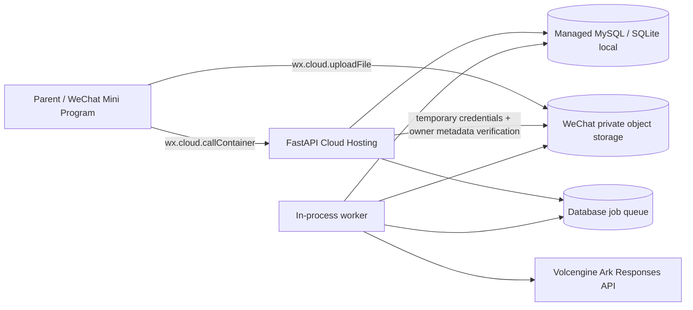
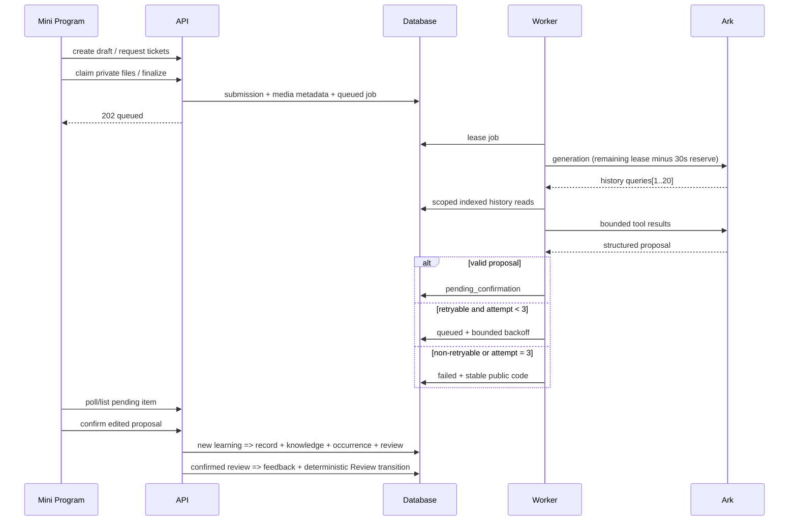
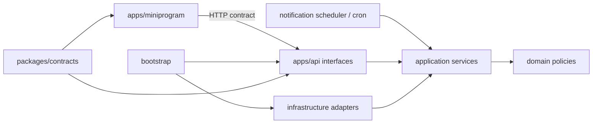

# Push Kids current architecture

- Status: `CURRENT / DAILY_TASK_BACKEND_030_DEPLOYED / FULL_PRODUCT_ACCEPTANCE_PENDING`
- 2026-10-16 projection fix: `BUG-SPEC-20261016-REVIEW-SUBJECT-ORDER-01` keeps daily-plan subject ordering through feedback in the existing PlanningService. No module, SQL, Schema, dependency or extension-point change; architecture revision stays unchanged. Frozen-container/MySQL gates passed; immutable GRAY031 is normal with 0% traffic, directed smoke/full switch pending, 030 retains 100%. Evidence: `docs/quality/evidence/REVIEW-SUBJECT-ORDER-20261016.md`, `docs/deploy/releases/20261016-review-subject-order-backend.md`.
- Local daily-task architecture: `ARCH-20261012-DAILY-TASKS-01`，用户2026-10-12批准 `SPEC-20261012-DAILY-TASKS-01`。
  daily_tasks拥有配置与上海日期完成事实，reporting/清理编排调用其服务；不影响planning、AI或复习预算。
  本地与生产迁移head=`20261012_0019`，新增两表及tenant-leading索引，数据存在时拒绝破坏性降级；2026-10-13生产迁移/check及030全量模式部署完成，隔离MySQL合同及真实小程序读取smoke通过。完整原生/真机与生产写路径验收待补，发布事实见docs/deploy/releases/20261013-fullstack-diff.md；模块/依赖不因本次发布改变。
- Revision: `ARCH-20261006-REVIEW-MANAGEMENT-01`
- Latest approval: user instruction “落地并实现”, 2026-10-06，批准 `SPEC-20261006-REVIEW-MANAGEMENT-03`。
  Planning拥有inventory只读分页、scheduling事务和plan_candidates有界候选；ReviewScheduleOverride为单次预约，
  ReviewScheduleChange为幂等审计；ChildrenService拥有清单revision失效。迁移head=`20261006_0016`。
  未来预览与今日物化共用选择规则；写事务按Child→Review锁序，资格/容量/计划刷新使用MySQL当前读。
  本地实现及隔离MySQL验证完成；未部署，原生界面验收待补。
- Previous approval: user instruction “落地这两个spec”, 2026-10-06，批准 `SPEC-20261006-SOURCE-DELETE-02`；
  规划域拥有单知识点删除，通知域通过 PlanningService 读取存活复习；无 schema migration。
- Confirmed by: user instruction “修复bug” approving `BUG-SPEC-20260919-MYSQL57-WORKER-01`, 2026-09-19
  (preserves `ARCH-ARK-CONTEXT-REUSE-20260919-01`, `ARCH-UNIFIED-REVIEW-20260913-02`,
  `ARCH-20260912-MYSQL57-01` and the MySQL 5.7 constraints)
- Scope: local adapters plus WeChat Cloud Hosting controlled staging

## Runtime context

Controlled staging is one Cloud Hosting instance with an in-process worker and durable MySQL job rows.
The Worker decision is referenced only as `ADR-001 / TD-001`. Local development retains SQLite and local
media through the same bounded infrastructure ports.

## Modules

| Module | Owns | Public boundary |
|---|---|---|
| `children` | children and subjects, child profile lifecycle | child/subject services and HTTP routes; `require_active_child` write gate |
| `learning` | submissions and confirmed learning records | submission lifecycle service |
| `knowledge` | normalized knowledge identity and occurrences | normalization policy |
| `planning` | versioned Review event projection, minute-bounded daily plans, Todo grouping and single-knowledge deletion | pure curve/heat policy + pure selection policy + application service; deletion.py owns atomic association cleanup |
| `activities` | schedules and practice records | activity service |
| `daily_tasks` | bounded parent configuration and Shanghai-day completion snapshots | daily task service + HTTP routes; child-locked writes and owned purge contract |
| `travel` | child-scoped recurring travel arrangements | travel service and HTTP routes; calendar projection contract |
| `reporting` | read models for dashboard/report/calendar | reporting service |
| `agent_processing` | provider contract, analysis jobs, retries, deterministic subject routing (`subject_routing.py`, pure) | analysis service and worker |
| `media` | validated local/cloud files, cloud ownership claim and temporary materialization | media store port |
| `notifications` | notification kinds and copy policy (`domain.py`, pure), member preferences, WeChat grants and quota, encrypted receiver, durable outbox with dedupe/lease/retry, planner and tick | notification service + HTTP routes + scheduler |
| `data_management` | durable child/family deletion requests, freeze/retry/tombstone lifecycle and cross-domain purge orchestration | deletion service + worker; each domain retains its own purge contract |
| `platform` | config, database, errors, request context, opaque scope-bound pagination cursors | infrastructure only |

Dependency direction is routers → services → pure policies. Infrastructure adapters implement contracts and may depend inward; pure policies do not depend outward.

Single-knowledge deletion enters through PlanningService and a narrow `planning/deletion.py` transaction.
It locks Child then scoped Review/Knowledge, removes associations with database-side set operations and
updates affected plan aggregates without filling empty slots. It retains shared Submission/Record/media.
Daily plan creation uses current locking reads after the child lock to avoid MySQL REPEATABLE READ
snapshots reinserting a concurrently deleted review. Notifications dispatch calls the family/child-bounded
PlanningService pending-load contract under the existing child locks before rendering/sending a digest.
Source projections validate stored evidence against the original submission's confirmed proposal;
learning never replaces old source evidence with an unrelated later submission's index. No migration,
generic deletion framework or planning → learning/agent dependency is introduced.

## Data and invariants

- Every business row includes `family_id`; all lookups enforce it. Cloud family scope comes from an active
  HMAC actor binding, never from the client's `X-Family-ID`.
- Timestamp columns use persistence-owned `UTCDateTime`: normalize aware input to UTC on bind, restore
  UTC on read on SQLite/MySQL. Existing naive timestamps retain the previous UTC interpretation; no schema
  migration or speculative correction of historical offsets is performed (`BUG-SPEC-20260905-05`).
- A submission becomes immutable evidence after confirmation; parent edits are captured in the confirmed record.
- A submission may own several `LearningRecord` rows, one per routed subject; `submission_id` is a plain
  index since `20260906_0004`. Subject identity always resolves against the child's configured catalogue
  through pure routing; model text never becomes a subject, and an unlisted name needs explicit parent consent.
- `KnowledgeItem` is unique per family, child, subject, normalized name and category. Repeated learning creates one `KnowledgeOccurrence` per knowledge per confirmation, preserving existing Review state.
- `ReviewFeedback` owns immutable confirmed events. `ReviewItem` is the O(1) current projection of step, next
  due date, last reviewed day, count, interval, heat, lapse, policy revision and state version. The pure
  `curve_heat_v1` policy updates both in one transaction; `defer` changes only an existing daily plan item.
- `DailyReviewPlan` is materialized once per family/child/local day from at most 120 indexed candidates and the
  child's minute budget. Selection is due date, then never/oldest reviewed, then ID; completing a plan item does
  not refill the day. The local session projection orders subjects by their first original plan ordinal,
  including feedback-terminal rows as anchors; only pending items enter a session, and empty sessions disappear.
  This feedback guarantee does not extend to deletion/rescheduling that changes the plan's retained row set.
  Unselected backlog rows keep their original due dates and receive no writes.
- `KnowledgeSearchTerm` is a deterministic, at-most-32-term index per knowledge item. The analysis Agent can call
  only the family/child-scoped history tool, at most 20 times/100 unique candidates/8 turns.
- Analysis input keeps two subject facts: configured subjects are active persisted learning subjects, while analysis
  subjects add the bounded system preset catalogue (`语文/数学/英语`). Schema and history-tool enums use the latter;
  learning confirmation remains the sole owner of consent and Subject creation.
- A model result is not successful unless its projected proposal contains a knowledge point or Todo match. Contracts
  return only static correction codes for empty output or model-authored runtime claims; Worker revalidates after its
  own proposal mutations before writing `pending_confirmation`.
- Cloud media is server-ticketed and claimed only after verifying uploader metadata, exact bucket/path,
  magic bytes, size and hash. Expired tickets and cancelled submissions are cleanup candidates.
- Public account-wide export/deletion remains deferred to FEAT-002; cancellation deletes its scoped media.
- A family may keep several child profiles; `children.active` is the profile lifecycle flag introduced by
  migration `20260906_0005`. `children` owns the whole rule set: at most five profiles in use, unique names
  among profiles in use, manager-only archive/restore, and the `require_active_child` gate that every new
  learning/subject/activity write passes through. Read paths keep using `get_child`, so archiving never
  removes rows or hides history. Archiving is not deletion. FEAT-006 separately provides manager-confirmed,
  durable physical child/family deletion with a freeze-before-purge lifecycle and domain-owned purge contracts.
  FEAT-007 adds `travel_arrangements` and create-idempotency rows in migration `20260906_0006`.
  `Database.expected_cloud_revision` tracks the single Alembic head; durable deletion extends that chain to
  `20260906_0007`, the notification channel to `20260906_0008`, and notification deletion ownership to
  `20260907_0009`; weekday-specific activity/travel time slots and bounded-read indexes extend it to
  `20260911_0010` and `20260911_0011`; durable batch-feedback replay and the unified Review projection,
  history-search index and daily-plan snapshot extend the head to `20260913_0012` and `20260913_0013`.
- Travel arrangements are independent from activities and project only into the Calendar query. The query
  normalizes CalendarEvent, ActivitySchedule and TravelArrangement time spans, then applies one pure half-open
  interval policy. Conflict metadata is derived at read time and marks every participant; it is never persisted.
- `activities/capacity.py` owns the cross-source Calendar admission budget: a child row lock serializes creates,
  then active CalendarEvent, timed ActivitySchedule and TravelArrangement rows are counted together against the
  approved limit of 20. Existing over-limit rows remain readable and deletion releases capacity.
- Notifications are best-effort and never claim a delivery they did not make. `notification_deliveries` is a
  durable outbox: a dedupe key owns at most one row, a pending row is refreshed in place, a row that no
  longer matches reality is cancelled, and every terminal row carries a result code. Receiver identity
  (WeChat OpenID) is stored AES-GCM encrypted with a key version, never in plaintext, never indexed and
  never logged. Business time (19:00 Asia/Shanghai, one hour before a schedule) is computed server-side and
  stored as a UTC instant. Membership is authoritative twice: when the audience is resolved and again
  immediately before sending, so a departed member cannot receive a family's child names. Child-bearing
  deliveries also own normalized `notification_delivery_children` links. Planner/outbox/dispatch lock and
  re-check active/deleting family and child state, so a deletion accepted after its freeze cannot be followed
  by a newly queued or externally sent notification. Child purge removes every delivery that references the
  child (including a multi-child digest); family purge removes all notification-owned rows. Introduced by
  migrations `20260906_0008` and `20260907_0009`.

## Async analysis sequence

### Current local staged pipeline (BUG-028; release gate still open)

The production provider factory now selects `StagedArkProvider`; the cloud deployment has not been
changed. `pipeline.py` owns fixed extraction → consolidation → scoped history search → alias matching
stages. Each original image is extracted independently with at most two concurrent requests per job
and process; exact duplicate image bytes retain the first original index. At most two adjacent-page
groups (up to three images each) resolve incomplete context, with explicit source coverage. Every
extracted candidate must occur exactly once in consolidation; the final output is capped at 20 items.
The server resolves model aliases to canonical identities and assembles evidence. Models never copy
database IDs or select tenant scope. Uncertain matching and missing material cannot publish partial drafts.

`stage_contracts.py` owns bounded strict DTOs and instructions; `stage_provider.py` owns stateless
`store=false`, explicit disabled thinking, stage output budgets, safe errors and whole-request async
deadlines. Extraction requests have 45 seconds, consolidation/matching 30 seconds, within the persisted
five-minute lease minus the 30-second writeback reserve. Successful independent extraction stages survive
another stage's failure. `runner.py` retains the 20-query/100-result scope and completion ledger.

`checkpoints.py` owns validated temporary DTOs in additive migration `20261006_0015_analysis_stages`:
14 rows/job, 64 KiB/row, 512 KiB/job, 24-hour TTL, revision/input/model/history fingerprints. Only successful
stage DTOs are stored; job state and safe telemetry represent failures/in-flight work. Images, raw provider
responses and secrets are never checkpointed. Success, cancellation, manual confirmation and child/family
purge delete the rows. Indexed expiry cleanup deletes at most 100 rows per sweep. `stage_io.py` keeps
blocking DB work outside the event loop with four process slots and deadline-aware completion; a timed-out
thread cannot make the caller wait during executor shutdown. Checkpoint commits recheck scope/lease/deadline.

Confirmation, checkpoints and final writeback lock Family → Child → Job → Submission, then Reviews;
writeback checks unexpired lease, attempt, state and deletion freeze. Claim order remains
`available_at, created_at, id`. The legacy provider below is retained only for controlled evaluation and
existing regression tests; its context-cache switch does not configure the new provider. Rollout must
drain old consumers before enabling new workers. No production migration or deployment is authorized here.

### Legacy provider used by comparison tests

`agent_processing/context.py` owns bounded initial input assembly and material fingerprints; `prompt.py` owns
deployment-versioned extraction rules. The personal Skill filesystem is not a runtime dependency. The initial
input contains the child profile, this material, same-day confirmed knowledge and the full materialized plan,
but no historical knowledge list. `runner.py` owns the eight-turn loop, 20-logical-query/100-unique-result budgets
and one deadline supplied from the durable Job lease; the eighth turn is final-only. `worker.py` derives that
deadline after media/context work from `lease_until - now - 30 seconds`, while `providers.py` disables SDK retries
and owns the default-on, attempt-local Ark Responses session chain. The first response is stored for at most ten
minutes; later turns send only new tool/correction input with `previous_response_id`, and terminal cleanup is
best-effort. `ARK_CONTEXT_CACHE_ENABLED=false` restores the stateless `store=false` full-resend path. This switch
does not control Ark's automatic implicit prefix cache, never enables the explicit `caching` field, and therefore
keeps strict JSON Schema on every generation. Response IDs stay only in the Provider invocation and never enter
the database or logs. The Provider also exposes one strict
`queries[1..20]` batch tool call while `history_search.py` owns each deterministic, scoped logical retrieval. The
tool contract freezes each final candidate name and subject before search. Runner owns the trusted completion ledger
and passes a final-validator callback into the Provider loop; `history_search.incomplete` therefore receives static
same-loop correction and can trigger an exact-name re-query before the Job attempt fails. Runner repeats the check
after Provider return as a compatibility/security fallback.
The same Provider loop owns correction for `proposal.actionable_items` and `uncertainty.runtime_claim`; exhaustion
then follows the existing retryable `analysis_output_invalid` Job policy rather than persisting an empty draft.
`telemetry.py` accepts only Job/attempt, bounded counters, safe statuses and normalized static validation categories;
it cannot log child content, subjects, keywords, media paths or provider payloads. Model references are validated in contracts; learning owns final identity validation,
occurrence deduplication and Review settlement in one transaction. Planning never depends on agent processing,
so the graph remains acyclic.
The legacy provider is invoked inside the same current lifecycle guards described above. Manual confirmation
cancels unfinished jobs; both late success and late failure are discarded.
Material fingerprints are server-owned proposal JSON metadata, preserved at confirmation and never logged. Job-only
diagnostics persist a bounded public code/static reason/normalized validation-code tuple; Submission/API retain the
generic parent-facing message.

## Decisions and trade-offs

`BUG-SPEC-20260905-03` adds recovery inside the existing process topology: Worker owns its health
state and bounded 1–30 second backoff; bootstrap retains the background Task and maps unavailable
workers to readiness 503. Healthy iteration resets backoff. Cleanup runs behind a separate exception
boundary at the existing 60 second cadence. Claimed-task preparation and provider failures use bounded
job retries; database failures close the session and preserve durable state for the existing five-minute
lease recovery. Stop wakes idle/backoff waits; an already running synchronous provider thread cannot be
forcibly stopped. Logs contain event/type/count/IDs only. This local fault-tolerance change does not
change the Worker decision in `ADR-001 / TD-001`.

`BUG-SPEC-20260919-AGENT-RETRY-02` keeps the same durable Job state machine and five-minute lease. It aligns the
8-turn loop with the existing 20-candidate contract through batched logical history queries, reserves the final
turn, and derives the full Agent deadline from the current persisted lease with a 30-second guarded-writeback reserve.
Provider SDK retries are disabled; invalid tool arguments are schema-checked before any query and corrected inside
the remaining Agent loop. Failure disposition is explicit: output/reference/budget and
transient dependency failures may requeue until attempt three, while schema capability and deterministic input or
configuration invariants stop immediately. SQL commit uncertainty still waits for lease recovery. Safe per-turn
telemetry is a narrow `agent_processing` contract rather than a second persistence or retry subsystem.

`BUG-SPEC-20260922-ANALYSIS-CORRECTION-02` keeps the same state machine and budgets but moves final history-ledger
validation to its correct owner boundary: Runner supplies the trusted validator, while Provider owns the remaining
generation/tool turns and static correction message. Prompt and tool description define the exact candidate-name
protocol; Runner's post-return validation remains the closed safety fallback. Worker ready-time ordering prevents an
older requeued Job from winning solely by creation age, and bounded Job diagnostics no longer depend on cloud log
retention. No API, Schema, family boundary, confirmation transaction or model grading authority changes.

`BUG-SPEC-20260923-EMPTY-PROPOSAL-QUALITY-01` separates the persisted subject catalogue from the bounded model
analysis catalogue, adds a projected-proposal non-empty invariant and prevents model prose from impersonating
runtime diagnostics. A learning-owned, row-locked repair transition can move only explicitly targeted legacy empty
pending proposals to the existing failed/retry state while retaining proposal/media. It defaults to dry-run and
requires family plus Submission IDs for apply; no schema, public API, UI state or confirmation transaction changes.

`SPEC-20260919-ARK-CONTEXT-REUSE-01` adds only a bounded transport policy inside the existing Ark Provider.
The Provider, rather than Worker/Runner/domain code, owns `store`, `previous_response_id`, expiry and deletion.
The default session mode minimizes repeated multi-turn input; the configuration rollback mode retains the prior
stateless protocol. Explicit Ark caching remains deferred because its current contract conflicts with strict
`json_schema`; cross-Job or cross-family response chains remain closed.

`BUG-SPEC-20260905-04` keeps subject classification in existing service boundaries: learning confirmation
requires server-resolved `Subject.kind=learning`; planning, Worker Todo candidates and review reporting
exclude historical activity reviews. Activity records/schedules remain owned by activities. No new
shared abstraction, dependency direction, schema migration or historical deletion is introduced.

| Decision | Choice | Trade-off / revisit trigger |
|---|---|---|
| Database | WeChat Cloud Hosting CynosDB MySQL 5.7 (InnoDB/`utf8mb4`); SQLite local/test; Alembic owns cloud schema | Shared SQL must run on MySQL 5.7; keep both dialects in the test matrix. See Database support matrix. |
| Job execution | durable rows + locked lease + in-process worker at one instance | Decision: `ADR-001 / TD-001`. |
| AI provider | Ark-compatible provider port plus test-only deterministic adapter | Add a provider only through contract tests; no provider logic in domain code. |
| Review event projection and daily plan | immutable event + rebuildable projection; one minute-bounded plan snapshot/day | See `decisions/ADR-REVIEW-EVENT-PROJECTION-AND-DAILY-PLAN.md`; changing ordering or policy needs a Spec revision. |
| Historical AI matching | deterministic term index + bounded scoped tool loop | No full-history Prompt, arbitrary SQL, model-controlled tenant or unbounded search. |
| Authentication | Cloud gateway actor → HMAC binding → family; `X-Family-ID` local only | Public ingress stays disabled; FEAT-002 owns collaboration/revocation UX. |
| Media | `wx.cloud.uploadFile` + ticket/claim cloud; local adapter for dev | Owner-only rules and orphan cleanup are operational requirements. |
| Mini program | native WXML/WXSS/JS | Revisit only if cross-platform delivery becomes an approved requirement. |
| Charts | native/CSS summary bars | Add a chart dependency only when comparative density justifies bundle cost. |

## Extension registry

| Axis | Status | Mechanism | Required evidence |
|---|---|---|---|
| AI provider | open | `AnalysisProvider` contract | test adapter + provider contract tests |
| Media store | open | `MediaStore` contract | validation and path isolation tests |
| Review date policy | closed in MVP | `curve_heat_v1` pure function | version vectors, event/projection and migration tests |
| Daily selection ordering | open, bounded | `daily-plan-v1` pure selection function | deterministic/budget/oldest-first and 10k SQL evidence |
| History search provider | closed | indexed `search_history_items` contract | tenant, subject, term/result/tool-budget contract tests |
| Auth provider | closed for staging | Cloud Hosting gateway + HMAC binding | real two-account and forged/public-entry tests |
| Notification channel | deferred | none | explicit product requirement |

## Module boundaries, positioning, and dependencies

`apps/miniprogram` is the native WeChat interface deployment unit. `apps/api` is a
modular FastAPI application whose domain/application/infrastructure/interface
boundaries are expressed inside `push_kids`; `packages/contracts` owns stable
cross-runtime schemas only. Business capabilities own their tables and services.
Routers and mini-program pages are interfaces, not owners of business rules.

## Dependency graph

Permitted dependency direction is interfaces/infrastructure → application →
domain, with bootstrap composing all layers. Capability-to-capability access uses
services/contracts rather than another module's persistence internals. Circular dependency detection
runs through `tools/check_architecture.py` and import-focused
tests; indirect and test-only cycles are forbidden.

## File and component decomposition

- Routers map transport input/output and call one application use case.
- Services own use-case orchestration and transaction boundaries.
- Domain files own pure entities, policies, state transitions, and invariants.
- Repositories/providers/media stores own database, network, and file side effects.
- Mini-program pages own presentation and transient form state; `utils/api.js`
  remains the single network boundary.
- Split a file when it mixes transport, persistence, domain policy, or unrelated
  lifecycle ownership; do not split cohesive policy only to reduce line count.

## Shared code and abstraction map

| Concept | Owner | Consumers | Contract |
|---|---|---|---|
| API schemas | owning capability / `packages/contracts` when cross-runtime | API and mini program | versioned request/response fixtures and contract tests |
| Analysis provider | `agent_processing` | worker | `AnalysisProvider` plus provider contract tests |
| Media store | `media` | learning submission flow | `MediaStore` plus validation/path-isolation tests |
| Review scheduling | `planning/policies.py` | learning confirmation and feedback | pure deterministic curve/heat policy; model never writes dates |
| Daily review selection | `planning/selection.py` | planning service → analysis context/reporting | pure versioned minute-budget ordering; no SQL, FastAPI or AI |
| Analysis history search | `agent_processing/history_search.py` | bounded Agent runner only | indexed family/child/subject query; no model-controlled tenant/SQL/limit |
| Child profile lifecycle | `children` | learning, activities, families, routers | `require_active_child` / `list_children(include_archived)`; archived profiles resolve for reads only |
| Travel calendar projection | `travel` | activities calendar query | normalized active arrangements for one family/child/day; no Today, Todo, report or practice consumer |
| Mini Program child context | `apps/miniprogram/utils/child-context.js` | today / calendar / records / reports / settings / activity edit | decorate, resolve-with-fallback, global selection sync, profile-limit hint; presentation only, no business rules |
| Bounded read cursor | `platform.pagination` | planning, learning, activities | opaque versioned payload, signed against route scope/filter/snapshot; authorization is re-evaluated on every page |

No global `common`, `utils`, or service locator may own business semantics. A new
shared abstraction requires at least a stable semantic contract, an owner,
compatible consumers, acyclic dependencies, and contract tests.

## Bounded read architecture

`BUG-SPEC-20260911-PERF-01` implements `ARC-014`. Every growing collection has a stable server order, a hard
maximum page/range bound and explicit continuation or omission metadata. Todo uses a scope- and day-bound snapshot
cursor so concurrent inserts or updates cannot duplicate or leak into an older traversal. Activity and submission
compatibility arrays expose continuation headers while preserving their top-level JSON shape. Report, calendar and
daily-summary counts are computed by bounded SQL aggregation; report activity subjects come from the same range as
headline totals, eliminating the raw-record request waterfall. Submission pages bulk-load their related facts in a
constant query budget.

Migration `20260911_0011` adds family/child/filter/order composite indexes for Review, learning history,
submissions, knowledge occurrences and activities. SQLite 50k-history plans/timings and fresh MySQL 8 `EXPLAIN`
checks are blocking automated evidence. Leading-wildcard substring search intentionally remains scan-based within
its explicit 50k-row budget and 200k-row/p95 revisit trigger. Request middleware emits only route-template slow or
large-response metadata; concrete IDs, query text, cursors and child content are excluded. Production index-build
lock duration and staged slow/large-route signals remain deployment gates, not local implementation claims.

`SPEC-UNIFIED-REVIEW-20260913-02` adds one exact due aggregate, one `(due_date,
last_reviewed_on,id)` ordered candidate read capped at 120 and finite writes only for the minute-bounded plan.
Subsequent reads use the plan/item indexes; unselected backlog receives zero writes. Historical matching queries
the deterministic term index with a per-call 20-row limit. The legacy paginated full-due contract remains
available during the UI compatibility window. SQLite 10k evidence keeps the dashboard at 16 queries and under
existing response/time/memory budgets; MySQL 5.7 mutation and EXPLAIN evidence remains a deployment gate.

## Database support matrix

`BUG-SPEC-20260912-MYSQL57-01 / ARCH-20260912-MYSQL57-01` pins the supported database runtimes after a
production read outage: BUG-018 combined bounded page rows and full-set aggregates with SQL window functions
(`OVER (...)`), which SQLite and MySQL 8 accept but the production engine — MySQL 5.7 — rejects, so Today,
Todo and Report failed for real families. `ARC-015` now enforces this matrix.

| Environment | Engine | Version floor | Storage / encoding | Schema authority |
|---|---|---|---|---|
| Production / staging | WeChat Cloud Hosting CynosDB MySQL | `5.7.18-cynos-2.1.14-log`, within the 5.7 series | InnoDB, `utf8mb4` connection/schema semantics | one Alembic head; cloud startup verifies it and never auto-creates production tables |
| Local / test | SQLite | file-backed dev database | n/a | local bootstrap self-heals dev schema; tests seed fixtures |

- **Capability floor.** Shared SQL owned by services must execute on MySQL 5.7.18. Window functions, CTEs
  (`WITH ... AS`), functional indexes, enforced `CHECK` constraints and other MySQL-8-only behavior are
  forbidden in runtime queries until an independently approved migration Spec raises the production baseline.
- **Bounded read shape on 5.7.** Todo/dashboard exact totals come from a `COUNT`, required/optional split from
  a budget-capped ordering prefix (`daily_budget_minutes` ≤ 120 ⇒ at most 121 rows), the page from an anchored
  `LIMIT limit+1`, and cursor-page position from one aggregate through the anchor — no window projection. Report
  subject/activity totals come from an aggregate over a grouped subquery plus one ordered detail `LIMIT 50`,
  replacing `COUNT() OVER()` / `SUM() OVER()` without materializing raw history.
- **Evidence rule.** Every release that changes SQL must execute the affected paths on a real MySQL 5.7 server
  (`tests/integration/test_mysql_runtime.py`); SQLite compilation and MySQL 8 `EXPLAIN` cannot substitute.
- **Worker claim shape on 5.7.** The controlled cloud topology remains one service instance. Analysis jobs,
  expired-media cleanup, notification delivery and durable deletion use ordered, bounded `SELECT ... FOR UPDATE`
  claims in their owning transactions. MySQL-8-only `SKIP LOCKED` is forbidden on the 5.7 floor; non-blocking
  multi-instance claim throughput remains deferred until a separately approved queue/topology revision.

## Architecture rationale and trade-offs

The monorepo keeps the independently packaged mini program and API in one repository while preserving
deployable-unit boundaries. The API remains a modular monolith. Cloud persistence is MySQL plus private
object storage; SQLite/local media exist only as local adapters. The staging identity boundary and owner-metadata
behavior passed operator-confirmed two-account Cloud Hosting acceptance on 2026-09-06, including metaid decoding
and public-ingress rejection. Public family collaboration, data rights and privacy release gates remain in FEAT-002.

## Extensibility policy and architecture confirmation

Variation axes are deliberately classified in the Extension point registry.
Open points use narrow ports owned by the affected capability. Closed points need
a new approved Spec/ADR. Deferred points must not acquire speculative factories or
plugin registries. The active local baseline is `ARCH-20260906-TRAVEL-01`, approved on 2026-09-06.
Its identity/storage acceptance points for two-account ownership, metaid decoding and public-ingress rejection
passed controlled staging on 2026-09-06. Remaining staging and release gates are recorded in
`CLOUD-SPEC-20260903-03`, plus the FEAT-007 native viewport/device evidence in `SPEC-20260906-TRAVEL-02`.

## Extension point registry

| Point | Status | Registration/discovery | Compatibility and isolation | Security/observability/tests | Removal rule |
|---|---|---|---|---|---|
| Analysis provider | open | bootstrap selects one configured adapter | provider contract; timeouts and bounded payloads | secret redaction, job metrics, test-adapter/provider contract tests | remove adapter after config and consumers are gone |
| Media store | open | bootstrap injects local or WeChat adapter | ticket/claim/private-object contract; validated owner/path/size/type | no public child media, safe errors, adapter + real storage tests | remove local adapter only after local-dev replacement |
| Review policy | closed | direct versioned policy call | migration required for policy change | deterministic unit tests | supersede only through approved policy revision |
| Auth provider | closed for staging | platform context resolves Cloud Hosting actor binding | public ingress disabled; raw OpenID never persisted | two-account, forged/public and cross-family tests | revise for non-WeChat clients or FEAT-002 collaboration |

## Pre-coding architecture confirmation

Before production coding changes modules, shared abstractions, dependency direction,
database/storage/job topology, or an extension status, the active Spec must record
the recommended design, alternatives, trade-offs, dependency DAG, file changes,
test points, architecture revision, and explicit owner confirmation. Public release
remains blocked until family permissions and the privacy/deletion flows are implemented and tested; the real
Cloud Hosting actor/owner/metaid/public-ingress gate passed controlled staging on 2026-09-06. The full cloud
runbook is `docs/operations/WECHAT-CLOUD-HOSTING.md`.

## History and source review — local implementation

`SPEC-HISTORY-20260905-01 / ARCH-HISTORY-20260905-01` adds read projections without new tables or page routes.
The reporting service aggregates `learning.history.LearningHistory` and PlanningService read contracts;
learning/planning never import reporting. Routers only validate transport/identity and delegate.
Original media reads validate the complete ownership chain before touching storage. Local responses require
identity on each download; cloud responses use the existing COS client to sign a GET for one object, including
the temporary security token, for at most 60 seconds. A removed member cannot obtain another capability;
already issued capabilities can remain usable until expiry. The bucket remains private.
Preview signing is capped per active member (local family fallback) at 30/minute, 1024 active windows,
within the existing single-process staging boundary. Distributed limits and real cloud cross-account access
remain release gates. Search text uses an encoded header to keep child content out of URL access logs.
Read projections do not invoke AI or mutate deterministic planning state. Static imports across all 53 Python
source modules were checked without a cycle; the repository policy checker also passed.

## Multi-child profile lifecycle — local implementation

`SPEC-20260906-MULTI-CHILD-01` adds a profile lifecycle without new modules or a new dependency direction.
`children` stays the single owner of capacity, naming, archive/restore and the write gate; `learning` and
`activities` call `ChildrenService.require_active_child` instead of implementing their own archived check.
`families` depends on `children` for creating the first profile and for listing profiles in use, and
`children` never depends back on `families`, so the graph stays acyclic. Archive/restore audit rows are
written straight to the shared `FamilyAuditEvent` persistence model rather than through the families
service, which avoids a reverse edge for one log row; the local `X-Family-ID` path has no actor binding and
is therefore left unattributed instead of logged against a fabricated actor. The migration is additive
(`active` column plus index) and reversible, and the local SQLite bootstrap self-heals an existing
development database. The Mini Program keeps its business rules on the server: `utils/child-context.js`
owns only child decoration, selection resolution with fallback and the global selection sync.

## Frontend design evidence architecture

`GOV-SPEC-LOCAL-DESIGN-EVIDENCE-20260913-01` replaces the former Figma-dependent gate. A Design Revision now
uses a repository-local editable SVG or self-contained HTML source, exact viewport/state PNG exports, and an
immutable SHA-256 approval manifest bound to the approved Task Spec revision. Figma files and waiver records
created before this revision remain historical evidence only and are not current implementation or release
dependencies. Repository previews prove the approved visible contract; WeChat DevTools and representative
iOS/Android runs remain authoritative for native geometry, interaction and device behavior.
