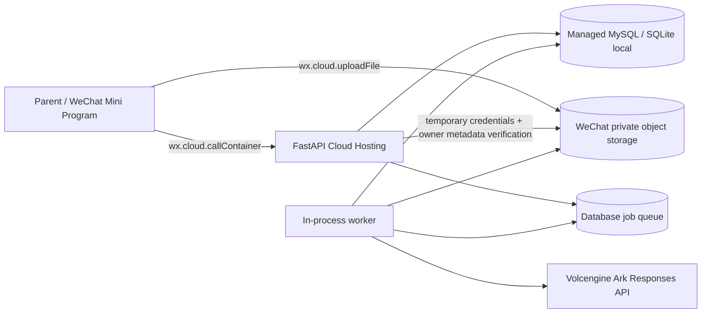
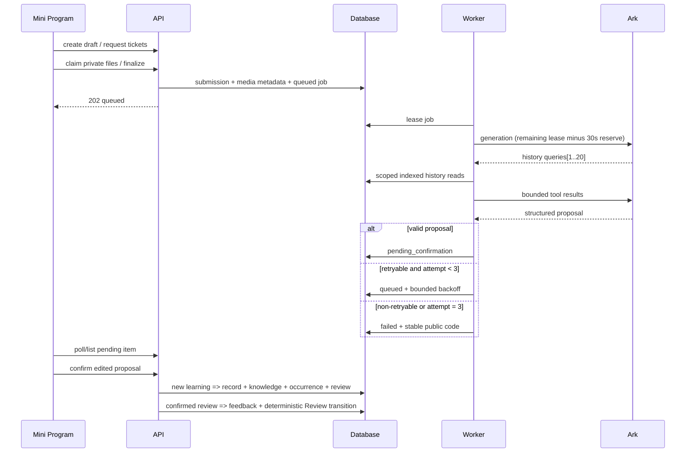
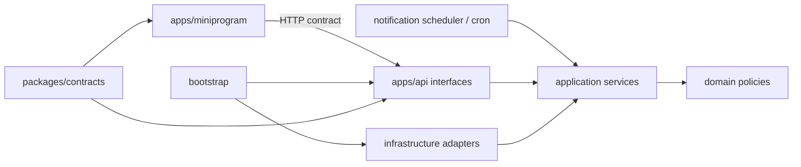

# Push Kids current architecture

当前本地前端架构`ARCH-20261106-MINIAPP-THEMES-01`随[DESIGN-002 Spec08](../../specs/active/DESIGN-002-GLOBAL-UI-CONSISTENCY.md)获用户“好的 按照以上方案落地”批准并实施。`presentation/theme/registry`拥有六主题完整语义角色、稳定ID、本地资产/默认glyph及平台chrome；`state`独占本机偏好和订阅；`adapters`显式组合17页及共享组件生命周期，只更新theme字段并清理订阅。依赖为App/设置/页面/组件→adapters或state→registry，不反向引用业务/API，不全局替换Page/Component。`theme-icon`消费单份生成glyph和registry色，`theme-picker`只持有候选；页头小JPEG离线复用。注册是有界编译期open点，新增仍需完整schema/资源/存储兼容/六主题检查及Spec/DREV批准；在线主题和账号同步deferred。既有领域与服务端依赖、Schema、权限、API、排期closed于此变更；[验证及未交付边界](../quality/evidence/themes-20261106/README.md)不冒充云端状态。

当前辅助验收架构`ARCH-20261105-SYSTEM-ONE-06`按[Spec06](../../specs/completed/BUG-036-SYSTEM-ONE-ACCEPTANCE.md)获批实现，已由040云交付。启闭均保持原Pro生成/历史检索及100历史项合同；`proposal_acceptance`只拥有固定产物检查、静态提示及降级DTO，`system_one_provider`只负责受信Ark专用接口，`decision_contracts`只保留答案校验及旧覆盖版本兼容常量。`request_limits`继续供两个Provider共用2槽。Worker在无DB事务时验收，随后按原锁序重核scope/lease/attempt/状态，原子写回原产物和内部验收元数据。分类/最近40/关系与修复编排已删除；0027迁移链和旧覆盖确认兼容保留，不是新验收依赖。[当前EVD](../../specs/evidence/EVD-20261105-BUG036-SYSTEMONE06.md)分别绑定本地测试、真实同期生成和家长内容review。

当前工作日架构`ARCH-20261105-WORKDAY-02`已随[Spec02](../../specs/completed/FEAT-001-CHINA-WORKDAY-SCHEDULES.md)获用户“完成这个方案的落地”批准。activities拥有纯`workday.py`和唯一有效日期/时段判定；离线精确依赖`chinesecalendar==1.11.0`，不联网、不引入通用recurrence抽象。CalendarEvent与ActivitySchedule加法字段`workday_only`；现有星期slots保持，工作日不写slots。reporting/notifications通过ActivitiesService消费投影与occurrence，依赖方向不反转。覆盖外跳过并返回静态warning/安全日志码；警告读取最多两次family/child限定的`limit(1)`查询，既有安排容量上限保持。迁移`20261105_0026`接`20261024_0025`，本地升级及旧数据兼容通过；生产已在本次受控窗口升级0027，040/0.1.18交付。架构检查5 policies/152 modules通过；原本地SQLite Alembic check的四索引漂移FAIL仍保留；本次生产MySQL current/check/strict schema及隔离MySQL新库/0025→0027均PASS，不把历史SQLite结论改标。[证据与限制](../quality/evidence/china-workday-20261105/README.md)。

当前生成架构`ARCH-20261101-KNOWLEDGE-SUCCESS-04`经2026-11-05用户明确批准[Spec04/Prompt06](../../specs/completed/BUG-036-FIXED40-SUCCESS-REPAIR.md)，实现13/16。pipeline将无法构组的单份未解来源交给原merge/correction/review，审查后空items不可自动重试；stage_contracts仍是技能/对象边界的唯一规则owner。原来源SHA/证据/局部纠正/历史、缓存02、事务及预算保持。无模块、共享抽象、依赖方向、扩展点、API、Schema或前端变化。[本轮EVD](../../specs/evidence/EVD-20261105-BUG036-SUCCESS04.md)绑定实际源码和测试；040已覆盖本增量，Spec开发DONE，内容验收独立。

历史10/13候选灰度发布范围：039基线＋批准10文件冻结为154payload的10/13候选，
[OPS发布Spec01](../../specs/active/OPS-20261101-BUG036-CACHE02-DEPLOYMENT.md)已明确批准；运行Schema/配置只读核验和工具维护通过。
固定40case质量34/40FAIL后BLOCKED，未创建新实例/云版本，当时生产039/100%及Schema0025保持；当前040/0027来自独立全栈OPS，旧候选发布状态仍BLOCKED。
同数据库Worker不受HTTP0%控制，质量门禁失败时未让新实例消费生产任务。[停止记录](../deploy/releases/20261101-knowledge-cache-gray-blocked.md)保留边界；当时活动12/15不在该10/13候选。

历史本地内容基线revision `ARCH-20261101-KNOWLEDGE-CONTENT-03`由[BUG-036内容Spec03 / Prompt05](../../specs/completed/BUG-036-SOURCE-GROUNDED-CONTENT-REPAIR.md)明确批准，代码为12/15。原图/原文字进入合并、纠正与完整提案复审；stage_contracts拥有正式证据目录、置信度和逐素材账本，pipeline验证来源、别名、64KiB及授权纠正范围，再从已审查证据装配和核验历史。item素材归属只用正式证据，omission沿候选lineage；运输字节用HTTPX request hook计已序列化body长度。Provider接口/调用预算、模块/依赖、公开API、Schema、Worker/retry事务不变，缓存02政策保持。[12 EVD](../../specs/evidence/EVD-20261101-BUG036-CONTENT03-ACCEPTANCE.md)166专项/896全量PASS、52条件skip、全库lint/format、mypy及架构4/151PASS；两项发现已修复、第二轮0新确认问题。完整原30严格9PASS＋1正确拒绝、补充0/3、边界7/10，内容FAIL；资源及51/61表审计PARTIAL。原图可见和确定性账本未证明模型语义可靠；该合同现由040继承交付，原内容FAIL保持。

缓存Architecture02交付核验：2026-11-01用户请求更新已部署状态后，官方version/service查询仍返回最新039 normal、PUBLIC关闭；039冻结包为staged06，与本地10/13五份源不同。[最终验收](../quality/evidence/BUG036-CACHE02-FINAL-ACCEPTANCE-20261101.md)记部署NOT_VERIFIED、保持Spec active/VERIFYING。本轮无模块/依赖/Schema变更或新部署，既有机制证据不充作云交付。

保留的缓存恢复revision `ARCH-20261101-KNOWLEDGE-CACHE-02`获[BUG-036缓存Spec02](../../specs/completed/BUG-036-CHECKPOINT-RETRY-STRATEGY.md)批准，原独立实现与验证对象为`staged-20261101-10`/prompt13；当前13/16继承该政策。Pipeline分类最终否决缓存读写，review0中间否决可恢复；Worker终态失败与Learning明确retry在原守护事务内调用checkpoints的固定语义unit删除合同，保留有效extract/group。明确retry锁family→child→job→submission并重查状态，删除/重置共同回滚。原116专项、857全量/52条件skip、独占MySQL5.7迁移/Schema/8专项及架构4/151通过保留原版本；本轮不冒称重新执行MySQL。继承实现已匹配040云交付，未手动清理生产旧缓存，真实内容失败保留；[缓存EVD](../../specs/evidence/EVD-20261101-BUG036-CACHE02.md)绑定其历史对象。

2026-11-01旅行交付revision `ARCH-RELEASE-20261101-0.1.17-UPLOAD-01`：039 normal/100%/1、PUBLIC关闭、Schema0025不变；168份冻结客户端0.1.17官方上传1,191,019字节并bump。用户本轮确认正向focus/前后分页与双家庭非owner门禁PASS_OPERATOR_CONFIRMED，微信健康与三尺寸42组原生/局部动作保持自动证据。三项旅行Spec开发DONE归档；模块/依赖/扩展点沿用获批BUG-035，不因发布再改代码。BUG-036生成/缓存及BUG-037并行页脚不混入，设备/内容验收与平台体验/审核/正式发布未完成。[当前上传](../deploy/releases/20261101-client-0.1.17-upload.md)绑定实际包和阶段。

2026-10-31内容验证基线`ARCH-20261031-KNOWLEDGE-GENERATION-01`由[BUG-036 Spec01/Prompt04](../../specs/completed/BUG-036-KNOWLEDGE-GENERATION-FINAL-PROPOSAL.md)批准。`stage_contracts`拥有共同质量规则、省略/复用DTO；`pipeline`拥有完整成员账本、同alias纠正、历史核验与装配；`stage_provider`拥有绝对排队deadline及获取槽后的45/30秒执行预算；`checkpoints`是临时DTO唯一持久化owner。失败白名单诊断经`failures/telemetry/worker`保留。内部verified-new键防止同名装配推翻经审查的明确新目标，公共Schema不变。该轮`staged09`/prompt13的教学证据、范围覆盖、审查义务保持于10/13，恢复政策由当前Architecture02取代。18/33调用、18cache键、20查询/100历史/512KiB输入保持；[09基线EVD](../../specs/evidence/EVD-20261031-BUG036-PROMPT09.md)832/46、架构4/151。真实素材26/30产出、内容12/30/完整10/30仍FAIL；原6PASS中18/25回退，exact-expiry分类PARTIAL，60/61表指纹一致的通知历史差异保留。该本地内容增量未部署。

此前Spec03的staged06/prompt10质量Review、一次有界纠正及历史语义等价由不可变后端038交付normal；PUBLIC关闭、Schema0025。前轮控制平面曾观察038流量100%，本BUG-036没有切流或定向业务smoke，历史包不覆盖07/08/09。历史发布事实见[038记录](../deploy/releases/20261031-knowledge-prompt-backend.md)，不与本地生成验收混记。

2026-10-26开发归档（历史；旅行三项2026-11-01交付见本页当前正文）：已交付037后端/0.1.16客户端所覆盖的需求按用户批准规则标记开发DONE，验收缺项独立保留；后续BUG-035和旅行导入精简尚未交付，继续active。当前归档和待验入口见[Spec状态清单](../../specs/STATUS.md)，依据为[治理Spec](../../specs/completed/GOV-002-CLOUD-DELIVERY-DEVELOPMENT-COMPLETION.md)。本轮不改产品合同、测试结论、设计或发布阶段。

当前导入架构`ARCH-20261025-TRAVEL-IMPORT-SIMPLIFICATION-01`随获批Spec01/DREV02已由0.1.17交付：imports直接系统相册/取消无业务写/选中仅既有imports，不写preferences；AI仅settings保存。controller拥有操作上下文/显示读取代次和相册返回预览恢复，WXML映射选择忙态/实际进度/可重试错误；旧consent/handler/样式已删，无模块/共享/依赖/扩展点变化，策略closed。原349项/DAG150/15组原生证据保留，设备/内容独立开放，[原实施](../quality/evidence/travel-import-simplification-20261025/README.md)不冒称本轮重跑。

BUG-035 gallery可选读参数/返回字段于2026-10-25获批实施，已由039/0.1.17两端交付；旧037/0.1.16仅覆盖此前范围。模块/依赖/Schema不再变化，体验/审核/正式发布未推进，[原本地验证](../deploy/releases/20261025-travel-diary-e2e-local.md)与当前上传分开。

2026-10-25 `ARCH-20261025-TRAVEL-DIARY-E2E-01` / BUG-035 Spec01 / DREV01获用户明确批准并实施。既有footprints/controller区分显示读取sequence与family/child/member操作上下文，imports拥有稳定批次/核对保选/部分确认，photos拥有编辑续接/选点/焦点画廊；records仍仅协调公开离开保护，Page和embedded共享实现，无新shared抽象或扩展点。读取和临时预览hide失效，正常系统返回保留操作，实际身份切换/卸载废弃操作；设置保存中提前show的收尾补载由imports既有owner完成。后端router新增可选focus_photo_id，reads校验租户/孩子/到访/confirmed后按既有id范围有界定位；返回previous_cursor，旧forward cursor兼容。每页≤50，limit+1与常数边界探测；MySQL使用既有ix_footprint_photo_gallery的专用hint，SQLite不受影响，无DDL。最终真实MySQL5.7两种五万分布/焦点40000前后窗实际计划和预算通过，DAG150无环。新前端focus未来需后端先发布；037未含本轮实现。[当前证据](../quality/evidence/travel-diary-e2e-20261025/README.md)区分本地、原生隔离、已验证真实云草稿与尚未验证的新focus云端/正式确认/设备。

2026-10-24 BUG-034，ARCH-20261024-FOOTPRINTS-CONTROLS-TIMELINE-01已获用户明确批准：现有footprints/presentation拥有确认当地时刻HH:mm/未知的显示映射，controller仅在初次/续页映射标签，不排序或改cursor；模板/样式复用学习btn/seg，Page和embedded共享owner。领域、API/SQL、模块边界、依赖方向、扩展点不变，无新全局抽象；[本轮证据](../quality/evidence/footprints-timeline-20261024/README.md)记录335项和当前原生范围，DAG150通过。

- Approved local title contract `ARCH-20261024-SUGGESTION-TITLE-LIMIT-01` / Spec01 / DREV04: `agent_processing/suggestion_contracts.SuggestionTitle` owns trimmed1–20 Unicode code points and no internal line breaks. Provider output, generation pre-persistence revalidation and `learning_suggestions.schemas.Edit` share it through the existing suggestions→agent_processing dependency. Read/approve/record/remove paths remain compatible with legacy120 titles; no schema migration, query change, reverse edge or extension point. Frontend field feedback is advisory; API remains authoritative. Architecture DAG, contracts, legacy compatibility, three native viewports and independent review pass locally; device/accessibility gates remain open. See [implementation evidence](../quality/evidence/SUGGESTION-TITLE-IMPLEMENTATION-20261024.md); BACKEND037_READ_SMOKE_PASS; client0.1.16 development upload completed; development DONE with remaining acceptance retained.

- Footprints minimal UI (2026-10-24, approved Spec01/DREV01): existing `footprints/controller` owns native secondary-action and archived-child selection, reusing `changeChild/allowDiscard`; records remains a host. No module/dependency/extension-point change to `ARCH-20261023-RECORD-TYPE-SWITCHER-01`. Archive menus render bounded pages without truncating history. BUG-032 CR-001 is repaired by refusing a timeline continuation result after a sheet/view context change, retaining its cursor and previews; a new load resets obsolete busy state. No regional cache abstraction, API, SQL, migration or provider change. See [source-bound local evidence](../quality/evidence/footprints-minimal-20261024/README.md); that UI-only increment preserved the then-current035/0022; current deployment is037/0025 below.

- Local architecture increment `ARCH-20261024-EMPTY-DAY-EARLY-REVIEW-02 / ARCH-20261024-INCREMENTAL-LEARNING-PATH-03`: approved and implemented, flags still false; backend037/0025 deployed, frontend0.1.16 uploaded; experience/review/production pending. `planning/early_review.py` owns pure eligibility; transactional `persistence/early_review_slots_v1.py` owns at most three indexed slots per review, with drift diagnosis/repair in `planning/early_projection.py`. `knowledge/learning_context.py` owns first-new confirmation clock and bounded20 context; `learning_suggestions` owns proposals/shared prompt/StudyTask/leased jobs/record intents. It consumes children, knowledge, learning confirmation-query and agent_processing contracts; learning/planning never depend on suggestions. Provider network calls occur outside transactions. Approval creates no formal facts. Migrations0023/0024 and grade-confirmation0025 are now in production; that historical head was0025; current local/production head is0027. See [accepted ADR](decisions/ADR-EMPTY-DAY-AND-PARENT-APPROVED-LEARNING.md) and [verification](../quality/evidence/TODAY-LEARNING-IMPLEMENTATION-20261024.md).

- Status: `CURRENT / BACKEND_040_NORMAL_100_PERCENT / PRODUCTION_SCHEMA_0027 / CLIENT_0.1.18_UPLOADED / ACCEPTANCE_PARTIAL`；[当前发布](../deploy/releases/20261106-fullstack-040-client-0.1.18.md)记录真实迁移、运行权限、七路GET及原生主路径；设备/内容与平台后续阶段独立。
- 2026-10-24 latest OPS01: frozen26714b9 migrated production0022→0025 at22:35 CST after explicit backup/maintenance approval. Current/check/admin structure and queue/early projections pass; grades unchanged, no confirmations invented.036 failed because CRUD trigger metadata was invisible. Approved [Spec01/Architecture01](../../specs/completed/BUG-CRUD-SCHEMA-READINESS.md) is implemented: runtime Database verification checks revision/tables/fields/indexes; only the explicit release mode and readonly tool require the trigger set. The release account and actual CRUD account pass their separate mandatory gates. App privileges stay CRUD; runtime readiness does not continuously detect administrator trigger destruction, which remains controlled-DDL/release-audit responsibility. No module/dependency/extension-point change. Corrected frozen02 created037 normal; user switched100%, official control plane confirmed22:56:57. Real AppID local client20 GETs all200, including live/ready and grade/suggestion reads; user writes/devices remain pending.035 is0% and cannot restart on0025, not a rollback target. Configuration18 values/resources equal the base, PUBLIC absent, coverage/early/suggestions off. See [current release](../deploy/releases/20261024-latest-backend-test-deployment.md); earlier observations below retain historical scope, not latest acceptance.
- 2026-10-23 release preparation: live read-only control-plane verification finds031 normal/100%, PUBLIC closed and production Schema0019. This supersedes the historical030/031 traffic statements below. Current complete business source is frozen for testing; no new backend, production DDL or traffic change has occurred. BUG-031 changes only FootprintReads preview SQL from IN/UNION to bounded materialized derived-table JOIN, preserving domain/API/tenant/state/page semantics and all module boundaries; architecture revision is unchanged. Final frozen SQLite/MySQL5.7.44 50k budgets and actual key/type/noDEPENDENT checks pass; see [evidence](../quality/evidence/FOOTPRINT-PREVIEW-MYSQL57-20261023.md) and [release preparation](../deploy/releases/20261023-fullstack-test-deployment.md).
- 2026-10-24 pre-configuration closure: frozen image/source, UID10001, live/ready and SIGTERM checks pass; BUG-031 is DONE. At that observation, production was0019/031 normal/100% with MINIAPP/OA and PUBLIC absent. The later034 configuration publication is recorded below. MINIAPP-only is the intended ingress contract; existing OA and historical resource differences remain administrator configuration gates under OPS Spec02, not silently applied changes. No module or architecture revision changed.
- Previous OPS execution (2026-10-24 morning, historical): the user approved existing-database0019→0022, then switched035 to100% and deleted034. Migration/current/check,55 tables,8 queue-v2 triggers and projection verification passed;18 real callContainer GETs passed after takeover. Configuration18 values matched the base, coverage=false, resources unchanged, OA/MINIAPP ingress with PUBLIC absent. No write-isolation or zero-downtime claim was made. The later0025/036 attempt above supersedes its current-schema/client-readiness statements; these035 results are not037 acceptance. See [historical migration](../quality/evidence/fullstack-release-20261024/database-upgrade-attempt02.json), [035](../quality/evidence/fullstack-release-20261024/backend-035.json), [smoke](../quality/evidence/fullstack-release-20261024/cloud-smoke-035.json) and [OPS Spec04](../../specs/completed/OPS-20261023-FULLSTACK-TEST-DEPLOYMENT.md). Real write/photo/isolation/product acceptance remains pending.
- Frontend composition increment: `ARCH-20261023-RECORD-TYPE-SWITCHER-01`边界保持。2026-10-24获批BUG-032 Spec05在records协调owner内修复跨代学习意图续接、顶部菜单与child-chip；footprints/controller拥有全部时间参数、最多100条窗口替换与预览代次，maps拥有地点窗口。原Page和embedded继续共用控制器/模板，imports/photos/maps依赖方向不变；父页仍只经公开方法及context/sheet事件协调。不增加共享抽象、动态注册、API、SQL、数据库或provider变化，见[当前实现及验证边界](../quality/evidence/record-entry-20261024/README.md)。
- Footprints increment: `ARCH-20261017-CHILD-PHOTO-FOOTPRINTS-03`，2026-10-18用户“落地编写代码”批准Spec04及本架构。footprints拥有五表、命令/导入/查询、元数据/私有媒体、持久worker和地图适配；AI候选合同放agent_processing，不依赖足迹ORM。只调用families/children公开scope锁和eligibility合同；data_management调用足迹owner清理，无反向依赖。足迹迁移为`20261018_0021`，此前生产head0022新增词条替代状态；当前生产与本地均包含0023/0024及独立年级功能0025，应用版本阶段见上方当前执行。见[实现证据](../quality/evidence/CHILD-FOOTPRINTS-IMPLEMENTATION-20261018.md)。
- 2026-10-16 projection fix: `BUG-SPEC-20261016-REVIEW-SUBJECT-ORDER-01` keeps daily-plan subject ordering through feedback in the existing PlanningService. No module, SQL, Schema, dependency or extension-point change; architecture revision stays unchanged. Frozen-container/MySQL gates passed; at that release's recording time GRAY031 was normal/0%, while030 retained100%. Current traffic is given by the2026-10-23 verified statement above; historical smoke does not prove current new features. Evidence: `docs/quality/evidence/REVIEW-SUBJECT-ORDER-20261016.md`, `docs/deploy/releases/20261016-review-subject-order-backend.md`.
- Local daily-task architecture: `ARCH-20261012-DAILY-TASKS-01`，用户2026-10-12批准 `SPEC-20261012-DAILY-TASKS-01`。
  daily_tasks拥有配置与上海日期完成事实，reporting/清理编排调用其服务；不影响planning、AI或复习预算。
  该发布时本地与生产迁移head=`20261012_0019`，新增两表及tenant-leading索引，数据存在时拒绝破坏性降级；2026-10-13生产迁移/check及030全量模式部署完成，隔离MySQL合同及真实小程序读取smoke通过。完整原生/真机与生产写路径验收待补，发布事实见docs/deploy/releases/20261013-fullstack-diff.md；本轮本地head更新如下，生产未改。
- Parallel approved revision: `ARCH-20261017-NOTIFICATION-AUTO-RENEWAL-01` (approved 2026-10-17; delivered037/0.1.16, development DONE / acceptance pending)
- Notification approval: user “按照这个方案落地”, 2026-10-17, approving SPEC-20261017-NOTIFICATION-AUTO-RENEWAL-01 and its architecture/DREV.
  planning owns actor completion cursors/receipts in the feedback transaction; notifications owns CAS opt-in, per-type template consent/cooldown and idempotent grant attempts. Notifications reads the public PlanningService cursor contract; no reverse dependency. The client prepares bounded leases before a tap and invokes WeChat synchronously, then registers the original event. Unknown external outcomes block automatic requests. This increment introduced `20261017_0020` (five additive tables); this migration is included in current production Schema0025; backend037 and client0.1.16 cover the implementation. Native/device and independent review remain open; see `docs/quality/evidence/NOTIFICATION-AUTO-RENEWAL-IMPLEMENTATION-20261017.md`.
- Previous revision/approval: `ARCH-20261006-REVIEW-MANAGEMENT-01`, user “落地并实现”, 2026-10-06，批准 `SPEC-20261006-REVIEW-MANAGEMENT-03`。
  Planning拥有inventory只读分页、scheduling事务和plan_candidates有界候选；ReviewScheduleOverride为单次预约，
  ReviewScheduleChange为幂等审计；ChildrenService拥有清单revision失效。迁移head=`20261006_0016`。
  未来预览与今日物化共用选择规则；写事务按Child→Review锁序，资格/容量/计划刷新使用MySQL当前读。
  本地实现及隔离MySQL验证完成；对应实现已随037/0.1.16交付，原生界面验收待补。
- Previous approval: user instruction “落地这两个spec”, 2026-10-06，批准 `SPEC-20261006-SOURCE-DELETE-02`；
  规划域拥有单知识点删除，通知域通过 PlanningService 读取存活复习；无 schema migration。
- Confirmed by: user instruction “修复bug” approving `BUG-SPEC-20260919-MYSQL57-WORKER-01`, 2026-09-19
  (preserves `ARCH-ARK-CONTEXT-REUSE-20260919-01`, `ARCH-UNIFIED-REVIEW-20260913-02`,
  `ARCH-20260912-MYSQL57-01` and the MySQL 5.7 constraints)
- Scope: local adapters plus WeChat Cloud Hosting controlled staging

- Current local revision: `ARCH-20261020-AUTO-SUPERSEDED-REVIEW-02`，Spec02经用户2026-10-20批准。Knowledge拥有永久状态及内容快照；learning在确认事务内调用状态与Planning协调合同。agent_processing拥有受控覆盖判定、任务/全局发现游标及后台租约；模型调用不持有事务。Planning消费统一SQL资格及冻结queue v2，不依赖provider。目录DREV01已获批准，前后端本地实现；完整原生/真机验收待补，相关实现已随037/0.1.16交付。证据见docs/quality/evidence/AUTO-SUPERSEDED-REVIEW-20261020.md。

## Runtime context

Controlled staging is one Cloud Hosting instance with an in-process worker and durable MySQL job rows.
The Worker decision is referenced only as `ADR-001 / TD-001`. Local development retains SQLite and local
media through the same bounded infrastructure ports.

## Modules

2026-10-24本地增量`ARCH-20261024-ANNUAL-GRADE-PROMOTION-02`：用户“好的 按照这个方案落地”批准Spec02/Architecture02/DREV01。children拥有grade_policy纯序列/学年建议与grade_confirmation有界候选/原子确认；profile service接入建档和人工改级，router只委托。只有children正式grade/确认学年/revision变化，reporting/AI继续读正式值，不引入planning/provider反向依赖。客户端App会话coordinator编排≤5个独立弹窗并使bootstrap变化前的在途候选失效，组件呈现、五Tab宿主接线，不复制政策。人工表单冲突只读刷新并要求重新选择，不自动改version覆盖。迁移0025接0024；此增量最初本地实施时生产为0022/035，随后已迁移到0025并由037交付，客户端0.1.16已开发上传。SQLite与真实隔离MySQL5.7并发/迁移/50k预算、三尺寸呈现及独立评审通过，修复后原生端到端/设备/可访问性待补，开发DONE；见[证据](../quality/evidence/ANNUAL-GRADE-IMPLEMENTATION-20261024.md)。上文各历史增量的local head按其日期理解。

| Module | Owns | Public boundary |
|---|---|---|
| `children` | children and subjects, child profile lifecycle, deterministic school-year proposals and shared grade confirmation | child/subject services and HTTP routes; `require_active_child` intake gate; bounded grade candidates and revision-guarded confirmation |
| `learning` | submissions and confirmed learning records | submission lifecycle service |
| `knowledge` | normalized identity, occurrences and permanent review supersession | normalization, content snapshots and scoped terminal-state contract |
| `planning` | versioned Review event projection, minute-bounded daily plans, Todo grouping and single-knowledge deletion | pure curve/heat policy + pure selection policy + application service; deletion.py owns atomic association cleanup |
| `activities` | schedules and practice records | activity service |
| `daily_tasks` | bounded parent configuration and Shanghai-day completion snapshots | daily task service + HTTP routes; child-locked writes and owned purge contract |
| `footprints` | parent-confirmed photo visits, fixed draft expiry, member AI preferences and private album resources | commands/imports/media services, bounded reads, pure policies, metadata subprocess, durable lease/cleanup worker; five owned tables and owner purge |
| `travel` | child-scoped recurring travel arrangements | travel service and HTTP routes; calendar projection contract |
| `reporting` | read models for dashboard/report/calendar | reporting service |
| `agent_processing` | provider contract, analysis jobs, retries, deterministic subject routing (`subject_routing.py`, pure) | analysis service and worker |
| `media` | validated local/cloud files, cloud ownership claim and temporary materialization | media store port |
| `notifications` | notification copy, member preferences and renewal CAS, per-type consent/cooldown, bounded grant attempts with idempotent quota registration, encrypted receiver, durable outbox, planner and tick | notification services + HTTP routes + scheduler; public planning cursor consumer |
| `data_management` | durable child/family deletion requests, freeze/retry/tombstone lifecycle and cross-domain purge orchestration | deletion service + worker; each domain retains its own purge contract |
| `platform` | config, database, errors, request context, opaque scope-bound pagination cursors | infrastructure only |

Dependency direction is routers → services → pure policies. Infrastructure adapters implement contracts and may depend inward; pure policies do not depend outward.

Single-knowledge deletion enters through PlanningService and a narrow `planning/deletion.py` transaction.
It locks Child then scoped Review/Knowledge, removes associations with database-side set operations and
updates affected plan aggregates without filling empty slots. It retains shared Submission/Record/media.
Daily plan creation uses current locking reads after the child lock to avoid MySQL REPEATABLE READ
snapshots reinserting a concurrently deleted review. Notifications dispatch calls the family/child-bounded
PlanningService pending-load contract under the existing child locks before rendering/sending a digest.
Source projections validate stored evidence against the original submission's confirmed proposal;
learning never replaces old source evidence with an unrelated later submission's index. No migration,
generic deletion framework or planning → learning/agent dependency is introduced.

## Data and invariants

- Every business row includes `family_id`; all lookups enforce it. Cloud family scope comes from an active
  HMAC actor binding, never from the client's `X-Family-ID`.
- Timestamp columns use persistence-owned `UTCDateTime`: normalize aware input to UTC on bind, restore
  UTC on read on SQLite/MySQL. Existing naive timestamps retain the previous UTC interpretation; no schema
  migration or speculative correction of historical offsets is performed (`BUG-SPEC-20260905-05`).
- A submission becomes immutable evidence after confirmation; parent edits are captured in the confirmed record.
- A submission may own several `LearningRecord` rows, one per routed subject; `submission_id` is a plain
  index since `20260906_0004`. Subject identity always resolves against the child's configured catalogue
  through pure routing; model text never becomes a subject, and an unlisted name needs explicit parent consent.
- `KnowledgeItem` is unique per family, child, subject, normalized name and category. Repeated learning creates one `KnowledgeOccurrence` per knowledge per confirmation, preserving existing Review state. Its independent `review_status` moves only normal→superseded; Review reactivation/rebuild never clears it. Both endpoints must be normal in one child-locked transaction, preventing cycles without relying on timestamp precision. The covering FK uses SET NULL: deleting one item never deletes or restores others. A reverse FK index prevents quadratic SQLite bulk cleanup.
- Queue v2 and all planning/aggregate/reminder reads exclude superseded knowledge, except a preexisting parent reservation consumed once by actual review. Reconciliation withdraws current/future pending automatic rows without refill and preserves terminal history. Directory cursors bind status and child revision.
- AI coverage is a separate optional alias-only judgment (≤20 old candidates/new item); only unchanged server snapshots matching the actual confirmed identity can apply. Truncated legacy evidence is excluded. Existing inventory discovery has a persisted (created_at,id) cursor, ≤20 identities/pass; confirmation enqueues its own unique job even when timestamp precision ties. Global discovery/claim indexes and cursor are internal control metadata; all relation reads/writes remain family/child scoped. One provider call≤30s/job, 90s lease, max3 attempts, explicit completed/failed/cancelled states. No model output determines dates.
- `ReviewFeedback` owns immutable confirmed events. `ReviewItem` is the O(1) current projection of step, next
  due date, last reviewed day, count, interval, heat, lapse, policy revision and state version. The pure
  `curve_heat_v1` policy updates both in one transaction; `defer` changes only an existing daily plan item.
- `DailyReviewPlan` is materialized once per family/child/local day from at most 120 indexed candidates and the
  child's minute budget. Selection is due date, then never/oldest reviewed, then ID; completing a plan item does
  not refill the day. The local session projection orders subjects by their first original plan ordinal,
  including feedback-terminal rows as anchors; only pending items enter a session, and empty sessions disappear.
  This feedback guarantee does not extend to deletion/rescheduling that changes the plan's retained row set.
  Unselected backlog rows keep their original due dates and receive no writes.
- `KnowledgeSearchTerm` is a deterministic, at-most-32-term index per knowledge item. The analysis Agent can call
  only the family/child-scoped history tool, at most 20 times/100 unique candidates/8 turns.
- Analysis input keeps two subject facts: configured subjects are active persisted learning subjects, while analysis
  subjects add the bounded system preset catalogue (`语文/数学/英语`). Schema and history-tool enums use the latter;
  learning confirmation remains the sole owner of consent and Subject creation.
- A model result is not successful unless its projected proposal contains a knowledge point or Todo match. Contracts
  return only static correction codes for empty output or model-authored runtime claims; Worker revalidates after its
  own proposal mutations before writing `pending_confirmation`.
- Cloud media is server-ticketed and claimed only after verifying uploader metadata, exact bucket/path,
  magic bytes, size and hash. Expired tickets and cancelled submissions are cleanup candidates.
- Public account-wide export/deletion remains deferred to FEAT-002; cancellation deletes its scoped media.
- A family may keep several child profiles; `children.active` is the profile lifecycle flag introduced by
  migration `20260906_0005`. `children` owns the whole rule set: at most five profiles in use, unique names
  among profiles in use, manager-only archive/restore, and the `require_active_child` gate that every new
  learning/subject/activity write passes through. Read paths keep using `get_child`, so archiving never
  removes rows or hides history. Archiving is not deletion. FEAT-006 separately provides manager-confirmed,
  durable physical child/family deletion with a freeze-before-purge lifecycle and domain-owned purge contracts.
  FEAT-007 adds `travel_arrangements` and create-idempotency rows in migration `20260906_0006`.
  `Database.expected_cloud_revision` tracks the single Alembic head; durable deletion extends that chain to
  `20260906_0007`, the notification channel to `20260906_0008`, and notification deletion ownership to
  `20260907_0009`; weekday-specific activity/travel time slots and bounded-read indexes extend it to
  `20260911_0010` and `20260911_0011`; durable batch-feedback replay and the unified Review projection,
  history-search index and daily-plan snapshot extend the head to `20260913_0012` and `20260913_0013`.
- Travel arrangements are independent from activities and project only into the Calendar query. The query
  normalizes CalendarEvent, ActivitySchedule and TravelArrangement time spans, then applies one pure half-open
  interval policy. Conflict metadata is derived at read time and marks every participant; it is never persisted.
- `activities/capacity.py` owns the cross-source Calendar admission budget: a child row lock serializes creates,
  then active CalendarEvent, timed ActivitySchedule and TravelArrangement rows are counted together against the
  approved limit of 20. Existing over-limit rows remain readable and deletion releases capacity.
- Notifications are best-effort and never claim a delivery they did not make. `notification_deliveries` is a
  durable outbox: a dedupe key owns at most one row, a pending row is refreshed in place, a row that no
  longer matches reality is cancelled, and every terminal row carries a result code. Receiver identity
  (WeChat OpenID) is stored AES-GCM encrypted with a key version, never in plaintext, never indexed and
  never logged. Business time (19:00 Asia/Shanghai, one hour before a schedule) is computed server-side and
  stored as a UTC instant. Membership is authoritative twice: when the audience is resolved and again
  immediately before sending, so a departed member cannot receive a family's child names. Child-bearing
  deliveries also own normalized `notification_delivery_children` links. Planner/outbox/dispatch lock and
  re-check active/deleting family and child state, so a deletion accepted after its freeze cannot be followed
  by a newly queued or externally sent notification. Child purge removes every delivery that references the
  child (including a multi-child digest); family purge removes all notification-owned rows. Introduced by
  migrations `20260906_0008` and `20260907_0009`.

## Async analysis sequence

### Current staged pipeline (BUG-036 delivered in cloud040)

System One now checks the already-valid final proposal only. The flag defaults on in040; disabling it leaves the same Pro pipeline. The dedicated Lite checker adds neutral, grouped uncertainties for parent review, with explicit no_finding/needs_review/unavailable/skipped/disabled outcomes. No outcome replaces facts, rejects a valid proposal, calls Pro again, or confirms learning. Questions/state are bounded to96KiB, each call to128 questions and9 images, each streamed response to64KiB; at most2 calls/256 questions share a5-second deadline including queueing and the original2 request slots. The Worker reserves30 seconds for writeback and skips acceptance below0.5 seconds of remaining budget. Provider I/O occurs outside DB transactions and the existing writeback locks revalidate family/child deletion, lease, attempt and state. Archived children retain existing-job completion semantics. Internal bounded acceptance metadata is stored in the pending proposal JSON and is hidden from the public proposal contract; parent confirmation retains its existing overwrite behavior. The Spec05 coverage fields decision_revision/review_state_version remain solely for pre-existing drafts, with no new producer of that version; the original Pro propose_coverage path can still produce legacy coverage_matches under its unchanged flag. The single-family zero count is insufficient to prove a global zero of Spec05 drafts. Owner: agent_processing/learning maintainers; review2026-11-12 and remove only after an authorized all-tenant zero audit and compatibility tests. Migration0027 remains in the chain without a runtime recent-pool consumer. UI routes, parent approval and deterministic planning policy are unchanged.

The shared `match` checkpoint validity fix applies with acceptance on or off: uncertain matches are never reusable. The Spec05 historical baseline refers to its pre-implementation snapshot, not this repaired branch or cloud039. The Spec06 comparison uses one frozen source for both flag states; current results are separately version-bound in its EVD.

The following detailed Pro pipeline applies with advisory acceptance enabled or disabled. Acceptance follows the validated output and does not replace generation, history, source ownership or the existing resource/transaction rules.

The provider factory selects `StagedArkProvider`. The retained recovery-policy baseline is
`ARCH-20261101-KNOWLEDGE-CACHE-02`, approved in [BUG-036 cache Spec02](../../specs/completed/BUG-036-CHECKPOINT-RETRY-STRATEGY.md),
on top of the approved Spec01 generation design. Content architecture03 owns source-grounded DTOs;
approved success architecture04 runs pipeline `staged-20261101-13` with legacy parity `child-aware-history-agent-20261101-16`.
The frozen cloud040 package contains this implementation and advisory acceptance; source hashes and actual deployment are bound in the20261106 release evidence. Cloud039 was the prior staged06 package and cannot run against schema0027.
`pipeline.py` owns extraction → consolidation and omission accounting → independent quality review
(at most one semantic correction) → scoped history search → alias matching → one final selected-history
name/scope/skill review → canonical assembly. Each original image is extracted independently with at most two concurrent requests per job
and process; exact duplicate image bytes retain the first original index. At most two adjacent-page
groups (up to three images each) resolve incomplete context, with explicit source coverage. A readable
single source that cannot form a group proceeds with its unresolved alias to the original-source
merge and review; no missing page is invented. A reviewed empty proposal is terminal and is not
automatically retried. Explicit core skills do not require invented practice instances; object learning
still requires actual objects or a closed scope. Every
extracted candidate belongs exactly once to a knowledge item or a bounded, quality-reviewed omission.
Only lack of learning evidence, missing media or an indeterminate object permits omission. All-omitted
or unreadable material cannot publish an empty/partial draft; the final output is capped at20 items.
Merge, correction and both reviews receive the same original images/text, subjects and bounded excerpts.
Extraction is a hint; readable empty candidates can proceed to source verification. Consolidation owns
up to40 unique e0..e39 evidence entries with actual materials and160-character details; each item has
1–20 unique keys, its own audited confidence and optional empty members for directly sourced discoveries.
Every actual material has exactly one bounded source check tied to the items its evidence supports.
Candidate subjects are not immutable facts. Review receives the entire proposal including summary and
uncertainties; q targets only those metadata, material targets only its associated contents, and i/o targets
the selected goals. Item material ownership uses audited evidence alone; omissions retain candidate
lineage because they have no formal evidence. Protected items and evidence identities/content remain
unchanged. Revision11's obsolete-provenance scope defect is fixed and regression-tested in revision12.
The server resolves model aliases to canonical identities and assembles only the audited evidence. Models never copy
database IDs or select tenant scope. Uncertain matching and missing material cannot publish partial drafts.

`stage_contracts.py` owns bounded strict DTOs and instructions; `stage_provider.py` owns stateless
`store=false`, explicit disabled thinking, stage output budgets, safe errors and whole-request async
deadlines. The Provider queues within the absolute deadline, then starts the45-second extract/group or
30-second other-stage execution cap after acquiring capacity. Extraction including context groups
remains within180 seconds and the five-minute lease minus the30-second writeback reserve.
Extract/group/merge/match permit one bounded structure/reference correction; quality review and final
reuse review have one request per position. The maximum normal/core calls are18/33, with optional
coverage at most one additional call. Review output is8192 tokens; match/reuse2048; extract/group4096
and merge8192. Successful independent extraction stages survive
another stage's failure. `runner.py` retains the20-query/100-result scope and completion ledger.
Consolidated UTF-8 JSON is capped at64KiB both with and without checkpoints. Provider pure-text payload
is capped at512KiB; images separately have the existing9-image/configured-upload-size bound.
Original image SHA is checked before and after quality-stage execution; capped hashing/slow-file
cancellation and the inherited exact64KiB storage edge remain unverified. Telemetry records
payload/image bytes and the serialized HTTP request-body length at a request event hook, plus token/time
counts, without retaining content. Real SDK/MockTransport equality replaces revision11's pre-SDK
estimate. Match/reuse input is capped at512KiB; the shared alias directory deduplicates up to420 existing
same-day/today/history identities, with the prior320 limit per candidate. Only history evidence can
be reduced and is marked incomplete; current learned targets are never truncated to fit.
Shared general knowledge rules are owned once by `stage_contracts.py`; examples come last. Legacy
keeps its trusted-ID transport while stages emit only aliases. Final history accept alone permits
copying an identity/name; explicit reject or null keeps the reviewed current target, including name
collisions through an internal `verified_new_keys` projection argument. Uncertain reuse fails safely.
The public DTO/Schema, formal parent-confirmation identity policy and deterministic planning are unchanged.

`checkpoints.py` owns validated temporary DTOs in additive migration `20261006_0015_analysis_stages`:
18 rows/job,64KiB/row,512KiB/job,24-hour TTL,revision/input/model/history fingerprints. Eligible validated
stage DTOs are stored: review0 refusal remains an intermediate correction input, while final review1 refusal
and reuse uncertain never read/write reusable checkpoints and stop automatic semantic retry.
The Worker purges merge/merge-correction/review0/review1/match/reuse within its current scope/lease-guarded
terminal failure transaction. Explicit parent retry uses the same family→child→job→submission lock order
and state re-read, purges the fixed semantic units through this owner, resets the original Job and commits
atomically while retaining eligible extract/group. SQL failures roll back deletion and reset together;
unknown commit outcomes and late leases retain the existing recovery protections.
Job state and safe telemetry represent failures/in-flight work. Images, raw provider
responses and secrets are never checkpointed. Success, cancellation, manual confirmation and child/family
purge delete the rows. Indexed expiry cleanup deletes at most 100 rows per sweep. `stage_io.py` keeps
blocking DB work outside the event loop with four process slots and deadline-aware completion; a timed-out
thread cannot make the caller wait during executor shutdown. Checkpoint commits recheck scope/lease/deadline.

Safe static field paths and error categories are carried by `StageFailure.diagnostics`; arbitrary model
keys collapse to `stage.fields`. The worker retains bounded review/reuse stage and unit metadata.
[09 content-baseline evidence](../../specs/evidence/EVD-20261031-BUG036-PROMPT09.md) records832 local
passes/46 conditional skips and independent read-only review, with historical07/08 evidence preserved. At exact simultaneous queue/total expiry,
the outer timeout can still label the failure `local_deadline`; queue-versus-total labeling remains PARTIAL.
Real-source semantic quality and cloud delivery are independent verification dimensions.

Confirmation, checkpoints and final writeback lock Family → Child → Job → Submission, then Reviews;
writeback checks unexpired lease, attempt, state and deletion freeze. Claim order remains
`available_at, created_at, id`. The legacy provider below is retained only for controlled evaluation and
existing regression tests; its context-cache switch does not configure the new provider. Rollout must
drain old consumers before enabling new workers. No production migration or deployment is authorized here.

### Legacy provider used by comparison tests

`agent_processing/context.py` owns bounded initial input assembly and material fingerprints; `prompt.py` owns
deployment-versioned extraction rules. The personal Skill filesystem is not a runtime dependency. The initial
input contains the child profile, this material, same-day confirmed knowledge and the full materialized plan,
but no historical knowledge list. `runner.py` owns the eight-turn loop, 20-logical-query/100-unique-result budgets
and one deadline supplied from the durable Job lease; the eighth turn is final-only. `worker.py` derives that
deadline after media/context work from `lease_until - now - 30 seconds`, while `providers.py` disables SDK retries
and owns the default-on, attempt-local Ark Responses session chain. The first response is stored for at most ten
minutes; later turns send only new tool/correction input with `previous_response_id`, and terminal cleanup is
best-effort. `ARK_CONTEXT_CACHE_ENABLED=false` restores the stateless `store=false` full-resend path. This switch
does not control Ark's automatic implicit prefix cache, never enables the explicit `caching` field, and therefore
keeps strict JSON Schema on every generation. Response IDs stay only in the Provider invocation and never enter
the database or logs. The Provider also exposes one strict
`queries[1..20]` batch tool call while `history_search.py` owns each deterministic, scoped logical retrieval. The
tool contract freezes each final candidate name and subject before search. Runner owns the trusted completion ledger
and passes a final-validator callback into the Provider loop; `history_search.incomplete` therefore receives static
same-loop correction and can trigger an exact-name re-query before the Job attempt fails. Runner repeats the check
after Provider return as a compatibility/security fallback.
The same Provider loop owns correction for `proposal.actionable_items` and `uncertainty.runtime_claim`; exhaustion
then follows the existing retryable `analysis_output_invalid` Job policy rather than persisting an empty draft.
`telemetry.py` accepts only Job/attempt, bounded counters, safe statuses and normalized static validation categories;
it cannot log child content, subjects, keywords, media paths or provider payloads. Model references are validated in contracts; learning owns final identity validation,
occurrence deduplication and Review settlement in one transaction. Planning never depends on agent processing,
so the graph remains acyclic.
The legacy provider is invoked inside the same current lifecycle guards described above. Manual confirmation
cancels unfinished jobs; both late success and late failure are discarded.
Material fingerprints are server-owned proposal JSON metadata, preserved at confirmation and never logged. Job-only
diagnostics persist a bounded public code/static reason/normalized validation-code tuple; Submission/API retain the
generic parent-facing message.

## Decisions and trade-offs

`BUG-SPEC-20260905-03` adds recovery inside the existing process topology: Worker owns its health
state and bounded 1–30 second backoff; bootstrap retains the background Task and maps unavailable
workers to readiness 503. Healthy iteration resets backoff. Cleanup runs behind a separate exception
boundary at the existing 60 second cadence. Claimed-task preparation and provider failures use bounded
job retries; database failures close the session and preserve durable state for the existing five-minute
lease recovery. Stop wakes idle/backoff waits; an already running synchronous provider thread cannot be
forcibly stopped. Logs contain event/type/count/IDs only. This local fault-tolerance change does not
change the Worker decision in `ADR-001 / TD-001`.

`BUG-SPEC-20260919-AGENT-RETRY-02` keeps the same durable Job state machine and five-minute lease. It aligns the
8-turn loop with the existing 20-candidate contract through batched logical history queries, reserves the final
turn, and derives the full Agent deadline from the current persisted lease with a 30-second guarded-writeback reserve.
Provider SDK retries are disabled; invalid tool arguments are schema-checked before any query and corrected inside
the remaining Agent loop. Failure disposition is explicit: output/reference/budget and
transient dependency failures may requeue until attempt three, while schema capability and deterministic input or
configuration invariants stop immediately. SQL commit uncertainty still waits for lease recovery. Safe per-turn
telemetry is a narrow `agent_processing` contract rather than a second persistence or retry subsystem.

`BUG-SPEC-20260922-ANALYSIS-CORRECTION-02` keeps the same state machine and budgets but moves final history-ledger
validation to its correct owner boundary: Runner supplies the trusted validator, while Provider owns the remaining
generation/tool turns and static correction message. Prompt and tool description define the exact candidate-name
protocol; Runner's post-return validation remains the closed safety fallback. Worker ready-time ordering prevents an
older requeued Job from winning solely by creation age, and bounded Job diagnostics no longer depend on cloud log
retention. No API, Schema, family boundary, confirmation transaction or model grading authority changes.

`BUG-SPEC-20260923-EMPTY-PROPOSAL-QUALITY-01` separates the persisted subject catalogue from the bounded model
analysis catalogue, adds a projected-proposal non-empty invariant and prevents model prose from impersonating
runtime diagnostics. A learning-owned, row-locked repair transition can move only explicitly targeted legacy empty
pending proposals to the existing failed/retry state while retaining proposal/media. It defaults to dry-run and
requires family plus Submission IDs for apply; no schema, public API, UI state or confirmation transaction changes.

`SPEC-20260919-ARK-CONTEXT-REUSE-01` adds only a bounded transport policy inside the existing Ark Provider.
The Provider, rather than Worker/Runner/domain code, owns `store`, `previous_response_id`, expiry and deletion.
The default session mode minimizes repeated multi-turn input; the configuration rollback mode retains the prior
stateless protocol. Explicit Ark caching remains deferred because its current contract conflicts with strict
`json_schema`; cross-Job or cross-family response chains remain closed.

`BUG-SPEC-20260905-04` keeps subject classification in existing service boundaries: learning confirmation
requires server-resolved `Subject.kind=learning`; planning, Worker Todo candidates and review reporting
exclude historical activity reviews. Activity records/schedules remain owned by activities. No new
shared abstraction, dependency direction, schema migration or historical deletion is introduced.

| Decision | Choice | Trade-off / revisit trigger |
|---|---|---|
| Database | WeChat Cloud Hosting CynosDB MySQL 5.7 (InnoDB/`utf8mb4`); SQLite local/test; Alembic owns cloud schema | Shared SQL must run on MySQL 5.7; keep both dialects in the test matrix. See Database support matrix. |
| Job execution | durable rows + locked lease + in-process worker at one instance | Decision: `ADR-001 / TD-001`. |
| AI provider | Ark-compatible provider port plus test-only deterministic adapter | Add a provider only through contract tests; no provider logic in domain code. |
| Review event projection and daily plan | immutable event + rebuildable projection; one minute-bounded plan snapshot/day | See `decisions/ADR-REVIEW-EVENT-PROJECTION-AND-DAILY-PLAN.md`; changing ordering or policy needs a Spec revision. |
| Historical AI matching | deterministic term index + bounded scoped tool loop | No full-history Prompt, arbitrary SQL, model-controlled tenant or unbounded search. |
| Authentication | Cloud gateway actor → HMAC binding → family; `X-Family-ID` local only | Public ingress stays disabled; FEAT-002 owns collaboration/revocation UX. |
| Media | `wx.cloud.uploadFile` + ticket/claim cloud; local adapter for dev | Owner-only rules and orphan cleanup are operational requirements. |
| Mini program | native WXML/WXSS/JS | Revisit only if cross-platform delivery becomes an approved requirement. |
| Charts | native/CSS summary bars | Add a chart dependency only when comparative density justifies bundle cost. |

## Extension registry

| Axis | Status | Mechanism | Required evidence |
|---|---|---|---|
| AI provider | open | `AnalysisProvider` contract | test adapter + provider contract tests |
| Media store | open | `MediaStore` contract | validation and path isolation tests |
| Review date policy | closed in MVP | `curve_heat_v1` pure function | version vectors, event/projection and migration tests |
| Daily selection ordering | open, bounded | `daily-plan-v1` pure selection function | deterministic/budget/oldest-first and 10k SQL evidence |
| History search provider | closed | indexed `search_history_items` contract | tenant, subject, term/result/tool-budget contract tests |
| Auth provider | closed for staging | Cloud Hosting gateway + HMAC binding | real two-account and forged/public-entry tests |
| Notification channel | deferred | none | explicit product requirement |

## Module boundaries, positioning, and dependencies

`apps/miniprogram` is the native WeChat interface deployment unit. `apps/api` is a
modular FastAPI application whose domain/application/infrastructure/interface
boundaries are expressed inside `push_kids`; `packages/contracts` owns stable
cross-runtime schemas only. Business capabilities own their tables and services.
Routers and mini-program pages are interfaces, not owners of business rules.

## Dependency graph

Permitted dependency direction is interfaces/infrastructure → application →
domain, with bootstrap composing all layers. Capability-to-capability access uses
services/contracts rather than another module's persistence internals. Circular dependency detection
runs through `tools/check_architecture.py` and import-focused
tests; indirect and test-only cycles are forbidden.

## File and component decomposition

- Routers map transport input/output and call one application use case.
- Services own use-case orchestration and transaction boundaries.
- Domain files own pure entities, policies, state transitions, and invariants.
- Repositories/providers/media stores own database, network, and file side effects.
- Mini-program pages own presentation and transient form state; `utils/api.js`
  remains the single network boundary.
- Split a file when it mixes transport, persistence, domain policy, or unrelated
  lifecycle ownership; do not split cohesive policy only to reduce line count.

## Shared code and abstraction map

| Concept | Owner | Consumers | Contract |
|---|---|---|---|
| API schemas | owning capability / `packages/contracts` when cross-runtime | API and mini program | versioned request/response fixtures and contract tests |
| Analysis provider | `agent_processing` | worker | `AnalysisProvider` plus provider contract tests |
| Media store | `media` | learning submission flow | `MediaStore` plus validation/path-isolation tests |
| Review scheduling | `planning/policies.py` | learning confirmation and feedback | pure deterministic curve/heat policy; model never writes dates |
| Daily review selection | `planning/selection.py` | planning service → analysis context/reporting | pure versioned minute-budget ordering; no SQL, FastAPI or AI |
| Analysis history search | `agent_processing/history_search.py` | bounded Agent runner only | indexed family/child/subject query; no model-controlled tenant/SQL/limit |
| Child profile lifecycle | `children` | learning, activities, families, routers | `require_active_child` / `list_children(include_archived)`; archived profiles resolve for reads only |
| Travel calendar projection | `travel` | activities calendar query | normalized active arrangements for one family/child/day; no Today, Todo, report or practice consumer |
| Mini Program child context | `apps/miniprogram/utils/child-context.js` | today / calendar / records / reports / settings / activity edit | decorate, resolve-with-fallback, global selection sync, profile-limit hint; presentation only, no business rules |
| Bounded read cursor | `platform.pagination` | planning, learning, activities | opaque versioned payload, signed against route scope/filter/snapshot; authorization is re-evaluated on every page |

No global `common`, `utils`, or service locator may own business semantics. A new
shared abstraction requires at least a stable semantic contract, an owner,
compatible consumers, acyclic dependencies, and contract tests.

## Bounded read architecture

`BUG-SPEC-20260911-PERF-01` implements `ARC-014`. Every growing collection has a stable server order, a hard
maximum page/range bound and explicit continuation or omission metadata. Todo uses a scope- and day-bound snapshot
cursor so concurrent inserts or updates cannot duplicate or leak into an older traversal. Activity and submission
compatibility arrays expose continuation headers while preserving their top-level JSON shape. Report, calendar and
daily-summary counts are computed by bounded SQL aggregation; report activity subjects come from the same range as
headline totals, eliminating the raw-record request waterfall. Submission pages bulk-load their related facts in a
constant query budget.

Migration `20260911_0011` adds family/child/filter/order composite indexes for Review, learning history,
submissions, knowledge occurrences and activities. SQLite 50k-history plans/timings and fresh MySQL 8 `EXPLAIN`
checks are blocking automated evidence. Leading-wildcard substring search intentionally remains scan-based within
its explicit 50k-row budget and 200k-row/p95 revisit trigger. Request middleware emits only route-template slow or
large-response metadata; concrete IDs, query text, cursors and child content are excluded. Production index-build
lock duration and staged slow/large-route signals remain deployment gates, not local implementation claims.

`SPEC-UNIFIED-REVIEW-20260913-02` adds one exact due aggregate, one `(due_date,
last_reviewed_on,id)` ordered candidate read capped at 120 and finite writes only for the minute-bounded plan.
Subsequent reads use the plan/item indexes; unselected backlog receives zero writes. Historical matching queries
the deterministic term index with a per-call 20-row limit. The legacy paginated full-due contract remains
available during the UI compatibility window. SQLite 10k evidence keeps the dashboard at 16 queries and under
existing response/time/memory budgets; MySQL 5.7 mutation and EXPLAIN evidence remains a deployment gate.

## Database support matrix

`BUG-SPEC-20260912-MYSQL57-01 / ARCH-20260912-MYSQL57-01` pins the supported database runtimes after a
production read outage: BUG-018 combined bounded page rows and full-set aggregates with SQL window functions
(`OVER (...)`), which SQLite and MySQL 8 accept but the production engine — MySQL 5.7 — rejects, so Today,
Todo and Report failed for real families. `ARC-015` now enforces this matrix.

| Environment | Engine | Version floor | Storage / encoding | Schema authority |
|---|---|---|---|---|
| Production / staging | WeChat Cloud Hosting CynosDB MySQL | `5.7.18-cynos-2.1.14-log`, within the 5.7 series | InnoDB, `utf8mb4` connection/schema semantics | one Alembic head; cloud startup verifies it and never auto-creates production tables |
| Local / test | SQLite | file-backed dev database | n/a | local bootstrap self-heals dev schema; tests seed fixtures |

- **Capability floor.** Shared SQL owned by services must execute on MySQL 5.7.18. Window functions, CTEs
  (`WITH ... AS`), functional indexes, enforced `CHECK` constraints and other MySQL-8-only behavior are
  forbidden in runtime queries until an independently approved migration Spec raises the production baseline.
- **Bounded read shape on 5.7.** Todo/dashboard exact totals come from a `COUNT`, required/optional split from
  a budget-capped ordering prefix (`daily_budget_minutes` ≤ 120 ⇒ at most 121 rows), the page from an anchored
  `LIMIT limit+1`, and cursor-page position from one aggregate through the anchor — no window projection. Report
  subject/activity totals come from an aggregate over a grouped subquery plus one ordered detail `LIMIT 50`,
  replacing `COUNT() OVER()` / `SUM() OVER()` without materializing raw history.
- **Evidence rule.** Every release that changes SQL must execute the affected paths on a real MySQL 5.7 server
  (`tests/integration/test_mysql_runtime.py`); SQLite compilation and MySQL 8 `EXPLAIN` cannot substitute.
- **Worker claim shape on 5.7.** The controlled cloud topology remains one service instance. Analysis jobs,
  expired-media cleanup, notification delivery and durable deletion use ordered, bounded `SELECT ... FOR UPDATE`
  claims in their owning transactions. MySQL-8-only `SKIP LOCKED` is forbidden on the 5.7 floor; non-blocking
  multi-instance claim throughput remains deferred until a separately approved queue/topology revision.

## Architecture rationale and trade-offs

The monorepo keeps the independently packaged mini program and API in one repository while preserving
deployable-unit boundaries. The API remains a modular monolith. Cloud persistence is MySQL plus private
object storage; SQLite/local media exist only as local adapters. The staging identity boundary and owner-metadata
behavior passed operator-confirmed two-account Cloud Hosting acceptance on 2026-09-06, including metaid decoding
and public-ingress rejection. Public family collaboration, data rights and privacy release gates remain in FEAT-002.

## Extensibility policy and architecture confirmation

Variation axes are deliberately classified in the Extension point registry.
Open points use narrow ports owned by the affected capability. Closed points need
a new approved Spec/ADR. Deferred points must not acquire speculative factories or
plugin registries. The active local baseline is `ARCH-20260906-TRAVEL-01`, approved on 2026-09-06.
Its identity/storage acceptance points for two-account ownership, metaid decoding and public-ingress rejection
passed controlled staging on 2026-09-06. Remaining staging and release gates are recorded in
`CLOUD-SPEC-20260903-03`, plus the FEAT-007 native viewport/device evidence in `SPEC-20260906-TRAVEL-02`.

## Extension point registry

| Point | Status | Registration/discovery | Compatibility and isolation | Security/observability/tests | Removal rule |
|---|---|---|---|---|---|
| Analysis provider | open | bootstrap selects one configured adapter | provider contract; timeouts and bounded payloads | secret redaction, job metrics, test-adapter/provider contract tests | remove adapter after config and consumers are gone |
| Media store | open | bootstrap injects local or WeChat adapter | ticket/claim/private-object contract; validated owner/path/size/type | no public child media, safe errors, adapter + real storage tests | remove local adapter only after local-dev replacement |
| Review policy | closed | direct versioned policy call | migration required for policy change | deterministic unit tests | supersede only through approved policy revision |
| Auth provider | closed for staging | platform context resolves Cloud Hosting actor binding | public ingress disabled; raw OpenID never persisted | two-account, forged/public and cross-family tests | revise for non-WeChat clients or FEAT-002 collaboration |

## Pre-coding architecture confirmation

Before production coding changes modules, shared abstractions, dependency direction,
database/storage/job topology, or an extension status, the active Spec must record
the recommended design, alternatives, trade-offs, dependency DAG, file changes,
test points, architecture revision, and explicit owner confirmation. Public release
remains blocked until family permissions and the privacy/deletion flows are implemented and tested; the real
Cloud Hosting actor/owner/metaid/public-ingress gate passed controlled staging on 2026-09-06. The full cloud
runbook is `docs/operations/WECHAT-CLOUD-HOSTING.md`.

## History and source review — local implementation

`SPEC-HISTORY-20260905-01 / ARCH-HISTORY-20260905-01` adds read projections without new tables or page routes.
The reporting service aggregates `learning.history.LearningHistory` and PlanningService read contracts;
learning/planning never import reporting. Routers only validate transport/identity and delegate.
Original media reads validate the complete ownership chain before touching storage. Local responses require
identity on each download; cloud responses use the existing COS client to sign a GET for one object, including
the temporary security token, for at most 60 seconds. A removed member cannot obtain another capability;
already issued capabilities can remain usable until expiry. The bucket remains private.
Preview signing is capped per active member (local family fallback) at 30/minute, 1024 active windows,
within the existing single-process staging boundary. Distributed limits and real cloud cross-account access
remain release gates. Search text uses an encoded header to keep child content out of URL access logs.
Read projections do not invoke AI or mutate deterministic planning state. Static imports across all 53 Python
source modules were checked without a cycle; the repository policy checker also passed.

## Multi-child profile lifecycle — local implementation

`SPEC-20260906-MULTI-CHILD-01` adds a profile lifecycle without new modules or a new dependency direction.
`children` stays the single owner of capacity, naming, archive/restore and the write gate; `learning` and
`activities` call `ChildrenService.require_active_child` instead of implementing their own archived check.
`families` depends on `children` for creating the first profile and for listing profiles in use, and
`children` never depends back on `families`, so the graph stays acyclic. Archive/restore audit rows are
written straight to the shared `FamilyAuditEvent` persistence model rather than through the families
service, which avoids a reverse edge for one log row; the local `X-Family-ID` path has no actor binding and
is therefore left unattributed instead of logged against a fabricated actor. The migration is additive
(`active` column plus index) and reversible, and the local SQLite bootstrap self-heals an existing
development database. The Mini Program keeps its business rules on the server: `utils/child-context.js`
owns only child decoration, selection resolution with fallback and the global selection sync.

## Frontend design evidence architecture

`GOV-SPEC-LOCAL-DESIGN-EVIDENCE-20260913-01` replaces the former Figma-dependent gate. A Design Revision now
uses a repository-local editable SVG or self-contained HTML source, exact viewport/state PNG exports, and an
immutable SHA-256 approval manifest bound to the approved Task Spec revision. Figma files and waiver records
created before this revision remain historical evidence only and are not current implementation or release
dependencies. Repository previews prove the approved visible contract; WeChat DevTools and representative
iOS/Android runs remain authoritative for native geometry, interaction and device behavior.
