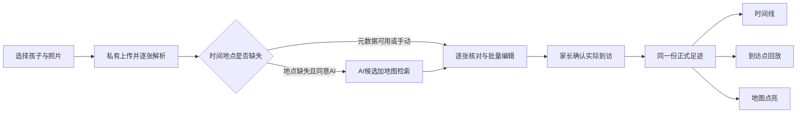
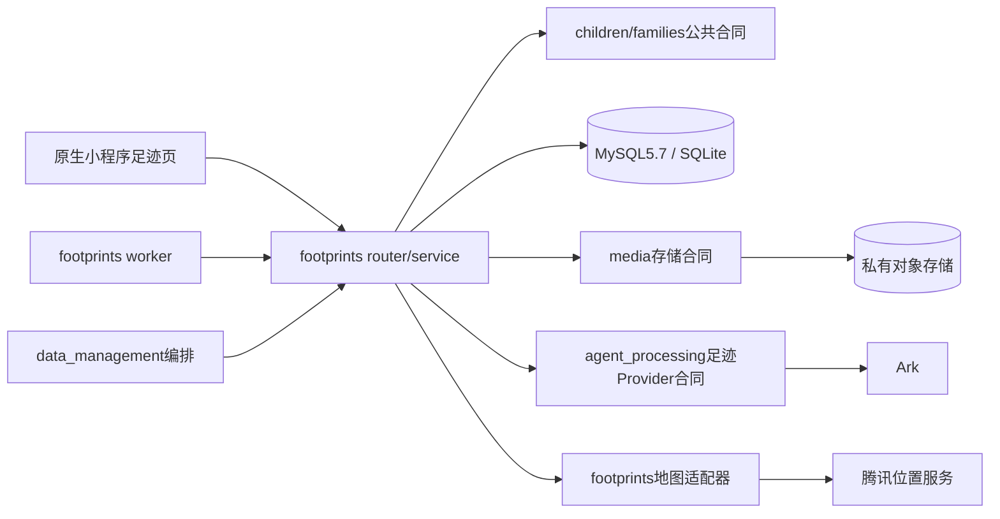

# FEAT-012 — 孩子照片足迹可行性调研

- AS_OF / 检索日期：2026-10-17（Asia/Shanghai）。
- 结论：**建议立项，按“照片足迹相册”实现；三种视图共用一份经家长确认的到访记录。**
- 调研范围：现有原生微信小程序、全球照片足迹与按主要轨迹自适应；单张/多张导入、时间与地点提取、时间线、回放、点亮。用户在grill第一轮明确全球为首版目标。
- 交付性质：文档调研与已确认交互设计；Q19用户“认可，评审收敛”，生产实施另批。没有运行原图上传实验、模型测评、地图接口或真机验收，没有新增生产实现。
- 关联：[Feature 规划状态](../../domain/features/FEAT-012-child-photo-footprints.md)、[候选 Feature Spec](../../../specs/active/FEAT-012-CHILD-PHOTO-FOOTPRINTS.md)、[grill review](20261017-grill-review.md)、[已确认交互稿](../../design/frontend/prototypes/DREV-20261017-CHILD-PHOTO-FOOTPRINTS-01/index.html)。

## 1. 决策结论

这个功能在当前技术栈上可做。体验是否顺畅，主要取决于原始照片里有多少可用元数据，以及缺失时家长需要补充多少信息，不能用“AI 能看图”代替输入质量验证。

| 能力 | 可行性 | 必须说明的边界 | 建议阶段 |
|---|---|---|---|
| 单张/多张照片上传 | 高 | 优先原图；选图后的文件不一定还保留原照片的全部信息 | 第一期 |
| 从照片读取时间 | 高，条件式 | 需存在可解析元数据；设备时钟、时区与人工修改会影响真实性 | 第一期 |
| 从照片读取地点 | 高，条件式 | 需 GPS；GPS 是拍照设备位置，不必然是被拍地标的位置或孩子到访证明 | 第一期 |
| AI 补地点 | 中 | 地标、招牌等提供候选；普通室内/山水/连锁店可能无法唯一定位 | 第一期受控启用 |
| AI 恢复准确日期和时刻 | 不应承诺 | 画面通常没有足够证据；票据/日期水印也不必然等于拍摄时间 | 使用人工补全 |
| 时间线照片流 | 高 | 按日期组织；无日期先草稿，上传成功7天未确认清理，不能拿上传时间冒充 | 第一期 |
| 按时间在地图播放 | 高 | 播放已知到访点；点间连线是示意，不能声称是实际行走/驾驶路线 | 第一期简版 |
| 中国地图点亮、缩略图 | 高 | 地点去重与重复到访分开；大范围聚合、局部展开 | 第一期 |
| 世界范围足迹 | 有条件可行 | 全球拖动与一屏概览分开；底图、海外检索、时区、坐标与权限分别验收 | 用户要求第一期，必须验证 |
| 省份/国家整块填色 | 可行但额外复杂 | 行政边界数据来源、版本、许可与地图表达另行核查 | 第二期可选 |

以上“高/中”为工程判断，**不是识别准确率、平台可用率或已完成验收结果**。产品建议命名“孩子足迹”；无需持续定位、后台轨迹采集或人脸识别。

## 2. 项目现状与复用边界

本节为 2026-10-17 当前工作树的只读核查，不推定云端与本地完全一致，也不重验其他任务的历史测试。

| 已有事实 | 代码/当前状态证据 | 对本功能的影响 |
|---|---|---|
| FEAT-007 管理每周上学/放学等时间占用，没有地点或路线 | [出行安排当前状态](../../domain/features/FEAT-007-travel-arrangements.md)、`apps/api/src/push_kids/travel/` | 新建 FEAT-012；避免改变原有日程冲突与 20 项容量合同 |
| 记录选图当前固定 `sizeType: ["compressed"]` | [记录入口](../../../apps/miniprogram/pages/records/index.js)、[草稿补传](../../../apps/miniprogram/pages/submission/detail.js) | 不能直接沿用为可靠 EXIF 入口；也不必改变学习照片入口 |
| 前端只读取图片大小和格式，未读时间/GPS | [cloud-media.js](../../../apps/miniprogram/utils/cloud-media.js) | 新增元数据解析与缺失状态，不能把 `getImageInfo` 当完整 EXIF API |
| 私有媒体已有签发、owner 校验、限额和临时预览 | [媒体存储](../../../apps/api/src/push_kids/media/store.py)、[媒体预览](../../../apps/api/src/push_kids/learning/media_router.py) | 可复用底层存储能力；新域仍须验证家庭/孩子/对象归属 |
| `MediaObject.submission_id` 非空且外键指向学习提交；上传流程以 submission 为中心 | [数据模型](../../../apps/api/src/push_kids/persistence/models.py)、[学习服务](../../../apps/api/src/push_kids/learning/service.py) | 新增足迹媒体所有权合同；不可伪造学习提交来存旅行照片 |
| Ark 分析合同与知识、学科、复习待办绑定 | [现有 Provider](../../../apps/api/src/push_kids/agent_processing/providers.py)、[现有分析合同](../../../apps/api/src/push_kids/agent_processing/contracts.py) | 可沿用平台和调用经验，不能直接复用学习分析的业务 DTO/结果 |
| 孩子档案、家庭角色、永久删除编排已存在 | [多孩子](../../domain/features/FEAT-005-multi-child-profiles.md)、[家庭协作](../../domain/features/FEAT-002-family-collaboration.md)、[清理](../../domain/features/FEAT-006-data-cleanup-and-family-reset.md) | 复用可信身份；同步新增媒体、任务与足迹清理，不能只加展示页 |
| 归档禁新增，既有草稿/上传/分析可收尾；删除冻结优先；当前媒体清单按学习提交收集 | [归档边界](../../../specs/completed/BUG-014-ARCHIVED-CHILD-WRITE-BOUNDARY.md)、[删除worker](../../../apps/api/src/push_kids/data_management/worker.py)、[媒体清单](../../../apps/api/src/push_kids/media/cleanup.py) | 足迹须明确服务端批次的已开始边界，新增owner清理接入；归档草稿无直达入口是现有限制，不能称为已解决 |
| 已依赖 Pillow；当前上传配置默认 10 MiB，图片白名单 JPG/PNG/WebP | `pyproject.toml`、`uv.lock`、[配置](../../../apps/api/src/push_kids/platform/config.py)、媒体存储 | 可先验证现有 Pillow 的 JPEG EXIF 解析；HEIC 是待解决的真实输入边界 |

当前没有证据表明已经存在照片足迹、地图回放或地图点亮的生产功能。后续跨域读取走服务合同，足迹不得产生学习记录、复习项、每日任务或日程占用。

## 3. 时间与地点如何取得

### 3.1 时间：先读元数据，再允许人工修正

优先读取 `DateTimeOriginal`、`OffsetTimeOriginal` 和亚秒信息；GPS 日期/时间作独立证据交叉核对。CIPA 的 Exif/XMP 映射明确区分原始生成时间、数字化时间与 UTC 偏移；GPS 字段还包含地理基准。这里引用旧版映射说明稳定字段语义，不将它当作最新版完整标准。[CIPA Exif/XMP 字段映射](https://www.cipa.jp/std/documents/e/DC-X010-2017.pdf)

CIPA 当前目录已列出 2026 年 Exif 3.1 与 Exif metadata for XMP 更新；**本功能应兼容常见旧照片，不能要求用户照片必须是 3.1**。新版正文未在此次工具中成功获取，未据此推断新特性。[CIPA 标准目录](https://www.cipa.jp/e/std/std-sec.html)

候选处理规则：

1. 有原始时间和 UTC 偏移：生成明确时刻，保留照片当地显示时间、偏移及来源，仍允许家长更正。
2. 有时间但无时区：显示“时区待确认”，结合家长确认的拍摄地区建议时区；不可直接按上传手机当前时区转换。
3. EXIF 与 GPS 时间冲突：保留冲突标记，不静默覆盖。跨国旅行和设备时钟设置错误都进入核对路径。
4. 只有日期：按“日”精度保存，不补造 00:00 的准确时刻；同一天照片可由家长调整相对顺序。
5. 没有时间：家长逐张或批量填写日期；支持未知时间草稿，不把文件创建、修改或上传时间显示为拍摄时间。
6. OCR 发现日期：只作为候选证据，家长确认其是否是拍摄日期。画面明暗、季节只能提供粗略线索。

**AI 无法通用、可靠地补回任意照片缺失的准确拍摄日期/时刻**，这是信息不足的产品边界。某次模型“猜对”不能证明可恢复。

### 3.2 地点：GPS 优先，AI 返回候选

优先顺序建议为：家长确认值 → 经校验的照片 GPS 候选 → AI/OCR 地点候选 + 地图检索 → 手动搜索/地图选点。确认值独立保存，异步任务迟到不得覆盖。

- 有 GPS：读取经纬度、N/S/E/W 和地理基准，验证范围，再做逆地理编码。坐标与地址的语义要分开：附近 POI 不证明实际进入了那个景点。
- 无 GPS：AI 提取建筑/招牌/文字等依据，最多返回 3 个地点名称与地区候选，也允许返回“无法判断”。地图检索将名称落实到合法 POI/坐标，家长选择后才形成正式记录。
- 场景无法唯一定位：先问城市或行程背景；普通餐厅、住宅、公园、无特征室内允许直接手填。
- 地点候选与已有 GPS 冲突：提示核对，不用 AI 无声覆盖 GPS。长焦照片拍到远处景物时，区分拍摄位置与景物位置。
- 同行多图：仅在该导入批次和经授权的行程背景中辅助判断，不因相邻上传就认定同地/同日。

火山方舟支持图片与多图理解，具备技术接入基础；官方也提示多图数量和图像信息量影响回答质量。这不构成地理定位准确率承诺，文档中的“Visual Grounding”指图像内目标定位，也不能等同于现实经纬度定位。[火山方舟图片理解](https://docs.volcengine.com/docs/ark/image-understanding?lang=zh)

作为能力边界参照，Google 的专用 Landmark Detection 也将目标表述为知名自然或人造地标。由此推断：先验证显著地标和文字线索有价值，但不能推广成所有生活照片都可精确定位；此处不建议直接引入 Google 服务。[Google 地标检测](https://docs.cloud.google.com/vision/docs/detecting-landmarks)

AI 自报的“90% 置信度”不能作为已校准概率或自动落库阈值。采用“照片信息/AI 建议/家长填写”来源标签和“待核对/已确认”状态；不能把元数据存在等同于事实已被证明，也不能通过人脸推断照片属于哪个孩子。

### 3.3 上传链是首要验证点

微信官方 API 类型提供多选和压缩控制；`getImageInfo` 返回尺寸、格式、方向等，未提供完整拍摄时间/GPS 合同。它们没有给出原图选择后 EXIF 必然完整保留的保证。`chooseMedia`从基础库2.10.0可用；选择数量在2.25.0前最多9张，2.25.0起最多20张。项目学习流程的9张是自身业务限额，**不是微信永久上限**；项目没有本功能20张端到端或最低基础库保证，足迹单次选择/服务批次上限须实测冻结。[微信官方 API 类型](https://raw.githubusercontent.com/wechat-miniprogram/api-typings/master/types/wx/lib.wx.api.d.ts)

建议流程：原图选择 → 服务端私有收件对象 → 解析必要 EXIF → 纠正方向 → 生成去 EXIF 展示图、缩略图及受限 AI 图 → 家长核对。Pillow 文档提供 EXIF 读取和按方向转置能力；仓库锁定版本仍需用对应运行环境验证，不能把当前网站版本当作已安装版本。[Pillow Image API](https://pillow.readthedocs.io/en/stable/reference/Image.html)、[Pillow ImageOps API](https://pillow.readthedocs.io/en/stable/reference/ImageOps.html)

需要专门测试 iPhone HEIC/Live Photo 的静态部分、Android JPEG、编辑后照片、微信原图转发、压缩转发、截图、云相册下载。若选图阶段已转码丢失 EXIF，服务端解析器无法恢复：优先提供手动补全，原文件导入作为后续候选路径。首期文件格式/10 MiB 限额与 HEIC 策略应在验证后冻结，不能只看模型支持格式就声称端到端支持。

## 4. 三种呈现的落地方式

### 4.1 时间线照片流

推荐单列时间轴搭配照片网格，确保阅读顺序明确。若使用双列瀑布流，必须保留按日期分组和可理解的读序；“瀑布流”本身不等于严格时间线。

- 显示日期/时间精度、地点、照片缩略图，首版按孩子、日期自动组织；点开地点可看历次记录，不依赖行程相册。
- 一次上传可跨多个日期和地点，逐张提取，再由家长确认分组；不能整批套用同一个时间地点。
- 同地＋当地日期合为一张到访日卡，每张照片自己的拍摄值保留。R3/Q12已确认按“来过几天”统计，不区分同日多次进入，不将照片数当旅行次数。
- 日期已知但地点未知仍可进入时间线；未知日期留在“待补时间”，不混入正式时间排序。
- 按到访记录游标分页、缩略图懒加载，不在客户端加载全相册再排序。

### 4.2 按时间播放足迹

微信原生 MapContext 的移动标记和点聚合已有官方示例；地图组件也支持点、折线和面覆盖物。可以按照片/到访时间驱动移动标记与底部照片卡。[腾讯小程序地图组件](https://raw.githubusercontent.com/TencentLBS/tencentmap-miniprogram-skill/main/references/map_component_guide.md)、[腾讯地图快速开始](https://raw.githubusercontent.com/TencentLBS/tencentmap-miniprogram-skill/main/quick_start_and_best_practices.md)

候选体验：当前孩子与日期筛选 → 播放、暂停、进度跳转、下一站 → 当前站显示时间、地点和照片。R3/Q13已确认镜头跟随当前地点；点亮视图独立保持主要区域优先。日期精度不足的同日点以家长确认的顺序播放并明确“当日顺序”；缺失日期/位置的点显示未纳入数量。首版无需速度档位或真实路程。

点间使用虚线或跳转动画，并标明“根据照片到访点连接，非实际路线”。跨天/长距离分段，压缩空白时间以免等待数小时；动画速度不代表真实速度。不默认调用驾车路线规划补齐空白，也不据此统计实际里程或交通方式。只有一站时显示单站卡；页面隐藏、切换孩子或用户拖动时暂停，拒绝迟到动画更新。

### 4.3 地图点亮

首版支持全球，按主要足迹自适应，提供“世界/全部足迹”入口：**全球/主要区域 → 城市/地点聚合 → 单地点访问记录和照片**。第二轮已确认：当前日期筛选的主要区域优先、提示其他区域数量、可看全部；空态中国。聚焦算法、全球技术能力与DREV仍须验证/批准。

- 首期点亮具体地点，并汇总城市/国家；放大显示照片标记，缩小聚合为计数和一张代表缩略图；不整块填色。
- 地点抽屉按当地日期列“哪天来过”，显示到访日数、首访/最近日期和照片数；修改日期或删除最后一张时重算，单张删除保留同地其他照片。
- 以家长确认的 POI/城市编码去重，不只依赖名称；同名地点不能合并，城市级信息不能伪装成具体景点。
- 若一个点仅确认到城市，使用城市精度与标签，不将城市中心描述为拍摄位置。
- 统计仅包含确认过孩子实际到访的记录；删除/改地点后重算，不能只增不减。
- 地图加载失败仍可浏览地点列表和时间线；不默认打开“我的当前位置”。

“地图点亮”有两种不同实现：点/城市标记（推荐首期），以及整省/整国填色。后者需要行政边界多边形、归属判定和渲染优化，不能由缩放地图自动得到。使用合规底图，保留版权/审图等标识；自定义中国/世界边界或导出海报前单独核查许可和地图审核适用性，不把第三方 GeoJSON 默认当可公开发布素材。政府地图使用说明也提示正规地图与编辑后地图的使用要求存在差异。[政府地图使用说明](https://www.xiongan.gov.cn/2021-08/28/c_1211348164.htm)

### 4.4 世界地图需要单独通过的门槛

腾讯位置服务的第一方说明列有海外服务，但不能据此推定本项目账号已经开通，也不能推定国内接口在全球同样可用。历史官方文章明确分别提到海外接口；当前产品介绍仍列有海外图能力。[腾讯海外地图与回放说明](https://cloud.tencent.com/developer/article/1767945)、[腾讯位置服务产品介绍](https://cloud.tencent.com/solution/lbs)

需要分别验证：海外底图能否显示与合适缩放、海外 POI 搜索/逆地理编码授权和返回字段、中文/外文地点名、目的地当地时间及夏令时、跨日期线连线、国内与海外坐标策略。选择几个中国城市以及东京、新加坡、巴黎、纽约做端到端样本；旧官方文章只证明能力方向，不能代替当前账号实测。

还要区分“地图可拖到世界各地”和“一屏看到整个世界”。官方原生 map 文档的 scale 范围为 3–20，手机端完整世界总览不能仅凭海外底图能力就保证；若需求是一屏展示所有国家和足迹，需单独验证总览呈现，必要时增加使用合规地图数据的 Canvas 概览，再下钻到原生地图。它会增加设计、素材和交互成本，不能承诺只修改一个缩放参数即可。[腾讯小程序地图组件](https://raw.githubusercontent.com/TencentLBS/tencentmap-miniprogram-skill/main/references/map_component_guide.md)

照片 GPS 常见为 WGS-84，但仍应检查地理基准；国内腾讯地图链路使用 GCJ-02，官方转换 API 提供 WGS-84 → GCJ-02。应保存原坐标及其坐标系，并分离展示坐标，避免重复转换；地图选点返回 GCJ-02 时不得冒称得到原始 WGS-84。海外转换行为须验证，不能按一个简单经纬度包围盒对所有点套国内偏移。[腾讯坐标转换](https://raw.githubusercontent.com/TencentLBS/tencentmap-webservice-skill/main/references/api-tools.md)

## 5. 推荐产品流程和数据模型

第二轮已确认复用现有五个 Tab，在“记录”提供“孩子足迹”入口，进入独立足迹页，按日期自动整理；页面内切换时间线、回放和地图。DREV01已在Q19获设计批准，入口尚未进入生产小程序。

建议的概念分层：

| 对象 | 作用 | 关键语义 |
|---|---|---|
| ImportBatch / PhotoAsset | 导入状态、私有对象与逐张候选 | 上传顺序不等于拍摄顺序；任务状态独立于确认状态 |
| Visit / VisitPhoto | 家长确认的一个到访日及其照片 | 同地点＋当地日期合并；跨日期生成不同日；每张照片保留独立时间/地点来源 |
| PlaceSnapshot | 地点名、地区编码、可选 POI 及坐标 | 不是公开全家/全用户地点图库；坐标精度显式记录 |
| Journey（后续范围） | 可命名的一段旅行 | 首版自动按日期整理，不引入该实体/筛选；以后提出时重新评审 |

时间建议包括 `captured_local_time`、`occurred_on`、可空的 UTC `occurred_at`、时区/偏移、`time_precision`、`time_source`；`created_at` 永远表示系统创建时间。未知或仅日期不得生成假的精确时刻。地点包括来源、精度、原坐标系/原值、展示坐标、国家/地区/城市/POI 和家长修正版本；缺失经纬度与 `(0,0)` 区分。

元数据、AI 候选、家长确认值分开。正式足迹只有确认后产生；照片可能是风景、家人转发或历史下载，须由家长选择孩子并确认实际到访，不能自动归属。第二轮确认每批一个孩子；合照给其他孩子记一份时分别导入，不建设跨孩子共享媒体或人脸自动归属。

## 6. 架构建议与备选方案

建议新增 `footprints` 业务域，拥有导入、逐张候选、到访、查询投影与清理；已有 `travel` 仍拥有固定出行安排。`agent_processing` 新增足迹专用 provider 合同/适配器，遵循现有规则隔离 Ark；不得复用学习的 AnalysisProposal，也不让 `footprints` 直接调用 Ark。地点检索与坐标转换通过足迹拥有的受限地图适配器执行。

新域的图片归属模型独立，复用 store 不等于复用绑定 Submission 的表。是否抽取更通用的上传票据由后续架构 revision 决定：当前推荐保留现有学习合同，足迹独立票据，避免先做大范围媒体迁移。地图服务不需要孩子身份或整份轨迹；只传当前查询必要的地点名/坐标。正逆地理编码的地址与坐标互转能力已有第一方 API 说明。[腾讯地址解析](https://raw.githubusercontent.com/TencentLBS/tencentmap-webservice-skill/main/references/api-geocoder.md)

| 方案 | 优点 | 代价/风险 | 建议 |
|---|---|---|---|
| 独立足迹域 + 原生 map + 按需 AI | 领域清晰，复用当前运行环境，三视图数据一致 | 新增所有权、删除和地图适配器 | 推荐 |
| 直接扩展现有 travel | 表面改动少 | 将周期日程与历史到访混合，容量与冲突规则易污染 | 不推荐 |
| 所有照片交给 AI 生成坐标/时间 | 演示快 | 不可验证、成本高、虚假精度、隐私数据传输更多 | 不推荐 |
| 直接接第三方轨迹云 | 可能有现成回放 | 本需求没有连续定位样本，引入额外留存和供应商成本 | 暂不采用 |
| WebView + 完整网页地图 | 部分可视化较自由 | 额外域名、兼容、资源与身份桥接成本 | 原生明确不能满足时重审 |
| 自绘全国/世界填色地图 | 图鉴效果强 | 地图素材、表达、边界版本与包体负担 | 第二期单独评审 |

## 7. 性能、成本与隐私

### 7.1 候选工程预算，尚待验证和批准

- R3/Q14已确认每次整理几十张、多批续传与离开继续；单次原生选择数、服务批次cap和会话上限分别验证后冻结，不继承学习9张或引入行程100张假设；默认10 MiB/张仍为候选，HEIC/超大图策略待验证。
- 时间线每页 20 条、最大 50；每卡最多 4 张缩略图，更多走独立分页；客户端最多保留 100 张卡的窗口。
- 地图按 bbox/缩放/日期在服务端聚合，每次不超过 200 个点/簇，响应目标不超过 256 KiB；不能加载完整历史再在前端聚合。
- 单次回放最多 100 个确认到访点，超出分段且显示总量和未纳入原因；同一回放建立版本快照，避免分页期间编辑导致跳序。
- 查询使用 tenant-leading 时间/地点/空间格网索引；按低缩放格网预聚合，避免世界视图每次扫描全历史。统计在数据库完成，页查询次数与照片数量无关。
- 图片缩略图目标约 100 KiB/张，界面懒加载；接口 p95 目标 500 ms（不含公网传输、AI与地图供应商耗时），以固定环境的 5 万条样本验证。它们是目标，不是性能测试结果。
- 导入任务按批/照片唯一键幂等，限制并发、超时和最多 3 次持久重试，保留成功照片结果；取消、删除和父母手动确认后拒绝旧任务写回。

### 7.2 成本应按四部分估算

`月成本 = 照片及缩略图累计存储 + 图片读取流量/请求 + AI输入输出用量 + 地图授权/API额度 + 增量计算资源`。

只对缺地点且用户选择 AI 的照片调用模型；GPS 完整的照片通常无须看图识别。地理查询可在供应商条款允许下按家庭、地点/格网去重并设失效，不能共享孩子照片或个人轨迹缓存。基础底图、WebService、海外服务、个性化样式的授权和计费要分别核查，不能把“能调用/有免费额度”当作商用免费。官方组件说明明确提示商业用途授权及付费样式，本次未能读取最新配额页，**不提供未经核实的单价或免费量**。[腾讯小程序地图组件](https://raw.githubusercontent.com/TencentLBS/tencentmap-miniprogram-skill/main/references/map_component_guide.md)

容量示例，仅作算术假设：1,000 家庭 × 每月 30 张 × 平均保存 3 MB ≈ 每月新增 90 GB，12 个月约 1.08 TB；另按 100 KB 缩略图约每月 3 GB。若其中 30% 走 AI，约每月 9,000 张 AI 输入。实际账单取决于保存规格、留存时间、模型版本、访问次数和账号合同，不能据此给人民币报价。

### 7.3 隐私是这个功能的核心发布要求

《个人信息保护法》将行踪轨迹与不满十四周岁未成年人的个人信息列为敏感个人信息，规定相关同意、监护人同意和专门规则，并要求相关情形事前做个人信息保护影响评估。家庭成员角色不自动等于已核实的监护人身份，产品与运营须明确同意机制。[个人信息保护法](https://www.cac.gov.cn/2021-08/20/c_1631050028355286.htm)

建议默认家庭内可见，正式记录写入限 manager/editor，viewer 只读；开启此功能前显式告知照片定位处理目的，AI 可选，拒绝后仍可手填。地图供应商只收到必要查询，AI 只收到必要的处理图和经用户同意的有限背景。供应商的数据保存/委托处理条件须独立核查，不能仅凭“不训练”推断“无任何留存”。

R3/Q10与R4/Q15已明确：每张照片服务端验证上传成功起固定168h清理未确认草稿，编辑、重试或归档不延期，显示具体清理日期。部分确认只将选中项入档，未选项仍按各自期限；已确认照片和其他孩子的数据不被草稿清理连带删除。到期先拒绝确认，再以持久任务收敛资源清理。

R4/Q16确认足迹相册规格，保留去EXIF展示图与缩略图，不承诺原画备份/下载。只有必要元数据提取与派生图生成成功后才安排原件24h清理；处理失败的原件最迟第7天清理，展示图/正式记录生命周期独立。长边2048为待真机清晰度验证候选，不把它当已测质量保证。提取结果只保留必要字段，不保留完整EXIF、设备序列号和原始模型载荷。

R3/Q11确认当前家庭/成员首次主动开启后，仅缺可用地点照片按需AI，设置可关闭；其他家庭成员不得因一人开启而默认同意。R4/Q17确认足迹内归档孩子入口可读历史、收尾旧草稿，不能新增照片；既有学习草稿入口不在此次扩展。R4/Q18确认逐张纠正/删除后同步三视图和统计，批量清空与公开分享不入首版。

孩子/家庭删除应覆盖原图收件、展示图、缩略图、候选、正式记录、任务、缓存与地点统计，删除冻结后不得复活；预览使用短期鉴权能力，禁止公开对象地址及原图进仓库。首期不增加公开分享、精确住址对外展示或后台采集位置。

## 8. 验证计划与立项门槛

建议先完成 2–3 人日的受控验证，再冻结产品承诺。真实照片必须得到授权并放在批准的私有位置，仓库只保存合成夹具、匿名编号和汇总；当前没有运行以下实验。

| 验证项 | 做法 | 通过/决策规则 |
|---|---|---|
| 元数据端到端保留 | iOS/Android 原图、HEIC、编辑/转发/截图，至少 40 个来源路径样本；上传前后对照独立真值 | 对收到且含有效字段的文件正确解析；报告每来源保留率，不能混成无意义总准确率 |
| AI 地点候选 | 至少 100 张：地标、招牌、普通室内/自然、同名歧义、境外各 20；人工真值与样本分层固定 | 报告地点粒度、Top-1/Top-3、拒答/错误自信率、家长修正率、耗时/成本；不把自评置信度算准确率 |
| AI 启用门槛 | 候选策略：有明确地标/文字证据组地点级 Top-3 ≥90%；无可验证线索组拒答 ≥90%；所有候选仍需确认 | 未达目标就缩小 AI 支持场景或首期只做元数据+人工；样本量只支持试点，不能宣传通用成功率 |
| 时间与误导 | 无时间、无时区、日期水印、设备错钟、跨国/夏令时/日期线 | 不补造时刻；不把票据日期、上传时间或当前定位当拍摄事实 |
| 地图三视图 | 同一数据对照；三视口 320×568、390×844、430×932；iOS/Android | 数量/日期/地点一致，未知项明确，回放可停可恢复，无横向溢出，操作区≥44px |
| 世界范围 | 国内代表城市及东京/新加坡/巴黎/纽约的底图、搜索、逆解析、坐标和时间 | 按能力逐项记录当前账号结果；缺项时继续时间线/地点列表，不宣称全球支持 |
| 容量与隔离 | 5 万条历史、世界聚合、重复上传、两账号/两孩子、迟到任务、删除与预览 | 有界响应、查询计划与 O(1) 页查询；越权为零，删除后无重建；真实 MySQL 5.7 必测 |
| 商用与发布 | 当前地图合同/额度、隐私声明、同意与影响评估、原生设计证据 | 与产品承诺一致后进入体验/提审；未经验证不标记已发布 |

原国内版本工程量估计：验证2–3人日、导入/所有权/确认/清理6–9人日、三视图5–8人日、联调验收3–5人日，合计16–25人日；这是旧范围下个人判断，非排期承诺。用户已要求首版全球，**16–25人日不能继续作为当前首版总量**；全球底图/地点检索/自适应总览验证后重新估算。行政区填色仍单独评审，不含等待资质/商用授权/微信审核。

## 9. 证据登记与反证检查

下列均于 2026-10-17 检索。官方能力文档只证明声明的接口，不证明本项目账号权限、数据质量或运行性能。GitHub 使用动态分支，实施时需固定引用版本。

| 证据 | 发布者/类型/日期 | 定位与适用范围 | 访问与限制 |
|---|---|---|---|
| E01 [CIPA 标准目录](https://www.cipa.jp/e/std/std-sec.html) | CIPA / 标准目录；3.1 为 2026-01-30，XMP 为 2026-06-01 | 标准版本与发布时间 | 目录可读，新版下载正文未取得 |
| E02 [CIPA Exif/XMP 字段映射](https://www.cipa.jp/std/documents/e/DC-X010-2017.pdf) | CIPA / 历史字段映射文件，2017，文件含草案占位 | §7.8、§8.3；PDF 第13–14/23–25页，时间/GPS语义 | 可读；仅辅助稳定字段解释，不冒充现行完整规范 |
| E03 [微信官方 API 类型](https://raw.githubusercontent.com/wechat-miniprogram/api-typings/master/types/wx/lib.wx.api.d.ts) | 微信官方 GitHub / 接口合同；动态分支 | ChooseMediaOption、GetImageInfoSuccessCallbackResult、MoveAlongOption | 可读；微信文档站直读失败，以官方类型交叉核查 |
| E04 [腾讯小程序地图组件](https://raw.githubusercontent.com/TencentLBS/tencentmap-miniprogram-skill/main/references/map_component_guide.md) | TencentLBS / 第一方文档；更新时间未标明 | markers/polyline/polygons、聚合、show-location、授权/样式 | 可读；API 能力与账号授权分开 |
| E05 [腾讯地图快速开始](https://raw.githubusercontent.com/TencentLBS/tencentmap-miniprogram-skill/main/quick_start_and_best_practices.md) | TencentLBS / 第一方示例；更新时间未标明 | MapContext 回放、聚合、坐标 | 可读；示例不能替代本项目真机测试 |
| E06 [腾讯地址解析](https://raw.githubusercontent.com/TencentLBS/tencentmap-webservice-skill/main/references/api-geocoder.md) | TencentLBS / 第一方 API 说明；更新时间未标明 | 正/逆地理编码、坐标与字段 | 可读；不据此承诺海外适用性 |
| E07 [腾讯坐标转换](https://raw.githubusercontent.com/TencentLBS/tencentmap-webservice-skill/main/references/api-tools.md) | TencentLBS / 第一方 API 说明；更新时间未标明 | WGS-84→GCJ-02、错误/配额 | 可读；不承诺反向转换或海外策略 |
| E08 [火山方舟图片理解](https://docs.volcengine.com/docs/ark/image-understanding?lang=zh) | 火山引擎 / 产品文档；动态页 | 图片/多图输入与数量质量限制 | 正文经官方页面检索索引可读，直接 open 解析失败；实施前重新核对 |
| E09 [Google 地标检测](https://docs.cloud.google.com/vision/docs/detecting-landmarks) | Google Cloud / 第一方产品文档；更新时间未核定 | 能力目标为知名地标 | 可读；只是边界对照，未选为供应商 |
| E10 [腾讯海外地图与回放说明](https://cloud.tencent.com/developer/article/1767945) | 腾讯位置服务官方账号 / 第一方公告；2020-12-31 | moveAlong、聚合、独立海外接口 | 可读但历史较久，不用作当前账号可用证据 |
| E11 [腾讯位置服务产品介绍](https://cloud.tencent.com/solution/lbs) | 腾讯云 / 当前第一方产品页；发布时间未标明 | 列有海外图能力 | 可读；未给出本项目商用报价/权限 |
| E12 [个人信息保护法](https://www.cac.gov.cn/2021-08/20/c_1631050028355286.htm) | 中国网信网 / 法律原文；2021-08-20 | 第28–31、55–56条 | 可读；此处为工程需求提取，不宣称已通过合规验收 |
| E13 [政府地图使用说明](https://www.xiongan.gov.cn/2021-08/28/c_1211348164.htm) | 中国雄安官网 / 政府公开说明；2021-08-28 | 地图来源、审图标识与编辑使用 | 可读；产品最终形式的适用性仍需核查 |
| E14 [Pillow Image API](https://pillow.readthedocs.io/en/stable/reference/Image.html) / [Pillow ImageOps API](https://pillow.readthedocs.io/en/stable/reference/ImageOps.html) | Pillow / 第一方库文档；stable 动态版 | getexif、方向转置 | 可读；不是当前项目锁定版本的运行证据 |

关键主张登记：

| Claim | 内容 | 支撑/反证 | 状态/置信度/新鲜度 |
|---|---|---|---|
| C01 | 有合适元数据时可确定性提取时间/GPS | E02、E14；字段缺失时不成立 | qualified / 高 / 字段语义稳定，未做项目实验 |
| C02 | 选择“原图”不等于保证端到端保留所有 EXIF | E03 未提供此保证；真实机型链路未测 | qualified / 中 / 当前接口核查，保留率未知 |
| C03 | 原生小程序足以实现点/线/回放/聚合 | E03–E05、E10 | verified（能力声明）/ 高 / 新旧第一方文档交叉支持，运行待测 |
| C04 | AI 适合候选地点，不应承诺任意照片精确定位或定时 | E08–E09 支持输入与地标方向；准确率承诺缺证据 | qualified（工程推断）/ 高于边界判断、低于实际效果估计 / 待样本验证 |
| C05 | 世界拖动、一屏世界概览与海外检索需要分项验证 | E04的scale范围、E10–E11；全球产品能力不等于当前账号权限 | qualified / 中 / 当前页+历史公告，权限及总览效果未知 |
| C06 | 国内 GPS 与地图坐标须显式处理 | E05、E07；GPSMapDatum可能不同 | qualified / 高 / 当前第一方合同，海外行为待测 |
| C07 | 儿童足迹需敏感信息保护与相应同意/评估 | E12 | verified（条文范围）/ 高 / 2026-10-17核查原文，产品落实未验收 |
| C08 | 现有照片流程不能直接当作新域能力 | 本报告§2代码证据；学习媒体非空外键/学科合同为反例 | verified（本地静态事实）/ 高 / 当日工作树 |
| C09 | 原国内范围约16–25人日；当前全球首版待重估 | 本报告§8旧范围工作分解，无项目实测 | estimate / 中低 / 不适用于当前全球首版总量 |

主动核查的反例包括：新基础库不只支持 9 张、元数据可缺失/被改写、地图坐标≠POI到访、Visual Grounding≠地理定位、地图产品全球能力≠项目海外接口权限、付费样式/商用授权≠基础底图/API同一计价。未找到足以支持“原图一定有 EXIF”“AI 可以补全所有时间地点”“照片连线就是真实路线”的证据，因此没有采用这些承诺。

## 10. 评审确认与本次收尾

四轮18项产品选择均已回答，原话见grill记录；明确首版全球与主要区域优先、地点点亮与城市/国家汇总、单孩子按日期组织、家长确认、固定7天草稿、条件24h原件清理、按需AI、到访日、跟随镜头、分批继续、归档草稿、逐张纠正/删除。2026-10-17 Q19用户“认可，评审收敛”，确认整体共同理解和具体交互稿，本轮grill review完成。

Spec更新为04、Architecture候选03，Task Spec状态READY_FOR_REVIEW，均未批准生产实施；DREV01已获设计范围批准并冻结。真实地图/识别/格式容量/清晰度与清理验证仍是门禁，不能把HTML演示成功当外部服务可用。交互稿27态×3视口81张手机PNG，虚构数据在本机演示续接，确认/编辑/删除后三视图同步更新；浏览器证据见批准清单。

已同步调研、PLANNED Feature、READY_FOR_REVIEW Spec、grill确认记录、批准交互设计、索引与UI-018规划状态。与FEAT-007、Behavior Catalog、Architecture、UI、测试/发布合同对照，不把设计稿写成生产实现，不修改旧Feature行为，不新增部署/上传/体验/审核/正式发布事实。HTML浏览器证据独立登记，实施仍待技术验证和具体Task Spec/架构批准，Spec继续留在active。

生产测试、原生三视口、真实 MySQL 5.7、Ark 地点测评、微信 EXIF 保留率、地图接口与商用账号验证：**NOT_RUN**。本次没有功能代码变更，也未使用获授权的真机/原图样本或配置外部账号能力，因此没有这些检查的通过证据。
