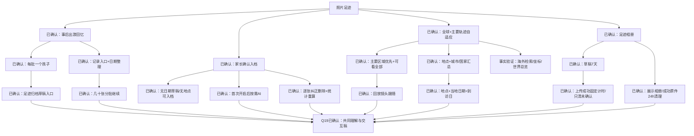

# 孩子照片足迹 — Grill review 记录

- Date: 2026-10-17
- Status: COMPLETE / USER_CONFIRMED，四轮决策及Q19整体需求/交互确认已完成；尚无生产实施批准。
- Scope: FEAT-012 / SPEC-20261017-CHILD-PHOTO-FOOTPRINTS-04。
- Method: 用户明确要求使用grill me；按grilling技能逐轮处理设计树的独立前沿。
- Companion: [可点击交互稿](../../design/frontend/prototypes/DREV-20261017-CHILD-PHOTO-FOOTPRINTS-01/index.html)。

## 已确认根节点（第一轮）

| Round / ID | 决策 | 用户答复 | 后果 |
|---|---|---|---|
| R1/Q1 | 事后出游回忆；无实时定位/规划 | “可以，先做出游回忆” | 只承诺离散照片到访，回放连线示意 |
| R1/Q2 | 家长确认后入档，AI允许拒答 | “可以，家长确认后入档” | AI结果保持候选，批量核对减负 |
| R1/Q3 | 全球与自适应 | “需要全球的，但是可以根据主要轨迹做自适应” | 推翻国内优先/海外后置建议，首版必须全球；具体聚焦规则待细化 |
| R1/Q4 | 足迹相册，不承诺原画备份 | “可以，足迹相册就够了” | 可保留展示图/缩略图；具体质量和清理时间未因本答复自动获批 |

## 已确认组织与地图规则（第二轮）

| Round / ID | 决策 | 用户答复 | 后果 |
|---|---|---|---|
| R2/Q5 | 当前筛选的主要区域优先；提示范围外数量，可看全部；空态中国 | “可以，主要区域优先，可看全部” | 全球能力不后置；主要区域算法与真实地图验收另行验证 |
| R2/Q6 | 点亮具体地点，汇总城市/国家，不整块填色 | “可以，地点点亮＋城市/国家汇总” | 首版排除行政区填色；城市精度记录不得伪装成景点 |
| R2/Q7 | 每批当前一个孩子，合照分别导入，无人脸自动归属 | “可以，首版一批一个孩子” | 不建设跨孩子共享媒体引用 |
| R2/Q8 | 有日期无地点可入时间线；缺日期留草稿；允许批量补全 | “可以，按这个规则” | 上传日期不得冒充拍摄日期；地图显示未定位数量 |
| R2/Q9 | 记录页入口，按日期自动整理，无须先建行程相册 | “可以，自动按时间整理” | 首版不依赖Journey实体或行程筛选；命名相册留作后续范围 |

## 已确认整理与回放规则（第三轮）

| Round / ID | 决策 | 用户答复 | 后果 |
|---|---|---|---|
| R3/Q10 | 未确认草稿7天自动清理 | “未确认草稿 7 天自动清理” | 用户选择备选，推翻本轮长期保留推荐；正文恢复7天合同，不能误写用户接受推荐 |
| R3/Q11 | 首次主动开启后，仅缺地点照片按需AI，可关闭 | “可以，开启后按需自动识别” | 设置按当前家庭/成员保存，不默认替其他成员同意 |
| R3/Q12 | 地点＋当地日期为一个到访日，不区分同日再次进入 | “可以，按地点＋当地日期统计” | 显示“来过几天”，照片数量与到访日独立 |
| R3/Q13 | 当前日期筛选回放，镜头跟随当前地点 | “可以，回放镜头跟随地点” | 点亮主要区域聚焦不替代回放跟随；跨国点保持可见 |
| R3/Q14 | 一次整理几十张，分批追加、离开继续 | “可以，几十张，可分批继续” | 单次选图/服务批次cap仍须真机验证，不把学习9张套入 |

## 已确认清理与纠错规则（第四轮）

| Round / ID | 决策 | 用户答复 | 后果 |
|---|---|---|---|
| R4/Q15 | 每张上传成功起固定7天，编辑/重试不延期；显示清理日期 | “可以，上传成功起固定 7 天” | 只清未确认照片及草稿；同批已确认记录不受影响 |
| R4/Q16 | 足迹相册规格；提取与派生图成功后原件24h清理，失败原件到第7天 | “可以，按足迹相册规格” | 保留展示图/缩略图，不提供原画备份/下载；2048长边为待实测候选 |
| R4/Q17 | 足迹内查看已归档孩子，旧草稿可确认/删除、不可新增；7天照常 | “可以，足迹可查看归档草稿” | 足迹新增访问入口，既有学习草稿入口不扩展 |
| R4/Q18 | 正式照片逐张纠正/删除，三视图与统计同步重算 | “可以，支持逐张纠正和删除” | 同地点其他照片保留；首版不加批量清空或公开分享 |

## 当前设计树与收敛前沿

当前没有继续追问的独立产品分支。用户已通过Q19确认共同理解与交互稿，本轮grill review结束。识别效果、全球账号、真实容量等事实验证留为明确技术门禁；Task Spec与Architecture的生产实施批准尚未取得。

## Q19 整体确认记录

- 日期：2026-10-17；批准人：产品负责人（用户）。
- 问题引用：`request_user_input_async / call_68a44a48d02740b6befbef52d0b390d9 / item 0`。
- 问题明确对应：`SPEC-20261017-CHILD-PHOTO-FOOTPRINTS-04` / `ARCH-20261017-CHILD-PHOTO-FOOTPRINTS-03` / `DREV-20261017-CHILD-PHOTO-FOOTPRINTS-01`，预览为 `http://127.0.0.1:8768/`。
- 问题范围原文：“本题确认评审结果，生产实施另行批准。真实地图、EXIF、AI 和原生验收仍为后续技术门禁。”
- 用户原话：**“认可，评审收敛”**。
- 已确认范围：R1–R4的18项产品决定、整体共同理解与具体交互稿；Design Revision 01按当前源和81张手机导出冻结。
- 未批准范围：生产代码、API/数据迁移、架构实施、真实儿童素材或第三方处理实验、部署与发布；Task Spec仍为READY_FOR_REVIEW。

## Review发现与处理

1. 原调研“国内三视图先行”只是建议，用户已要求全球；当前Spec正文必须改为首版全球，不能只追加一条答复却保留矛盾范围。
2. 自动把EXIF/GPS或AI候选视作孩子到访不成立，保留家长确认；没有完整时间时不伪造时间。
3. 主要区域聚焦可能隐藏海外点，用户已确认用数量和看全部入口说明，不能把范围外点静默丢弃。
4. 用户已确认地点点亮与城市/国家汇总，整省/整国填色从首版排除。
5. 足迹相册不等于原画备份；清理原件不能导致用户失去可浏览照片。
6. 图示路线不代表真实行走道路；全球底图、海外地点服务、时区/坐标和一屏总览必须分别验证。
7. 用户明确选择7天自动清理，不能仍在正文保留长期草稿推荐；计时按每张服务端接收成功，部分确认必须保护正式照片。
8. 归档后允许已有工作收尾与禁止新增要分别校验；足迹入口不得错误沿用现有归档草稿缺入口的限制。
9. 到访日、地点、城市/国家与照片数必须从同一确认集合重算；修改日期/删除最后一张会影响日统计，删除一张不能删掉同地其他照片。

## 仓库事实核查

按grilling技能派只读代理核查设计工具与证据格式；未委派需求决策。沿用PKDS-2.0、现行FEC和精确三视口。
系统python3可导入Playwright，项目.venv没有；默认沙箱Chrome启动受限，本轮浏览器导出另行运行并记录实际结果。
旧已批准设计源和快照不修改。HTML证据不能替代原生节点、真机、EXIF、AI和地图接口验证。

第二轮后按同一技能委派只读事实核查，结果：

- 现有学习前后端限制9张是业务合同；[微信官方类型](https://raw.githubusercontent.com/wechat-miniprogram/api-typings/master/types/wx/lib.wx.api.d.ts)说明chooseMedia从基础库2.10.0可用，2.25.0前最多9张、之后最多20张。项目没有本功能20张端到端或最低基础库保证；不把平台允许量写成已支持量。
- [FEAT-005](../../domain/features/FEAT-005-multi-child-profiles.md)既有合同是归档禁止新增、允许既有草稿/补传/分析/重试收尾。现有归档草稿没有直达入口，足迹方案必须明确访问路径，不能承诺恢复体验已存在。
- [FEAT-006](../../domain/features/FEAT-006-data-cleanup-and-family-reset.md)删除冻结优先，迟到任务不得写回；新足迹owner必须接入inventory/purge，当前只枚举学习提交的清理器不会自动覆盖新媒体/任务/统计。
- `children.get_child`允许归档且不单独阻止deleting，足迹收尾须显式执行冻结检查；“服务端导入批次已创建”是否作为已开始边界将在候选Spec写明，不由本地选图自动产生权利。
- 发现既有FEAT-005“无物理删除路径”局部陈旧措辞，与独立FEAT-006冲突；本轮登记为既有问题，未静默扩展修改已批准档案范围，也不据此否认已有删除合同。

以上是静态合同/第一方接口核查，没有运行本功能测试或真机实验。

第三/四轮后按技能再次委派只读代理核查原型和归档事实。确认旧原型没有AI设置/固定TTL/分批累计、到访是硬编码、回放只换标记没有换镜头，故本轮实际改动这些交互，而非只改评审文案。现有`GET /children?include_archived=true`可读本家庭归档档案，无需重复建设列表API；足迹历史/草稿/收尾端点和冻结测试仍待实施。

## 当前交互稿证据

- R3/R4与Spec04同步后重新运行render.py，27态×3精确视口81张手机PNG，另有桌面工作台图；已目检320窄屏回放/同意/照片翻页、390核对/删除确认。
- DOM与点击导入/同意/核对/确认/回放/暂停/进度/世界/聚合/详情/修改/全选：PASS。
- 语义走查：分批追加不覆盖、部分确认移出草稿、AI开启后沿用与关闭、GPS地点保留、刷新恢复、改日期增加到访日、删除后日数/照片数减少且同地其他图保留、归档旧草稿确认、模拟168h边界只清未确认：PASS。
- 设计manifest及现行设计政策校验结果见Spec§16；自包含、PNG尺寸和SHA的机器检查与Q19用户设计批准分别登记。
- 走查修正：直接打开状态初始化、相近点聚合、照片画面填充、窄屏回放底部控件。
- 本机localStorage只保存虚构演示，可重置；三视图共享当前示例集合，不能宣称跨设备/服务端照片存储或清理。原生/照片/AI/地图接口：NOT_RUN。
- 导出工具ruff检查/格式：PASS；本轮文档/清单终检结果以Spec§16为准，历史R2检查不能冒充本轮diff证据；架构脚本沿用本任务早先checked=3有限证据，无生产架构变更未重跑。

## 结束条件

所有用户决策节点收敛、事实验证形成结果或明确验证门禁、用户确认共同理解：本轮review结束条件已满足。
需求和交互设计已确认，设计源/PNG/SHA清单冻结。生产开发仍须另行批准具体Task Spec/Architecture；Spec为READY_FOR_REVIEW并留在specs/active/，功能实现和验收未完成，不标DONE。
