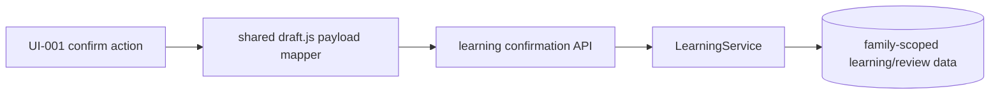

# BUG-025 — 纯复习草稿确认丢失科目

- Status: `VERIFYING`
- Severity: `用户阻断：纯复习草稿无法确认`
- Risk: `R1`
- Owner: `产品负责人（用户）`
- Implementer: `Codex`
- Reviewer/Verifier: `Codex + 产品负责人`
- First observed: `2026-09-19 / 小程序开发版本 0.1.11`
- Related incident/ticket: `当前会话：String should have at least 1 character`
- Spec revision: `BUG-SPEC-20260919-REVIEW-ONLY-CONFIRM-01`
- User confirmation: `approved by product owner on 2026-09-19; current-thread reply “修复” immediately after the explicit BUG-SPEC-20260919-REVIEW-ONLY-CONFIRM-01 approval request`
- Affected Feature IDs: `FEAT-001`
- Feature current-state documents: `docs/domain/features/FEAT-001-push-kids-mvp.md`
- Feature baseline revision: `FEAT-STATE-20260919-REVIEW-SOURCE-07-UPLOADED`
- Feature merge owner: `Codex`

## Frontend Design Impact and Repository-native Approval

- Frontend impact: `no — no layout, copy, interaction, state presentation, or visual contract changes`
- Frontend impact reason: `the same confirmation action succeeds for a previously rejected valid payload`
- Frontend engineering impact: `yes — shared confirmation payload construction and regression coverage`
- Frontend engineering impact reason: `apps/miniprogram/pages/submission/draft.js changes request mapping only`
- Affected UI IDs: `UI-001`
- UI current-state documents: `docs/design/frontend/ui/UI-001-parent-miniapp.md`
- Frontend baseline revision: `FDB-20260913-04`
- Frontend engineering constraint revision: `FEC-20260913-LOCAL-DESIGN-EVIDENCE-01`
- Affected frontend quality dimensions: `state/form/security/privacy/observability`
- Frontend quality budgets/requirements: `server remains authoritative; recoverable forms preserve input; no child content or identifiers are logged; no bundle dependency or visual resource added`
- Frontend quality verification plan: `targeted payload test, full frontend suite, ESLint, Mini Program validation, architecture/design-policy checks, preview/upload gates`
- Approved frontend engineering deviations: `none`
- Current Design Revision(s): `DREV-20260919-TODAY-SOURCE-MATERIAL-01`
- Editable design source path(s): `N/A — no visible change`
- Design source SHA-256: `N/A — no visible change`
- Proposed Design Revision: `N/A — no visible change`
- Required viewport/state exports: `N/A — request serialization only; no geometry or rendered state changes`
- Prototype status: `N/A`
- Approved Task Spec revision: `BUG-SPEC-20260919-REVIEW-ONLY-CONFIRM-01`
- Approved Design Revision: `N/A`
- Design approval evidence: `N/A — no visible change`
- Snapshot manifest path: `N/A — no visible change`
- Permitted implementation deviations: `none`
- UI current-state merge owner: `Codex`
- UI current-state merge evidence: `pending verification`
- Frontend visual/a11y/resolution verification: `N/A for changed behavior; existing release-level native/device gates remain NOT_RUN unless exercised during release`
- Frontend engineering verification evidence: `targeted 10 passed; frontend 170 passed; ESLint, Mini Program validation, architecture and design-policy checks PASS`
- External design dependency: `none`

## 1. Symptom and impact

- Who/what is affected: `家长确认仅包含 today_review/history_item、没有新增 knowledge_points 的 AI 草稿`
- Frequency: `deterministic for every review-only draft submitted through the current Mini Program payload builder`
- User-visible symptom: `点击确认后 Toast 显示 “String should have at least 1 character”，草稿无法入终态`
- Business/data/security impact: `确认被阻断；请求在 Pydantic transport validation 前失败，因此没有正式学习、ReviewFeedback 或其他数据写入，也没有跨家庭风险`
- First known good version: `unknown; review-only confirmation server behavior exists, but the shared client payload branch is faulty`
- First known bad version: `0.1.11 confirmed`
- Workaround: `none safe; converting the match into new knowledge would change semantics and may duplicate existing knowledge`

## 2. Reproduction

### Preconditions

- Environment/version: `Mini Program 0.1.11 against the current confirmation API`
- Actor/permissions/tenant: `family member with learning-record write permission`
- Data/fixture: `pending_confirmation proposal with knowledge_points=[] and one server-origin todo_match; original proposal.subject_name="数学"`
- Feature flags/config: `none`
- External dependencies: `none after the proposal already exists`

### Steps

1. Open a pending AI draft that contains only an existing-review match.
2. Keep the valid review match and press confirm.
3. Observe the POST `/submissions/{id}/confirm` payload and response.

### Actual result

`confirmPayload` creates `groups=[]` and overwrites the valid proposal subject with `subject_name=""`; the API returns 422 with `loc=(proposal, subject_name)`, `type=string_too_short`, `msg=String should have at least 1 character`.

### Expected result

The client preserves the server proposal subject for a review-only confirmation; the existing API accepts the request and `BHV-005` confirms the server-origin Review match without creating duplicate learning knowledge.

### Reproduction evidence

- Test/script: `direct ConfirmSubmission.model_validate reproduction using the client-produced empty subject shape`
- Request/trace/log ID: `N/A — deterministic local contract reproduction; no child payload retained`
- Screenshot/data query: `N/A`
- Reproduction rate: `100%`

## 3. Triage

### Confirmed facts

| Fact | Evidence |
|---|---|
| The source proposal has a non-empty subject | provider and persisted `AnalysisProposal.subject_name` require `min_length=1` |
| Review-only drafts legitimately have no knowledge groups | `LearningService._confirmation_plans` accepts no buckets when `todo_matches` is non-empty |
| The client replaces the subject with an empty string when groups are empty | `apps/miniprogram/pages/submission/draft.js:120` |
| The API rejects that empty string before service execution | `AnalysisProposal.subject_name = Field(min_length=1, max_length=40)`; local validation reproduced the exact error |
| Existing frontend coverage misses the malformed field | review-only test asserts points, matches, and groups but not `payload.proposal.subject_name` or backend schema validity |

### Hypotheses

| Hypothesis | Supports | Contradicts | Experiment | Result |
|---|---|---|---|---|
| The validation error is caused by the review-only payload branch | exact code assignment and exact Pydantic error reproduce | none found | validate the constructed empty-subject payload | confirmed |

### Blast radius

- Entry points: `pages/submission/confirm` and pending `pages/record-detail`, both through shared `draft.js`
- Callers/consumers: `all confirmation callers using confirmPayload`; only zero-knowledge/non-empty-review payloads fail this way
- Data already affected: `none corrupted; rejected before transaction`
- Security/tenant boundary: `unchanged; server continues to validate the stored original Review references and family scope`
- Related behaviors: `BHV-004, BHV-005`
- Other code with the same pattern: `no other assignment of empty proposal.subject_name found in confirmation payload construction`

### Link/call graph

```text
confirm CTA
  -> draft.confirmDraft
  -> confirmPayload
  -> knowledge_points=[] -> groups=[] -> subject_name="" (fault)
  -> POST /submissions/{id}/confirm
  -> ConfirmSubmission / AnalysisProposal validation
  -> 422 string_too_short (LearningService not entered)
```

## 4. Root cause

### Fault mechanism

The shared client mapper incorrectly treats “no new-knowledge group” as “no subject.” A review-only proposal still has a valid server-origin subject and Review identity, but `confirmPayload` discards that subject whenever `groups.length === 0`. The server contract correctly rejects the resulting empty string.

### Why existing controls missed it

- Missing/incorrect test: `the review-only frontend test checks collection shapes but not the complete request schema or preserved subject`
- Review/spec gap: `multi-subject grouping documented the first-group mapping but did not state the zero-group fallback`
- Monitoring gap: `generic Pydantic text reaches the Toast; no safe field-specific client mapping exists, but error-copy changes are outside this minimal fix`
- Architecture/process contributor: `a client DTO mapper duplicated one proposal invariant without a contract-validity assertion`

### Root-cause evidence

- Code location: `apps/miniprogram/pages/submission/draft.js:107-122`
- Failing test: `TP-001 failed pre-fix with 9 passed / 1 failed and actual '' versus expected '数学'`
- Runtime evidence: `local model validation returns ('proposal','subject_name') / string_too_short with the exact reported message`

## 5. Fix contract

### Required behavior

- With one or more knowledge groups, `proposal.subject_name` remains the first group subject for backward compatibility.
- With zero knowledge groups and at least one legitimate review match, `proposal.subject_name` preserves the trimmed server proposal subject.
- The client must never manufacture an empty subject for a valid review-only draft.
- Server-side `min_length=1`, original-proposal allowlisting, family/child scope, and atomic confirmation remain unchanged.

### Must not change

- Do not allow empty subject names in the backend schema.
- Do not derive or guess the authoritative subject from editable Todo display text.
- Do not create Knowledge/LearningRecord for a review-only confirmation.
- Do not change layout, copy, confirmation gestures, error presentation, API schema, database schema, or deterministic Review policy.

### Feature current-state impact

- Current Feature sections affected: `Current invariants / verification evidence / change references`
- Incorrect/obsolete statement to correct: `none; implementation failed to satisfy the existing pure-review confirmation contract`
- Final facts to merge after verification: `review-only client confirmation preserves proposal subject and passes the existing API contract`
- Change Reference to add: `BUG-SPEC-20260919-REVIEW-ONLY-CONFIRM-01`

### Non-goals

- Redesigning the confirmation page or changing validation copy.
- Reclassifying AI items or changing Review state transitions.
- Backend deployment, schema migration, data repair, or backfill.
- Changing multi-subject knowledge grouping.

### State/data repair

- Does the fix prevent new corruption only? `It removes a request rejection; there is no corruption.`
- Is existing data repair required? `No; pending drafts remain retryable after the client update.`
- How is affected data identified? `No batch identification required.`
- Is repair idempotent/reversible/audited? `N/A; code rollback is sufficient and no stored data changes.`

## 6. Fix design

### Selected change

- Existing path to modify: `confirmPayload` in the shared Mini Program draft mixin.
- Logic to delete/replace: `replace the zero-group "" fallback with the trimmed original proposal.subject_name`.
- Why no parallel path is needed: `both confirmation entry points already share this mapper`.
- Error/transaction/concurrency implications: `none; the request reaches the existing server transaction, which owns validation, locking, dedupe, and Review transition`.

### Trade-offs and alternatives rejected

| Alternative | Why rejected |
|---|---|
| Make backend `subject_name` optional/empty for review-only payloads | Weakens a stable proposal invariant and accepts malformed payloads from every client |
| Derive subject from `todo_matches[0].subject_name` | Creates a second authority and ambiguous behavior if matches span subjects or display metadata is absent |
| Create a synthetic group for review-only confirmation | `groups` specifically maps knowledge indexes; an empty synthetic group misstates the API meaning |
| Add a new confirmation endpoint | Parallel path and rollout complexity for a one-line mapping defect |

### Sequence diagram

```mermaid
sequenceDiagram
  participant P as Parent
  participant M as Mini Program draft mapper
  participant A as Confirmation API
  participant S as LearningService
  P->>M: confirm review-only draft
  M->>M: groups=[]; preserve proposal.subject_name
  M->>A: POST valid ConfirmSubmission
  A->>S: validated request
  S->>S: revalidate server-origin Review match
  S-->>P: existing ConfirmationResult
```

### State machine

```text
pending_confirmation + review-only valid proposal
  faulty client 0.1.11 -> 422 transport rejection -> pending_confirmation
  fixed client 0.1.12  -> existing confirmation transaction -> confirmed

invalid empty-subject payload -> remains 422
tampered/foreign Review reference -> remains rejected with zero writes
```

### Architecture diagram



No module boundary, dependency direction, shared abstraction, extension point, database, API, or deployment-topology change.

### Expected file changes

| File/path | Action | Expected change | Why required |
|---|---|---|---|
| `apps/miniprogram/pages/submission/draft.js` | modify | preserve original subject in zero-group review-only payload | authoritative defect fix |
| `tests/frontend/draft-subjects.test.js` | modify | assert a review-only payload retains subject and remains schema-compatible in shape | regression prevention |
| `docs/domain/features/FEAT-001-push-kids-mvp.md` | modify after verification | merge verified behavior and release evidence | feature source of truth |
| `docs/domain/BEHAVIOR-CATALOG.md` | modify after verification | record frontend contract evidence for BHV-005 | behavior source of truth |
| `docs/design/frontend/ui/UI-001-parent-miniapp.md` | modify after verification | record UI engineering-only fix and upload state | UI source of truth |
| `docs/deploy/releases/20260919-022.md` | add after release checks | frontend 0.1.12 release record | release evidence |
| `tools/release/miniprogram_version.json` | update only after successful upload | bump released baseline from 0.1.11 to 0.1.12 | prevent version reuse |
| this Spec | modify/move | approval, verification, DONE; move to completed | lifecycle closure |

### Compatibility and rollout

- Deployment order: `frontend-only; existing backend contract already supports review-only confirmation`
- Feature flag: `none`
- Migration/backfill: `none`
- Rollback/restore: `select the previous Mini Program version; no data rollback`
- Success metrics: `targeted review-only payload test passes; full gates pass; preview compiles; 0.1.12 upload succeeds`
- Abort criteria: `normal multi-subject payload changes, backend schema must be relaxed, any authorization/confirmation regression, required test failure, wrong AppID/env/version, or CLI login failure`
- Intended release state: `Mini Program 0.1.12 development version uploaded; experience/review/production remain separate manual gates`

## 7. Regression verification

### Required regression test

- Test point ID: `TP-001`
- Acceptance/expected behavior: `review-only confirmPayload returns knowledge_points=[], groups=[], todo_matches preserved, and proposal.subject_name="数学" rather than ""`
- Test level: `frontend unit/contract-shape test`
- Pre-fix failure evidence: `current code deterministically returns subject_name=""; direct backend model validation reproduces string_too_short`
- Post-fix success evidence: `PASS — targeted 10 passed; full frontend 170 passed`
- Why this test proves the bug: `it executes the exact shared mapper and asserts the field named by the backend validation error`

### Adjacent cases

| Case | Expected |
|---|---|
| Original reproduction | valid subject preserved; confirmation can reach service |
| One-subject new knowledge | first group subject remains authoritative |
| Multi-subject new knowledge | current grouping/index mapping unchanged |
| Empty point filtered from a mixed draft | filtered indexes remain stable |
| Invalid empty/null subject from an invalid proposal | not normalized into a guessed subject; backend remains authoritative |
| Tampered/unauthorized Review | existing server rejection and zero side effect |
| Duplicate/concurrent confirmation | existing service state/transaction behavior unchanged |

### Verification commands

| Test point | Command/case | Environment | Result | Evidence |
|---|---|---|---|---|
| TP-001 + adjacent frontend | `node --test tests/frontend/draft-subjects.test.js` | local Node | PASS | pre-fix 9 passed / 1 failed; post-fix 10 passed |
| Full frontend | `npm test` | local Node | PASS | 170 passed, 0 failed |
| Frontend lint/static | `npm run lint:miniapp && npm run check:miniapp` | local | PASS | ESLint clean; `MINIPROGRAM_VALID pages=15 source_bytes=667593` |
| Required backend regression | `uv run pytest tests/unit tests/integration tests/contract -q` | local SQLite | PASS | 362 passed, 4 skipped, 57 warnings |
| Python quality | `uv run ruff check . && uv run ruff format --check . && uv run mypy apps/api/src` | local | PASS | Ruff PASS; 343 files formatted; Mypy 86 files PASS |
| Architecture/design | `uv run python tools/check_architecture.py && uv run python tools/validate_design_evidence.py --check-current-policy` | local | PASS | `ARCHITECTURE_VALID checked=3`; `DESIGN_EVIDENCE_VALID` |
| Preview | DevTools CLI `islogin` + `preview` | real AppID | not run | pending after all checks pass |
| Upload | DevTools CLI upload version `0.1.12` | WeChat platform | not run | pending after preview |
| Native/device matrix | review-only confirm on iOS/Android and required viewports | experience devices | NOT_RUN unless operator performs after upload | manual release gate |

## 8. Review checklist

- [x] Observable symptom and expected contract are clear.
- [x] Root cause is evidence-backed.
- [x] Same pattern was searched elsewhere.
- [x] Fix targets the shared authoritative client mapper.
- [x] Required design views are complete.
- [x] Expected file changes are bounded.
- [x] User approved this exact Spec revision.
- [x] Regression test fails pre-fix and passes post-fix.
- [x] Required automated checks pass or have explicit risk.
- [x] Feature/UI/behavior current-state facts are merged for local verification.
- [ ] Development version 0.1.12 is uploaded and release evidence recorded.
- [ ] Spec is DONE and moved to `specs/completed/`.

## 9. Closure and prevention

- Changed behavior: `review-only confirmation preserves the original proposal subject when no knowledge groups exist`
- Deleted workaround/logic: `removed the client-created empty-string fallback for zero groups`
- Data repaired: `not required`
- Monitoring added: `none; regression contract prevents recurrence without logging child content`
- Behavior catalog update: `BHV-005 now states the review-only payload invariant and frontend regression evidence`
- Feature current-state document update and Change Reference: `FEAT-001 and UI-001 updated to local verified state`
- Architecture/test/process change preventing recurrence: `full payload invariant asserted in the existing review-only test`
- Independent Review: `pending`
- Residual risk: `native experience verification requires an operator-owned review-only fixture`
- Follow-up owner/date: `product/release owner after upload`

## 10. Approval requested

Recommended approval text:

> 批准 BUG-SPEC-20260919-REVIEW-ONLY-CONFIRM-01，按推荐方案修复、验证并上传小程序 0.1.12 开发版本。

This approval authorizes the scoped code/document/test changes, local verification, commit, and Mini Program
preview/upload. Setting the experience version, submitting WeChat review, and formally publishing remain separate
operator gates under `docs/deploy/FRONTEND-RELEASE.md`.
