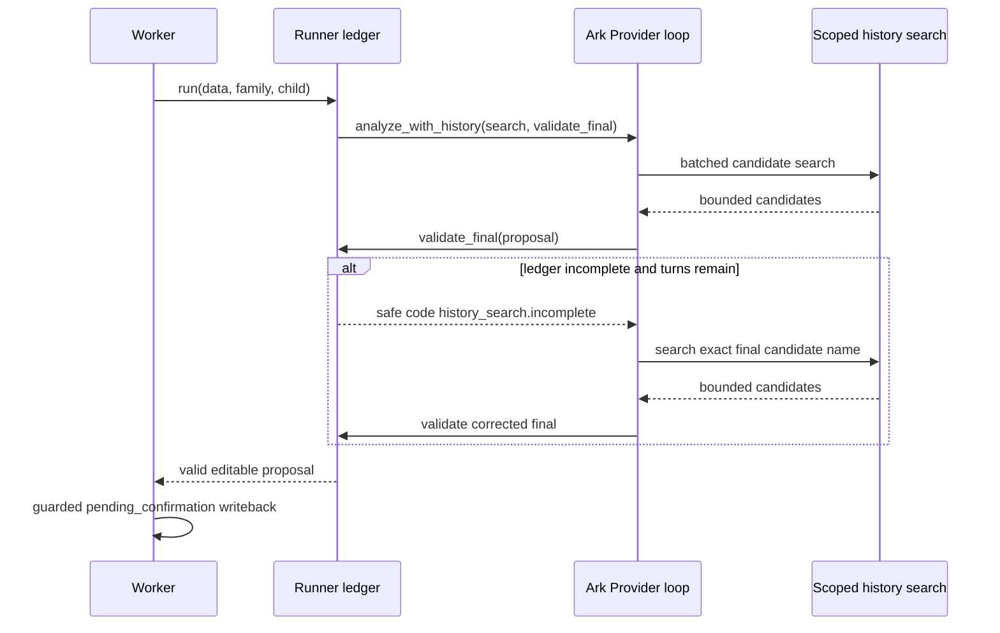
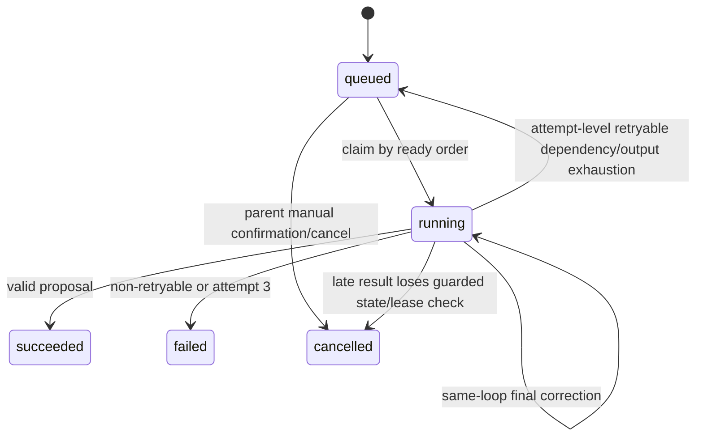
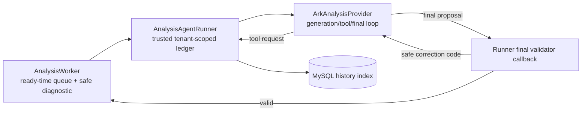

# BUG-026 — 分析最终校验回路与重试队列公平性

- Status: `VERIFYING`
- Severity: `P1 — 可识别的学习照片会反复返回 analysis_output_invalid，且旧失败任务会阻塞后续分析`
- Risk: `R2 — 修改 Agent 最终校验回路、任务领取顺序和安全诊断持久化；不改正式学习写入语义`
- Owner: `产品负责人（用户）`
- Implementer: `Codex`
- Reviewer/Verifier: `Codex + 产品负责人受控验收`
- First observed: `2026-09-22 / 生产 flask-ik19-023`
- Related incident/ticket: `2026-09-22 用户反馈“最近的内容分析和生成都是错误的”`
- Spec revision: `BUG-SPEC-20260922-ANALYSIS-CORRECTION-02`
- User confirmation: `APPROVED — 产品负责人（用户），2026-09-22；用户在收到
  BUG-SPEC-20260922-ANALYSIS-CORRECTION-02 的精确协议、同-loop 纠错方案与发布门禁说明后，
  明确回复“修复这个问题 然后发布”。批准范围不新增 candidate_id，不包含生产数据修复，也不跳过灰度、
  业务 smoke 或最终流量门禁。`
- Affected Feature IDs: `FEAT-001`
- Feature current-state documents: `docs/domain/features/FEAT-001-push-kids-mvp.md`、`docs/domain/BEHAVIOR-CATALOG.md`
- Feature baseline revision: `FEAT-STATE-20260919-REVIEW-ONLY-CONFIRM-02-UPLOADED`
- Feature merge owner: `Codex；仅在实现及验证完成后合并最终事实`

## Frontend Design Impact and Repository-native Approval

- Frontend impact: `no — 页面、文案、交互和 API 响应形状不变`
- Frontend impact reason: `现有整理中、失败、重试和家长确认流程保持不变；修复发生在后端 Agent/Worker 内部`
- Frontend engineering impact: `no — 不修改小程序代码、工具链或前端质量预算`
- Frontend engineering impact reason: `仅运行既有前端回归证明兼容`
- Affected UI IDs: `N/A`
- UI current-state documents: `N/A`
- Frontend baseline revision: `N/A`
- Frontend engineering constraint revision: `N/A`
- Affected frontend quality dimensions: `N/A`
- Frontend quality budgets/requirements: `N/A`
- Frontend quality verification plan: `N/A；运行 npm test 与小程序静态校验作为兼容回归`
- Approved frontend engineering deviations: `none`
- Current Design Revision(s): `N/A`
- Editable design source path(s): `N/A`
- Design source SHA-256: `N/A`
- Proposed Design Revision: `N/A`
- Required viewport/state exports: `N/A`
- Prototype status: `N/A`
- Approved Task Spec revision: `N/A until approved`
- Approved Design Revision: `N/A`
- Design approval evidence: `N/A`
- Snapshot manifest path: `N/A`
- Permitted implementation deviations: `none`
- UI current-state merge owner: `N/A`
- UI current-state merge evidence: `N/A`
- Frontend visual/a11y/resolution verification: `N/A`
- Frontend engineering verification evidence: `pending compatibility regression`
- External design dependency: `none`

## 1. Symptom and impact

- Who/what is affected: 使用图片分析的家庭；已观察到 2026-09-21/22 的语文、英语图片任务。
- Frequency: 生产快照中，四笔被用户重试/新建的任务里两笔已出现至少一次可重试失败，一笔进入第二次
  attempt，两笔尚在队列等待；同批附近四笔已成功提案经照片复核基本对应材料。
- User-visible symptom: 单笔任务先长时间“整理中”，随后显示无法整理；多笔任务一起提交时，后续任务长时间
  保持 queued，形成“最近分析和生成都错误”的整体感受。
- Business/data/security impact: 未确认草稿不会写正式学习或 Review，未发现跨家庭或正式数据损坏；家长无法及时
  得到可编辑提案，并会反复手动重试。
- First known good version: `flask-ik19-023` 仍有同日首 attempt 成功案例，因此不是 Provider 全局不可用。
- First known bad version: `flask-ik19-023` 的 2026-09-21/22 实际任务。
- Workaround: 等待最多三次完整 Job attempt 或补充文字后手动重试；会继续占用单 Worker，不能作为修复。

## 2. Reproduction

### Preconditions

- Environment/version: `prod-d2g14rwoycac6b45d / flask-ik19-023 / MySQL 5.7 / schema 20260913_0014`。
- Actor/permissions/tenant: 已绑定家庭的可写成员；身份和完整资源 ID 不进入本文。
- Data/fixture: 多知识点图片；模型先用候选名 A 完成历史检索，最终输出经过整理的等价名称 B。
- Feature flags/config: `ARK_CONTEXT_CACHE_ENABLED` 未显式配置，因此使用默认 `true`；单实例、单进程 Worker。
- External dependencies: 微信私有对象存储、Ark Responses API、MySQL。

### Steps

1. 模型调用 `search_history_items(candidate_key=A)` 并得到合法结果。
2. 模型在最终结构化提案中把同一候选名称整理成 B。
3. Provider 内部结构/引用校验通过并结束会话。
4. Runner 在 Provider 返回之后执行历史检索 completion ledger 校验。
5. 同时提交后续图片任务，观察旧任务重排队后的领取顺序。

### Actual result

- `AnalysisAgentRunner.run()` 在 Provider loop 外抛出 `history_search.incomplete`；模型收不到纠错机会。
- Worker 将整笔 Job 重新排队并从头重传图片/上下文；最多重复三次。
- 领取查询仅按 `AgentJob.created_at` 排序。旧任务一旦短 backoff 到期，会持续优先于新任务，造成队头阻塞。
- 安全校验码只写 stdout；当前环境 `SearchClsLog` 返回 `ResourceNotFound.TopicNotExist`，数据库只保留通用
  用户文案，无法回看该 attempt 的安全原因。

### Expected result

- 可纠正的最终 ledger 不一致必须在同一个 Agent loop 内返回静态安全指导，允许模型补做精确候选检索后重新输出。
- 完整 Job attempt 重试不能持续抢占更早 ready 的未尝试任务。
- 每个失败/重排队 attempt 在数据库保留不含儿童内容的静态原因和校验码；用户接口仍只显示通用文案。
- 家长确认前仍不得创建正式学习、知识、Review 或 Feedback。

### Reproduction evidence

- Test/script: 当前 `tests/unit/test_analysis_agent_runner.py::test_runner_refuses_to_label_new_without_a_completed_history_search`
  证明 Runner 会在 Provider 返回后抛错；缺失的是“同 loop 修正后成功”回归。
- Request/trace/log ID: 生产完整 ID 不写入 Spec；快照只记录 attempt/state/timestamp。
- Screenshot/data query: 2026-09-22 13:03–13:07 UTC，旧任务在 attempt 1/2 间重排队，后续两个任务保持
  attempts=0/1；最近成功提案与对应 1–3 张照片已人工逐项复核。
- Reproduction rate: 代码级 scripted 路径为 100%；生产具体每次校验码因日志 Topic 故障不可追溯，需由新增
  安全持久化在发布后闭环。

## 3. Triage

### Confirmed facts

| Fact | Evidence |
|---|---|
| 当前 100% 流量为 `flask-ik19-023` | 只读 `DescribeCloudBaseRunServer`：`FlowRatio=100`、1 replica |
| Ark 会话复用在该版本默认开启 | 版本环境未设置 `ARK_CONTEXT_CACHE_ENABLED`；代码默认 `true` |
| Provider 内部可纠错，但 Runner ledger 校验发生在 Provider 返回之后 | `providers.py::analyze_with_history` 与 `runner.py::run` |
| Runner 后置错误被 Worker 当作完整 attempt 失败 | `worker.py` 的统一 failure disposition/requeue 分支 |
| 队列领取只按创建时间，未按 ready 时间 | `worker.py::_claim_one/process_one` 查询的 `order_by(AgentJob.created_at)` |
| 单任务重试可阻塞新任务 | 单实例单 Worker + 生产 attempt/state 时间序列 |
| 当前无法回查静态 validation code | `SearchClsLog` 返回 `ResourceNotFound.TopicNotExist`，Job 只存通用文案 |
| 已成功的四笔近期提案没有出现系统性识图错位 | 临时只读照片复核；图片未写仓库并在诊断结束后清理 |

### Hypotheses

| Hypothesis | Supports | Contradicts | Experiment | Result |
|---|---|---|---|---|
| Ark 会话复用造成跨任务串上下文 | 改动时间接近问题反馈 | response ID 是 attempt-local，近期多笔首 attempt 成功 | 检查请求形状/作用域测试 | rejected as primary cause |
| Provider 全局不可用 | 多笔任务报错 | 同版本同日多笔成功，图片 materialize/DB 正常 | 生产状态与提案复核 | rejected |
| 最终名称与已检索候选名漂移触发后置 ledger 错误 | 代码确定性可达；多知识点任务重复 full attempt | 生产 validation code 未持久化 | scripted 同义改名用例 | confirmed code defect; production correlation strong |
| 单 Worker 队列排序放大单笔失败 | 旧 Job 多次 attempt、新 Job 长时间 attempts=0 | 无 | ready-time 排序回归 | confirmed |

### Blast radius

- Entry points: 图片/文字提交 finalize、失败草稿 retry。
- Callers/consumers: `AnalysisWorker` → `AnalysisAgentRunner` → `ArkAnalysisProvider` → history search。
- Data already affected: 未确认 Submission/Job 状态与等待时间；没有证据表明正式学习数据损坏。
- Security/tenant boundary: 不变；历史检索继续由 Runner 固定 family/child scope。
- Related behaviors: `BHV-003`、`BHV-014`、`BHV-015`。
- Other code with the same pattern: Provider 内其他结构/引用校验已在 loop 内；仅 Runner completion ledger 留在 loop 外。

### Link/call graph

```text
Mini Program finalize/retry
  → LearningService queues AgentJob
  → AnalysisWorker claims oldest created eligible Job
  → AnalysisAgentRunner owns scoped history ledger
  → ArkAnalysisProvider runs tool/final loop
  → Provider returns final proposal
  → Runner raises history_search.incomplete outside loop
  → Worker requeues whole Job
  → same old Job becomes eligible and precedes newer Jobs
```

## 4. Root cause

### Fault mechanism

`history_search.incomplete` 是可由模型补一次精确检索解决的输出校验，但其所有权跨在 Runner 和 Provider
之间：Runner 持有可信 ledger，Provider 持有生成 loop。当前没有 final-validation callback，因此 Runner 只能在
Provider 已结束后拒绝提案。Worker 又把该拒绝升级为完整 Job 重试。与此同时，队列用创建时间而非 ready 时间
排序，使最老的可重试 Job 反复占用唯一 Worker。安全 validation code 没有持久化，平台日志 Topic 故障进一步
掩盖了这一因果链。

### Why existing controls missed it

- Missing/incorrect test: 有“未检索必须拒绝”测试，没有“名称整理导致 ledger mismatch 后同 loop 自愈”测试，也没有
  “retry 不抢占 fresh ready Job”测试。
- Review/spec gap: `BUG-022` 明确覆盖工具参数错误的同-loop 修正，但没有覆盖 Provider 返回之后的 Runner ledger 校验。
- Monitoring gap: validation code 只在短暂 stdout 中，未进入持久安全诊断字段；平台日志 Topic 不可用。
- Architecture/process contributor: 单 Worker 是已知架构限制；不公平排序把单任务缺陷放大成队列级影响。

### Root-cause evidence

- Code location: `apps/api/src/push_kids/agent_processing/runner.py`、`providers.py`、`worker.py`。
- Failing test: 待新增 scripted regression；现有 test 只证明错误会逸出 Provider。
- Runtime evidence: 同一版本存在成功提案，失败任务以 1–3 次完整 attempt 串行重试，后续 ready Job 未先执行。

## 5. Fix contract

### Required behavior

- Runner 向支持该合同的 Provider 提供 final proposal validator；它在 Provider loop 内检查 scoped ledger。
- `history_search.incomplete` 以静态、不含儿童内容的纠错说明留在当前 session/turn budget 内；模型可补工具调用并重新输出。
- Prompt 与 tool description 必须明确以下精确协议，而不是只写“查询相关候选”：
  1. `queries[*].candidate_key` 必须逐字等于准备在最终 `subjects[subject_name][*].name` 中输出的完整名称；
  2. 同一个候选的 `subject_name` 在工具调用和最终输出中必须完全一致；
  3. 查询成功后不得再改名、合并或拆分；若确需改名、合并或拆分，必须按每个最终名称重新调用工具；
  4. 每个 `kind=new` 的最终条目都必须存在一个成功完成的
     `(subject_name, normalize(candidate_key)) == (subject_name, normalize(name))` 查询；
  5. `history_item` 必须逐字复制工具结果的规范 `name`、`existing_knowledge_id` 和 `review_id`，不得自行改写；
  6. 一次工具调用仍使用 `queries` 批量提交当前所有最终候选，不能逐条浪费轮次。
- 兼容不接受 callback 的测试/旧 Provider；Runner 保留最终防线，绝不放宽“new 必须先检索”。
- Job 领取按 `available_at, created_at, id` 稳定排序；fresh ready Job 不被刚 requeue 的旧 Job 抢占。
- `AgentJob.error_message` 保存有界内部诊断标记（公共 code、静态 reason、最多 20 个 sanitize 后 validation codes）；
  `LearningSubmission.error_message` 和 API 仍仅保存/返回现有家长文案。

### Must not change

- 模型不判分、不判断掌握、不预测下一课；复习日期仍由确定性 planning policy 生成。
- 家长确认前零正式学习/Review 写入。
- family/child scope、20 logical calls、100 unique results、8 turns、20 proposals 和租约/重试上限不变。
- raw prompt/output、关键词、科目、图片、家庭/孩子内容不得进入日志或诊断字段。
- API、数据库 schema、小程序界面与文案不变。

### Feature current-state impact

- Current Feature sections affected: AI history Agent validation、Worker retry/fairness、safe observability。
- Incorrect/obsolete statement to correct: 当前文档把所有模型校验描述为同-loop 可纠正，实际 Runner ledger 校验不是。
- Final facts to merge after verification: final validator callback、ready-time queue ordering、持久安全诊断。
- Change Reference to add: `BUG-SPEC-20260922-ANALYSIS-CORRECTION-02`。

### Non-goals

- 不提高 Worker 并发、不拆独立队列服务、不更换模型、不改变知识粒度或历史检索算法。
- 不自动重跑或确认现有生产草稿，不修改/删除已确认记录。
- 不修复微信云日志 Topic；仅保证核心诊断不依赖它。

### State/data repair

- Does the fix prevent new corruption only? `是；当前问题是失败/等待，不是正式数据腐败。`
- Is existing data repair required? `否。发布后由家长对仍 failed 的草稿使用现有重试入口。`
- How is affected data identified? `state=failed AND error_code=analysis_output_invalid；只按家庭授权读取。`
- Is repair idempotent/reversible/audited? `现有 retry 是幂等状态转换；本 Spec 不执行生产数据修复。`

## 6. Fix design

### Selected change

- Existing path to modify: `runner.py` 建立可信 final validator；`providers.py` 在每次 final 后、return 前调用；
  `prompt.py` 和 tool description 写明上述精确格式；`worker.py` 改 ready 顺序并持久化安全诊断。
- Logic to delete/replace: 删除 Ark Provider 成功路径之后才首次发现 ledger mismatch 的单一路径；保留 Runner fallback
  作为兼容/安全防线。
- Why no parallel path is needed: 仍是同一个 Agent loop、同一个 Worker state machine 和同一张 Job 表。
- Error/transaction/concurrency implications: callback 只读内存 ledger；历史工具仍逐次开 family-scoped session；队列排序不改变
  锁、租约、attempt 计数或终态。

### Trade-offs and alternatives rejected

| Alternative | Why rejected |
|---|---|
| 放宽/删除 `history_search.incomplete` | 会允许未经历史检索的新知识，增加重复正式知识风险 |
| 仅增加 Job 重试次数 | 放大成本、延迟和队头阻塞，不修复错误层级 |
| 立即关闭 Ark session reuse | 同版本已有成功证据，且不能解决 Runner 后置校验与队列排序 |
| 提高 Worker 并发 | 扩大资源/锁/租户风险，仍会重复完整失败 attempt |
| 本次新增 `candidate_id` 并重构输出 Schema | 当前可用“精确名称协议 + 同-loop纠错”闭环；新增跨轮 ID 会扩大 Schema、Prompt、兼容和测试范围，先 deferred，只有真实错误率仍不可接受时再单独评审 |
| 新增诊断表/migration | 当前 `AgentJob.error_message` 可承载有界内部标记，无需 R3 数据变更 |

### Sequence diagram



### State machine



### Architecture diagram



### Expected file changes

| File/path | Action | Expected change | Why required |
|---|---|---|---|
| `apps/api/src/push_kids/agent_processing/runner.py` | modify | final validator callback + compatibility fallback | ledger authority stays in Runner |
| `apps/api/src/push_kids/agent_processing/providers.py` | modify | invoke callback inside loop and apply static safe guidance | avoid full Job retry |
| `apps/api/src/push_kids/agent_processing/prompt.py` | modify | document `history_search.incomplete` correction semantics; bump revision | deterministic model guidance |
| `apps/api/src/push_kids/agent_processing/telemetry.py` | modify if needed | reuse sanitizer for persisted codes | privacy boundary |
| `apps/api/src/push_kids/agent_processing/worker.py` | modify | ready-time ordering + internal safe diagnostic marker | fairness and post-incident evidence |
| `tests/unit/test_analysis_agent_runner.py` | modify | callback/fallback ledger tests | trust-boundary regression |
| `tests/unit/test_subject_grouped_analysis.py` | modify | same-loop correction/session request shape/privacy | Provider regression |
| `tests/integration/test_worker_resilience.py` | modify | queue fairness and safe/public error split | state-machine regression |
| `docs/domain/features/FEAT-001-push-kids-mvp.md` | modify after verification | merge final current facts | source of truth |
| `docs/domain/BEHAVIOR-CATALOG.md` | modify after verification | update BHV-003/BHV-014 | behavior truth |
| `docs/architecture/ARCHITECTURE.md` | modify after verification | record validation ownership/fair queue | architecture truth |

### Compatibility and rollout

- Deployment order: backend-only immutable version → local/container/MySQL gates → controlled gray → real image smoke → manual full traffic gate。
- Feature flag: 不新增；如必须紧急缓解，可在控制台显式设 `ARK_CONTEXT_CACHE_ENABLED=false`，但它不替代本修复。
- Migration/backfill: none。
- Rollback/restore: 切回 `flask-ik19-023`；Schema 不回滚。
- Success/abort metrics: 新任务首 attempt 成功率恢复；`history_search.incomplete` 在同 loop 后成功；fresh ready Job 不被 retry
  抢占；任一跨家庭、确认前正式写入、ready 失败或 raw 内容进入诊断即停止放量。

## 7. Regression verification

### Required regression test

- Test point ID: `TP-001`
- Acceptance/expected behavior: Prompt/tool schema 明确要求 `candidate_key` 与最终 `name` 相同；若模型仍先检索 A、
  final 输出 B，final validator 在同 Agent loop 返回精确静态指导，模型补检索 B 后同一 Job attempt 成功。
- Test level: unit/provider+runner scripted Responses。
- Pre-fix failure evidence: 当前 callback 不存在，Runner 在 Provider return 后抛 `history_search.incomplete`。
- Post-fix success evidence: pending。
- Why this test proves the bug: 直接覆盖错误所有权跨 loop 边界的确定性链路。

### Adjacent cases

| Case | Expected |
|---|---|
| 原始名称漂移 reproduction | 同 attempt 自愈 |
| 已精确检索后输出 | 仍一次成功 |
| 未检索且 turn 用尽 | 仍拒绝并按现有上限重试/终态 |
| 恶意/越权 reference | 拒绝且零查询或 family-scoped 零结果 |
| callback 不被旧测试 Provider 接受 | Runner fallback 仍拒绝 |
| 旧 retry 与 fresh ready Job 同时存在 | 先领取 available_at 更早者，顺序稳定 |
| 诊断字段 | 仅静态 code/reason；公共 API 文案不变 |
| session/stateless 模式 | 两种模式均同-loop 修正，无 response ID 持久化 |

### Verification commands

| Test point | Command/case | Environment | Result | Evidence |
|---|---|---|---|---|
| `TP-001` | targeted provider/runner correction tests | local synthetic | PASS | targeted set 65 passed；覆盖 A→B 漂移后同-loop 补查成功 |
| `TP-002` | worker ready-order and safe diagnostic integration tests | SQLite | PASS | fresh-ready 优先、Job 安全诊断与 Submission 公共文案分离均通过 |
| `TP-003` | `uv run pytest tests/unit tests/integration tests/contract -q` | local | PASS | 366 passed / 4 skipped / 57 warnings；4 skipped 为未注入 MySQL URL 的环境用例 |
| `TP-004` | `uv run ruff check . && uv run ruff format --check .` | local | PASS | 345 files formatted；Ruff 无问题 |
| `TP-005` | `uv run mypy apps/api/src` | local | PASS | 86 source files |
| `TP-006` | `npm test` | local | PASS | 170 passed；ESLint PASS |
| `TP-007` | architecture/design/miniprogram validators | local | PASS | architecture/design PASS；15 pages / 667593 bytes |
| `TP-008` | isolated MySQL 5.7 Worker regression | Docker | PASS | 用户授权重启 Docker；utf8mb4 MySQL 5.7.44 空库 migration/current/check PASS，runtime 4 passed；CRUD 用户 DDL denied |
| `TP-009` | controlled live Ark multi-item image smoke | cloud gray | NOT_RUN | 必须在 MySQL/容器门禁通过并创建灰度版本后执行 |

## 8. Review checklist

- [x] Observable symptom and expected contract are clear.
- [x] Root cause is evidence-backed; production exact validation code remains an explicit observability limitation.
- [x] Same pattern was searched elsewhere.
- [x] The fix modifies the authoritative path.
- [x] Obsolete workaround/branch is identified.
- [x] Required design views are complete.
- [x] Expected file changes were reviewed.
- [ ] Regression test was not executed against a separate pre-fix checkout；the pre-fix deterministic path is
  established by the previous Runner-only rejection test and code boundary, not reported as a newly run failure.
- [x] Every required test point ran or has an explicit skipped-check risk.
- [ ] Historical behavior tests pass.
- [x] Data repair, compatibility and rollback are addressed.
- [x] Monitoring detects recurrence without raw content.
- [x] No unrelated refactor is mixed in.

## 9. Closure and prevention

- Changed behavior: `精确名称协议 + Runner final-validator callback + Provider 同-loop 静态纠错；Worker
  ready-time 稳定排序；Job-only 有界安全诊断。`
- Deleted workaround/logic: `Runner 返回后才首次发现 history_search.incomplete 的单一路径已替换；
  Runner 后置检查仍作为兼容/安全防线保留。`
- Data repaired: `none planned`。
- Monitoring added: `pending safe persistent diagnostic marker`。
- Behavior catalog update: `pending`。
- Feature current-state document update and Change Reference: `pending`。
- Architecture/test/process change preventing recurrence: `pending`。
- Independent Review: `pending`。
- Residual risk: Ark semantic variability remains; bounded schema, scoped history search and parent confirmation remain the controls。
- Follow-up owner/date: `Codex / after approval`。
