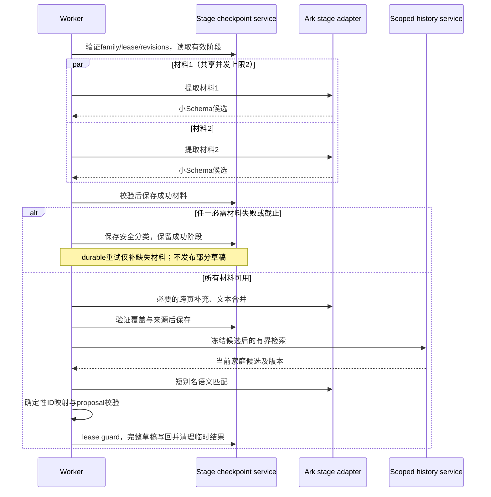
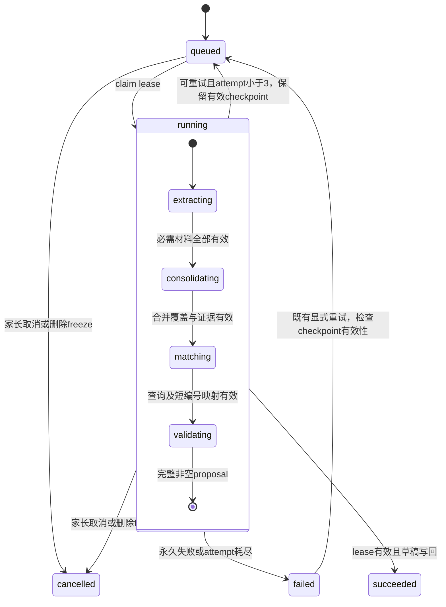
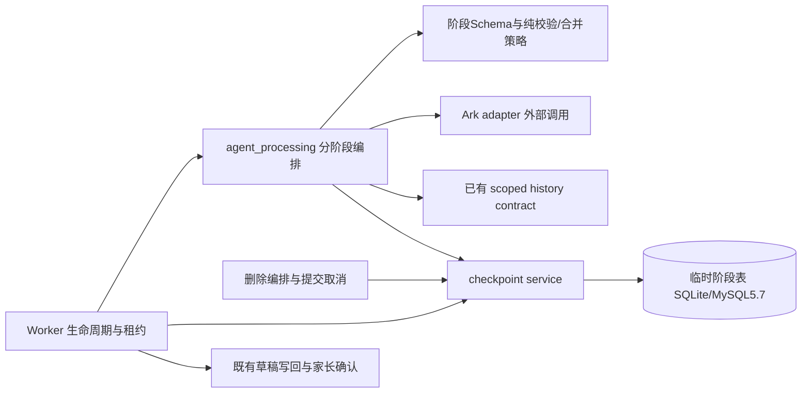

# BUG-028 — 分阶段材料分析、受控并发与失败恢复

- Status: `VERIFYING`
- Severity: `P1 — 有效学习材料连续三次耗尽生成预算，无法生成可确认草稿`
- Risk: `R3 — 分析编排、受控并发、临时内容持久化及 MySQL migration`
- Owner: 产品负责人（用户）
- Implementer: Codex
- Reviewer/Verifier: 实现后的独立只读 Reviewer；产品负责人验收语义质量
- First observed: `2026-10-06 / flask-ik19-025`
- Related incident: 本会话用户提供的 2026-10-06 14:11:29–14:20:32 脱敏任务日志；不复制原始日志、儿童材料或模型响应进仓库。
- Spec revision: `BUG-SPEC-20261006-STAGED-ANALYSIS-01`
- Proposed architecture revision: `ARCH-20261006-STAGED-ANALYSIS-01`
- User confirmation: **APPROVED — 产品负责人（用户），2026-10-06，本会话明确回复“好的 按照这个方案修改，并进行充分的测试，从数据库中筛选历史的信息然后进行测试，查看生成稳定性和结果”；批准本 Spec revision 与 ARCH-20261006-STAGED-ANALYSIS-01，授权读取有权访问的历史材料进行隔离重放，不授权生产业务写入或部署。**
- Affected Feature IDs: `FEAT-001`（生成）；`FEAT-006`（新增临时数据的删除职责）
- Feature current state: [FEAT-001](../../docs/domain/features/FEAT-001-push-kids-mvp.md)、[FEAT-006](../../docs/domain/features/FEAT-006-data-cleanup-and-family-reset.md)
- Feature baseline revisions: `FEAT-STATE-20261006-SOURCE-DELETE-01-LOCAL`、`FEAT-STATE-20260919-MYSQL57-WORKER-04-LOCAL`；工作区有其他任务并行修改，实现前重新核对，不覆盖。
- Cloud source baseline: 发布记录所指 `b3db219 / flask-ik19-025`；日志亦显示 `024` 承接另一任务，不据此认定流量比例或版本回归。
- Feature merge owner: Codex，仅在验证后合并最终事实。
- Template: [BUGFIX-SPEC](../_templates/BUGFIX-SPEC.md)

## Frontend Design Impact and Repository-native Approval

- Frontend impact: `no`；保留现有 queued/analyzing/failed/pending_confirmation、手动重试、手动输入及确认页面，不增加阶段进度或部分成功界面。
- Frontend engineering impact: `no`；本修订不修改小程序代码、布局、文案或公开响应结构。
- Affected UI IDs: `UI-001` 为兼容性消费者；无 UI 合同变更。
- Design Revision、设计源、viewport exports、manifest、frontend deviations: `N/A`，没有可见设计变更。
- Frontend baseline/FEC: 沿用仓库批准基线；不申请例外。现有前端测试验证旧 API/error code 兼容。
- Task approval: `BUG-SPEC-20261006-STAGED-ANALYSIS-01 APPROVED 2026-10-06`；Design approval: `N/A`。
- Historical replay authorization: 2026-10-06本会话用户进一步明确回复“授权使用现有 Ark 接口回放历史图片”；仅临时副本、既有Ark接口、隔离测试与聚合指标。
- Historical replay gate: 自动审批随后要求家长文字及必要历史知识上下文独立授权；已提问，尚未收到回复。历史回放进程已结束、临时材料已清理；此前7个完成观测保留，不能称144次对照已完成。
- External design dependency: none。
- 若需要新增部分草稿、分阶段进度或修改家长错误文案，必须另修订 Spec 并通过设计门禁。

## 1. Symptom and impact

一条含三张图片的任务在约三轮 4.5 分钟尝试后失败。家长无法获得有效草稿，已有成功工作在整任务重试时丢失。没有日志证据表明正式学习/复习数据已被错误写入。

频率未知：单次事件不能推导总体失败率。目标是显著降低可避免的失败、保留可恢复进度并可解释终态；外部依赖永久不可用时仍必须有诚实的失败状态，不承诺零失败。

## 2. Reproduction and evidence

| 尝试 | 用户提供日志中的事实 |
|---|---|
| 1 | 首轮 `provider_call` 失败，269744 ms，remaining_time_ms=0 |
| 2 | 三图读取317 ms、上下文14 ms；首轮110677 ms，历史检索2个query返回11条；第二轮81092 ms后 `context.reference`；第三轮77793 ms后 `provider_call` 失败、预算为0 |
| 3 | 三图读取393 ms、上下文12 ms；首轮269593 ms后失败，达到3次上限 |

核对发布源的五分钟 lease、30秒写回余量、SDK retries=0、每次请求 timeout=剩余预算，与日志一致。请求在预算耗尽时失败，高度符合超时；原始 SDK exception/status/request ID 未保留，不能进一步归因于厂商排队、推理或网络。

`context.reference` 来自模型 `context_used` 不属于 `recent_learning.record_id` 集合；不能仅凭该码断言具体错误 ID 或错误字段来源。

原始三图从已授权数据库及既有媒体服务只读取得，并已完成一次A/B/C/D隔离回放；没有修改原记录。历史对照因后续自动审批要求补充文字/上下文授权而停止，不能据此宣布稳定性验收通过。材料未进入仓库或普通日志，临时副本已清理。详见[验证记录](../../docs/quality/evidence/BUG-028-STAGED-ANALYSIS.md)。

## 3. Triage and hypotheses

### 已确认的工程事实

- 当前模型同时负责读图、知识提炼、科目/粒度、历史查询、去重/复习分类和完整提案生成；可进入8轮循环。
- 每个模型知识点11个字段，包含多个数据库标识及跨字段约束。三科 Schema 紧凑 JSON 约2715 bytes；33个分析科目的合成上限样本约5635 bytes。数字来自当前工作区的只读构造，不能代表事故请求的实际 token 数。
- Schema 保证字段形状，引用、等价关系和材料证据仍需本地校验。不能通过去掉严格校验来提高表面成功率。
- 当前请求未显式配置 thinking/reasoning 或 max_output_tokens。仓库默认模型为 `doubao-seed-2-1-pro-260628`；事故云版本的实际模型/接入点参数尚未读得，不能声称其运行时配置已确认。
- 当前重试完整重启分析；不存在已验证的逐材料持久化 checkpoint。
- `DependencyError` 包装丢失了供运维区分超时/限流/连接失败的安全分类。

| 假设 | 支持证据 | 尚不能确定的部分 | 隔离实验 |
|---|---|---|---|
| 多任务耦合和语义约束导致反复推理/纠错 | 第二次已出现引用校验失败和再生成 | Schema复杂度对耗时的独立贡献 | 同模型/材料/推理设置，比较旧流程、简化ID后的单阶段、分阶段 |
| 推理默认值与无输出预算加重长尾 | 代码未显式设置；官方模型文档说明默认思考能力 | 云端实际model及reasoning tokens未知 | 固定拓扑，仅改变支持的思考档位和输出预算 |
| 多图视觉负载拉长请求 | 事故为3图；失败请求耗尽约270秒 | 不同图片清晰度/密度/大小影响 | 0/1/3/6/9图、密集/跨页/重复材料分层 |
| 提供商限流、网络或排队 | 均可能导致provider_call失败 | 没有底层分类、HTTP状态和request ID | 新增安全遥测，再关联提供商诊断；不臆测 |

官方参考（2026-10-06 检索；兼容性须对实际模型再次确认）：

- [结构化输出](https://docs.volcengine.com/docs/ark/structured-output-beta?lang=zh)：结构合法不保证内容正确，任务复杂度/输出限制仍可能造成问题。
- [深度思考](https://docs.volcengine.com/docs/ark/deep-thinking?lang=zh)：各模型支持的思考开关和档位不同。
- [Responses API](https://docs.volcengine.com/docs/ark/create-model-responses-api?lang=zh)：max_output_tokens包含回答与思考内容，不能压低到必然截断有效输出。

### Link/call graph

```text
现状：submission → AgentJob → worker → runner → Ark(读图+工具+final+纠错循环)
                                      ↘ history_search → scoped DB
目标：submission → AgentJob → worker → staged_pipeline
                                      ├ extraction → bounded Ark calls
                                      ├ consolidation → bounded text/group-image calls
                                      ├ history lookup → existing scoped service
                                      ├ matching → short alias decisions
                                      └ deterministic projection → guarded writeback
                          checkpoint service ↔ validated temporary stage records
```

## 4. Fault mechanism and controls gap

约270秒覆盖整个多轮 Agent attempt。单次慢请求可能用完全部预算；生成结果语义不合法又要求模型重新输出完整结构，消耗额外时间；任务失败后，下次重复已经成功的读图/生成/查询。三次 attempt 用尽形成终态。

已有40-case合成质量门禁不能证明真实多图、密集跨页材料、厂商长尾下的可靠性；此次需补多图覆盖、语义人工真值、失败分母、耗时和恢复测试。没有证据证明单纯增大超时或改模型即可根治。

## 5. Fix contract

1. 保留严格小 Schema 和服务端引用/业务校验，将识别、合并、匹配拆开。模型不再抄写持久化UUID；本次调用范围内的短别名经服务端映射回ID。
2. 图片有限并发提取；默认每Job及每实例最多2个在途模型请求，批次大小不会直接变成并发数。进程中所有该链路消费者共享限额。
3. 每个阶段成功后保存经白名单投影和验证的临时结果；失败只重做缺失/失效阶段。原始模型payload、图片/base64、思维链、远端response ID不持久化。
4. 所有必需材料处理成功且合并/匹配校验通过，才产生完整可确认草稿。任何材料失败不得伪装为无内容，不得悄悄丢页后宣布成功。
5. 家长确认前不写正式记录、KnowledgeOccurrence或Review；计划日期仍由确定性策略生成，模型不评分、不判断掌握。
6. 保持公开 API、最终 AnalysisProposal 和现有失败码兼容；内部增加细分错误分类。现有人工输入、重试、取消行为保留。
7. 不自动重试、确认、删除既有生产失败记录；代码通过验收并按部署手册发布后，原记录可以走既有家长重试入口。

### Feature current-state impact

- FEAT-001 / BHV-003、BHV-014：经验证后替换全能Agent循环、模型ID复制、整任务重算的现状描述，记录阶段预算和恢复。
- FEAT-006：补充临时阶段结果的owner、TTL、取消/家庭/孩子删除与迟到写入阻断。
- 当前架构、测试策略以及上下文复用Spec：明确新流程替代的范围。只在各自实现完成后合并事实；不提前标记实现。
- 同日去重、今日复习、历史复习、新科目确认、原图编号和精确来源语义必须保留，兼容同工作区的原图/知识删除任务。

## 6. Fix design

### 6.1 推荐流程

**A. 分材料提取**

- 输入为单图、必要的家长说明、年级和科目目录；纯文字独立材料单元。模型只识别本次真实内容与来源，不输入家庭历史清单，不调用检索工具。
- 小 Schema 包含候选知识名称/科目/材料证据/置信度，以及需要相邻页上下文的标记和短材料片段。每材料最多20个候选、证据描述有现有长度界限；溢出显式报错，不截断伪成功。
- source index/material ID由服务端绑定；模型不能决定另一张图的归属。同字节图片只识别一次，保持原始排序到证据序号的映射。
- 在同一提交内可复用成功提取；禁止跨家庭、孩子、提交做全局内容缓存。全局最多9图+1文字材料，候选硬上限200。

**B. 合并与跨页补充**

- 先按同科目、规范名称及等价范围做确定性完全重复消除，再用一次有界文本模型请求判断剩余语义等价组和统一粒度。
- 合并模型返回候选短编号分组及必要的规范名称；服务端验证所有输入候选均被分配且只分配一次。遗漏/重复编号、跨科目合并、凭空来源和循环合并拒绝。
- 合并允许同一知识点保留多份证据，不能把“相关”当成“等价”，不能用多数投票认定掌握。
- 对续页题目、表格跨页、文字指代照片等，先做有界相邻材料组补充（每组最多3图，最多2组），再合并；需要更大上下文时明确失败并保留进度，不猜测缺失条件。
- 不因任意一页超时而降级为可确认的部分草稿。允许清晰标记的非学习/空白页，但必须有成功处理状态；所有材料均无有效知识时继续保留现有非空防线。
- 合并后最多20个正式候选；无法不损失语义地满足上限时失败。summary/category/display_kind/review_method/1–5分钟等展示字段在此阶段或已有确定性策略中生成，不再附带历史UUID。

**C. 历史匹配与装配**

- 对合并后候选冻结最终名称/科目；编排器按既有边界执行同日/今日计划匹配和必要的历史检索，不再让模型决定何时查询。
- 继续最多20个逻辑query、每query最多20条、100个唯一历史候选；租户/孩子/科目由服务端注入。检索失败不能等价于无历史，未经成功检索不得标new。
- 语义匹配模型仅返回输入候选短编号到历史短编号或明确new/不确定的决策；范围等价须有材料依据。today_review/history_item的最终分类、真实ID、version、同日排除和确认合同由服务端决定。
- 使用本次调用绑定的映射表解析短编号；越界/跨候选引用仍拒绝。去除由模型生成context_used UUID的要求：仅在确实使用提供的背景记录时以允许的短别名声明，服务端转成真实ID；未使用则为空。
- 本阶段不允许改名/拆分/合并绕过查询；若必须重整，失效下游并在有界预算内重新合并和检索。最终复用既有proposal校验与Worker租约写回检查。

### 6.2 恢复与临时数据

- 新增 `analysis_stage_results` additive表，由agent_processing拥有，关联family/child/submission/job；字段含stage、unit key、revision、输入指纹、状态、安全错误分类、validated payload、expiry、timestamps。
- 唯一键以family/job/stage/unit/revision等稳定标识组成；具体MySQL5.7索引字节长度在migration测试中验证，不能把大JSON/原始文本作索引。
- 最大14个结果单元（10材料+2跨页组+合并+匹配）；每单元最多64 KiB、每job合计512 KiB；读取按family/job有界，一次取所需集合，禁止逐候选N+1。
- payload只保存经验证的候选及来源投影，属于临时儿童内容，不能当作普通诊断。最长24小时；成功装配、取消、提交清理或家庭/孩子删除时清除；过期清理有持久化、可观测的补偿路径，每批<=100，禁止无界扫描。
- 提取缓存键含材料字节/文字指纹、年级、科目目录、模型/参数/提示词/Schema版本。合并依赖上游摘要；匹配额外依赖当日/历史候选与Review版本摘要。历史、输入、模型或revision变更不得复用失效结果。
- 跨attempt复用只限相同输入下已完成的阶段；pending/in-flight在恢复时重新执行。每次写入检查family、job、attempt、lease与取消/删除freeze；旧worker结果不得覆盖新attempt。
- 不共享SQLAlchemy Session到并发任务。模型并发只操作不可变输入；checkpoint/最终写回由所有者短事务完成，提供商调用期间不持有DB锁。
- FEAT-006通过agent_processing的公开purge合同清除checkpoint；取消/材料修改通过该owner公开失效合同。不得直接跨domain写表，也不得引入learning↔agent_processing循环依赖。

### 6.3 有界资源、重试和模型参数

- 保留5分钟Job lease、30秒写回余量和最多3次durable attempts。网络调用必须服从全局绝对截止时间，不能只依赖SDK单次read timeout保证总时长。
- 初始测试配置：提取单调用45秒，跨页补充45秒，文本合并/匹配单调用30秒；每次timeout=min(阶段上限,全局剩余预算)。这些是待验收参数，不宣称已达标。
- 提取阶段尝试最多使用180秒，其余阶段共享剩余预算；9图在压力下可能跨attempt恢复，不以延长lease兜底。预算不足时不启动新调用，已验证结果保存后进入受控重试。
- 一次attempt每材料最多1次传输调用；可纠正的文本输出每阶段最多1次修正调用，仍计入阶段/全局预算。最多10提取+2跨页+2合并+2匹配=16调用/attempt，3 attempts硬上限48；已有成功阶段不再调用。
- SDK自动重试保持0；连接失败、429、5xx、请求超时由durable job调度，采用有上限指数退避/抖动并尊重有界Retry-After。401/403、明确不支持参数及永久输入失败不得盲重试。
- 初始模型预算实验范围：提取2048–4096、合并4096–8192、匹配1024–2048输出tokens；支持参数的同一模型上比较低思考/关闭思考，不盲目禁用全部推理。出现截断必须显式失败，不能把半JSON修成假成功。
- 最终参数必须在此范围内经质量/延迟门禁选定，并记入证据；超范围、更换供应商或放大资源预算须修订批准。
- 同一模型可同时用于各阶段；新流程优先stateless store=false的小请求，避免把全部图片带入后续匹配。既有ARK_CONTEXT_CACHE_ENABLED只作用于旧路径；不能同时默默改变旧合同。无全局远端response缓存。
- 每实例并发2不等于账号限额。部署前核对实际模型RPM/TPM、实例数及新旧版本共存；无法给出安全总额度时不启用多实例并发，新流程不得无界扩容。

### 6.4 可观测性与隐私

记录job/attempt/stage/unit序号、schema/prompt/parameter revision、材料数、请求/输入/输出/推理token计数、耗时、排队耗时、timeout类型、HTTP状态、安全提供商错误码、可安全使用的request ID、checkpoint命中、重试次数及成功/失败/取消。可用性未知的字段标unknown，不能填0假装已测。

不记录prompt/正文/图片/base64、原始错误对象、响应正文、思维链、UUID映射内容或远端response ID；错误消息不做正则清洗后原样输出，使用类型/状态白名单分类。分别识别local_deadline/provider_timeout/rate_limited/auth/config/network/incomplete/validation/unknown。

### Trade-offs and alternatives

| 方案 | 收益 | 风险/成本 | 决定 |
|---|---|---|---|
| 只调推理、输出预算，保留单阶段 | 改动小，可快速验证默认参数影响 | ID及工具语义耦合、失败重算仍存在 | 作为消融对照和可能的先行修复，不代替恢复设计 |
| 按字段分多次生成同一份结果 | 单次输出短 | 重复读图，多次生成相互矛盾 | 不选；按职责拆分更清楚 |
| 串行按职责分阶段 | 易追踪和局部重试 | 多图串行延迟 | 保留concurrency=1对照 |
| 每图无限并发，最后大模型全量重做 | 表面等待短 | 429/TPM峰值、跨页丢失、汇总再次成为大调用 | 不选 |
| 有界并发提取+文本合并+匹配+checkpoint | 降低单调用任务量，复用已成功工作 | 更多调用、合并误差、临时表及删除职责 | 推荐，必须通过对照实验 |
| 去掉Schema/引用校验或超时后用部分结果 | 表面成功率高 | 内容缺失、错误引用、跨家庭风险 | 禁止 |
| 全局加超时/重试 | 部分长尾可能成功 | 等待与费用更高，重复失败不解决 | 不作为主要修复 |

### Sequence diagram



### State machine



### Architecture diagram



- Owner: agent_processing；新增pipeline、stage contracts、checkpoint service分别负责编排、数据合同和短事务，纯策略不导入DB/网络。
- open: 各阶段模型参数及并发1–2，受版本化合同/资源/隐私/质量门禁约束；兼容测试包括取消、超时、限流、旧API。
- closed: 无限Agent循环、任意工具、跨家庭缓存、自动确认、未覆盖材料成功、模型生成真实身份ID。
- deferred: 多提供商故障转移、外部工作流平台、自动扩容、部分草稿前端、逐token流式进度。
- 不新增无owner的common/utils；不因分阶段引入微服务或新的部署拓扑。

### Expected file changes

| File/path | Action | Expected change / necessity |
|---|---|---|
| `apps/api/src/push_kids/agent_processing/pipeline.py` | add | 固定阶段、限额、截止、有效性及恢复编排 |
| `.../agent_processing/stage_contracts.py` | add | 小Schema、短编号和覆盖/来源合同，避免继续膨胀旧contracts |
| `.../agent_processing/checkpoints.py` | add | 临时结果owner、TTL、失效、purge与租约写入 |
| `.../agent_processing/providers.py`, `prompt.py`, `telemetry.py` | modify | 阶段调用、参数、安全异常分类/用量遥测 |
| `.../agent_processing/worker.py`, `runner.py`, `contracts.py` | modify | 接入新编排，保留公开proposal合同，替换旧生成依赖 |
| `.../persistence/models.py`, `.../platform/config.py`, `.../platform/database.py` | modify | 临时表、受限配置、expected cloud revision |
| `apps/api/migrations/versions/` | add | 从实施时唯一head创建additive migration，不预占并行任务编号 |
| `.../data_management/worker.py`, `.../learning/service.py` | modify | 调用owner清理/失效合同；实现前验证依赖DAG |
| `tests/unit/`, `tests/integration/`, `tests/contract/`, `tests/performance/` | add/modify | 下列TP对应的最小必要覆盖、真实MySQL5.7 |
| `tools/evaluate_analysis_quality.py`, `tools/benchmark_staged_analysis.py`, 脱敏fixtures | modify/add | 可重复消融、失败分母、语义/延迟/成本及多图压力 |
| FEAT-001/006、BHV、ARCH、TEST-STRATEGY、相关活动Spec | modify after verification | 同步最终事实与旧流程退出条件 |

表中 `...` 均为 `apps/api/src/push_kids`。实际阶段适配器、异常分类和有界阻塞IO分别位于`stage_provider.py`、`failures.py`、`stage_io.py`；清理通过现有learning owner合同接入，未修改data_management依赖方向。新增迁移0015，并行复习管理功能随后新增0016；未覆盖并行功能。

### Compatibility, migration and rollout

- 临时新旧选择仅用于受控对照/回滚，不随机按图片数改变业务语义。若消融证明小改动即可达到目标，先反馈实验结果并修订范围，不能以已写Spec为由强行复杂化。
- 先backup与additive migration，再部署兼容worker。新旧Worker同时消费同一Job会破坏阶段协议；必须在激活新流水线前排空/停止旧消费者并核对所有实例，不能只给Job加字段而让旧代码忽略字段继续抢任务。
- 部署按[发布手册](../../docs/deploy/README.md)单独授权；本Spec批准不授权生产迁移、流量切换或重试既有用户记录。
- 回滚先停止新claim、排空/取消在途调用，再切旧兼容版本；保留additive表，不破坏性downgrade，旧worker可以从完整原材料重新分析，临时内容继续由兼容清理任务按TTL回收。
- 新流程验收和观察通过后，在本任务完成前移除应用内旧编排选择与无消费者代码/旧配置；回滚依靠不可变旧版本。仍有消费者的上下文复用代码不得随意删除。过渡期owner为Codex，截止为本Spec关闭。
- 重审/停止条件：质量或成本门禁失败、九图/跨页遗漏、取消后写回、租约跨写、限流增长、超过资源/TTL上限、旧worker仍抢任务。

## 7. Regression and experiment plan

### 消融顺序：先归因，再决定最终实现范围

1. A：旧流程与实际模型基线；补可观测分类，不改变推理设置。
2. B：同Schema/同拓扑，显式限制支持的推理与输出预算；隔离默认参数影响。
3. C：在B基础上按职责分段、移除模型UUID责任，并发1；隔离阶段拆分影响。
4. D：与C相同，仅并发2；测吞吐、尾延迟、429及费用。另用故障注入验证checkpoint复用，不与正常耗时对比混算。

筛选采用至少12个分层固定材料、每组至少3次、顺序交错；相同输入、模型、参数revision和时段，保存case ID和聚合指标。不把拓扑和模型都换掉后称为Schema收益。复杂度归因可追加同一任务的等价精简Schema对照，不去掉业务校验。

### Required test points

| ID | 必须证明 | 层级 / 命令 |
|---|---|---|
| TP-01 | SDK timeout/HTTP429/5xx/auth/incomplete分别分类；不输出原始异常或密钥/儿童内容 | unit/provider contract，`uv run pytest tests/unit tests/contract -q` |
| TP-02 | 精确重现110.7+81.1+77.8秒预算与错误引用；越界短别名拒绝；成功阶段不重跑 | fake-clock unit + integration |
| TP-03 | 0/1/3/6/9图顺序、重复图片、图文冲突、相邻页题目和多科目；无材料遗漏及错误来源编号 | unit/integration/人工语义真值 |
| TP-04 | 相似但不同知识不合并；等价项合并且保留所有必要证据；超20明确失败；不放宽非空/无幻觉防线 | unit/quality fixtures |
| TP-05 | 任意材料失败不能发布部分草稿；重启/lease回收只复用有效成功项；材料/模型/历史变更正确失效 | integration |
| TP-06 | 取消/家庭删除/孩子删除/到期清理后无checkpoint；迟到结果不能复活；新旧消费者隔离 | integration + MySQL5.7 |
| TP-07 | per-job/per-instance并发<=2；全局绝对截止；429退避；不共享DB session；资源/大小/调用硬上限 | fake-provider压力/性能测试 |
| TP-08 | history family/child/subject界限、20/100预算、失败不判new、同日/今日/历史及确认并发版本保留 | existing + focused integration/contract |
| TP-09 | additive迁移、唯一约束、索引/查询计划/锁竞争、恢复及回滚兼容 | 真实MySQL5.7 runtime；SQLite不能替代 |
| TP-10 | A/B/C/D真实模型对照、112次最终质量门禁、延迟和费用 | 受控live工具，密钥由既有runtime读取 |
| TP-11 | 现有API、手动输入/反馈、确认、取消、原图精确来源、前端无回归 | 全量既有测试与validators |

其中TP-02/05必须先在旧路径证明“校验失败后整轮重算/无阶段恢复”的缺口；不要求旧架构具备新API才构造必败的无意义测试。

### 验收目标（均为待测目标）

- 保留既有固定交错40-case门禁与单科>=90%；额外24个多图/跨页/密集/重复/文字混合fixture各3次，共112个端到端观测，至少111/112成功。基础设施/超时失败也计入总分母，重跑不能擦掉失败。
- 语义真值由独立人工审阅的脱敏材料定义；知识提取precision/recall各>=95%；关键跨页材料完整、错误来源、跨租户、假成功、错误合并及确认前正式写入均为0。
- p95端到端（含排队/重试）目标：文字/单图<=60秒、三图<=120秒、六/九图<=240秒；按材料组报告，不混合掩盖长尾。样本不足时只报观测分位数和样本数，不声称线上SLA。
- 每成功提交平均实际token费用<=同材料旧流程的1.5倍；包含失败请求费用、报告输入/输出/思考token及请求数。超过预算不得静默上线。
- 主动故障注入单列；常规成功率不能剔除真实失败或把故障测试混入正常率。72/112等样本只能作发布门禁，不能证明长期99%可靠性；生产受控观察至少100个合格任务并保留全分母。

### Verification commands / current results

| 检查 | 本轮状态 | 说明 |
|---|---|---|
| 用户日志与发布源 `b3db219` 对照 | DONE | 无生产写入；确认预算耗尽和引用校验路径 |
| Schema只读构造 | DONE | 三科2715、33分析科5635 bytes；首次把33科误传给max30的existing_subjects触发校验，改用analysis_subjects后成功 |
| skill inspect_project只读审计 | EXECUTED | 用于仓库发现，不等同于生产功能验证 |
| CLI只读模型配置查询 | INCONCLUSIVE | 返回中未提取到模型字段；不宣称已确认云端模型 |
| `uv run pytest tests/unit tests/integration tests/contract -q` | PASS | 465 passed / 11 skipped；MySQL配置缺失的测试在独立容器另跑，不伪称全部执行 |
| 只含BUG-028暂存改动的提交快照 | PASS | 434 passed / 7 skipped；Ruff check/format通过，mypy 92 files、架构checked=3通过；不包含其他并行功能改动 |
| 旧流程事故预算/错误引用/重算 + checkpoint专项 | PASS | 新增事故模拟后49 passed；初始化耗时75秒时模型预算仅195秒 |
| `uv run ruff check .` / `uv run ruff format --check .` / `uv run mypy apps/api/src` | PASS | 401 files格式检查；mypy 96 source files；后续仅新增测试/报告元数据，最终再校验 |
| `npm test` / architecture / design / miniprogram validators | PASS | 198 passed；checked=3；DESIGN_EVIDENCE_VALID；16 pages / 703427 bytes |
| 性能/E2E | PASS | 7 passed；初次沙箱不能绑定本地端口，授权重跑通过 |
| MySQL5.7.44 | PASS | 全新utf8mb4库迁移到当前head0016，alembic check无漂移；runtime与新增阶段共9 passed；重用旧测试库的2个身份冲突失败保留说明 |
| live合成质量 | PASS | 中间版40/40+71/72、最终来源约束专项9/9；固定最终revision03的40/40+72/72=112/112，全分母与旧失败均保留；语义人工真值另待验收 |
| live历史A/B/C/D | INCOMPLETE | 12条/25图已筛选；144次计划仅7次完成。原事故单次A188.27s/B35.68s/C16.09s/D12.48s均成功；文字/上下文授权待回复 |
| 人工语义/实际费用/线上观察 | NOT_RUN | 词法重合和科目覆盖不是独立人工precision/recall；未核账单、未部署 |

## 8. Review checklist and approval

- [x] 已区分可证事实、假设与待验收目标。
- [x] 推荐方案、备选、调用图、时序、状态机、架构、预算和删除职责已列出。
- [x] 生产实现前需要批准；不会把方案当作修复结果。
- [x] 用户批准 `BUG-SPEC-20261006-STAGED-ANALYSIS-01` + `ARCH-20261006-STAGED-ANALYSIS-01`（2026-10-06，本会话）。
- [ ] 完整归因对照与人工语义/费用验收；本地代码、MySQL和固定最终112次合成门禁已通过。
- [x] 独立只读Review覆盖当前实现正确性、职责与依赖DAG；结论PASS WITH NON-BLOCKS，所列P0/P1均已修复；最后P2预算顺序已修复并回归。旧对照消费者的最终退出仍随验收关闭。
- [ ] 同步Feature/BHV/Architecture/Test事实和相关Spec生命周期；无残留未完成实现。

## 9. Closure and prevention

本地实现已完成，当前处于VERIFYING：分阶段恢复、受控并发、严格覆盖及清理合同已接入，Feature/BHV/Architecture/Test已记录本地事实；未执行生产迁移、部署或原任务重试。完整历史消融、人工语义与费用验收尚未完成，旧对照代码仍有实验消费者，因此保留active，不能提前置DONE。全部完成后移至completed。

最终报告分别列出implementation、verification、release；性能/成功率只引用实际执行结果。安全数据规则、外部服务持续失败的残余风险与阶段checkpoint清理结果必须可检查。
