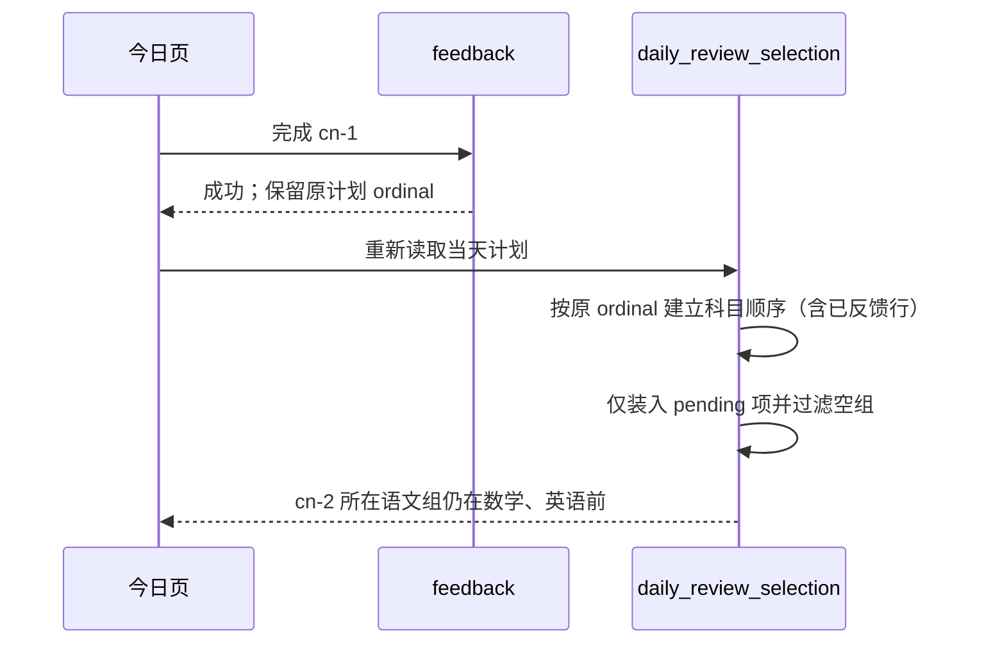

# BUG-029 — 完成复习条目后科目分组跳序

- Status: `VERIFYING`
- Severity: `复习操作后科目卡片跳位，影响家长连续操作；未发现计划或学习数据损坏`
- Risk: `R1 — 单服务内可逆的响应分组修复`
- Owner: `产品负责人（用户）`
- Implementer: `Codex`
- Reviewer/Verifier: `Codex Diff Review + 自动化回归；用户操作验收待确认`
- First observed: `2026-10-16 / 用户报告；当前本地 HEAD 8b933da 可确定性复现`
- Related incident/ticket: `当前会话：“在语文的item点击完成之后，顺序会变”`
- Spec revision: `BUG-SPEC-20261016-REVIEW-SUBJECT-ORDER-01`
- User confirmation: `APPROVED — 产品负责人（用户），2026-10-16，当前会话在本 Spec 01 及根因说明后明确要求“好的 修改代码 然后提交git 并部署”；唯一待确认修订即本 revision。`
- Delivery authorization: `同一用户消息明确授权 Git 提交与后端部署；追加发布记录和冻结产物，按现有发布手册完成灰度及可执行验收，保留全量切流人工门禁。`
- Affected Feature IDs: `FEAT-001`
- Feature current-state document: `docs/domain/features/FEAT-001-push-kids-mvp.md`
- Feature baseline revision: `FEAT-STATE-20261006-REVIEW-MANAGEMENT-03-LOCAL，叠加文档列明的 2026-10-15 已批准增量；发现时 HEAD 8b933da`
- Feature merge owner: `Codex，修复并验证后合并正文与 Change Reference`

## Frontend Design Impact and Repository-native Approval

- Frontend impact: `no — 后端恢复既有稳定日计划的科目顺序；不新增或修改前端控件、布局、文案、动作或状态呈现`
- Frontend impact reason: `今日页原样映射 review_selection.sessions；错误的跳序源于后端过滤已反馈条目后重建分组，不需要前端重新排序`
- Frontend engineering impact: `no — 不修改 apps/miniprogram 或前端依赖/构建/质量政策`
- Affected UI IDs: `UI-001，既有复习列表行为恢复`
- UI current-state document: `docs/design/frontend/ui/UI-001-parent-miniapp.md`
- Frontend baseline revision: `FDB-20260913-04 (APPROVED，保持不变)`
- Frontend engineering constraint revision: `FEC-20261007-NATIVE-GEOMETRY-02 (APPROVED，保持不变)`
- Affected frontend quality dimensions: `N/A — 后端投影修复；既有 state、server authority、有界读取契约保持`
- Frontend quality budgets/requirements: `不增加客户端排序缓存、请求、节点或资源；原 120 项日计划硬上限及 FEC-PERF-READ-001..004 保持`
- Frontend quality verification plan: `已有今日稳定计划前端回归；新增 HTTP dashboard 回归验证真实消费者收到的分组顺序`
- Approved frontend engineering deviations: `none`
- Current Design Revision(s): `沿用 UI-001 的既有已批准设计；本次无设计变更`
- Editable design source path(s): `N/A — 无新增或修改前端设计`
- Design source SHA-256: `N/A — 不修改设计源或已批准 manifest`
- Proposed Design Revision: `N/A — 后端稳定性修复，不改变设计契约`
- Required viewport/state exports: `N/A — 无布局或控件几何变化；不将历史原生/真机证据宣称为本轮验收`
- Prototype status: `N/A`
- Approved Task Spec revision: `BUG-SPEC-20261016-REVIEW-SUBJECT-ORDER-01`
- Approved Design Revision: `N/A — 无新设计`
- Design approval evidence: `N/A — 本次需批准 Task Spec revision`
- Snapshot manifest path: `N/A — 不变更既有批准快照`
- Permitted implementation deviations: `none`
- UI current-state merge owner: `Codex`
- UI current-state merge evidence: `2026-10-16已合并稳定日计划正文及引用；保留未部署/无新原生验收的边界`
- Frontend visual/a11y/resolution verification: `本轮 not run；无前端改动，既有原生/真机待验收事项不在本次关闭`
- Frontend engineering verification evidence: `npm test 244/244、ESLint、bounded-read-pagination 8/8及小程序静态检查通过；详见本轮质量证据`
- External design dependency: `none`

## 1. Symptom and impact

- 家长在今日的复习列表中，最初看到“语文 → 数学 → 英语”。语文仍有待复习条目时，完成其排在计划前面的条目，刷新后语文卡片移到后面。
- 对交错的计划 ordinal 可确定性触发；具体生产客户端/后端版本尚未核实。
- 影响连续操作时的位置预期；本地复现中 plan_id、planned_count 均不变，selected_count 正确减少 1。
- First known good/bad version: `NEEDS_VERIFICATION — 未做提交二分；当前 HEAD 已复现，无需依赖生产数据定位`
- Workaround: `无可持续的操作规避；刷新仍由同一错误投影重建顺序`

## 2. Reproduction

### Preconditions and steps

1. 在 SQLite 内存库创建隔离的虚构家庭、孩子、语文/数学/英语学习科目；无需模型或网络。
2. 写入同一天已物化计划，ordinal 依次为 `cn-1, math-1, en-1, cn-2, math-2, en-2`，各 1 分钟、state=pending。
3. 调用 `PlanningService.daily_review_selection`，得到语文、数学、英语三个 session。
4. 通过真实 `PlanningService.feedback(..., "cn-1", "complete", idempotency_key=...)` 完成第一条语文，再调用 selection。

### Actual / expected

- Actual: `数学 → 英语 → 语文`；语文仍剩 `cn-2`。
- Expected: `语文 → 数学 → 英语`；只移除已反馈条目。语文全部无待复习条目后才移除其空组，其余组保持相对顺序。

### Reproduction evidence (2026-10-16)

- 使用 `PYTHONPATH=apps/api/src .venv/bin/python -` 执行上述内存 fixture 与真实服务调用。
- 实际输出：`before=[语文, 数学, 英语]; after=[数学, 英语, 语文]; same_plan=true; planned_count=6→6; selected_count=6→5`。
- 保序断言失败：`AssertionError: BUG reproduced: completing one item reorders subjects`，退出码 1，为预期反例。
- 无真实孩子内容、凭据、生产请求或持久业务写入。
- `uv run --offline` 先因默认缓存访问权限失败；切换临时缓存后 uv 自身 system-configuration panic。改用现有 `.venv/bin/python` 后复现与基线测试实际运行，不将 uv 失败记为通过。

## 3. Triage

| Confirmed fact | Evidence |
|---|---|
| 完成后的前端乐观过滤保留当前组顺序 | `pages/today/index.js feedback` 使用 map/filter，随后 `load()` |
| 刷新时客户端直接采用服务端 session 顺序 | `stableReviewPlan` 映射 `selection.sessions`，没有额外排序 |
| 后端读取固定计划顺序，但先跳过非 pending 项 | `planning/service.py daily_review_selection` 的 ordinal 查询与 continue |
| 分组顺序由首次遇到的剩余 pending 项决定 | 在 continue 之后才初始化 by_subject 并 sessions.append |
| 旧日计划内容稳定测试未断言部分反馈后的组序 | `test_review_fairness.py`、`test_review_inventory.py`；现有基线通过而反例失败 |

- Hypothesis: `上述后端投影重建导致跳序，已由真实服务内存复现确认；前端重新排序假设不成立。`
- Blast radius: `ReportingService.dashboard → review_selection.sessions` 及该服务的其他读消费者；同一分组路径处理 complete/partial/reinforce/defer 等既有反馈终态。
- Data/security: `无数据修复；家庭/孩子边界和权限逻辑不变。`
- Same-pattern search: `已检查今日 todoView/mergeTodoGroups、纯分组 group_daily_todos、旧 daily_review_selection 与当前稳定计划服务；本次只修改当前物化计划的权威投影。`

### Link/call graph

```text
todo-card 完成
  → today.feedback → POST /reviews/{id}/feedback → PlanningService.feedback
  → today.load → GET /children/{id}/dashboard → ReportingService.dashboard
    → PlanningService.daily_review_selection
      → 按 ordinal 读取原计划 → 过滤终态 → 按首次剩余条目重建 sessions（错误位置）
    → stableReviewPlan → todoView → todo-card
```

## 4. Root cause

组序缺少独立于“当前剩余条目”的锚点。计划本身按固定 ordinal 交错安排科目；过滤完已反馈条目后，首次出现的科目可能改变，插入有序字典/列表便得到不同的组序。需要让同一科目已反馈的原计划条目继续提供组序锚点，同时只把 pending 项放入返回卡片。

现有控制只覆盖计划集合、数量和不补题，没有覆盖反馈前后的科目组相对位置；无运行时排序指标。用确定性回归守住不变量，不新增包含孩子内容的日志或埋点。

## 5. Fix contract

- 对当前查询返回的同一日计划行，科目组按该科目最早的原计划 ordinal 顺序展示，已反馈行仍提供顺序锚点。
- 完成/部分/巩固/稍后后，若同组仍有 pending 项，位置不变；组内剩余项仍按原 ordinal，组 id 不变。
- 全组没有 pending 项才从 sessions 移除；最后一组完成后 sessions=[]，不返回空卡片。
- 刷新、重新进入页面、重复读取和成功幂等重试均从同一日计划得到相同顺序，不依赖前端缓存。
- selected/planned/feedback 项数与分钟、all_items、policy revision、曲线更新、事务、SQL、120 项上限、无补题、租户隔离均保持原合同。
- 不强制所有家庭首次都按语数英排列；首次顺序仍由原计划决定，自定义科目同样保序。
- Non-goals: `科目设置排序、复习优先级/选题算法、跨日或跨计划固定顺序、旧 todo_groups 兼容路径、删除/手动改期导致原计划行集合变化时的新增排序保证、小程序重新上传。`
- State/data repair: `不迁移、不回填；修复后读取既有计划即可恢复顺序。`
- Feature/UI merge: `验证后更新 FEAT-001 与 UI-001 的稳定日计划正文，补充分组顺序；Behavior Catalog BHV-006 补充不变量及当前证据。发现时“稳定计划”未完整覆盖呈现组序，本 Spec 明确修复该差异，不把预期伪装为已实现事实。`
- Architecture merge: `核对 planning 的日计划投影描述；模块、依赖、Schema、扩展点均不变，不为本次新建 ADR 或调整架构边界。`

## 6. Fix design

### Selected change

在 `PlanningService.daily_review_selection` 既有有序遍历中，先为首次出现的科目建立 session，再处理 pending/终态分支；只有 pending 项累加到 session。响应构建时去掉没有 items 的 session。所有行仍走原 snapshot/count 路径，不增加 SQL、额外扫描历史或持久状态。

| Alternative | Trade-off / decision |
|---|---|
| 服务端原计划 ordinal 锚定（推荐） | 单一权威路径，O(120) 有界内存处理，无迁移；响应前须过滤空 session |
| 前端记住最初卡片顺序 | 新增重复状态，重进、刷新、切孩子失效，其他消费者仍错误；拒绝 |
| 强制语文/数学/英语固定序或按名称重排 | 改变原始计划顺序与自定义科目语义，超出修复范围；拒绝 |
| 新增 group_ordinal 字段/数据迁移 | 既有 ordinal 足够，增加协议与回填维护成本；拒绝 |

### Sequence diagram



### State machine

```text
pending → complete / partial / reinforce / deferred（沿用原反馈语义）
  ├─ 同科目仍有 pending → 原位置展示剩余条目
  └─ 同科目无 pending → 移除空组，其余组相对顺序不变
```

### Architecture diagram

`N/A — 单个现有 planning application service 内调整响应组装；调用图已列出边界，不改变模块、依赖、数据归属、部署拓扑或扩展点。`

### Expected file changes

| File/path | Action | Expected change / necessity |
|---|---|---|
| `apps/api/src/push_kids/planning/service.py` | modify | 修正唯一权威的 sessions 投影顺序 |
| `tests/integration/test_daily_review_session_order.py` | add | 真实服务和 HTTP dashboard 反例，验证反馈、组消失、重复读取、幂等和隔离 |
| `docs/domain/features/FEAT-001-push-kids-mvp.md` | modify after verification | 合并已验证保序事实和 Change Reference，保留本地/发布差别 |
| `docs/domain/BEHAVIOR-CATALOG.md` | modify after verification | 将分组顺序加入稳定计划不变量 |
| `docs/design/frontend/ui/UI-001-parent-miniapp.md` | modify after verification | 当前稳定日计划正文补充顺序，不修改设计资源 |
| `docs/quality/evidence/REVIEW-SUBJECT-ORDER-20261016.md` | add after implementation | 反例、修复回归、Diff Review、未执行项和文档逐项冲突核对 |
| `specs/README.md` and this Spec | modify / lifecycle move | 索引、批准、验证结果与生命周期；完成门禁通过才移入 completed |
| `docs/deploy/releases/20261016-review-subject-order-backend.md` | add | 用户明确要求部署，记录冻结提交、容器、平台版本、验收及人工门禁 |

- Compatibility/rollout: `字段、SQL和Schema不变；客户端原样消费顺序。按用户2026-10-16追加授权提交Git并按 docs/deploy/README.md 部署后端，不将本地结果记为上线；全量切流保留人工门禁。`
- Rollback: `回退该后端投影提交即可；不涉及数据恢复。`
- Observability: `以固定计划的自动化保序断言发现回归，无新日志/埋点。`

## 7. Regression verification

| Test point | Acceptance / command | Environment | Current result |
|---|---|---|---|
| TP-001 | 六条交错计划，完成第一条语文后组序、组 id 和余项序不变；新测试须在修复前失败 | SQLite + 真实 service | PASS；持久回归旧实现5 failed/3 passed，修复后8/8通过 |
| TP-002 | 分别覆盖 complete/partial/reinforce/defer；数量、分钟、计划集合及 all_items 状态正确，不补题 | SQLite service | PASS，4种反馈参数化验证 |
| TP-003 | 完成某科全部条目后仅移除该组；全部完成返回空 sessions，反馈计数守恒；空计划无空组 | SQLite service | PASS |
| TP-004 | 新会话重复读取与反馈幂等重放保持顺序/计数；通过 HTTP dashboard 和 feedback 验证真实响应 | SQLite/FastAPI | PASS |
| TP-005 | 自定义科目、原计划非语数英顺序、跨家庭/孩子隔离；顺序跟原计划而非名称；错误反馈不改计划 | SQLite/FastAPI | PASS |
| TP-006 | `.venv/bin/python -m pytest tests/integration/test_daily_review_session_order.py tests/integration/test_review_fairness.py tests/integration/test_review_inventory.py tests/unit/test_review_selection.py -q` | 本地 | PASS，30 passed/8 optional MySQL skipped |
| TP-007 | `.venv/bin/python -m pytest tests/unit tests/integration tests/contract -q`；`.venv/bin/ruff check .`；`.venv/bin/ruff format --check .`；`.venv/bin/mypy apps/api/src` | 本地 | PASS，518 passed/19 skipped；Ruff/format519文件及Mypy103文件通过；历史lint经单独批准chore修复 |
| TP-008 | `node --test tests/frontend/bounded-read-pagination.test.js`；`.venv/bin/python tools/check_architecture.py`；`.venv/bin/python tools/validate_design_evidence.py --check-current-policy`；`.venv/bin/python tools/validate_miniprogram.py` | 本地 | PASS，8/8、ARCHITECTURE_VALID checked=3、DESIGN_EVIDENCE_VALID、MINIPROGRAM_VALID pages=16 source_bytes=1070913；另npm test244/244及ESLint通过 |

新测试统一使用独立虚构数据。主要回归必须在修复前失败、修复后通过。已有MySQL变体未运行不写为通过；本次不改变 SQL，若后续实现需要改 SQL，必须升修订并补真实 MySQL 5.7 门禁。无前端代码/几何改动，原生三视口和 iOS/Android 本轮未执行，不代替后续发布操作验收。

## 8. Review checklist

- [x] 症状、预期、根因、权威路径和修复前反例明确。
- [x] 已检查相邻分组实现；没有并行修复路径或前端缓存补丁。
- [x] 必需视图、替代方案、文件清单、兼容与回滚明确。
- [x] 用户批准本 Spec revision。
- [x] 持久回归在旧实现失败，在修复后通过；必需测试点均有实际证据。
- [x] Diff Review 确认每处改动必要、位置正确，无冗余/无关重构。
- [x] Feature、Behavior、Architecture、UI、Spec、证据及发布状态逐项核对；历史发布不冒充本次部署。
- [ ] 完成门禁通过后设置 DONE、迁移 completed 并修复索引/引用；否则保留 active 并写明未完成项和恢复条件。

## 9. Closure and prevention

- Changed behavior / deleted logic: `已把session初始化移到pending过滤前，终态行仍提供原序锚点；响应去掉空组。删除“先过滤再决定科目顺序”的错误路径。字段/SQL/Schema不变。`。
- Data repaired: `N/A — 无数据损坏或回填`。
- Monitoring: `回归断言；无新增生产埋点`。
- Documentation/evidence merge: `Feature、BHV-006、Architecture、UI正文与索引已同步；详见 docs/quality/evidence/REVIEW-SUBJECT-ORDER-20261016.md 和 docs/deploy/releases/20261016-review-subject-order-backend.md`。
- Independent Review: `R1 Codex逐文件Diff Review通过；同一实现者复核，不冒称独立人员审查`。
- Current lifecycle decision: `VERIFYING，保留 specs/active/。代码及TP-001..008已完成；Git bug提交1b1e964、lint提交374b9ba。Docker恢复后通过冻结镜像构建/UID/health/SIGTERM、隔离MySQL5.7空库迁移及18项专项、冻结镜像HTTP保序；灰度不可变031于22:56:03 normal，副本1，PUBLIC关闭，配置与030一致。030=100%/031=0%，未定向smoke/全量；031日志TopicNotExist，未冒称验收通过。恢复/关闭条件为管理员在控制台配置031定向测试并完成小程序反馈保序/健康/共存观察，再按发布手册确认全量。Owner为产品/发布负责人，回复“已完成后端全量发布”后只读核验并关闭Spec；未完成不判DONE。`。
