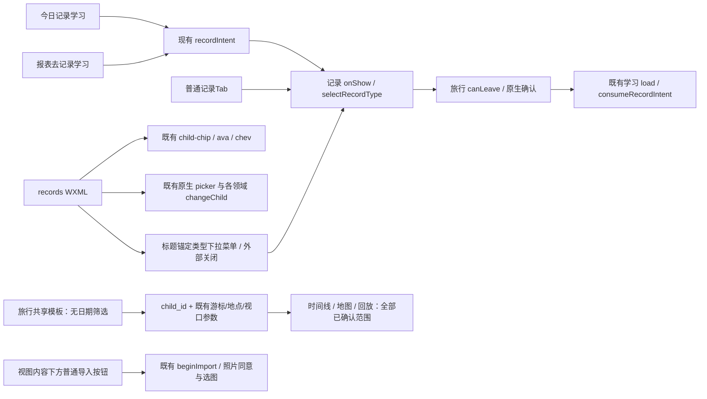
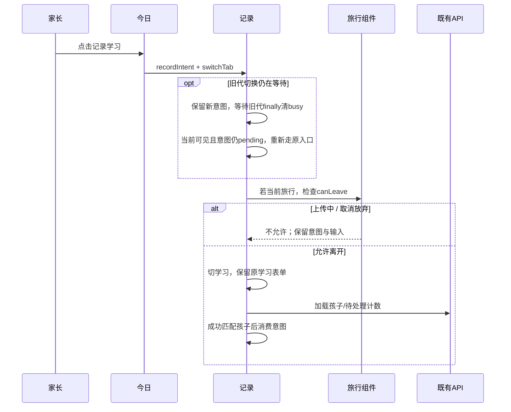
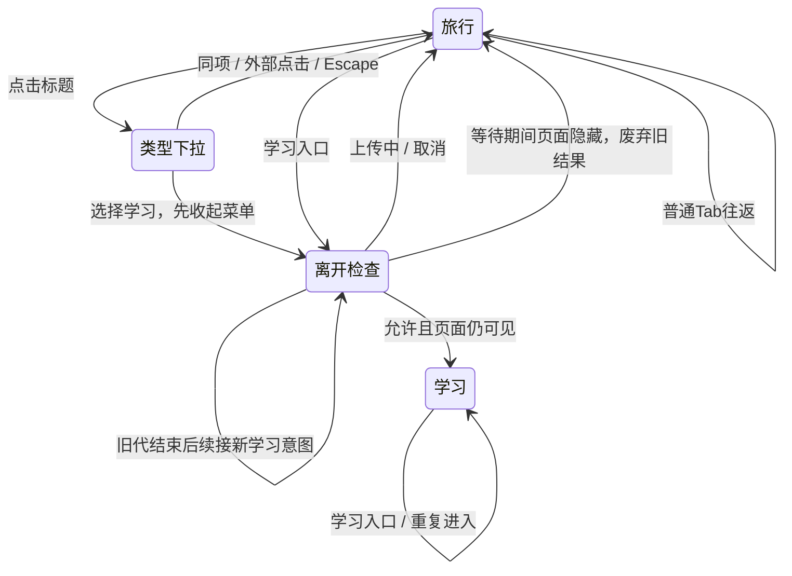
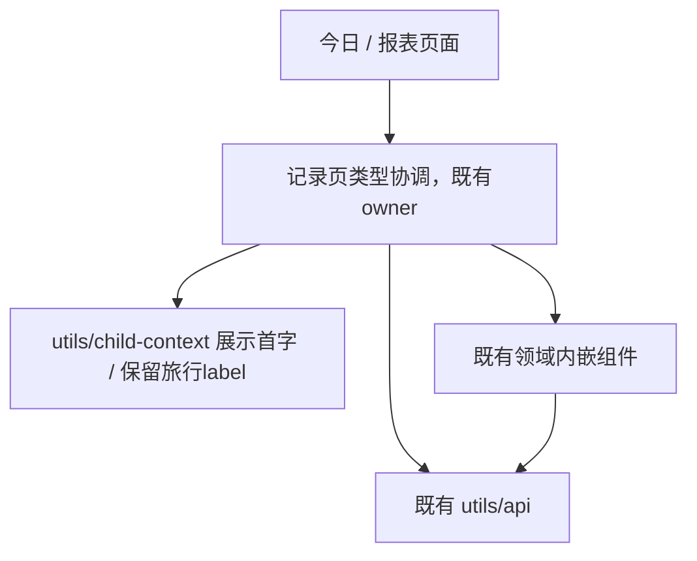

# BUG-032 — 记录页照片入口、顶部选择与学习入口回归

- Status: VERIFYING
- Severity: 局部UI一致性；学习入口类型错误会导致家长进入不相关表单。
- Risk: R2，包含原生控件和异步离页保护的回归验证。
- Owner / Feature merge owner: 产品负责人（用户）
- Implementer: Codex
- Reviewer/Verifier: 实施者核对与自动化/原生验证；独立只读评审和家长真机验收待执行。
- First observed / Date: 2026-10-24，本地完整微信开发者工具客户端。
- Spec revision: BUG-SPEC-20261024-RECORD-ENTRY-05
- Architecture: 沿用ARCH-20261023-RECORD-TYPE-SWITCHER-01；不改变模块边界、依赖方向、扩展点或API。
- User confirmation: APPROVED；产品负责人（用户），2026-10-24，在Spec05/当前DREV01交互稿收尾回复后明确回复「可以」，唯一对应BUG-SPEC-20261024-RECORD-ENTRY-05 + DREV-20261024-RECORD-ENTRY-01；授权本地实施与验证，不包含上传/发布/提交推送。
- Affected Feature IDs: FEAT-001、FEAT-012；Behavior BHV-038、BHV-040、BHV-041。
- Current states: [FEAT-001](../../docs/domain/features/FEAT-001-push-kids-mvp.md)、[FEAT-012](../../docs/domain/features/FEAT-012-child-photo-footprints.md)、[UI-001](../../docs/design/frontend/ui/UI-001-parent-miniapp.md)、[UI-018](../../docs/design/frontend/ui/UI-018-child-photo-footprints.md)。
- Feature baseline: FEAT-STATE-20261020-AUTO-SUPERSEDED-FULLSTACK-02-LOCAL / FEAT-STATE-20261024-PHOTO-FOOTPRINTS-15；记录入口Spec01已批准、本地VERIFYING。
- Source baseline: HEAD 82ca52775bc948f2a963a8f4ed614322d8859de8 + 已有dirty worktree；保留全部既有修改。[本轮实施基线](../../docs/quality/evidence/record-entry-20261024/implementation-baseline.json)与最终源摘要分别记录，不将整个共享工作区当作本轮diff。

## Frontend Design Impact and Repository-native Approval

- Frontend impact: yes；孩子选择器外观、类型顶部下拉、旅行日期筛选删除、照片导入改内容下方普通按钮。
- Frontend engineering impact: yes；WXML/WXSS和本地view字段、导航回归与原生几何。
- Affected UI IDs: UI-001、UI-018；内嵌与独立足迹入口共享模板，其他页面不改变。
- Frontend baseline revision: FDB-20260913-04，APPROVED。
- Frontend engineering constraint revision: FEC-20261007-NATIVE-GEOMETRY-02，APPROVED。
- Affected dimensions: component/state/form/responsive/a11y/browser/performance/security/privacy/observability；数据可视化及AI生成合同N/A，本轮不变。
- Budgets: 44px操作目标；正文/操作标签≥14px；三视口无重叠/越界，容差1px；长名不裁切；不以overflow:hidden作为通过依据；1.5MiB预算保持，无新依赖/请求/轮询/存储/日志。
- Previous Design Revision: DREV-20261023-RECORD-TYPE-SWITCHER-01；批准快照保持不可变。
- Current approved Design Revision: DREV-20261024-RECORD-ENTRY-01。
- Editable source: [自包含HTML](../../docs/design/frontend/prototypes/DREV-20261024-RECORD-ENTRY-01/index.html)；SHA以候选清单为准。
- Frontend spec: [设计规格](../../docs/design/frontend/prototypes/DREV-20261024-RECORD-ENTRY-01/FRONTEND-SPEC.md)。
- Snapshot manifest: [30态/视口导出及SHA](../../docs/design/frontend/snapshots/UI-001/DREV-20261024-RECORD-ENTRY-01/APPROVAL.md)。
- Prototype status: APPROVED；Approved Task/Design revisions: BUG-SPEC-20261024-RECORD-ENTRY-05 + DREV-20261024-RECORD-ENTRY-01。
- Required viewports/states: 320×568、390×844、430×932，DPR1；travel/learning/long/single/types/learning-types/long-types/today/from-learning/travel-bottom，共30张。
- Approval evidence / deviations: 2026-10-24用户「可以」，接续唯一Spec05及当前DREV01 / none。
- External design dependency: none。
- Merge evidence: 已按实际实现同步Feature、Behavior、UI、Architecture适用正文；验证边界和本地发布状态见[本轮证据](../../docs/quality/evidence/record-entry-20261024/README.md)。

## 1. Symptom and reproduction

用户截图显示：记录页右上角为绿色圆角矩形“姓名＋箭头”，与今日/日程/报表的纸色child-chip不同。用户同时报告先选择旅行，再从首页学习入口进入时未切回学习；希望明确学习入口统一记录学习。

Spec02新增反馈：用户在候选交互稿圈选整行“开始日期 / 至 / 结束日期 / 全部”，批注「不需要这个，默认就是全部」。按整行删除理解，三个视图均展示当前孩子全部已确认足迹范围。该批注确认本项设计方向，不等于批准此前Spec01或本Spec02整体实施；Spec01的待批准请求已由02取代。DREV01仍是未批准候选，可原位更新，保持用户正在查看的URL。

Spec03新增反馈：用户圈选底部“记录类型”弹层，要求「这个选择框可以放在上面，类似于切换孩子的下拉框」。改成记录标题下方的锚定下拉菜单，去掉底部抽屉和灰色遮罩，保留两项与当前项勾选。Spec03取代02作为当前待批准范围；批注确认设计方向，不构成Spec03整体实施批准。截图中的日期筛选是浏览器旧页面内容，不撤回上一条移除要求。

Spec04新增反馈：用户圈选标题右侧“导入照片”小按钮，要求「这个入口可以大一点，类似于学习知识里面的上传图片」。改为标题/统计下方、三视图之前的通栏上传卡片，复用现有学习上传风格与插画，整块可点击。04取代03作为当前待批准范围；前述日期移除与顶部下拉继续保留。该批注确认照片入口方向，尚未批准Spec04整体实施。

Spec05取代04：用户查看大卡片后批注「所占的高度太大了，放在下面，使用一个button的方式」。撤回160px大卡片方案，改为足迹内容下方48px普通主按钮，随页面滚动，不覆盖地图或底部导航。保留此前顶部下拉、孩子控件、默认全部范围及学习入口修复；随后用户「可以」批准Spec05与当前DREV01，源和导出冻结，已本地实施。上文Spec01–04为批准前历史，不是当前待批准状态。

截图为用户提供的本地附件，包含真实孩子姓名，不复制进仓库。设计和后续截图只使用合成姓名与素材。

步骤：记录标题选择旅行 → 底部今日 → 点击记录学习 → 检查记录标题/表单及孩子。对普通底部记录入口另验其仍记忆旅行。

预期：学习入口进入学习表单；普通记录入口记忆类型。旅行上传/未保存编辑仍遵守既有保护；取消离开不得丢失输入或消费学习意图。单纯导航不得创建学习或足迹事实。

## 2. Triage and evidence

| 实施前诊断事实（历史，不代表当前实现） | Evidence |
|---|---|
| 外观差异已确认 | records/index.wxml的record-child；index.wxss独立绿色背景/矩形圆角；其他页面使用styles/atoms.wxss的child-chip/ava/chev |
| 代码已有明确学习意图分支 | today.recordLearning和reports.goRecord设置recordIntent；records.onShow在旅行状态下调用同一selectRecordType离开保护，再load/consumeRecordIntent |
| 现有测试隔离了真实入口和load | tests/frontend/record-types.test.js已有意图测试，但用桩替换load、直接设置recordIntent，没有走今日按钮到消费的完整链路 |
| 当前完整客户端干净主路径能切回学习 | [实施前诊断](../../docs/quality/evidence/record-entry-20261024/preimplementation-navigation.json)：初次因当前已在学习而NOT_RUN；第二次通过现有方法切旅行→今日→记录学习，最终learning、加载结束、无错误、意图已消费 |
| 确认一个会遗留学习意图的生命周期竞态 | [确定性反例](../../docs/quality/evidence/record-entry-20261024/preimplementation-race.json)：等待旧离开保护→隐藏→真实today.recordLearning返回→旧保护结束；实际travel、意图仍pending、busy已清，预期learning。未替换learning load，无生产源码修改 |
| 用户截图对应的完整原生触发条件尚未复现 | 确定性生命周期反例不能冒充真机上复现同一截图；也不能把干净主路径PASS推断为所有竞态均正确 |

已搜索全部recordIntent写入：今日、报表两处。历史意图继续由报表承接，记录类型列表仍closed两项。

## 3. Root cause / fix contract

样式根因已确认：实施前记录头使用独立record-child样式，未复用既有child-chip外观。本地实现采用既有头像首字、纸色胶囊、细边和线性箭头，记录页只补44px高度、14px标签和长名几何。

照片入口当前合同：标题/统计下直接接三视图与内容，导入按钮位于当前视图内容之后，通栏宽、48px高、20px上间距、12px圆角、既有深绿主按钮样式。仅20px线性相机图标＋14px“导入照片”，无插画、渐变、虚线或说明文案。不固定/悬浮覆盖内容或Tab，随页面滚动，底部预留空间保证按钮可完整触达。旅行不新增图片资源/依赖/请求；候选学习页现有插画参照与生产学习上传路径保持。

按钮仍调用既有beginImport；活动孩子且canWrite时可见，归档/只读/无孩子不出现。时间线、回放、点亮均在各自内容之后保留一个入口；空态不重复导入按钮，保留手动记录。上传/保存时使用原保护防止重入，照片同意、一次几十张/分批、选图取消、离开/迟到回调与AI确认合同不变。取舍为减少首屏占用，较长内容需滚动到下方；不另增悬浮入口或更改Tab语义。

类型菜单：锚定记录标题，左对齐、下距8px、宽200px且不超过视口两侧16px内宽；纸色、细边、轻阴影，无重复“记录类型”标题或关闭按钮。两项各至少48px，当前项淡绿底和勾选，展开时标题箭头朝上。标题可再次点击收起；外部点击/Escape收起且不透传，选中后收起、焦点回标题；Tab离开菜单，方向键/Home/End选择位置，Enter确认。HTML采用非模态menu/menuitemradio；小程序使用其支持的可访问属性表达名称/展开/当前项，不假定网页ARIA在原生可用。长名换行不改变菜单相对标题位置。

类型选择在进入既有canLeave前收起菜单；上传仍阻止离开、编辑取消仍保留原类型和输入，不额外重开菜单。菜单展开不再隐藏底部Tab，背景不变暗；透明外部点击层避免误触。旅行照片/编辑面板继续遵守其原有导航隐藏规则。原生地图仍通过既有menu-open保护层叠，验证类型菜单不会被地图或原生picker盖住；滚动、隐藏/卸载后菜单收起。该调整属于既有记录页协调owner内部，不新建通用弹层框架或全局导航协议。

导航已确认的失效机制：旧selectRecordType等待canLeave期间，onHide递增typeSwitchSequence；新学习入口通过onShow再次进入，但recordSwitching仍为true，因此直接返回。旧保护结束后因generation失效退出，finally只清busy，没有处理仍pending的新学习意图。现有单元测试只验证“旧结果不能切换”，漏掉“新学习意图必须在旧切换结束后继续”。

在原类型协调owner内最小修正：旧切换结束、清busy后，只在旧generation已失效、记录页当前可见、仍处旅行且学习意图仍pending时，重新走既有onShow/canLeave路径。正常同代取消不自动重试，不循环弹窗；普通Tab没有学习意图时不重置旅行；页面仍隐藏时不执行，留给下一次onShow。不给调用方新增协议或全局状态，不绕过离开保护。用户截图的具体触发时序仍需原生/真机验证，不以此反例推断全部报告条件。

必须保持：学习未提交文字、照片、日期、孩子、幂等键和滚动；旅行独立孩子/归档标记；家长确认才入档；所有服务端家庭边界；上传不可离开，编辑取消不消费意图；隐藏/卸载清理和迟到响应失效。无数据修复、迁移、AI变更、后端发布、前端上传或提交推送。

旅行范围修正：共享WXML删除整行日期筛选，清理专用样式和controller的start/end状态、filterDate/clearFilter；params不再发送日期范围。summary、visits、地图、回放和地点详情均使用当前孩子的全部已确认范围，保留地点、游标、revision及地图视口等各接口参数。拍摄日期提取、编辑、时间线日期分组、当地日期到访统计保持。后端现有可选日期过滤协议保留兼容，不改API或SQL。

“全部”不是一次加载全量：现有服务端游标/聚合/响应预算继续生效。现有时间线100条上限提示“请缩小日期范围继续浏览”将失效，地点列表也有100条硬停。两者沿用既有“查看更多”操作：窗口内追加至最多100条，到边界后用户点击续看时换成下一窗口并滚到该列表起点；触底只在当前窗口内追加，不自动替换整个窗口。窗口替换时回收旧缩略图资源、保持失败可重试和迟到响应失效；不得无界缓存旧窗口。回放原有分段续播和地图有界聚合保持。不得通过移走筛选、添加“全部时间”说明或静默截断历史代替这项要求。

## 4. Design and call graph

无新模块/抽象/扩展轴，依赖DAG保持。孩子装饰复用现有helper且保留旅行“已归档”label，不将学习年级label覆盖旅行标签。原生picker的选择、保存中禁用和领域回调保持。

| Alternative | Trade-off / decision |
|---|---|
| 复用child-chip，仅补本页几何 | selected；风格一致，不影响其他页，不新增选择面板 |
| 全局修改chip样式 | rejected；扩大范围，其他页无需改变 |
| 每次记录Tab都重置学习 | rejected；违背普通Tab记忆旅行的既有合同 |
| 新增recordType参数/全局状态或重写导航 | rejected；现有意图已表达学习语义，已确认问题位于旧切换清理后的续接，无需平行机制 |
| 清空页面/重建客户端以绕过状态 | rejected；可能丢失未提交内容，无法证明修复 |
| 删除整行日期筛选，范围默认全部，保留有界续看 | selected；按用户批注减去控件，无新筛选入口；需修正旧100条日期提示和硬停 |
| 只删“全部”按钮、隐藏筛选或一次下载全相册 | rejected；前两者不符合圈选范围，后者违背有界读取与资源预算 |
| 标题下方锚定菜单 | selected；选择就在入口旁，布局延续孩子选择控件语言，无新弹层框架 |
| 保留底部抽屉或直接替换成原生picker | rejected；前者不符合批注；后者的系统弹出位置不保证位于顶部 |
| 标题/统计下160px上传卡片 | superseded；用户查看后明确认为占高过大，05撤回 |
| 内容下方48px普通主按钮 | selected；按新批注缩小占高，内容优先，长列表需滚动到下方 |
| 再增悬浮按钮或重复空态入口 | rejected；用户要求一个下方button，不增加并行入口或遮挡内容 |

## 5. Expected file changes

| File/path | Action | Necessity |
|---|---|---|
| apps/miniprogram/pages/records/index.wxml | modify | 学习/旅行孩子统一chip/首字/标签/箭头；类型抽屉改标题锚定菜单及原生支持的可访问属性 |
| apps/miniprogram/pages/records/index.wxss | modify | 删除record-child独立外观和底部类型抽屉样式，补chip布局与顶部菜单几何/层叠 |
| apps/miniprogram/pages/records/record-types.js | modify | 旧代结束后续接学习入口；旅行decorate保留归档label；菜单开关/滚动收起/选中先关闭、只由旅行照片面板隐藏Tab |
| apps/miniprogram/pages/footprints/index.wxml / index.wxss / controller.js | modify | 日期筛选清理；内容下方普通导入按钮接原beginImport与权限保护、去重空态按钮；时间线有界续看 |
| apps/miniprogram/pages/footprints/maps.js | modify | 地点到访列表有界续看不再硬停；保持地图/回放既有合同 |
| apps/miniprogram/pages/footprints/imports.js | modify | beginImport对保存/上传中拒绝重入，保留原同意与选图流程 |
| tests/frontend/record-types.test.js / p2-records.test.js | modify | 真实今日/报表入口到load/意图消费的回归，取消/上传/迟到与孩子上下文 |
| tests/frontend/footprints.test.js | modify | 全部范围跨三视图、有界续看、日期纠正；下方导入按钮权限/保护/选图取消 |
| 本DREV源/导出、诊断/实施证据 | add | 可审阅设计、SHA与真实检查记录 |
| Feature/Behavior/Architecture/UI/Spec/发布本地记录与索引 | modify | 核对实际diff，合并经验证事实；不覆写历史与既有发布物 |

导航生产路径保持：today/reports → recordIntent → records.onShow → selectRecordType/canLeave → load/consume。在既有切换清理处分支续接，不新增入口协议。后端、数据库、全局atoms和其他页面样式不改。

## 6. Acceptance / required test points

| ID | Case / command | Required result |
|---|---|---|
| TP01 | 合成单/多/归档/长名孩子，学习/旅行chip | 相同外观；姓名完整；归档标记保留；44px目标/14px标签；选择仍到原领域 |
| TP02 | 今日真实recordLearning→旅行记录页onShow→真实load/消费；报表goRecord同验；重放已记录跨代反例 | 最终学习，正确孩子，意图消费一次，无业务写入；反例实施前FAIL、实施后PASS，不只用load桩证明 |
| TP03 | 旅行→今日→普通记录；学习→旅行→学习 | 普通Tab保留旅行；原学习表单所有字段保留 |
| TP04 | 上传中、旅行编辑取消/确认、等待确认时隐藏、连续入口/迟到响应、只读/无孩子/网络失败 | 既有保护有效；不串孩子、不丢数据、不复活旧结果；失败可恢复 |
| TP05 | npm test；npm run lint:miniapp；python3 tools/validate_miniprogram.py；python3 tools/check_architecture.py；git diff --check | 当前diff通过；无后端SQL/API改动，后端全套N/A |
| TP06 | python3 tools/validate_design_evidence.py --manifest docs/design/frontend/snapshots/UI-001/DREV-20261024-RECORD-ENTRY-01/APPROVAL.md | 批准后匹配SHA；候选阶段加--allow-pending，不虚报批准 |
| TP07 | 真正微信320×568/390×844/430×932节点与截图；学习/旅行/单孩子/长名/归档/类型菜单 | 触控尺寸、间距≥8px、无重叠越界，视觉与批准稿一致；真实picker打开、选择和取消 |
| TP08 | 完整客户端旅行→今日学习；普通Tab往返，iOS/Android读屏/大字体 | DevTools明确结果；真机未执行标NOT_RUN，不用HTML/旧图抵扣 |
| TP09 | 实施后独立只读review；doc引用/当前正文与diff冲突核对 | 正确性、设计合理性、位置和必要性通过；无无关重构/旧record-child残留 |
| TP10 | 内嵌/独立足迹页面无日期筛选；切孩子/三视图/返回；跨年份与超过100条合成到访、地点详情、游标失败重试/迟到、缩略图回收 | 无start/end过滤参数或旧范围；全范围统计/地图/回放；所有历史可分段触达、窗口最多100条、无日期筛选死路；拍摄日期纠正与当地日期统计保持；原生验证窗口切换滚动位置 |
| TP11 | 三视口旅行/学习/长名标题展开类型菜单，地图/照片面板/滚动/离页/上传/取消；键盘与原生读屏 | 菜单贴标题下8px、无越界/裁切、当前项勾选、48px选项；无灰色遮罩/底部抽屉/重复标题/关闭按钮；Tab可见且外部点击不透传；选择先收起再检查离开保护；照片面板导航规则不变；原生地图不遮挡，菜单取消与焦点合理 |
| TP12 | 三视口空/有足迹三视图的下方按钮；活动/归档/只读/无孩子；保存中重复点击、首次同意/取消选图、读屏、滚动到底 | 内容之后唯一48px主按钮/20px线性图标/14px标签，无插画大卡片；可滚动到按钮且与Tab间距≥8px、命中不遮挡；原beginImport/权限/防重入有效，取消不改数据；手动记录和学习上传不退化 |

## 7. Verification and lifecycle

- 后续实施者只读复核曾发现CR-001（P1 BLOCK）：满100条时间线“下一组”在途时打开照片，全局releasePreviews删除/取消照片预览；无写入Node反例复现。用户本轮授权实施后，在原已批准TP04/TP10范围修复：分页结果返回时如已进面板/其他视图，保留窗口/游标且不回收预览，新load重置过期busy。已加载/在途两种照片预览回归和失效分页失败回归通过，最终331项前端全过；[新源绑定证据](../../docs/quality/evidence/footprints-minimal-20261024/README.md)独立于旧313项/51组。原review发现保留历史，未宣称独立复审已通过；Spec继续VERIFYING。

- 实施前原生诊断：一次NOT_RUN、一次干净主路径PASS，详见上述JSON；没有生产源码注入、图片上传或业务写入。
- 实施前确定性状态反例：FAIL，最终travel而非learning，意图仍pending；运行真实今日handler、真实记录load，只有API与离开保护时序使用合成桩。用于证明竞态，不冒充原生截图复现。
- 历史候选HTML：Spec01/02的21张三视口导出、44px目标/标题与孩子横向或换行后纵向间距/无横向越界、普通Tab记忆/学习入口/文字保留/Escape焦点回归均PASS。当前[render-audit](../../docs/design/frontend/prototypes/DREV-20261024-RECORD-ENTRY-01/render-audit.json)和清单按最新候选重跑，不以历史检查代表当前稿通过。首轮截图超时改用软件渲染；长名看图后改为整胶囊换行，并补齐纵向几何。
- Spec01阶段：候选清单校验（--allow-pending --check-current-policy）、54个本地链接、渲染脚本Ruff check/format、git diff --check均PASS。8份生产/测试源SHA与实施前基线一致。此记录不替代Spec02修改后的重新检查。
- Spec02候选阶段：按批注删除整行日期筛选与专用样式；21张导出、三视口几何/导航/无筛选断言、候选清单校验（--allow-pending --check-current-policy）、55个本地引用、渲染脚本Ruff check/format及git diff --check均PASS。390×844旅行页已看图，统计下方直接接三视图，无新增说明。没有运行生产代码变更后的npm/原生矩阵，不复用旧证据冒充新通过。
- Spec02时源基线复核为7/8匹配：today/index.js与最初基线不同，保留其他任务差异。实施前已重新记录implementation-baseline，并以当前真实Today/Reports handler运行TP02；旧导航反例仍只作为历史证据。
- Spec03候选验证：27张三视口导出、菜单位于标题下8px/无越界/导航可见/无灰色遮罩、当前项语义、选择/再次点标题/外部点击/Escape/方向键/Tab、原有学习入口/文字保留检查均PASS。320×568学习页滚动收起、滚动位置保留和标题焦点恢复专项PASS。候选清单校验（--allow-pending --check-current-policy）、55个本地引用、脚本Ruff check/format均PASS；390×844旅行菜单与320×568长名菜单已看图。git diff --check收尾核验；不把HTML结果视为原生通过。
- Spec04候选验证：27张三视口导出、通栏卡片高≥160px/唯一导入入口/标题旁无小按钮/插画解码/与视图间距、原有菜单/导航/学习入口/文字保留均PASS。候选清单（--allow-pending --check-current-policy）、55条本地引用、渲染脚本Ruff check/format均PASS；390×844与320×568旅行页已看图，320px下卡片与三视图均可见，后续内容通过滚动访问。HTML内嵌PNG与既有学习素材逐字节一致。git diff --check收尾核验；不代表原生选图/权限/素材回退通过。
- Spec05候选验证：30张三视口导出、内容下方48px按钮/无插画/唯一入口/20px内容间距、滚动到底后完整可见/与Tab间距≥8px/中心可命中、原菜单/导航/学习入口/文字保留均PASS。候选清单（--allow-pending --check-current-policy）、58条本地引用、脚本Ruff check均PASS；格式检查在本轮调整中通过，收尾与git diff --check再次核验。390×844普通旅行页、320×568滚动到底状态已看图；仅HTML候选验证，原生与真实选图/权限未执行。
- TP01–TP12当前实施状态、命令结果和原生/真机边界逐项见[验证矩阵](../../docs/quality/evidence/record-entry-20261024/README.md)。最终完整前端313项通过（并行任务新增用例后重跑），lint、Mini Program/架构/批准设计校验通过；原生矩阵在独立离线副本采集，不代表真实选图、AI或全球地图供应商验收。
- 当前生产035/Schema0022不因本地增量改变；不重部署、不上传、不改coverage配置。
- 回滚：只恢复本轮记录头、照片入口、旅行范围/续看改动和新增测试；保留原用户修改，不撤回已部署后端、数据库或旧DREV快照。
- 当前保留active/VERIFYING：三视口51组最终原生节点/截图与完整AppID/插件客户端现有handler导航已通过；系统picker取消/选择、OS实际点击、独立review和iOS/Android字体/读屏/真实选图未全部验收。用户已解锁，但CUA多窗口绑定不可靠，未完成项保留NOT_RUN/PARTIAL。完成门禁并记录证据后才DONE并移completed；代码完成不等于验收完成。
- 文档闭合：已同步FEAT-001/012、BHV-040/041、Architecture、UI-001/018、Frontend Design索引、当前设计规格、Spec索引、本地发布记录和验证矩阵。删除当前正文中旧小按钮/日期筛选/类型菜单隐藏Tab的矛盾描述；BHV-038同意/权限/确认合同保持。批准HTML与快照SHA不变，旧清单只追加Superseded by。未执行门禁明确保留，不把历史证据冒充本轮通过。
