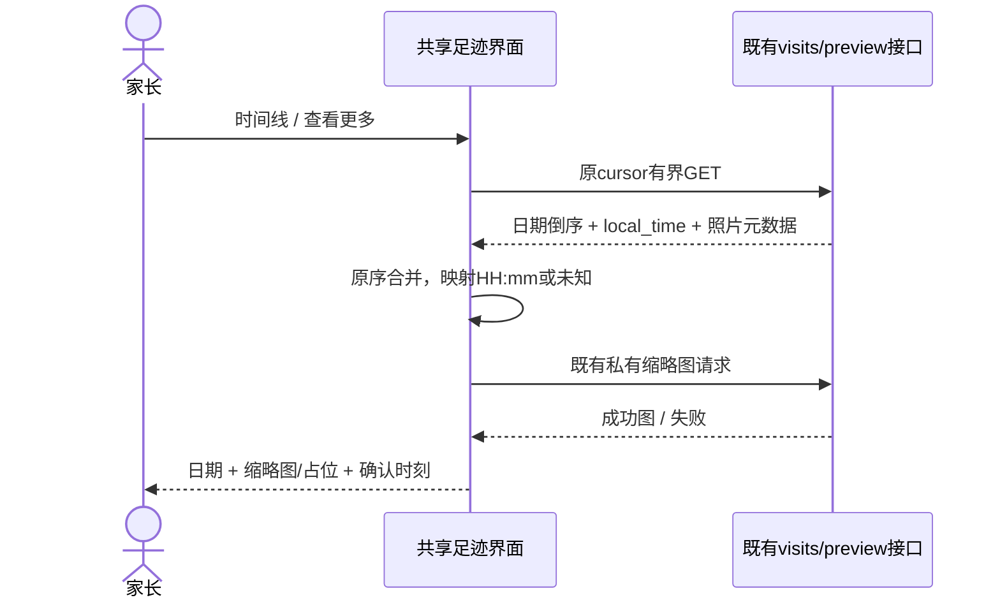
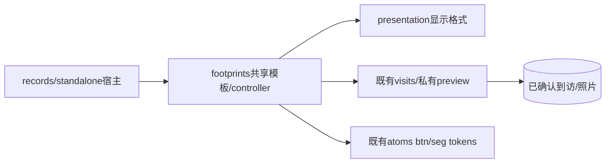

# BUG-034 — 旅行按钮一致性与倒序时间线

- Status: VERIFYING
- Spec revision: BUG-SPEC-20261024-FOOTPRINTS-CONTROLS-TIMELINE-01
- Architecture revision: ARCH-20261024-FOOTPRINTS-CONTROLS-TIMELINE-01（APPROVED；模块边界不变）
- Severity / Risk: P2 / R2（可见样式与照片时间呈现；无数据写入变化）
- Owner / Approver: 产品负责人（用户）
- Implementer / Feature/UI merge owner: Codex
- Reviewer/Verifier: Codex；实施后单独只读复核，原生/设备验收分开记录
- Date / baseline: 2026-10-24；HEAD 26714b997465fd2d1d9199f45ed931bd85c39405＋已有部署修复/证据dirty worktree，保留原改动
- User request: 本会话截图批注「button的样式，圆角和样式需要和学习那面保持一致」「时间线这里使用倒叙的方式…需要有时间/缩略图」
- User confirmation: APPROVED；产品负责人（用户），2026-10-24，本会话call_a4e6de3e6be5408fb860b26f20a09323回复「批准 Spec01＋Architecture01＋DREV01，按此实施」，适用本Spec01/Architecture01与DREV01
- Affected Features: FEAT-012；FEAT-001仅记录Tab宿主回归
- Current state: [FEAT-012](../../docs/domain/features/FEAT-012-child-photo-footprints.md) / FEAT-STATE-20261025-PHOTO-FOOTPRINTS-21；[UI-018](../../docs/design/frontend/ui/UI-018-child-photo-footprints.md) / UI-STATE-20261025-PHOTO-FOOTPRINTS-18；[FEAT-001](../../docs/domain/features/FEAT-001-push-kids-mvp.md) / [UI-001](../../docs/design/frontend/ui/UI-001-parent-miniapp.md)
- Runtime baseline: 037/Schema0025已部署，真实微信读取通过；[OPS发布记录](../../docs/deploy/releases/20261024-latest-backend-test-deployment.md)。已按既有批准OPS证据同步Feature/UI当前阶段；035段落保留早间历史，不改写原验收，也不当成本新稿证据。

## Frontend Design Impact and Repository-native Approval

- Frontend impact: yes；三视图切换、普通主次按钮、时间线缩略图时间标签
- Frontend engineering impact: yes；共享模板/样式与窄职责显示映射，不新增依赖、请求或持久状态
- Affected UI IDs: UI-018 / UI-001
- Frontend baseline revision: FDB-20260913-04（APPROVED，纸·芽，沿用学习页暖纸/松绿/胶囊）
- Frontend engineering constraint revision: FEC-20261007-NATIVE-GEOMETRY-02（APPROVED，无例外）
- Quality dimensions: component/state、responsive、native/device、a11y、中文时间/未知值、media/privacy、async/resource、error recovery
- Budgets: 字号≥14px、目标≥44px；主操作48px；三列等宽且不越界，照片两列间距8px；当前每卡≤4缩略图、每窗口≤100条、原预览并发/释放机制；初始包≤1.5MiB，不新增库/网络/日志/缓存
- Current Design Revisions: FOOTPRINTS基础DREV01、COPY02、RECORD-ENTRY01、MINIMAL01各自批准范围；旧源/快照不可变
- Proposed Design Revision: DREV-20261024-FOOTPRINTS-TIMELINE-01
- Editable source: [index.html](../../docs/design/frontend/prototypes/DREV-20261024-FOOTPRINTS-TIMELINE-01/index.html)
- Design contract: [FRONTEND-SPEC.md](../../docs/design/frontend/prototypes/DREV-20261024-FOOTPRINTS-TIMELINE-01/FRONTEND-SPEC.md)
- Design source SHA-256 / exports: 见[候选清单](../../docs/design/frontend/snapshots/UI-018/DREV-20261024-FOOTPRINTS-TIMELINE-01/APPROVAL.md)
- Required viewports: 320×568、390×844、430×932，1x，状态矩阵见设计合同
- Prototype status / Approved Spec / Approved Design: APPROVED / Spec01 / DREV-20261024-FOOTPRINTS-TIMELINE-01
- Design approval evidence: 用户2026-10-24在call_a4e6de3e6be5408fb860b26f20a09323明确批准Spec01＋Architecture01＋DREV01；源与42张快照自此冻结
- Permitted deviations / External dependency: none / none
- Verification: 候选HTML及SHA先审；批准后三视口原生节点/截图、按钮实际切换/预览、单独复核；真机/读屏/字体放大缺项单列，不用HTML代替

## 1. Symptom and reproduction

入口：记录Tab→旅行日记；独立足迹页复用同一模板。用户截图中三视图切换是10/12px圆角、深绿整块选中，与学习页既有按钮体系不一致。时间线需要明确最近在前，并能直接看时间和照片缩略图。

只读确认：`index.wxss`在通用按钮规则硬编码10px、fp-tabs12px，主导入12px；学习实际使用`styles/atoms.wxss`的`.btn`和`.seg`，均为`--pk-r-pill`。时间线WXML已有日期和每卡≤4预览，但未显示photo.local_time。真实用户有照片的数据未被读取或修改；不能凭截图推断现有时间线实际为升序。

服务端`FootprintReads.visits`已经`local_date DESC, id DESC`，cursor采用同一小于边界；客户端refresh/moreVisits原序消费，没有reverse。API已有照片local_time/私有预览和manual标志。本次倒序需求无需新后端排序；必须验证跨页仍倒序，不能仅把已加载一页reverse。原回放按日期/同日顺序前进继续保留。

## 2. Fix contract

1. 三视图切换复用学习页`.seg.n3`的胶囊外框/单项与浅纸色选中态、松绿文字、轻阴影；仍是三列等宽，局部保证每项≥44px。当前状态有aria-pressed，点击处理沿用changeMode。
2. 导入/保存/确认等普通主按钮使用学习页`.btn`松绿胶囊，48px主操作、16px字；次操作沿用secondary/文字语义，≥44px/14px。原生关闭、选择圆形目标与列表行不被强制改成主CTA。删除fp角色中重复的按钮圆角/主色/阴影声明，不新增另一套共享抽象，也不重画学习页。
3. 时间线按已确认到访日期从新到旧显示；同日按既有稳定id次序，跨页沿用服务端游标。日期不是上传/创建时间；不跨时区重新猜测。用户可编辑的同日播放顺序不变。
4. 每张实际缩略图下方显示其已确认当地时刻HH:mm；缺时刻显示“时刻未知”，不生成00:00或用上传时间。卡头保留到访日期、地点及真实照片数，缩略图仍至多4张，两列、裁切aspectFill，保持原点击照片详情路径。
5. 预览处理中/失败保留占位与可读时间，照片详情仍可打开重试原路径；手动无图到访显示“手动到访”和已知/未知时刻，不画伪照片、不算进照片数。viewer/归档保留阅读，原新增权限不变。

状态/数据修复：N/A，无历史数据改写或回填；错误只在呈现。无新Provider、AI内容、API、Schema、权限、开关、地图、排序参数或后台任务变化。不部署服务端、不上传客户端；批准后本地客户端实现/验收。

## 3. Design and trade-offs

Link/call graph：records宿主/独立Page→共享footprints模板、controller→现有visits API（DESC＋cursor）→现有照片预览；presentation窄职责映射HH:mm/未知标签；样式引用既有atoms btn/seg。领域/数据流owner不变。

状态机：原`timeline↔playback↔lit`、`浏览→照片面板→浏览`保持；新增仅显示派生：`有时刻→HH:mm / 无时刻→未知`、`预览待取→成功图 / 失败占位`。离页/切孩子/开面板的在途分页与预览失效继续使用原代次，不新增持久状态。

| 方案 | 取舍 | 决定 |
|---|---|---|
| 沿用服务端DESC/cursor，补足时间呈现，复用atoms | 最小范围，保留分页/媒体安全和视觉一致性 | 推荐 |
| 客户端reverse或只sort当前页 | 可能把后续页插错位置，不能证明全局倒序 | 不采用 |
| 让回放也倒放/新增日内排序API | 改用户已编辑顺序和SQL/游标合同，超出本批注 | 不采用 |
| 继续新增独立圆角/颜色补丁 | 无统一语义，后续仍漂移 | 不采用 |

模块/依赖方向/公共抽象/扩展点无变化，沿用ARCH-20261023-RECORD-TYPE-SWITCHER-01；本Architecture01仅明确呈现owner和边界。Frontend设计/FEC均沿用批准基线，无新全局规则。

## 4. Expected files

| 文件 | 动作/必要性 |
|---|---|
| `apps/miniprogram/pages/footprints/index.wxml` | 修改：btn/seg语义、选中状态、缩略图与时间标签、manual/预览占位 |
| `apps/miniprogram/pages/footprints/index.wxss` | 修改：删除与atoms冲突的普通按钮声明，保留44/48px几何与媒体卡片；不批量修无关圆角 |
| `apps/miniprogram/pages/footprints/presentation.js` | 修改：窄职责时间显示映射，不改原字段/顺序 |
| `apps/miniprogram/pages/footprints/controller.js` | 仅初次/续页显示映射接入；保持cursor、100窗口、释放与迟到保护 |
| `tests/frontend/footprints.test.js` | 按实际变化补时间/未知/manual、跨页/换窗口及已有预览竞态必要回归；不写逐字CSS镜像 |
| 当前DREV源/清单、设计索引与三视口原生证据工具 | 新增候选与本diff验收；生产transport不替换，不复用旧截图 |
| FEAT-001/012、BHV-040/041/038、UI-001/018、测试/本地发布/Spec索引 | 合并最终已验证事实，修正文档冲突；旧批准快照只按规则加Superseded by |

不改apps/api、SQL、migration、云配置、学习页源码或全局tokens；不提交/推送。回退只恢复本前端diff，不涉及DB恢复。

## 5. Required verification

| ID | 必须证明 | 验证与当前状态 |
|---|---|---|
| TP01 | 学习同款pill主/次操作与seg选择；44px/14px、主操作48px、三列等宽无裁切 | 320/390/430各18原生态PASS，共54组节点/PNG；390实际切换/播放PASS |
| TP02 | 日期倒序，跨页/100窗口不倒置、不重复；不同家庭/孩子不泄漏 | 既有API DESC/cursor只读核对＋初次/追加/替换与孩子scope回归PASS；无SQL变更未重复5万MySQL基准 |
| TP03 | HH:mm、HH:mm:ss→HH:mm、缺值未知，不用created_at；manual无伪图、预览失败时间仍可读 | 3项本次回归PASS，含秒/小数秒/非法值、失败详情；320/390/430未知/失败/manual原生PASS |
| TP04 | 点击缩略图和查看详情、viewer/归档、切视图/孩子/面板迟到保护、失败保留cursor | 335项包含原footprints/record-types回归PASS；390实际点击未知缩略图/详情/关闭/设置开关PASS，真实媒体/设备NOT_RUN |
| TP05 | 未改后端/请求/写入/权限/设计基线，无包体预算回退 | 335项/ESLint/17页1221792源字节/DAG150/批准设计SHA PASS；diff/链接/源摘要随最终收尾记录 |
| TP06 | 文档正文/索引/证据一致，单独只读审查正确性/必要性/边界/残留 | 文档按实际diff同步；最终只读复核见本会话收尾报告；设备/读屏/大字体NOT_RUN |

候选渲染不是实施/原生/真机证据。现有云端读取结果不移作本diff通过；本次代码/测试均在上述明确批准之后修改。

## 6. Approval and lifecycle

候选验证：42张HTML导出及SHA清单、三视口DOM几何/倒序检查、切换/预览/保存/下一组交互、未知时刻/旧日期/手动无伪图上下文检查均PASS；候选未发出外部网络请求。设计validator（allow-pending＋current-policy）、Markdown链接核对与diff whitespace检查PASS。Playwright默认浏览器未安装，改用本机Chrome完成候选验证，未安装额外浏览器。证据见候选清单与同目录render-audit.json。

实施/文档闭环：当前4份生产源码及3项回归已修改，335项与静态门禁通过。320/390/430原生54组及390实际点击通过；2026-10-25解锁后补齐430的18组，源码摘要与隔离副本仍一致；设备/读屏/大字体及家长真实数据验收NOT_RUN。证据见[本次记录](../../docs/quality/evidence/footprints-timeline-20261024/README.md)。Feature/Behavior/Architecture/UI/设计/测试/本地发布及Spec索引按实际diff同步；旧批准清单仅补本范围Superseded by，不改源与导出。037/0025沿用既有已批准OPS证据，不作本次原生验收。

当前active/VERIFYING；上述Spec01＋Architecture01＋DREV01已获用户明确批准并实施，不再等待同一批准。三尺寸原生已全部通过，设备/读屏/大字体及用户验收尚未闭环，不满足DONE迁移条件；最终只读复核结论见本会话收尾报告，补齐实际验收后再判断completed。未上传、部署、提交或推送。
