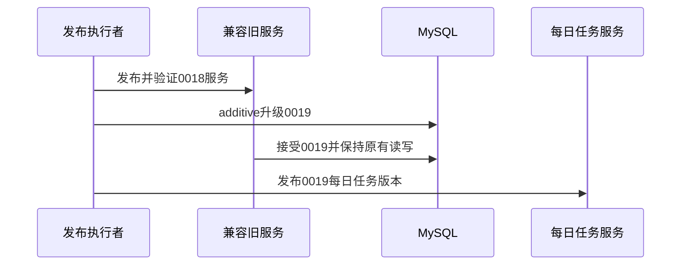

# BUG-20261013 — 每日任务发布的双版本 Schema 兼容

- Status: VERIFYING
- Severity: 生产升级窗口旧后端健康检查失败、无法直接回退
- Risk: R3
- Owner: 用户
- Implementer/Verifier: Codex
- First observed: 2026-10-13，生产Schema只读核验0018
- Spec revision: SPEC-20261013-DAILY-TASK-RELEASE-COMPAT-01
- User confirmation: 用户于2026-10-13明确回复“批准兼容方案并继续发布”，批准SPEC-20261013-DAILY-TASK-RELEASE-COMPAT-01；部署及跳过新增备份沿用本会话授权。
- Affected Feature IDs: FEAT-001、FEAT-010
- Feature current-state documents: docs/domain/features/FEAT-001-push-kids-mvp.md、docs/domain/features/FEAT-010-daily-tasks.md
- Feature baseline revision: FEAT-STATE-20261012-DAILY-TASKS-01-LOCAL
- Feature merge owner: Codex

## 1. 现象、原因与范围

当前生产0018，新版要求0019。可追溯0018源码的启动和ready只接受0018；0019仅新增两表和索引，不修改既有行，但旧服务仍可能因版本号校验失败而不就绪。028实际源码身份尚未证明。

推荐从可追溯0018源码冻结过渡后端，仅将Schema白名单限定为0018和0019；它不注册每日任务路由，不查询新表。先验证、发布过渡版本并由管理员确认流量，再迁移0019，发布既有每日任务候选。所有新功能仍以已批准FEAT-010为准；不得将新版直接运行在0018或放宽到任意Schema。

前端设计/工程影响：N/A，本修订不修改前端；设计源、视口、manifest与DREV：N/A，无可见变更。

## 2. 设计视图

调用图：bootstrap启动/ready → Database.verify_cloud_schema → alembic_version；原有服务 → 原有表。

状态机：0018旧服务 → 0018兼容服务 → 0019兼容服务 → 0019每日任务灰度 → 人工确认流量；任何失败停止推进，保留0019表和事实，回退兼容服务。

架构图：N/A，模块和依赖不变，仅现有Database的显式有限Schema白名单。

权衡：推荐兼容过渡版本，成本为额外构建/发布/流量确认；直接迁移再发新版可能导致健康失败及无可用回退，拒绝；不限定版本号接受任意Schema，拒绝。

## 3. 文件、验收与测试

预期修改：可追溯0018冻结源码中apps/api/src/push_kids/platform/database.py；增加兼容校验测试与release manifest；同步发布报告和Feature发布事实。活动仓库新版0019严格校验保持现有合同。

- TP-001：过渡服务在真实MySQL5.7的0018/0019均ready，其他revision拒绝。
- TP-002：隔离MySQL空库base→0018→0019，current/head一致、check无差异；旧业务家庭边界、CRUD、幂等及新每日任务合同通过。
- TP-003：冻结容器构建、非root、live/ready、SIGTERM通过；无秘密和生产内容进入包或证据。
- TP-004：云灰度normal、真实小程序业务smoke，PUBLIC关闭；未完成流量确认不宣称线上生效。

## 4. 实施与生命周期

此具体revision已批准并实施冻结兼容包。新增备份按用户明确要求跳过，记录恢复风险；生产迁移授权沿用“部署后端”“不需要备份直接发布”。当前VERIFYING保留active；完整门禁完成才DONE并迁入completed。

## 5. 当前验证证据

可追溯源码8052419d37503f7597995a87f1bfa84cfb953e34，仅Database校验一行变更；可重放补丁deploy/cloudbase/schema-0018-0019-compat.patch，reverse --check通过。冻结目录dist/release-compat-20261013-0018-0019，103文件；manifest SHA256 bd1c3432ac200596f43f65d95cd586916d10a7b7c69bbc8ca30324decf99c9f5。逐项Git差异与manifest及实际秘密扫描通过；新版冻结包无额外源码变更。

TP-001本地MySQL5.7.44接受0018/0019、拒绝未知revision通过。旧模型CRUD、跨家庭读取拒绝通过；TP-002空库base→0018→0019、check无差异及11个MySQL集成检查通过，新每日任务真实MySQL服务合同通过，见发布报告。TP-003兼容/新版容器均构建通过、UID10001、live/ready、本地SIGTERM退出0。兼容校验文件Ruff check/format通过。TP-004兼容云版本029于2026-10-13 13:37:38达到normal，PUBLIC关闭；当前路由callContainer live/ready均200但尚不能归因于029，等待管理员灰度测试路由和流量确认，未宣称TP-004通过。生产数据库仍0018，Spec保留VERIFYING/active，恢复条件为029定向smoke及接管确认，然后继续0019迁移和新版灰度。
