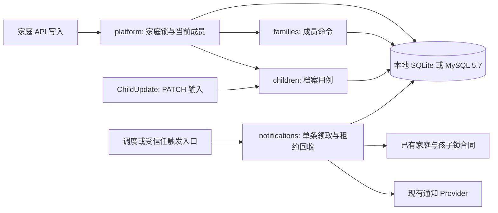
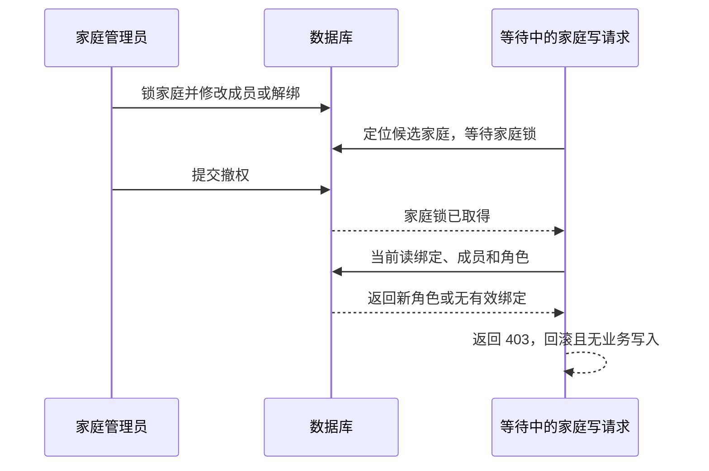
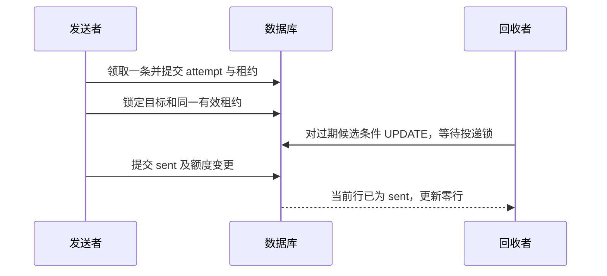
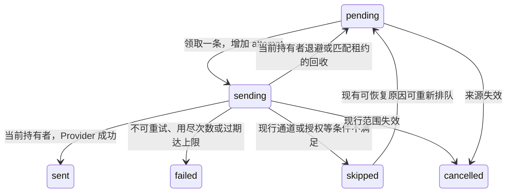

# BUG-20261124 — 家庭写入权限、通知投递与孩子档案校验

- Status: VERIFYING（本地实现，匹配云交付待补）
- Spec revision: `BUG-SPEC-20261124-CORE-REVIEW-01`
- Architecture revision: [`ARCH-20261124-CORE-TRANSACTION-01`](../../docs/architecture/decisions/ADR-20261124-CORE-TRANSACTION-BOUNDARIES.md)
- Risk: R3（通用写入授权）；通知投递和档案输入为 R2；原型脚本为独立 R0。
- Owner: 产品负责人。实现由当前会话负责，验证后由独立 `critical_reviewer` 复核固定版本。
- User confirmation: 产品负责人，2026-11-24，本聊天回复「批准，执行」，对应确认请求中的 `BUG-SPEC-20261124-CORE-REVIEW-01` 和 `ARCH-20261124-CORE-TRANSACTION-01`。
- First observed: 2026-11-24，工作区基准 `760adeed5169c0ff53a8f145544c9de56499b497`。[初始证据](../evidence/EVD-20261124-CORE-REVIEW-DISCOVERY.md)
- 当前状态：[FEAT-002 家庭协作](../../docs/domain/features/FEAT-002-family-collaboration.md)、[FEAT-003 通知通道](../../docs/domain/features/FEAT-003-notification-channel.md)、[FEAT-005 多孩子档案](../../docs/domain/features/FEAT-005-multi-child-profiles.md)、[FEAT-013 升年级](../../docs/domain/features/FEAT-013-annual-grade-promotion.md)和本地工作区的 FEAT-014 今日复习题。兼容面包括 [FEAT-006 删除](../../docs/domain/features/FEAT-006-data-cleanup-and-family-reset.md)和[FEAT-011 通知续订](../../docs/domain/features/FEAT-011-notification-auto-renewal.md)。
- Frontend impact: 无小程序界面、交互或运行时代码变更；Design Revision、FEC、原生视口和六主题运行态复验不适用。Q-001 单独核对现有原型的两档视口、六主题和字节产物。

## 1. 症状、根因与验收

| 发现 | 复现条件与实际行为 | 目标及禁止副作用 |
| --- | --- | --- |
| CORE-001 | MySQL 5.7 默认隔离级别下，管理员持家庭锁并把 editor 降为 viewer 或移除。另一写请求在管理员提交前读到旧身份并等待家庭锁，随后使用旧角色继续写。 | 撤权先提交时，等待中的写请求返回 403，无领域或成功审计写入。合法写先取得锁则可先完成；角色和家庭冻结在同一串行边界读取。活跃 viewer 的本人提醒操作继续允许。 |
| CORE-002 | 回收者普通读取过期 `sending`，持有投递锁的发送者先提交 `sent`，回收者再按旧对象 UPDATE；先批领后串行发送也会令队尾租约过期。 | 当前 `sending` 且租约仍属对应 attempt 时才能回收或发送。旧持有者不得发送、写回或扣额度；已提交终态不得被回收覆盖。未到实际发送的队尾保留 `pending`，以后可以正常发送。 |
| CORE-003 | 两名有效管理员时，通过成员删除 API 删除本人，成员及身份绑定被解除。原测试仅建一名管理员，能被最后管理员保护拦截。 | 本人删除始终 409，成员、绑定、审计均保持。可按现行合同移除其他成员；[BUG-010 已批准合同](../completed/BUG-010-NATIVE-LAYOUT-AND-PARENT-FLOWS.md)继续适用。 |
| CORE-004 | `PATCH /api/v1/children/{id}` 显式传入 `name: null` 或 `daily_budget_minutes: null`，通过旧 schema 并触发非空约束错误。 | 两种输入各返回 422，持久状态不变。字段省略保持原值，有限制的合法值继续支持。`grade: null` 仍按已批准的明确意图和版本条件清空。 |
| DOC-001 | 题库工作区 README 把当前题库与旧现场拟题合并描述，架构正文仍把服务外执行器写成唯一云路径。 | 题库工作区区分新题库与当日抽样、旧现场拟题回退，以及 042/043/0.1.21 的历史交付阶段。阅读和启用说明随 FEAT-014 源码入库。 |

Q-001 仅修改不参与运行时的 `render.py`。现有报告有 18 条 E501 和 1 条 B023。两次 Chromium 导出字节和原清单校验均通过。[机械修复与发现阶段证据](../evidence/EVD-20261124-CORE-REVIEW-DISCOVERY.md)

CORE-001 至 CORE-004 的原始证据为源码与请求路径。正式 Red/Green 使用合成数据和真实 API 或后台入口。生产是否已有相关数据变化待核验，超出本轮的读写范围。

本次 Git 主分支提交覆盖 CORE-001 至 CORE-004，保持现有 `20261105_0027` Schema。主分支尚无两个题库路由，相关重复授权删除及 DOC-001 留在题库工作区。共享 SQLite 写事务入口按原实现单独纳入。[主分支验证](../evidence/EVD-20261124-CORE-REVIEW-MAIN.md)

## 2. 修复设计

### 调用与架构

- CORE-001：在 POST/PATCH/DELETE 等真实写路径中，初读仅用于定位候选家庭。MySQL 先锁 active Family 当前行，再用 `FOR UPDATE` 和标量列当前读核验可信 actor、绑定 active/归属、成员 active/归属和角色。不得从 identity map 读取权限，也不得把本次写迁往重新绑定后的另一家庭。文件 SQLite 在首次身份查询前由现有事务入口取得 `BEGIN IMMEDIATE`；保留 `X-Family-ID` 本地路径和普通 GET 当前合同。保持 `self_service_context` 的本人写例外并覆盖相应测试。
- CORE-002：在固定 tick 到期窗口中逐条领取，保留每轮上限和排序，单条以领取时钟启动租约，并记录持有者的 delivery ID、attempt 与截止时间，不跨发送持有其他待发项租约。发送前遵循现有家庭／孩子／投递锁顺序，匹配持有者及有效截止时间，并重新读取接收设置与剩余额度；持锁到终态或重试结果提交。过期候选采用有界读取与数据库条件更新，限定 ID、`sending`、原 attempt、原截止时间和已过期条件，按实际更新行计数。检查相邻撤回/取消路径是否可能覆盖终态，只有相同并发不变量所需改动才纳入。SQLite 复用写序列化，MySQL 5.7 使用普通行锁和带条件更新。授权额度仅在成功发送事务中扣一次。保留已知 Provider 成功但进程未提交时的既有外部结果不确定性。
- CORE-003：在 `FamilyService.remove_member` 对同家庭有效目标完成定位后，按 `context.member_id` 拒绝本人目标，保留管理员及未知目标的旧边界。
- CORE-004：在 `ChildUpdate` 校验显式提供的不可清空字段，使用字段校验保持 422。可省略字段与可空年级使用既有 PATCH 和年级版本语义，去掉业务层被新合同取代的 null 分支。

已提交的 `sent` 不允许被租约回收或旧持有者转换。成员角色是既有 active/removed 状态机；此次只改变写时授权和自移除拒绝。PATCH 输入和文档无独立持久状态机。

| 备选 | 取舍 |
| --- | --- |
| 换用普通成员查询或只 `refresh()` | 仍可能使用旧事务快照。采用锁后标量当前读，写请求增加小范围锁成本。 |
| 先锁成员再锁家庭 | 与现有家庭管理和冻结锁顺序相反。先定位家庭再锁定并核验可保留现有事务边界。 |
| 延长批量租约或后台续租 | 仍需所有权校验，且队首阻塞可以继续拉长队尾等待。逐条领取增加小事务次数，避免长时间预占，批次总量保持有界。 |
| 去掉发送期间的锁 | 必须另建外部幂等或投递确认协议，并可能重开删除竞态。保留现有串行边界，由短 Provider 超时限制常见持锁时长。 |
| 在服务层吞数据库约束错误 | 无明确请求字段合同。入口拒绝非法 null，保留 grade 的独立语义。 |

## 3. 范围、文件与回退

| 预计路径 | 动作与理由 |
| --- | --- |
| `apps/api/src/push_kids/platform/context.py`、`knowledge/review_router.py`、`review_worksheets/router.py` | 把锁后当前授权收敛到共享入口，复用现有 SQLite 事务入口。两个题库路由移除重复授权及其提前回滚。 |
| `apps/api/src/push_kids/families/service.py` | 保护成员本人账号，通知目标核验使用与已绑定写请求相同的家庭先锁顺序。 |
| `apps/api/src/push_kids/notifications/service.py`、`outbox.py`、`planner.py` | 逐条领取、条件回收与撤回。已复现规划器用旧状态取消或重排终态。MySQL 对重排行执行当前读，SQLite 在 planner 的第一次读取前进入写事务。 |
| `apps/api/src/push_kids/children/schemas.py`、`children/service.py` | 修正 PATCH 输入合同并清理不可达分支。 |
| `tests/conftest.py`、`tests/integration/test_family_onboarding.py`、`test_multi_child_profiles.py`、`test_notification_resilience.py`、`test_notification_channel.py`、`test_mysql_runtime.py`、`test_review_worksheets.py`、`test_review_worksheet_mysql.py` | 保留真实请求和投递入口的可失败回归。题单并发屏障调整到新的事务入口。两个非调度测试夹具禁用随本机环境意外启动的后台循环。 |
| `README.md`、`docs/architecture/ARCHITECTURE.md`、`docs/domain/BEHAVIOR-CATALOG.md`、适用 Feature 正文、ISS/REG/EVD 和 Spec 索引 | 同步权威事实及实际验证，记录本次与历史交付的边界。 |

不增加迁移、API 路由、配置开关或依赖。模块所有权及依赖方向沿用当前架构；扩展点不变。已生成的审查报告、设计来源、快照和历史部署记录保留。出错回退限定应用版本，避免恢复已知越权窗口或启动两个会并发使用旧回收逻辑的执行器。混合版本阶段，旧发送者仍可能忽略新租约契约；以后发布须沿发布手册验证投递执行器新旧互斥、双账号隔离与正常授权、低竞争写入和状态恢复，并观察 403、锁等待、失败与重复投递。本轮批准本地修复，实际发布与生产数据修复另行授权。

## 4. 验证和收尾

| ID | 必需验收与命令范围 | 当前结果 |
| --- | --- | --- |
| TP-01 | 隔离真实 MySQL 5.7。事务屏障确认孩子 PATCH 已到家庭锁，再提交 editor 降为 viewer 或移除。两种 403 均断言孩子和审计无变化，正常授权写和获锁优先写验证成功。补文件 SQLite 写序和 viewer 本人提醒兼容。 | 本地通过。真实双账号/owner 待发布验收。 |
| TP-02 | 双连接固定“回收看到过期旧租约、发送先提交”的交错，断言不覆盖 `sent`、额度仅扣一次。验证过期持有者不能覆盖新 attempt、队尾等待超过原租约、不重复调用发送模拟器、崩溃恢复、达上限及删除相邻路径。MySQL 5.7 和 SQLite。 | 两个数据库专项与本地 tick 通过。真实通知送达待发布验收。 |
| TP-03 | 两管理员测试，直调 API 自移除 409 后成员、绑定和成功审计保持。移除另一个有效成员成功并留审计。 | 本地通过。 |
| TP-04 | 分别显式传两个 null 得 422，非法请求前后档案相同；省略、边界合法值、grade 清空且检查版本、跨家庭和 viewer 边界。 | 本地通过，核对 OpenAPI 可省略与可空属性。 |
| TP-05 | 对照当前代码、配置与发布记录校验 README、架构改动及链接。 | 核对 042/043/0.1.21 和新题库配置，结果见 EVD。 |
| TP-06 | 后端全量、Ruff 与格式、mypy、架构检查。固定版本后独立 R3 Review，跟踪全部发现。 | 原工作区后端 1,172 通过、90 条件跳过，隔离 MySQL 专项 36 通过，前端 424 通过，所有静态检查通过。R3 两项已修复，复评无新增。主分支单独验证，记载两处基线测试失败及原型 Ruff 基线问题。[主分支证据](../evidence/EVD-20261124-CORE-REVIEW-MAIN.md) · [原工作区证据](../evidence/EVD-20261124-CORE-REVIEW-IMPLEMENTATION.md) · [R3 报告](../evidence/CORE-REVIEW-20261124-R3.md) |

回归先运行预期失败的行为测试，记录真实 Red，再最小修复并保留 Green 与环境版本。核对 Feature／行为目录／架构／UI／测试及部署文档；合并已验证的本地事实，保留真实云端和原生验收状态。匹配实现的云交付后按 GOV-002 独立判断开发归档和业务验收。
