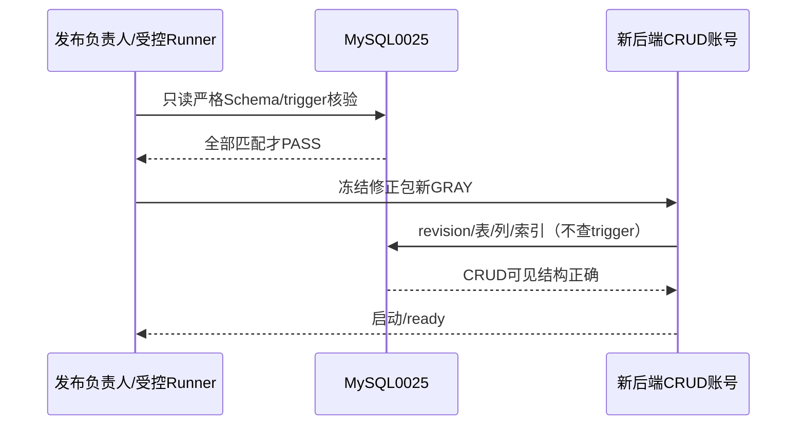
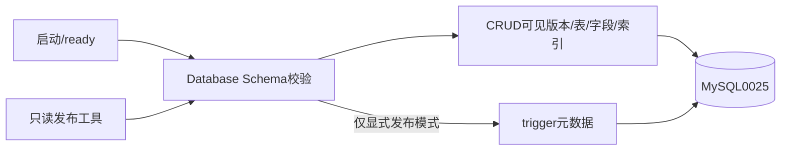

# BUG — CRUD账号Schema readiness与触发器元数据权限隔离

- Status: VERIFYING
- Severity: 原P1启动阻断已修复；037 normal/100%且读取smoke通过，等待用户本地业务验收
- Risk: R2；生产恢复部署沿用已批准OPS01的R3维护窗口
- Spec revision: BUG-SPEC-20261024-CRUD-SCHEMA-READINESS-01
- Architecture revision: ARCH-20261024-CRUD-SCHEMA-READINESS-01（APPROVED）
- Owner / Approver: 用户；Implementer / Verifier: Codex
- Date / baseline: 2026-10-24 / 26714b9 / 036冻结代码 / 生产0025
- User confirmation: 用户2026-10-24回复call_f5deed23a40b43f2b50e7ec67901bf90：「批准此Spec和Architecture，验证后继续部署」，批准本Spec01及Architecture01。
- Affected Features: FEAT-001复习派生投影、FEAT-004建议（保持关闭）、FEAT-013年级（启动阻断回归）、FEAT-006权限/恢复
- Current state: `docs/domain/features/FEAT-001-push-kids-mvp.md`、`FEAT-004-daily-learning-suggestions.md`、`FEAT-013-annual-grade-promotion.md`、`FEAT-006-data-cleanup-and-family-reset.md`。
- Context: [已批准OPS01](OPS-20261024-LATEST-BACKEND-TEST-DEPLOYMENT.md)；[生产失败阶段](../../docs/deploy/releases/20261024-latest-backend-test-deployment.md)

## 1. 证据与根因

根因定位时：生产0022→0025已完成，admin current/check/运行时结构、8 queue+9 early触发器及投影无差异；036镜像成功构建但22:40:40 deploy_failed/0%，035当时100%，严格0022不能在0025上重启。当前修正包037已normal/100%，035为0%、036仍失败，两者均保留历史证据；035不作为回滚目标。

只读使用036实际应用账号，经已批准的同库管理访问地址（仅替换网络endpoint，不换账号），SELECT确认0025；information_schema.TRIGGERS的early可见计数0，原样Database.verify_cloud_schema抛出「数据库提前复习投影触发器不完整」。证据`docs/quality/evidence/latest-backend-release-20261024/runtime-account-schema-attempt02.json`。首次内网endpoint本地不可达单列保留。不读取云端未知日志也已复现确定启动阻断；不声称已排除全部其他启动原因。

MySQL5.7的触发器元数据可见性要求TRIGGER权限，不能用CRUD账号的空结果判断DDL缺失：[官方合同](https://dev.mysql.com/doc/mysql-infoschema-excerpt/5.7/en/information-schema-triggers-table.html)。TRIGGER同时允许触发器操作，不给应用扩权。

## 2. 推荐设计与取舍

应用`Database.verify_cloud_schema()`默认只做CRUD可见的revision、必需表/字段/索引校验，仍拒绝版本/结构缺失；启动与ready保持该默认。增加显式、默认false的仅发布核验参数`verify_triggers`：true时由受控发布账号检查预期trigger集合，不捕获/忽略缺失异常。新增窄职责只读发布工具，显式启用该检查，凭据仅安全环境注入，输出固定PASS/FAIL类别，不创建/修改Schema或打印URL。

发布手册规定触发器核验是每次相关后端发布的必需门禁；运行账号验证与发布账号验证分别记录。应用不再持续探测它无权限查看的trigger元数据。权衡：运行中被管理员破坏触发器不由每次ready发现，依赖受控DDL权限、发布审计/投影诊断；不虚称实时完整性。未改变投影生成/修复、选题、学习确认或家庭授权合同。

| 方案 | 收益 | 风险/代价 | 决定 |
|---|---|---|---|
| CRUD运行校验＋显式发布账号trigger核验 | 恢复最小权限启动、保留发布结构门禁 | 两类证据；运行期无trigger元数据检测 | 推荐 |
| 给应用TRIGGER或admin权限 | 代码少改 | 提升DDL能力，违背最小权限 | 拒绝 |
| 忽略所有Schema异常或只查SELECT1 | 快速启动 | 隐藏版本/结构不匹配 | 拒绝 |
| 0026证明表/definer视图 | 可读专用元数据 | 新DDL、失效一致性与恢复范围更大 | 本轮不引入 |

## 3. 必需设计视图

Link/call graph：lifespan/ready→Database.verify_cloud_schema(default)→revision/table/field/index；发布工具→Database.verify_cloud_schema(verify_triggers=true)→上述检查＋trigger集合。两者连接身份不同，应用永不取得migration凭据。

State machine：036_FAILED→SPEC_APPROVED→LOCAL_FIXED→CRUD_AND_ADMIN_GATES_PASS→NEW_FROZEN_GRAY→READY→OPERATOR_DIRECTED_SMOKE→LOCAL_USER_TEST。任一门禁失败→停止放量/记录事实；不重复upgrade/downgrade/清队列。

模块边界/依赖方向/共享抽象/扩展点不变；增加方法显式模式只限发布调用，非插件扩展。Frontend design及engineering均N/A：无前端源码、视觉、交互或设计变更；已批准快照不改。

## 4. 范围与预期文件

生产仅`apps/api/src/push_kids/platform/database.py`运行校验；新增窄职责`tools/verify_cloud_schema.py`；相关MySQL最小权限回归与必要单测；发布手册、测试策略、Architecture/Feature/Behavior/UI阶段、OPS及证据/索引闭环。不得修改既有migration、数据库权限、业务模型/API、开关或配置。

验证后从26714b9＋本批准修复生成新的白名单不可变运行包（02）及SHA，记录未提交diff；不覆盖036旧包。数据库已是0025，只读核验，不重复迁移。继承原18项配置/资源/入口，创建新GRAY，036保留失败证据、不自动删除；全量接管仍是仓库手册的人工门禁。不得提交/推送Git或上传客户端。

## 5. 验收与测试点

| ID | 必需检查 | 验收 |
|---|---|---|
| T01 | 一次性MySQL5.7：root迁移、仅CRUD用户 | CRUD不可见trigger但默认Schema校验PASS；缺列/索引/错revision继续FAIL；CREATE/ALTER/TRIGGER拒绝 |
| T02 | 显式发布trigger核验与工具 | admin全部存在PASS；隔离库删除一个early触发器后严格核验FAIL；CRUD严格模式不能伪装PASS；固定输出不含连接串/凭据 |
| T03 | 后端全量及相关MySQL | 全量/年级/提前复习/永久状态回归；Ruff/format、mypy、DAG；前端未改不机械重跑已通过332项，发现相关失败再扩大。实施期该相关MySQL回归发现既有立即claim时序假设：DATETIME秒级round可使available_at暂时在未来；在test_today_learning_mysql既有用例中增加最多2秒轮询，沿用生产worker重试合同，不改业务/时钟/断言，仍严格验证唯一自动提示、提案和并发审批/正式记录零写入；原失败保留。属本T03相关测试适配，无新增生产范围/架构变化。 |
| T04 | 新冻结包/容器/生产只读 | manifest/源码/秘密白名单、本地非root/live/ready/SIGTERM；生产admin严格模式和实际CRUD默认模式均PASS，无DDL/业务写入 |
| T05 | 新GRAY/本地客户端 | new normal/0%、配置相等/PUBLIC关闭；管理员定向后真实微信live/ready和只读业务；用户业务/设备继续独立验收 |

## 6. Approval / lifecycle

本Spec01＋Architecture01已经用户明确批准并实施。T01/T02：实际MySQL5.7最小权限/拒绝DDL/结构损坏/严格trigger与工具6 passed。T03：后端780 passed/46条件MySQL skip；实库相关26项通过，含年级4/今日1/永久13/计划2及权限6；Ruff/format740、mypy150、DAG150、diff通过。首轮今日立即claim失败与DATETIME真实round探针、最多2秒测试轮询修订及复测证据保留。T04：冻结02两包源码/秘密/manifest、镜像150源码SHA/UID10001/live200/ready200/SIGTERM4.808s/exit0、CLI dry-run通过；生产0025 admin严格工具和实际CRUD默认模式分别PASS，未重复DDL。T05部署/接管后读取PASS：037 normal/0%后用户先调100%，官方复核与真实本地客户端20项GET全200，含live/ready/新年级/建议；配置18项一致/PUBLIC关闭，控制面239.699秒观察及末次live/ready再200。全量前定向smoke未执行，不追记为通过。用户正式写入/设备验收仍NOT_RUN。

本轮代码与文档冲突核对完成：启动检查双身份合同、Architecture取舍、Feature/Behavior/UI运行阶段、发布门禁和测试证据已合并当前正文，无领域/API/UI偏差。人工接管与读取smoke已完成；用户业务反馈待补，故留active/VERIFYING，收到反馈后按实际覆盖评估完成并迁completed，不把读取检查当作写入/设备验收。生产备份与OPS批准仍有效；本修复不扩大权限、不执行破坏性恢复。
