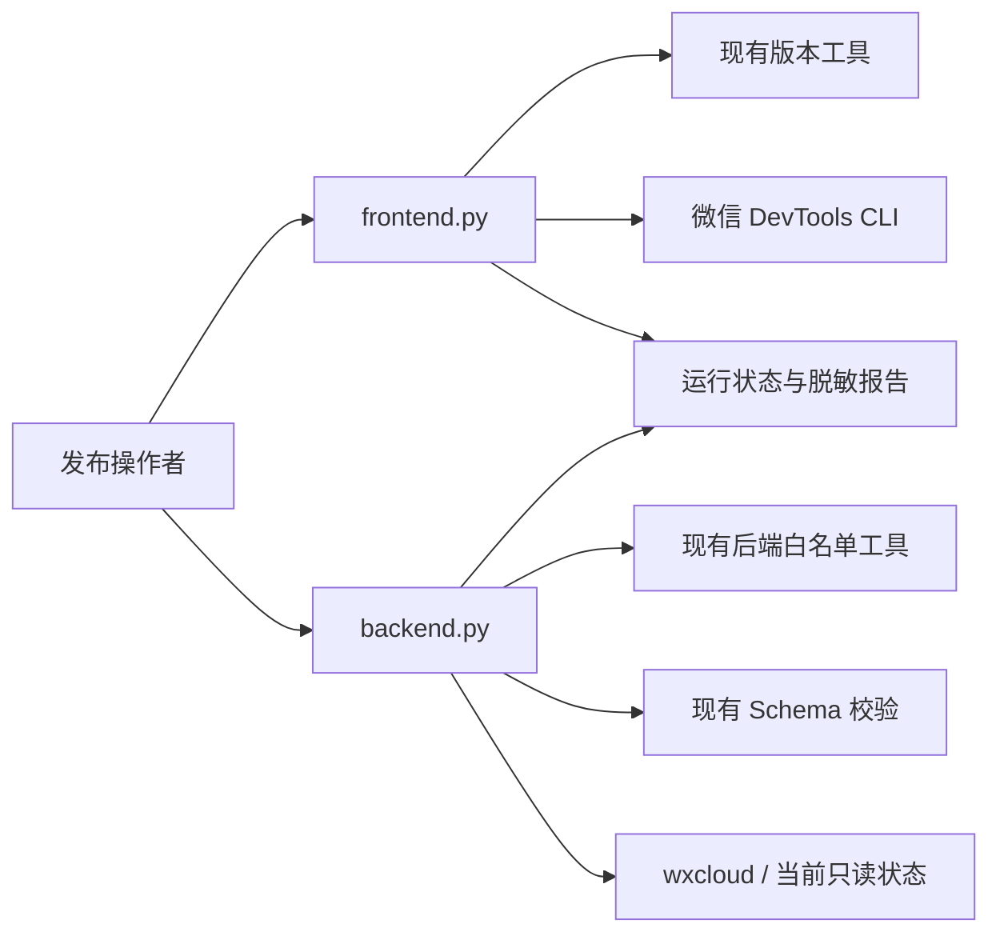
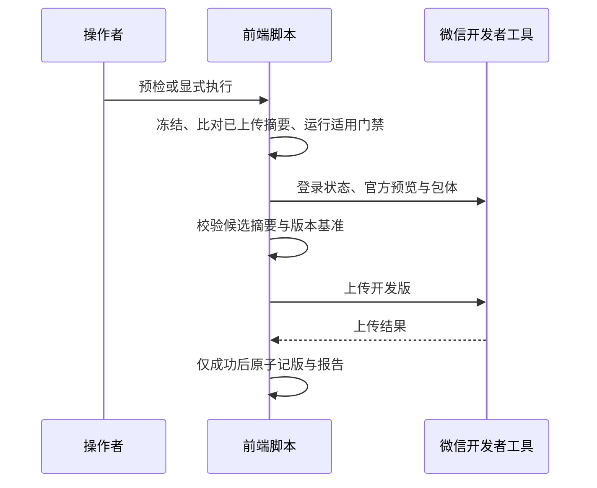
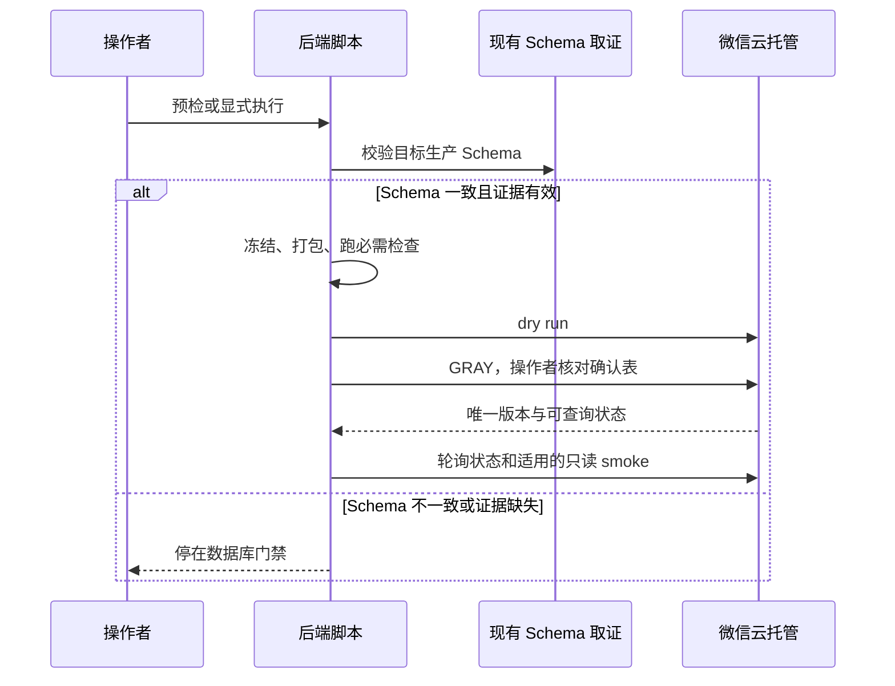
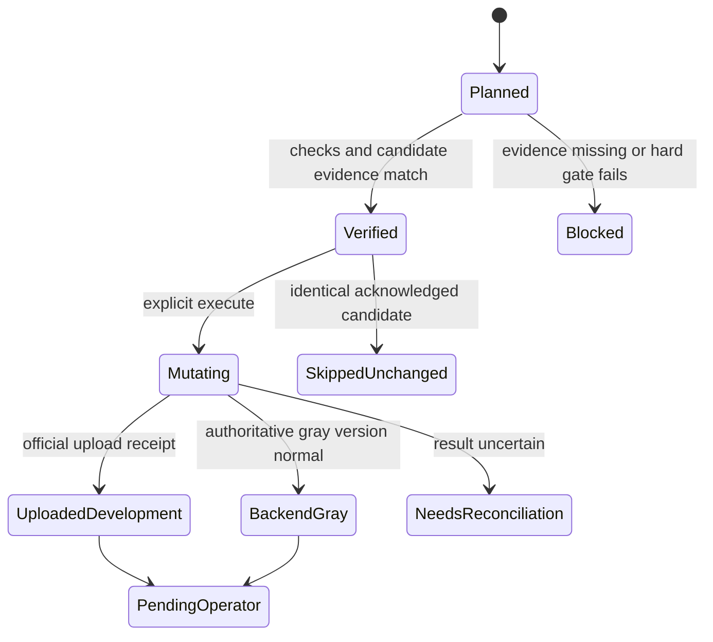

# CLOUD-002 — 前后端确定性发布脚本

- Status: `APPROVED`
- Risk: R3，脚本可在显式执行后创建微信开发版或生产后端灰度版本。
- Spec revision: `CLOUD-002-SPEC-02`，接替未批准的 `CLOUD-SPEC-RELEASE-AUTOMATION-20260913-01`。
- Architecture revision: `ARCH-RELEASE-AUTOMATION-20261108-02`
- Date: 2026-11-08
- User confirmation: APPROVED。产品负责人于 2026-11-08 回复“批准，然后上传前端”，批准 CLOUD-002-SPEC-02 / ARCH-RELEASE-AUTOMATION-20261108-02，授权上传前端开发版。
- Owner: 产品负责人。实现及验证: Codex。独立只读安全/发布 Review: 待安排。
- Affected Feature: FEAT-001 的发布和验证记录。[当前 Feature](../../docs/domain/features/FEAT-001-push-kids-mvp.md)基线为 `FEAT-STATE-20261107-THEMES-03` 与 0.1.19 开发交付。验证后仅更新发布工具、范围和证据事实。

## Frontend Design Impact and Repository-native Approval

- Frontend impact: NO，发布脚本不改小程序可见界面、交互或业务行为。
- Frontend engineering impact: YES，改变冻结、检查、预览、上传和版本记录工具链。UI-001 仅涉及发布证据。
- Baseline: `FDB-20261107-05` / `FEC-20261107-AGENT-DEVICE-MATRIX-03`。真实 AppID、云环境、服务、urlCheck、资源预算和敏感内容门禁沿用。
- Design Revision、可编辑原型、设计导出和 UI 设备测试：N/A，本 Spec 无 UI diff。实际候选需要的设计、原生与真机证据按发布阶段分别校验和记录。
- Approved Task Spec revision: CLOUD-002-SPEC-02。Engineering deviation: none。

## 1. 结果与边界

日常发布由两条本地命令运行，重复检查、打包、等待和报告全部使用确定性代码。运行时无需 Agent 或模型。

```bash
uv run python tools/release/frontend.py --execute --description "用户可见变化"
uv run python tools/release/backend.py --execute
```

不带 `--execute` 时预检或输出计划，无生产写入。每次运行输出精简终态和证据目录，完整日志留在本机。授权编写并测试脚本与实际发布是两步。本轮实现验收采用假 CLI 和本地预检，生产发布另由调用方明确执行。

以[当前前端手册](../../docs/deploy/FRONTEND-RELEASE.md)和[当前后端手册](../../docs/deploy/BACKEND-RELEASE.md)为准。相比旧提案，本修订聚焦两个独立入口和普通同 Schema 的后端发布。自动生产迁移、自动备份/删除、组合发布和自动切流暂缓，已有数据库、平台账号和管理员门禁照常执行。

## 2. 架构和责任



前端入口负责微信项目、包体和上传状态。后端入口负责 Schema 证据、白名单包和灰度状态。仅在两端具有相同状态语义时共享一小份本地锁、原子记录和脱敏执行逻辑。现有业务模块和专用脚本无需依赖新入口。脚本支持的云平台、发布目标和风险门禁为 closed，新增平台或生产迁移需要新 Spec。

### 前端序列



1. 从明确的工作区/提交范围冻结生产文件到新目录，保存文件白名单、Git HEAD、差异与哈希。执行真实 AppID、云环境、生产配置和敏感内容校验。上传前复核冻结包与通过门禁的摘要一致。
2. 同一已上传源码摘要直接跳过，版本不推进。基准取最近一次可核实的开发上传，本地 `0.1.19` 的摘要可从[现有上传证据](../evidence/client-release-20261108/README.md)引入。证据缺失或本地版本与回执冲突时停止。
3. 改动包执行适用的前端测试、lint、静态与设计/架构检查，核对原生或其他人工证据。官方预览成功且包体合规、生产兼容和只读健康门禁满足后，执行开发版上传。
4. 官方成功回执先落盘，再以本地事务推进版本号及源码摘要。上传结果不明确时记录待核对并保护已预留版本。后续运行读取回执或管理员核实结果，避免重复上传。
5. 按已到达阶段生成报告，体验、审核、正式发布和备份保留的人工步骤沿用仓库手册。

### 后端序列



1. 从受控只读来源核对真实生产 Schema、唯一代码 head、预期应用 revision 和手册要求的现状证据。只认同一环境、可复核且当前有效的结果。无法证明相等时停止，输出手册的迁移/备份操作。当前无迁移时略过新建迁移前备份。
2. 复用现有后端测试、Schema 校验、容器和白名单打包工具。检查 manifest/密钥/启动门禁后运行 `wxcloud deploy --dryRun`。
3. 通过带唯一版本备注、固定 `GRAY`、显式 Dockerfile/目标目录/端口的 `run:deploy` 创建版本。保留原有交互确认表，禁止使用 `--noConfirm`。只读轮询以目标版本和服务状态为准，日志 Topic 订阅错误单独记录。
4. 记录灰度版本、适用 smoke、实际流量和回滚目标。当前备份保留数量无法安全读取时给出管理员步骤。全量切流由管理员按手册处理。

### 状态与重入



已确认的外部成功只执行一次。摘要变更要求新运行。原子记录和同目标互斥保护版本号和唯一备注。CLI 超时或被中断时保留可核对状态。凭证只经既有已批准环境进入专用工具，日志、命令参数和报告只保存脱敏信息。禁止自动重试未知写入、自动回退或破坏性操作。

## 3. 取舍与预计文件

| 方案 | 决策 |
|---|---|
| 两个独立入口复用现有工具 | 采用。前后端可分开预检和发布，单条命令生成证据 |
| 继续由对话执行手册 | 仅保留作人工恢复手段 |
| 自动迁移、备份、组合发布 | 当前缺少可验证的自动化生产迁移与恢复接口，留待独立修订 |
| Bash 拼接生产命令 | 状态、超时、脱敏和未知结果核对由 Python 结构化处理 |

预计新增 `tools/release/frontend.py`、`tools/release/backend.py`、必需的共用运行记录/锁逻辑、假 CLI 回归测试。复用并按需更新 `tools/release/miniprogram_version.py`、发布版本记录和 `docs/deploy/`。业务、API、数据与 Schema 范围 N/A。合并后保留现有手册作为人工恢复入口。

## 4. 验收和顺序

| 点位 | 验收 |
|---|---|
| TP-REL-01 | 两条入口默认零生产写入。假 CLI 记录参数，覆盖前端、后端和缺少授权 |
| TP-REL-02 | 冻结包来源明确，错误目标、缺证据、含秘密、包过大、改动竞态或任一必需检查失败时停止 |
| TP-REL-03 | 0.1.19 同摘要跳过。新包官方预览后成功上传且只推进一次版本。中断、回执未知或并行执行不能重复上传 |
| TP-REL-04 | 后端仅在证据一致时进入 dry run，Schema 不一致或不可核实即停。灰度 argv 和确认表强约束，目标版本轮询不依赖 Topic，验证无切流 |
| TP-REL-05 | 假 CLI 注入凭证哨兵，报告和日志无泄露。状态原子恢复、超时、部分成功以及旧版回退目标可核对 |
| TP-REL-06 | 适用全量测试、lint/format、架构和发布手册交叉核对。真实生产写入为 NOT_RUN，直到另行发布 |

先批准此 Spec/Architecture，再用假 CLI 实现安全路径和回归，最后运行本地影子预检并更新文档。回退为停用脚本并按手册使用已有不可变产物，生产状态由相应管理员核实。
