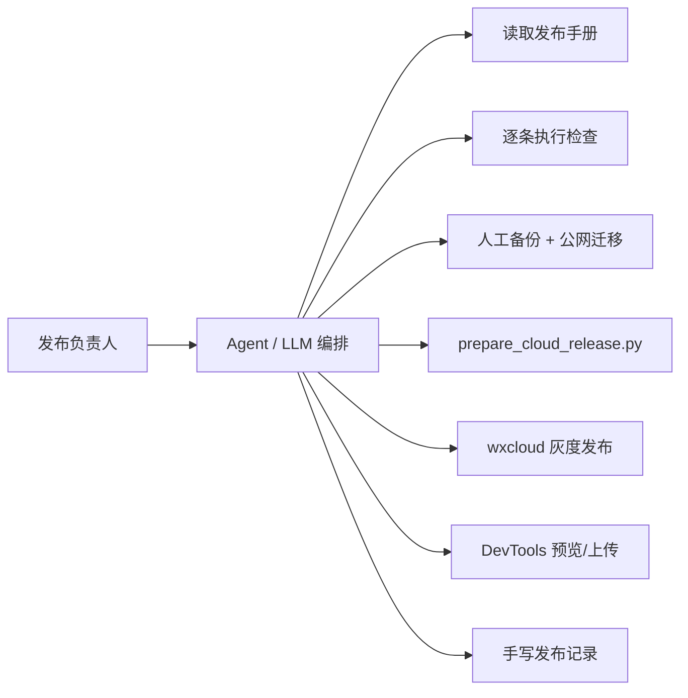
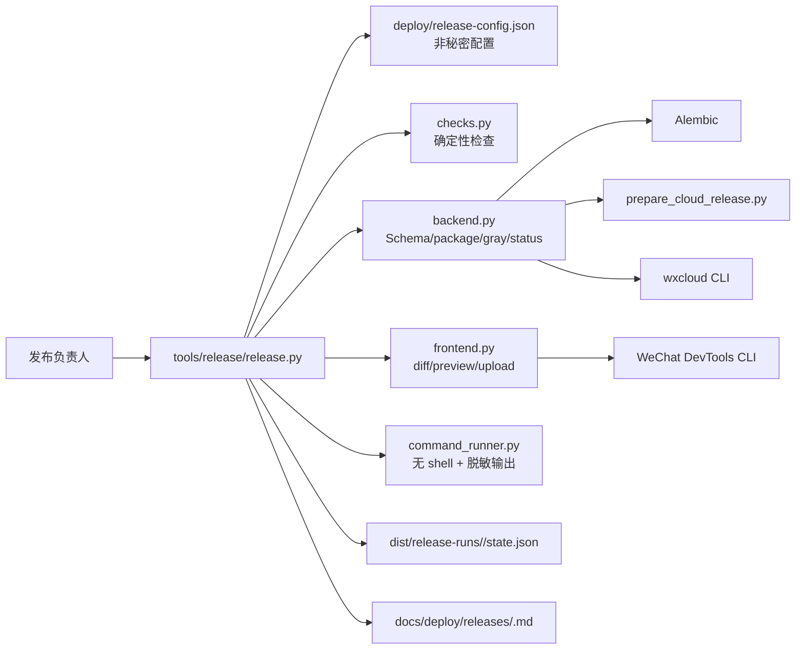
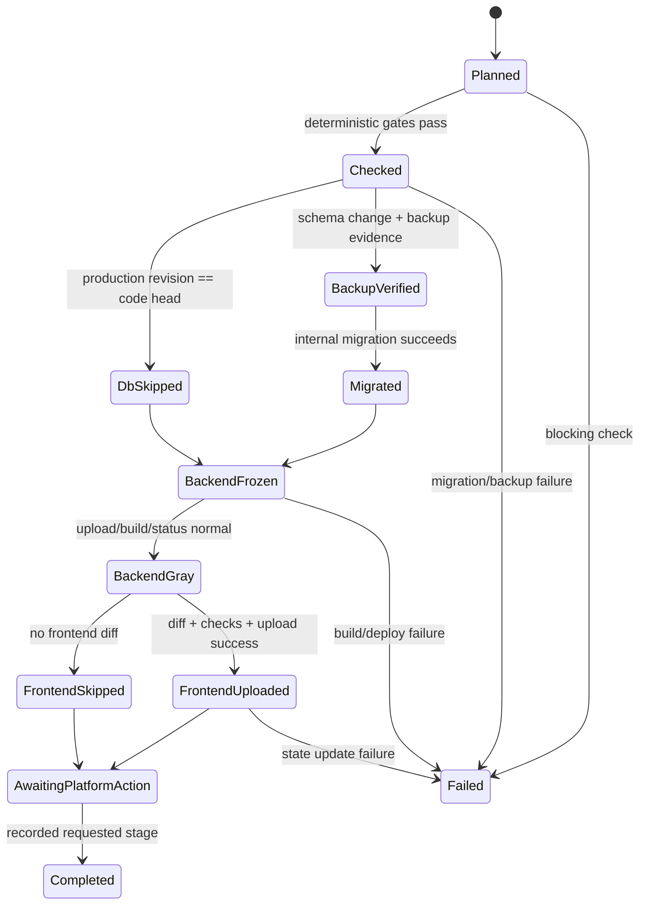
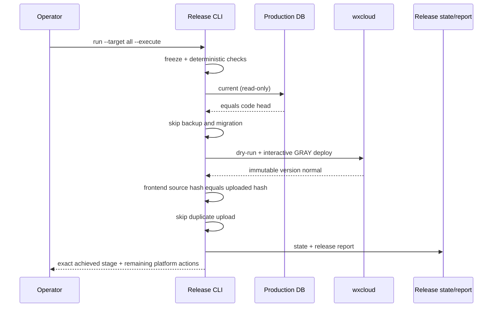
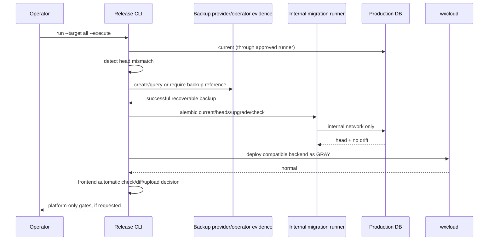

# CLOUD-002 — 前后端确定性发布自动化

- Status: `READY_FOR_REVIEW`
- Risk: `R3`（生产 Schema、云流量、微信版本、未成年人数据恢复能力）
- Spec owner: 产品负责人（用户）
- Implementer: Codex
- Reviewer: independent read-only release/security reviewer
- Verifier: 产品负责人 + Codex
- Created: 2026-09-13
- Last updated: 2026-09-13
- Target release: next repository tooling release；不自动触发当前生产发布
- Spec revision: `CLOUD-SPEC-RELEASE-AUTOMATION-20260913-01`
- Architecture revision: `ARCH-RELEASE-AUTOMATION-20260913-01`
- User confirmation: `PENDING`；用户已提出脚本化与减少门禁，本 revision 尚待明确批准
- Additional R3 approval: 实现后必须完成独立只读安全/架构 Review
- Affected Feature IDs: `FEAT-001`（仅发布与验证证据，不改变产品行为）
- Feature current-state documents: `docs/domain/features/FEAT-001-push-kids-mvp.md`
- Feature baseline revision: `FEAT-STATE-20260913-UNIFIED-REVIEW-BACKEND-02-LOCAL`
- Feature merge owner: Codex（实现和验证完成后）

## Frontend Design Impact and Repository-native Approval

- Frontend impact: no；不修改小程序可见界面或交互
- Frontend impact reason: 只新增仓库内发布 CLI、自动检查和发布记录
- Frontend engineering impact: yes；改变前端检查、预览、上传和版本状态的工具链入口
- Frontend engineering impact reason: 统一版本差异检测、自动校验、上传与原子更新版本状态
- Affected UI IDs: `UI-001`（仅发布证据）
- UI current-state documents: `docs/design/frontend/ui/UI-001-parent-miniapp.md`
- Frontend baseline revision: `FDB-20260906-02`
- Frontend engineering constraint revision: `FEC-20260911-READ-PERF-01`
- Affected frontend quality dimensions: performance/resource、security/privacy、observability
- Frontend quality budgets/requirements: 初始包 `<1.5 MiB`；真实 AppID/生产 env/service/urlCheck；包内无秘密、OpenID、数据库地址、儿童材料或测试数据
- Frontend quality verification plan: release CLI unit/integration tests；`npm test`、ESLint、Mini Program validator；伪 DevTools CLI 验证失败与成功分支
- Approved frontend engineering deviations: none；生产上传不存在 `--no-verify`
- Current Design Revision(s): N/A；无可见变化
- Editable design source path(s): N/A；无可见变化
- Design source SHA-256: N/A；无可见变化
- Proposed Design Revision: N/A
- Required viewport/state exports: N/A；不修改渲染代码
- Prototype status: N/A
- Approved Task Spec revision: PENDING
- Approved Design Revision: N/A
- Design approval evidence: N/A；不触发设计门禁
- Snapshot manifest path: N/A
- Permitted implementation deviations: none
- UI current-state merge owner/evidence: Codex / pending
- Frontend visual/a11y/resolution verification: N/A；不修改 UI
- Frontend engineering verification evidence: pending automated release-tool tests
- External design dependency: none

## 0. Executive summary

### Problem

当前发布依赖 Agent/LLM 逐条读取手册、拼接命令、等待状态并手写报告。仓库已有
`tools/prepare_cloud_release.py` 与 `tools/release/miniprogram_version.py`，但缺少统一状态机，导致：

- 相同步骤每次重新编排，人工往返多；
- CLI 参数容易漂移，曾发生 `--noConfirm` 把预期灰度变成全量；
- 无前端差异时仍可能重复上传；
- 数据库、后端、小程序和平台状态容易被混称为“已发布”；
- 失败后只能依赖聊天历史判断从哪里继续。

### Intended outcome

仓库提供一个确定性 Python CLI；普通发布由脚本完成检查、冻结、迁移判定、后端灰度、前端差异检测、
上传、状态轮询和发布报告，不调用 LLM。脚本可安全重入并从本地非敏感状态文件续跑。

### 对用户提出的三项调整的结论

| 请求 | 结论 | 最终规则 |
|---|---|---|
| 数据库不需要备份 | 部分接受 | **无 Schema 变化时**自动跳过数据库连接、迁移和备份；**有 Schema 变化时**必须存在可恢复备份，不提供生产 `--skip-backup` |
| 数据库不需要关闭公网 | 不接受长期公网 | 推荐路径从内网 migration runner 执行，数据库公网始终关闭，因此日常不再出现“打开/关闭公网”步骤；若只能临时公网访问，脚本必须等待并验证关闭后才能继续 |
| 前端不需要验证 | 部分接受 | 取消 LLM/人工逐项检查，保留秒级自动门禁；无前端差异直接跳过上传。体验成员、提审、隐私声明和正式发布仍是微信平台人工门禁 |

这些限制保护可恢复性、数据库网络边界和真实微信版本，不允许通过 `--force`、`--no-verify` 或环境变量绕过。

## 1. Current behavior



| Responsibility | Current location | Problem |
|---|---|---|
| 后端白名单包 | `tools/prepare_cloud_release.py` | 只打包，不编排测试、迁移、状态和报告 |
| 前端版本号 | `tools/release/miniprogram_version.py` | 只存版本号，不存 source SHA/package hash，无法判断重复包 |
| 发布规则 | `docs/deploy/*.md` | 面向人阅读，不能可靠重入执行 |
| 云端状态 | `wxcloud` / DevTools CLI | 结果未进入统一状态机 |
| 发布证据 | `docs/deploy/releases/*.md` | 人工汇总，易遗漏 PASS/FAIL/NOT_RUN |

## 2. Target behavior and architecture

### Architecture



Dependency direction：`release.py → backend/frontend/checks → command_runner`；步骤模块可使用现有专用工具，
专用工具不得反向导入 orchestrator。生产应用代码不得导入 `tools/release`。

### Public CLI

```text
python3 tools/release/release.py plan --target all
python3 tools/release/release.py run --target backend --execute
python3 tools/release/release.py run --target frontend --execute --description "<真实变化>"
python3 tools/release/release.py run --target all --execute --description "<真实变化>"
python3 tools/release/release.py status --run-id <id>
python3 tools/release/release.py resume --run-id <id> --execute
```

- `plan` 永远只读，列出将运行、跳过和阻塞的步骤。
- `run` 默认 dry-run；生产写操作必须显式 `--execute`。
- `resume` 只重试未完成/可重试步骤，已成功且输入摘要未变的步骤不重跑。
- 不提供 `--no-verify`、`--skip-backup`、`--keep-db-public`、`--noConfirm`。
- secret 只从进程环境或批准的本机环境文件注入，绝不进入参数、state、report 或日志。

### Release state machine



`Completed` 表示脚本请求的阶段已完成，不把开发版本上传等同于体验版、审核中或正式版。

### All-in-one sequence — no Schema or frontend change



### Schema-change sequence



## 3. Deterministic policies

### Database

1. Read code head and application expected revision; mismatch is a hard failure.
2. Read production current revision through an approved migration runner.
3. If equal: emit `database=SKIPPED_NO_SCHEMA_CHANGE`; do not connect with DDL credentials and do not create backup.
4. If different: require successful backup evidence before `upgrade head`.
5. Default network mode is `internal`; public TencentDB endpoints are rejected unless a separately approved temporary-window
   mode is configured. That mode must verify the endpoint becomes unreachable before backend deployment continues.
6. Schema migration remains additive/expand-first；application account remains CRUD-only.

Phase 1 may accept an operator-provided non-secret backup reference because wxcloud CLI 2.3.3 has no MySQL backup API。
Automatic provider snapshot creation is an open extension point only after an authenticated, testable provider API is selected.

### Backend

- Freeze Git SHA, dirty-file list, Alembic head and package manifest before deployment.
- Run checks from a versioned profile (`fast` or `full`); production defaults to `full`.
- Always create a whitelist package and secret-scan it.
- Always dry-run before `run:deploy`.
- Always pass `--releaseType GRAY` and preserve interactive confirmation；never pass `--noConfirm`.
- Poll `version:list` and `service:list`; Topic subscription errors are non-authoritative.
- Stop after immutable gray version is `normal`; full traffic stays an explicit platform decision.

### Frontend

- State file records latest uploaded `version`, `source_sha`, deterministic package hash, upload timestamp and description.
- If source/package hash is unchanged, output `frontend=SKIPPED_NO_CHANGE` and do not bump/upload.
- A changed package must pass automatic config, secret, syntax/test, lint, validator and size checks.
- DevTools login/preview/upload run without LLM；upload success atomically advances version state.
- Production upload has no `--no-verify` path. Slow device/two-account validation moves to the experience/review stage and
  remains explicit `NOT_RUN` until actually performed.
- Selecting experience members, declaring privacy/category, submitting review and final publishing remain platform-owner actions.

### Fast versus full profile

| Check | `fast` | `full` production default |
|---|---:|---:|
| source/config/secret scan | required | required |
| targeted unit/contract tests | required | required |
| full backend/frontend suites | optional, recorded | required |
| migration compatibility | when Schema changes | when Schema changes |
| package/dry-run/status | required | required |
| device/two-account smoke | NOT_RUN allowed for dev upload | required before formal public release |

## 4. Security, failure and idempotency

- Subprocess uses argument arrays with `shell=False`; sanitized environment is allowlisted.
- Output redactor covers configured secret values and URL userinfo; reports contain only names/status/digests.
- State writes use temporary file + atomic replace; state contains no child/family content.
- Every external mutation has a precondition and postcondition. Unknown results become `NEEDS_RECONCILIATION`，not blind retry.
- Version creation/upload detects already-existing version before retrying.
- Git or package hash change invalidates downstream successful steps and requires a new run id.
- SIGINT leaves resumable state and never performs automatic rollback or destructive downgrade.
- Production database backup, full traffic, experience membership, privacy declarations, review submission and formal publish
  cannot be silently converted into boolean flags that bypass accountable platform decisions.

## 5. Trade-offs and alternatives

| Option | Benefit | Cost/risk | Decision |
|---|---|---|---|
| 继续由 LLM 执行手册 | 灵活 | 慢、不可重入、易受聊天上下文影响 | reject |
| 一个大型 Bash 脚本 | 编写快 | 引号/secret/JSON/状态恢复脆弱，难单测 | reject |
| Python 确定性状态机 | 可测试、跨步骤校验、原子状态、结构化报告 | 初始代码较多 | **selected** |
| Schema 变化也跳过备份 | 少一步 | migration/误操作无可靠恢复点 | reject |
| 数据库永久公网 | 本机迁移方便 | 长期扩大攻击面，不符合当前云边界 | reject |
| 前端完全不验证 | 最快 | 可上传错误 AppID/env、秘密或不可编译包 | reject |
| 无变化自动跳过 + 快速自动门禁 | 快且诚实 | 仍需数秒到数分钟 | **selected** |

## 6. Extensibility policy

| Variation axis | Status | Mechanism/contract | Requirements | Revisit condition |
|---|---|---|---|---|
| release target backend/frontend/all | open, bounded | enum subcommands | same state/report/security contract | new deployable unit |
| check profile | open, bounded | named immutable profile | cannot omit hard security/schema gates | CI runtime budget changes |
| backup provider | open | provider protocol returning non-secret evidence | authentication isolation, idempotency, status polling, contract tests | provider API selected |
| cloud platform | closed | wxcloud/DevTools adapters only | new Spec for another platform | platform migration |
| production bypass flags | closed | no mechanism | N/A | never without R3 Spec revision |
| LLM release planner | deferred | none | must not be required for execution | only for advisory analysis |

## 7. Expected file changes

| File/path | Action | Responsibility | Verification |
|---|---|---|---|
| `tools/release/release.py` | add | CLI, state transitions, plan/run/resume/status | CLI integration tests |
| `tools/release/command_runner.py` | add | shell-free subprocess, timeout, redaction | secret/timeout/error tests |
| `tools/release/checks.py` | add | Git/config/schema/package predicates | unit tests |
| `tools/release/backend.py` | add | migration decision, package, wxcloud gray/status | fake-command integration tests |
| `tools/release/frontend.py` | add | diff/hash/version/preview/upload | fake DevTools tests |
| `tools/release/miniprogram_version.py` | modify | atomically persist version + source/package identity | version tests |
| `tools/release/miniprogram_version.json` | modify schema | latest uploaded identity; no secret | fixture tests |
| `deploy/release-config.json` | add | fixed non-secret AppID/env/service/paths/check profiles | schema/config test |
| `package.json` | modify | `release:plan` / `release:all` convenience commands | command smoke |
| `tests/unit/test_release_*.py` | add | policies, redaction, hashes, state machine | pytest |
| `tests/integration/test_release_cli.py` | add | fail/retry/resume with fake external CLIs | pytest |
| `docs/deploy/*.md` | modify | script-first runbook and remaining manual platform actions | doc assertions/diff check |
| `docs/operations/WECHAT-CLOUD-HOSTING.md` | modify | internal migration runner/default-closed DB boundary | architecture review |
| `docs/domain/features/FEAT-001-push-kids-mvp.md` | modify after verification | release automation evidence reference only | final current-state audit |

No application runtime module, API, database table or visible Mini Program file should change.

## 8. Required test points

| ID | Acceptance | Required evidence |
|---|---|---|
| `TP-REL-001` | plan is read-only | fake CLIs/filesystem prove zero external writes |
| `TP-REL-002` | no-Schema path skips backup/migration | equal current/head fixture |
| `TP-REL-003` | Schema mismatch cannot skip backup | missing/failed backup evidence hard-fails |
| `TP-REL-004` | default path never requires DB public access | internal-mode contract and public-endpoint rejection |
| `TP-REL-005` | temporary public mode cannot continue while reachable | fake network state blocks backend deploy |
| `TP-REL-006` | `--noConfirm` is impossible | argv contract assertion |
| `TP-REL-007` | topic error does not decide status | version/service status fixtures |
| `TP-REL-008` | unchanged frontend skips upload/version bump | source/package hash fixture |
| `TP-REL-009` | changed frontend runs hard automatic gates | fail each config/secret/test/lint/size branch |
| `TP-REL-010` | upload state is atomic | interrupted upload and state-write recovery |
| `TP-REL-011` | secrets never enter argv/output/state/report | canary secrets across all artifacts |
| `TP-REL-012` | resume is idempotent | kill after each mutation boundary, then resume |
| `TP-REL-013` | stage reporting is honest | gray/upload/experience/review/formal are distinct enums |
| `TP-REL-014` | repository remains valid | full backend/frontend/architecture commands from `AGENTS.md` |

Implementation verification commands:

```bash
uv run pytest tests/unit/test_release_*.py tests/integration/test_release_cli.py -q
uv run pytest tests/unit tests/integration tests/contract -q
uv run ruff check .
uv run ruff format --check .
uv run mypy apps/api/src tools/release
npm test
npm run lint:miniapp
npm run check:miniapp
uv run python tools/check_architecture.py
uv run python tools/validate_miniprogram.py
git diff --check
```

## 9. Rollout and rollback

1. Implement `plan/status` and fake-CLI tests first；no production mutation.
2. Add backend dry-run/package/status orchestration，compare output with current manual runbook.
3. Add no-Schema skip and schema-change backup enforcement；do not deploy a migration runner until its environment exists.
4. Add frontend diff/hash/preview/upload orchestration.
5. Run one shadow release：script plans and validates while the old runbook remains authority.
6. After evidence matches, make script the documented default; retain manual runbook as disaster fallback.

Rollback is repository-level：revert script/docs and use the existing manual runbook。Already-created cloud versions, uploaded
Mini Program versions and additive Schema are never deleted or downgraded automatically.

## 10. Approval decision

Recommended approval is this exact revision with the following boundary:

- approve deterministic script execution and removal of LLM from routine release;
- approve automatic skip of database work only when production revision already equals code head;
- approve default-closed/internal database migration, not permanent public MySQL;
- approve automatic fast frontend validation and unchanged-package skip, not zero validation;
- retain platform-owner gates for full traffic, experience members, privacy/category, review submission and formal publish.

Implementation must not begin until the user explicitly approves
`CLOUD-SPEC-RELEASE-AUTOMATION-20260913-01`。
