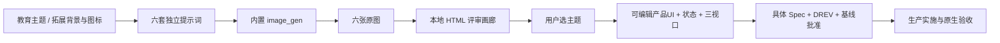
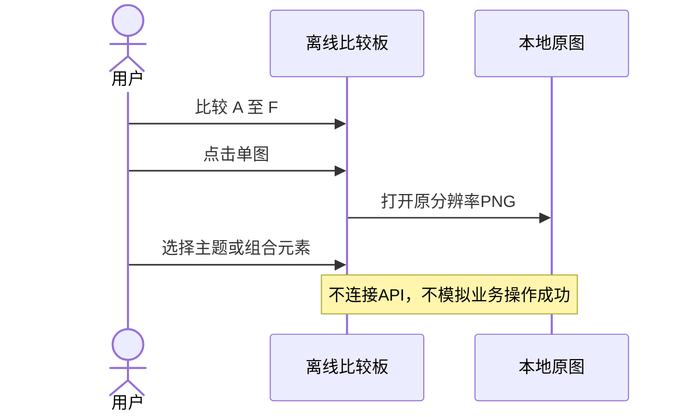
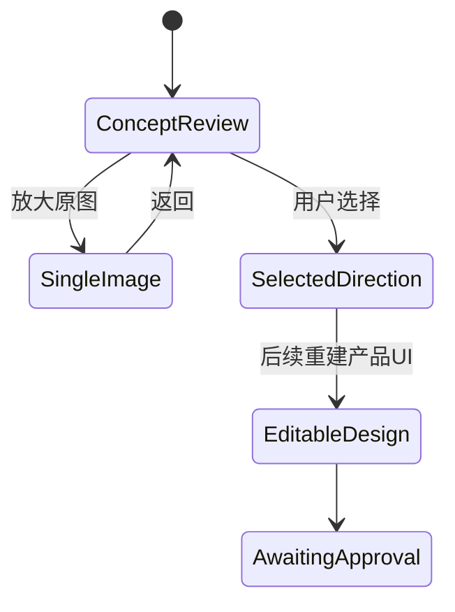
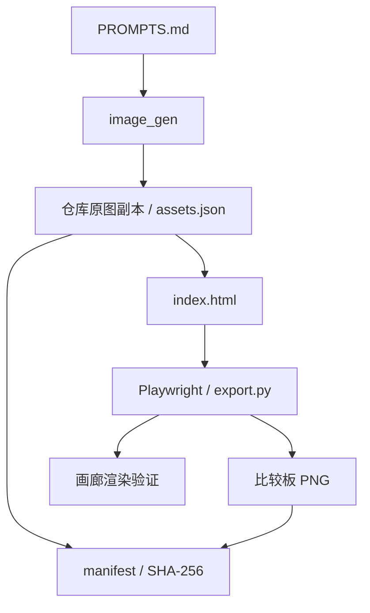

# DESIGN-002 — 全界面 UI 与交互优化评审稿

- Status: READY_FOR_REVIEW
- Risk: R1（离线设计探索，不实施业务功能）
- Spec revision: `DESIGN-002-SPEC-04`
- Updated: 2026-11-06
- Owner / Reviewer: 产品负责人（用户）
- Designer / Verifier: Codex
- Latest request: “因为这个是偏向孩子教育的，你再来设计6张图 要跟之前的不一样。注意你的想象力可以拓展一点，不要聚集在配色变化，可以附加背景，图标等设计”
- Approved Task Spec / Design Revision: PENDING
- Design stage: CONCEPT_PENDING_STYLE_SELECTION
- Production implementation: NOT_STARTED
- Release: N/A

## 0. 目标与授权边界

前一轮六版主要探索界面配色、卡片、按钮和图标容器。用户进一步要求突出儿童教育属性，扩大背景、插画和图标的想象空间。本轮用同一设置页生成六张独立教育主题效果图，并放在一张比较板中选择。

本轮授权是创作主题候选；不是生产实现或已批准视觉基线。生成图片保留在项目中，提示词与来源可追溯。没有修改小程序、后端、数据库、当前业务文档或已批准视觉资产。

## 1. 依据、范围与可追溯性

- Affected: [FEAT-001](../../docs/domain/features/FEAT-001-push-kids-mvp.md)、[FEAT-005](../../docs/domain/features/FEAT-005-multi-child-profiles.md)、[FEAT-007](../../docs/domain/features/FEAT-007-travel-arrangements.md)、[FEAT-010](../../docs/domain/features/FEAT-010-daily-tasks.md) / 设置页 UI-001。与Spec03相同业务范围，当前只呈现设置页首屏。
- Production baseline: FDB-20260913-04；engineering: FEC-20261007-NATIVE-GEOMETRY-02，均未修订。
- Design Revision: `DREV-20261106-UI-CONSISTENCY-04`。
- [评审画廊](../../docs/design/frontend/prototypes/DREV-20261106-UI-CONSISTENCY-04/index.html)、[设计边界](../../docs/design/frontend/prototypes/DREV-20261106-UI-CONSISTENCY-04/FRONTEND-SPEC.md)、[完整提示词](../../docs/design/frontend/prototypes/DREV-20261106-UI-CONSISTENCY-04/PROMPTS.md)。
- [SHA manifest](../../docs/design/frontend/snapshots/UI-001/DREV-20261106-UI-CONSISTENCY-04/manifest.json)、[结果](../../docs/design/frontend/snapshots/UI-001/DREV-20261106-UI-CONSISTENCY-04/RESULTS.md)、[待选择记录](../../docs/design/frontend/snapshots/UI-001/DREV-20261106-UI-CONSISTENCY-04/APPROVAL.md)。

此轮采用内置image_gen独立生成六张位图，画廊只展示图片。**它不是六套可编辑产品UI，也不能满足生产实施所需的控件、状态与精确视口证据。** 这种方式用于先确定视觉方向，避免把尚未选定的主题扩大成全量开发工作。

## 2. 推荐设计、备选与取舍

采用六个完整教育主题世界；保留相同内容，分别改变场景、材质、角色、图标、分组构图和按钮语汇。

| 方向 | 核心设计 | 取舍 |
|---|---|---|
| A 成长花园 | 纸雕花园、嫩芽角色、种子袋科目、植物按钮 | 贴合知芽品牌；后续需控制植物装饰密度 |
| B 星际探索 | 观测站、原创机器人、星球与轨道、舷窗图标 | 好奇探索感强；深浅场景和资源体积需优化 |
| C 绘本小屋 | 水粉小屋、小狐狸、书页分章、布纹书签按钮 | 阅读氛围强；需将纸张与文本拆开实现 |
| D 自然观察站 | 格纸、植物标本、放大镜、观察手册索引 | 科普探究感强；装饰标签不应挤占操作内容 |
| E 积木乐园 | 软陶几何空间、嫩芽角色、拼插模块、立体学习道具 | 年轻活泼；需限制3D资产数量和移动端资源成本 |
| F 灵感手帐 | 格纸、撕边便签、胶带贴纸、彩铅与手绘图标 | 更像孩子的日常学习；需保留清晰文本和命中区域 |

仅在旧布局上换色无法满足最新要求；一次性实现全部六个主题没有必要。本轮不做生产架构选择，待选定主题后再提出资产、组件与加载策略。

主要业务数据、两类添加入口、五Tab与选中设置态保留。人物与角色均为合成插画。背景不是新奖励机制、评分或学习结果。原有家长确认、AI提案、手动路径、确定性复习、家庭隔离和资料管理合同不变。

## 3. 界面和状态边界

六图均显示合成孩子小禾、语文/数学/英语、两项课外活动和两项每日任务。围棋周日14:00–16:00、游泳周日17:00–18:00；阅读每天20分钟、围棋每天30分钟。每版的两类添加按钮采用同一主题材质和样式。

只交付六张设置页主题图与可打开原图的画廊。生成画面没有可点击产品节点、真实导航、表单、数据写入或完整加载/失败/权限状态。原17路由/39状态仍属于历史候选，不能挪作DREV04覆盖证据。

## 4. 调用、状态、架构与流程

业务调用与数据库状态机 N/A，无生产模块、依赖方向或扩展点变更。

## 5. 验证与预期文件

新增DREV04提示词、HTML画廊、导出脚本、设计边界；六图、比较板、来源/SHA与结果。保存历史Spec03并更新本Spec与STATUS，保留旧DREV所有源和快照。

| 检查 | 真实范围 |
|---|---|
| D4-01 | 六张图逐图目视检查主题差异、主要中文、时间与添加按钮 |
| D4-02 | 画廊1440×1000与390×844窗口载入全部图片、无横向溢出/JS异常/外网请求 |
| D4-03 | 六图副本与工具原文件SHA一致、来源与完整提示词保存 |
| D4-04 | 画廊与比较板关联SHA；文档链接存在；旧DREV完整性 |
| NOT_RUN | 产品320×568/390×844/430×932重排、44px命中区、精确对比度、键盘/读屏/大字、原生/真机 |
| N/A | 生产Red/Baseline、pytest/npm/mypy、API/数据库、上传与发布 |

画廊窗口检查不等于产品视口验收；生成的位图无法证明可访问性或原生布局。执行和结果见RESULTS；不沿用Spec03的18视口检查作为当前证据。

## 6. 生命周期、批准与文档闭环

当前Spec留在 `specs/active/`，READY_FOR_REVIEW；无生产实现或对应云交付，不设置DONE。用户选主题仅为设计方向选择，后续需补齐可编辑UI、完整状态、三视口与匹配SHA，并获得具体Spec+DREV+基线批准。

已同步Spec04、STATUS、设计范围和验证记录；[Spec03历史副本](../evidence/DESIGN-002-SPEC-03.md)与更早候选保留。检查本轮文件没有生产事实变化；Feature、Behavior、Architecture、UI CURRENT、FDB/FEC和发布文档不写入候选事实。尚待用户选择、后续细化与原生验证。
