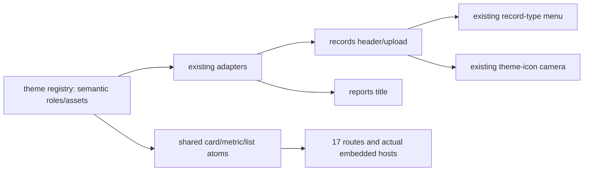
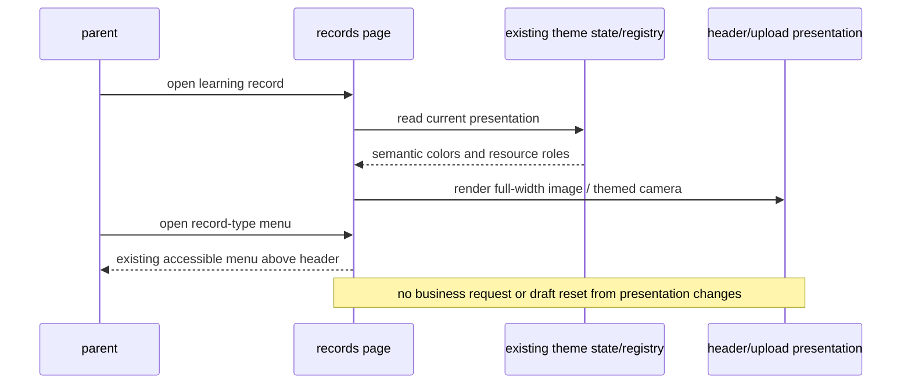

# DESIGN-003 — 六主题标题、头图、上传入口与容器层级调优

- Status: READY_FOR_REVIEW
- Spec revision: `DESIGN-003-SPEC-01`
- Date: 2026-11-06
- Severity: 视觉可读性与一致性缺陷；不涉及业务事实或数据损坏。
- Risk: R2（共享呈现角色影响多页；不新增架构边界）
- Owner / approver: 用户；设计与实施：Codex；独立Reviewer/Verifier：待安排。
- First observed: 用户在DESIGN-002 Spec08本地实现后指出四项视觉问题。
- User confirmation: PENDING。当前请求明确授权定位与准备调优；具体Spec01及DREV09尚未提交批准，未修改生产代码。
- Affected Feature IDs: FEAT-001；视觉宿主包括已存在的家庭/档案/通知/旅行页面，领域行为不变。
- Feature baseline: `docs/domain/features/FEAT-001-push-kids-mvp.md`，本地呈现`FEAT-STATE-20261106-THEMES-01`；UI基线`UI-STATE-20261106-THEMES-01`。
- Feature/UI merge owner: Codex，在实施与验证后合并事实；本次准备阶段不将提案写成当前实现。
- Related task: [DESIGN-002 Spec08](DESIGN-002-GLOBAL-UI-CONSISTENCY.md)，其批准与VERIFYING/未上传状态继续有效。

## Frontend Design Impact and Repository-native Approval

- Frontend impact: YES；Frontend engineering impact: YES。
- Approved baseline: `FDB-20260913-04`；`FEC-20261007-NATIVE-GEOMETRY-02`；Architecture沿用`ARCH-20261106-MINIAPP-THEMES-01`。
- Current Design Revisions: DREV06五主题方向、DREV08设置切换；新提案`DREV-20261106-UI-CONSISTENCY-09`仅接管以下四项，不改设置入口或主题机制。
- Affected UI: UI-001为主；共享卡片/反馈容器的实际宿主还须检查UI-009/010/011/015/016/017/018。UI-014取消草案N/A。
- Editable source: `docs/design/frontend/prototypes/DREV-20261106-UI-CONSISTENCY-09/source.html`及自包含`index.html`；源SHA见[待批准manifest](../../docs/design/frontend/snapshots/UI-001/DREV-20261106-UI-CONSISTENCY-09/APPROVAL.md)。
- Prototype status: AWAITING_APPROVAL；Approved Task Spec / Design Revision: N/A until explicit approval。
- Design approval evidence: PENDING；原DREV06/08源、清单、导出不改。
- Required design exports: 六主题×三视口（320×568、390×844、430×932）×9场景=162张；reports/records/settings/nested/loading/empty/error/disabled/sheet。设计导出不等于原生验收。
- Quality dimensions: typography/reflow、media fit/fallback、nested component hierarchy、form/selection/error boundaries、touch/accessibility、dark contrast、resource/performance。
- Budgets: 沿用源码≤1,500,000字节、五主题插画≤150,000字节、主题补丁≤32,000/偏好≤256字节；无新图像/字体/框架下载；触区≥44px、常规正文≥14px；本次不提高任何阈值。
- Engineering deviations: NONE。原生系统菜单/地图底图等仍按既有平台边界处理。

## 1. Problem、复现与根因

1. 报表“一点一滴，看得见”在小屏末字单独换行。`styles/theme.wxss`对主题页头标题统一设`max-width:66%`，原始风格又让右侧插画和标题共占一行；`reports/index.wxss`允许任意字符换行。固定中文标题未获得足够宽度。
2. 学习记录头图不完整。`records/index.wxml`把`.theme-header`放在`record-type-anchor`内，而此锚点仅随记录类型按钮伸缩；子图片采用aspectFill，于窄容器内大量裁切。图片规格为780×304。
3. 上传空态图片与各主题背景不协调。registry将五个新主题的所有原插画角色（含upload）映射为同一张横幅；上传区再用aspectFit显示整张带背景图片，形成第二块场景背景。
4. 模块边界过多。新主题palette把卡片`pk-border`映射到更明显的`pk-line`，同时关闭阴影；卡片、内嵌反馈面板和指标块各有闭合描边。原始风格较弱的轮廓与层次更舒适。

以上为代码归因与用户观察，不冒充本轮原生截图复现。上一轮原生工具阻塞仍见原证据。

## 2. Intended outcome与范围

### 2.1 标题

报表固定标题在三标准视口全部单行、完整显示，维持24px标题角色，不用省略号或缩小成正文。标题独占完整首行，子文案/孩子入口位于其下；原始小插画移到次级内容右侧。仅此固定标题取消66%限制，不对所有长标题使用强制nowrap。系统放大字体允许完整折行，不能为单行而横向溢出。

### 2.2 学习记录头图

图片归整个记录页头所有，记录类型锚点只拥有菜单定位。新主题图片按780:304自然比例以`widthFix`完整呈现；标题与孩子入口覆盖在安全区内。类型菜单保持位于锚点、可展开并越过头图，不被overflow裁掉。原始风格不新增横幅。学习/旅行类型、切换孩子、保存中禁用、长孩子名及菜单互斥维持当前合同。

### 2.3 上传入口

原始风格保留现有相机插画；五新主题用现有camera glyph配主题tint/wash的轻量图形构图，移除upload角色对整张横幅的错误复用。资源选择在registry统一表达，不逐页判断theme ID，不生成新图或引入框架。图片失败继续使用语义camera。真实上传照片保持原图内容与色彩，只调外框，不改变证据。

### 2.4 容器层级

保留原始风格现有柔和材质；五新主题的装饰性卡片/指标/列表容器取消可见闭合描边，使用surface与canvas色差、既有间距/圆角分组。内嵌反馈组与概览用浅底或分隔线，不再叠套方框。表单输入、选中/焦点、危险/错误、图表刻度、checkbox和上传细虚线是有效边界，保留并检查对比度，不能全局`border:0 !important`。科技风格保留角形语言，不靠每层描边表达科技感。

### Non-goals / must not change

不增主题、在线资源、AI、业务分支、全局Page/Component覆盖、API/模型/数据库/权限/排期/草稿语义；不改设置切换入口与偏好机制；不授权上传或发布。所有修改沿现有presentation owner与页面几何路径。

## 3. Impact map与required views

架构图即上述依赖图：边界和方向不变；不新增抽象或扩展点，Architecture01继续有效。

State machine: N/A — 不改变现有业务/主题/菜单状态转移；须回归loading/empty/error/disabled/sheet、菜单开关与图片失败。媒体加载失败继续走既有glyph/隐藏装饰回退，不引入新状态机。

| 方案 | 收益 | 代价/风险 | 选择 |
|---|---|---|---|
| 完整宽度标题、自然比例图片、主题glyph、减少装饰边框 | 修复权威路径；资源不增长；保留六风格个性 | 页头需核对长名与菜单；共享边框需多宿主验收 | 推荐 |
| 一律缩小文字、强制拉伸图片 | 几何改动少 | 损害可读性、形变；未解决层级 | 拒绝 |
| 每主题另生成上传插画/六套页面 | 可独立绘制 | 新包体、维护与检查成本 | 拒绝 |

## 4. Expected file changes与旧路径清理

| 文件 | 动作与原因 |
|---|---|
| `presentation/theme/registry.js` | 修正upload资源语义与装饰card边界角色；已有效的control/error/selected角色保留 |
| `styles/theme.wxss` | 精确调整报表标题与记录头图规则，删除错误窄容器/限制；不堆全局override |
| `styles/atoms.wxss` / `components/todo-card/index.wxss` | 仅在相同语义确需时取消嵌套装饰边框；输入/反馈操作的有效边界保持 |
| `pages/records/index.wxml/.wxss` | 图片移至完整页头；上传装饰使用主题glyph；锚点继续负责菜单 |
| `pages/reports/index.wxml/.wxss` | 标题独占首行、原始插画不挤标题 |
| 受影响frontend tests / `tools/check_themes.js` | 更新真实可失败的媒体角色合同；几何与长名检查用渲染证据，不写镜像CSS断言 |
| Feature/UI/FDB/FEC/Spec与证据 | 仅实施后合并已验证事实；Behavior/Architecture/发布核对为无变更时明确记录 |

被替代的upload横幅映射和导致裁切的头图嵌套应删除；不留第二套业务控制器或遗留修补选择器。生成tokens若受registry变更需再生并验证幂等。

## 5. Acceptance / required test points

| TP | 应满足的可观察结果 | 验证与证据 |
|---|---|---|
| 01 | 六主题×三视口固定报表标题1行，全文可见无省略，字号24px | 原生节点宽高、字阶、截图；大字独立记录，允许完整折行 |
| 02 | 五新主题记录头图完整780:304，无横向溢出；原始不增横幅 | 实际image/frame比例与截图；资源失败/长名/旅行切换/菜单展开及层级 |
| 03 | 五新主题上传入口无横幅小方块，camera语义可见且与背景协调 | 空照片/已选照片/失败/上传中；无新网络/AI/资源依赖 |
| 04 | 卡片与内嵌反馈无多层装饰边框，字段/选中/错误边界仍清晰 | 四主宿主及每实际共享宿主、深海夜色对比度、表单/弹层/图表回归 |
| 05 | 当前主题切换、草稿/游标/忙态、业务请求数量不回归 | 既有9主题合同及受影响业务流程、`npm test` |
| 06 | 六主题全受影响路由与状态三视口 | 沿registry/app.json派生306路由+144共享态原生节点与截图；新增媒体/菜单/长名场景逐项映射，未执行如实NOT_RUN |
| 07 | 结构/资源/生成/架构/设计合同保持 | lint:miniapp、validate_miniprogram、check_themes（固定基线e221d8d）、生成幂等、check_architecture、validate_design_evidence |

设计稿输出仅检查其162场景的HTML几何/资源/标题及交互选择，不替代以上原生、真机、读屏或独立Review。

## 6. Plan / verification / completion

1. 定位、制作可编辑设计与六主题三视口导出，记录SHA；提交本Spec01+DREV09供批准。
2. 批准后修改现有生产路径、保留当前无关diff；先做可失败的媒体角色回归，其余CSS几何不写镜像单测。
3. 执行适用自动化与原生/设备矩阵，记录未执行与阻塞；做独立只读Review。
4. 合并Feature、UI与设计/工程正文，逐项核对Behavior/Architecture/发布事实；本地未上传保持VERIFYING/active。

| 验证层 | 当前结果 |
|---|---|
| 根因代码检查 | 完成；依据见§1 |
| HTML设计几何/导出/哈希 | 以DREV09 `verification.json` / manifest实际结果为准 |
| 当前生产源码与已有测试/工具保护 | 设计导出前后SHA核对见DREV09 verification；未修改生产代码 |
| 本revision生产实现、业务自动化、原生/真机、独立Review、上传 | NOT_RUN：当前待具体Spec01 + DREV09批准；不借上一轮368测试或原生截图充当本轮验证 |

最终状态：READY_FOR_REVIEW，路径`specs/active/DESIGN-003-THEME-VISUAL-REFINEMENT.md`。仅准备设计不满足云交付DONE；DESIGN-002的未完成验收仍独立保留。
