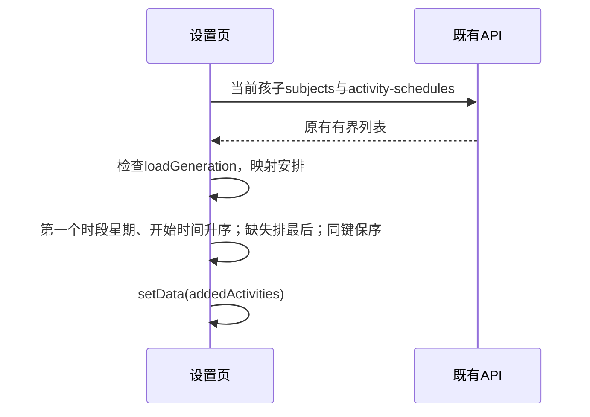

# FEAT-001 — 设置页课外活动按星期排序 (Spec Lite)

- Status: VERIFYING
- Risk: R1
- Owner: 产品负责人（用户）
- Implementer: Codex
- Reviewer: Codex 自查、用户验收
- Date: 2026-10-10
- Spec revision: SPEC-20261010-ACTIVITY-WEEKDAY-ORDER-02
- User confirmation: 产品负责人（用户），2026-10-10，本会话“按照这个方案实现”，批准SPEC-20261010-ACTIVITY-WEEKDAY-ORDER-02及修正后的DREV-20261010-ACTIVITY-WEEKDAY-ORDER-01；原UI不变。
- Affected Feature IDs: FEAT-001
- Feature current-state documents: docs/domain/features/FEAT-001-push-kids-mvp.md
- Feature baseline revision: FEAT-STATE-20261006-REVIEW-MANAGEMENT-03-LOCAL
- Feature merge owner: Codex

## Frontend Design Impact and Repository-native Approval

- Frontend impact: yes — 设置页活动行的展示顺序改变。
- Frontend engineering impact: yes — 页面列表派生数据改变。
- Affected UI IDs: UI-001
- UI current-state documents: docs/design/frontend/ui/UI-001-parent-miniapp.md
- Frontend baseline revision: FDB-20260913-04（APPROVED）
- Frontend engineering constraint revision: FEC-20261007-NATIVE-GEOMETRY-02（APPROVED）
- Affected frontend quality dimensions: component/state/responsive/a11y/browser/performance/security/privacy/observability
- Frontend quality budgets/requirements: 既有单列、44px触控、三视口及读取状态合同；FEC-PERF-READ-001/002/003/004；包体1.5MiB。
- Frontend quality verification plan: 列表加载行为测试；编辑索引与刷新测试；全量前端、ESLint、架构、设计策略、小程序校验；三视口原生排序、点击及节点矩形证据。
- Approved frontend engineering deviations: none
- Current Design Revision(s): 设置页复用既有 UI-001 纸·芽设计，仅本增量排序合同另立 revision。
- Editable design source path(s): docs/design/frontend/prototypes/DREV-20261010-ACTIVITY-WEEKDAY-ORDER-01/activity-order.svg
- Design source SHA-256: 见 snapshot manifest
- Proposed Design Revision: DREV-20261010-ACTIVITY-WEEKDAY-ORDER-01
- Required viewport/state exports: 320×568、390×844、430×932；有内容（多时段、同星期、缺失安排）、空列表、读取错误。
- Prototype status: APPROVED
- Approved Task Spec revision: SPEC-20261010-ACTIVITY-WEEKDAY-ORDER-02
- Approved Design Revision: DREV-20261010-ACTIVITY-WEEKDAY-ORDER-01
- Design approval evidence: 用户2026-10-10“按照这个方案实现”，此前明确原UI不变及围棋09:00应在钢琴19:00之前。
- Snapshot manifest path: docs/design/frontend/snapshots/UI-001/DREV-20261010-ACTIVITY-WEEKDAY-ORDER-01/APPROVAL.md
- Permitted implementation deviations: none
- UI current-state merge owner: Codex
- UI current-state merge evidence: pending
- Frontend visual/a11y/resolution verification: 设计导出只供批准；不能替代原生三视口证据。
- Frontend engineering verification evidence: docs/quality/evidence/ACTIVITY-WEEKDAY-ORDER-20261010.md；本地自动化通过，原生三视口未运行。
- External design dependency: none

## 1. Problem and outcome

当前设置页按 subjects 返回顺序映射 addedActivities，未根据上课星期排序。
用户要求按周一至周日展示，多时段取第一个，没有星期或时段排最后。

## 2. Scope

- 仅设置 → 课外活动当前孩子的在用活动列表，排序不写回服务端。
- 排序键取 schedule.time_slots[0].weekday。协议0代表周一，6代表周日；整数0–6依次排序。
- 多时段严格取数组第一个，不寻找后续有效项，不另算最小星期；服务端正常返回 canonical 星期升序数组。
- 无 schedule、空 time_slots、首项无有效星期（null、缺失、非整数、越界）放最后。
- 同星期按第一个时段开始时间升序；围棋周三09:00排在钢琴周三19:00之前。同星期同开始时间保持原序。有效星期但开始时间缺失/非法时排在该星期有效时间之后；末尾组保持原序。时间接受HH:mm及HH:mm:ss。
- 新增、修改、移除安排后既有 reload 重新应用排序；切换孩子与迟到响应隔离保持既有合同。
- 原有UI完全不变：不修改WXML、WXSS、图标、文案、尺寸、布局、表单或按钮，只改变活动列表数据顺序。学习科目、出行安排、日程、今日、后端API、排期、数据模型、权限不改变。
- Feature/UI合并：验证后补入设置页排序事实和本Spec引用，不覆盖未完成发布或其他任务记录。

## 3. Impact map

- Entry/caller: settings.load → 并行读取 subjects/activity-schedules → scheduleMap → addedActivities → setData。
- Authoritative path: apps/miniprogram/pages/settings/index.js，局部排序函数/派生列表。
- Dependencies: 既有 api、child-context、ui；不增加依赖、请求或跨域业务逻辑。
- Existing tests: tests/frontend/prototype-activity-schedule.test.js、child-profiles.test.js、config-and-copy.test.js。
- Docs: FEAT-001、UI-001 当前状态。

## 4. Required design views

### Link/call graph

```text
设置加载/安排保存/孩子切换 → load → subjects + schedules → 活动映射 → 星期/开始时间稳定排序 → setData → 活动行点击 → 按排序后index编辑
```

### Sequence diagram



### State machine

N/A：不新增业务状态；沿用 loading/content/empty/error/retry，排序只在成功取得当前孩子数据后发生。

### Architecture diagram

N/A：模块、文件职责、依赖方向及扩展点均保持；此排序点 closed，不增加通用排序注册机制。

### Trade-offs

| Option | Benefit | Cost/risk | Decision |
|---|---|---|---|
| 页面内稳定派生排序 | 范围准确，无API/数据变更 | 需确认点击索引随列表同步 | selected |
| 修改后端通用subjects顺序 | 多入口共享 | 影响其他页面及数据合同 | rejected |
| 按星期再按开始时间 | 正确体现同日上课先后 | 需校验时间格式 | selected — 用户指出围棋09:00应在钢琴19:00之前 |

## 5. Expected file changes and deletion plan

| File/path | Action | Intended change | Why required |
|---|---|---|---|
| apps/miniprogram/pages/settings/index.js | modify | 活动映射后按首时段星期及开始时间稳定排序 | 用户要求 |
| tests/frontend/activity-weekday-order.test.js | add | 页面行为边界、编辑索引与刷新隔离 | 排序可能改变点击目标 |
| docs/domain/features/FEAT-001-push-kids-mvp.md | modify | 已验证排序事实 | 当前状态 |
| docs/design/frontend/ui/UI-001-parent-miniapp.md | modify | 本增量设计与证据 | 当前状态 |
| 本Spec及DREV目录 | add/update/move | 审批、设计与验证记录 | 仓库治理 |

Final authoritative path: settings/index.js 的 addedActivities 派生路径；替换无排序映射结果，不保留第二条排序路径。

## 6. Acceptance criteria

- AC-001：周日、周三、周一输入展示周一、周三、周日；完整7天按周一至周日；周三围棋09:00在钢琴19:00之前，同星期同开始时间保序。
- AC-002：多时段以第一个为准；即使后项星期更小或首项无星期也不改用后项。
- AC-003：没有安排/没有时段/非法星期均在最后，0（周一）有效；同键稳定且不修改源数组。同星期缺少合法开始时间排在有效时间之后，覆盖HH:mm、HH:mm:ss及非法时间。
- AC-004：点击任意排序后行打开该活动安排；修改安排刷新后重排；切换孩子不显示旧列表；失败保留既有恢复行为。
- AC-005：WXML/WXSS无差异；三视口既有行可读、触控可达，空态和错误态保留；学习及出行顺序不变，无新增请求。

## 7. Required test points

| Test point | Acceptance criterion | Test level | Command/case | Required result |
|---|---|---|---|---|
| TP-001 | AC-001/002/003 | frontend behavior | node --test tests/frontend/activity-weekday-order.test.js | 顺序与边界通过 |
| TP-002 | AC-004/005 | frontend behavior | 同文件：点击索引、刷新、孩子隔离、失败及未影响列表 | 通过 |
| TP-003 | AC-005 | regression/static | npm test；npm run lint:miniapp；.venv/bin/python tools/check_architecture.py；tools/validate_miniprogram.py；tools/validate_design_evidence.py --check-current-policy | 通过 |
| TP-004 | AC-005 | native | 微信开发者工具320×568、390×844、430×932：排序、点击、长标题、空/错态截图与矩形 | 无裁切/错对象，触控≥44px |

## 8. Plan

1. 批准本Spec与DREV后仅调整活动派生顺序。
2. 执行测试/静态与原生检查，保留证据并合并当前状态。
3. 全部完成门禁后Status DONE并移至specs/completed；未完成验证如实保留VERIFYING，不发布。

## 9. Verification

| Test point / command | Result | Evidence/notes |
|---|---|---|
| TP-001/002 | passed | 专项6 passed：星期、时间、首项、边界、点击、刷新、迟到响应、空态和错误 |
| TP-003 | passed | 全量213 passed；ESLint、架构、小程序、设计策略、diff检查通过 |
| TP-004 | not run | 本机默认原生自动化端口不可用，未取得三视口原生证据；详见evidence |

## 10. Completion

- Changed behavior: 设置页课外活动按首时段星期、开始时间稳定排序。
- Deleted/replaced behavior: 替换活动直接按subjects原顺序展示；单一页面派生路径，无重复排序路径。
- Files changed: settings/index.js、专项测试、本Spec、设计证据、FEAT-001、UI-001及验证报告。
- Review findings: 自查未发现问题；输入不变、无额外网络/依赖、无UI模板样式差异。
- Residual risk: 原生三视口证据待补，未发布。
- Lifecycle decision: 保持VERIFYING及active；TP-004未完成，不能标DONE或移completed。
- [x] Scope/non-goals preserved.
- [ ] Acceptance criteria pass.
- [ ] Required commands ran.
- [x] No duplicate/legacy path remains.
- [x] Docs updated if facts changed.
- [x] Feature/UI current-state merged.
- [x] No unrelated Diff.
