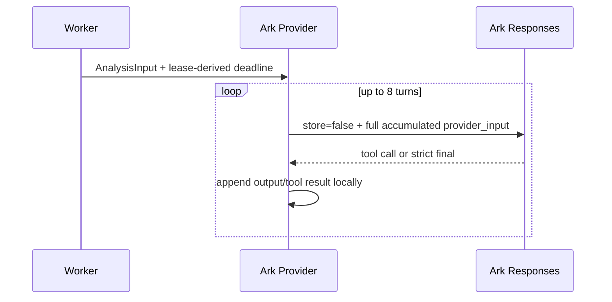
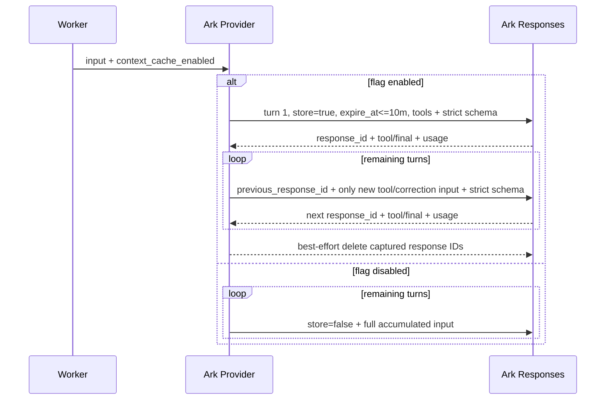
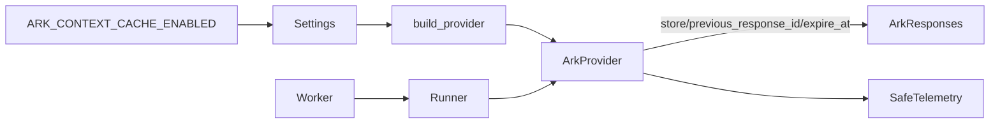
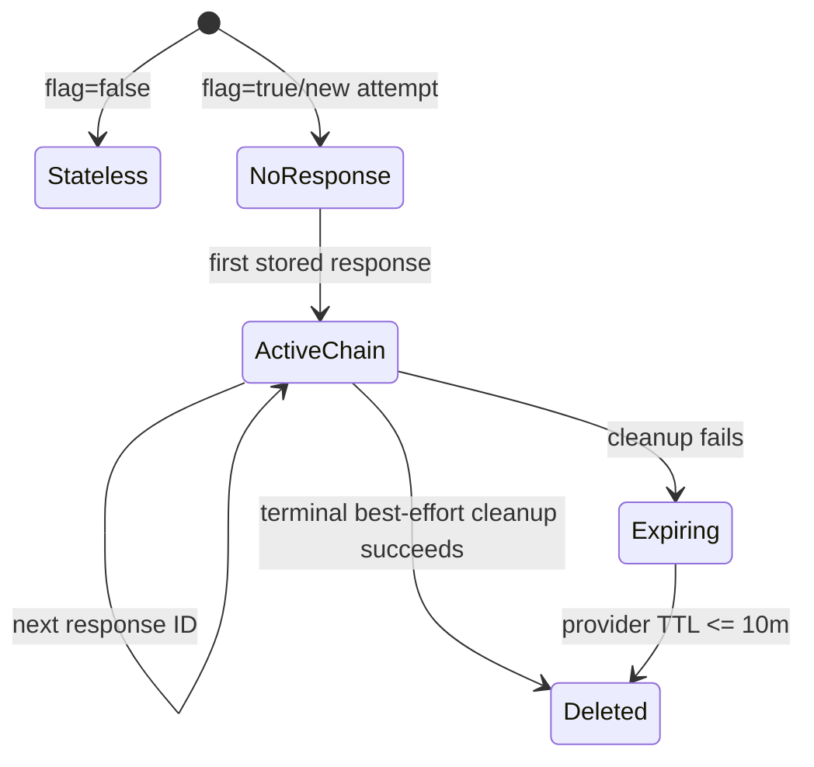
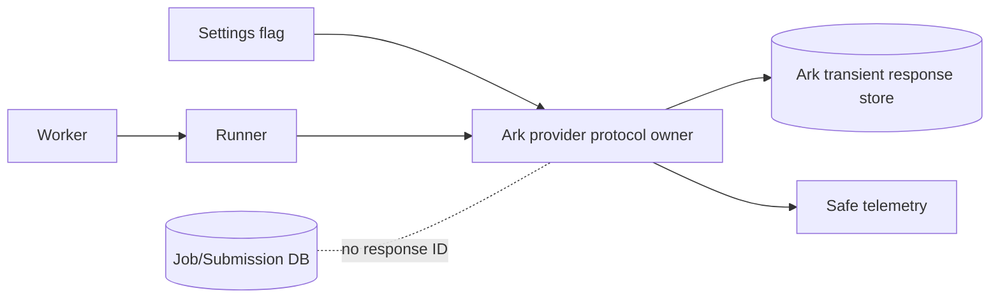

# FEAT-001 — Ark 会话上下文复用开关

- Status: `VERIFYING`
- 2026-10-06 scope update: 已批准 `BUG-SPEC-20261006-STAGED-ANALYSIS-01` 的本地默认工厂使用
  stateless 分阶段Provider；本开关仅影响仍被对照工具/回归测试消费的旧Provider，不影响新流程。
  BUG-028 尚在VERIFYING，待其门禁关闭后再评价本Spec被取代的生命周期；当前无生产切换。
- Risk: `R2 — 改变 Provider 对儿童图片/文字的远端临时存储方式、Agent 多轮请求协议和成本归属`
- Spec owner: `产品负责人（用户）`
- Implementer: `Codex`
- Reviewer: `Codex 独立只读 review`
- Verifier: `Codex + 产品负责人受控云验收`
- Created: `2026-09-19`
- Last updated: `2026-09-19`
- Target release: `N/A — 本 Spec 不授权部署`
- Spec revision: `SPEC-20260919-ARK-CONTEXT-REUSE-01`
- User confirmation: `APPROVED — 用户于 2026-09-19 回复“可以”，并要求验证该方式是否降低模型推理时间`
- Additional R2/R3 approval: `由本 revision 的明确批准满足`
- Affected Feature IDs: `FEAT-001`
- Feature current-state documents: `docs/domain/features/FEAT-001-push-kids-mvp.md`
- Feature baseline revision: `FEAT-STATE-20260919-ANALYSIS-RETRY-03-LOCAL`
- Feature merge owner: `Codex；仅在实现、验证、review 完成后合并最终事实`

## Frontend Design Impact and Repository-native Approval

- Frontend impact: `no — 不修改页面、文案、交互或 API 响应`
- Frontend impact reason: `仅增加后端运行时开关并改变 Ark 多轮传输方式`
- Frontend engineering impact: `no — 不修改小程序代码或质量预算`
- Frontend engineering impact reason: `后端 Provider/config 变更`
- Affected UI IDs: `N/A`
- UI current-state documents: `N/A`
- Frontend baseline revision: `N/A`
- Frontend engineering constraint revision: `N/A`
- Affected frontend quality dimensions: `N/A`
- Frontend quality budgets/requirements: `N/A`
- Frontend quality verification plan: `运行既有 npm test 与 lint，证明无意外影响`
- Approved frontend engineering deviations: `none`
- Current Design Revision(s): `N/A`
- Editable design source path(s): `N/A`
- Design source SHA-256: `N/A`
- Proposed Design Revision: `N/A`
- Required viewport/state exports: `N/A`
- Prototype status: `N/A`
- Approved Task Spec revision: `N/A until approved`
- Approved Design Revision: `N/A`
- Design approval evidence: `N/A`
- Snapshot manifest path: `N/A`
- Permitted implementation deviations: `none`
- UI current-state merge owner: `N/A`
- UI current-state merge evidence: `N/A`
- Frontend visual/a11y/resolution verification: `N/A`
- Frontend engineering verification evidence: `N/A`
- External design dependency: `none`

## 0. Executive summary

### Problem

当前 Agent 每轮都以 `store=false` 重新发送累计 `provider_input`。虽然方舟对当前模型自动提供不可关闭的
隐式前缀缓存，但应用没有使用 `previous_response_id` 复用已存储的多轮上下文，也没有可配置的上下文
复用模式或命中 Token 观测。

### Intended outcome

新增后端开关 `ARK_CONTEXT_CACHE_ENABLED`，默认 `true`。开启时仅在一个 Job attempt 内使用方舟
Responses 的临时会话存储和 `previous_response_id` 续接；关闭时保持当前 `store=false`、完整上下文重发。
无论开关值如何，都保留 strict JSON Schema、8 turns、lease-derived deadline、工具边界和三次 Job retry。

该开关准确控制“应用管理的会话上下文复用”，不能关闭方舟针对当前模型自动启用的隐式缓存；运行文档、
配置注释和日志必须明确这一差异。

### Why now

BUG-022 已使 Agent loop 可观测且有界；下一步可以在不改变业务语义的前提下减少多轮工具调用时重复上传
累计上下文，并用 cached-token 指标判断真实收益。

## 1. Facts, decisions, assumptions, questions

### Confirmed facts

| ID | Fact | Evidence |
|---|---|---|
| `F-001` | 当前请求为 `store=false`，每轮重新发送累计 `provider_input`，未传 `previous_response_id` | `agent_processing/providers.py` |
| `F-002` | 当前模型默认 `doubao-seed-2-1-pro-260628` | `platform/config.py`、`.env*.example` |
| `F-003` | 方舟对 Seed 2.0+ 在线推理自动启用隐式缓存且不可关闭 | 方舟官方《上下文缓存》文档，2026-09-17 |
| `F-004` | 方舟显式缓存需要 `store=true`、`caching.enabled` 和多轮 response ID；此前轮次启用显式缓存后不支持 `json_schema` | 同一官方文档 |
| `F-005` | strict `json_schema` 是当前模型输出正确性和家长确认前安全边界的一部分 | `BHV-003`、`BHV-014`、BUG-022 tests |

### Decisions

| ID | Decision | Owner/date | Rationale |
|---|---|---|---|
| `D-001` | 开关控制 Responses 会话存储/续接，而不使用 `caching:{type:enabled}` | 用户 / 2026-09-19 | 保留 strict JSON Schema，不制造协议不兼容 |
| `D-002` | 默认开启；关闭时严格回到 BUG-022 的 stateless 请求 | 用户 / 2026-09-19 | 满足默认使用与可回退要求 |
| `D-003` | 上下文只在单个 Job attempt 内复用，不跨孩子、家庭、Job 或 retry attempt | 用户 / 2026-09-19 | 防止跨租户/跨任务内容串联 |
| `D-004` | 开启时每个远端 response 最长保留 10 分钟，终态 best-effort 删除；删除失败依靠 TTL | 用户 / 2026-09-19 | 覆盖 5 分钟 lease，同时最小化儿童内容保留窗口 |

### Assumptions

| ID | Assumption | Risk if wrong | Validation | Owner/due |
|---|---|---|---|---|
| `A-001` | 当前 Ark Responses 兼容 `store/previous_response_id/expire_at` 与 strict schema 组合 | 云端可能返回 capability 400 | 本地协议测试 + 部署前受控 Ark smoke | 产品负责人 / 部署前 |
| `A-002` | `usage` 会暴露 cached token 计数 | 只能观测模式、不能证明命中 | 容错解析；字段缺失记 unknown，不影响任务 | Codex / 实现期 |

### Open questions

| ID | Question | Why it matters | Recommended answer | Owner | Blocking? |
|---|---|---|---|---|---|
| `Q-001` | 是否批准“会话上下文复用”语义，而不是方舟显式缓存？ | 显式缓存会迫使 strict schema 降级，且 false 也无法关闭厂商隐式缓存 | 已批准 revision 01；保留 strict schema，并在名称/文档中说明开关边界 | 用户 | resolved |

## 2. Current behavior and evidence

### Current flow

### Current evidence

- Code: `agent_processing/providers.py` 的 `analyze_with_history()`。
- Tests: `tests/unit/test_subject_grouped_analysis.py`、`test_provider_evidence.py`。
- Behavior IDs: `BHV-003`、`BHV-014`。
- Runtime evidence: BUG-022 的逐轮日志尚未部署；无缓存命中指标。
- Related Spec: `specs/completed/BUG-022-ANALYSIS-AGENT-OBSERVABILITY-AND-RETRY.md`。

## 3. Target behavior

### Primary sequence diagram

### Behavior matrix

| Case | Preconditions | Input/action | Expected result | Side effects | Forbidden result |
|---|---|---|---|---|---|
| enabled default | valid Ark config | multi-turn tool loop | first call stores, later calls use previous ID | <=10m provider storage within same attempt | cross-job ID reuse |
| disabled | env flag false | any loop | exact BUG-022 stateless requests | no provider response storage | `store=true` or previous ID |
| single-turn | enabled | first response is final | valid proposal | first response cleaned/TTL | extra generation only to create cache |
| capability error | enabled | Ark rejects session fields | typed capability/dependency failure under existing retry policy | no silent mode switch inside attempt | silent success or schema downgrade |
| cleanup failure | enabled | delete fails after terminal result | proposal outcome unchanged; safe warning | TTL remains recovery owner | raw response or exception text in logs |

## 4. Scope

### In scope

- 配置 `ARK_CONTEXT_CACHE_ENABLED: bool = true`。
- Provider 内两种权威传输模式：enabled session reuse / disabled stateless。
- enabled 模式 10 分钟 TTL、同 attempt response chain、终态 best-effort cleanup。
- 安全日志记录 mode、cached-token 计数或 unknown，不记录 response ID/内容。
- 配置、协议、隐私、回退和全量回归测试。

### Out of scope / non-goals

- 不启用方舟 `caching:{type:enabled}`，不降低 strict `json_schema` 为 `json_object`。
- 不承诺或伪造关闭厂商不可关闭的隐式缓存。
- 不跨 Job/家庭/孩子共享 response ID，不持久化 ID 到 MySQL。
- 不部署、不改生产环境变量、不自动重跑生产任务。

### Invariants / must not change

- 家长确认前零正式数据写入；模型不评分、不决定复习日期。
- 8 turns、20 logical queries、100 results、最后一轮 final-only、5 分钟 lease 与三次 Job attempts 不变。
- strict JSON Schema、本地引用校验、family/child scope 和日志隐私边界不变。
- 开关关闭时请求形状与 BUG-022 stateless 模式一致。

### Feature current-state impact

- Existing Feature sections affected: Agent Provider 传输、配置、隐私、可观测与限制。
- Final facts to merge: 开关默认值、准确语义、TTL/cleanup、strict schema 保留、隐式缓存不可关闭。
- Superseded statement: “不保存 provider-side conversation state”改为按开关选择。
- Change Reference: `SPEC-20260919-ARK-CONTEXT-REUSE-01`。

### Link/call graph

## 5. Domain and data design

- Terms: `implicit cache` 是方舟自动且不可关闭的前缀缓存；`session reuse` 是应用通过已存 response ID
  续接；`explicit cache` 是 `caching.enabled`，本 Spec 不使用。
- Database schema/backfill: `N/A — 无数据库变化`。
- State machine:

## 6. Interfaces and errors

| ID | Caller | Input | Output | Errors | Compatibility |
|---|---|---|---|---|---|
| `CFG-001` | runtime | `ARK_CONTEXT_CACHE_ENABLED` boolean, absent=>true | Settings boolean | invalid boolean fails startup validation | additive env config |
| `ARK-001` | Provider | store/expiry/previous ID selected by mode | existing `AnalysisProposal` | existing typed disposition; no content in errors | API/business DTO unchanged |

## 7. Authorization, security, and privacy

- Response IDs remain in process memory only and are never logged/persisted.
- A chain is constructed inside one `analyze_with_history()` invocation and cannot cross attempt boundaries.
- Stored child material expires no later than 10 minutes; terminal cleanup is best effort and does not change Job success/failure.
- Logs contain only `context_mode`, aggregate cached token count/unknown and cleanup outcome.
- No API key, raw prompt/output, image, subject, keyword or response ID enters logs.

| Threat/failure | Impact | Mitigation | Evidence |
|---|---|---|---|
| response ID reused across tenants | cross-family disclosure | local variable per Provider invocation; no shared cache/map | concurrent isolation unit test |
| cleanup failure | provider retains content | expire_at hard bound + safe warning | cleanup-failure test |
| flag false still described as all caching off | misleading operations | config/docs call it application session reuse and disclose implicit cache | settings/docs contract test |
| schema weakened for caching | invalid proposal | never send `caching.enabled`; strict schema assertion in both modes | request-shape tests |

## 8. Architecture and implementation boundaries

### Chosen approach

在现有 `Settings → build_provider → ArkAnalysisProvider` 路径传入一个布尔策略。Provider 仍是 Ark 协议唯一
Owner；Runner/Worker 不认识 response ID。Provider 在 enabled 模式维护一次调用范围内的链，并在 finally
清理；disabled 模式复用现有完整输入路径。

### Modules and dependency direction

| Module | Responsibility | Must not own/do |
|---|---|---|
| `platform/config.py` | 解析默认开启的运行时开关 | 不维护 response ID |
| `agent_processing/providers.py` | Ark store/previous ID/expiry/cleanup 协议 | 不跨 Job 缓存、不中断领域确认边界 |
| `agent_processing/telemetry.py` | 白名单缓存模式/计数/cleanup outcome | 不记录 response ID 或内容 |

### Architecture diagram

### Trade-offs and alternatives rejected

| Alternative | Benefit | Why rejected | Revisit condition |
|---|---|---|---|
| 方舟显式 `caching.enabled` | 确定性缓存命中 | 与当前 strict `json_schema` 不兼容，并产生显式存储费用 | 方舟支持两者组合且受控质量验证通过 |
| 仅加布尔值但请求不变 | 配置看似简单 | 假开关；无法影响运行行为 | never |
| 关闭时在 Prompt 前加随机 nonce | 可降低隐式前缀命中 | 不能保证关闭、增加成本且污染模型输入 | never |
| 跨 Job 共享 response ID | 更高缓存复用 | 儿童/家庭隔离与内容新鲜度风险不可接受 | 不重审 |
| 继续永远 stateless | 最低隐私风险 | 多轮上下文重复传输，无法满足用户要求 | 开关默认 false 时可回退 |

### Extensibility policy

| Variation axis | Status | Mechanism | Requirements | Revisit |
|---|---|---|---|---|
| session/stateless | open, bounded | one boolean setting | same schema/privacy/retry contract + request-shape tests | new Ark protocol |
| explicit cache | deferred | none | needs new Spec, cost/privacy/schema evidence | vendor compatibility changes |
| cross-job cache | closed | prohibited | N/A | explicit product/privacy redesign |

### Architecture confirmation

- Recommended technical design: default-on, attempt-local Responses session reuse with 10-minute TTL; no explicit cache field。
- Alternatives and trade-offs: listed above。
- Long-term maintainability rationale: Provider owns vendor protocol; no second cache/database abstraction。
- Architecture revision: `ARCH-ARK-CONTEXT-REUSE-20260919-01` proposed。
- User/architecture-owner confirmation: `APPROVED by user on 2026-09-19`。
- ADR required: `No — bounded Provider transport option; Architecture + Feature current-state are sufficient`。

## 9. Expected file changes, replacement, and deletion plan

| File/path | Action | Expected change | Why |
|---|---|---|---|
| `platform/config.py` | modify | default-on boolean flag | runtime authority |
| `agent_processing/providers.py` | modify | session/stateless request construction, TTL and cleanup | Ark protocol owner |
| `agent_processing/telemetry.py` | modify | safe cache fields/events | observability whitelist |
| `.env.example`, `.env.runtime.example` | modify | document default and exact semantics | operator contract |
| `tests/unit/test_provider_evidence.py` | modify | settings wiring/default | config contract |
| `tests/unit/test_subject_grouped_analysis.py` | modify | both modes, previous IDs, schema, TTL, cleanup/isolation | provider contract |
| `tools/benchmark_ark_context_reuse.py` | add | 成对、交替顺序的真实 Ark 延迟/cached-token 安全基准 | 满足用户要求且不输出内容/凭据/response ID |
| `docs/architecture/ARCHITECTURE.md` | modify after verification | final transport boundary | architecture truth |
| `docs/domain/BEHAVIOR-CATALOG.md` | modify after verification | current cache semantics | behavior truth |
| `docs/domain/features/FEAT-001-push-kids-mvp.md` | modify after verification | final state + Change Reference | feature truth |
| `docs/quality/TEST-STRATEGY.md` | modify after verification | cache privacy/protocol tests | regression policy |
| `docs/DEPLOYMENT.md` | modify | 配置与安全 A/B 命令 | operator contract |
| `docs/operations/WECHAT-CLOUD-HOSTING.md` | modify | 云环境变量与回退语义 | cloud runbook |

Temporary coexistence: `None — 两种模式是受支持配置，不是迁移双写；单次请求只走一种模式。`

## 10. Non-functional requirements

| ID | Requirement | Target | Measurement | Failure response |
|---|---|---|---|---|
| `NFR-001` | privacy retention | provider-side response <=10 minutes | request expiry + cleanup tests | block completion if unbounded |
| `NFR-002` | correctness | strict schema and validation identical in both modes | request/result contract tests | no schema downgrade |
| `NFR-003` | isolation | zero cross-invocation response IDs | concurrent/sequential fixture | block completion |
| `NFR-004` | observability | mode/hit counters, zero IDs/content | caplog privacy tests | block completion |

## 11. Acceptance criteria

### AC-001 — Default session reuse

- Given `ARK_CONTEXT_CACHE_ENABLED` absent。
- When an analysis needs multiple turns。
- Then the first request stores with <=10 minute expiry and later turns reference only the immediately previous response。
- And strict JSON Schema remains on every generation。
- And not log/persist a response ID or raw child/model content。

### AC-002 — Disabled rollback mode

- Given `ARK_CONTEXT_CACHE_ENABLED=false`。
- When an analysis runs。
- Then every request uses `store=false` and the full accumulated context, matching BUG-022 behavior。
- And no previous response ID, expiry or cleanup call is emitted。

### AC-003 — Failure and cleanup

- Given enabled mode returns success, validation failure, timeout or dependency failure。
- When the invocation terminates。
- Then captured response IDs are deleted best effort and all stored responses have a TTL fallback。
- And cleanup failure does not overwrite a valid proposal or expose private diagnostics。

## 12. Verification plan

| Test point | Acceptance/risk | Level | Expected evidence |
|---|---|---|---|
| `TP-001` | default true / explicit false parse | unit config | settings assertions |
| `TP-002` | first store + expiry, later previous ID, strict schema retained | unit Provider | exact request shapes |
| `TP-003` | false reproduces stateless BUG-022 | unit Provider | store=false/full input/no cleanup |
| `TP-004` | invalid tool args still same-loop retry in both modes | unit Provider | no search on invalid args |
| `TP-005` | cleanup success/failure/TTL and no private logs | unit Provider | caplog/request assertions |
| `TP-006` | 独立 Provider invocation（含下一 Job retry 调用）starts a fresh chain | unit Provider | response IDs never cross invocation/attempt |
| `TP-007` | historical behavior | full backend/frontend/static gates | repository commands |
| `TP-008` | real Ark compatibility, latency and cached-token evidence | controlled paired A/B | 用户已授权；需在具备 `ARK_API_KEY` 的受控环境运行，不得输出内容/ID/密钥 |

Pre-change failure: default settings and Provider request-shape tests fail because the setting/session path does not exist。
Forbidden-side-effect proof: false mode emits no store/previous ID; logs contain no IDs/content; independent invocations share no chain。

## 13. Rollout, migration, rollback

- Rollout: deploy backend immutable version only after separate approval; configure flag explicitly in cloud even though default is true;
  first smoke with non-sensitive controlled image, inspect status/latency/cached-token/cleanup events, then decide traffic。
- Mixed versions: no API/DB incompatibility; each worker uses its process config。
- Rollback: set `ARK_CONTEXT_CACHE_ENABLED=false` and restart, or roll back backend to `c5d1f54`。
- Data backfill/schema: none。
- Abort: schema/capability 400, response IDs in logs/DB, cleanup without TTL, higher failure rate or attempt exceeding lease。

## 14. Implementation plan

1. Add config/wiring and request-mode contract tests。
2. Implement attempt-local session chain, TTL, strict-schema requests and safe cleanup/telemetry。
3. Run focused and full gates；perform independent read-only review；在有 Key 的受控环境运行交替顺序 A/B。
4. Merge verified facts into Architecture/Behavior/Feature/Test Strategy, archive Spec, commit separately。

## 15. Review plan

- Verify official Ark semantics are not misrepresented: false disables application session reuse, not implicit vendor caching。
- Verify strict schema never changes and explicit `caching` is absent。
- Verify response IDs cannot escape invocation memory/logs/database。
- Verify every modified file is necessary and no duplicate cache abstraction is introduced。

## 16. Implementation and verification record

- Changed behavior: `ARK_CONTEXT_CACHE_ENABLED` 缺省为 true；Provider 在单 invocation 内用
  `store=true + expire_at<=10m + previous_response_id` 续接，只发送新增对话输入并每轮重申工具/strict
  Schema；false 保留完整 stateless 重发；终态反向 best-effort 删除 response；日志只增加 mode、缓存 token
  聚合和 cleanup 数量。
- Evidence:

| Test point | Command/evidence | Result |
|---|---|---|
| TP-001..006 | `uv run pytest tests/unit/test_provider_evidence.py tests/unit/test_subject_grouped_analysis.py -q` | PASS — 38 passed |
| TP-007 backend | `uv run pytest tests/unit tests/integration tests/contract -q` | PASS — 354 passed, 4 MySQL-environment skips |
| TP-007 frontend | `npm test && npm run lint:miniapp` | PASS — 167 passed; ESLint passed |
| TP-007 performance/E2E | `uv run pytest tests/performance tests/e2e -q` | PASS — 3 passed |
| TP-007 static | Ruff check/format, Mypy 87 files | PASS |
| TP-007 repository | architecture/design/miniprogram validators | PASS — checked=3; design valid; 15 pages/665198 bytes |
| TP-008 live Ark A/B | `PYTHONPATH=apps/api/src uv run python tools/benchmark_ark_context_reuse.py --runs 1` | NOT_RUN — local `ARK_API_KEY` absent; browser safety policy blocks cloud console and no bypass was attempted |

- Review: `PASS for local implementation; no Blocker/Major finding after correcting one review finding: tools are
  now sent on every session request so later tool rounds and final tool_choice do not rely on undocumented inheritance.`
- File necessity review:

| Group | Necessary? | Review finding |
|---|---|---|
| config/env examples | yes | one default-on authority and operator-visible rollback value |
| Provider/telemetry | yes | vendor protocol remains in adapter; no shared cache or DB state |
| unit tests | yes | both modes, strict Schema, invalid args, TTL, cleanup, privacy and invocation isolation |
| benchmark tool | yes | user-required real latency comparison without printing private payloads |
| architecture/feature/behavior/quality/runbooks | yes | current-state and operational truth changed |

- Deviations: `Session requests repeat the bounded tool definition every turn, while only conversation input is
  incremental. This preserves multi-tool-round capability and final-only enforcement; it does not change the
  approved attempt-local context boundary.`
- Residual risk: `真实 Ark 对 store/previous_response_id/expire_at + strict Schema 的组合兼容性、cached-token
  字段和实际延迟差异仍需在持有运行时 Key 的受控环境执行至少两组成对 A/B（发布决策建议三组）。`

## 17. Completion gate

- [x] No blocking design question remains.
- [x] R2 approval is recorded.
- [ ] Acceptance and verification pass or record explicit residual risk（等待用户要求的真实 Ark 延迟 A/B）。
- [x] Independent review has no Blocker/Major finding.
- [x] Feature/Behavior/Architecture/Test Strategy contain verified local facts.
- [ ] Spec is moved to `specs/completed/` and feature commit is created.

Final status: `VERIFYING — local complete; live Ark paired latency A/B pending manual cloud execution`

## 18. Revision history

| Date | Change | Reason | Approved by |
|---|---|---|---|
| `2026-09-19` | revision 01 initial proposal | reconcile requested default-on switch with Ark cache/schema/privacy constraints | pending |
| `2026-09-19` | revision 01 approved; live latency A/B required | user confirmation | user |
