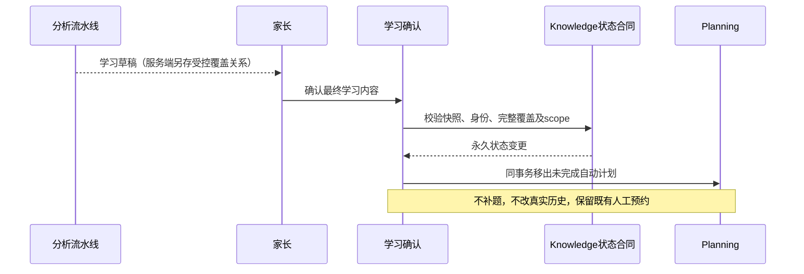
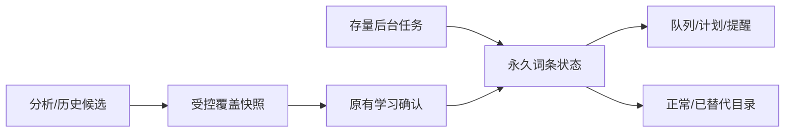
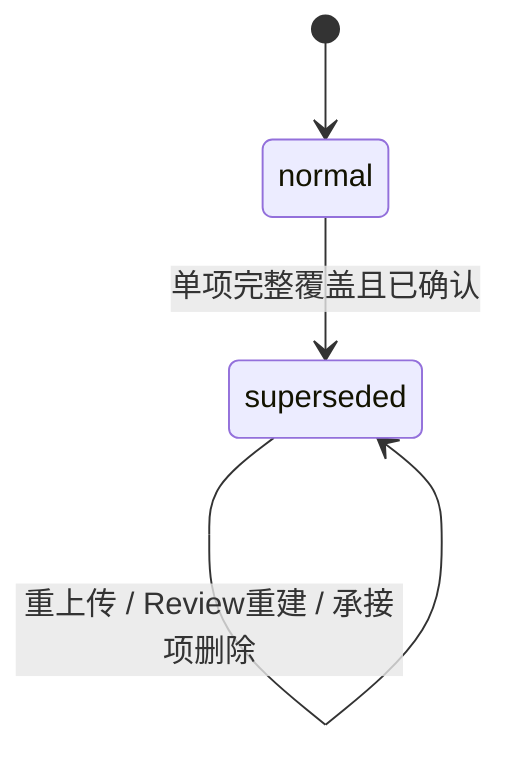
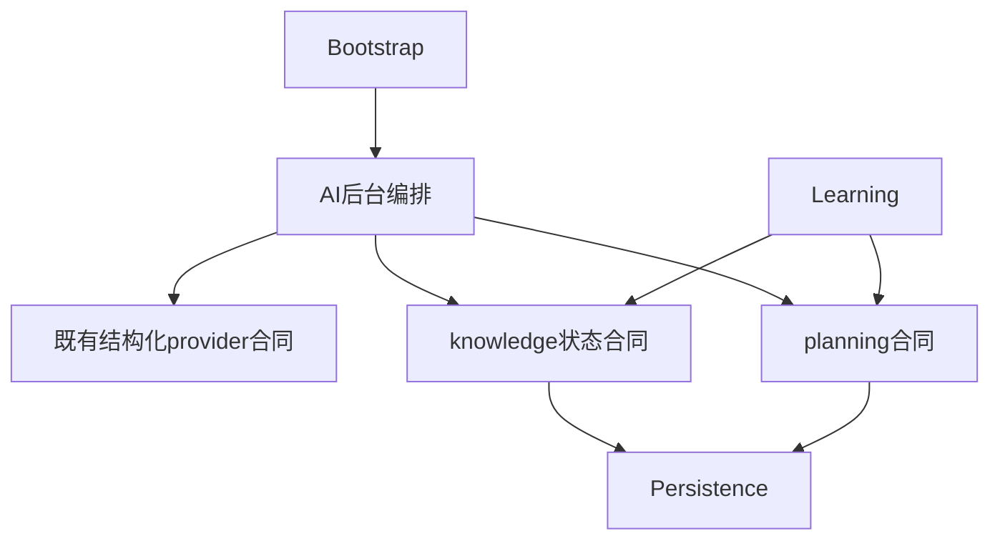

# FEAT-001 — AI 自动替代复习词条

- Status: VERIFYING
- Risk: R3
- Spec owner / Approver: 产品负责人（用户）
- Implementer / Verifier: Codex
- Created / Last updated: 2026-10-20 / 2026-10-21
- Spec revision: SPEC-20261020-AUTO-SUPERSEDED-REVIEW-02
- Architecture revision: ARCH-20261020-AUTO-SUPERSEDED-REVIEW-02
- Approval evidence: 用户2026-10-20「按照这个方案落地代码，并经过严格的测试」，承接Q1–Q15最终方案。
- Affected Feature IDs: FEAT-001；FEAT-003提醒、FEAT-006删除兼容
- Current state: [FEAT-001](../../docs/domain/features/FEAT-001-push-kids-mvp.md)
- Baseline: HEAD 8f3c5b04e61c96d4c19cf9eefd26514a8a095e1a + 既有未提交改动，保留无关工作。
- Target release: 本地实现与严格验证；不含部署、真实通知或线上数据整理。
- Template: [FEATURE-SPEC](../_templates/FEATURE-SPEC.md)

## Frontend Design Impact and Repository-native Approval

- Frontend impact / engineering impact: yes；UI-001目录筛选、分页及操作状态。
- Frontend baseline revision: FDB-20260913-04（APPROVED）
- Frontend engineering constraint revision: FEC-20261007-NATIVE-GEOMETRY-02（APPROVED）
- Design Revision: DREV-20261020-SUPERSEDED-REVIEW-01（APPROVED，2026-10-20用户回复「批准该设计并继续实现」，对应Spec02）；[可编辑源](../../docs/design/frontend/prototypes/DREV-20261020-SUPERSEDED-REVIEW-01/index.html)、[前端说明](../../docs/design/frontend/prototypes/DREV-20261020-SUPERSEDED-REVIEW-01/FRONTEND-SPEC.md)、[21张导出与SHA清单](../../docs/design/frontend/snapshots/UI-001/DREV-20261020-SUPERSEDED-REVIEW-01/APPROVAL.md)。
- Required exports: 320×568、390×844、430×932；正常、已替代、菜单、只读、长标题、承接项已删除、空态，21张已生成，批准后源与SHA清单保持冻结。
- 质量预算：44px热区、正文14px、有界分页、迟到响应隔离；主包≤1.5MiB。
- 隔离原生三视口×独立/内嵌×七态共42组数字几何通过，截图通道超时；完整视觉矩阵及iOS/Android验收未通过，HTML不能代替原生证据。最终采集范围见测试证据。

## 0. Executive summary

在保留旧词条、学习来源和真实复习历史的前提下，AI识别单个已确认新词条独立完整覆盖旧词条时，将旧词条永久标记为已替代，停止自动排期。
这不代表掌握，也不合并知识身份。日期仍由确定性规划产生。

## 1. Facts, decisions, assumptions, questions

最终决定（用户Q1–Q15）：所有学习科目、存量及新增；同一核心技能的完整覆盖才替代，课程进阶或部分重叠不足以替代；不确定时保留原排期。
新学习确认入库后立即生效，不额外确认或通知。一个新项可以替代多个旧项，不能组合多个新项覆盖一个旧项。
状态不可恢复，没有人工保护或恢复入口。再次上传旧材料、删除承接项均不恢复。
删除只作用于所选词条，不联动删除。
当天未完成自动待办立即移出，不补题；已完成历史保留；已有人工安排保留一次。

## 2. Current behavior and evidence

当前按family/child/subject/规范名称/category识别知识，10以内与20以内名称不同，因此各有Review并交替排期。
Review.active同时表达曲线生命周期和历史重新激活，不能承载永久替代事实。
现有队列投影v1为冻结合同，新增v2及迁移，禁止改写历史迁移。
上一轮21项只读基线通过，不能当作本次实现证据。

## 3. Target behavior

仅服务端保存、经过scope及内容快照校验的AI关系可在确认时生效；编辑影响判定的内容后原关系失效。
旧知识、来源、Occurrence、Feedback和实际次数保留；新旧之间不复制次数或伪造反馈。
旧内容再次确认可以记录真实学习/复习，但不能清除永久状态。
日计划、未来预览、积压及提醒统一消费状态；预先存在的人工预约在消费前例外一次。

## 4. Scope

包括schema、受控AI合同、确认事务、存量任务、排期统一保护、目录筛选及必要测试与事实文档。
不含知识合并、课程图谱、部分覆盖、掌握判定、学习推荐、恢复、联动删除、发布。

## 5. Domain and data design

KnowledgeItem新增review_status（normal默认，superseded终态）、superseded_by_knowledge_id（自表FK，ON DELETE SET NULL）、superseded_at、supersession_policy_revision。
同family/child/subject、非自身、两端均正常，防止环与相互替代；词条缺失Review也保持状态。
Review.active继续原有生命周期，不通过它表达永久状态。旧数据默认normal；迁移不调用AI。
后台使用持久化(created_at,id)游标每批20个遍历存量，新确认同时创建任务，避免循环反连接扫描全历史；全局发现索引仅供内部后台，实际关系写入仍family/child-scoped。每个已确认知识一个唯一任务，保存queued/running/completed/failed/cancelled、尝试次数、租约和静态错误码。

## 6. Interfaces and errors

目录与科目计数接口新增review_status=normal|superseded，默认normal；游标绑定状态与目录revision。
目录返回review_status、承接知识ID/名称、原有次数/日期；承接项不存在时显示「原承接词条已删除」。
已替代列表不按未来日期投影；可按科目/次数分页。新人工改期命令拒绝已替代项，既有预约消费一次。
AI只引用请求内短编号，不接受任意数据库ID。增量关系来自服务端原始草稿，确认后重新核对实际身份与内容指纹。
无恢复API。沿用403/404/409和原学习确认幂等规则。

## 7. Authorization, security, and privacy

AI无写库权限；关系应用由服务控制，同租户/孩子/学习科目。未确认、篡改、跨scope、自引用、过期关系零副作用。
日志仅数量、耗时和静态错误，不含原始payload、照片、孩子内容或凭据。
家长确认仍是正式学习/Review产生门槛；AI仅自动处理已确认知识的排期资格。

## 8. Architecture and implementation boundaries

knowledge拥有状态及合法性；learning编排确认事务；planning拥有计划与队列副作用；agent_processing提供结构化AI判定及后台编排。
网络请求不持有数据库事务。planning不依赖AI provider。

备选及取舍：只改Review.active会被重激活；只隐藏界面会遗漏提醒和未来计划；合并/删除违反历史保留要求；每次GET调用AI不可控。选择独立永久状态与写时协调。
扩展点closed：仅完整覆盖；部分覆盖/多项联合/知识图谱deferred。provider继续现有隔离、超时、schema和租户合同。
Architecture02随Spec02批准。

## 9. Expected file changes, replacement, and deletion plan

- persistence models、新迁移、新queue v2：增量schema及事务投影；保留冻结v1。
- knowledge状态服务、agent_processing覆盖合同/worker、learning确认：受控应用和存量任务。
- planning inventory/service/scheduling：资格、旧计划移出、不补题及一次人工例外。
- 小程序review-inventory与API：状态筛选、承接历史、仅删除操作；具体DREV已批准并本地实现。
- tests/unit/integration/contract/performance/frontend及Feature/Behavior/Architecture/UI/Spec/证据。
不引入通用utils或新知识图平台；不覆盖既有无关改动。

## 10. Non-functional requirements

现有单次分析≤20单元；覆盖候选每项≤20，后台每次发现≤20/领取1，最多一次30秒模型调用、3次尝试。
后台唯一任务键、租约恢复、终态；停用/删除孩子取消；失败不影响既有学习或排期。
读取必须tenant-leading索引、有界返回、数据库聚合、页查询数O(1)，不能加载全历史内存两两比较。
MySQL5.7真实迁移/查询计划为发布门禁，SQLite不能冒充。

## 11. Acceptance criteria

- AC01：新学习原有确认后立即自动生效；未确认、取消、编辑影响判定或非法关系不生效。
- AC02：自动新排期/未来/积压/提醒排除；已有未完成自动行移出，无补题；已有人工预约保留一次。
- AC03：原历史/次数/来源守恒；旧材料重现及Review重建不恢复。
- AC04：单项完整覆盖，部分/不同技能/不确定保持独立；全部学习科目。
- AC05：scope、自引用、环、幂等、并发和回滚；删除仅所选项，其他永久状态不变。
- AC06：存量任务有界、重启/重试/取消/失败安全。
- AC07：目录正常默认、已替代筛选/承接关系/原历史，无恢复或新排期入口；原生三视口与真机证据。

## 12. Verification plan

| Test point | 必需验证 | 结果 |
|---|---|---|
| TP01 | AI正反合同、独立标注跨科目完整/部分覆盖语义样本 | PASS：严格合同、真实流水线可选阶段；真实Ark 15个标注合成样本通过，不外推普适准确率 |
| TP02 | 原分析到确认、编辑/篡改、幂等/回滚、真实历史守恒 | PASS：专项SQLite、真实MySQL确认快照及事务回滚；原流水线覆盖成功/失败降级 |
| TP03 | 今日旧快照/未来/积压/预约/提醒、无补题及一次例外 | PASS：同事务移出、投影/负载、已完成守恒、人工消费一次及全量回归 |
| TP04 | 重上传、缺Review、终态、删除、scope和版本冲突 | PASS：历史重激活/重建、SET NULL、跨孩子/科目/家庭、自引用、状态游标及目录revision |
| TP05 | SQLite及真实MySQL5.7迁移/回滚/并发 | PASS：SQLite升级/安全回退/重升；MySQL5.7 head迁移及13项真实事务/并发/目录计划/回退重升测试；有永久状态时拒绝schema回退 |
| TP06 | 存量断点/租约/重试/取消、规模/查询数/EXPLAIN | PASS：持久游标20/40/51/51、重试/取消/租约耗尽；10k/50k双状态，SQLite实际ORM及MySQL5.7目录EXPLAIN |
| TP07 | 前端筛选/分页/迟到响应/只读/三视口原生及iOS/Android | PARTIAL：前端265项通过，含新筛选/分页/迟到响应/只读/共享内嵌及几何反例；原生数字矩形见证据，截图及iOS/Android未完成 |
| TP08 | pytest/Ruff/format/Mypy/npm/lint/架构/设计/小程序全适用检查 | PARTIAL：后端671 passed/35条件跳过、性能14 passed/2条件跳过、前端265及适用静态门禁通过；全库format被既有无关足迹render.py阻断。独立只读评审在实现与文档收尾后执行，结论以本轮最终输出为准 |

脚本模型合同通过不能等同真实模型语义正确率；未执行检查明确记录NOT_RUN。

## 13. Rollout, migration, rollback

本轮仅本地，发布遵守docs/deploy/README.md；先schema和所有排期保护，再开启AI。
关闭开关只停止新标记，不清除既有状态。回退不得回到忽略永久状态的后端。
迁移不触发存量AI；后台独立有界处理。记录静态检查/跳过/应用数量，不单独通知用户。

## 14. Implementation plan

记录批准→界面证据及DREV确认（后端独立继续）→状态与计划保护→分析确认/存量→严格验证→只读评审→事实文档闭环。

## 15. Review plan

独立只读评审在实现与事实文档冻结后检查语义边界、服务所有权、排期旁路、迁移、并发、永久状态及必要diff；结论见本轮最终输出，不以自动化结果预写评审通过。

## 16. Implementation and verification record

前后端已本地实现：0022迁移、冻结v1后新增queue v2、Knowledge终态与Planning协调、原分析可选覆盖阶段、确认快照、存量持久游标/任务，以及目录状态API。用户明确批准具体DREV01后，独立页及报表共享组件已接入状态筛选、承接关系、原学习记录和仅删除菜单。

真实MySQL5.7验证发现created_at仅秒精度，不能用于防环先后门槛；采用两端normal的原子单向终态转换保障无环。规模测试发现SQLite自引用SET NULL缺少反向索引会令批量清理退化，已补索引并完成全performance（14 passed/2 optional MySQL skipped）及迁移重跑。MySQL回退顺序修正为先删除自表外键再删除支撑索引，避免1553错误；独立临时库13项通过，包含并发、实际目录查询计划和回退重升；每次只清理本次随机新库，测试结束恢复容器停止状态。AI合成语义15例通过，未使用线上孩子数据。

当前命令、最终结果、跳过原因与非本轮format问题见[测试证据](../../docs/quality/evidence/AUTO-SUPERSEDED-REVIEW-20261020.md)。实现已完成，完整原生截图及真机验收未完成；独立只读评审单独执行。不得标为DONE或发布。

## 17. Completion gate

- [x] 用户批准Spec02及Architecture02；无恢复/联动删除。
- [x] 具体DREV源/21张exports/hash已准备并校验。
- [x] 用户批准具体DREV（2026-10-20明确回复）。
- [x] 前端实现及自动化状态验证。
- [ ] 所有适用测试、独立评审和事实冲突核对。
- [x] 真实MySQL5.7迁移/行为/并发/目录计划证据。
- [ ] 原生三视口及iOS/Android真机证据。
完成门禁才DONE并迁移completed；缺验收则VERIFYING留active，注明恢复条件。

## 18. Revision history

| 日期 | Revision | 变更/批准 |
|---|---|---|
| 2026-10-20 | SPEC-20261020-AUTO-SUPERSEDED-REVIEW-01 | 初始草案，未实施 |
| 2026-10-20 | SPEC-20261020-AUTO-SUPERSEDED-REVIEW-02 | Q1–Q15收敛永久替代、无恢复、无联动删除；用户指示按方案实现并严格测试，APPROVED |
