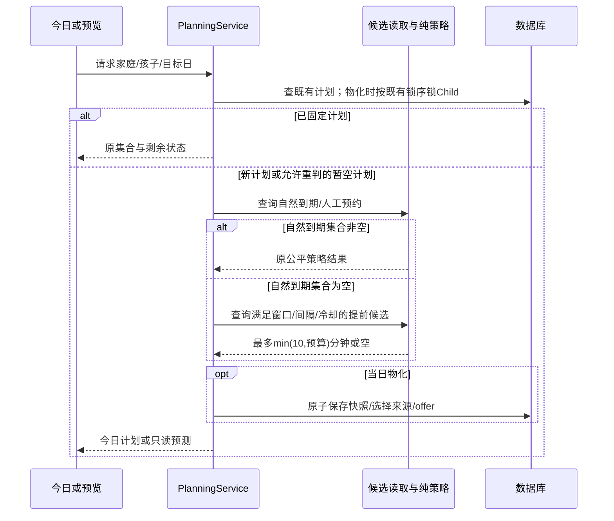
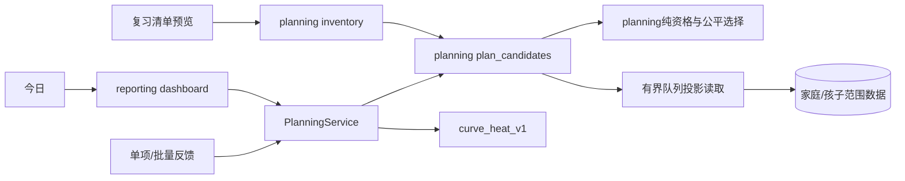
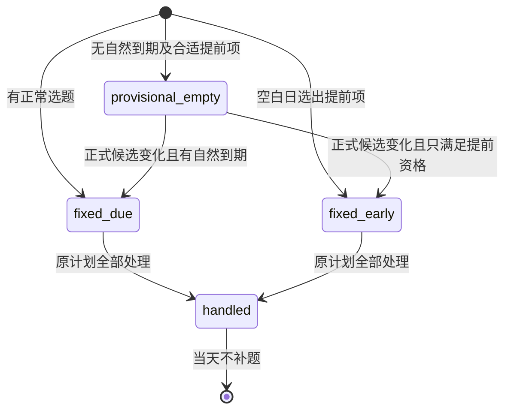
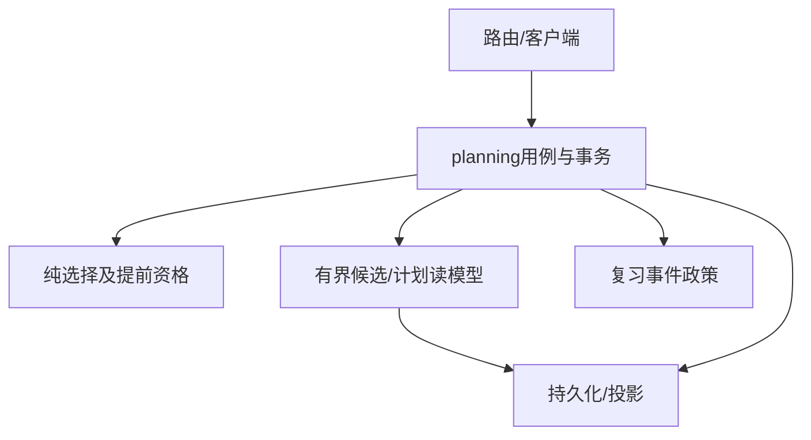

# FEAT-001 — 空白日少量提前复习

- Status: VERIFYING
- Risk: R3（自动选题资格、提前复习反馈、计划快照和日期展示）
- Spec owner: 产品负责人（用户）
- Implementer: Codex；已按批准范围完成本地业务实现
- Reviewer / Verifier: Codex执行本地验证；独立实现评审、内容与真机验收仍待完成
- Verifier: Codex；原生与真机验收由发布负责人完成
- Created: 2026-10-24
- Last updated: 2026-10-24
- Target release: 后续独立[OPS Spec01](OPS-20261024-LATEST-BACKEND-TEST-DEPLOYMENT.md)已批准26714b9服务端部署；0023随0025落生产库、CRUD启动修复另获批准，037 normal/100%且20项真实读取通过；提前复习保持默认关闭，前端未上传。本Spec剩余验收继续VERIFYING。
- Spec revision: SPEC-20261024-EMPTY-DAY-EARLY-REVIEW-04
- Architecture revision: ARCH-20261024-EMPTY-DAY-EARLY-REVIEW-02（APPROVED）
- User confirmation: 产品负责人2026-10-24先以「按照这个方案 落地」批准Spec03及完整需求，再针对两份Spec04、Architecture02/03与首次Design01明确回复「批准，按此实现」；已获本修订实施授权
- Additional R2/R3 approval: APPROVED；产品负责人2026-10-24在明确列出两份Spec04、Architecture02/03和DREV01的审批问题后回复「批准，按此实现」
- Affected Feature IDs: FEAT-001；FEAT-003/005/006/011仅做通知、档案、清理、完成协作兼容核对
- Feature current-state documents: ../../docs/domain/features/FEAT-001-push-kids-mvp.md
- Feature baseline: 当前fair-v2稳定计划与curve_heat_v1；以Feature正文和实际源码为准
- Feature merge owner: Codex；本地已验证事实合并，未通过的发布验收单独保留

## Frontend Design Impact and Repository-native Approval

- Frontend impact: yes — 今日可显示尚未自然到期的条目，需要明确“提前安排”和原计划日期；编辑计划中的原到期与今日安排不能互相矛盾。
- Frontend engineering impact: yes — 今日/内嵌与独立复习清单状态、API兼容、反馈和日期语义。
- Affected UI IDs: UI-001；当前文档 ../../docs/design/frontend/ui/UI-001-parent-miniapp.md。
- Frontend baseline revision: FDB-20260913-04（已批准）；FEC-20261007-NATIVE-GEOMETRY-02（已批准）。
- Affected frontend quality dimensions: state、component、responsive、a11y、compatibility、performance、security/privacy、observability。
- Quality budgets: 继承FEC读取/响应/包体预算，正文至少14px、触控至少44px；不增加图表或框架。
- Approved Design Revision: DREV-20261024-TODAY-LEARNING-01；两份Spec共用，2026-10-24获批，HTML/PNG/SHA冻结
- Editable design source / SHA-256 / snapshot manifest: [本地HTML与逐屏规格](../../docs/design/frontend/prototypes/DREV-20261024-TODAY-LEARNING-01/FRONTEND-SPEC.md)；[SHA清单](../../docs/design/frontend/snapshots/UI-001/DREV-20261024-TODAY-LEARNING-01/APPROVAL.md)。清单状态APPROVED；批准不代表原生验收。
- Required viewport/state exports: 320×568、390×844、430×932；全部26态×3，复习专属review-due/early/empty/handled/inventory/viewer/source/long/error；两个viewer态均无写入口。几何/交互验收仍由P07覆盖。
- Prototype status: APPROVED；用户2026-10-24「批准，按此实现」。
- Approved Task Spec / Architecture / Design: Spec04+Architecture02+DREV-20261024-TODAY-LEARNING-01 APPROVED，2026-10-24用户回复「批准，按此实现」，对应本聊天明确列出全部修订的审批问题。
- Permitted implementation deviations: none。
- UI current-state merge evidence: 已同步UI-001与Feature/Behavior/Architecture；精确检查结果见本轮实现证据。
- Frontend visual/a11y/native/device evidence: PARTIAL；390×844十二态合成原生几何通过，完整矩阵/键盘/读屏/真机待补；不等同78张设计导出。
- External design dependency: none。

## 0. Executive summary

当前自动候选必须due_date≤目标日；没有自然到期内容时直接生成空计划，即使已有部分词条接近原复习日。已存在的初始空计划不重判，因此首次读取之后才正式确认的到期知识也可能不进入当天计划。
用户希望把空白日作为确定性选题的第二阶段：判断已有学习条目是否适合提前安排，少量加入今日计划。
目标是调整所有孩子后续排期策略，不是定向修复某个孩子今天的数据，也不是把每日分钟预算当作必须完成的目标。

推荐：自然到期优先；确实空白时才从接近到期且间隔已充分经过的词条中选取，自动提前部分最多min(10,孩子预算)分钟。
本轮在已批准需求上形成可评审的技术与设计修订，未修改生产代码、Schema、云端计划、学习或反馈事实。独立的“两日无新增→AI单项建议”见[FEAT-004 Spec](FEAT-004-INCREMENTAL-LEARNING-PATH.md)；新学不共享本Spec的复习预算，不以新学待办是否为空决定复习补排。

## 1. Facts, decisions, assumptions, questions

### Confirmed facts

- 现有自然到期候选、手动预约、科目公平、分钟预算和稳定快照由planning确定，AI不负责日期。
- 现有curve_heat_v1可按实际提前复习日计算下一间隔；“被安排”本身不增加复习次数。
- 2026-10-24对一个用户指定档案的只读试算：未来3天11个条目中，6个符合下述候选参数，合计16分钟。仅说明候选池可非空，没有选择或写入10分钟清单，也不代表所有空白日均有合适条目。
- 同次查询仍有1个自然到期项。按本草案实际执行应先处理自然到期，不能据上述未来候选声称当天应触发提前补充。
- 私有原文、姓名、ID、凭据、图片与模型载荷未写入本Spec。

### Decisions and assumptions

- 用户已选：少量安排，自动提前部分最多10分钟且不超过孩子预算；已有自然到期/历史未完优先，今天做完后不继续补；实际学习反馈后才推进下一日期。Q2确认间隔、人工日期与允许为空；Q18已确认具体产品初始参数。
- Q18已确认的产品初始值：最多提前3个自然日、原间隔至少经过80%、距离上次复习和上次被安排均至少2个自然日；尚未实际复习过的首次复习项不提前。这些不是已验证的学习效果结论。
- 推荐仅在自然到期集合为空时启用；非空但较少时不填补至10分钟或每日预算。
- Q17已确认：不修改被提前安排条目的原due_date；Today计划承载提前安排，真实完成后才重新计算下一日期；未做/跳过不增加复习次数。

### Open questions / gates

- Q1–Q20及需求汇总共同理解已由「按照这个方案 落地」确认，包括非空不补足与旧版空计划保守兼容；没有新增产品访谈问题。
- 本修订技术/架构/设计已明确批准；业务已本地实现，剩余验收按第12/17节记录，不重复需求确认。
- 发布范围、启用及兼容版本另按部署手册确定，本轮没有部署授权。

## 2. Current behavior and evidence

入口：reporting.dashboard→PlanningService.daily_review_selection→每日快照；创建时调用selected_candidates。
已有计划直接返回，不因完成而换一批；未来预览走只读候选计算。反馈通过record_review_event更新事件、Review投影和同日计划项。

2026-10-24只读源码核对：计划无持久的原始选中数/ever_nonempty；单知识删除会物理删除计划项与相关反馈/改期并递减当前汇总，因此旧计划的行数/分钟/due_count均为0不可靠证明“从未安排过”。改期通常保留rescheduled行，但知识被删除后证据也消失。兼容迁移不能从当前0值猜测历史初始空状态；不能据此声称全部旧版空计划已可安全重判。

证据：planning/{service,selection,plan_candidates,inventory,policies,queue_state}.py；learning/service.py；
specs/active/FEAT-001-FAIR-DAILY-REVIEW.md、FEAT-001-UNIFIED-ITEM-REVIEW-STRATEGY.md；BHV-006/033/034。

## 3. Target behavior

### 3.1 两阶段选择

1. 根据服务端Asia/Shanghai日期，校验家庭、孩子和既有当日计划。
2. 已固定的正常/提前计划按原集合返回；已经全部完成、延期、改期或删除后的空余不启动第二轮选题。
3. 新计划先查询完整自然到期资格集合和既有人工预约；只要该集合非空，沿用原有策略。预算太小导致装不下一项也不进入提前分支。
4. 自然到期和应执行预约均为0，才查询提前候选；无合适候选时允许一天为空。
5. 提前分支使用现有科目覆盖与公平语义，预算=min(10,max(0,孩子预算))；每项分钟仍按1..5夹取，最多10项，不强求装满。
6. 选定后固定集合并记录offer，不记录反馈；重复读取和完成不继续补充。
7. 新策略创建的、从未产生过计划项的暂空计划可在正式候选发生变化后重判：仍先查自然到期，再查提前候选。必须以显式历史状态区分，不能仅凭当前剩余数或当前行数为0判断。

### 3.2 提前资格

所有条件同时成立：

- 同家庭/孩子、未归档/清理中的档案，启用的learning科目、active Review、normal Knowledge；不选择已替代条目。
- 已经正式确认；review_count≥1且last_reviewed_on存在。不提前拉入今天刚学、尚无第一次复习事实的词条。
- today < 原due_date ≤ today+3。
- gap=原due_date-last_reviewed_on > 0；elapsed=today-last_reviewed_on ≥ 2，且5×elapsed≥4×gap。使用整数比较，避免浮点边界。
- last_offered_on为空或today-last_offered_on≥2；因此不会连续两天反复提前推同一条。
- 无未消费的家长手动预约，且无当天已反馈、延期、改期或已入选记录。
- 日期/计数不完整或矛盾的旧数据不进入提前池，保留正常到期处理路径。

### 3.3 计划、日期与反馈

- 原due_date保留，计划项保存selection_kind=early、original_due_date及选择时Review状态版本；普通项为due。
- 今日展示“提前安排 · 原计划 MM/DD”；未来清单保留原建议日期，并标记已被今日提前安排。
- 提前条目完成/部分/巩固时，复用现有真实反馈与curve_heat_v1，从实际复习日计算下一日期；不额外推进一档。
- 提前项defer/未做：不变更原due_date、不增加次数/最近复习日；原到期日仍自然参加选题。
- Today在完成后维持完成状态；明天不能继续显示旧提前计划，跨日重新按实际状态选题。
- 单项和批量反馈对合法今日提前项均可操作；未来项通过同家庭/孩子、今日pending early计划项、选择快照与当前状态校验，不放开任意未来ID。
- preview只读使用同一政策和参数，不能写计划、offer、Review、Feedback；只预测当前状态，不假定未来完成。
- total_due/backlog/逾期指标继续表达自然到期事实，不把提前数量混入；增加early_count/early_minutes表达计划构成。

### Primary sequence diagram

### Behavior matrix

| 场景 | 结果 |
|---|---|
| 自然到期2项、合计4分钟 | 维持正常选题，不填至10分钟 |
| 自然到期0、合适未来项16分钟、预算30 | 提前部分≤10分钟，不保证恰好10分钟 |
| 同上、孩子预算5 | ≤5分钟 |
| 仅有昨天刚复习或尚未到80%间隔的条目 | 保持空白 |
| 提前项已经完成/延期，刷新 | 原计划终态，不换新题 |
| 从未产生任务的暂空计划，随后有新正式候选 | 受控重判，优先自然到期 |
| 家长指定未来日期、已替代、归档/清理中 | 不自动提前 |
| 并发读取/反馈/删除/手动改期 | 一个一致快照，冲突不重复写反馈 |

## 4. Scope

In scope：全局空白日选择策略、计划来源快照、提前反馈资格、预览与日期透明、候选读取预算和回归。
Out of scope：定向修改现有生产计划、提前凑满30分钟、有到期项时补足、每天保证有题、AI预测、掌握判断、每日任务或课外活动排期。
保持：家长确认才建立正式学习；实际反馈才记录复习；occurred_at/created_at独立；历史补录不制造过去Todo债务；人工预约优先。
FEAT-003提醒的到期负载仍只统计自然到期；本次不为提前项新增通知或冒充逾期。提前complete沿用FEAT-011既有可信本人完成协作，不新增授权方式。
验证后更新FEAT-001、BHV-006/033/034、Architecture/ADR、UI-001、测试证据及发布记录；其余Feature逐项核对，不把待实现策略写成当前事实。

### Link/call graph

## 5. Domain and data design

Owner为planning。新增闭集计划状态语义：provisional_empty→fixed_due/fixed_early→原计划全部处理；terminal后不重开。
未生成候选时provisional_empty可停留，候选变化后受控重判。遗留计划没有新状态时按已固定处理，不猜测历史上是否曾有计划项；当天可能仍显示旧空计划，新机制从启用后带明确历史状态的新计划起保证。该兼容限制在最终共同理解中显式列出，不能宣称修复任意既存旧空快照。

拟增加：计划项选择来源、原到期与Review版本快照；计划是否允许重判的持久状态和读代次。采用既有Child复习清单revision识别正式变化，不用MAX(updated_at)。
候选资格需要数据库侧过滤和tenant-leading索引；复用review_queue_entries owner，不新增全量历史扫描或每条SQL查询。
下面固定本次字段、槽投影及迁移合同；不能把“未来3天”误作数据量上限。
迁移不回填虚假反馈，不重排旧计划；孩子/家庭清理涵盖新增快照/投影。

### 5.1 具体存储合同（Architecture02）

| 表 | 新增/默认 | 语义与迁移 |
|---|---|---|
| daily_review_plans | materialization_state VARCHAR(20) NOT NULL DEFAULT 'legacy_fixed' | 旧行及旧应用新写行均固定；新应用显式写provisional_empty/fixed_due/fixed_early，不复用原state字段 |
| daily_review_plans | evaluated_inventory_revision INTEGER NULL | 暂空计划最近评估的Child.review_inventory_revision；只有今日、版本变化且仍未曾选中时重判；选中后永久固定 |
| daily_review_plan_items | selection_kind VARCHAR(8) NOT NULL DEFAULT 'due' | closed枚举due/early；旧行兼容due |
| daily_review_plan_items | original_due_date DATE NULL；selected_review_version INTEGER NULL | early必须都有值，due的新行也保存选择快照；不改变Review原due_date |
| review_early_slots | review_item_id VARCHAR(36)、slot_on DATE复合主键；family_id VARCHAR(80)、child_id/subject_id VARCHAR(36)、minutes INTEGER、priority_key VARCHAR(66)均NOT NULL | planning拥有的可重建投影；每Review最多3行，不是历史或新的排期事实；Review删除CASCADE |

槽生成：对due_date−3/−2/−1逐一验证3.2全部静态条件；自动queue_eligible_on等于due_date时作为旧队列锚点兼容；其他queue_eligible_on及孩子/科目恢复日期仍为槽日期下限，且last_offered_on冷却满足。无历史、异常日期、任何未消费预约、已替代、inactive等生成0槽。日期运算分别使用SQLite日期函数和MySQL5.7 DATE_ADD/DATEDIFF，不用CTE/窗口/函数索引。纯Python资格与SQL投影以相同边界样本做合同对照，防止两套政策漂移。

固定索引：ix_early_slots_pool(family_id,child_id,slot_on,minutes,priority_key)；ix_early_slots_subject(family_id,child_id,slot_on,subject_id,minutes,priority_key)；ix_early_slots_first(family_id,child_id,slot_on,subject_id,priority_key)。slot_on等值，不扫描全量未来Review再Python过滤。先取最多120个科目锚点，再每科/分钟top1和五种分钟全局池；SQL语句数不随科目数或返回项数增长，物化候选≤1268，最终early≤10项。科目最近offer复用既有queue索引；覆盖与预算沿用纯公平政策。

新增冻结存储合同persistence/early_review_slots_v1.py和迁移20261024_0023_early_review_slots（down_revision=20261020_0022）。按Review/Knowledge/Subject/Child/Override的新增、变更、删除在事务内同步相关槽；MySQL同表多触发器与现有rq_v2兼容。禁止修改已发布review_queue_v2.py。全量回填在迁移中按ID每批1000处理，在线读不repair；schema启动检查增加新表/字段/索引/触发器。冻结前重新校验Alembic单head，若其他任务先占迁移序号则明确重排引用，不覆盖其迁移。

### 5.2 暂空重判与并发

锁序沿用现有家庭生命周期锁（如调用方已持有）→Child→Plan→Review/PlanItem；等待后重新读取最新版本。新计划/暂空重判在同一事务中查自然到期完整聚合、预约及有界选题，再固定集合与offer。自然到期非空但预算装不下时保存fixed_due，不进入early，也不因刷新换题。纯空时保存provisional_empty及新版本，只有正式候选revision变化才再评估；空计划写入本身不递增候选revision，避免反复自触发。跨日另建计划。

完成/延期/删除均不能把fixed状态改回provisional_empty。early反馈须同时满足今日pending计划项、同scope、original_due快照与Review.state_version仍一致；人工改期或其他真实反馈已变更时409并刷新。反馈提交后只应用一次现有curve_heat_v1；原due已被提前的事实保留在计划项。

## 6. Interfaces and errors

沿用dashboard、review-inventory和反馈路由；加法响应字段selection_kind、original_due_date、early_count/early_minutes。
日计划policy_revision使用独立新值，不能以fair-v2冒充新资格语义。未知值客户端安全降级，不伪报到期。
自然到期统计与提前计划统计分开；合法提前项的批量/单项反馈一致；无资格/状态已变化409，范围外404，只读403。
### 6.1 加法DTO与兼容

既有dashboard、Todo/preview、inventory每个受影响条目增加selection_kind（due/early）、original_due_date（ISO日期或null）；计划摘要增加early_count/early_minutes，均统计当前仍存活的计划行，含当日已反馈行。既有total_due/backlog保持自然到期口径，planned_count仍为当日计划行数；不能用当前数量反推是否可重判。policy_revision新值empty-day-v1；legacy_fixed及旧政策保持原返回语义。

不增加反馈命令或放宽未来ID。客户端继续发送既有state_version/反馈幂等键；服务端在planning用例内判断今日合法early。未知selection_kind客户端按中性“今日安排”显示且不声称自然到期，不擅自展示不受支持的写按钮。preview可针对明确目标日读取槽但只读，不模拟将来实际反馈。

发布兼容采取“先Schema→全部后端升级且确认旧实例退出→新客户端具备early展示/反馈→启用empty_day_early_review_enabled”。开关默认false；先由服务端已识别新客户端的协议能力确认小范围启用。旧客户端响应不能无标识接收未来early项：启用前须确认最低可用客户端版本已切换，不能仅靠后端加法字段推定旧版安全。回滚先关生成，保留已生成early计划的新版读取/反馈，禁止退回不能处理它的后端。

## 7. Authorization, security, and privacy

所有读取/反馈均家庭和孩子双边界；目标日由服务器确定，viewer无显式写入入口。
首次物化沿用现有读触发服务端计划的权限合同，不允许客户端传入候选ID或提前窗口。
只读试算不保存用户原文；运行指标只记录聚合计数、来源、拒绝类别与耗时，不记录儿童身份或知识正文。

## 8. Architecture and implementation boundaries

纯资格/参数属于planning闭集政策；SQL候选与有界索引读取属于plan_candidates；服务持有事务与快照；router校验传输。
反馈复用policies.py，不更改基础曲线/热度公式。learning通过planning公开服务告知候选变化；不直接写计划表。
复用既有公平选择语义，不能因统一接口加入泛用common/utils。没有新的open扩展点；任意窗口、AI排期、家长自定义提前参数deferred。

依赖DAG保持router→service→纯策略/持久化；learning/reporting消费planning，planning不反向导入这些域。
替代方案：只修初始空计划不能覆盖真正没有到期内容的日子；每次刷新全量重排破坏稳定性；任意提前凑满预算会忽略原间隔；本方案允许空白、少量提前并保留原到期事实，代价是新增资格索引与日期来源状态。
Architecture02已于2026-10-24获「批准，按此实现」批准。due事实与提前计划分离及槽投影已落地并合入现行Architecture/ADR，不另造排期owner。

## 9. Expected file changes, replacement, and deletion plan

| 位置 | 预期变化 |
|---|---|
| planning/{selection,plan_candidates,service,inventory,queue_state}.py | 提前资格、两阶段选题、幂等快照、预览、反馈 |
| planning新增窄职责纯政策文件（如有） | early_review.py纯资格、early_candidates.py有界探针、early_projection.py漂移诊断/修复；架构已批准 |
| persistence/models.py、队列投影及迁移 | 快照来源、显式空计划状态、必要索引/同步规则 |
| persistence/early_review_slots_v1.py、20261024_0023迁移 | 每Review最多3个确定性槽、增量触发器和tenant/day索引；不改冻结queue v2 |
| learning/service.py、reporting/service.py | 候选变化通知、真实到期与提前计划统计分离 |
| miniprogram今日/复习清单及组件 | 提前标识、原日期、兼容、反馈；具体文件以设计审查为准 |
| tests/unit、integration、contract、frontend、performance | 资格边界、数据库/并发、API/UI、规模预算 |
| Feature、Behavior、Architecture/ADR、UI、quality、deploy | 仅合并实现后已验证事实 |

保留原政策处理历史固定计划；新政策只用于启用后创建的新计划。旧快照和事件不删，临时并存边界及移除条件在发布修订中确定。

## 10. Non-functional requirements

O(1)页查询次数；候选读取有硬上限、tenant-leading索引与SQL过滤，科目不能被全局截断隐去。
按现有FEC/测试策略执行SQLite及真实MySQL5.7规模/EXPLAIN，覆盖1万/5万词条和大量不合资格条目，维持500ms读取预算及既有响应/内存预算；未通过不能发布。
锁序沿用Child→Review/Plan；日期/快照/事件提交原子，事务失败无部分计划和虚假反馈。

## 11. Acceptance criteria

- AC-01：自然到期优先；自然到期非空但装不下时不提前；非空低负载日不补足。
- AC-02：空白日只选满足3日/80%/2日冷却等全部资格的条目，自动提前≤min(10,孩子预算)分钟；可保持为空。
- AC-03：提前安排不改due/count/last；只写计划与offer。真实反馈后按实际日推进一次，defer保留原due。
- AC-04：重复/并发/跨日稳定；当前剩余0不等同初始空；旧计划不被重排。
- AC-05：预览无写；自然到期统计不冒充提前数量；前端明确原日期，单项/批量反馈一致。
- AC-06：隔离、永久替代、人工预约、归档/清理、通知/完成协作、规模预算与原复习行为无回归。

## 12. Verification plan

| TP | Current result / remaining gate |
|---|---|
| P01 | 80%/冷却/无历史/未来窗口纯政策及SQL槽对照已测试，预约和更新失效已测试 |
| P02 | 9分钟保守预算、到期装不下仍不提前、130条单科不遮蔽另一科机会及10k/50k索引探针通过；全反选择分钟矩阵待补 |
| P03 | SQLite暂空代次重判/选过即固定/延期不补/保守迁移与修复已测试；MySQL5.7并发门禁NOT_RUN |
| P04 | 真正提前complete、defer原日期、非法未来ID和版本冲突已测试；既有反馈/批量回归随全量运行 |
| P05 | 两日提前预览无写且不重复、提前来源DTO已测试；完整目录/预览状态矩阵待补 |
| P06 | family/child边界及旧通知/清理/预约回归随全量运行；真实权限/设备验收待补 |
| P07 | 未知selection拒绝写入口与只读测试、设计SHA及原生建议/待学检查已执行；复习三视口/真机反馈矩阵待补 |
| P08 | SQLite10k/50k固定3条early读取、实际索引及响应预算通过；真实MySQL5.7和全内存/反选择矩阵NOT_RUN |
| P09 | 实际仓库检查和最终数字见证据；其他并发任务的结果不得充作本轮结果 |

命令、通过/失败/未执行范围见[实现证据](../../docs/quality/evidence/TODAY-LEARNING-IMPLEMENTATION-20261024.md)。旧计划删除后聚合为0仍按legacy_fixed，不猜测历史。

## 13. Rollout, migration, rollback

本轮不部署、不迁移生产、不修生产数据。本地0023/0024迁移已验证；具体DDL、默认关闭开关、客户端能力门禁及回滚已固定于本地发布记录，未来发布仍须按docs/deploy/README.md另获授权并补齐验收。
新旧版本不能对新policy_revision产生互不兼容的解释；先验证客户端识别和反馈，再启用新计划生成。不能静默修改其他任务冻结包。
回滚须保留已发生真实反馈和计划来源，不通过改回原due来抹去真实复习；停新提前生成与旧计划可读/反馈的组合能力必须实测。

## 14. Implementation plan

1. 需求汇总已批准；本修订固定字段/索引/API与DREV01，取得Spec04/Architecture02/Design01批准后实施。
2. 获具体修订批准后，先以合成数据复现目标边界，再实现纯策略和有界候选。
3. 完成事务/反馈/预览与前端映射，执行P01–P09并记录真实结果。
4. 合并已验证当前文档，按实际授权单独处理部署；完成门禁通过才DONE并迁至completed。

## 15. Review plan

先核对原到期与提前安排的语义、候选阈值、反馈一致性和兼容/回滚，再检查SQL规模与DAG；实现后按证据核查，不以本草案代替测试。
是否使用独立实现评审者等待实施安排；grilling期间已按技能要求委托只读源码事实发现，核对旧空计划和删除证据，不是独立实现评审，也未访问生产或修改文件。

## 16. Implementation and verification record

- 当前：Spec04/Architecture/Design已批准，本地实现完成，验证状态VERIFYING。先前01–04准备阶段的只读/NOT_RUN记录仅代表当时，不能替代[本轮实现证据](../../docs/quality/evidence/TODAY-LEARNING-IMPLEMENTATION-20261024.md)。当前Feature/Behavior/Architecture/UI/测试和发布文档已按实际diff核对并同步；生产和真机状态未提升。

- Changed behavior / deleted behavior: none；01新建策略，02合并Q1/Q2/Q17与旧计划兼容事实，03记录Q18参数已确认并等待最终需求汇总确认。
- Files changed: 本文件、FEAT-004-INCREMENTAL-LEARNING-PATH.md与../README.md；仅本聊天需求草案/索引，保留其他任务内容。
- Evidence: 2026-10-24此前只读候选试算，以及本轮只读源码核对DailyReviewPlan/单知识删除/改期/反馈持久状态；未保存私有内容或原始数据库输出。
- Review: 19个编号章节、图示围栏、DRAFT状态、索引唯一入口/目标和当前文档引用存在性检查PASS；索引diff空白检查PASS。核对现有due-only/不补题正文：本稿明确为待实现提议，未把新策略冒充当前能力，当前正文无本轮新增冲突。实现评审及P01–P09均NOT_RUN。
- 本轮02文档检查PASS：两稿0–18章节、围栏、相对链接、唯一索引、问答覆盖、否决设计残留、尾部空白与敏感文字；AGENTS非预测正文及原FEAT-004 REJECTED保留；`git diff --check -- specs/README.md`退出0。仅证明文档结构，不是业务或合规验收。
- 本轮03文档检查PASS：2026-10-24执行两稿0–18章节、围栏、相对链接、03/DRAFT、索引唯一入口、Q1–Q20覆盖、部分/换项状态、尾部空白与敏感文字检查；现行AGENTS非预测边界及原REJECTED保留；`git diff --check -- specs/README.md specs/active/FEAT-001-EMPTY-DAY-EARLY-REVIEW.md specs/active/FEAT-004-INCREMENTAL-LEARNING-PATH.md`退出0。仅为文档检查，业务、内容与原生验证仍NOT_RUN。
- Deviations: N/A（全文未批准）；10分钟、今日完成不补、实际反馈才改日期及Q18参数已按回答记录；旧计划兼容边界在最终需求汇总显式呈现。
- 2026-10-24批准记录：产品负责人回复「按照这个方案 落地」，上下文明确为两份Spec03及最终需求汇总；03为APPROVED需求基线。本文件现进入技术/设计修订04的READY_FOR_REVIEW，不把原需求重复列为待确认。
- 04增加5.1/5.2/6.1具体合同及共享DREV01候选；本轮设计导出/校验结果见[设计规格](../../docs/design/frontend/prototypes/DREV-20261024-TODAY-LEARNING-01/FRONTEND-SPEC.md)。生产实现和P01–P09仍NOT_RUN。
- 04准备验证PASS：78份合成HTML导出/尺寸审计、8条原型点击与Tab焦点循环；candidate manifest运行`validate_design_evidence.py --allow-pending --check-current-policy`返回DESIGN_EVIDENCE_VALID；Spec章节/链接/索引/批准追溯/状态与JS/Python语法通过；设计导出脚本Ruff check与format-check通过；限定路径git diff --check退出0。`tools/check_architecture.py`当前仓库返回ARCHITECTURE_VALID policies=4 modules=130，仅验证现有图，不证明尚未实现的新模块。Feature/Behavior/Architecture/UI/测试及发布正文核对：本轮仅提案/设计工具，没有运行能力变更，不把提案写成CURRENT，既有运行事实无需替换。
- Residual: 仅本次新增Spec04/Architecture02/Design01批准及其后实现/验证/发布门禁未完成；没有生产代码/数据操作。

## 17. Completion gate

- [x] 识别FEAT-001和现有due-only/稳定快照合同。
- [x] 记录用户的全局策略方向与10分钟偏好，没有冒充完整批准。
- [x] Q18的提前窗口、间隔比例、冷却与首次复习边界已确认。
- [x] 最终需求汇总共同理解及Spec03获「按照这个方案 落地」确认（包括非空不补足与旧计划兼容）。
- [x] 调用图、时序、状态机、架构、替代方案、文件影响和必需测试点已列出。
- [x] DDL/索引和API合同、可批准的设计源及SHA/78份视口候选齐备；不代表原生或数据库验收。
- [x] Spec04/Architecture02/Design01获「批准，按此实现」。
- [ ] 按批准范围实现、必需验收和回归通过。
- [x] 当前文档同步本地事实和回滚方案；未执行的部署/验收明确保留。
- [ ] 无阻断评审项；完成门禁后改DONE并迁移、修复索引/引用。

Final status: VERIFYING；保留specs/active/。本地代码已实现，真实MySQL5.7、独立Review、完整原生/真机与内容/适用条件验收未齐，不满足DONE门禁；补齐第12节证据后再评估迁入completed。

## 18. Revision history

| Date | Change | Reason | Approved by |
|---|---|---|---|
| 2026-10-24 | 初始策略草案01 | 用户要求全局空白日自动判断提前条目，并选择最多10分钟 | 仅方向/容量偏好已确认；完整修订未批准 |
| 2026-10-24 | SPEC-20261024-EMPTY-DAY-EARLY-REVIEW-02 | 合并grilling确认与旧空计划证据缺失，记录新学独立预算及待定参数 | 产品回答已记录；完整修订/架构/设计未批准 |
| 2026-10-24 | SPEC-20261024-EMPTY-DAY-EARLY-REVIEW-03 | Q18确认3日/80%/2日与首次复习不提前；收束为最终需求汇总确认 | 产品参数已确认；共同理解/完整修订/架构/设计未批准 |
| 2026-10-24 | 03批准记录 | 用户在最终汇总后明确要求「按照这个方案 落地」 | 产品负责人；Spec03及共同理解APPROVED，未追认尚未存在的设计 |
| 2026-10-24 | SPEC-20261024-EMPTY-DAY-EARLY-REVIEW-04 / Architecture02 | 固定3槽索引投影、暂空状态、DTO及混合版本启用；共享可编辑Design01 | 产品负责人2026-10-24「批准，按此实现」 |
