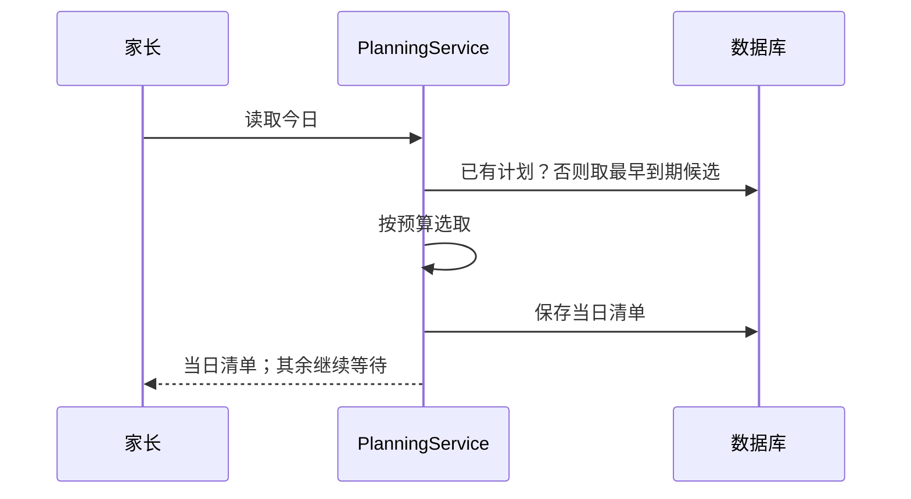
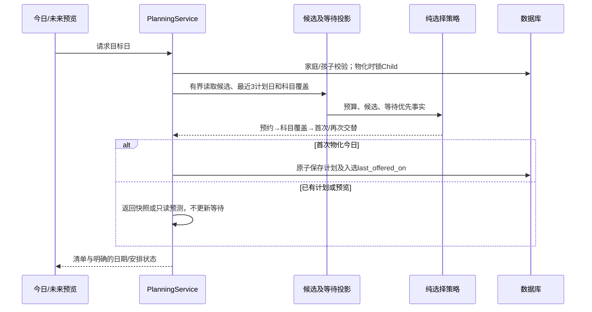
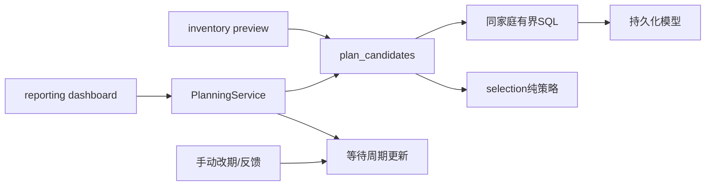
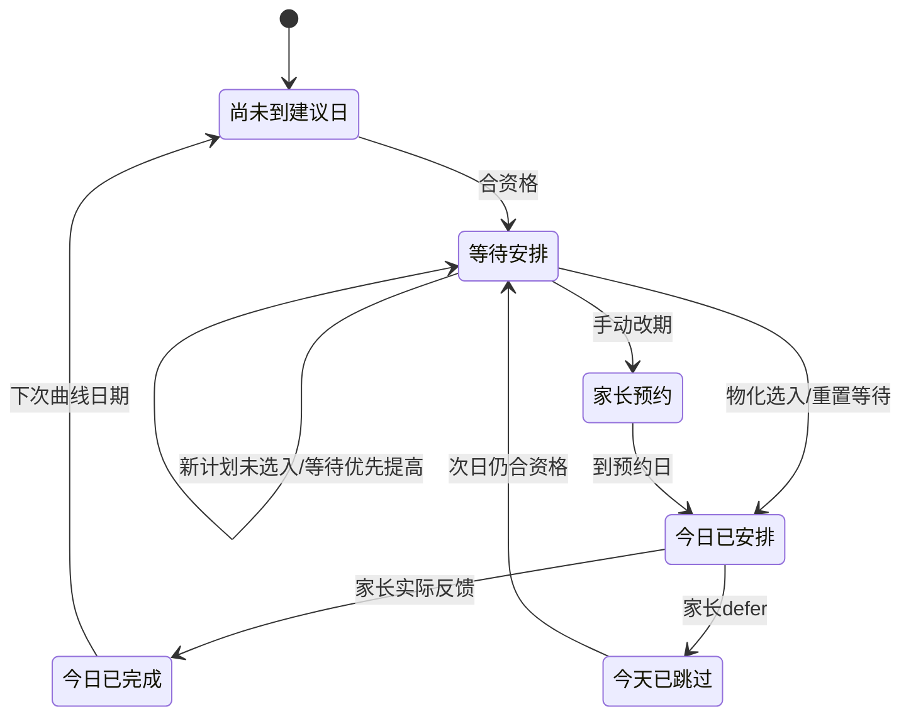
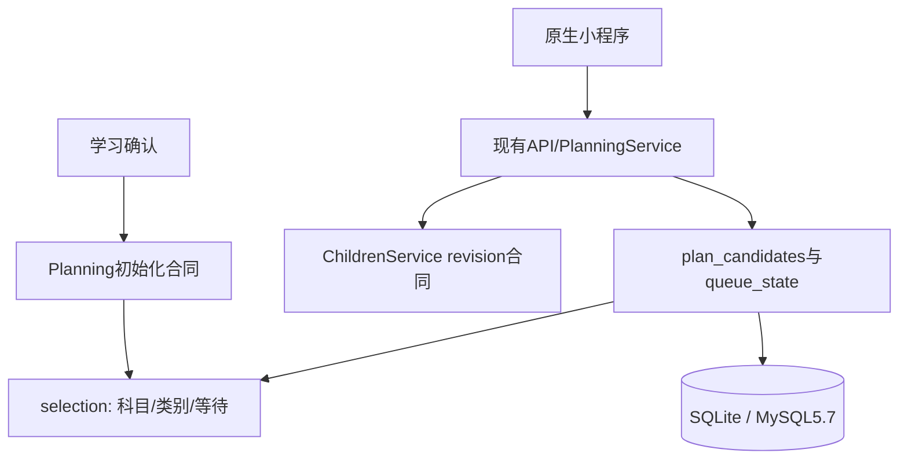

# FEAT-001 — 每日复习科目覆盖与等待优先

- Status: BLOCKED
- Risk: R3（排期行为、数据库投影、前端说明；不改变记忆曲线）
- Spec owner: 产品负责人（用户）
- Implementer: Codex
- Reviewer: 实现完成后的独立只读审查者
- Verifier: Codex；原生设备验收由发布负责人完成
- Created: 2026-10-07
- Last updated: 2026-10-07
- Target release: 用户2026-10-07授权测试后提交并部署服务端；生产迁移备份和全量切流仍遵循人工门禁
- Spec revision: SPEC-20261007-FAIR-REVIEW-01
- User confirmation: 产品负责人（用户），2026-10-07，本会话“生成代码，然后测试后提交部署服务端”；唯一待实施方案为本Spec与用户删减说明后的DREV，确认本修订实施
- Additional R2/R3 approval: 同一用户指令批准ARCH-20261007-FAIR-REVIEW-01；不免除数据库备份与全量人工门禁
- Affected Feature IDs: FEAT-001；FEAT-005/006只涉及既有归档/清理回归，无新增产品能力
- Feature current-state documents: docs/domain/features/FEAT-001-push-kids-mvp.md
- Feature baseline revision: FEAT-STATE-20261006-REVIEW-MANAGEMENT-03-LOCAL
- Source baseline: 8214557bf5431dae5b7d385d84c01a88b8c9d1ad；初始工作区只有未跟踪output/，保持不动
- Feature merge owner: Codex

## Frontend Design Impact and Repository-native Approval

- Frontend impact: yes — 今日计划说明、复习条目的日期与安排状态文字
- Frontend engineering impact: yes — 服务端状态投影、空值/旧版本降级和长中文换行
- Affected UI IDs: UI-001
- UI current-state documents: docs/design/frontend/ui/UI-001-parent-miniapp.md
- Frontend baseline revision: FDB-20260913-04（已批准）
- Frontend engineering constraint revision: FEC-20260913-LOCAL-DESIGN-EVIDENCE-01（已批准）
- Affected frontend quality dimensions: state、responsive、a11y、日期语义、性能、隐私、兼容、observability
- Frontend quality budgets/requirements: 三竖屏320×568/390×844/430×932；正文≥14px；触控≥44px；FEC-PERF-READ-001..004；主包≤1.5MiB
- Frontend quality verification plan: 状态映射/迟到响应测试、npm test、lint、设计源/hash、原生三视口几何、iOS/Android阅读和反馈回归
- Approved frontend engineering deviations: none
- Current Design Revision(s): DREV-20261006-SOURCE-DELETE-01；DREV-20261006-REVIEW-MANAGEMENT-03
- Proposed Design Revision: DREV-20261007-FAIR-REVIEW-01
- Editable design source path(s): docs/design/frontend/prototypes/DREV-20261007-FAIR-REVIEW-01/index.html
- Design source SHA-256: 以同修订快照manifest为准
- Required viewport/state exports: FRONTEND-SPEC.md列出的全部增量状态×三个竖屏
- Prototype status: APPROVED
- Approved Task Spec revision: SPEC-20261007-FAIR-REVIEW-01
- Approved Design Revision: DREV-20261007-FAIR-REVIEW-01
- Design approval evidence: 产品负责人（用户），2026-10-07，“生成代码，然后测试后提交部署服务端”，对应删除两段说明后的唯一候选稿
- Snapshot manifest path: docs/design/frontend/snapshots/UI-001/DREV-20261007-FAIR-REVIEW-01/APPROVAL.md
- Permitted implementation deviations: none
- UI current-state merge owner: Codex
- UI current-state merge evidence: 实现验证后写入；不得把候选设计写成已上线
- Frontend visual/a11y/resolution verification: 设计导出与实现后的原生验收分开记录
- Frontend engineering verification evidence: 实现后记录
- External design dependency: none

## 0. Executive summary

当前每日计划按到期日选取，单科积压可能耗尽预算；部分已有到期内容的科目缺席，从未复习的内容等待多次安排。
目标是在家长预算内优先保证科目机会，再兼顾首次/再次复习，并优先照顾连续未被选入的条目。
30分钟是当前样本孩子的设置，不是写死的新全局值。等待优先提高获得机会的概率，不承诺超容量时全部按时完成。

## 1. Facts, decisions, assumptions, questions

| 类型 | 内容 | 依据/处理 |
|---|---|---|
| fact | 只读诊断发现某日44项到期，30分钟选入10项且无数学；当时数学有4项到期 | 本会话2026-10-07生产只读查询；仓库只保留聚合，不保存孩子姓名/ID/原文 |
| fact | 当前选择规则为due_date、last_reviewed_on、id；自动候选仅最早120项 | selection.py、plan_candidates.py |
| fact | 本地已有手动预约优先、120项上限及超预算提示 | SPEC-20261006-REVIEW-MANAGEMENT-03；本次必须兼容 |
| decision | 科目覆盖→剩余预算中的首次/再次交替；等待优先用于各阶段内部 | 用户2026-10-07批准实施 |
| decision | 连续错过3个实际计划日进入优先层；刷新/预览不计数 | 阈值3是产品初始值，不宣称科学定论 |
| decision | 这次实现公平排期和日期/等待说明；主动加练为后续独立增强 | 前轮表述为可选入口；本轮已异步询问，未答时采用此推荐范围 |
| assumption | 新策略只影响切换后新生成的计划，已有今日清单保持稳定 | 防止家长看到进行中清单突然变化；迁移/重复读取测试 |
| fact | 本Spec、架构及删减说明后的DREV已获实施批准 | 本会话“生成代码，然后测试后提交部署服务端” |

## 2. Current behavior and evidence

每日第一次读取物化DailyReviewPlan；选择时按到期顺序装入分钟预算。学习反馈更新曲线与次数，
没有入选的条目保留due_date。当天刷新/完成不补题。未来预览只读，明天/后天共用候选选择。
家长预约优先并允许显式超预算。当前候选截断发生在科目覆盖前，单改内存排序无法解决规模下科目缺席。

证据：planning/{selection,plan_candidates,inventory,scheduling,service}.py；BHV-033；
docs/architecture/decisions/ADR-REVIEW-EVENT-PROJECTION-AND-DAILY-PLAN.md；
tests/integration/test_review_inventory.py、tests/unit/test_parent_schedule.py。

## 3. Target behavior

### 3.1 确定性选择规则（daily-plan-fair-v2）

1. 资格不变：同家庭/孩子，活动中的learning科目与Review，due_date≤目标日；未确认草稿/活动不参加。
2. 手动预约先放入，计入相应科目覆盖和已用预算。保留既有预约超预算例外与提示；自动项不得使总时长进一步超过预算。
3. **科目覆盖轮**：有合资格自动候选且尚未被覆盖的科目各争取1项。科目顺序为最近获安排日期最早（从未优先）、
   科目内最大等待等级、最早有效等待起点、subject_id。不固定偏向语文/数学/英语，适用于家长自建learning科目。
   若每科至少一项的最小分钟之和可装入剩余预算，给尚未轮到的科目预留该最小分钟，当前科目选可在余量内放入的最高优先项。
   若无法全部覆盖，按上述顺序逐科选择可放入项；未覆盖科目保持其较早的最近安排日期，后续计划优先，不按科目名称抢占。
4. **剩余预算轮**：划分review_count=0与review_count>0两个池。先选择当前已入选自动项数量较少的一类；同量时先首次复习。
   此后每次重新比较两类已选数量，相当于补齐后交替；一类无可放入项时允许另一类使用余量。不强求50%分钟。
5. **类内/科目内条目优先级**：连续落选≥3个实际计划日优先；其后按饱和落选计数降序、有效等待起点升序、
   due_date升序、last_reviewed_on（null优先）、review_id升序。只选择不超剩余分钟的项；分钟继续夹在1..5。
6. 不得重复选同一个Review；所有阶段合计≤120项。耗尽预算/容量或无可放入项即停止。
7. 原则优先级为家长预约→科目覆盖→首次/再次机会→各池内等待优先。不承诺优先等待层能挤掉全部其他科目。
8. 任意顺序传入同一快照得到相同结果；同日重读不得重新分配。未来预览与物化共享同一纯选择器。

### 3.2 连续落选的精确定义

以Asia/Shanghai自然日计。落选是“该日确实生成过新策略计划，当时条目已进入当前等待周期，但未被安排”。
单纯过了日历一天、同日刷新、只读未来预览、旧策略计划均不冒充一次落选。

- Review增加`queue_eligible_on`与`last_offered_on`两个可空日期投影。新确认的eligible=max(建议复习日,确认当地日)。
- 每次新计划只更新最多120个入选Review的last_offered_on；不逐条写所有落选记录。
- 当前等待起点=max(queue_eligible_on,due_date,last_offered_on+1天)。取目标日前最近3个fair-v2实际计划日，
  计算其中≥等待起点的个数，作为0..3饱和计数。3代表“至少连续落选3个实际计划日”，不是精确终身次数。
- 当天计划生成后，落选项读投影可把当天包含在最近3日中；决定当天选择时只看之前计划，避免循环自证。
- 实际反馈后，queue_eligible_on=max(反馈后due_date,反馈提交当地日)；只更新队列投影，保留现有曲线规则。
  历史补录不倒填队列等待。被安排但家长未反馈的项已经获得机会，下一天重新开始等待；不声称已经复习。
- 家长defer只跳过当天；queue_eligible_on至少为次日；不增加review_count，不把当天算作系统落选。
- 手动改期重置当前等待起点到预约日；未来预约到日之前不参加自动队列，不因旧逾期提高优先。
- 科目停用/孩子归档或清理时停止资格；重新启用重置为启用日与due_date较晚者，不把停用期算等待。
- 旧数据迁移queue_eligible_on=max(迁移生效当地日,due_date)，last_offered_on=NULL。不伪造历史落选次数。
- 明天/后天预览只在内存模拟前一日候选和等待状态，并保持既有“前一日已选不重复”的预览约定；标记预测而非保证。

### 3.3 状态与文案

- 今日只显示安排项数、预计时长和清单；按用户2026-10-07截图反馈移除排期策略说明、等待总数及对应分隔线。
- 完成态保留“今天的复习已经完成”，不附加“不会自动补入”或未选入数量说明；后台稳定清单规则不变。
- 不为已删除的等待总数展示新增API字段或数据库列；现有backlog统计合同保留兼容。
- 条目自动日期标签为“建议复习日”，另显示“今日已安排／今日已完成／今天已跳过／等待安排／尚未到建议日”。
- 今天没有物化计划时，合资格项显示“等待生成今日安排”，不得在只读inventory中物化计划。
- 预约项用“家长安排日期”，不把被覆盖的due_date冒称原曲线建议日。
- 未来时间视图为“预计安排”，保留“实际安排会随复习进度更新”，不展示保证性承诺。
- 旧API缺少新字段时仅显示“计划日期”，不猜测等待、安排或完成状态；未知次数继续“待核实”。
- “等待安排”说明到达建议日，不代表过期、欠账或没掌握；使用中性文字，不增加红色告警。

| 场景 | 预期 | 禁止 |
|---|---|---|
| 三科到期、预算足以各选一项 | 三科都有机会，剩余按规则分配 | 某科被120项截断隐藏 |
| 预算不足覆盖所有科目 | 最近没获得安排的科目先获得机会 | 虚报全科覆盖、超预算 |
| 首次与再次都有可放入项 | 两类均有机会，等待优先在各自池内生效 | 只选一类直到预算耗尽 |
| 等待达到3次 | 相同池内优先于未达3次候选 | 承诺一定第4天完成 |
| 重复/并发读取 | 一个计划、一次last_offered更新 | 同日刷新增等待或重排 |
| 删除/反馈/改期并发 | Child→Review同锁序，当前读，全部回滚或完整提交 | 已删除项重新入选、游标读到混合版本 |
| 只读viewer | 按现有权限读取；无显式写操作按钮 | 提供修改计划权限 |

## 4. Scope

In scope：三项公平策略、等待投影与迁移、共享预览/实际排期、两处界面说明、兼容/安全/规模测试、离线回放。
Out of scope：主动加练入口、自动增加预算、AI排期、掌握度、修改曲线间隔、生产数据修复、自动全量切流。
服务端部署已由2026-10-07后续指令授权，仍受性能、迁移兼容、备份及发布手册门禁约束。
不变量：只有家长实际反馈累计复习；occurred_at/created_at不改；活动不参加；不自动补题；生产家庭身份边界不变。
当前Feature的daily-plan-v1选择说明、BHV相关条款和UI日期文案在验证后更新；原预约合同保留并写明优先关系。

## 5. Domain and data design

| 实体 | Owner | 变化/不变量 |
|---|---|---|
| ReviewItem | planning | queue_eligible_on、last_offered_on；不替代review_count/last_reviewed_on |
| Child / Subject | children | 内部review_queue_resumed_on记录恢复/启用日；候选读取消费该事实，不引入children到planning反向依赖 |
| DailyReviewPlan | planning | policy_revision=daily-plan-fair-v2；保存生成时eligible_subject_count、covered_subject_count两个整数；不新增无消费者的等待总数字段或科目ID清单 |
| DailyReviewPlanItem | planning | 复用既有状态；选入≠完成 |

新增additive migration（预计20261007_0017；实施时核对head后确定），SQLite与MySQL5.7兼容。
新增复习范围/等待排序索引必须family、child领先；科目关联索引按实际EXPLAIN确认；不添加无消费者宽索引。
清理删除随Review/Plan已有生命周期，无新孤立事件表。下线旧后端期间停止积累fair-v2等待；重新启用必须重置
队列生效日，避免把旧后端未维护的last_offered值作为真实等待。回滚优先保留additive列，禁止直接删新数据列。

## 6. Interfaces and errors

不新增写API。保留既有due_date与排序/分页合同，只增加服务端投影：

| 接口 | 新字段/语义 |
|---|---|
| dashboard.review_selection | selection_policy、coverage_limited（boolean）；不新增waiting_count_at_creation |
| inventory.items[] | suggested_review_on（自动有效日期或null）、scheduled_on（预约日期或null）、arrangement_state（枚举）、missed_plan_days（0..3；3表示至少3次） |
| inventory | 日期仍以上海as_of_day为准；页长20/max50，revision游标仍强制校验 |

arrangement_state优先顺序：当前日计划complete/partial/reinforce→reviewed_today，deferred→deferred_today，
pending→scheduled_today；有效未来预约→reserved；自动due>today→not_due；合资格且今日已有计划→waiting；
合资格但没有今日计划→awaiting_daily_plan；无Review或停用→unavailable。旧日反馈不能伪造今日已完成。
新字段null与缺失：null是明确不适用；缺失表示旧后端。empty列表表示无条目，不掩盖网络错误。
计划/反馈/改期导致新投影变化时通过ChildrenService提高inventory revision，避免跨页快照混用。
错误沿用400参数、403角色、404家庭资源、409状态/游标冲突；失败不留下半个计划或等待投影。

## 7. Authorization, security, and privacy

所有查询（包括候选子查询/科目聚合/等待日期）都限定可信family_id与child_id。
继续微信入口身份与既有viewer/归档/删除保护。客户端不能提交等待次数、排序或policy版本。
日志只有策略版本、耗时、候选/选入/未覆盖数量和静态错误码；不记录姓名、ID、知识原文、照片、凭据。
回放从只读事务读取获授权家庭，内存去标识；落盘仅聚合指标和人工合成样例。

## 8. Architecture and implementation boundaries

- Architecture revision: ARCH-20261007-FAIR-REVIEW-01（随本Spec获批准）
- Owner: planning；selection保持纯Python，无SQLAlchemy/FastAPI/Provider依赖。
- plan_candidates负责SQL有界候选和日期事实；新增queue_state.py仅拥有等待周期投影，不做通用队列框架。
- PlanningService保持事务边界；children服务仍拥有revision更新；归档/启用通过既有服务合同调用，不跨域直接写表。
- 学习确认通过planning的初始化合同设置等待周期；不在learning复制排期策略。
- 更新既有ADR，记录旧规则被替换的范围；不新建平行v2服务与重复router。

候选读取不能先全局取120再做公平。固定数量SQL分别获取：最多120条手动预约；最多120个科目
各1..5分钟桶的最高优先候选（≤600条，最小分钟也可由桶导出）；首次池与再次池分别按1..5分钟桶
取前floor(120/分钟)项（每类≤120+60+40+30+24=274条），保证预算余量所需的短项不会被长项挡住。
跨池去重前上限120+600+274×2=1268个候选；最终计划仍≤120项。不从桶中混入未授权/停用科目。
科目多于120时按最近覆盖时间/等待优先选120个；聚合返回准确科目总数及未覆盖数，不隐藏截断。
MySQL5.7使用聚合/派生表/反连接，禁止窗口函数与逐科N+1；同一操作的SQL数不随历史或科目数增长。
上述桶上限来自既有最大120分钟预算；若实现需要超过1268候选，应更新本Spec的资源预算而非静默扩大。
等待读取最多3个计划日期，避免为所有积压项逐日记账。选择时最多更新120条，其他项零写入。

| 方案 | 好处 | 取舍/结论 |
|---|---|---|
| 推荐：覆盖+两类机会+等待优先 | 直接解决两种缺席，保持确定性与预算 | 更多SQL排序/少量投影，必须规模验证 |
| 仅增加预算 | 实现简单 | 增加家长负担且不解决倾斜，不采用 |
| 每科固定三等分 | 易解释 | 自建科目/不同分钟/空科目浪费容量，不采用 |
| 全量每日给落选项计数 | 计数直接 | 写放大与无上限扫描，不采用 |
| LLM决定每日安排 | 文案灵活 | 违反确定性规划且难审计，不采用 |

扩展策略：科目集合open（通过现有learning科目合同，统一家庭校验、分页/120覆盖上限、静态指标、合同测试）；
策略参数closed（3次阈值与规则随policy revision发布）；用户可配权重与主动加练deferred。
模块依赖用check_architecture校验，禁止planning→agent_processing/provider、纯策略→持久化。

## 9. Expected file changes, replacement, and deletion plan

| 文件 | 操作 | 必要变化 |
|---|---|---|
| planning/selection.py | modify | 替换单一到期排序；纯策略合同与版本 |
| planning/plan_candidates.py | modify | 有界分池/科目取候选及历史日期摘要 |
| planning/queue_state.py | add | 两个等待投影的初始化/重置/入选更新合同 |
| planning/{service,inventory,scheduling}.py | modify | 事务接入、只读预测、状态投影、预约保持 |
| persistence/models.py、migrations/versions/20261007_0017_*.py、platform/database.py | modify/add | additive列/索引、Schema期望 |
| learning/service.py、children/service.py | modify | 仅初始化/恢复资格的等待合同接入，不改学习记录语义 |
| apps/miniprogram/pages/{today,review-inventory}/index.{js,wxml,wxss} | modify | 中性状态说明与条件换行；wxss仅必要几何 |
| tests/unit/test_daily_review_fairness.py | add | 规则、极限预算、排列确定性、长期机会 |
| tests/integration/test_review_fairness.py、test_review_fairness_migration.py | add | SQLite与MySQL真实事务/迁移/权限 |
| tests/integration/test_review_schedule_mysql.py | modify | 与手动预约/并发兼容 |
| tests/performance/test_review_fairness_scale.py | add | 10k/50k、有界SQL/候选/响应/EXPLAIN |
| tests/frontend/*fair-review*.test.js | add | 新旧API与各状态文案 |
| tools/replay_review_fairness.py | add | 获授权只读快照与去标识仿真，聚合报告 |
| Feature/UI/Behavior/Architecture/ADR/Test Strategy | modify after verification | 合并已验证事实，替换过时排序及文案说明 |

无长期双实现；旧策略仅保留在离线基准回放中用于比较。既有计划按其policy_revision继续读，不回写历史。
绝对前缀分别为apps/api/src/push_kids/、apps/api/及仓库根。无与本需求无关的搬迁/重构。

## 10. Non-functional requirements

固定SQL数量（目标单次候选≤12条语句，事务/权限另计）；候选≤1268、计划≤120、inventory页≤50。
不扫描全量历史到Python，不逐科查询；最近计划日期≤3。新字段单条额外响应≤256字节。
50k条、偏科、>120个科目与新旧两类不均衡夹具均检查执行计划；同环境p95相对旧路径≤2倍且绝对≤500ms，
不满足时先优化/重新评审，不能降低公平性或遗漏慢样本。主包≤1.5MiB；无新运行时依赖。

## 11. Acceptance criteria

| ID | Given / When / Then |
|---|---|
| AC-01 | 语文大量积压、数学英语有到期项；30分钟足以覆盖三科；每日选取必须包含三科 |
| AC-02 | 任意多科且预算不够全覆盖；按最近安排轮转，预算/120上限不突破，显式coverage_limited |
| AC-03 | 两类均可装入且覆盖轮后有余量；先补少数再交替，无空池浪费 |
| AC-04 | 条目连续错过3个实际计划日；同池优先提升；刷新/预览/无计划日不累计 |
| AC-05 | 已有当日计划；刷新、完成或策略上线；清单稳定且不自动补入 |
| AC-06 | 手动预约超预算/改期/defer/历史反馈；与既有合同一致且不制造虚假复习/等待 |
| AC-07 | 同一快照预览和实际物化；结果一致；两日预测只修改内存且仍明确非承诺 |
| AC-08 | v1历史/无Review/旧API/归档/恢复/删除/跨家庭；状态准确、兼容、不泄露、无孤儿 |
| AC-09 | 界面各状态/长中文/三视口；用户能区分建议日期与实际安排，无横向溢出/伪承诺 |
| AC-10 | 10k/50k与极端科目分布；候选、SQL、内存/响应有界，无先截断造成科目/类别遗漏 |

## 12. Verification plan

| Test point | AC | 层级与必须覆盖 | 证据 |
|---|---|---|---|
| TP-01 | 01/02/03 | 纯策略：3科、120+科、5/15/30/120分钟、1..5分钟、单科、两类、固定排序、输入打乱 | 新单测；旧代码必须在偏科样例失败 |
| TP-02 | 04/05 | 连续多日、有日期间断、同日100次读、首次/再次切换、家长不反馈 | 单测+SQLite真实服务 |
| TP-03 | 06/08 | 预约/超预算/defer/归档恢复/补录/删除与队列重置 | 既有回归+新integration |
| TP-04 | 05/07/08 | 并发创建计划、反馈/改期/删除交错、回滚、revision与身份隔离 | 真实MySQL5.7、无SKIP LOCKED |
| TP-05 | 08 | 空库及0016升级/回退保留列、新后端启动schema门禁 | SQLite/MySQL迁移记录 |
| TP-06 | 07/09 | 新旧API、loading/error/unknown/empty、切孩子迟到响应、只读预览无写 | 前端与API合同测试 |
| TP-07 | 09 | 设计源/hash、原生三竖屏节点几何、iOS/Android阅读与反馈 | 分开保存设计PNG和native证据；HTML不能替代原生 |
| TP-08 | 10 | 10k/50k分布、120候选陷阱、分钟桶余量、SQL计数、租户领先索引 | SQLite与MySQL5.7 EXPLAIN/时延 |
| TP-09 | 01..08 | 当前授权孩子快照+28天固定假设仿真，对比旧/新；3/10科合成过载、全完成/部分完成/不完成 | 聚合指标：科目缺席、首次等待、最大/p95等待、总分钟、重复/超额数 |

历史未保存完整每刻Review状态，不能把今天投影直接冒充过去的真实回放。历史只有证据完整时才能还原；
否则明确标记“从当前快照起的情景仿真”，两策略用相同输入与完成假设，未来学习不提前泄露。
真实家庭读事务只读、无写入；历史原文/ID不得落盘，合成夹具可入库。TP-09尚未运行，不能预告改善数值。
 required commands：pytest unit/integration/contract、Ruff check/format、Mypy、npm test/lint、
check_architecture、validate_design_evidence、validate_miniprogram，以及新增performance与真实MySQL专项。
本阶段只创建Spec与候选设计；业务测试NOT_RUN，实施后执行并记录每点pass/fail/not-run及原因。

## 13. Rollout, migration, rollback

按docs/deploy/README.md和BACKEND-RELEASE.md：服务端发布已授权；先完成性能与兼容过渡，再备份→additive迁移→后端新策略。
现有当天计划继续；次日首次计划采用新策略。迁移生效日期明确按上海时区处理；生产数据不回写复习次数。
回滚新后端前冻结策略/保留列，使用已验证兼容schema的旧业务版本；不得直接退回严格要求旧revision的镜像。
不删除已确认反馈。重新启用时重置队列起算，不补算无证据等待。人工门禁仍按既有标准块处理，不索取凭据。

## 14. Risks and mitigations

覆盖/首次机会会推迟部分旧条目：接受此公平性取舍，用同输入仿真比较最长等待与复习延迟。
长期超容量仍可能积压：展示等待事实，不能保证固定天数；不自动扩大预算。
部分历史缺少队列证据：从迁移日起累计；保留原due_date，不追认虚假等待。
SQL复杂度：候选池/分钟桶规模与查询计划为阻断验收，不能只在小SQLite夹具通过。
既有手动预约可能占满预算：尊重预约、显示超预算/覆盖受限，不悄悄撤销家长选择。

## 15. Implementation plan

具体修订批准→迁移与纯策略→有界候选/共享预览→事务/生命周期接入→UI说明→
真实MySQL及规模验证→情景仿真→独立只读Review→Feature/UI/ADR事实合并→满足门禁后归档。
独立Review需检查逐文件必要性、放置位置、循环依赖、旧路径残留及上述优先级的实际实现。

## 16. Execution and verification record

2026-10-07：已读取Feature、架构、排期实现、UI和测试约束；完成只读项目盘点。
候选设计13状态×3视口共39张PNG导出完成；文字≥14px、示例按钮≥44px、无横向溢出/脚本错误检查通过。
`python3 tools/validate_design_evidence.py --manifest docs/design/frontend/snapshots/UI-001/DREV-20261007-FAIR-REVIEW-01/APPROVAL.md --allow-pending --check-current-policy`
实际返回DESIGN_EVIDENCE_VALID。此为待批准设计证据完整性，不代表已批准或原生验收完成。
随后用户明确授权代码、测试、提交与服务端部署；本Spec/DREV审批已记录在文件头和设计manifest。
代码实现完成；功能、迁移、MySQL回归和本地镜像证据见
`docs/quality/evidence/FAIR-REVIEW-20261007.md`。性能门禁失败，独立审查BLOCK，未部署。
补充索引投影与schema过渡方案为`SPEC-20261007-FAIR-REVIEW-02`，待明确批准；不得预先实现新增投影。
当前Spec保留active/BLOCKED，原生三视口/iOS/Android及真实家庭快照28天仿真仍NOT_RUN。

## 17. Completion gate

- [x] Spec + Architecture + DREV具体修订批准
- [ ] AC-01..10和TP-01..09证据，必需检查/原生验收完成
- [ ] 独立Review无未解决Major/Blocker；替换旧权威路径
- [x] Feature/UI/Behavior/ADR/架构及测试事实已同步
- [x] 无真实儿童内容、凭据、无关改动
- [ ] 完成后Status=DONE并移至specs/completed/；未满足则保留真实状态

Final status: BLOCKED — 5万条性能门禁未达标，迁移兼容过渡未落实；等待补充架构修订批准。

## 18. Revision history

| 日期 | 修订 | 变更 | 批准 |
|---|---|---|---|
| 2026-10-07 | SPEC-20261007-FAIR-REVIEW-01 | 落实本会话公平排期方向、明确边界与验收 | 待批准 |
| 2026-10-07 | 01候选稿调整 | 按用户“这些信息不需要”移除今日排期说明和等待总数，取消仅服务于该展示的新增字段；尚未批准的设计源与导出同步更新 | 用户明确要求本次文案删减；整体实施仍待批准 |
| 2026-10-07 | 01批准/实现 | 用户授权实现、测试、提交和服务端部署；修复MySQL字符集及后天科目轮换预览，记录未通过性能门禁 | “生成代码，然后测试后提交部署服务端”；不豁免门禁 |
