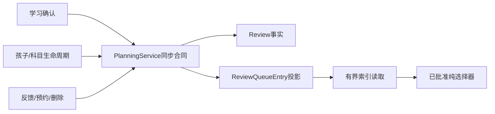
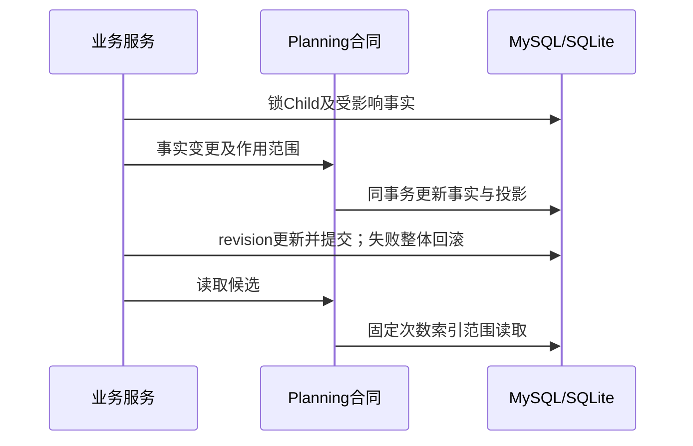

# FEAT-001 — 公平复习索引投影与迁移兼容补充方案

- Status: READY_FOR_REVIEW
- Risk: R3
- Created: 2026-10-07
- Spec revision: SPEC-20261007-FAIR-REVIEW-02
- Architecture revision: ARCH-20261007-FAIR-REVIEW-02
- Parent approved scope: [SPEC-20261007-FAIR-REVIEW-01](FEAT-001-FAIR-DAILY-REVIEW.md)
- Affected feature: FEAT-001
- Current state: docs/domain/features/FEAT-001-push-kids-mvp.md
- User confirmation: PENDING；尚未按本补充方案改写生产代码
- Frontend impact: none；不改变DREV-20261007-FAIR-REVIEW-01的界面和排期产品规则

## 已验证的问题

首版共享选择器的功能测试通过，SQL固定6次、候选不超过1268条，但5万条/130科目的
候选查询需要反复关联Knowledge/Review/Subject并排序。SQLite实测约1.25–1.46秒，
本机隔离MySQL5.7（amd64容器）约3.28–3.56秒，未达到已批准的500ms预算。
新增分钟索引和last_offered索引虽改善性能，仍不能把跨表动态优先级变成索引范围读取。
不得将“返回有界”误报为“性能通过”，不得删除或放宽验收预算后发布。

独立审查还发现既有ready检查要求数据库版本完全相等；迁移后旧镜像不能直接作为
健康的共存/回滚版本。因此必须先核实实际生产源码与revision，并制作兼容过渡版本。

## 推荐方案与取舍

增加planning拥有的`ReviewQueueEntry`可重建投影，每个Review至多一条，保存家庭/孩子、
Review/科目引用、1..5分钟桶、首次/再次类别、确定性排序键和可用状态。
ReviewItem及真实反馈仍是事实来源；投影不产生复习次数、不改变曲线、不暴露写API。

- 使用家庭/孩子领先的两类索引：类别/分钟/排序键、科目/分钟/排序键。
  剩余池直接索引读取top-K，覆盖轮在窄索引上聚合；保留1268候选、120选入、固定SQL预算。
- 确认、反馈、预约、计划选入、科目恢复/停用、档案恢复/归档和删除均通过planning合同
  在原事务同步投影；不使用异步最终一致性，不增加Cron、外部缓存或通用框架。
- 学习内容预计分钟更新必须同步投影；提供内部重建与一致性校验，禁止客户端写排序键。
- 投影迁移采用additive创建及回填；校验一致性后启用新读取。回滚保留投影和真实历史，
  禁止为回退镜像删除已使用字段。
- 上线前准备旧业务代码的schema兼容过渡镜像，仅允许明确审查过的additive revision集合，
  禁止将ready改为接受任意schema；保留可验证的旧业务回滚版本，再迁移、灰度新策略。

代价：增加持久化投影及各写入口同步责任。好处：保持已批准的公平规则与性能预算。
备选一：继续无索引跨表排序，已经实测不达标。备选二：直接放宽500ms预算，影响未来预览
和首屏延迟，不推荐。备选三：只取最早120条，重新引入数学被隐藏的问题，拒绝采用。

## 调用与事务

状态机：复用父Spec的未到期/等待/已安排/反馈/预约状态；没有新的用户可见状态。
部署状态：旧版→兼容过渡版→备份确认→additive迁移→新策略灰度→人工切流。

## 文件和验证要求

预计修改：persistence/models.py、新additive迁移、planning/queue_state.py与plan_candidates.py、
PlanningService生命周期合同及learning/children调用、database schema兼容检查、迁移/并发/规模测试、
Feature/ADR和部署记录。纯选择器及已批准设计不变。

必须通过：原TP-01..09；投影与全量事实选择等价；所有入口同步、事务失败回滚、跨家庭拒绝、
MySQL RR交错、迁移回填/重建、1万/5万条及130科目固定SQL/1268候选/120选入、相同环境p95≤500ms且
≤旧路径2倍；兼容过渡版本在迁移前后ready均正常，未知schema仍被拒绝。原生前端验收独立记录。

## 审批

待用户明确批准本Spec/Architecture修订后实施新增投影；首版代码保留供复核，禁止部署。
