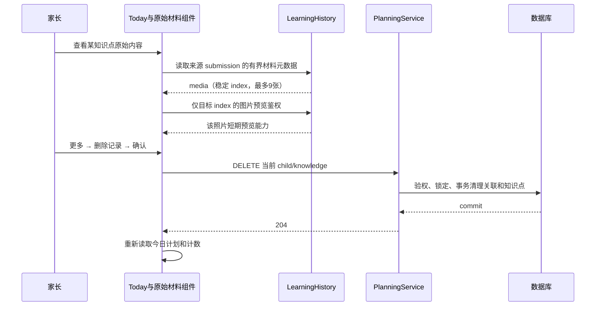
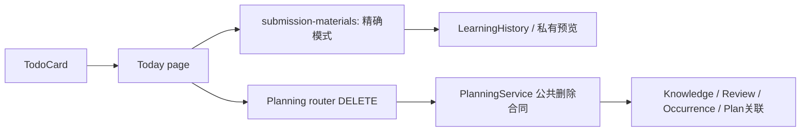
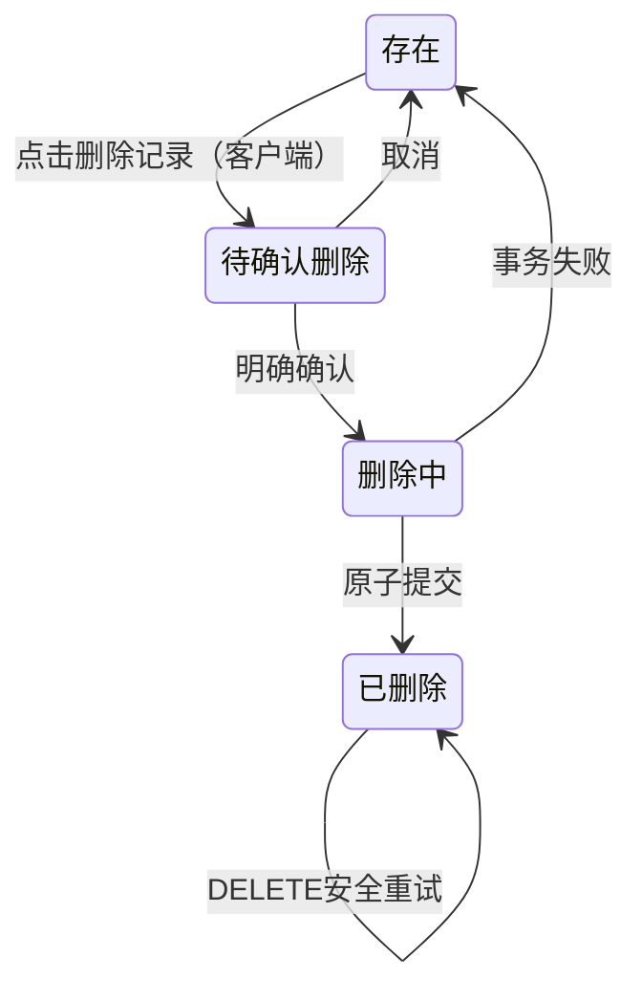
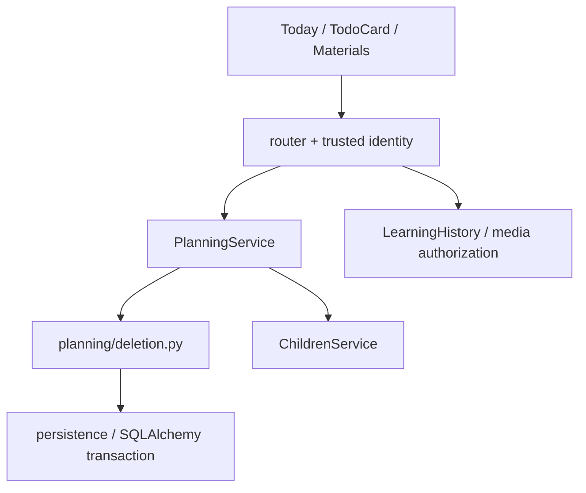

# FEAT-001 — 精确原图与单知识点删除

- Status: VERIFYING
- Risk: R2（永久删除知识点及关联数据）
- Spec owner: 产品负责人（用户）
- Implementer: Codex
- Reviewer: 待独立会话/人员审查；实现者自查不替代独立审查
- Verifier: Codex；原生真机由操作者协同验收
- Created: 2026-10-06
- Last updated: 2026-10-06
- Target release: N/A，本次未请求发布
- Spec revision: SPEC-20261006-SOURCE-DELETE-02
- User confirmation: 产品负责人（用户），2026-10-06，本会话“落地这两个spec”；批准当前 SPEC-20261006-SOURCE-DELETE-02 与配套 DREV-20261006-SOURCE-DELETE-01
- Additional R2/R3 approval: 同上，批准单知识点删除影响与 ARCH-20261006-SOURCE-DELETE-01
- Affected Feature IDs: FEAT-001；FEAT-006 仅作为整档删除边界参考，本次不修改它
- Feature current-state documents: docs/domain/features/FEAT-001-push-kids-mvp.md
- Feature baseline revision: FEAT-STATE-20261002-VOICE-INPUT-02-LOCAL；commit 03d88052d057a4da1790903dc84b143705d2b1de
- Feature merge owner: Codex

## Frontend Design Impact and Repository-native Approval

- Frontend impact: yes，Today 原始内容只显示对应照片；更多菜单新增删除记录与确认弹层
- Frontend engineering impact: yes，组件媒体选择、异步生命周期、删除状态和权限
- Affected UI IDs: UI-001
- UI current-state documents: docs/design/frontend/ui/UI-001-parent-miniapp.md
- Frontend baseline revision: FDB-20260913-04（APPROVED；沿用 PKDS-2.0 纸·芽）
- Frontend engineering constraint revision: FEC-20260913-LOCAL-DESIGN-EVIDENCE-01（APPROVED）
- Affected frontend quality dimensions: component/state/form/responsive/a11y/browser/performance/security/privacy/observability
- Frontend quality budgets/requirements: 44px 热区、正文 >=14px、三视口无横溢出；FEC-PERF-READ-001..004；破坏性动作确认、请求世代隔离、错误保留、按需私有媒体读取
- Frontend quality verification plan: 前端行为测试、原生三视口节点几何/截图、iOS/Android，见 TP-001..011
- Approved frontend engineering deviations: none
- Current Design Revision(s): DREV-20260919-TODAY-SOURCE-MATERIAL-01
- Proposed Design Revision: DREV-20261006-SOURCE-DELETE-01
- Editable design source path(s): docs/design/frontend/prototypes/DREV-20261006-SOURCE-DELETE-01/index.html
- Design source SHA-256: 见配套 APPROVAL.md；批准时冻结
- Required viewport/state exports: menu/photo/confirm/unknown × 320×568、390×844、430×932
- Prototype status: APPROVED
- Approved Task Spec revision: SPEC-20261006-SOURCE-DELETE-02
- Approved Design Revision: DREV-20261006-SOURCE-DELETE-01
- Design approval evidence: 产品负责人（用户），2026-10-06，本会话“落地这两个spec”
- Snapshot manifest path: docs/design/frontend/snapshots/UI-001/DREV-20261006-SOURCE-DELETE-01/APPROVAL.md
- Permitted implementation deviations: 原生字体 fallback、实际内容自然换行、微信原生图片预览；不允许改变删除范围和状态文案
- UI current-state merge owner: Codex
- UI current-state merge evidence: UI-STATE-20261006-SOURCE-DELETE-01-LOCAL，记录本地实现和未完成原生验收
- Frontend visual/a11y/resolution verification: 12张候选PNG已生成，HTML几何与交互预览通过，manifest校验DESIGN_EVIDENCE_VALID；原生实现证据 NOT_RUN
- Frontend engineering verification evidence: 195 frontend tests、ESLint、小程序静态、微信 preview PASS；原生矩阵未完成
- External design dependency: none

## 0. Executive summary

Today 知识点已具备来源提交和图片序号，但原始材料组件只高亮该照片，仍加载整批材料。改为只显示这个知识点对应照片。更多菜单在“今天先跳过”下新增“删除记录”，经确认永久移除当前知识点及复习关联，保留其他内容。

本修订补充用户再次强调的第一项需求：必须打通“分析输出图片 index → 确认保存 → 召回同次提交的对应照片”的完整链路。只有已有字段或相关图片高亮，不算本需求已实现。当前本地代码已实现，验证详情见第16节；未部署。

## 1. Facts, decisions, assumptions, questions

| 类别 | 内容 | 依据 |
|---|---|---|
| fact | 模型 evidence 已有 1-based image_index（1..9），Provider 已在每张输入照片前标号 | agent_processing/contracts.py、providers.py |
| fact | Planning 已返回 source_submission_id/source_image_index；TodoCard 已透传到 Today | planning/service.py、components/todo-card/index.js |
| fact | submission-materials.load 直接把 history.media 全部写入，并下载全部缩略图 | components/submission-materials/index.js |
| fact | KnowledgeItem 为跨次学习复用的知识身份，每项只有一个 ReviewItem | persistence/models.py 的唯一约束 |
| confirmed | 删除当前知识点及其后续复习，保留同次提交其他内容 | 用户本会话范围问题回复 |
| confirmed | 查看原始内容应精确显示对应照片，允许分析输出本次提交图片index，召回时只展示关联材料 | 用户重述第一项需求后要求“补充这个spec” |
| decision proposed | 删除知识身份及其 occurrence、feedback、搜索词、计划关联；原 LearningRecord 总结、Submission、共享媒体保留 | 不把知识点删除扩大为整次上传删除；确认文案说明历史关联也移除 |
| decision proposed | 旧记录不能可靠定位时显示“未关联具体照片”；不自动重新分析、不猜第一张 | 防止误关联和未确认的数据变更 |

Blocking questions: 无；本 Spec + DREV 已明确批准。

## 2. Pre-change behavior and evidence

链路：Provider 图片编号 → direct_evidence → 家长确认 → KnowledgeItem.evidence_json → Planning._source_evidence → TodoCard.source → Today.sourceSheet → submission-materials。
当前仅根据 index 加“相关图片”标签，history.media 全量展示；菜单只有 reinforce/partial/defer。服务端无单知识点删除 API。
参考测试：tests/frontend/today-source-material.test.js、tests/unit/test_provider_evidence.py、tests/unit/test_planning_source_evidence.py、tests/integration/test_todo_provenance.py。

## 3. Target behavior

### 3.1 精确照片展示示例

一次提交 `submission-A` 上传3张照片：照片1语文、照片2数学、照片3英语。数学知识点的图片证据为 `image_index=2`。家长确认后，召回该知识点应携带 `source_submission_id=submission-A` 和 `source_image_index=2`；点击“查看原始内容”，只能请求并显示A的照片2。不能展示照片1/3，不能同时展示整次提交的其他原文，也不能只给照片2加高亮后仍显示所有照片。

另一次 `submission-B` 也有照片2；即便索引相同，也不能用B的照片2替代A的照片2。“这次的信息”指所选来源提交内、与当前知识点关联的那张照片，不是最新上传批次，也不是整个来源提交。

### 3.2 交互时序和行为矩阵



| Case | Expected result | Forbidden result |
|---|---|---|
| 多张照片、index=2 | 仅照片2；标题保留原编号；全屏预览仅该图 | 先下载全批再隐藏 |
| 照片和文字混合 | 有有效图片索引时仅相关照片及当前知识摘要 | 同时展示整次其他原文/照片 |
| 纯文字来源 | 保留原文核对；不把 AI 摘要冒充原文 | 为文字猜图 |
| 多图旧记录、index缺失/非法/匹配不到 | 不请求任何照片预览，显示未关联提示；保留已确认摘要 | 展示整批或静默用照片1 |
| 图片410/403/网络错误 | 对应不可用/鉴权错误/可重试状态；不替换成其他图 | 越权或错图 |
| 同一 submission 连点不同知识点 | source index 变化触发重新选择，迟到返回不覆盖 | 继续显示上一知识的照片 |
| 删除成功 | 当前知识点从知识库、历史知识列表、复习和模型历史召回消失 | 只从界面移除、刷新后复活 |
| 取消/失败 | 无写入或整体回滚；保留卡片和明确错误 | 乐观报告成功、部分删除 |
| 同提交的其他知识 | 内容、复习、照片继续可读 | 删除整次上传 |
| 切孩子/离页 | 丢弃旧界面回调、清理预览引用 | 删除成功回调覆盖另一个孩子 |

## 4. Scope and link/call graph

范围：Today 当前知识点来源和删除入口、专用 DELETE、关联清理、回归与事实文档。非目标：整次上传/整档删除、图片裁剪/OCR、AI 自动修订历史、回收站、发布。历史详情的“原始材料”仍按提交展示完整材料。



## 5. Domain and data design

- 图片使用 submission 内稳定的 1-based media.index，与 Provider 输入序号一致；过滤发生在预览能力请求之前。索引不能用过滤后数组位置替代。维持既有单主证据合同，不扩展到多图索引数组。

### 5.1 来源定位端到端合同（本修订补充）

| 阶段 | 必须保存/传递的事实 | 实现约束 |
|---|---|---|
| 上传及分析输入 | 本次submission及其稳定媒体顺序 | 复用 `sort_order, created_at, id` 排序；编号从1开始，最多9张。模型看到的编号必须与history.media.index一致 |
| 模型输出 | 每个有图片证据的知识点的 `direct_evidence[].source=image`、`image_index`、`detail` | 复用已有字段；index只能指向本次输入图片，禁止引用历史召回材料的编号冒充本次来源；服务端验证整数、范围和图片存在性 |
| 家长确认 | 知识点和它的已确认图片证据，以及同源的submission关联 | AI输出仍只是提案；确认前不创建正式知识/复习记录；手动确认无可靠图片证据时允许为空 |
| 复习召回/读投影 | `source_submission_id` + `source_image_index` + `source_summary` | 三者必须来自同一份已确认来源；index无全局含义，不能单独定位图片 |
| 界面选择 | 同一submission的 `media.index === source_image_index` | 使用严格整数匹配，不能使用过滤后的数组下标，也不能用 `index || 1` 兜底 |
| 缩略图和全屏查看 | 匹配到的唯一media.id | 在请求预览能力/下载之前过滤；列表、缩略图、全屏urls均只含目标图，不预取同批其他照片 |

主图选择：已确认 evidence 中按原顺序取第一条有效图片证据，原题提示取同一条的detail；前面的文字证据不应遮蔽后面的有效图片证据。多条图片证据仍采用一个主图，不展开同批全部图片。完全无图片证据的纯文字提交保留文字路径；含照片但关联未知的提交显示“未关联具体照片”，不自动展示全部照片或混合提交的全部文字。

跨次来源一致性：复用知识点时沿用首次有效确认的来源对；后续复习不把新提交的image_index套到旧source_submission_id。当前 `learning/service.py` 存在为旧知识补空evidence的分支，实现时必须检查它与首次Review来源是否同源，不能仅依赖“index在1..9”证明正确。无法证明同源的旧数据降级为未知关联；不自动重分析、不猜图、不修改原图。

编号稳定性：媒体不可用时保留原编号的不可用状态；不能移除照片1后将照片2改成照片1。分析重试、后续补传及读取必须遵守同一排序合同；无法保证编号对应时显式失败/降级，禁止拿错照片继续显示。`occurred_at/created_at` 不因原图查看而改变。

### 5.2 删除范围与事务

- 删除以 family_id + child_id + knowledge_id 为作用域，Review ID 不充当整个 submission 的删除 ID。
- 一个事务内清理 DailyReviewPlanItem、ReviewFeedbackRequest、ReviewFeedback、KnowledgeOccurrence、KnowledgeSearchTerm、ReviewItem、KnowledgeItem。使用 SQL 子查询/集合操作，不将全部历史加载进 Python。
- ReviewFeedbackBatchRequest 的既有回执可能引用旧 review：不得重放时复活或写入；按原始幂等响应保留其他项的回执，读投影不得把回执当成存活知识。专项验证。
- 已 materialize 的日计划应更新受影响汇总/项目，保持其余项目稳定顺序，不补入额外复习造成新负担。数据聚合交给数据库。
- 所有历史 occurrence 和该知识反馈随知识点删除；原学习提交、原学习记录总结、原图保留，即使记录剩余知识数为0也不删除提交。知识数/复习数基于存活实体，提交数量仍按保留的记录计算。
- 锁顺序与 Children/Review 写路径协调；删除与确认/反馈串行化。旧草稿指向已删除 Review 时采用既有 stale-match 处理，不能自动重建；之后用户新提交并明确确认同名新知识仍允许创建新身份。
- Schema/backfill: 预计无新表/列和历史回填；若索引/查询计划证据证明须迁移，更新修订再审批。



## 6. Interfaces and errors

新增 `DELETE /children/{child_id}/knowledge/{knowledge_id}`，manager/editor 可用，viewer 拒绝；沿用可信 family context。child 属于当前家庭且可写才处理。有效 child 下已不存在或不属于作用域的 knowledge 均返回204无操作，避免泄露跨家庭存在性；无权403，child不可读404/deleting409，依赖失败5xx事务回滚。自然幂等，无新的幂等表。客户端只在204后刷新，不将路由404当删除成功；服务端先于新前端部署。

前端 TodoCard 保留 knowledge_id，新增独立 delete 事件（不是第五种 feedback action）。submission-materials 新增显式精确选择模式，默认保持历史详情的整批模式；观察器包含选择模式和 index，清理 generation 与临时路径。

精确来源沿用已有响应字段，不要求模型输出submission ID（由服务端绑定当前提交）。示例中的ID与内容均为合成说明：

```json
{
  "knowledge_id": "knowledge-math",
  "source_submission_id": "submission-A",
  "source_image_index": 2,
  "source_summary": "根据年龄差求妈妈的年龄。"
}
```

有效图片索引是1..9的整数；null/缺失表示未获得可靠图片定位，0、负数、字符串、布尔值和越界数不得被当作有效索引。旧客户端可忽略现有可空字段；新精确模式遇到旧服务端缺字段时按未知关联处理，不能退回全批照片。摘要是已确认的证据描述，不是图片本身，也不能替代精确照片验收。

## 7. Authorization, security, and privacy

服务端复核家庭和孩子权限；viewer 不渲染删除入口且直接请求403。媒体继续通过既有短期鉴权，不记录图片地址/文字/原始模型 payload。删除不会触发共享媒体物理清理、模型调用或外部通知发送。审计仅静态结果码/耗时/数量；现有未发送复习摘要在发送前按存活知识重算，核验不会继续提醒已删除项。

## 8. Architecture and implementation boundaries

已采用 `ARCH-20261006-SOURCE-DELETE-01`：沿用 Planning 对知识/复习关联的所有权，新增窄职责 deletion.py，由 PlanningService 暴露公共合同。Router 只验传输并调用，Planning 不引入 LearningService 或 Agent 依赖；domain.py 仅为旧 Todo DTO 透传knowledge_id，不修改纯排期策略。



| Alternative | Benefit | Trade-off / decision |
|---|---|---|
| 只过滤前端照片 | 无API变更，复用现有稳定index | 采用；最多9条元数据，预览仅目标图 |
| 新建知识点材料API | 后端返回更窄 | 本次无必要，已有metadata有界且鉴权完备 |
| Review.active=false | 修改很少 | 不满足删除知识点，仍可召回，拒绝 |
| 删除整次Submission | 清理简单 | 误伤同次其他内容，用户已排除 |
| 增加软删列/回收站 | 可恢复 | 所有读路径都需过滤且会改唯一身份，当前不采用 |

共享抽象：不新增通用删除框架，复用现有媒体组件与请求客户端。扩展点：删除范围 closed（单知识点），软删/多图主证据 deferred；现有 Provider open 合同不变。依赖 DAG 用 tools/check_architecture.py 验证。ADR: N/A，未改变模块所有权；通知通过既有Planning公共查询读取存活复习。Architecture confirmation: APPROVED，用户2026-10-06“落地这两个spec”。

## 9. Expected file changes, replacement, and deletion plan

| Path | Action | Purpose |
|---|---|---|
| apps/miniprogram/components/submission-materials/index.js,wxml,wxss | modify | 显式精确模式、index观察、未知/失效来源状态 |
| apps/miniprogram/components/todo-card/index.js,wxml,wxss | modify | 知识ID、权限、删除事件/菜单/禁用态 |
| apps/miniprogram/pages/today/index.js,wxml,wxss | modify | 独立确认/请求/恢复/刷新、传递精确模式 |
| apps/api/src/push_kids/planning/router.py,service.py | modify | 公共DELETE入口和窄职责委派 |
| apps/api/src/push_kids/planning/deletion.py | add | 家庭隔离下单知识点事务清理 |
| apps/api/src/push_kids/notifications/service.py | modify | 在现有投递锁下重新计算存活复习摘要，无待复习则取消待发通知 |
| apps/api/src/push_kids/planning/domain.py | modify | 旧Todo DTO仅新增可空knowledge_id，不改确定性策略 |
| apps/api/src/push_kids/planning/service.py | modify | 统一主图片证据和同源摘要选择，所有相关读投影保持一致 |
| apps/api/src/push_kids/learning/service.py | modify if needed | 防止跨次补空evidence与Review首次来源错配；不扩大删除范围 |
| apps/api/src/push_kids/agent_processing/contracts.py,providers.py,worker.py；learning/history.py | retain unless contract test fails | 核对模型输出与媒体稳定编号链路；已有行为满足则保留，不重复添加index字段或无关重构 |
| tests/frontend/*source*, *delete* | modify/add | 精确媒体和删除交互反例 |
| tests/integration/test_knowledge_deletion.py | add | 真实DB关联、权限、幂等、并发、聚合 |
| tests/unit/test_provider_evidence.py, test_planning_source_evidence.py | modify if needed | 复用现有index并证明编号不漂移 |
| tests/integration/test_mysql_runtime.py, tests/performance/test_read_paths.py | modify | MySQL5.7受影响路径/规模和查询计划 |
| docs/domain/features/FEAT-001-push-kids-mvp.md, docs/domain/BEHAVIOR-CATALOG.md, docs/design/frontend/ui/UI-001-parent-miniapp.md | modify after verification | 合并最终事实 |

替换 Today 整批预览行为；历史详情整批模式保留且有明确消费者。无临时双实现、无无关清理。保留工作区既有 untracked output/。

## 10. Non-functional requirements

单图模式预览API/下载只涉及1张；Today首屏预取0张；删除查询次数不随历史条数增长，响应204无明细；历史/反馈删除为数据库集合操作。日志无儿童内容。UI不新增依赖，符合FEC既有包体预算、44px热区、可读错误和大字换行。

## 11. Acceptance criteria

- AC-001：9图来源的第2张证据 → 查看 → 仅第2张被下载和显示；手动历史详情仍显示完整提交。
- AC-002：缺失/越界/错误/已删来源 → 清晰状态且零错误照片；切换同提交不同index也无串图。
- AC-003：展开更多 → 删除紧邻今天先跳过之后；确认说明范围；取消零请求，pending防重复，失败卡片保留。
- AC-004：确认删除 → 当前知识及所有复习/历史关联移除；同提交其他知识、原图、原总结保留；统计与召回一致。
- AC-005：重复、跨家庭、跨孩子、viewer、旧反馈/草稿并发均不能误删或复活；删除事务失败整体回滚。
- AC-006：三视口和真机操作可达、图片隐私不回退、原有反馈和整批历史保持可用。
- AC-007：A提交3张图且数学证据index=2，从分析输出、家长确认、数据库、召回响应到界面，最终只显示A2；B提交即使也有index=2也不能串图。失败/缺失定位不得回退全批或第一张。
- AC-008：同一知识点后来再次提交、旧证据被补空、首条证据是文字而后有有效图片、前序图片失效等场景，提交与索引始终同源且编号不漂移；不能只用字段存在或高亮截图宣称通过。

## 12. Verification plan

| Test point | AC | Level | Required evidence |
|---|---|---|---|
| TP-001 | 001,002 | frontend | 同提交9张仅请求第2张；索引切换/迟到/缺失/410/403/重试/纯文字/混合；旧实现必须失败 |
| TP-002 | 001,007,008 | unit/integration/frontend | 固定A/B两个提交各3张合成图片，模型给A的数学知识index=2；驱动真实确认与召回响应并交给组件，断言仅A2预览请求、下载及显示；验证序号1/9边界和0/负数/字符串/布尔/越界拒绝 |
| TP-003 | 003,005 | frontend | 菜单顺序、知识ID、权限、确认取消、pending防重、错误恢复、切孩子和卸载 |
| TP-004 | 004 | integration | 一次提交多科目多知识仅删一个；跨次同知识occurrence/feedback清理，其他实体/媒体零改动 |
| TP-005 | 004,005 | integration | 重复DELETE、错家庭/孩子、viewer、失败回滚、反馈和确认竞态、batch回执不复活 |
| TP-006 | 004 | integration | 已物化计划/下一复习/历史/报表/搜索/待发送通知消除该知识且计数一致 |
| TP-007 | 004,005 | performance/MySQL | 10k历史规模、O(1)查询/受控内存、索引计划、真实MySQL5.7锁/事务/SQL兼容 |
| TP-008 | 001,006 | regression | pytest unit/integration/contract；npm test；Ruff check/format、Mypy、ESLint、架构、design evidence、小程序静态 |
| TP-009 | 006 | native | DevTools编译；320×568/390×844/430×932节点几何/截图；iOS/Android图片预览与确认、大字 |
| TP-010 | all | independent review | 正确性、设计、逐文件必要性、放置位置、冗余与无越界变更 |
| TP-011 | 002,007,008 | unit/integration/frontend | 同知识跨次提交、旧证据补空、同提交index切换、先文字后图片证据、照片1失效而照片2仍有效；无串图/重编号，未知关联零预览请求；纯文字与历史整批路径不回归 |

原版失败点：TP-001全批图片请求、TP-003缺少删除入口、TP-004无DELETE。兼容证明：TP-001历史整批、TP-008旧反馈。数据库和HTTP真实 wiring 由TP-004..007覆盖。原生平台差异不可由HTML代替。所有NOT_RUN须写原因/风险，不虚报通过。

## 13. Rollout, migration, rollback

后端先、新前端后；本任务不部署。预计无迁移、无自动回填、无运行时feature flag。旧客户端无新增调用；旧后端404时新界面显示失败。发布遵守docs/deploy/README.md，含SQL变更须真实MySQL5.7门禁。代码可回滚，已确认物理删除不能用代码回滚恢复；仅批准的备份恢复流程可恢复数据，产品无撤销承诺。来源错误/误删/权限失败应立即停止发布，由产品负责人和实现者处理。

## 14. Implementation plan

1. 审批Spec+DREV，补齐失败反例；实现精准照片与兼容模式，先通过TP-001/002/011。
2. 实现Planning单知识点事务及HTTP合同，验证TP-004..007。
3. 接入菜单与确认、权限、状态恢复；TP-003/008/009。
4. 独立只读复核、同步FEAT/UI/行为事实，完成门禁后移至specs/completed/。若原生必须证据不可取得则保持VERIFYING并列明缺口。

## 15. Review plan

R2独立只读审查重点核对跨次身份删除影响、共享提交不误删、索引来源不漂移、并发不复活、既有回执/计划/通知投影。实现者已按这些路径自查；独立会话/人员尚未执行，不将自查冒充独立审查。逐文件必要性记录见 `docs/quality/evidence/SOURCE-DELETE-20261006.md`。

## 16. Implementation and verification record

2026-10-06：用户“落地这两个spec”批准本修订与DREV后实施。实现范围：严格图片索引、同源证据校验、Today单图模式、单知识点DELETE及确认交互、日计划集合清理、待发通知重算。无需迁移或回填。

| 检查 | 结果与证据 |
|---|---|
| TP-001/003/011 frontend | PASS，`npm test` 195 passed；9图只取2、同提交切换、迟到清理、未知/非法/410/403/网络恢复、纯文字/历史整批；确认取消/防重/失败/权限/切孩子；云身份未加载时禁止入口，待bootstrap后按manager/editor授权 |
| TP-002 真实数据链路 | PASS，`test_precise_source.py` 用真实上传→编号分析→确认→HTTP召回与history元数据，将实际响应传给已实现的JS组件；A/B均只下载并显示各自照片2，跨批媒体请求404 |
| TP-004/005/006 | PASS for exercised paths，DELETE权限/隔离/幂等/事务失败回滚、反馈回执不复活、保留共享提交/总结、日计划不补项、后加知识不扣旧计划、待发摘要刷新/取消；真正并行的反馈/确认与删除压力场景仍未专门执行 |
| TP-007 | PASS，SQLite 1/10k关联规模：查询<=20、Python峰值<5MB、EXPLAIN索引；隔离MySQL5.7.44迁移/current/check PASS，运行时7 passed，最终删除计数修改后专项2 passed（5 deselected），覆盖10k及重复读旧快照/已物化计划 |
| TP-008 | PASS，`.venv/bin/python -m pytest tests/unit tests/integration tests/contract tests/performance -q` 411 passed / 7 skipped；7项MySQL在上述独立运行中通过。Ruff check/format、Mypy、`npm run lint:miniapp`、架构、小程序、设计策略通过 |
| TP-009 compile | PASS，用户明确授权微信预览后，真实AppID CLI preview成功；最终权限修正后复验656208 bytes；未执行upload、审核、发布或后端部署 |
| TP-009 native | NOT_RUN，隔离本地副本启动原生模拟器时WechatSI插件返回41002 `appid missing`，automator无法获得可用运行时。320×568/390×844/430×932节点几何/截图、iOS/Android、大字验收未完成；HTML12张设计截图不能替代 |
| TP-010 | PARTIAL，实现者逐文件自查已记录；独立会话/人员审查 NOT_RUN |

命令说明：`uv run`最初受全局uv缓存读取权限限制，改用已有`.venv/bin/`执行同一工具；误试`npm run lint`发现无此脚本后使用仓库定义的`lint:miniapp`并通过。中间测试/格式失败均已修复并复跑，不计为最终成功。详细本地证据和必要性清单见 `docs/quality/evidence/SOURCE-DELETE-20261006.md`。
批准后的设计manifest、HTML和12张PNG保持不变。保留原有`output/`和工作期间另一任务新增的REVIEW-MANAGEMENT设计/Spec，不将其计入本任务。

## 17. Completion gate

- [x] 用户明确了删除范围。
- [x] 调用图、时序、状态、架构、权衡和测试点已具备。
- [x] Spec、Architecture、Design Revision批准。
- [ ] 所有AC通过，所需测试有真实结果，独立审查无Blocker/Major。
- [x] FEAT/UI/行为和架构同步本地实现事实，明确未验收范围；保留其他任务文件。
- [ ] 满足完成门禁，Status改为DONE并移至completed。

Final status: VERIFYING。代码与本地自动化已完成；原生矩阵、真机、独立审查及额外并行写压力测试未满足，按本Spec第14节留在active，不宣称DONE或已发布。

## 18. Revision history

| Date | Change | Reason | Approved by |
|---|---|---|---|
| 2026-10-06 | SPEC-20261006-SOURCE-DELETE-01 | 精确照片及用户确认的单知识点删除 | PENDING |
| 2026-10-06 | SPEC-20261006-SOURCE-DELETE-02 | 补充提交ID+图片index全链路，并在明确批准后落地本地实现与验证记录 | 用户“落地这两个spec” |
