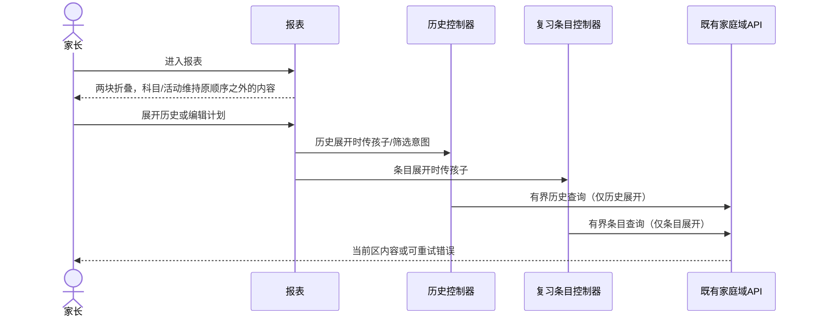
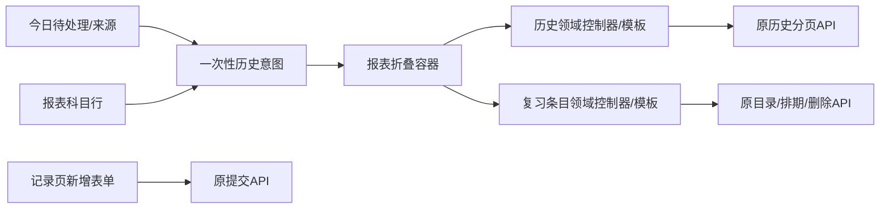

# FEAT-001 — 报表内历史记录与编辑计划折叠区

- Status: VERIFYING
- Risk: R2（记录历史跨 Tab 迁移，复习条目需要复用现有有界列表与操作状态）
- Spec owner: 产品负责人（用户）
- Implementer: Codex
- Reviewer / verifier: 产品负责人（用户）/ Codex
- Created / last updated: 2026-10-11
- Target release: 用户随后于 2026-10-11 授权上传，客户端随小程序 `0.1.13` 开发版本已上传；体验版与正式版未发布。
- Spec revision: SPEC-20261011-REPORT-DISCLOSURES-01
- User confirmation: 用户于2026-10-11先要求将候选区块“复习条目”改为“编辑计划”，随后在审阅方案后回复“然后按照这个方案进行落地”，批准 SPEC-20261011-REPORT-DISCLOSURES-01 与 DREV-20261011-REPORT-DISCLOSURES-01
- Additional R2/R3 approval: 同上；批准领域控制器/模板复用与报表宿主边界
- Affected Feature IDs: FEAT-001
- Feature current-state documents: `docs/domain/features/FEAT-001-push-kids-mvp.md`
- Feature baseline revision: FEAT-STATE-20261006-REVIEW-MANAGEMENT-03-LOCAL 及后续本地增量
- Feature merge owner: Codex（实施和验证后）

## Frontend Design Impact and Repository-native Approval

- Frontend impact: yes；报表板块顺序、历史入口位置、复习入口形态和默认展开状态变化。
- Frontend engineering impact: yes；涉及报表、记录、复习条目、跨 Tab 意图和有界异步读取。
- Affected UI IDs: UI-001
- UI current-state documents: `docs/design/frontend/ui/UI-001-parent-miniapp.md`
- Frontend baseline revision: FDB-20260913-04（APPROVED）
- Frontend engineering constraint revision: FEC-20261007-NATIVE-GEOMETRY-02（APPROVED）
- Affected quality dimensions: component/state/form/responsive/a11y/browser/performance/security/privacy/table-chart/observability。
- Budgets: 320×568、390×844、430×932；触控≥44px；历史每页20项；复习条目现有服务端上限；主包≤1.5MiB；FEC-PERF-READ-001～004。
- Verification plan: 12张设计导出与SHA；前端定向/全量、静态、架构、原生三视口矩形、iOS/Android真机；后端API不变时后端测试 N/A。
- Approved frontend engineering deviations: none。
- Current Design Revisions: DREV-20260906-REPORT-01、DREV-20261010-REVIEW-INVENTORY-02（各自原批准范围内）
- Editable design source: `docs/design/frontend/prototypes/DREV-20261011-REPORT-DISCLOSURES-01/`
- Proposed Design Revision: DREV-20261011-REPORT-DISCLOSURES-01
- Required exports: collapsed/history-open/review-open/both-open × 320×568、390×844、430×932。
- Prototype status: APPROVED
- Approved Task Spec revision / Design Revision / approval evidence: SPEC-20261011-REPORT-DISCLOSURES-01 / DREV-20261011-REPORT-DISCLOSURES-01；用户2026-10-11“然后按照这个方案进行落地”。
- Snapshot manifest: `docs/design/frontend/snapshots/UI-001/DREV-20261011-REPORT-DISCLOSURES-01/APPROVAL.md`
- Permitted implementation deviations: none；如展开内容或导航路径改变，须先修订 Spec 与设计。
- UI current-state merge: 已按本地实现事实更新 `UI-001`、`FEAT-001` 与 `BHV-019`；真机门禁继续保留。
- External design dependency: none。

## 0. Problem and intended outcome

用户提供的两张截图分别是记录页的「历史记录」折叠卡和报表顶部的「复习条目」入口卡，并要求把两块放在报表「科目学习记录」与「课外活动投入」之间，默认均折叠。随后用户明确将后者的可见名称改为「编辑计划」。当前历史列表在记录页表单下方，复习入口在报表区间选择器上方；两个页面职责和首屏层级不符合目标。

批准的目标顺序为：科目学习记录 → 历史记录 → 编辑计划 → 课外活动投入。两个折叠区独立展开，首次进入、切换孩子和重新进入报表均默认收起。展开后在报表内呈现原有完整、有界列表和控件；记录页保留新增表单及待处理提醒，但移除表单末尾的历史列表。「编辑计划」只替换本区及其独立页的可见标题，知识、Review、排期的领域术语和接口保持原名。

## 1. Facts, decisions and open questions

| ID | Fact / decision | Evidence / rationale |
|---|---|---|
| F-001 | 记录页历史默认折叠，可分页、搜索、筛选、进入详情；viewer 当前直接展开 | `pages/records/index.*`、`history.*`；BHV-019 |
| F-002 | 报表顶部入口进入独立复习条目页；科目与活动板块相邻。候选新名称为「编辑计划」 | `pages/reports/index.wxml`；用户2026-10-11更名要求 |
| F-003 | Today 和报表科目行通过一次性 `recordIntent` 打开记录页历史 | `pages/today/index.js`、`pages/reports/index.js` |
| D-001 | 历史与复习状态仍由各自领域控制器负责，报表仅负责折叠、上下文和排版 | 避免同一业务列表出现两套查询/权限逻辑 |
| D-002 | 只有明确展开时读取对应首屏列表；折叠期间不预取全量历史/条目 | FEC-PERF-READ-001～003 |

Blocking question resolved: 用户批准当前推荐方案，即展开后内嵌完整内容，记录页移除原历史区。

## 2. Target behavior

| Case | Result |
|---|---|
| 初次进入/重新进入/切孩子 | 两块默认收起；旧孩子的行、游标、筛选和请求结果不可显现 |
| 展开历史 | 按现有合同获取最多20条，显示已确认/待处理/全部、搜索/筛选/分页和详情入口；待处理数可显示在折叠标题 |
| 展开编辑计划 | 复用当前时间/科目/次数筛选、分组、分页、44×44菜单与既有操作；原独立页以「编辑计划」为标题，仍可从具体导航进入且共享同一行为 |
| 两块同时展开 | 互不覆盖，按指定顺序向下排布；活动区始终在两块之后 |
| 请求失败/无权限/空结果 | 只影响当前折叠区；错误、重试、空态和只读语义沿用原合同 |
| Today 待处理与科目下钻 | 打开报表对应历史折叠区，保留孩子、状态、科目与日期意图；手动新增仍进入记录页表单 |

### Sequence diagram



### Link/call graph and architecture



### State machine

```text
页面进入/孩子变更 → 历史收起 + 复习收起
各区：收起 ↔ 展开；展开 → loading → content/empty/error/forbidden
筛选/分页 → loading → content/error；折叠或切孩子使旧响应失效
两区独立，可同时展开；写操作继续遵守原确认/只读/冲突状态
```

### Architecture choices and trade-offs

| Option | Benefit | Cost/risk | Decision |
|---|---|---|---|
| 报表只显示两个跳转卡 | 小改动 | 展开后没有原内容，不符合当前候选的「折叠板块」理解 | 备选，待用户选择 |
| 报表复制两份列表和请求 | 上手快 | 权限、分页、状态与详情逐渐分叉 | 拒绝 |
| 提取领域控制器/模板，报表作为宿主 | 原行为复用，数据合同只有一份 | 跨页面状态拆分及验证范围较大 | 推荐，需批准 |

## 3. Scope and file plan

In scope: 报表中的位置、折叠、完整列表、原导航意图迁移；记录页移除历史大区但保留待处理提醒和新增路径。Out of scope: 服务端API/Schema/复习策略/正式记录语义、云端发布。

| Path | Expected change |
|---|---|
| `apps/miniprogram/pages/reports/index.{wxml,wxss,js}` | 删除顶部入口，在两板块之间插入历史记录、编辑计划两独立折叠区；挂接列表并处理孩子/区间/刷新/隐藏状态 |
| `apps/miniprogram/pages/records/index.{wxml,wxss,js}` | 移除末尾历史区；待处理提醒改为明确导航到报表；新增表单继续可用 |
| `apps/miniprogram/pages/records/history.*`、复习条目相关模块 | 将完整有界列表迁到有明确领域归属的可复用模块/模板，避免报表复制查询；保留独立详情路径；独立页可见标题同步为「编辑计划」 |
| `apps/miniprogram/pages/today/index.js` | 将历史意图指向报表；新增意图仍指向记录 |
| `tests/frontend/` | 顺序、默认态、展开请求、意图、切孩子/迟到响应、权限/空/错误/分页/菜单回归 |
| `docs/domain/BEHAVIOR-CATALOG.md`、FEAT-001、UI-001 | 仅在实现且验证后合并新事实，替换BHV-019原位置描述 |

## 4. Acceptance and required test points

| AC | Observable result | Test point |
|---|---|---|
| AC-001 | 三视口顺序精确，两个区默认收起，≥44px命中区、文案/计数不溢出 | TP-001 设计导出和原生矩形 |
| AC-002 | 历史/条目各自展开、收起、同时展开；折叠时不拉完整列表 | TP-002 前端状态/请求测试 |
| AC-003 | 历史筛选/分页/详情、复习筛选/菜单/权限与现有合同一致 | TP-003 既有专项与新增回归 |
| AC-004 | Today/科目意图、孩子切换、迟到响应、错误/空/只读正确 | TP-004 意图/隔离测试 |
| AC-005 | FEC预算、静态/架构/设计证据通过，iOS/Android可操作 | TP-005 全量前端、lint、静态、架构、设计校验与真机 |

## 5. Verification and completion

用户已批准本修订及 DREV；本地实现和当前状态文档已更新。逐点验证记录见 `docs/quality/evidence/REPORT-DISCLOSURES-20261011.md`：TP-001～004 的设计/自动化/微信开发者工具原生三视口证据为 PASS；TP-005 中前端、lint、静态、架构、设计校验为 PASS，iOS/Android 真机为 NOT_RUN（未连接真机）。用户随后授权上传，`0.1.13` 开发版本已由微信 CLI 上传，见 `docs/deploy/releases/20261011-report-disclosures-frontend.md`；体验版、审核、正式版均未进行。因此本 Spec 保持 VERIFYING 于 `specs/active/`，不能宣称真机验收或 DONE。
