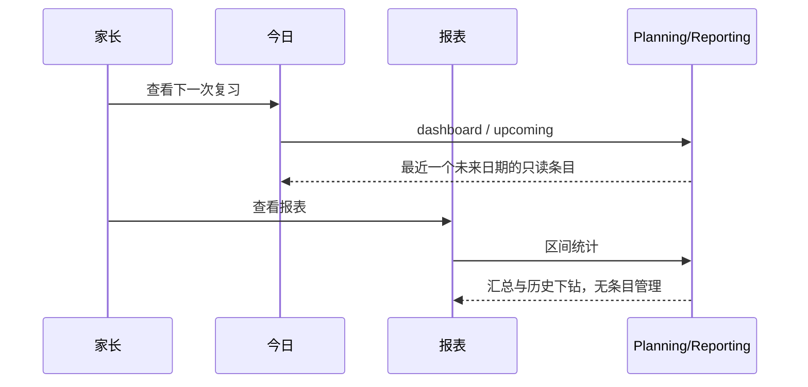
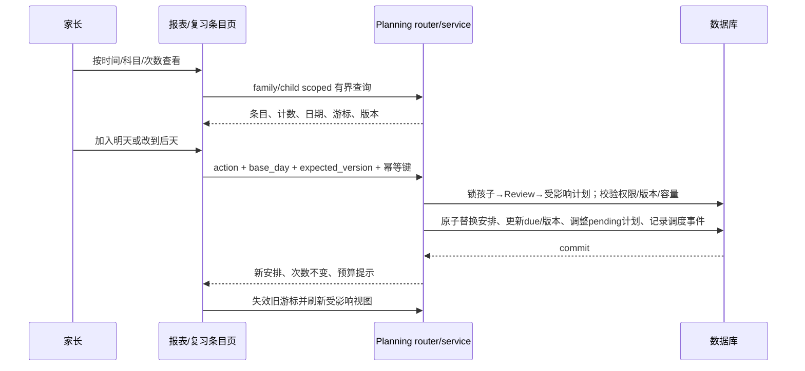
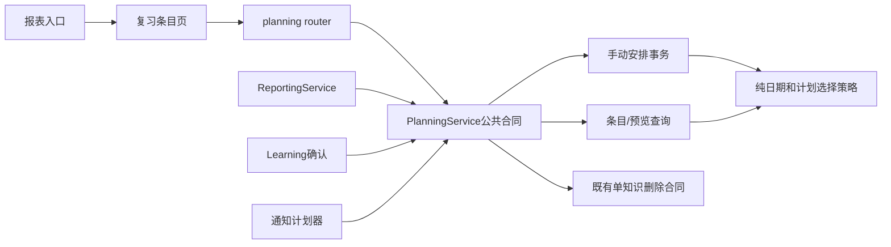
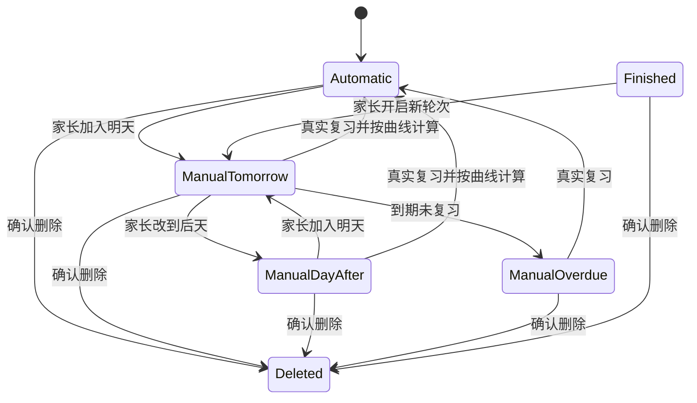
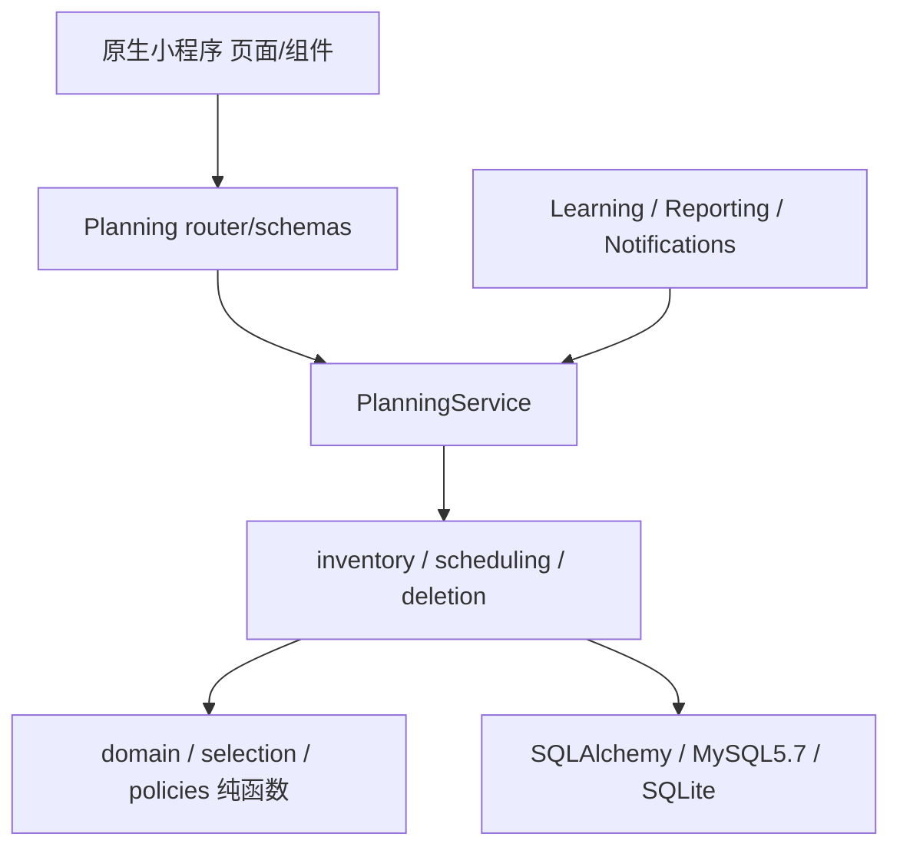

# FEAT-001 — 报表复习条目预览与手动调整

- Status: VERIFYING
- Risk: R3（排期优先级、每日预算、持久化与删除联动）
- Spec owner: 产品负责人（用户）
- Implementer: Codex
- Reviewer: 实现后独立只读审查
- Verifier: Codex；原生设备由操作者协同验收
- Created: 2026-10-06
- Last updated: 2026-10-07
- Target release: N/A，本次未请求发布
- Spec revision: SPEC-20261006-REVIEW-MANAGEMENT-03
- User confirmation: 产品负责人（用户），2026-10-06，本会话在03版交付后明确“落地并实现”，批准 SPEC-20261006-REVIEW-MANAGEMENT-03
- Additional R2/R3 approval: 同一指令批准 ARCH-20261006-REVIEW-MANAGEMENT-01 及本修订手动预算优先/删除取舍
- Affected Feature IDs: FEAT-001；FEAT-006 删除生命周期、FEAT-003 提醒仅作受影响合同
- Feature current-state documents: docs/domain/features/FEAT-001-push-kids-mvp.md
- Feature baseline revision: FEAT-STATE-20261002-VOICE-INPUT-02-LOCAL
- Feature merge owner: Codex，实现并验证后合并

## Frontend Design Impact and Repository-native Approval

- Frontend impact: yes；Today 删除“下一次复习”，报表新增复习条目入口及明細管理页
- Frontend engineering impact: yes；分页、筛选、变更、并发、权限和错误恢复
- Affected UI IDs: UI-001
- UI current-state documents: docs/design/frontend/ui/UI-001-parent-miniapp.md
- Frontend baseline revision: FDB-20260913-04（APPROVED）
- Frontend engineering constraint revision: FEC-20260913-LOCAL-DESIGN-EVIDENCE-01（APPROVED）
- Affected frontend quality dimensions: component/state/form/responsive/a11y/browser/performance/security/privacy/observability
- Frontend quality budgets/requirements: FEC-PERF-READ-001..004；44px 热区；正文 >=14px；包体 <=1.5MiB；三视口；服务端授权
- Frontend quality verification plan: TP-008..011；原生节点几何和 iOS/Android 不可用 HTML 导出替代
- Approved frontend engineering deviations: none
- Current Design Revision(s): DREV-20261006-SOURCE-DELETE-01（另一项已批准工作）；报表沿用 DREV-20260906-REPORT-01
- Proposed Design Revision: DREV-20261006-REVIEW-MANAGEMENT-03
- Editable design source path(s): docs/design/frontend/prototypes/DREV-20261006-REVIEW-MANAGEMENT-03/index.html
- Design source SHA-256: 见配套 APPROVAL.md
- Required viewport/state exports: entry/time/after/subject/count/count-exact/count-custom/count-empty/actions/delete/empty/error/readonly/long/pending/conflict/budget/today × 320×568、390×844、430×932
- Prototype status: DRAFT（03版源码与交互逻辑已更新，截图导出待补）
- Approved Task Spec revision: SPEC-20261006-REVIEW-MANAGEMENT-03
- Approved Design Revision: DREV-20261006-REVIEW-MANAGEMENT-03
- Design approval evidence: 产品负责人（用户），2026-10-06，本会话“落地并实现”；原型已可审阅，导出与原生验收仍缺证，不伪称通过
- Snapshot manifest path: docs/design/frontend/snapshots/UI-001/DREV-20261006-REVIEW-MANAGEMENT-03/APPROVAL.md
- Permitted implementation deviations: 仅平台字体、安全区和内容自然换行；可见行为变化需新修订
- UI current-state merge owner: Codex
- UI current-state merge evidence: UI-STATE-20261006-REVIEW-MANAGEMENT-03-LOCAL；本地实现，原生验收待补
- Frontend visual/a11y/resolution verification: 见候选设计 manifest；原生验收 NOT_RUN
- Frontend engineering verification evidence: docs/quality/evidence/REVIEW-MANAGEMENT-20261006.md
- External design dependency: none

## 0. Executive summary

家长目前难以整体了解有哪些知识、各复习多少次，也不能从报表直接清理错误条目或调整下次日期。
删除 Today 的“下一次复习”入口；在报表增加“复习条目”，进入按时间、科目、复习次数查看的独立页。
每条展示实际复习次数、最近复习和下次安排；提供加入明天、改到后天、删除条目。
改期只是排期操作，不伪造完成反馈；下一次真实复习后继续按既有确定性曲线计算。

## 1. Facts, decisions, assumptions, questions

| 类别 | 事实或建议 | 依据/处理 |
|---|---|---|
| fact | 用户“下一次服务”对应代码里的“下一次复习” | pages/today/index.wxml 的 next-review 区域 |
| fact | 报表只有汇总、趋势和历史下钻，无全知识条目管理 | pages/reports/index.wxml |
| fact | ReviewItem 已有 review_count、last_reviewed_on、due_date、state_version | persistence/models.py |
| fact | 次数不是 step+1；同日有效反馈也可能累加 review_count | planning/policies.py |
| fact | 每日计划首次物化后不自动补题，默认分钟预算15，上限120 | planning/service.py、selection.py |
| fact | 工作树已有未提交的单知识删除实现 | SPEC-20261006-SOURCE-DELETE-02；planning/deletion.py |
| proposed | “复习频率”在界面称“复习次数”，符合用户从少到多的定义 | 不引入每周频率或掌握度计算 |
| assumed | 本期不合并知识身份、不修改名称/正文 | 具体操作清单只列删除和改期；已向用户询问 |
| assumed | 手动安排优先，可超过日常分钟预算，显示实际总时长 | 已向用户询问；本修订采用推荐方案，批准包含此取舍 |

用户对合并或预算的答复若与建议不同，先修订 Spec 和设计，再请求批准；不得默默改变已批准范围。
无凭空待办：本次只调整已有、家长确认过的知识。

## 2. Current behavior and evidence

- 事实文档：FEAT-001 / UI-001 当前状态、ADR-REVIEW-EVENT-PROJECTION-AND-DAILY-PLAN。
- 代码：planning/service.py 的 daily_review_selection、_create_daily_review_plan、record_review_event；
  reporting/service.py 的 dashboard.next_review；planning/policies.py 的 apply_review_event。
- 删除依赖：已批准 SOURCE-DELETE-02 保留 Submission、LearningRecord、共享媒体，删除知识身份、
  occurrence、feedback、搜索词和计划关联；本次复用该合同，不重新实现另一套删除。
- 已有测试入口：tests/performance/test_read_paths.py、tests/integration/test_knowledge_deletion.py、
  tests/frontend/knowledge-deletion.test.js；实施时先核实当前工作树状态，保留其他任务的改动。
- 运行态证据：本次未连接线上；源码事实不等于线上版本事实。

## 3. Target behavior

### 3.1 入口与三种视图

1. Today 移除下一次复习的展开、列表、续页和自动展开逻辑；没有今日任务时显示“今天没有待复习内容”。
   保留今日复习、学习、活动和现有来源/删除操作。
2. 报表标题下、7/30/100天区间控件前新增“复习条目”入口，副文案“看看复习了几次，调整接下来的安排”。
   独立明细页不受报表历史区间限制；无最近学习记录但有旧知识时仍可进入。
3. 按时间：明天/后天两个可切换日期，显示上海自然日的实际日期、计划项数和预计分钟。默认明天。
   这是按当前状态计算的预览，文案“按当前安排预览，实际复习后会更新”；查看本身不提前物化日计划。
4. 按科目：展示全部 learning 科目（含0条科目），排除活动，不提供“全部”选项；默认选择目录首个科目，
   每次只看一个科目，按 review_count ASC、knowledge_id ASC 稳定排序。复用按时间的文字+副文案+
   松绿下划线选中样式，不使用独立胶囊或实色块；每行最多三个，更多科目换行/有界分页，不横向拖动。
5. 按次数：跨科目按 review_count ASC、knowledge_id ASC，从0次开始。移除重复的“复习次数”标签和下拉框，改为直接可点的
   “全部 / 0次 / 1次 / 2次 / 3次 / 指定次数”，每行最多三项、沿用时间/科目的下划线选中样式。
   默认全部；常用项一点击即筛选。“指定次数”打开数字输入弹层，确定后才应用，可输入0..2147483647内任意整数，精确等于N次，
   不是至少N次或次数区间。明确显示当前筛选；无匹配显示次数空态并可清除筛选。切换筛选重置游标；
   未知次数不匹配任何具体整数。自定义弹层未确定或取消时不改变已应用条件，非法输入保留并提示。输入0..3后选中对应快捷项；
   其他整数确认后，“指定次数”改为当前“N次”并选中，再点可修改。结果区只显示条目数：全部时仅在其下
   保留一句“按复习次数从少到多排列”，具体次数时显示“已复习N次”且不显示排序文案。排序固定，不做可点击外观。
   不按 step、学习出现次数或模型评价排序。科目/次数视图包含已结束轮次，标注“本轮已结束”，不等同掌握。
6. 条目内容：科目、完整可换行名称、已复习N次、最近复习日期（null 为“还未复习”）、下次安排
   （inactive 为“本轮已结束”），以及“调整”按钮。详情可复用精确来源弹层。旧数据缺 Review 时
   显示“暂无复习安排/次数未知”，不能伪造0；允许删除，改期先返回明确不可用原因。

### 3.2 条目操作与日期语义

| 动作 | 规则 | 不允许的副作用 |
|---|---|---|
| 提高优先级 · 加入明天 | 目标 = 服务端上海今天+1；设显式手动安排，明天一定进入计划 | 只改 due 却仍被预算/积压挤掉 |
| 降低优先级 · 改到后天 | 仅当前下一次安排为明天时可用；原明天安排移除，目标=今天+2 | 保留明天副本或重复加入 |
| 已在明天/后天 | 对同一目标重复操作为 no-op/同请求重放；按钮说明原因 | 重复排期或多次增版本 |
| 非明天的条目 | “改到后天”禁用并注明“仅明天的安排可延后” | 把更远日期意外提前却称降低优先级 |
| 重新安排已结束轮次 | 加入明天时开启新轮次 step=0；保留历史次数、最近复习日和实际事件 | 把安排当成一次复习或重写历史 |
| 删除 | 二次确认后物理删除知识身份及关联、所有未执行安排；精确影响见下文 | 只隐藏卡片、刷新复活 |
| 改期成功 | 更新两个时间视图、对应条目和统计；当前排序失效则重读第一页 | 旧游标追加造成重复/漏项 |

删除条目的菜单文字使用现有danger红色，说明文字保持次要墨色；最终确认按钮沿用红底白字。
删除确认明确：“这个知识点及其复习记录、后续安排会被删除；同次上传的其他知识和原始材料保留。此操作无法撤销。”
沿用已批准删除语义，因此历史知识/反馈统计也会减少；不承诺只删除未来却保留本项历史。

### 3.3 计划与曲线（本修订关键取舍）

- 手动安排优先于自动候选；允许手动安排使总分钟超过孩子的日常预算，显示“已含手动安排，超过日常预算N分钟”。
  自动候选只使用剩余分钟；无剩余时不再自动加入。仍保持硬上限120项/孩子/日，达到上限返回409并不改期。
- 手动预定是一次性的未来安排，不是永久权重。到当天仍未完成时作为优先积压保留；跨日不创建过去待办债务。
- 同一个 Review 最多一个待执行手动安排。从明天改到后天采用事务替换，不新增第二条有效预约。
- 不预生成无限未来日期。改期马上重算当前 due_date 和当日/未来计划投影；既有曲线的 step/interval/heat/
  last_reviewed_on/review_count 保留（已结束轮次重启按上述例外）。只更新 state_version 和安排事实。
- 下次真实复习发生时，消费/取消原手动安排，再以真实发生日、当前曲线状态计算下一日期。提前复习也会消费
  尚未执行的安排，避免明天再次出现。历史补录早于本次改期基准日不消费安排、不回退当前排期。
- 改期不写 ReviewFeedback；另存调度审计。稍后/defer 仍不是复习，不计次数，不假装完成。
- 已在今日物化计划中的 pending 项改期后标记 rescheduled，今日不补题；该状态不能被统计成“已复习”。
  已完成计划与历史反馈保留不重排。次日计划生成仍是幂等一次；新显式操作只精确调整受影响项。
- 提前查看明后天采用与正式日计划相同的纯选择器，但不写 DailyReviewPlan。按明天→后天顺序模拟，
  后天不重复列出预览中明天已安排的项；不假设复习成功后未来一定新增什么。真实未完成项跨日重新参与选择。
  已物化的目标日以该快照为准，不用预览重建。

### 3.4 主时序

### 3.5 失败和边界

无孩子、0条、加载、分页失败保留已有行、权限过期、viewer只读、已删除404、归档409、容量409、
并发409刷新后重试、跨午夜409重新展示明天实际日期、保存中防连点、切家庭/孩子丢弃迟到结果均需覆盖。
删除与反馈/分析确认并发必须串行或安全冲突，不能重建已删除知识或用旧提案撤销新日期。

## 4. Scope and link/call graph

In scope：Today入口移除、报表入口和管理页、三视图、精确单项删除复用、手动预约和重算、分页/索引/迁移/测试。
Out of scope：合并知识、批量操作、知识正文编辑、任意日期选择、AI排期、修改曲线参数、部署发布。
保留家庭隔离、手工学习录入、人工反馈、occurred_at/created_at、已确认才生成正式知识、无掌握度评价。

## 5. Domain and data design

| 数据 | Owner | 变更/不变量 |
|---|---|---|
| ReviewItem | planning | 保持一个Knowledge对应一个Review；due_date为当前权威日期，state_version用于冲突检测 |
| ReviewScheduleOverride（新增） | planning | family/child/review 唯一活动预约；scheduled_on、requested_on、created_at、updated_at；不复制知识正文 |
| ReviewScheduleChange（新增） | planning | 幂等键、请求摘要、before/after日期与版本、动作、结果、created_at；不存照片/模型输出/姓名 |
| DailyReviewPlanItem | planning | 增加 rescheduled 明确状态，不归为有效复习；删除移除关联，显式改期不自动补题 |
| KnowledgeItem/Subject | 既有知识/科目边界 | 只用于安全读投影；不添加通用实体管理器 |

迁移：新增两张 planning 表、租户领先的日期/次数查询索引，新增 Child 的复习清单 revision（或同等
planning-owned单行revision），供跨页变更检测。Review新增/反馈/删除/改期以及科目变更都在原事务内
增加该revision；避免用不安全的MAX(updated_at)伪装稳定快照。批准后确定单一索引实现并用EXPLAIN验证。
推荐次数列表索引以 family_id/child_id 开头，连接 Knowledge 的 subject_id 索引；必要时将 subject_id
纳入 Review 投影，若确需改变数据所有权须先升修订，不静默增加冗余字段。
老数据预约为空、review_count/due_date逐字不变；索引和版本回填不模拟历史改期。
删除生命周期同时清理新增预约/调度审计；整孩子/家庭purge复用planning拥有的清理合同。

## 6. Interfaces and errors

路径为本修订拟定合同；沿用项目API前缀与身份依赖。

| API | Input | Output / 语义 |
|---|---|---|
| GET /children/{child}/review-inventory | view=time/subject/count；offset=1/2仅time；subject_id在subject视图必填；review_count在count视图可选；cursor；limit默认20最大50 | as_of_day、revision、items、total、next_cursor、sort；time另含planned_minutes/budget_minutes/manual_minutes |
| GET /children/{child}/review-inventory/subjects | cursor、limit默认20最大50 | learning科目id/name/知识数，含0条；服务端聚合；稳定id顺序 |
| POST /children/{child}/reviews/{review}/schedule | action=tomorrow/day_after；base_day；expected_version；Idempotency-Key | before/after due、review_count、state_version、manual安排及预算提示 |
| DELETE /children/{child}/knowledge/{knowledge} | 已有单知识删除合同 | 204；不扩展为整份提交删除 |

- review_count未传表示全部次数；具体值必须为0..2147483647整数且仅用于count视图，SQL精确等值过滤后排序/计数/分页；null、负数、小数、越界值拒绝。游标scope包括review_count，不能换次数复用旧游标。subject视图必须显式指定授权科目；无科目时展示目录空态而非请求全部。
- 时间按 Asia/Shanghai，日期 YYYY-MM-DD；客户端不提交任意目标日期。base_day不等于服务端今天返回409 day_changed。
- 次数为 ReviewItem.review_count（实际confirmed observed/complete/partial/reinforce），defer/改期/浏览/取消为0增量。
  同日多次有效事件的次数沿用现有定义，不偷换成天数；防重请求不重复计数。
- null明确代表无最近复习/未知Review，不等于0；空列表返回200 items=[] total=0，不隐藏失败。
- 游标绑定family/child/view/filter/as_of_day/revision/排序锚点；revision变化返回409 cursor_stale，前端保留提示并重读。
  每页取limit+1，SQL计数、SQL排序、O(1)条数无关查询；不下载全历史在内存排序。
- subjects每页<=50；UI一屏最多50个条目，更多翻页替换而非无限append；保留条件和返回位置。
- 手动预约每目标日<=120；自动候选每模拟日<=120，两天<=240；预约读含积压仍<=120排序前缀、额外SQL总数。
- 列表响应目标<=96KiB、页查询<=8（不含身份依赖）；明后天预览<=16查询，预算溢出显式标识。
- 400游标/参数非法，401/403按身份合同，404跨家庭/孩子/资源，409过期/归档/满额，422结构校验。
- 相同幂等键相同请求重放首次结果；不同payload返回409。先完成鉴权再重放，不因旧结果绕过权限。
  删除后调度请求不能复活Review；超时重试不能多预约。幂等键最多100字符，符合现有限制。
- 旧客户端 upcoming 和 dashboard.next_review 暂保留兼容；新Today移除对应调用/渲染/续页代码。
  新客户端遇旧服务端缺新端点，显示“功能暂不可用，请稍后重试”，不假装没有条目。

## 7. Authorization, security, and privacy

读允许当前家庭有效viewer；写遵循既有editor/manager授权；隐藏按钮不是鉴权。
所有查询/join/写入/游标/replay都校验family+child。归档孩子可读，手动重排及删除要求active；
整档删除冻结期间拒绝写入。输入、日期、ID、版本、科目均不信任客户端。
不新建通知发送路径；通知计划器通过Planning公开合同读取最新事实，已取消的安排不得触发旧提醒。
技术日志只记录安全状态码、耗时、计数和关联ID；不记录知识正文、姓名、身份凭据或原始图像。

## 8. Architecture and implementation boundaries

- Architecture revision: ARCH-20261006-REVIEW-MANAGEMENT-01（待批准）。
- 推荐：现有planning内增加窄职责查询和手动安排用例，复用纯曲线与计划选择；reporting只消费合同。
- planning/domain.py纯日期转换；selection.py纯预算/手动优先选择；policies.py保持真实复习策略权威。
- planning/inventory.py负责有界查询；planning/scheduling.py负责事务、预约和审计；service.py仅公开委托与既有联动。
- 不新增通用CRUD/Repository、跨域直接表写或反向import；不把计划策略塞入router/前端/模型prompt。
- 共性只抽现有正式计划和未来预览共享的确定性选择合同，两个消费者必须走同一套，防止预览与实际分叉。

| 方案 | 收益 | 代价/取舍 |
|---|---|---|
| 推荐：显式手动预约 + 曲线不变 | 保证手动条目出现；可审计；真实次数不污染 | 新表、幂等和快照联动；手动可超过日常预算 |
| 只改due_date | 代码较少 | 积压/预算会挤掉明天条目，无法兑现用户操作 |
| 复用complete/reinforce反馈 | 复用现成入口 | 假增复习次数、改热度/步数，拒绝 |
| 提前物化所有未来计划 | 预览读取简单 | 浏览产生写入、锁定过时计划，重排写放大，拒绝 |

扩展：view与schedule action闭集closed；任意日期、永久优先权、批量合并deferred。无新增open插件点。
ADR：批准后更新既有Review事件/日计划ADR，区分“真实复习事件”和“家长排期命令”，保持依赖DAG。

## 9. Expected file changes, replacement, deletion plan

| 路径 | 计划动作 | 必要性 |
|---|---|---|
| apps/miniprogram/pages/today/index.* | 修改 | 删除next-review渲染/事件/状态/续页；保留其他任务改动 |
| apps/miniprogram/pages/reports/index.* | 修改 | 固定新增入口，不受历史区间和空态隐藏 |
| apps/miniprogram/pages/review-inventory/index.*、app.json | 新增/注册 | 独立条目页、筛选分页、操作和错误状态 |
| apps/miniprogram/utils/api.js | 按需修改 | 使用统一API边界；不散落请求 |
| apps/api/src/push_kids/planning/{inventory,scheduling}.py | 新增 | 有界读、手动安排事务；窄职责 |
| planning/{router,schemas,service,domain,selection,deletion}.py | 修改 | 公开合同、纯规则、计划/删除联动 |
| persistence/models.py、迁移、platform/database.py | 修改/新增 | 预约/审计/版本/索引和单一head |
| learning确认 / 科目更新 / 通知 / 整档purge调用处 | 必要时修改 | 通过planning合同失效游标、消费预约和清理；不复制策略 |
| tests/unit、integration、contract、performance、frontend | 新增/修改 | TP矩阵；删除仅覆盖旧Today未来UI的废弃断言，保留兼容API测试 |
| Feature/UI/Behavior/Architecture/ADR | 验证后更新 | 合并最终事实；完成后归档本Spec |

兼容端点Owner=planning；移除条件=确认无旧客户端消费并有独立API删除修订，本期不擅自删除。
既有SOURCE-DELETE Spec和已批准manifest不改动；发生实现冲突先核实并最小合并。

## 10. Non-functional requirements

遵守ARC-001..016、FEC全部受影响条款。SQLite和真实MySQL5.7都验证，禁止CTE/窗口函数。
无全量列表、逐条Feedback聚合、N+1、无限未来模拟或对所有积压写入。10k/50k条规模验证索引和响应预算。
手动改期只写目标Review/预约/审计、必要的计划项与版本；不重建整份计划、不改其他孩子数据。

## 11. Acceptance criteria

- AC-001：Today找不到“下一次复习”，报表可进入独立管理页，三视图真实数据一致。
- AC-002：明后天日期准确；科目目录覆盖所有学习科目且无“全部”；默认单科；次数从少到多且含0次，并能精确筛选N次，不用轮次冒充次数。
- AC-003：加入明天必入计划；改到后天后明天不再有该项；自动分钟预算让位于显式手动安排。
- AC-004：改期不增加次数/反馈；下次真实复习按实际发生日重新计算；并发/重试恰好一次。
- AC-005：删除知识及后续安排，其他同批知识和材料保留，Today/预览/历史召回不复活。
- AC-006：跨家庭隔离、viewer只读、归档/冻结写入拒绝；页面无无限历史加载。

## 12. Verification plan

| TP | 覆盖 | 级别与必测点 |
|---|---|---|
| TP-001 | AC-002 | unit/contract：0/1/多次、同日真实多反馈、defer/改期不计数；同次数稳定ID顺序；null与inactive |
| TP-002 | AC-002 | integration：两时间视图、单科切换/零条/自建科目、精确次数0/1/6/任意N/无匹配/清除筛选、排除活动、未来预览零写入、今天处理后预览更新 |
| TP-003 | AC-003/004 | unit：上海跨日/月/年/闰日；明天→后天→明天；曲线保留；inactive重启；上限120；预算超量 |
| TP-004 | AC-003/004 | integration：120旧候选挤压也必选手动项；重复幂等；提前复习消费；历史补录不消费；不自动补题 |
| TP-005 | AC-004/005 | integration：双端改期、反馈/确认/删除竞争；version冲突；事务故障回滚；stale Proposal不能覆盖新日期 |
| TP-006 | AC-005/006 | integration：单知识和整档purge清新表；其他条目不变；viewer/外家庭/另一孩子/归档/冻结；日志不含内容 |
| TP-007 | AC-002/006 | performance：10k/50k；页查询<=8、预览<=16；限量行/响应<=96KiB；游标变更409；SQLite及真实MySQL5.7 EXPLAIN |
| TP-008 | AC-001/002 | frontend：入口和空报表；三视图、科目无全部且复用日期选择样式、精确次数/自定义非法输入/筛选分页、清单上限、返回保留、旧服务端、迟到响应隔离 |
| TP-009 | AC-003/005 | frontend：改期成功/失败/pending/conflict/预算提示；删除取消/确认/失败；只读无写请求 |
| TP-010 | 全部UI | 原生320×568/390×844/430×932节点几何、状态截图、大字、安全区、iOS/Android；热区>=44px，无横溢出 |
| TP-011 | 架构与回归 | pytest unit/integration/contract，npm test，Ruff check/format，Mypy，架构、设计证据、小程序静态与lint |
| TP-012 | 数据 | SQLite/MySQL5.7空库/升级/降级，旧due/count不变，索引计划、事务/死锁重试、旧客户端回归 |

## 13. Rollout, migration, rollback

批准→后端加法迁移/API→本地和MySQL验证→前端和原生矩阵；本次不直接发布。
未来发布严格按docs/deploy/README.md；上传/体验/提审/正式发布分别记录。
回滚先关闭新入口/写入口；已有预约仍由支持该Schema的后端读取和履行。存在未完成预约时不可直接回滚
到忽略预约的旧后端。调度审计保留到合同定义的知识/孩子/家庭删除；不能仅回滚due伪造旧事件。

## 14. Implementation plan

1. 获得本Spec、Architecture和Design具体revision批准；核实已有SOURCE-DELETE工作，记录基线。
2. 先实现纯选择/日期规则与Schema迁移，随后用例API、幂等/权限和事务测试。
3. 实现有界读与预览，验证真实MySQL5.7排序索引和规模预算；失败则停留VERIFYING而不宣布完成。
4. 实现已批准UI及原生验收；独立只读审查并处理有授权范围内的修复。
5. 合并Feature/UI/Behavior/Architecture事实；全部完成门禁后Status=DONE并移到specs/completed。

## 15. Review plan

审查功能正确性、设计合理性、每文件必要性/位置/冗余；重点审查预算变化、真实事件与排期分离、
知识删除依赖、租户隔离、日计划不补题、预览零写和有界查询。不得因为自动化通过就跳过原生证据。

## 16. Implementation and verification record

- 生产源码：本地实现完成，未发布。报表入口、三视图、次数直选/指定次数、红色删除、手动明天/后天安排、
  版本/幂等/预算/120项上限、未来只读预览和删除清理已接通。迁移0016位于同日staged-analysis 0015之后。
- 设计验证：01版45张PNG和浏览器检查只证明上一版。03版沿用02版的验证限制：浏览器工具拒绝file://本地预览的访问，
  未自动刷新用户标签页、未重新导出PNG；静态语法与交互逻辑检查见03版证据清单。不得复用01截图声称03视觉已验收。
- 自动化、规模、SQLite/MySQL5.7迁移与并发、独立审查结果见
  `docs/quality/evidence/REVIEW-MANAGEMENT-20261006.md`。CR-001/002/003均已修复并获独立复查关闭。
- 2026-10-07代码收尾：修复已物化计划中预算外积压项手动加入时的重复计数、改期后未来计划汇总、
  已移出条目删除时的二次扣减；单科目录后页刷新保留选择。全量后端476 passed/11 skipped、前端199 passed；
  修改后的SQL在隔离MySQL5.7并发用例9 passed。原生视觉门禁仍未完成。
- 原生三视口/真机及DREV03视觉导出未完成。自动审批拒绝DevTools原生界面检查，判定与此前本地预览限制冲突；
  停止该路径，不绕过拒绝。保留VERIFYING，不将源码/Node检查冒充视觉验收。

## 17. Completion gate

- [x] 需求、调用图、时序图、状态机、架构、取舍、文件清单和测试点具体化。
- [x] 用户批准 SPEC-20261006-REVIEW-MANAGEMENT-03 + ARCH-20261006-REVIEW-MANAGEMENT-01。
- [x] 用户批准 DREV-20261006-REVIEW-MANAGEMENT-03的设计方向和交互。
- [ ] 补齐DREV03视觉导出并冻结完整manifest（批准不等于已取得导出证据）。
- [ ] 实现和所有required tests有pass/fail/not-run证据；阻断项关闭。
- [x] 独立审查及三项发现修复复核，Feature/UI/Behavior/Architecture事实合并。
- [ ] 原生验收门禁完成后归档Spec；当前仍有明确验证工作，保留active。

## 18. Revision history

| Date | Revision | Change | Approval |
|---|---|---|---|
| 2026-10-06 | SPEC-20261006-REVIEW-MANAGEMENT-01 | 首版：三视图、单项删除、手动改期与计划联动 | PENDING，被02替代 |
| 2026-10-06 | SPEC-20261006-REVIEW-MANAGEMENT-02 | 按用户反馈：删除红色、单科且沿用日期样式、具体次数筛选 | PENDING，被03替代 |
| 2026-10-06 | SPEC-20261006-REVIEW-MANAGEMENT-03 | 修正截图所示交互并本地实现；确定性排期、并发和分页验证 | 用户“落地并实现”批准；VERIFYING |
