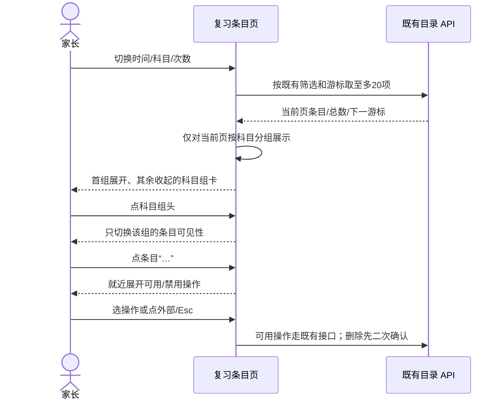
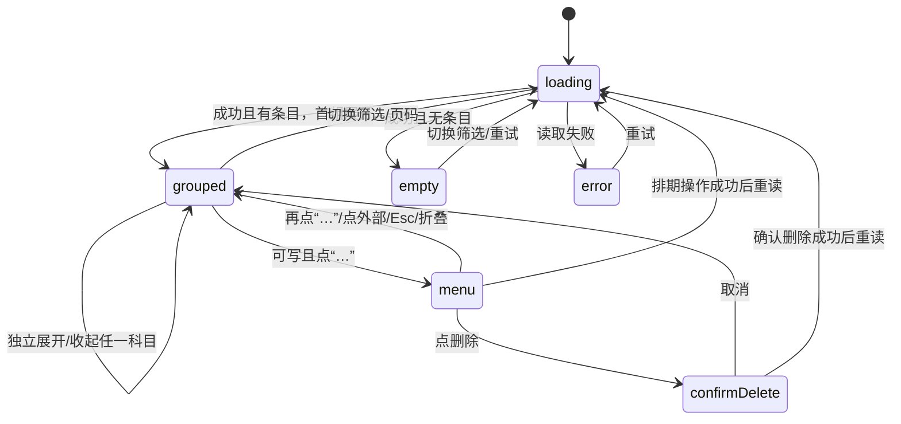

# FEAT-001 — 复习条目按科目卡片展示（Spec Lite）

- Status: VERIFYING
- Risk: R1（只改小程序复习条目页的展示，不改服务端或反馈）
- Owner: 产品负责人（用户）
- Implementer: Codex
- Reviewer: 实现完成后的只读审查者
- Date: 2026-10-07
- Spec revision: SPEC-20261007-REVIEW-GROUP-CARDS-05
- User confirmation: -04 已由产品负责人（用户）在本会话消息“好的 按照这个方式修改代码 然后部署前端”确认；-05 是针对三张原生布局错误截图的唯一待确认修订，产品负责人（用户）于 2026-10-07 在本会话回复“修改代码 并测试”，明确批准按 -05 实施和验证。DREV-20261007-REVIEW-GROUP-CARDS-01 的视觉目标不变。
- Affected Feature IDs: FEAT-001
- Feature current-state documents: `docs/domain/features/FEAT-001-push-kids-mvp.md`
- Feature baseline revision: FEAT-STATE-20261006-REVIEW-MANAGEMENT-03-LOCAL；公平排期修订仍在 VERIFYING
- Feature merge owner: Codex

## Frontend Design Impact and Repository-native Approval

- Frontend impact: yes — 复习条目列表采用用户提供的“复习安排”科目卡片形式
- Frontend engineering impact: yes — 同页展示分组、列表节点与响应式几何
- Affected UI IDs: UI-001
- UI current-state documents: `docs/design/frontend/ui/UI-001-parent-miniapp.md`
- Frontend baseline revision: FDB-20260913-04（APPROVED）
- Frontend engineering constraint revision: FEC-20261007-NATIVE-GEOMETRY-02（用户于 2026-10-07 批准 -05 后更新）
- Affected frontend quality dimensions: component/state/responsive/a11y/i18n/performance/privacy
- Frontend quality budgets/requirements: 320×568、390×844、430×932；正文≥14px；触控≥44px；主包≤1.5MiB；FEC-PERF-READ-001..004
- Frontend quality verification plan: 分组/分页/切换/迟到响应状态测试、`npm test`、`npm run lint:miniapp`、`uv run python tools/validate_miniprogram.py`、设计证据校验、原生三视口与iOS/Android走查
- Approved frontend engineering deviations: none
- Current Design Revision(s): DREV-20261006-REVIEW-MANAGEMENT-03、DREV-20261007-FAIR-REVIEW-01
- Editable design source path(s): `docs/design/frontend/prototypes/DREV-20261007-REVIEW-GROUP-CARDS-01/index.html`
- Design source SHA-256: 见候选快照清单
- Proposed Design Revision: DREV-20261007-REVIEW-GROUP-CARDS-01
- Required viewport/state exports: time/count/count-input/count-custom?n=7/folded/subject/empty/long/readonly/actions × 三视口
- Prototype status: AWAITING_EXPORT（原截图仍是旧底部面板版本，需重导出）
- Approved Task Spec revision: SPEC-20261007-REVIEW-GROUP-CARDS-05（2026-10-07 用户“修改代码 并测试”）
- Approved Design Revision: DREV-20261007-REVIEW-GROUP-CARDS-01（交互与布局方向获确认；快照待重导出）
- Design approval evidence: 本会话用户消息“好的 按照这个方式修改代码 然后部署前端”；Manifest 仍为 AWAITING_EXPORT，发布前必须补齐证据
- Snapshot manifest path: `docs/design/frontend/snapshots/UI-001/DREV-20261007-REVIEW-GROUP-CARDS-01/APPROVAL.md`
- Permitted implementation deviations: none
- UI current-state merge owner: Codex
- UI current-state merge evidence: 本地已验证的页面状态已补入 `UI-001-parent-miniapp.md`；新版设计证据与发布状态仍未通过
- Frontend visual/a11y/resolution verification: 320px、430px 原生页面截图和 390px CUA 模拟器画面已人工检查筛选行、条目与就近菜单；三视口候选设计导出和真机走查待完成
- Frontend engineering verification evidence: 微信原生 `selectorQuery().fields({rect:true,size:true})` 在 320×568、390×844、430×932 的 time/subject/count 共 9 组和各一组打开菜单的矩形均通过专用审计；各视口“…”为 44×44px，筛选无重叠或越界。数字证据仅存本机临时目录，不含儿童文字或 ID。
- External design dependency: none

## 1. Problem and outcome

现有“复习条目”每项各占一张卡，科目、次数、日期与状态纵向堆叠。用户在本会话实际查看小程序后，要求采用其 2026-10-07 附图中的“复习安排”科目卡片形式，随后要求像复习项目一样可以折叠，并明确取消截图中的“调整复习安排”底部面板，改为点击条目右侧“…”就近弹出下拉菜单。前一轮反馈指出候选稿把“指定次数”写死成4次、科目与次数筛选按钮宽度不齐；本轮三张原生截图进一步显示“…”按钮被拉成大块、三列筛选按钮相互顶住并在换行时形成不规则宽度。目标是在相同筛选与服务端数据下，按科目形成可扫读、可逐科展开的组卡，让筛选区整齐响应视口，并把条目标题、次数、安排状态和操作放在展开后的连续行内，同时用原生几何检查拦住这类静态测试遗漏的布局回归。附图是视觉/信息层级参考，不授权把今日的“完成”反馈、原题提示或图片入口新增到目录页。

## 2. Scope

### In scope

- 复习条目的按时间、科目、次数三个视图统一采用暖白科目组卡：松绿左缘、科目字标、组标题/本页项数、组内分隔线。
- 每个条目显示完整可换行标题、已复习次数、最近复习日、建议/家长安排日期、明确的安排状态和不小于44px的“调整”入口。
- 每个科目组头都是独立的展开/收起按钮，显示科目与本页项数、适用时的“预计安排”标记和方向箭头；默认展开当前页第一组，其余收起。可以同时展开多组；收起仅隐藏组内行，不改查询或待办状态。筛选、页码、孩子或页面上下文变化时，新结果按第一组展开的默认状态重建。只读用户也能开合。
- 条目尾部“…”打开贴近该按钮的非模态下拉菜单，显示“加入明天复习”“改到后天复习”“删除条目”；沿用既有可用/禁用条件和操作 API。一次只打开一个菜单；再次点同一“…”、点菜单外、按 Esc、折叠科目或切换结果时关闭；靠近视口底部时向上弹，菜单不得横向溢出或遮挡本行操作。删除仍进入既有二次确认，保存/冲突/错误仍有明确反馈。
- 筛选按钮按视图使用等宽响应布局：时间两列，科目与次数三列；行内等宽同高，长标签换行，320/390/430 宽度均不横向溢出。实际科目数量变化时继续按三列流入后续行，不使用写死像素宽度。
- “指定次数”是输入入口，不是预设4次。未输入时始终显示“指定次数”；只有用户输入并确认合法非负整数后，所选按钮才显示该值（如“7次”）。保留现有指定次数范围和筛选 API；原型的 `n=7` 仅是显式输入后的合成示例，不代表默认值。
- 先按服务端既有游标取至多20项，再在**本页内**按科目做纯展示分组；科目顺序取本页第一次出现顺序，各组内保留原返回顺序。组数/项数不冒充全量或计划优先级；下一页重新分组。
- 按时间视图把“计划复习”改为“预计安排”，保留未来只读预览随进度变化的说明；“等待安排”仍表示今日状态，不冒充明天已经物化。
- 0项时只留单一空态说明，避免“0项/约0分钟”与空态重复。
- 修正原生布局：条目“…”必须是固定 44×44 逻辑像素的可点击目标，不挤压标题/元数据列；科目/次数筛选三列、日期筛选两列，同排等宽且按钮外边缘留出明确间距，任何按钮不得越过容器或与邻项重叠。设计目标与既有 DREV 一致，不改变 API 或交互语义。
- 对三视口的原生页面增加节点矩形量测与截图走查：检查按钮尺寸、筛选同行等宽、水平/垂直间距、容器边界和重叠；将这类必检项写入前端工程约束与测试策略。静态 CSS/HTML 预览不得作为原生几何通过的替代。

### Non-goals

- 不加“完成”反馈、勾选、原题提示或来源图片；不改今日页和报表图表。
- 不改服务端排序/分页/预览算法、30分钟预算、日期与状态语义、调整/删除的业务条件及 API。
- 不把跨页同科目拼成完整总组，不下载全量条目到客户端。

### Must not change

家长确认、实际反馈才增加复习次数；未来预览不写计划。只读者不出现调整入口；错误与迟到响应仍遵循现有家庭/孩子上下文边界。

### Feature current-state impact

实现验收后更新 FEAT-001 的目录展示说明与 UI-001 当前状态；未实施前本候选不写成当前事实。

## 3. Impact map and design views

### Link/call graph

```text
报表复习条目入口 → review-inventory/index.js 有界请求 → review-inventory/index.wxml 展示分组 → 条目“…”下拉菜单 → 既有 schedule/delete API（删除另经确认）
```

### Sequence diagram



### State machine



### Architecture diagram


### Trade-offs

| Option | Benefit | Cost/risk | Decision |
|---|---|---|---|
| 服务端按科目重排并重新分页 | 全局完整组 | 改API/游标与排序，超出视觉诉求 | 不选 |
| 本页按科目分组 | 贴近附图，保持20项有界读取 | 跨页同科目可重复出现；全局次数顺序不再逐行连续 | 选用，并标“本页” |
| 每科独立折叠，首科默认展开 | 进入长列表时保持扫描密度，也能同时比较多个科目 | 折叠状态不跨筛选/页码保存 | 选用；新结果重置展开状态 |
| 筛选按视图使用等宽网格 | 同行按钮对齐，标签变化时不乱跳 | 可能比紧贴文字的按钮占更多宽度 | 选用；时间2列、科目/次数3列 |
| 条目“…”锚定下拉菜单 | 操作就近、不中断列表阅读 | 需要处理视口边缘、层级、焦点与点外关闭 | 选用；近底部向上弹 |
| 全屏遮罩底部面板 | 可容纳说明文字 | 遮挡列表，用户明确不要 | 不选 |
| 每条独立卡只换颜色/圆角 | 修改小 | 达不到截图的科目组视觉与密度 | 不选 |
| 继续使用 Grid 与原生 `button` 的裸宽度 | 改动少 | 当前原生截图已出现内容盒溢出、控件尺寸异常；静态检查未拦住 | 不选 |
| 筛选项改为百分比单元容器，按钮 `border-box`；“…”脱离伸缩行并显式限定宽高 | 由外层单元负责轨道，控件自身不争夺布局宽度 | 多一层轻量视图、需量测原生矩形 | 选用 |
| 只加静态 CSS 文本断言 | 易自动化 | 无法证明微信原生计算后尺寸，仍可能漏掉相同错误 | 不作为唯一验收；结合原生几何脚本/记录 |

## 4. Expected file changes

| File/path | Action | Intended change |
|---|---|---|
| `apps/miniprogram/pages/review-inventory/index.js` | modify | 从当前页数据导出展示组、处理每组开合与单个操作菜单状态，不新增请求 |
| `apps/miniprogram/pages/review-inventory/index.wxml` | modify | 可折叠科目组卡、锚定下拉菜单和单一空态；保留筛选/指定次数输入与删除确认 |
| `apps/miniprogram/pages/review-inventory/index.wxss` | modify | 三视口组卡/菜单定位、筛选等宽响应、换行、层级与触控几何 |
| `tests/frontend/review-inventory.test.js` | modify | 有界展示分组、筛选/指定次数/分页、菜单开合/禁用/确认、状态与只读回归 |
| `docs/design/frontend/FRONTEND-ENGINEERING-CONSTRAINTS.md`、`docs/quality/TEST-STRATEGY.md` | modify | 增加原生控件尺寸、行列间距、重叠与跨视口量测门禁 |
| `tools/` 或 `tests/frontend/` 中专用几何审计脚本及证据 | add | 读取微信原生节点矩形，断言三视口两列/三列与 44×44 操作目标；保留可审查结果 |
| `docs/domain/features/FEAT-001-push-kids-mvp.md`、`docs/design/frontend/ui/UI-001-parent-miniapp.md` | modify after verification | 更新当前事实 |

Final authoritative path: 现有 review-inventory 页面。旧的逐条 `.entry` 卡片改为组内条目，不另建并行目录。

## 5. Acceptance criteria and test points

| ID | Given/when | Then |
|---|---|---|
| AC-01 | 明天预览包含多科、同科多项 | 单个本页科目组卡含多个条目；组标题/计数、日期、次数、状态与调整可读；无完成按钮 |
| AC-02 | 按科目/次数筛选、指定次数或翻页 | 筛选语义与服务端游标不变；只对当前页分组，组内次序保留；无整库读取 |
| AC-03 | 空、错误、加载、只读、长中文 | 各有明确状态；无重复0统计；长文自动换行；只读无调整 |
| AC-04 | 明后天预览 | 标为预计安排，与条目当前“等待安排”不混同为已物化 |
| AC-05 | 320/390/430宽度 | 无横向溢出、遮挡或低于44px的操作目标；原生与预览证据分开 |
| AC-06 | 多科结果，进入页面及点组头 | 第一组展开，其余收起；点击只切换当前科，组头项数持续可见；可同时展开多科；收起组的条目操作不能触达 |
| AC-07 | 切换筛选/分页/孩子或只读 | 新结果重置默认开合；只读可展开但无调整；不会重新请求或改动后台记录 |
| AC-08 | 可写条目点“…” | 仅该条旁弹出一个非模态菜单；保留三个既有操作及禁用条件；无全屏遮罩或旧调整面板 |
| AC-09 | 菜单开着，点外部/Esc/另一“…”/折叠；靠近屏幕底部 | 按预期关闭或切换；焦点可恢复；菜单在视口内上/下定位，不盖住触发按钮；只读无菜单 |
| AC-10 | 选择删除/排期，或遇409/403/保存中 | 删除先二次确认；业务条件、API、冲突与错误恢复不变 |
| AC-11 | 时间/科目/次数筛选，320/390/430视口 | 时间两列，科目/次数三列；同行等宽，长标签安全换行，科目数量变化可续行；无水平溢出 |
| AC-12 | 首次进入按次数/点击指定次数/输入0、7或非法值 | 首次显示“指定次数”，不预设4；合法确认后显示用户输入的次数并按该值筛选；非法值给出可见错误且不查询 |
| AC-13 | 三视口打开含多科/多次数筛选及长标题的原生复习条目页 | “…”节点宽高各 44±1px，标题和元数据不被按钮侵占；筛选两/三列同行宽度差≤1px、相邻边缘间距≥8px、行间距≥8px、无重叠或越界；第四个科目安全换行 |

| Test point | AC | Level/command | Required result |
|---|---|---|---|
| TP-01 | 01/02/03/04/06..12 | `node --test tests/frontend/review-inventory.test.js` | 全通过 |
| TP-02 | 01..12 | `npm test`、`npm run lint:miniapp`、`uv run python tools/validate_miniprogram.py` | 全通过 |
| TP-03 | 05 | 三视口设计快照与manifest校验；原生节点几何/DevTools、iOS/Android阅读走查 | 设计与原生证据各自记录 |
| TP-04 | 边界 | `uv run python tools/check_architecture.py` | 通过 |
| TP-05 | 13 | 微信开发者工具原生节点矩形采集和三视口截图；专用审计脚本校验尺寸、间距、重叠、边界 | 320×568、390×844、430×932 各通过；截图人工确认文字换行与菜单位置 |

## 6. Verification and completion

用户已确认 -05 原生布局修复及质量门禁增强；当前为验证中。筛选单元与按钮的盒尺寸、“…”固定目标和标题/元数据留白已修正，工程约束与测试策略已加入原生矩形门禁。三个视口的原生矩形和专用审计通过，320/390/430 模拟器画面已人工检查；新版设计导出与真机走查尚未完成，不能把旧版截图用于发布。

| Test point | Result | Evidence |
|---|---|---|
| TP-01 | PASS | `node --test tests/frontend/review-inventory-geometry.test.js tests/frontend/review-inventory.test.js`：15/15，其中新增几何审计正例及三类负例共4项。 |
| TP-02 | PASS (direct Python) | `npm test`：207/207；`npm run lint:miniapp`：通过；`npm run check:miniapp`：MINIPROGRAM_VALID pages=16 source_bytes=712564。曾尝试的 `uv run python tools/validate_miniprogram.py` 因本机 uv 缓存访问 EPERM 未通过该入口，已用直接 Python 执行同一校验脚本。 |
| TP-03 | PARTIAL | `npm run check:design-evidence`：DESIGN_EVIDENCE_VALID（当前已批准基线）。针对新版 DREV 单独运行 `validate_design_evidence.py --manifest` 返回 DESIGN_EVIDENCE_INVALID：Manifest 为 AWAITING_EXPORT，三视口新版导出缺失。320/430px 原生截图与390px CUA模拟器画面已人工检查；iOS/Android 真机走查未运行。 |
| TP-04 | PASS | `python3 tools/check_architecture.py`：ARCHITECTURE_VALID checked=3 |
| TP-05 | PASS | 微信原生 `selectorQuery` 在 320/390/430px 分别采集 time/subject/count 和打开菜单共 12 组数字矩形，`node tools/review_inventory_geometry.js audit` 全部通过：日期两列、科目/次数三列与第四科目续行等宽；相邻按钮间距至少8px，“…”均44×44px，长标题避让，菜单留在视口内且不盖住触发按钮。数字 JSON 存在本机 `/private/tmp/push-kids-native-*.json`，不含儿童文字或 ID；320/430 原生截图仅存本机临时目录，390 CUA 截图与展开菜单在本会话人工检查通过。 |

- [x] Spec revision 与 Design Revision 的实现方向获明确批准；快照/Manifest 待补齐。
- [x] 按批准范围修改页面与定向测试，并执行可用的自动检查。
- [x] -05 获明确批准。
- [x] 修正原生几何并把量测门禁写入工程约束；320/390/430 三视图及菜单的原生数字矩形验证通过。
- [ ] 补齐设计/原生证据和发布门禁，再合并最终事实、评估 `DONE` 并移至 `specs/completed/`。
