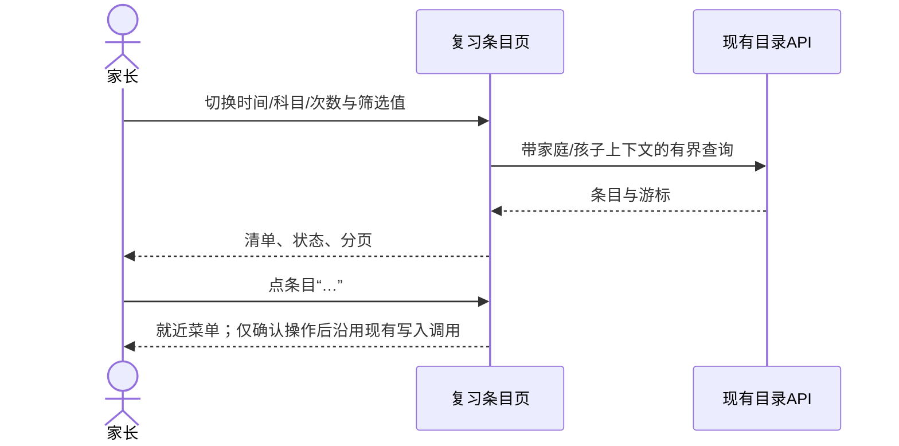

# FEAT-001 — 复习条目清单式改版（Spec Lite）

- Status: VERIFYING
- Risk: R1（仅小程序目录页视觉与本地交互布局，不改服务端事实）
- Owner: 产品负责人（用户）
- Implementer: Codex
- Reviewer: 产品负责人（用户）
- Date: 2026-10-10
- Spec revision: SPEC-20261010-REVIEW-INVENTORY-REDESIGN-01
- User confirmation: 产品负责人于2026-10-10在审阅效果图和方案后回复“好的按照这个方案实现”，批准本 Spec revision 与 DREV-20261010-REVIEW-INVENTORY-02 的生产实现
- Affected Feature IDs: FEAT-001
- Feature current-state documents: `docs/domain/features/FEAT-001-push-kids-mvp.md`
- Feature baseline revision: 当前目录页本地事实见 FEAT-001 与 `SPEC-20261007-REVIEW-GROUP-CARDS-05`
- Feature merge owner: Codex（实际实现和验证后）

## Frontend Design Impact and Repository-native Approval

- Frontend impact: yes — 精简目录页层级，改变筛选呈现与单科条目布局
- Frontend impact reason: 真机截图显示重复标题、两层宽筛选、逐项大卡和被拆行日期占用过多首屏空间
- Frontend engineering impact: yes；本次实现小程序运行代码
- Frontend engineering impact reason: 未来需修改目录页 WXML/WXSS/JS 状态呈现、交互测试和原生几何审计
- Affected UI IDs: UI-001
- UI current-state documents: `docs/design/frontend/ui/UI-001-parent-miniapp.md`
- Frontend baseline revision: FDB-20260913-04（APPROVED）
- Frontend engineering constraint revision: FEC-20261007-NATIVE-GEOMETRY-02（APPROVED）
- Affected frontend quality dimensions: component/state/form/responsive/a11y/i18n/performance/privacy
- Frontend quality budgets/requirements: 320×568、390×844、430×932；正文≥14px；触控≥44px；有界目录每页20项；主包≤1.5MiB
- Frontend quality verification plan: 候选SVG/PNG 4状态×3视口与SHA清单；批准后测试筛选、分页、折叠、菜单、权限、迟到响应及三视口原生矩形/真机
- Approved frontend engineering deviations: none
- Current Design Revision(s): DREV-20261007-REVIEW-GROUP-CARDS-01（既有实现方向，证据仍待补）
- Editable design source path(s): `docs/design/frontend/prototypes/DREV-20261010-REVIEW-INVENTORY-02/*.svg`
- Design source SHA-256: 候选清单 `docs/design/frontend/snapshots/UI-001/DREV-20261010-REVIEW-INVENTORY-02/APPROVAL.md`
- Proposed Design Revision: DREV-20261010-REVIEW-INVENTORY-02
- Required viewport/state exports: time/subject/count/actions × 320×568、390×844、430×932；实施验收补 selector-open/empty/readonly/error/long/delete-confirm 等状态
- Prototype status: APPROVED
- Approved Task Spec revision: SPEC-20261010-REVIEW-INVENTORY-REDESIGN-01
- Approved Design Revision: DREV-20261010-REVIEW-INVENTORY-02
- Design approval evidence: 用户2026-10-10回复“好的按照这个方案实现”
- Snapshot manifest path: `docs/design/frontend/snapshots/UI-001/DREV-20261010-REVIEW-INVENTORY-02/APPROVAL.md`
- Permitted implementation deviations: none
- UI current-state merge owner: Codex
- UI current-state merge evidence: pending；候选效果图不写成当前生产事实
- Frontend visual/a11y/resolution verification: 12张合成SVG/PNG的视觉与像素尺寸检查；原生与真机待实现后验证
- Frontend engineering verification evidence: `docs/quality/evidence/REVIEW-INVENTORY-REDESIGN-20261010.md`；本地代码和三视口模拟器已验证，真机待完成
- External design dependency: none

## 1. Problem and outcome

用户的2026-10-10真机截图显示：原生导航和内容重复写“复习条目”，解释文字占用多行，查看方式与筛选并列成两排宽控件，按科目或按时间仅首屏显示一两项；逐条大卡还把日期拆成两行，“调整”孤立于内容右下角。目标是保持纸芽视觉和全部业务事实，用紧凑的一层筛选及可扫读清单，让家长在首屏更快找到条目和其当前状态。

## 2. Scope

### In scope

- 原生导航继续显示页面名，内容区取消重复大标题和泛化说明。
- 按时间保留双日选择；按科目/次数收为一个显示已选值的选择入口，不隐藏现有可选值或指定次数的确认步骤。
- 时间/次数视图按当前页科目成组，可独立折叠；单科视图直接展示带分隔线的清单，避免重复科目组头。
- 每行保留完整可换行标题、准确复习次数、最近复习、建议/家长安排日期与当日安排状态；固定44×44“…”就近菜单。
- 显式区分未来预计和今日已安排；明日预览不会写成确定计划。
- 设计候选包含时间、科目、次数和菜单四个状态，三视口精确导出；方向确认后补齐其他风险状态再实施。

### Non-goals

- 本轮不部署、不改服务端API、预算/排期/反馈/删除语义。
- 不把原有来源照片、完成反馈或掌握预测塞入目录页。

### Must not change

目录查询仍有界分页且家庭/孩子隔离；复习次数只能由真实反馈改变；只读用户不能出现写操作，删除需二次确认。

### Feature current-state impact

实现并验证后更新 FEAT-001 目录展示描述和 UI-001 当前状态，保留旧 Spec 历史证据。

## 3. Impact map

- Entry/caller: 报表的复习条目入口 → `pages/review-inventory/index`
- Authoritative path after approval: 该页 WXML/WXSS/JS 的筛选与展示层
- Dependencies/callees: 现有目录分页/科目游标/调整/删除 API，不改合同
- Existing tests: `tests/frontend/review-inventory.test.js` 与原生 `tools/review_inventory_geometry.js`
- Behavior/architecture docs: FEAT-001、UI-001、FDB-20260913-04、FEC-20261007-NATIVE-GEOMETRY-02

## 4. Required design views

### Link/call graph

```text
报表入口 → 复习条目页 → 单层筛选 → 现有有界查询 → 时间/次数分组或单科清单 → “…” → 现有排期/删除调用
```

### Sequence diagram



### State machine

```text
time/subject/count → 选筛选值 → loading → loaded/empty/error
loaded → 展开/收起科目（仅time/count） → loaded
loaded → 打开“…” → 菜单开 → 关闭/排期/删除确认 → loaded/保存中/冲突
```

### Architecture diagram


### Trade-offs

| Option | Benefit | Cost/risk | Decision |
|---|---|---|---|
| 保持两层多按钮和逐项卡 | 改动小 | 继续重复、首屏密度低，窄屏换行风险高 | 不推荐 |
| 科目/次数横向滑动胶囊 | 首屏高度低 | 隐藏可选项，违反普通页面不依赖横向拖动的基线 | 拒绝 |
| 单层当前值选择器 + 清单 | 保留选择能力，首屏显示更多知识，视觉接近今日页纸面分组 | 需补充分层选择器的展开/错误状态与原生验收 | 推荐，待审阅 |

## 5. Expected file changes and deletion plan

| File/path | Action | Intended change | Why required |
|---|---|---|---|
| `docs/design/frontend/prototypes/DREV-20261010-REVIEW-INVENTORY-02/` | add | 可编辑SVG/生成脚本与页面规格 | 本轮候选设计 |
| `docs/design/frontend/snapshots/UI-001/DREV-20261010-REVIEW-INVENTORY-02/` | add | 三视口PNG和SHA清单 | 审阅与证据 |
| `apps/miniprogram/pages/review-inventory/index.{wxml,wxss,js}` | modified | 单层筛选、清单、菜单适配 | 已获批准的本地实现 |
| `tests/frontend/review-inventory.test.js`、原生几何审计 | modified | 交互和三视口回归 | 防止重复错误 |
| FEAT-001、UI-001 当前状态 | modified | 合并本地已验证事实及待验收项 | 不把本地实现写成发布事实 |

Final authoritative path: 现有复习条目页。Old path/logic to delete: 重复大标题、泛化介绍、两层铺满按钮、逐项卡片；仅在批准并验证实现后删除。

## 6. Acceptance criteria

- AC-001：三个视图都只显示一层筛选；原生导航标题不在内容区重复，320/390/430 不出现横向溢出。
- AC-002：时间/次数分组能独立折叠，单科视图不重复科目卡头；当前页项数与服务端总数不混淆。
- AC-003：每行准确呈现次数、最近复习、日期和状态；44×44菜单不遮挡标题，320px菜单完整落在视口内。
- AC-004：科目分页、指定次数确认、只读/空/错误/冲突/保存和删除确认仍按原合同运行。

## 7. Required test points

| Test point | AC | Level/command | Required result |
|---|---|---|---|
| TP-001 | 001–003 | `render.py`、`rsvg-convert`、候选Manifest `--allow-pending` | 4状态×3视口导出与SHA一致 |
| TP-002 | 001–004 | 前端定向测试与 `npm test`（实施后） | 全通过 |
| TP-003 | 001–003 | 320/390/430微信原生矩形与截图（实施后） | 无重叠/越界，触控≥44px |
| TP-004 | 004 | iOS/Android真机路径（实施后） | 筛选/菜单/权限/错误可读可操作 |

## 8. Plan and verification

1. 用户已批准本 Spec 与 DREV；批准信息先写入本 Spec 和设计 manifest，随后实施本地小程序代码。
2. 已验证交互、静态、三视口原生矩形；仍需补风险状态导出及 iOS/Android 真机验收。

| Test point | Result | Evidence |
|---|---|---|
| TP-001 | PASS | `render.py` 生成12个SVG，`rsvg-convert` 导出12张PNG；批准后 `python3 tools/validate_design_evidence.py --manifest .../APPROVAL.md` 及 `--check-current-policy` 均返回 DESIGN_EVIDENCE_VALID。 |
| TP-002 | PASS | 定向18/18、`npm test` 216/216、ESLint与小程序静态校验通过。 |
| TP-003 | PASS（模拟器） | 微信原生320/390/430十组数字矩形审计通过，含时间菜单、320px向上菜单及科目/次数展开态；证据见 `docs/quality/evidence/review-inventory-redesign-20261010/`。 |
| TP-004 | NOT_RUN | iOS/Android真机尚未验收；风险状态设计导出仍待补。 |

## 9. Completion

本地小程序实现完成且自动化与模拟器几何通过；未上传或发布。iOS/Android真机与补充风险状态证据未完成，故保持 `VERIFYING` 并留在 `active/`，不标记 DONE。工作树中的 `OPS-20261010-CLOUD-COST-RETENTION.md` 与本 Spec 无关，保持原样。
