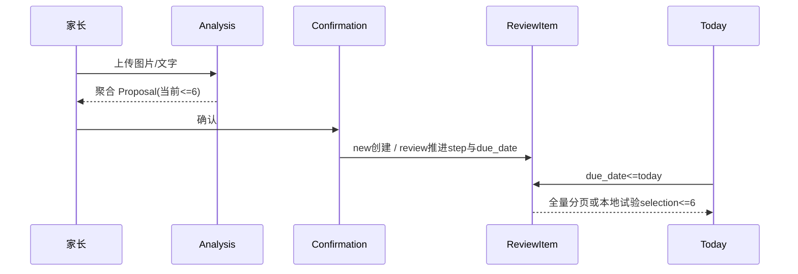
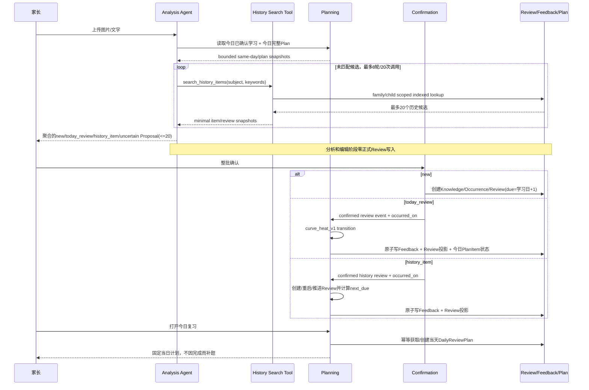
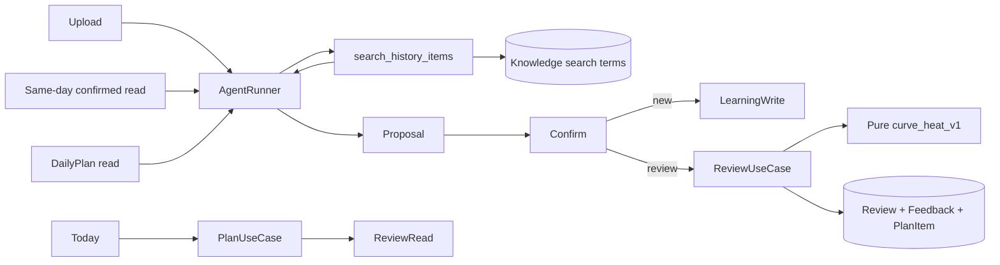
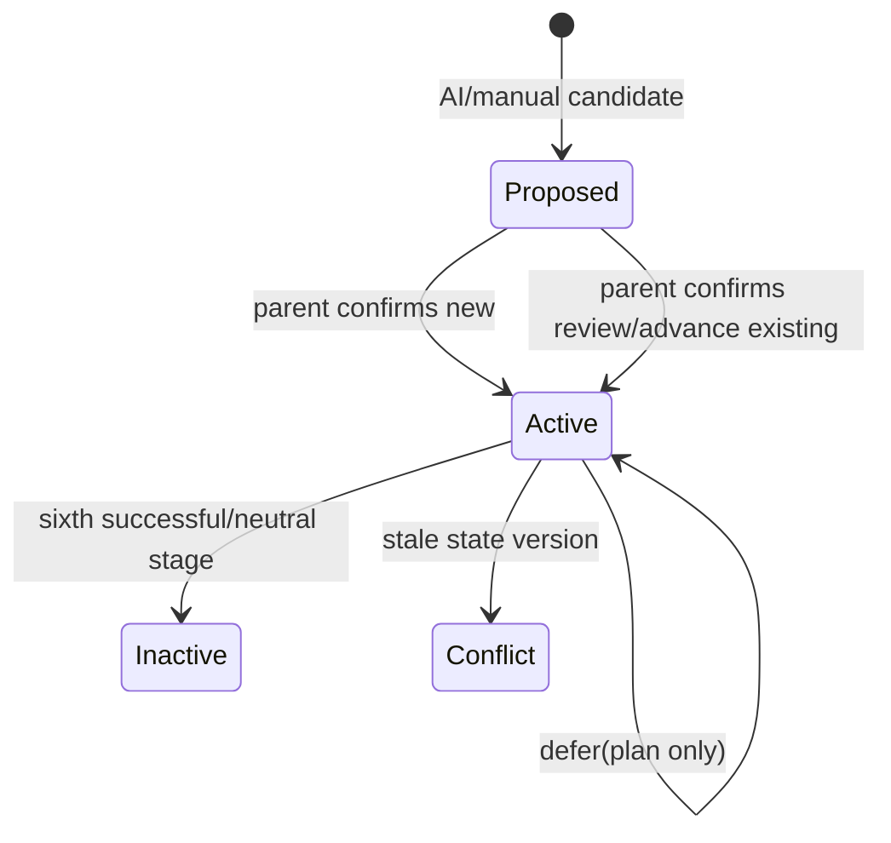
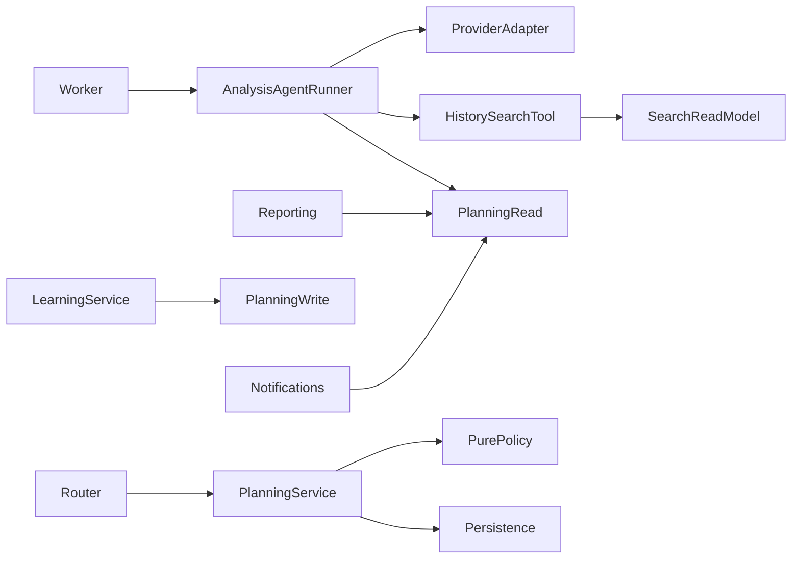
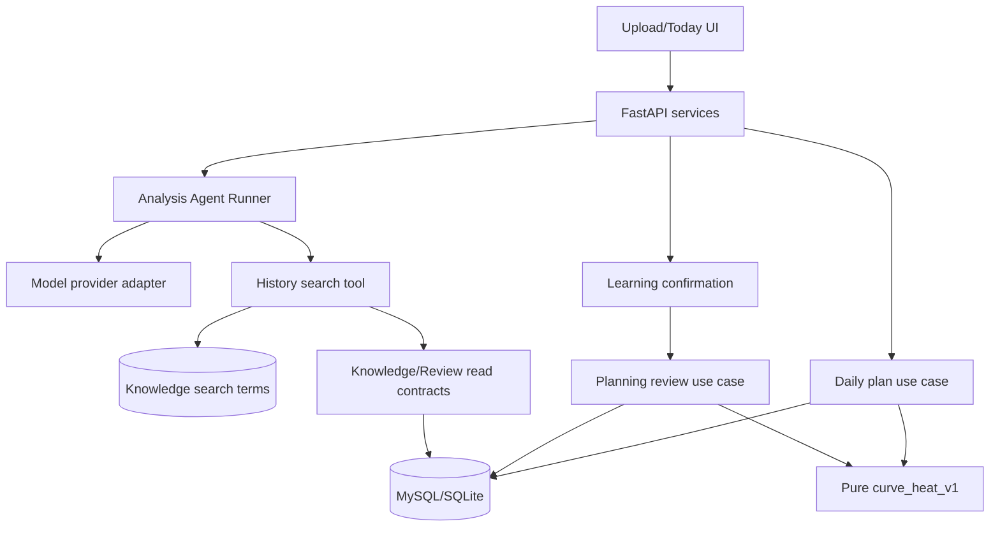

# FEAT-001 — Item 生成、每日复习与自适应复习策略统一设计

- Status: `VERIFYING`
- Risk: `R3`
- Spec owner: 产品负责人（用户）
- Implementer: `Codex（批准后）`
- Reviewer: `TBD（产品、后端、数据、学习科学、前端）`
- Verifier: `Codex + 用户真实材料/体验验收`
- Created: 2026-09-13
- Last updated: 2026-09-13
- Target release: `Mini Program development version 0.1.8 after frontend approval and verification`
- Spec revision: `SPEC-UNIFIED-REVIEW-20260913-04`
- User confirmation: `APPROVED；用户于 2026-09-13 回复“批准”，承接对 SPEC-UNIFIED-REVIEW-20260913-04 + DREV-20260913-UNIFIED-REVIEW-01 的精确批准请求`
- Additional R2/R3 approval: `后端 Agent/tool、数据、复习算法和积压架构、仓库原生设计证据治理及 DREV-20260913-UNIFIED-REVIEW-01 均已批准`
- Affected Feature IDs: `existing FEAT-001`
- Feature current-state documents: `docs/domain/features/FEAT-001-push-kids-mvp.md`
- Feature baseline revision: `FEAT-STATE-20260913-BOUNDED-REVIEW-BACKEND-01-LOCAL`
- Feature merge owner: `Codex（实现验证后）`
- Supersession plan: 本 Spec 已取代未批准草案 `SPEC-FULL-DUE-CONTEXT-20260913-01`、
  `SPEC-REVIEW-V2-20260907-01`，获批后再替代 `SPEC-REVIEW-LOAD-20260913-03` 中的每日 6 条稳定随机抽样；
  后者已验证的聚合 Prompt、new/review 确认分流、提前复习能力继续保留

## Frontend Design Impact and Repository-native Approval

- Frontend impact: `yes — Today 从全量到期/试验性 6 条抽样改为一次生成的当日复习计划；排序、积压摘要、完成后不补题可见`
- Frontend impact reason: 用户每天实际看到的 Review 集合和状态变化发生改变
- Frontend engineering impact: `yes — 新增 daily plan read model、计划项状态、兼容旧 Todo 字段和上传确认联动`
- Frontend engineering impact reason: Today 数据合同和状态机改变，但不增加家长设置或选择步骤
- Affected UI IDs: `UI-001（今日、上传确认）`
- UI current-state documents: `docs/design/frontend/ui/UI-001-parent-miniapp.md`
- Frontend baseline revision: `FDB-20260913-04`
- Frontend engineering constraint revision: `FEC-20260913-LOCAL-DESIGN-EVIDENCE-01`
- Affected frontend quality dimensions: `component/state/form/responsive/a11y/i18n/browser-device/performance/security/privacy/observability`
- Frontend quality budgets/requirements: `320×568、390×844、430×932；触控目标>=44px；不出现评分/掌握文案；不在 Storage/日志保存儿童正文`
- Frontend quality verification plan: `0/1/正常/积压/上传命中今日项/历史复习/完成不补题/失败/并发状态；三视口原生几何；iOS/Android`
- Approved frontend engineering deviations: `none`
- Current Design Revision(s): `DREV-20260913-UNIFIED-REVIEW-01（APPROVED）`
- Editable design source path(s): `docs/design/frontend/prototypes/DREV-20260913-UNIFIED-REVIEW-01/today-plan-390.svg；confirm-kinds-390.svg`
- Design source SHA-256: `today-plan=385d89c8fc16aa4ad98677d23bc8757272f572bd6aa47e30b6973dc574128875；confirm-kinds=606029185a92a1954129c6f3366b1049911f3ed747156594e06465d57e577d87`
- Proposed Design Revision: `DREV-20260913-UNIFIED-REVIEW-01`
- Required viewport/state exports: `三视口；上述全部状态`
- Prototype status: `APPROVED；320×568、390×844、430×932 的 Today/confirm 本地候选已冻结`
- Approved Task Spec revision: `SPEC-UNIFIED-REVIEW-20260913-04`
- Approved Design Revision: `DREV-20260913-UNIFIED-REVIEW-01`
- Design approval evidence: `产品负责人（用户）于 2026-09-13 回复“批准”，精确批准 SPEC-UNIFIED-REVIEW-20260913-04 + DREV-20260913-UNIFIED-REVIEW-01；冻结 manifest 中六张候选图及 SHA-256`
- Snapshot manifest path: `docs/design/frontend/snapshots/UI-001/DREV-20260913-UNIFIED-REVIEW-01/APPROVAL.md`
- Permitted implementation deviations: `none`
- UI current-state merge owner: `Codex`
- UI current-state merge evidence: `UI-001 updated for stable Today plan and three-kind confirmation presentation`
- Frontend visual/a11y/resolution verification: `repository-native 320/390/430 approval exports PASS；real AppID preview compile PASS；native device viewport matrix/iOS/Android NOT_RUN`
- Frontend engineering verification evidence: `frozen 0.1.7 baseline + approved frontend diff: 165 tests, ESLint and Mini Program validator PASS；0.1.8 development upload PASS`
- External design dependency: `none；不免除自动检查、三视口原生几何和 iOS/Android 体验`

## 0. Executive summary

### Problem

现有设计分别讨论了 Item 聚合、今日复习抽样和 Review Policy V2，存在重复与冲突：是否限制 6 条、
Prompt 应看到哪些 Review、复习事实和计划日期是否共用一个字段、积压是否改期、是否要求家长选择节奏。
若把未选中的到期项每天批量改成明天，会制造 O(backlog) 写放大、丢失原始到期事实，并把“没有复习”
伪装成一次状态变化。

### Intended outcome

保持唯一用户路径：`上传 → 确认 → 复习`。分析从“单次大 Prompt”升级为受控 Agent loop：首轮只发送
本次材料、孩子学习配置、今日已确认学习和今日完整复习计划；模型对尚未匹配的候选生成关键词，通过
family/child scoped 的只读工具检索历史 Item，必要时有限次改写关键词并再次检索，最后分类为 `new`、
`today_review` 或 `history_item`。家长确认前零正式写入；确认后，新知识新增 Item/Review，今日复习推进
原 Review 并完成对应 PlanItem，其他历史知识推进或重启原 Review。三类都由 planning 的确定性算法计算
下一计划日。每天只生成一个受分钟预算约束的计划，不固定限制 6 条；积压不批量改 Review 日期。

### Why now

当前 6 条后端方案尚未正式发布 UI，ReviewItem 又缺少可直接索引的最近复习日和计数。统一设计后再实现，
可以避免先发布抽样再迁移，同时用有界查询和有限写入控制真实积压下的数据库压力。

## 1. Facts, decisions, assumptions, questions

### Confirmed facts

| ID | Fact | Evidence |
|---|---|---|
| `F-001` | 当前 Prompt 已实现 child-aware 适度聚合、三种规范方法和 new/review 候选 | `agent_processing/prompt.py`、`contracts.py` |
| `F-002` | 当前 ReviewItem 只有 `step/due_date/last_feedback/active`，没有 `last_reviewed_on/review_count` | `persistence/models.py` |
| `F-003` | ReviewFeedback 保存每次事件时间；当前读取最近复习日需要对反馈表做 `max(occurred_at)` 聚合 | `planning/service.py` |
| `F-004` | 当前确认事务已支持 due 和 future-due active Review 的匹配与推进 | `learning/service.py` + integration tests |
| `F-005` | 当前确定性间隔为 `1/3/7/14/30/60`，第六次完成后 inactive | `planning/domain.py` |
| `F-006` | child 每日预算范围为 5..120 分钟，默认 15 分钟 | `children/schemas.py` |
| `F-007` | 真实数据曾出现单日 25 项/85 分钟到期 | `SPEC-REVIEW-LOAD-20260913-03` 生产只读证据 |
| `F-008` | 根合同要求所有集合读取有界、family scoped；只有家长确认可产生正式学习/Review 写入 | `AGENTS.md` |
| `F-009` | FSRS 使用 difficulty、stability、retrievability 和 review rating；当前上传确认没有可靠 recall rating | FSRS 官方算法/Anki 官方手册 |

### Decisions

| ID | Decision | Owner/date | Rationale |
|---|---|---|---|
| `D-001` | 保留当前收敛 Item 规则；移除 6/单科4业务上限，保留 Proposal 最多20的技术边界 | user direction + proposed / 2026-09-13 | 控制粒度但不因任意6截断，继续兼容既有接口 |
| `D-002` | AI 对可确认候选输出 `new/today_review/history_item`；无法安全归类时输出内部安全态 `uncertain`，不能伪装成 new | user / 2026-09-13 | 三类直接对应确认后的数据库动作；不确定时避免重复建知识 |
| `D-003` | AI 分析阶段永不改正式状态；“复习直接修改状态”发生在家长确认事务 | product invariant / 2026-09-13 | 保留可编辑提案和人工确认门禁 |
| `D-004` | ReviewItem 增加 `last_reviewed_on`、`review_count`、`interval_days`、`heat_milli`、`lapse_count`、`policy_revision`、`state_version` | proposed / 2026-09-13 | O(1) 读取最近事实和排序，不反复聚合全历史 |
| `D-005` | `due_date` 明确定义为“下一计划复习日”；`last_reviewed_on` 只表示实际发生且确认的最近复习日 | proposed / 2026-09-13 | 禁止混淆事实与计划 |
| `D-006` | 每个上海自然日最多推进同一 Review 一次；多次上传可留审计事件，但不重复增加算法次数/跳档 | proposed / 2026-09-13 | 防止拆批照片或重复材料加速曲线 |
| `D-007` | 采用 `curve_heat_v1`：固定基础记忆曲线 + 指数衰减热度 + 实际间隔修正；暂不直接接入 FSRS | proposed / 2026-09-13 | 当前没有可靠四档记忆结果，先保证可解释和可审计 |
| `D-008` | 每日没有固定6条；按 `daily_budget_minutes` 装入计划，单项分钟最小1，因此正常15分钟最多15项 | user direction + proposed / 2026-09-13 | 数量随真实耗时变化 |
| `D-009` | 每天第一次读取时幂等物化 DailyReviewPlan；当天完成后不补题 | proposed / 2026-09-13 | 今日集合稳定，上传命中可直接更新计划项 |
| `D-010` | 到期资格使用 `due_date<=today`，不是只查 `due_date==today` | proposed / 2026-09-13 | 未选积压次日仍然可见，不需要批量改期 |
| `D-011` | 计划选择按 `due_date ASC → last_reviewed_on ASC/从未复习优先 → review_id` | proposed / 2026-09-13 | 先尊重算法算出的紧迫度，再以距离上次复习最久打破同级顺序 |
| `D-012` | 未选 Item 不改 `due_date/last_reviewed_on/review_count`；只保留到期事实，第二天重新竞争计划 | proposed / 2026-09-13 | 避免 O(backlog) 日写放大和伪造状态 |
| `D-013` | 首轮 Prompt 只含本次材料、孩子学习配置、今日已确认学习和今日完整 DailyReviewPlan；不一次性注入历史 Item | user / 2026-09-13 | 今日匹配优先，历史量不再直接消耗 Prompt token |
| `D-014` | ReviewFeedback 继续作为不可变审计事实；ReviewItem 新字段是可重建投影，在同一事务原子更新 | proposed / 2026-09-13 | 兼顾查询性能、审计和恢复 |
| `D-015` | 历史匹配采用受控 Agent tool loop：模型生成关键词，服务端工具按索引检索候选，模型结合候选语义完成判断 | user / 2026-09-13 | 避免全历史上下文，同时保留同义表达匹配能力 |
| `D-016` | 历史检索工具只读、闭集、服务端注入 family/child；模型不能传租户、任意 SQL、排序或无限 limit | proposed / 2026-09-13 | 防止越权、全表扫描和不可控查询 |
| `D-017` | Agent loop 硬边界：最多8轮、20次工具调用、累计返回100个候选、单次最多20个候选；耗尽仍不确定则返回 uncertain | proposed / 2026-09-13 | 成本、延迟和数据库访问可预测，禁止超预算后误判 new |
| `D-018` | 新增确定性历史检索词索引；新 Item 确认时原子写入，旧 Item 迁移时无模型回填 | proposed / 2026-09-13 | 避免 `%LIKE%` 全表扫描和额外模型成本 |

### Assumptions

| ID | Assumption | Risk if wrong | Validation | Owner/due |
|---|---|---|---|---|
| `A-001` | “热度”指最近确认复习的频率/熟悉度，不是家长主观重要性 | 若用户指重要性，interval 方向会相反 | 本 Spec 确认 | user / approval |
| `A-002` | 单次上传确认只能证明“实际复习发生”，不能稳定证明独立回忆质量 | 算法可能过保守或过激进 | 真实材料/家长流程检查 | product / pilot |
| `A-003` | 默认15分钟、聚合 Item 1..5分钟足以约束正常每日计划 | 特殊家庭仍可能很多 | 7/30天计划条数与完成率观测 | product/data |
| `A-004` | 既有 ReviewFeedback 可可靠回填最近复习日和计数 | 历史重复/时区可能造成偏差 | migration dry-run + sample audit | data / migration |

### Resolved divergences

| ID | Divergence | Recommended decision | Consequence | Blocking? |
|---|---|---|---|---|
| `Q-001` | 未选到今日计划的 Item 是否统一改到明天 | **不改 ReviewItem**；查询 `due_date<=today`，次日自然重选 | 避免每天批量写、保留真实逾期日 | resolved by approval |
| `Q-002` | 过多时只按“距离上次复习最久”还是先看到期紧迫度 | **先 due_date，后 last_reviewed_on** | 弱项/早到期项不会被长周期成熟项挤掉，索引也更有效 | resolved by approval |
| `Q-003` | 热度含义 | **最近确认复习频率形成的熟悉热度；越热只小幅拉长间隔** | 不增加家长选项，不表示重要性/掌握度 | resolved by approval |
| `Q-004` | 历史 Item 已归档或缺失 active Review 时如何处理 | **确认 history_item 后复用 KnowledgeItem，并创建/重启唯一 Review** | 不重复建知识；仍能按算法产生下一复习日 | resolved by approval |
| `Q-005` | 技术边界 | **Proposal 保留20；Agent 最多8轮/20次工具调用/100个累计候选** | API/UI/事务和模型循环均有界，超限明确失败或 uncertain | resolved by approval |

## 2. Current behavior and evidence

### Current flow



### Current evidence

- Code: `agent_processing/*`、`learning/service.py`、`planning/domain.py`、`planning/service.py`、`persistence/models.py`
- Tests: agent context/provider、learning confirmation、planning domain/read path、review selection suites
- Behavior IDs: `BHV-006`、`BHV-014`、`BHV-025`
- API/schema: Proposal；ReviewFeedback；Todo cursor page；本地 additive `review_selection`
- Runtime evidence: 聚合和 selection 后端仅完成本地验证；受控 Ark 原图、真实 MySQL5.7、DREV/前端和部署未完成
- Related specs: `SPEC-REVIEW-LOAD-20260913-03`、`SPEC-REVIEW-V2-20260907-01`、`SPEC-FULL-DUE-CONTEXT-20260913-01`

## 3. Target behavior

### End-to-end sequence



### Item generation and classification

1. 角色根据 child `grade + configured learning subjects` 动态限定；不发送姓名和预算。
2. 同科目、同核心目标、同复习动作聚合；题号、单字、同组词和同类例题进入 direct evidence，不逐条建 Item。
3. `review_method` 仍限定为主动回忆、变式练习、解释应用；每项估算1..5分钟。
4. Proposal 不再限制6/单科4；外部 schema 保留0..20技术边界，超过明确 `proposal_too_large`。
5. 首轮输入只包含：`child_profile`、本次图片/文字、`same_day_confirmed_learning`、`today_review_plan`；不包含全量历史目录。
6. 分类顺序：同日重复保护 → 今日Plan精确/语义匹配 → 对剩余候选执行历史工具检索 → `history_item` 或 `new` → `uncertain`。
7. 对每个无法从今日上下文归类的候选，模型必须先生成科目内检索关键词，再调用 `search_history_items`；允许根据结果有限次收窄或扩展关键词。
8. 只有完成规定检索且无等价历史候选时才允许输出 `new`；调用失败、结果冲突、预算耗尽或证据不足一律输出 `uncertain`。
9. `today_review` 必须引用今日 PlanItem/Review 快照；`history_item` 必须引用工具返回的 KnowledgeItem/Review 快照；服务端在保存 Proposal 前重新校验这些 ID 和版本。
10. 今日计划和历史候选只是匹配上下文；没有本次材料的直接证据不得输出复习分类。

首轮 Prompt 的动态数据固定为以下四块，字段裁剪由服务端负责：

```text
孩子学习配置（grade + configured_subjects，不含姓名）
{{child_learning_profile_json}}

本次学习材料（图片和/或文字）
{{submitted_material}}

今日已由家长确认的学习（完整，最多200；超限报错，不截断）
{{same_day_confirmed_learning_json}}

今日复习计划（完整，最多120）
{{today_review_plan_json}}
```

`same_day_confirmed_learning` 仅含 Item ID、科目、规范名称、分类和本日发生标记；`today_review_plan` 仅含
PlanItem/Review/Knowledge ID、科目、规范名称、类别、到期日、状态和版本。`existing_knowledge_json` 从首轮 Prompt
删除。历史信息只能经工具结果进入后续轮次；因此数据库历史总量不会线性放大首轮 token。

### Agent tool loop contract

Agent 由项目内的 `AnalysisAgentRunner` 编排，不把 Agent 状态机塞进 Prompt，也不允许 provider 直接访问数据库。
图片只在首轮发送一次；后续轮次复用同一 provider 会话/响应链并仅交换模型消息和工具结果，provider 请求保持
`store=false`。编排器记录结构化计数和错误码，不记录图片、原文、完整 Prompt 或完整模型响应。

唯一首发工具为闭集只读工具：

```json
{
  "name": "search_history_items",
  "input": {
    "candidate_key": "runner-scoped-candidate-key",
    "subject_key": "configured-subject-key",
    "keywords": ["1..8 normalized keyword phrases"]
  },
  "server_limits": {
    "keywords": 8,
    "keyword_chars": 40,
    "results_per_call": 20,
    "tool_calls_per_job": 20,
    "agent_turns_per_job": 8,
    "unique_results_per_job": 100
  }
}
```

- `candidate_key` 只能引用本轮已提取的候选；runner按候选维护成功调用、返回ID和错误的completion ledger。
- `family_id/child_id` 来自已认证的 AgentJob 上下文，既不出现在 tool schema，也不接受模型覆盖。
- `subject_key` 必须属于孩子已配置的非活动科目；`keywords` 经服务端规范化、去重和长度校验。
- 工具返回最多20项：`knowledge_item_id/review_item_id/name/subject/category/last_reviewed_on/review_count/due_date/active/state_version/match_signals`。
- 工具不返回历史图片、原始作答、Feedback 正文、家庭身份、孩子姓名或任意跨科数据。
- 工具结果按 `exact_name DESC → matched_term_count DESC → updated_at DESC → item_id` 稳定排序；模型无权更改排序或limit。
- 每次调用结果 ID 去重计入累计100个上限；超限、超时或数据库错误使相关候选进入 `uncertain`，不静默截断为 new。

### Historical search index

新增 `knowledge_search_terms`，由服务端确定性生成并维护：

| Field | Constraint / index | Meaning |
|---|---|---|
| `family_id, child_id, subject_id` | tenant-leading | 强制租户/孩子/科目范围 |
| `knowledge_item_id` | FK + indexed | 所属历史 Item |
| `term` | normalized, max40 | 完整规范名、中文2/3-gram、英文/数字word token |
| `term_kind` | exact/bigram/trigram/token | 排名信号，不代表模型判断 |

唯一键为 `(family_id, child_id, subject_id, knowledge_item_id, term, term_kind)`；查询索引为
`(family_id, child_id, subject_id, term, knowledge_item_id)`。查询使用规范化 term 的 indexed `IN` + group/rank，
禁止以 `%keyword%` 扫描 KnowledgeItem 正文。确认新 Item 时与 Knowledge/Review 原子写入检索词；migration 对旧 Item
使用同一纯函数回填，不调用模型。每个 KnowledgeItem 最多32个去重term，优先级为完整名称→word token→
高信息量3-gram→2-gram；因此索引行数上界为 `32 × KnowledgeItem数量`，不会因名称长度无界膨胀。最终“是否同一知识”
仍由 Agent 基于本次证据与候选语义判断，检索排名本身不作业务结论。

### ReviewItem projection and event semantics

新增/明确字段：

| Field | Type | Meaning |
|---|---|---|
| `last_reviewed_on` | DATE nullable | 最近一次实际发生且确认的复习自然日 |
| `review_count` | INT >=0 | 已确认复习事件数；同一自然日可留多事件，但算法只推进一次 |
| `step` | INT | 成功/中性复习曲线位置，不等于掌握等级 |
| `interval_days` | INT | 当前计划间隔，1..180 |
| `due_date` | DATE | 下一计划复习日 |
| `heat_milli` | INT | 近期确认复习频率的定点数热度，1000=1.0，范围0..5000 |
| `lapse_count` | INT | 明确“需要巩固”次数；不用于儿童评价 |
| `policy_revision` | VARCHAR | 产生当前状态的不可变算法版本 |
| `state_version` | INT | 并发/幂等状态版本 |

`ReviewFeedback` 增加 `reviewed_on`、`source=today|upload|manual`、policy revision、before/after step/interval/due
等结构化审计字段，不保存答案、图片、模型原文或掌握判断。

三种确认动作严格区分：

| Classification | Confirmation write | Review fact | Next due |
|---|---|---|---|
| `new` | 新增 KnowledgeItem + LearningOccurrence + 唯一 ReviewItem + search terms | 学习发生，不增加 `review_count`，`last_reviewed_on=null` | 按 `learned_on` 初始化 |
| `today_review` | 复用原 Knowledge/Review，更新对应 DailyReviewPlanItem | `last_reviewed_on=occurred_on`，review_count按同日规则增加 | 按确认复习事件推进 |
| `history_item` | 复用原 Knowledge；active Review推进，inactive/missing Review按获批的Q-004规则重启/创建 | 同 today_review | 按确认复习事件推进或重启 |

因此“new 也按算法更新下一复习时间”表示创建初始 `due_date`，不把首次学习伪装成一次复习。
所有 Proposal 引用都携带不可编辑的 `knowledge_item_id/review_item_id/state_version` 快照；家长可以编辑展示文本，
但不能把引用 ID 改成任意历史记录。若编辑已改变核心知识语义，服务端要求重新分析，而非沿用旧匹配。

### `curve_heat_v1` algorithm

该策略是可解释的产品冷启动算法，不宣称为科学常数或 FSRS 实现。所有计算在 `planning` 纯函数完成，
使用整数/Decimal 固定舍入；下一日期从实际 `reviewed_on` 计算。

基础曲线：

- 新 Item：`step=0, interval=1, due_date=max(learned_on+1, today)`。
- 一次中性/完成复习后依次使用：`3, 7, 14, 30, 60, 90` 天。
- 第六次中性/完成推进后 `active=false`；含义是本轮自动复习结束，不写“已掌握”。

热度更新（每个新的复习自然日最多一次）：

```text
elapsed = max(1, reviewed_on - last_reviewed_on)
heat = min(5.0, old_heat * 2^(-elapsed / 14) + 1.0)
heat_factor = 1 + min(0.25, max(0, heat - 1) * 0.05)
```

14天是热度半衰期，热度最多只把下一基础间隔拉长25%，防止“最近经常遇到”无限延长。

实际间隔修正：

```text
spacing_ratio = clamp(elapsed / max(1, previous_interval), 0.5, 1.5)
spacing_factor = sqrt(spacing_ratio)
next_interval = ceil(base_interval[next_step] * heat_factor * spacing_factor)
next_interval = clamp(next_interval, 1, 180)
next_due = reviewed_on + next_interval
```

- 提前复习的 `spacing_factor<1`，即使推进也不会获得过长间隔。
- 逾期后确实复习的 `spacing_factor>1`，下一间隔只有限增加，不会因一次晚做跳多档。
- 上传并由家长确认的历史/计划外复习使用中性 `observed`，与 `complete` 相同推进一次，但不声称回忆成功。
- `partial`：记录实际复习日/次数/热度，step不前进，下一间隔为当前基础间隔的一半，至少1天。
- `reinforce`：记录实际复习日/次数/热度，step回退一档、lapse+1，明天复习。
- `defer`：不是复习事实，不改 last_reviewed_on、review_count、heat、step；仅把当天PlanItem标记deferred，
  Review仍保持到期，明天自然再次参与选择。
- 同日第二次 observed/complete 不再推进；若出现partial/reinforce，只允许向更保守的日期收缩。
- 历史补录 `reviewed_on<last_reviewed_on`：增加不可变审计事件和总count，但不回退当前投影；
  `last_reviewed_on=max(existing, reviewed_on)`，due/step保持。

### DailyReviewPlan algorithm

1. 一天第一次读取 Today 或当日分析需要上下文时，按 family+child+day 幂等创建一个计划快照。
2. 候选为 `active=true AND due_date<=day`；活动类和归档科目排除。
3. SQL 使用 tenant-leading index，顺序为 `due_date ASC, last_reviewed_on ASC NULLS FIRST, review_id ASC`。
   MySQL5.7 用显式 `last_reviewed_on IS NOT NULL` 排序表达/等价字段，不依赖数据库默认NULL差异。
4. 读取上限为 `min(daily_budget_minutes, 120)` 个候选；每项分钟夹在1..5，按顺序装入直到分钟预算。
   不设置6条业务上限；默认15分钟最多15项，120是child预算和资源安全边界。
5. 创建计划和选中PlanItem，写入数最多120/child/day；唯一键保证并发只产生一个计划。
6. 当天完成/部分/巩固/稍后只更新原计划项状态，不再补入新项。
7. 未选中的到期Review不写任何字段；次日因仍满足 `due_date<=day` 继续参与，原始逾期日可审计。
8. 首轮 Prompt 获得当天Plan的全部Item。历史 Item 不预载，通过 `search_history_items` 按需识别计划外、提前、
   inactive 或尚无 Review 的历史知识。

### Behavior matrix

| Case | Preconditions | Action | Expected result | State/side effects | Forbidden result |
|---|---|---|---|---|---|
| 新知识 | 无历史等价项 | 上传并确认 | new Item + Review | due=学习日+1 | 分析时写入 |
| 今日计划复习 | 命中PlanItem | 上传并确认 | 原Review推进，PlanItem完成 | feedback+投影原子写 | 重复建知识 |
| 历史非今日复习 | 历史Knowledge命中且不在Plan | 上传并确认 | 标记history_item；推进或重启Review | last/count/heat/due更新 | 当成new |
| 提前复习 | due_date>today | 上传并确认 | observed transition | 从实际日重算下一日期 | 拒绝或重复建知识 |
| 同日重复 | 当天已推进 | 再次确认同Review | 留审计但不二次跳档 | 最多保守收缩 | 多次加速 |
| 每日正常 | due分钟<=预算 | 打开Today | 全部进入Plan | bounded plan rows | 任意截6 |
| 每日积压 | due分钟>预算 | 打开Today | 按排序装入预算 | overflow零写 | 把overflow批量改明天 |
| 完成后刷新 | 已完成部分Plan | 刷新 | 原计划剩余项 | 不补题 | 无尽刷新出题 |
| defer | 当天没练 | 稍后 | plan item deferred | Review事实不变 | 伪造review时间/count |
| tool失败/预算耗尽 | 历史判断未完成 | 分析 | 相关候选uncertain或整批安全失败 | 零正式写入 | 未检索完整即判new |
| 重复/并发确认 | same key/stale state | 确认 | replay或409 | 最多一次推进 | double transition |
| 跨家庭 | wrong family | 任意 | 404 | 零写入/零泄露 | 返回存在性 |

## 4. Scope

### In scope

- 聚合Item生成、20条技术边界、`new/today_review/history_item/uncertain` 分类和受控历史检索 Agent loop。
- 家长确认后新建或推进；今日/历史/提前复习统一事件语义。
- 确定性历史检索词索引、只读检索工具、loop预算、错误降级和旧 Item 回填。
- ReviewItem 最近复习日、次数、曲线/热度状态和下一计划日投影。
- `curve_heat_v1` 纯算法、版本、迁移和回滚。
- DailyReviewPlan 稳定快照、分钟预算、积压排序、完成不补题。
- 删除/替换未发布的6条稳定随机selection和相冲突的旧Spec设计。

### Out of scope / non-goals

- 不增加复习强度、pace、重要性、保留率等家长配置。
- 不接入FSRS/外部AI scheduler，不采集答案或让AI评分。
- 不构建通用 Agent/plugin/任意SQL工具框架；首版只开放 `search_history_items`。
- 不自动合并/删除历史正式Item。
- 不批量重算全部既有due_date；迁移只回填事实投影，下一次真实复习才切新policy。
- 不把未选积压标为defer、失败或明天复习。
- 不改变活动排期。

### Invariants / must not change

- 家长确认前零正式学习/Review/Feedback写入。
- due/step/active/heat只由planning纯策略产生，模型提供的日期/状态不可信。
- family-scoped server boundary；错误家庭统一404。
- `occurred_at` 和 `created_at` 均保留；历史补录不生成过去Todo债务。
- 手工学习和手工Todo feedback保持一等路径。
- 不存储/记录儿童图片、原始Prompt、原始模型payload或答案正文。

### Affected users, modules, and consumers

| Area/consumer | Current dependency | Change | Compatibility action |
|---|---|---|---|
| analysis | one-shot prompt: today plan<=6 + bounded history<=100 | complete plan + same-day context + indexed history-search loop | Proposal仍<=20，新增三类引用 |
| confirmation | mixed new/review | 调用统一review transition并更新PlanItem | snapshot/state_version |
| planning domain | fixed tuple | versioned curve_heat_v1 | fixed_v1 evaluator保留 |
| planning read | full due/selection<=6 | DailyReviewPlan | legacy groups compatibility window |
| persistence | Review+Feedback | additive projection+plan tables | expand migration/lazy policy |
| Today/notification/reporting | due groups/selection | consume plan read contract | frontend需DREV批准 |

### Feature current-state impact

- Existing sections affected: AI proposal、Review lifecycle/date policy、Today read model、data schema、architecture、quality evidence.
- New Feature target: `N/A — existing FEAT-001`.
- Final facts to merge: only after implementation verification.
- Superseded statements: fixed6 output/selection、random rotation、feedback aggregate for last-reviewed、overflow defer/write.
- Related Feature IDs: FEAT-003 notification只消费plan，不拥有算法；FEAT-004不得改Review事实.

### Link/call graph



## 5. Domain and data design

### Terms

| Term | Meaning | Do not confuse with |
|---|---|---|
| last_reviewed_on | 最近实际确认复习日 | due_date/明天计划 |
| due_date | 下一计划复习日 | 已经复习 |
| heat | 最近确认复习频率的衰减状态 | 重要性、掌握率、流行度 |
| review_count | 已确认复习事件总数 | step/成功次数 |
| daily plan | 某天稳定展示的有界快照 | 改写所有到期Review |
| history item | 孩子过去已确认的同一知识，无论其Review当前active/inactive/missing | 今日计划项/new |
| search term | 服务端确定性建立的召回索引词 | 最终语义等价结论 |

### Entities/aggregates

| Entity | Owner | Identity | Lifecycle | Sensitive fields | Invariants |
|---|---|---|---|---|---|
| ReviewItem | planning | review_id | active fixed_v1→lazy curve_v1→inactive | family/child | one/knowledge；versioned state |
| ReviewFeedback | planning | feedback_id | immutable | tenant/time/source | audit source of truth |
| DailyReviewPlan | planning | family+child+day | created→active→closed | tenant | one/day；no refill |
| DailyReviewPlanItem | planning | plan+review | pending→complete/partial/reinforce/deferred | tenant link | one review/plan |
| KnowledgeSearchTerm | agent_processing search read model | item+term+kind | create/backfill/delete with Knowledge | normalized child knowledge | tenant-leading；deterministic |

### State transitions

| From | Event | Guard | To | Atomic writes | Invalid behavior |
|---|---|---|---|---|---|
| candidate new | parent confirm | proposal valid | active Review step0 | learning+occurrence+review | preconfirm write |
| inactive/missing historical Review | parent confirms history_item | fresh item snapshot | active Review | feedback+projection+search terms if missing | duplicate Knowledge |
| active Review | observed/complete | newer day/version | next step/due or inactive | feedback+projection+plan status | AI schedule |
| active Review | partial | newer day/version | same step/short interval | same | mark mastery |
| active Review | reinforce | newer day/version | lower step/due tomorrow | same+lapse | erase history |
| active Review | defer | plan pending | review unchanged | plan status only | update last/count/heat |
| active Review | older backfill | historical day | projection unchanged except total audit/count policy | feedback | time regression |



### Schema/data changes

- `review_items`: additive fields listed in section 3；replace index with
  `(family_id, child_id, active, due_date, last_reviewed_on, id)` after MySQL5.7 EXPLAIN.
- `review_feedback`: additive reviewed day/source/policy/before-after fields；existing occurred_at remains.
- New `daily_review_plans`: family_id, child_id, plan_date, budget_minutes, total_minutes, policy_revision,
  state, created_at；unique(family_id, child_id, plan_date).
- New `daily_review_plan_items`: plan_id, review_item_id, ordinal, estimated_minutes, state, updated_at；
  unique(plan_id, review_item_id), index(review_item_id, plan_id).
- New `knowledge_search_terms`: fields/indexes defined in section 3；与 KnowledgeItem 同事务创建/删除，迁移确定性回填。
- Backfill `last_reviewed_on=max(local_date(feedback.occurred_at))`、`review_count=count(feedback)`；
  existing step/due/active不改；heat=0、interval从当前due与最近事实推导或nullable，policy=fixed_v1.
- Existing fixed_v1 rows在下一次真实复习时惰性切换curve_heat_v1；不批量改日期.
- Deletion workflow必须先删plan items/plans，再删feedback/review；family/child scope保持.
- Migration使用expand→dual read/write→pilot；真实MySQL5.7验证后才能发布.

## 6. Interfaces and errors

| ID | Caller | Input | Output | Auth | Idempotency | Errors | Compatibility |
|---|---|---|---|---|---|---|---|
| `JOB-001` | analysis worker | material+profile+same-day+today plan | Proposal 0..20 + typed refs | job/family scope | job lease | provider/schema/tool_budget/too_large | classification migration |
| `TOOL-001` | AnalysisAgentRunner | subject_key+keywords1..8 | history candidates0..20 | server-injected family/child | per-job dedupe/cache | invalid/timeout/budget | internal only |
| `API-001` | Today | child_id+day | DailyReviewPlan DTO | family | unique day plan | 404/409/422 | legacy groups during window |
| `API-002` | confirmation | Proposal edits+Review snapshots | new records+updated reviews | family | existing confirmation | 404/409/422 | mixed<=20 |
| `API-003` | feedback | review_id+action+expected_version | new state/due/plan status | family | Idempotency-Key | 404/409/422 | v1 actions retained |

- 日期为Asia/Shanghai自然日，API使用YYYY-MM-DD；时间审计仍为UTC timestamp.
- Plan items按ordinal稳定；同日重复读取byte-equivalent，反馈后只改变state，不增补列表.
- unknown/extra model字段拒绝；Proposal 21项返回明确too_large，不截断.
- 每个未由same-day/today plan归类的候选至少要有一次成功工具调用；`new` 必须带runner生成的
  `history_search_complete=true`及检索审计摘要，模型自报的complete不被信任。
- `today_review/history_item` 的引用在 Proposal 持久化和家长确认两个时点分别 tenant-scope reload；过期版本返回409或要求重分析。
- stale Review返回409且零写；same-key/body重放第一次结果.
- 计划创建并发依赖unique key，失败方重读已有计划.

## 7. Authorization, security, and privacy

- Actor/resource: existing family identity；Review、Plan、child、subject全链路family验证.
- Trust boundaries: model JSON、tool name/arguments、IDs、day、action、expected version均不可信.
- Sensitive data: 首轮仅发送最小孩子配置、今日上下文和本次材料；工具只返最小历史快照；不发姓名/预算，不记录原始内容.
- Abuse/resource: Proposal<=20、8 agent turns、20 tool calls、100 unique candidates、20 results/call、计划候选<=120.

| Threat/failure | Impact | Mitigation | Evidence |
|---|---|---|---|
| cross-family ID/cursor | data leak/write | tenant-leading query+404 | integration |
| duplicate upload/confirm | multi-step jump | idempotency+same-day guard+state_version | concurrency tests |
| mass overflow defer | write amplification/history corruption | explicitly forbidden；overflow zero writes | 10k fixture |
| daily plan race | duplicate plans/items | unique key+transaction+re-read | SQLite/MySQL |
| tool injection/arbitrary query | cross-tenant leak/full scan | closed tool registry + typed args + server scope + indexed query | contract/EXPLAIN |
| incomplete history search | false new | runner-owned completion ledger；failure/budget→uncertain | failure injection |
| float drift | different due dates | Decimal/fixed-point and explicit ceil/clamp | property vectors |
| raw child logging | privacy breach | allowlist metrics/caplog | security test |

## 8. Architecture and implementation boundaries

### Chosen approach

`agent_processing`拥有 Agent loop、证据聚合、受控工具注册和历史语义匹配；provider只负责模型传输，不拥有
工具执行或数据库会话。`learning`拥有家长确认用例；`planning`拥有Review状态、curve_heat_v1、每日计划和
事务合同；persistence只保存事实/投影/检索索引，不执行公式。Daily plan只物化选中项，不修改overflow Review。

### Modules and dependency direction

| Module | Responsibility | Public contract | Must not own/do |
|---|---|---|---|
| agent_processing runner | bounded loop/aggregate/classify | strict<=20 Proposal + tool ledger | due calculation/formal write |
| agent_processing tools | typed historical lookup | minimal candidate snapshots | arbitrary SQL/provider calls |
| provider adapter | model Responses transport/tool-call decoding | response turn DTO | DB access/business classification |
| learning service | confirm mixed proposal | confirmation DTO | interval formula |
| planning domain/policies | pure curve transition | versioned state→transition | SQL/FastAPI/AI |
| planning service | plan/feedback transactions | Plan/Review DTO | embed Prompt semantics |
| persistence | rows/indexes/migration | models | business decisions |
| reporting/notifications/UI | consume plan | read-only plan contract | direct Review writes |

### Purpose/domain and file decomposition

- `planning/domain.py`保留transition入口；curve实现超过250行时新增`planning/policies.py`.
- 每日计划选择若超过150行新增`planning/daily_plan.py`纯选择函数；SQL/事务留service.
- 新增 `agent_processing/runner.py` 和 `history_search.py`；runner编排有限状态机，history_search拥有闭集工具和索引查询，禁止generic utils.
- provider contract从“一次analyze完成业务”下沉为“执行一轮模型响应”；本地确定性provider实现同一轮次合同用于测试.
- Review projection和Feedback必须同事务，不拆成最终一致后台任务.

### Dependency DAG



- Enforcement: `tools/check_architecture.py` + import contract tests.
- Forbidden: provider→persistence；model→arbitrary SQL；planning→agent_processing；domain→SQL/FastAPI/provider；AI→due/state；UI/reporting→tables.
- Legacy cycle removal: none；删除selection分支减少边.

### Shared abstractions

| Concept | Owner | Consumers | Contract | Why | Tests |
|---|---|---|---|---|---|
| Review transition | planning | learning/planning | versioned pure DTO | one scheduling authority | vector/property |
| Daily plan | planning | Today/AI/notifications | immutable item set+mutable statuses | same meaning across consumers | contract/integration |
| History search tool | agent_processing | AnalysisAgentRunner | server-scoped keywords→minimal snapshots | bounded historical recall | contract/EXPLAIN |
| Provider turn | agent_processing provider | runner | messages/tools→typed response/tool calls | provider-neutral loop | fake/provider contract |

### Architecture diagram



### Trade-offs and alternatives rejected

| Alternative | Benefit | Why rejected | Revisit condition |
|---|---|---|---|
| overflow全部改到明天 | `due_date==today`查询简单 | O(backlog)日写、丢失原due、制造热行 | 不采用 |
| 仅查due_date==today | 查询直观 | 昨日未选项永久丢失 | 不采用 |
| 固定每天6条 | 强约束 | 与1..5分钟Item不匹配且用户已否决 | 新真实容量证据 |
| 全历史Item塞进首轮Prompt | 实现最简单 | token随历史线性增长、触顶后漏匹配 | 永久不采用 |
| 每个候选直接 `%LIKE%` Knowledge正文 | 无新表 | 无法稳定使用索引，历史增长后扫描放大 | 仅小样本原型 |
| 向模型开放SQL/通用检索工具 | 灵活 | 越权、注入、成本和性能不可控 | 永久不采用 |
| 向量数据库首发 | 语义召回强 | 新基础设施、隐私/运维/回填复杂；当前量级未证明需要 | indexed term召回率不足且有测量证据 |
| 只按last_reviewed排序 | 符合直觉 | 忽略算法紧迫度，成熟长间隔项挤占弱项 | 用户明确选择该trade-off |
| 完整FSRS | 更细预测 | 依赖rating/参数和原子卡片，当前只有“发生复习” | 足量高质量结果反馈+独立评估 |
| 家长选择pace/重要性 | 可控 | 增加产品复杂度 | 用户明确重新要求 |
| 每次动态计算Today不存Plan | 零plan表 | 完成后会补题、同日集合漂移 | 接受补题时重审 |
| ReviewFeedback现查last/count | 无schema | 日读随历史增长且重复聚合 | 小数据永久且有压测证据 |

### Extensibility policy

| Variation axis | Status | Mechanism | Requirements | Revisit |
|---|---|---|---|---|
| policy revision | open, bounded | code registry+persisted revision | immutable vectors、migration、metrics、rollback | pilot data |
| arbitrary formulas/AI scheduler | closed | no runtime expression | new R3 Spec/security/science review | explicit need |
| daily budget | existing bounded | child 5..120 | no model exposure；plan tests | product change |
| parent pace/importance | closed | no field/UI | new Spec+DREV | explicit user request |
| history search ranking | open, bounded | versioned deterministic term generator/ranker | tenant index、golden recall、EXPLAIN | recall evidence |
| agent tool set | closed | allowlist contains search_history_items only | new R3 Spec for additional tools | explicit new use case |

### Architecture confirmation

- Recommended technical design: bounded Agent tool loop + indexed history recall + event audit + denormalized Review projection + pure curve/heat policy + bounded daily plan snapshot.
- Alternatives/trade-offs: recorded above.
- Maintainability: separates actual facts, schedule projection and daily presentation; avoids mass writes and aggregate scans.
- Architecture revision: `ARCH-UNIFIED-REVIEW-20260913-02 (proposed)`.
- User/architecture-owner confirmation: `APPROVED by product owner on 2026-09-13`.

### ADR required?

- Yes before implementation.
- ADR target: `docs/architecture/decisions/ADR-REVIEW-EVENT-PROJECTION-AND-DAILY-PLAN.md`.
- Reason: adds a bounded Agent/tool trust boundary, durable search index and Review projection, DailyReviewPlan aggregate, and replaces existing selection architecture.

## 9. Expected file changes, replacement, and deletion plan

| File/path | Action | Expected change | Authority/why | Evidence |
|---|---|---|---|---|
| `agent_processing/prompt.py/contracts.py/context.py` | modify | no6；首轮same-day+complete plan；typed classifications/refs | AI boundary | contract/A-B |
| `agent_processing/runner.py` | add | bounded Agent状态机、tool ledger、completion guard、final validation | orchestration owner | unit/failure injection |
| `agent_processing/history_search.py` | add | search_history_items闭集工具、term生成/检索/排名 | analysis private | golden recall/EXPLAIN |
| `agent_processing/providers/*` | modify | one-turn Responses/tool-call transport；无DB访问 | provider boundary | provider contract |
| `agent_processing/worker.py` | modify | 调用runner而非one-shot analyze；沿用job lease/retry | background use case | integration |
| `planning/domain.py` | modify | versioned transition入口 | policy authority | vector tests |
| `planning/policies.py` | add | fixed_v1+curve_heat_v1 pure registry/formula | narrow domain owner | property |
| `planning/daily_plan.py` | add if split trigger | budget packing/ordering | pure plan rule | unit |
| `planning/service.py/router.py/schemas.py` | modify | plan creation/read；feedback projection/state version | use case/API | integration/contract |
| `learning/service.py` | modify | confirm调用planning transition；PlanItem联动 | confirmation | mixed tests |
| `persistence/models.py` + new migration | modify/add | Review/Feedback字段、Plan表、KnowledgeSearchTerm表/索引/回填 | durable state | migration/MySQL |
| `planning/selection.py` | replace | remove fixed6/random rules；retain pure minute-budget ordering | superseded policy/new owner | unit/source audit |
| `reporting/service.py` | modify | consume plan/due facts，remove unshipped selection | correct owner | regression |
| `tests/unit/test_review_selection.py` | delete/replace | curve/daily plan tests | new oracle | suite |
| Mini Program Today/confirm | modify after DREV | plan states and compatibility | visible UI | JS/native |
| Feature/Behavior/Architecture/ADR | modify after verified implementation | merge current facts | source of truth | independent review |

### Temporary coexistence

- Authoritative new path after approval: DailyReviewPlan + curve_heat_v1.
- Legacy: fixed_v1 rows/clients readable；old Todo groups remain during client window.
- Migration: additive schema；old due/step unchanged；lazy policy transition.
- Removal: no old-client writes for90 days、no selection consumer、production migration audit.
- Guard: tests prevent new selection imports and direct non-planning Review writes.

## 10. Non-functional requirements

| ID | Requirement | Target | Measurement | Failure response |
|---|---|---|---|---|
| `NFR-001` | deterministic policy | same state/event/revision→same bytes/date | vectors/property | block release |
| `NFR-002` | bounded plan work | <=120 candidate reads and <=120 plan item writes/child/day | 10k due fixture | block release |
| `NFR-003` | zero overflow writes | 10k due only selected plan rows written | DB snapshot/query count | block release |
| `NFR-004` | indexed read | tenant-leading index，MySQL5.7无全表扫描目标 | EXPLAIN | redesign/block |
| `NFR-005` | idempotency/concurrency | one plan/day；one schedule advance/review/day | SQLite/MySQL race | block release |
| `NFR-006` | prompt/history bounds | Proposal<=20；same-day<=200、plan<=120，超限明确失败；历史不预载 | provider spy/token metrics | explicit fail/no truncate |
| `NFR-007` | privacy | zero raw child/prompt/image/model payload logs | caplog/scan | block release |
| `NFR-008` | migration safety | existing due/step/active byte-equivalent after schema upgrade | fixture hash | rollback/block |
| `NFR-009` | bounded Agent loop | <=8 turns、<=20 calls、<=100 unique results、<=20/call | fake provider + counters | uncertain/fail, never false-new |
| `NFR-010` | indexed history recall | <=32 terms/Item；tenant-leading query；10k/100k Item无正文full scan | row count + MySQL5.7 EXPLAIN/latency | redesign/block |
| `NFR-011` | model payload bound | 历史payload只随工具预算增长，不随数据库总量增长 | 100k Item provider spy/token metric | block rollout |

## 11. Acceptance criteria

### AC-001 — 上传分类与确认写入

- Given: 一批材料同时含新知识、今日Plan复习、非今日历史复习和提前复习.
- When: AI生成聚合Proposal，家长整批确认.
- Then: new创建Item/Review并从学习日计算初始due；today_review推进原Review并完成PlanItem；history_item复用Knowledge并推进或重启Review；复习类更新last/count/heat/due.
- And: 7..20个独立聚合Item不因6被截断.
- And not: 分析阶段写入、review重复建知识、模型生成日期.

### AC-001A — 历史按需检索与安全降级

- Given: 孩子有10万历史 Item，本次材料包含同义表达的历史知识、今日知识和真正新知识.
- When: Agent先读今日上下文，再生成关键词调用历史工具并完成有限循环.
- Then: 历史数据不会全量进入Prompt；命中项为history_item；真正新项只有在runner确认检索完成后为new.
- And: 单次<=20、累计<=100、调用<=20、轮次<=8，查询family/child/subject scoped且走term索引.
- And not: 工具失败/预算耗尽后判new、模型传family ID/SQL/limit、跨科/跨家庭候选、`%LIKE%`正文全扫.

### AC-002 — 曲线和热度可重现

- Given: fixed event sequences，包含提前、按时、逾期、partial、reinforce、defer和同日重复.
- When: curve_heat_v1执行.
- Then: 精确匹配版本化测试向量；日期1..180；defer不改复习事实.
- And not: float/platform差异、同日多跳、历史回填回退当前状态.

### AC-003 — 每日计划和积压

- Given: child预算15分钟，10k due，分钟1..5.
- When: 首次打开Today并重复刷新/完成.
- Then: 计划<=15分钟、最多15项、排序稳定、完成后不补题；overflow零写且次日仍可选.
- And not: 固定截6、全量Review改明天、全表Feedback聚合.

### AC-004 — 数据投影和迁移

- Given: existing Review/Feedback history.
- When: migration/backfill执行.
- Then: last/count正确回填，旧due/step/active不变；ReviewFeedback可重建投影.
- State must remain: tenant隔离、删除顺序、rollback可验证.

### AC-005 — 简单家长路径

- Given: 正常/积压/历史复习场景.
- When: 家长使用小程序.
- Then: 仍只有上传→确认→复习，不要求选择pace、重要性、曲线或每日数量.
- And not: 不显示掌握率、评分或算法参数.

## 12. Verification plan

| TP | AC/risk | Level | Case/environment | Expected evidence |
|---|---|---|---|---|
| `TP-001` | AC-001 | unit/contract | 7/20/21、same-day/today/history/future/inactive | exact classification/refs/bounds |
| `TP-002` | AC-001 | integration | mixed confirm/cancel/edit/stale | zero prewrite + exact atomic writes |
| `TP-002A` | AC-001A | unit/contract | scripted 1/2/8 rounds、0/20/100 results、tool errors | exact calls/ledger/uncertain guard |
| `TP-002B` | AC-001A/NFR | integration/performance | 10k/100k history、CJK/ASCII terms、wrong tenant | recall golden set/EXPLAIN/no leak |
| `TP-003` | AC-002 | unit/property | formula vectors/Decimal/platform edges | byte/date deterministic |
| `TP-004` | AC-003 | unit/integration | budget5/15/120，minutes1..5，no refill | exact plan |
| `TP-005` | AC-003/NFR | performance | 10k due/read/write snapshot | bounded rows/queries/zero overflow update |
| `TP-006` | AC-004 | migration | empty/legacy/large SQLite+MySQL5.7 | no old state diff/backfill exact |
| `TP-007` | concurrency | integration | plan race、same review/day、replay/stale | one winner/replay/409 |
| `TP-008` | tenant/privacy | integration/caplog | wrong family/IDs/logs | 404/no leak |
| `TP-009` | AI quality | controlled Ark | 15 original submissions，one-shot vs agent loop | parent rubric/count/classification/false-new/token/tool-call diff |
| `TP-010` | AC-005 | frontend/native | states+320/390/430+iOS/Android | approved DREV/screenshots |
| `TP-011` | architecture | static/review | imports/direct writes/dead selection | clean DAG/file necessity report |
| `TP-012` | regression | full | repo prescribed commands | recorded pass/fail/not-run |

- Pre-change failures: one-shot history<=100；无tool loop/search index；Review projection/Plan不存在；7th Item被拒；selection固定6.
- Old behavior proof: manual entry、history、activity exclusion、archived child、family、feedback idempotency.
- Forbidden side effects: cancel/AI failure/overflow/defer不更新Review事实.
- Real wiring: SQLite HTTP、MySQL5.7 migration/concurrency/search EXPLAIN、Ark original images+tool loop、native Mini Program.
- Manual-only: 聚合可理解性和UI体验；自动化不可替代.

## 13. Rollout, migration, rollback

### Rollout

1. 批准本 Spec/R3 架构；创建并批准 ADR 与仓库原生 DREV。
2. 实现纯policy/plan、term generator、fake-provider Agent loop及测试，不接流量.
3. expand migration + dual read/write + search term backfill；验证旧状态hash/MySQL5.7 EXPLAIN.
4. controlled Ark A/B；一个测试family启用新analysis agent/policy/plan.
5. 观察7天技术指标、30天负荷趋势；无false-new/双推进/积压写放大后扩大.
6. 合并Feature/UI/Behavior/Architecture事实；旧Spec按生命周期归档.

### Compatibility window

- fixed_v1 evaluator和旧Todo/feedback合同保留；新Review按flag创建curve_heat_v1.
- 旧Review在下一次真实复习时惰性迁移，不批量改due.
- `daily_review_plan`可通过flag关闭并回退旧Todo读取；已写plan为审计数据.
- `analysis_agent_loop`可独立关闭并回退one-shot provider；回退期间不删除search terms.
- 无历史Knowledge/Review删除或自动合并.

### Observability and release gates

| Signal | Baseline | Success | Abort | Window |
|---|---:|---:|---:|---|
| proposal count | old mean3.53/max17 | 无逐题回归、<=20 | truncation/>20 | immediate |
| false-new review | pending | 0 controlled | any confirmed duplicate | immediate |
| agent tool calls/job | none | p95<=8，max<=20 | any>20/unbounded | immediate |
| history candidates/job | current prompt<=100 | max<=100 | any>100/cross-tenant | immediate |
| history search query | current in-memory match | indexed/no full scan | table scan/query spike | immediate |
| plan DB writes | none | <=selected+constant | any overflow update | immediate |
| plan query | current bounded pages | indexed/bounded | full scan/query explosion | immediate |
| double advance | 0 | 0 | any | immediate |
| due backlog trend | 25/85 example | descriptive/non-explosive | 14天持续加速 | 30 days |
| parent edit/delete rate | pending | stable/improved | >20% material corrections | 30 batches |

### Rollback / restore

- Disable new policy/plan flags；保留读取已写curve rows和plan audit.
- 不把curve状态伪造映射回旧step；用ReviewFeedback+policy revision离线重建.
- Schema contraction只在兼容期、备份和恢复演练后进行.
- Prompt/Agent loop可独立回滚；search term表可保留只读；已确认记录不删除.

## 14. Implementation plan

### Step 1 — 统一Spec/ADR和纯算法

- Finalize Q-001..Q-005、policy vectors、DailyPlan selector.
- No production mutation before approval.
- Stop if product/science review rejects heat meaning or feedback mapping.

### Step 2 — Expand persistence and projection

- Add Review/Feedback fields、plan表和knowledge_search_terms；用纯函数回填，不改旧due/step.
- Validate SQLite/MySQL5.7、term索引EXPLAIN、deletion lifecycle and restore.
- Stop on full scan、write amplification、migration state diff.

### Step 3 — Analysis/confirmation vertical slice

- Keep converged generation/no6；首轮full plan+same-day，历史改为闭集search tool loop.
- Implement runner-owned limits/completion ledger，provider只执行模型轮次；fake provider覆盖循环与错误.
- Route confirmed today/history review through planning transition；history inactive/missing Review按Q-004处理.
- Stop on incomplete-search false-new、unbounded/full-scan query、preconfirm write、double advance.

### Step 4 — Daily plan/API and approved frontend

- Add idempotent plan API and compatibility adapter.
- Complete repository-native DREV approval before UI code; implement no extra parent choices.
- Stop on refill、overflow writes、visible divergence.

### Step 5 — Controlled rollout/current-state merge

- Ark/MySQL/native evidence, independent review, pilot gates.
- Merge verified facts and archive superseded specs per lifecycle.

## 15. Review plan

- Product: one-path flow、today/history distinction、no extra settings.
- Learning science: no mastery claim；heat/curve parameters labeled product defaults.
- Backend/data: event/projection atomicity、same-day semantics、plan race、migration/restore.
- Performance: 10k due MySQL5.7 EXPLAIN、bounded reads/writes、no feedback aggregate hot path.
- AI quality: history召回golden set、false-new、Agent轮次/候选/token与one-shot对比.
- Security/privacy: family scope、untrusted tool args/IDs/model、closed tools、zero raw logs.
- Independent reviewer: mandatory R3; include every changed file's necessity/location/redundancy.

## 16. Implementation and verification record

- Changed behavior: backend now assembles the initial context without historical Item preload, executes a bounded
  indexed history-search Agent loop, proposes new/today_review/history_item, and applies only parent-confirmed
  events. Review projection, deterministic `curve_heat_v1`, and one materialized minute-budget plan/day are live
  in the local/test runtime.
- Deleted/replaced behavior: fixed6/random daily selection and one-shot in-memory history injection are no longer
  authoritative. The old full Todo pagination API remains for client compatibility. Five superseded AI/Review
  Specs were marked cancelled and moved to `specs/rejected/`; this is the only related active Spec.
- Files changed: `agent_processing/{context,contracts,history_search,prompt,providers,runner,worker}.py`,
  `learning/service.py`, `planning/{domain,policies,selection,service,schemas}.py`, persistence/database/router/reporting,
  Alembic `0013`, Mini Program Today/confirmation pages, unit/integration/contract/performance/E2E/frontend tests,
  ADR and current-state documents.
- Evidence:
  - unit/integration/contract: `324 passed, 4 skipped` after the final test additions;
  - performance/E2E: `3 passed`; 10k dashboard evidence `15 items / 15 minutes / 16 queries / 54.9ms median`;
  - frontend frozen-package regression: `166 passed`; targeted stable-plan/classification/review-only tests PASS;
  - Ruff check + full format check, Mypy 85 source files, architecture checked=3, Mini Program 15 pages/656671 bytes: PASS;
  - SQLite Alembic 0012→0013→0012 migration/backfill: PASS;
  - repository design evidence validator, real AppID preview compile and development upload `0.1.9`: PASS;
  - controlled Ark, real MySQL 5.7 EXPLAIN/race and native device three-viewport/iOS/Android: NOT_RUN.
- Review: implementer self-review found no local automated Blocker/Major; independent review remains pending.
- Deviations: active worktree regression is currently affected by parallel, out-of-scope family invite changes
  (`2` frontend assertions, migration head `0014` guard and one prototype Ruff import); release validation used a
  clean `0.1.7` baseline plus only this approved frontend diff. Cloud feature flags were not added.

## 17. Completion gate

- [x] Unified scope、sequence、state、architecture、trade-offs、files、tests documented.
- [x] Q-001..Q-005 explicitly resolved.
- [x] User/R3 owner approves `SPEC-UNIFIED-REVIEW-20260913-02`.
- [x] ADR approved and recorded from the same architecture approval.
- [x] DREV editable source/snapshot manifest approved before frontend implementation.
- [ ] Backend/data local implementation complete; controlled Ark/MySQL and frontend/release evidence remain.
- [ ] Independent review has no Blocker/Major.
- [x] Feature/Behavior/Architecture current state merged; UI state unchanged because frontend is gated.
- [x] Superseded related Specs moved to rejected; only the unified Spec remains active.

Final status: `VERIFYING — backend/data gray-deployed；frontend 0.1.9 development version uploaded；native device and independent review remain`

## 18. Revision history

| Date | Change | Reason | Approved by |
|---|---|---|---|
| 2026-09-13 | `SPEC-UNIFIED-REVIEW-20260913-01` initial unified design | User requested consolidation of Item generation, daily review and review scheduling, with explicit history fields and backlog/database-pressure handling | PENDING |
| 2026-09-13 | `SPEC-UNIFIED-REVIEW-20260913-02` Agent history-search revision | User corrected data flow: initial model context contains today facts; historical Item matching uses model-generated keywords, bounded search tool and loop; confirmation maps to new/today_review/history_item writes | PENDING |
| 2026-09-13 | `SPEC-UNIFIED-REVIEW-20260913-02` approved for implementation | User explicitly asked to keep this as the only active related Spec and implement/test the approved logic | 产品负责人（用户） |
| 2026-09-13 | `SPEC-UNIFIED-REVIEW-20260913-03` frontend delivery revision | Added stable DailyReviewPlan Today mapping, new/today/history labels and local snapshot candidate under the former evidence process | superseded by revision 04 |
| 2026-09-13 | `SPEC-UNIFIED-REVIEW-20260913-04` repository-native frontend evidence revision | Keeps the visible contract unchanged and replaces the former external-tool waiver with editable local sources and a hash manifest | 产品负责人（用户）回复“批准” |

## 19. Scientific and technical references

- Anki Manual — FSRS uses desired retention, parameters and review ratings; workload rises as desired retention increases: https://docs.ankiweb.net/deck-options.html#fsrs
- Open Spaced Repetition — FSRS algorithm models difficulty, stability and retrievability and consumes ratings: https://github.com/open-spaced-repetition/awesome-fsrs/wiki/The-Algorithm
- SuperMemo — SM-2 interval and response-quality algorithm history: https://www-beta.supermemo.com/en/articles/history
- Existing project research archive: `docs/research/competitive-analysis/20260907-push-kids/README.md`
