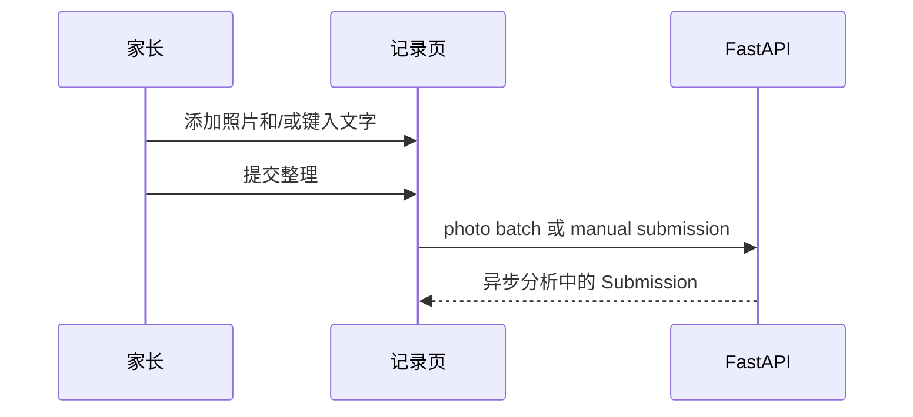
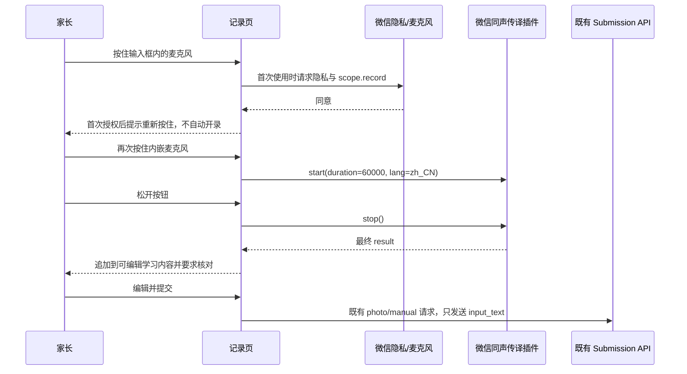
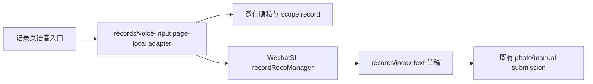
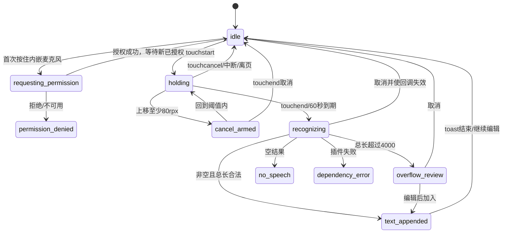
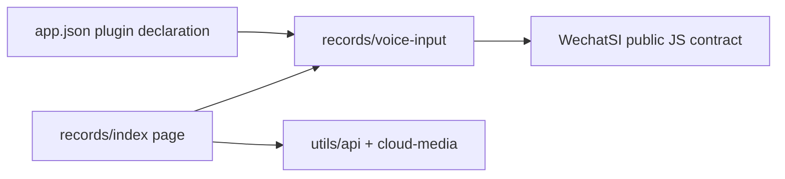
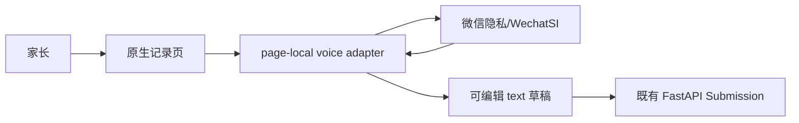

# FEAT-001 — 家长语音输入学习内容

- Status: VERIFYING
- Risk: R2（外部插件、麦克风权限、儿童学习内容隐私、原生真机状态）
- Spec owner: 产品负责人（用户）
- Implementer: Codex
- Reviewer: pending independent review
- Verifier: pending independent verification
- Created: 2026-10-01
- Last updated: 2026-10-02
- Target release: Git commit and frontend deployment authorized on 2026-10-02; upload follows the existing privacy/native gates, then experience/review/production follow the repository manual gates
- Spec revision: `SPEC-20261001-VOICE-INPUT-03`
- User confirmation: 用户于 2026-10-01 在收到 `SPEC-20261001-VOICE-INPUT-03 + DREV-20261001-RECORD-VOICE-INLINE-03` 的明确批准请求后回复“你先来实现代码，然后进行充分测试，前端交互可以慢慢调整”，批准本 revision 和 DREV 进入本地实现与验证
- Release authorization: 用户于 2026-10-02 在明确告知工作区未提交内容为本语音录入功能后回复“提交然后部署”，批准提交本 revision 的现有实现并推进前端发布；隐私声明、原生验收、体验版、提审与正式发布仍遵守既有门禁
- Additional R2/R3 approval: 产品负责人（用户）于 2026-10-01 批准本 R2 revision；目标 AppID 插件条款、隐私声明、原生真机与发布状态仍是独立人工门禁
- Affected Feature IDs: `FEAT-001`
- Feature current-state documents: `docs/domain/features/FEAT-001-push-kids-mvp.md`
- Feature baseline revision: `FEAT-STATE-20260926-EMPTY-PROPOSAL-QUALITY-04-GRAY-025`
- Feature merge owner: Codex after verified implementation

## Frontend Design Impact and Repository-native Approval

- Frontend impact: yes — 记录页“学习内容”增加语音输入入口及录音/转写/恢复状态
- Frontend impact reason: 新增麦克风授权、录音、外部转写、文本追加和错误恢复交互
- Frontend engineering impact: yes — 新插件、页面状态、权限、生命周期、媒体隐私、真机兼容和包体检查
- Frontend engineering impact reason: 原生小程序记录页需要管理唯一录音器、迟到回调、页面离开和表单提交互斥
- Affected UI IDs: `UI-001`
- UI current-state documents: `docs/design/frontend/ui/UI-001-parent-miniapp.md`
- Frontend baseline revision: `FDB-20260913-04`
- Frontend engineering constraint revision: `FEC-20260913-LOCAL-DESIGN-EVIDENCE-01`
- Affected frontend quality dimensions: component/state/form/responsive/a11y/i18n/browser-device/performance/security/privacy/motion-media-AI/observability
- Frontend quality budgets/requirements: 320×568、390×844、430×932；触控目标 ≥44px；正文 ≥14px；初始 Tab 包 ≤1.5 MiB；根节点无横向滚动；失败保留照片/文字/时间；不记录音频、转写正文、临时路径或插件 payload；AI 草稿仍须家长确认
- Frontend quality verification plan: Node VM 状态/迟到回调/提交流程测试；ESLint；小程序静态/包体；设计证据校验；真实 AppID preview；iOS/Android 授权、中断、后台、弱网与三视口原生节点几何
- Approved frontend engineering deviations: none

- Current Design Revision(s): `DREV-20260911-RECORD-SIMPLIFICATION-01`; `DREV-20260911-RECORD-PHOTO-ADD-SOURCE-02`
- Editable design source path(s): `docs/design/frontend/prototypes/DREV-20261001-RECORD-VOICE-INLINE-03/record-voice-inline.html`
- Design source SHA-256: `2364267c8dc25b876a893d6436e15d9067e3b76d2ec1d72e0467b52ab21722cd`
- Proposed Design Revision: `DREV-20261001-RECORD-VOICE-INLINE-03`
- Required viewport/state exports: idle、holding、appended × 320×568、390×844、430×932；permission/cancel-armed/recognizing/no-speech/error/overflow/interrupt 由状态测试和真机证据覆盖
- Prototype status: APPROVED_FOR_LOCAL_IMPLEMENTATION
- Approved Task Spec revision: `SPEC-20261001-VOICE-INPUT-03`
- Approved Design Revision: `DREV-20261001-RECORD-VOICE-INLINE-03`
- Design approval evidence: 用户于 2026-10-01 在明确批准请求后要求先实现并充分测试；允许后续通过新 DREV 继续调整交互
- Snapshot manifest path: `docs/design/frontend/snapshots/UI-001/DREV-20261001-RECORD-VOICE-INLINE-03/APPROVAL.md`
- Permitted implementation deviations: 原生字体 fallback、真实中文自然换行、微信系统授权弹窗外观
- UI current-state merge owner: Codex after verification
- UI current-state merge evidence: pending
- Frontend visual/a11y/resolution verification: repository candidate exports ready；native pending
- Frontend engineering verification evidence: pending implementation

- External design dependency: `none`

## 0. Executive summary

### Problem

家长当前只能拍照或键入学习内容。晚间单手使用、内容较长或不方便打字时，手动录入成本仍高。

### Intended outcome

有写权限的家长可以在记录页把最多 60 秒的普通话语音转成可编辑文字；转写文字先进入既有学习内容
字段，只有家长主动提交后才进入现有 AI 草稿流程，只有家长确认后才成为正式学习记录。

### Why now

记录入口已经统一成照片+文字表单，语音可以作为文字输入适配器复用既有提交、分析和确认合同，而不必
新增音频数据模型或后端处理链路。

## 1. Facts, decisions, assumptions, questions

### Confirmed facts

| ID | Fact | Evidence |
|---|---|---|
| `F-001` | 当前记录页同屏接受照片和最多 4000 字文字；有图走 photo batch，无图有文字走 manual submission | `apps/miniprogram/pages/records/index.{js,wxml}`；`BHV-002` |
| `F-002` | 微信 `RecorderManager.start` 支持麦克风录音，平台上限 10 分钟；`scope.record` 需要用户授权 | [微信 RecorderManager](https://developers.weixin.qq.com/miniprogram/dev/api/media/recorder/RecorderManager.start.html)、[授权](https://developers.weixin.qq.com/miniprogram/dev/framework/open-ability/authorize.html) |
| `F-003` | 微信同声传译插件 `wx069ba97219f66d99` 提供最终语音识别结果；单次最长 60 秒，公开配额 250 条/分钟、3 万条/天 | [官方插件文档](https://mp.weixin.qq.com/wxopen/plugindevdoc?appid=wx069ba97219f66d99&token=&lang=zh_CN) |
| `F-004` | 公开插件文档没有列出计费价目、腾讯云账号或密钥配置，也没有公开 SLA/音频留存期 | 同上；这是对公开文档内容的范围判断，不是“永久免费”承诺 |
| `F-005` | 小程序调用个人信息相关能力前必须有匹配的用户隐私保护指引；声明与调用不符可能被平台拦截 | [隐私指引](https://developers.weixin.qq.com/miniprogram/dev/framework/user-privacy/)、[开发指南](https://developers.weixin.qq.com/miniprogram/dev/framework/user-privacy/PrivacyAuthorize.html) |
| `F-006` | 当前仓库没有音频、麦克风或插件声明；云端媒体合同只覆盖受验证的照片对象 | `apps/miniprogram/app.json`、`docs/architecture/ARCHITECTURE.md` |

### Decisions

| ID | Decision | Owner/date | Rationale |
|---|---|---|---|
| `D-001` | 采用微信同声传译插件客户端转写，不采用腾讯云付费 ASR 或后端音频上传 | 用户 / 2026-10-01 | 最少改动、无长期密钥、复用现有文字链路 |
| `D-002` | 语音是 `text` 的输入方式，不新增 Submission source、表、API 或历史筛选 | proposed / 2026-10-01 | 避免把临时输入方式升级为业务事实 |
| `D-003` | 原始音频不上传、不持久化、不回放；转写结果可编辑且不自动提交 | proposed / 2026-10-01 | 最小化儿童学习内容处理和隐私范围 |
| `D-004` | 麦克风内嵌紧凑文字框，直接按住录音、松开转文字、上滑取消；不切换输入模式 | 用户反馈 / 2026-10-01 | 去掉外置按钮和模式切换，文字与语音保持在同一输入边界；手动文字仍是完整降级路径 |

### Assumptions

| ID | Assumption | Risk if wrong | Validation | Owner/due |
|---|---|---|---|---|
| `A-001` | 目标 AppID 可以添加微信同声传译插件当前版本 | 无法预览/发布 | 小程序后台插件页只读核验并添加后用真实 AppID preview | 产品负责人 / implementation start |
| `A-002` | 插件在公开配额内不产生直接调用账单 | 出现未预算费用或条款风险 | 添加插件前阅读目标 AppID 显示的最新服务条款/费用；保留截图或人工确认 | 产品负责人 / before add |
| `A-003` | 60 秒足够覆盖家长一次学习内容口述 | 频繁分段影响体验 | 体验版定向测试；不在首版串联多段自动录音 | 产品负责人 / experience gate |

### Open questions

| ID | Question | Why it matters | Recommended answer | Owner | Blocking? |
|---|---|---|---|---|---|
| `Q-001` | 目标 AppID 插件添加页当前是否显示审核、主体或收费条款？ | 决定能否真实预览和发布，并影响费用承诺 | 真实 AppID preview 前由账号管理员核验并记录；若显示付费或不允许添加，停止平台交付并回到新 Spec | 产品负责人 | yes before native preview/release; no for local implementation |
| `Q-002` | 隐私指引里应采用平台当前哪一项个人信息类型和第三方处理方文案？ | 提审合规 | 以目标后台实际字段为准，不在代码或 Spec 中猜字段 | 产品负责人 | yes before release, no for local design |

本 Spec 已批准本地实现。`Q-001/Q-002` 不授权自动化提交主体声明，也不阻塞确定性的本地代码与测试；
它们在真实 AppID preview、体验版和后续发布前仍是阻断门禁。

## 2. Current behavior and evidence

### Current flow

### Current evidence

- Code: `apps/miniprogram/pages/records/index.{js,wxml,wxss}`、`apps/miniprogram/app.json`
- Tests: `tests/frontend/learning-history.test.js`、`tests/frontend/config-and-copy.test.js`
- Behavior IDs: `BHV-002`、`BHV-003`、`BHV-015`、`BHV-019`
- API/event/schema: 现有 `input_text`、`source=manual/photo`，无音频字段
- Runtime evidence: FEAT-001 当前状态记录最近小程序静态/前端门禁；本 Spec 不把历史证据当新改动通过
- Related ADRs/incidents: `ADR-001` 只覆盖现有照片对象存储；本方案不扩张该媒体边界

## 3. Target behavior

### Primary sequence diagram

### Behavior matrix

| Case | Preconditions/actor | Input/action | Expected result | State/side effects | Forbidden result |
|---|---|---|---|---|---|
| happy path | writer、已授权 | 按住内嵌麦克风→说话→松开 | 结果追加进同一输入框并短暂提示检查 | 仅页面草稿变化 | 把松开当提交/正式写入 |
| existing text | 已有家长文字 | 再录一段 | 以一个换行追加，不覆盖原文 | 直接在文字框编辑或删除 | 替换/重复追加 |
| first permission | 首次使用 | 按住并同意系统授权 | 回到原输入框，提示“请重新按住” | 表单不变 | 手指已松开后自动录音 |
| permission denied | 未授权或已拒绝 | 按住说话 | 显示去设置与文字输入降级 | 表单不变 | 清空/循环弹窗 |
| gesture cancel | recording | 向上移动≥80rpx并松开/touchcancel | 取消本次，不触发追加 | 表单不变 | 把取消音频送去提交 |
| no speech | 插件返回空白 | 松开 | 回到原输入框并提示“没有听清” | 表单不变 | 空白当成功 |
| dependency failure | 网络/配额/插件错误 | 录音或转写 | 安全错误文案、可重试、手动路径继续 | 不写正文日志 | 假成功/阻断提交 |
| late callback | 取消、切孩子、hide/unload 后回调 | 插件返回 | generation token 丢弃结果 | 新页面状态不变 | 旧语音污染新孩子 |
| length overflow | 合并后 >4000 字 | 返回结果 | 原文不变，进入待加入文字编辑态 | 不静默截断 | 超限请求或丢原文 |
| duplicate gesture | 正在请求/录音/转写 | 再次 touchstart | 不创建第二录音任务 | 全局唯一 manager | 麦克风冲突 |
| viewer | 无写权限 | 浏览记录页 | 不渲染语音入口 | 无副作用 | 请求权限/插件调用 |

## 4. Scope

### In scope

- 学习内容紧凑输入框的内嵌麦克风，以及 permission/holding/cancel-armed/recognizing/appended/error/overflow 状态。
- 微信同声传译插件接入，普通话 `zh_CN`，单次最长 60 秒。
- 按住开始、松开转写、上滑取消、结果追加、4000 字边界、迟到回调和页面生命周期保护。
- 隐私声明和真实 AppID 插件准入的发布门禁。
- 既有照片、纯文字、照片+文字、历史和确认流程回归。

### Out of scope / non-goals

- 保存、上传、回放、分享或历史展示原始音频。
- 后端 ASR、腾讯云 ASR 密钥/临时凭证、音频对象存储或数据库迁移。
- 多段录音队列、方言/英语切换、热词、自学习、说话人分离。
- 自动总结、自动提交、自动确认、评分、掌握判断或下一课预测。
- 把“语音”增加为历史 source、筛选项或报表维度。

### Invariants / must not change

- 家长确认前零正式学习、知识、Review 或 Todo 写入。
- 有照片仍走 photo batch；无照片有文字仍走 manual submission；空材料仍为零请求。
- 照片/文字失败保留表单；家庭/孩子隔离和云入口不改变。
- `occurred_at`、历史补录、9 图上限和 4000 字服务合同不改变。
- 原始音频、转写正文、临时路径、插件 payload 不进入日志、仓库、本地存储或分析事件。

### Affected users, modules, and consumers

| Area/consumer | Current dependency | Change | Compatibility action |
|---|---|---|---|
| writer 记录页 | 照片+文字表单 | 新增语音辅助输入 | 手动输入永远可用 |
| viewer 记录页 | 只读历史 | 无可见入口 | 保持无权限请求 |
| Submission API | `input_text` | 无合同变化 | 继续复用原请求 |
| Ark analysis | 图片/完整文字 | 只可能收到家长核对后的转写文字 | 不新增 provider call |
| 历史/报表 | manual/photo source | 无变化 | 不新增 source 值 |

### Feature current-state impact

- Existing Feature sections affected: Purpose/current behavior；Current invariants 的统一记录表单、隐私和媒体输入描述
- New Feature document target, if applicable: N/A；这是 FEAT-001 的输入增量
- Final facts to merge after verification: 60 秒语音→可编辑文字、无原始音频持久化、权限/失败降级、真机证据
- Superseded Feature statements to replace/remove: “照片和文字始终同屏”扩展为“照片、文字及语音辅助输入”；source 语义不变
- Related Feature IDs: N/A

### Link/call graph

## 5. Domain and data design

### Terms

| Term | Meaning | Do not confuse with |
|---|---|---|
| voice input | 把临时语音转成页面文字草稿的客户端输入方式 | 可持久化音频记录 |
| transcript | 插件返回并经家长核对的候选文字 | 正式学习事实或模型结论 |

### Entities/aggregates

N/A：不新增领域实体。页面只持有短生命周期的 `voiceState`、触摸起点/取消阈值、计时、generation token 和
可空待加入转写；权威业务实体仍为既有 Submission。

### State transitions

非法状态：首次授权完成后无新 touchstart 自动录音；同时存在两个录音任务；保存中开始录音；录音/转写中提交；取消后迟到结果回写；viewer 请求权限。

### Schema/data changes

- Schema: none
- Backfill: none
- Existing data compatibility: unchanged
- Read/write deployment order: frontend-only；插件后台准入和隐私声明在体验版之前完成
- Retention/deletion: 原始音频不进入应用持久化；页面退出清理引用，插件侧留存由最新条款人工核验
- Restore/rollback: 回滚小程序版本即可；无数据恢复

## 6. Interfaces and errors

### API/event/job contract

| ID | Caller/producer | Input | Output | Auth | Idempotency | Errors | Compatibility |
|---|---|---|---|---|---|---|---|
| `PLUGIN-001` | records voice adapter | `{duration:60000, lang:"zh_CN"}` | `onStart/onStop/onError`; 只消费 trimmed `result` | 微信隐私+scope.record+插件准入 | 单一活动 generation；重复 start 被本地拒绝 | 映射为 permission/no_speech/dependency_error；只保留安全码 | 插件不可用时手动输入仍可用 |
| `API-EXISTING` | records save | 既有 photo/manual payload | 既有 Submission | unchanged | unchanged | unchanged | 无新增字段/source |

约束：空/全空白 `result` 为 no_speech；结果追加前 trim；只在原文非空时插入一个换行；总长不得超过
4000；错误 UI 不展示原始插件 message；无需重试后台任务，家长显式点击重试。

## 7. Authorization, security, and privacy

- Authenticated actor: 既有 family member；只有 writer 渲染/调用语音入口
- Resource/tenant ownership check: 无新服务端资源；提交继续由既有 family/child 边界校验
- Administrative override: none
- Input trust boundaries: 插件结果是不可信外部输入；trim、长度校验并必须由家长可见编辑
- Sensitive data handling: 音频和 transcript 属于儿童学习内容；只在内存中短期存在，最终仅经现有 `input_text` 提交
- Audit events: 不新增正文审计；发布/插件准入按部署文档记录
- Abuse/rate controls: 客户端只允许一个活动任务；依赖插件 250/min、30k/day 公开配额；不自动重试

| Threat/failure | Entry | Impact | Mitigation | Evidence |
|---|---|---|---|---|
| 麦克风越权/过早授权 | 页面加载/首次手势 | 隐私/审核失败 | 仅用户首次按住时申请；授权后必须等新手势；viewer 不渲染 | VM + 真机授权测试 |
| 原始音频泄露 | tempFilePath/log/storage | 儿童内容暴露 | 不读取/上传/持久化路径；禁止日志 | source inspection + tests |
| 转写污染其他孩子 | late callback | 跨孩子草稿错误 | child/generation 绑定；切换使旧 generation 失效 | deterministic callback tests |
| 插件错误暴露内部信息 | onError | 信息泄露/混乱 | 静态家长文案；仅安全分类 | error mapping tests |
| 静默截断 | 4000 字 | 内容丢失 | overflow review，不改原文 | boundary tests |

## 8. Architecture and implementation boundaries

### Chosen approach

小程序记录页通过一个 page-local voice adapter 调用 WechatSI 全局唯一识别 manager。Adapter 只管理
权限、插件生命周期、generation token 和规范化结果；`records/index.js` 继续拥有表单字段、孩子切换和
提交分流。Adapter 只把候选 transcript 返回页面，不调用 API、不写 storage、不拥有业务提交。

### Modules and dependency direction

| Module | Responsibility in this change | Public contract | Must not own/do |
|---|---|---|---|
| `pages/records/voice-input.js` | 插件 manager、权限、计时、手势取消、回调隔离、错误分类 | page-local controller callbacks | API、Submission、storage、日志正文 |
| `pages/records/index.js` | 内嵌按钮触摸状态、文本追加/溢出、提交互斥、孩子切换 | existing Page methods | 插件内部错误/网络协议 |
| `pages/records/index.wxml/.wxss` | 设计状态和可访问呈现 | DREV visible contract | 业务状态推导 |
| `app.json` | WechatSI 插件声明 | exact provider/version | 密钥/账号信息 |
| icon generator/output | 麦克风图标 | existing generated icon contract | 手工编辑 generated WXSS |

### Purpose/domain and file decomposition

- Module/domain boundaries and owners: records page owns voice input;不抽到 generic utils
- File/component responsibilities: adapter 负责平台生命周期，page 负责表单；WXML/WXSS 负责呈现
- Responsibilities intentionally kept together and why: 仅记录页消费，尚无稳定跨页面语义
- God-file split candidates and split triggers: 若第二个页面使用同一语音输入且合同一致，再评审提取 owned component

### Dependency DAG

- Circular dependency check/enforcement: adapter 不 import page、api 或 cloud-media；page 单向调用 adapter
- Forbidden edges: adapter→backend API、adapter→local storage、domain/backend→WechatSI
- Legacy cycle removal plan: N/A

### Shared abstractions

| Concept | Owner | Consumers | Shared semantics/change axis | Contract | Why extract/not extract | Contract tests |
|---|---|---|---|---|---|---|
| voice controller | records page | records only | 微信插件生命周期 | page-local callbacks | 从 index.js 隔离外部副作用，但不伪装通用能力 | fake manager/permission tests |

### Architecture diagram

### Trade-offs and alternatives rejected

| Alternative | Benefit | Why rejected | Revisit condition |
|---|---|---|---|
| 原生 RecorderManager + 后端腾讯云一句话识别 | 供应商/重试/热词可控 | 新增音频上传、存储、清理、密钥、计费、API 与隐私边界 | 插件 SLA/准确率/准入不能满足生产 |
| 腾讯云智能语音小程序插件 | 实时结果、热词、10 分钟 | 需腾讯云服务和临时凭证；个人主体有限制；产生明确计费面 | 需要热词或长录音且接受付费 |
| 直接让现有 Ark 处理音频 | 复用 AI 供应商关系 | 当前 provider/schema 只接受图片/文字；ASR 与学习分析职责混合 | 单独 Spec 证明模型、成本和隐私合同 |
| 输入框外麦克风 + 语音模式切换 | 接近微信传统交互，模式明确 | 用户反馈按钮位置错误，且多一步切换 | 真实可用性证明内嵌按钮误触严重时重访 |
| 点击开始/点击停止 + 状态卡 | 状态明确、运动障碍更友好 | 用户反馈步骤和视觉状态过多 | 长按方案出现显著可用性问题时重访 |

### Extensibility policy

| Variation axis | Status | Mechanism/contract | Extension requirements | Reopen/revisit condition |
|---|---|---|---|---|
| ASR provider | deferred | 首版直接 page-local WechatSI adapter，不定义通用 provider interface | 新 provider 必须有独立 Spec、隐私/费用/错误/测试合同 | WechatSI 不可用或产品要求热词/更长语音 |
| language | closed | `zh_CN` | 新语言需 UI、准确率和内容测试 | 明确用户需求 |
| audio persistence | closed | 不保存 | 新增数据 owner、保留/删除/权限/导出/成本全合同 | 用户明确需要回放/证据音频 |

### Architecture confirmation

- Recommended technical design: page-local WechatSI adapter → existing text draft
- Alternatives and trade-offs: 见上表；选中方案把外部能力限制在客户端输入边界
- Long-term maintainability rationale: 不污染 Submission/agent_processing/media；失败完全降级到现有文字路径
- Architecture revision: `ARCH-VOICE-INPUT-20261001-01`（仅本 Spec 内记录；无需独立 ADR）
- User/architecture-owner confirmation: 产品负责人（用户）于 2026-10-01 要求按本 revision 先实现并充分测试

### ADR required?

- No
- ADR link: N/A
- Reason: 不改变数据库、部署拓扑、后端媒体 owner 或既有开放扩展点；若改为后端 ASR 则需要新 Spec/ADR 判断

## 9. Expected file changes, replacement, and deletion plan

| File/path | Action | Expected change | Replacement/authority | Why | Removal timing/evidence |
|---|---|---|---|---|---|
| `apps/miniprogram/app.json` | modify | 声明 WechatSI exact provider/version | 微信插件合同 | 运行时加载 | 回滚版本删除 |
| `apps/miniprogram/pages/records/voice-input.js` | add | page-local controller | authoritative voice lifecycle | 隔离平台副作用 | 功能移除时删除 |
| `apps/miniprogram/pages/records/index.js` | modify | 表单/状态/迟到回调/提交互斥 | existing page authority | 集成 transcript | 同次变更无旧 voice path |
| `apps/miniprogram/pages/records/index.wxml` | modify | 入口与状态 UI | approved DREV | 用户可见交互 | N/A |
| `apps/miniprogram/pages/records/index.wxss` | modify | page-only geometry | PKDS layers | 状态布局 | N/A |
| `tools/gen_icon_styles.py` | modify | 新增麦克风图标源 | icon generator authority | 禁止文本/emoji 图标 | generated diff evidence |
| `apps/miniprogram/styles/icons.wxss` | generated modify | 生成图标类 | generator output | runtime icons | generator idempotency |
| `tests/frontend/voice-input.test.js` | add | controller/page 状态测试 | feature regression | 覆盖权限/迟到/边界 | feature removal时删除 |
| `tests/frontend/learning-history.test.js` | modify | 既有提交/切换回归 | existing behavior tests | 防止破坏照片/文字 | retain |
| `tests/frontend/config-and-copy.test.js` | modify | plugin/copy/结构断言 | static contract | 防误删/误文案 | retain |
| `docs/design/frontend/WECHAT-MINIPROGRAM-API-BASELINE.md` | modify | 记录 recorder/plugin/permission 基线 | platform audit | 当前能力事实 | merge after implementation |
| FEAT/UI current state | modify after verify | 合并最终事实与证据 | current-state SSOT | 完成门禁 | only after verify |

### Temporary coexistence

None。语音从第一版即只写入现有文字草稿；没有 legacy 音频路径或双写。

## 10. Cost and non-functional requirements

### Incremental cost assessment as of 2026-10-01

| Cost item | Expected incremental cost | Confidence | Basis / gate |
|---|---:|---|---|
| WechatSI ASR calls | `¥0 expected within published quota`, not a contractual free guarantee | medium | 公开文档只列 250/min、30k/day 配额，未列计费或腾讯云账户；添加插件前必须核验目标后台条款 |
| WeChat Cloud Hosting API/compute | approximately `¥0` | high | 音频不进入 Cloud Hosting；提交请求数量不增加，只发送既有 `input_text` |
| Object storage/egress | `¥0` | high | 不上传、不保存、不下载原始音频 |
| Ark analysis | no extra model call; only possible marginal input-token change | high | 每条 Submission 仍运行原有一次分析；语音只是更易生成文字 |
| Database | `¥0` | high | 无表、列、行类型或额外持久化 |
| Development/QA | one-time effort, estimated 3–5 person-days | medium/inference | frontend/controller/tests 2–3 days；后台隐私/插件与 iOS/Android/三视口验收 1–2 days；不含审核排队 |
| Contingency: Tencent Cloud one-sentence ASR | current free quota 5000 calls/month; 30k-call annual package ¥90 | high for current published price | only if a new Spec replaces WechatSI; [current pricing](https://cloud.tencent.com/document/product/1093/35686) |

结论：选中方案没有可证明的新增基础设施账单，最可能的新增成本是一次性开发、真机测试和隐私/插件
运营工作。由于 WechatSI 公开文档没有价格与 SLA，不能把“¥0 expected”写成永久免费承诺。

### Non-functional requirements

| ID | Requirement | Target/budget | Measurement | Failure response |
|---|---|---|---|---|
| `NFR-001` | gesture feedback | 已授权按住后 100ms 内进入 holding 可见态；首次授权完成后不自动开录 | fake clock + native observation | 保留明确反馈，不伪造录音 |
| `NFR-002` | bounded recording | hard cap 60s；一个活动 manager | unit/native | 自动 stop；无第二任务 |
| `NFR-003` | privacy | zero audio/transcript/path/plugin payload in logs/storage/analytics | source/test/manual inspection | release blocker |
| `NFR-004` | recovery | permission/network/no-speech/interruption preserves form | tests + native | release blocker |
| `NFR-005` | layout/a11y | 3 viewports, ≥44px targets, no horizontal overflow, text status | design/native geometry | release blocker |
| `NFR-006` | package | initial Tab package remains ≤1.5 MiB | validator/DevTools | investigate plugin declaration/package split before upload |
| `NFR-007` | observability | safe category only if existing error channel exists; no new content logging | inspection | omit telemetry rather than log content |

## 11. Acceptance criteria

### AC-001 — 语音成为可编辑文字，不成为正式记录

- Given: 有写权限的家长位于记录页
- When: 按住说话并松开，完成一段非空普通话录音
- Then: transcript 以单个换行追加到同一学习内容输入框，并短暂显示“已转成文字，请检查”
- And: 家长可以继续编辑并按既有按钮提交
- And not: 不自动发请求、不自动确认、不保存音频
- Evidence: controller/page test + native preview

### AC-002 — 权限和依赖失败安全降级

- Given: 隐私未同意、麦克风拒绝、插件网络/配额失败或无有效语音
- When: 家长尝试语音输入
- Then: 回到原输入框，显示短暂可恢复提示与去设置/重试/手动填写路径
- State must remain: 照片、文字、时间、孩子不变；提交手动内容仍可用
- Evidence: deterministic error tests + iOS/Android

### AC-003 — 生命周期和租户上下文隔离

- Given: recording/recognizing 中发生取消、切孩子、hide、unload 或权限变化
- When: 旧 manager 随后返回 result/error
- Then: 旧 generation 被丢弃
- And not: 不得写入新孩子文字、不显示旧成功、不产生请求
- Evidence: late callback tests

### AC-004 — 长度与原文安全

- Given: 已有文字，或合并后将超过 4000 字
- When: transcript 返回
- Then: 合法结果只追加一次；超限时原文不变并允许编辑待加入文字
- And not: 不覆盖、不重复、不静默截断
- Evidence: 0/1/3999/4000/overflow tests

### AC-005 — 现有记录分流不变

- Given: 纯转写文字、照片+转写文字、空材料或原手动文字
- When: 家长提交
- Then: 分别走既有 manual、photo、zero-request、manual 路径
- And: idempotency、occurred_at、失败保留合同不变
- Evidence: existing + extended learning-history tests

### AC-006 — 隐私、费用与发布门禁

- Given: 准备体验版/正式发布
- When: 检查目标 AppID 插件和隐私配置
- Then: 记录插件可用版本、最新费用/条款、隐私类型/第三方处理说明与成功信号
- And not: 不能在未核验收费/主体/隐私条款时声称零成本或完成发布
- Evidence: manual gate record

## 12. Verification plan

| Test point | Acceptance/risk | Test level | Case/command | Fixture/environment | Expected evidence | Owner |
|---|---|---|---|---|---|---|
| `TP-001` | AC-001/004 | frontend unit | new `voice-input.test.js` | fake WechatSI manager + clock/touch | inline hold/release/swipe-cancel/append/length pass | implementer |
| `TP-002` | AC-002 | frontend unit | permission deny/no-speech/error mapping | fake wx/plugin | form preserved, safe copy | implementer |
| `TP-003` | AC-003 | frontend unit | cancel/switch/hide/unload late callbacks | generation fixtures | zero stale mutation | implementer |
| `TP-004` | AC-005 | frontend regression | `node --test tests/frontend/*.test.js` | Node VM | all pass | verifier |
| `TP-005` | structure/privacy | lint/static/inspection | `npm test`; `npm run lint`; `uv run python tools/validate_miniprogram.py` | local | pass; no secret/content log/storage | verifier |
| `TP-006` | design gate | design evidence | `uv run python tools/validate_design_evidence.py --manifest ...` | pending manifest | pass after approval | verifier |
| `TP-007` | native UI | DevTools | compile + 320/390/430 geometry + large text + keyboard | target AppID | no overflow; targets ≥44px | verifier |
| `TP-008` | native platform | manual iOS/Android | first auth no auto-start, denied→settings, hold/release, swipe-cancel threshold, touchcancel, 60s, interruption, background, weak network | representative devices | recoverable states, form preserved | product owner |
| `TP-009` | AC-006 | admin/manual | plugin terms + privacy + experience version | MP admin | recorded success signal | product owner |

Pre-change failure: `TP-001`/`TP-002`/plugin declaration do not exist. Old behavior proof: `TP-004` and AC-005.
Forbidden side effects: `TP-003`/`TP-005`. Real wiring: `TP-007`–`TP-009`; mocks cannot substitute.

## 13. Rollout, migration, rollback

### Rollout

1. Implement locally and run automated/design gates，不访问真实儿童内容或平台管理设置。
2. Target AppID verifies/adds plugin and current terms; close Q-001 before registered-AppID preview.
3. Update development privacy guide for microphone/voice transcription before upload.
4. Registered AppID preview and real-device matrix.
5. Upload development version, set experience version, run directed acceptance.
6. Only after acceptance proceed through existing review/production manual gates.

### Compatibility window

- Mixed versions: backend unchanged；旧前端继续照片/文字，新前端多语音入口
- Old clients/consumers: fully compatible
- Feature flags: none；依赖失败已降级到手动文字
- Data backfill: none

### Observability and release gates

| Signal | Baseline | Success threshold | Abort threshold | Observation window |
|---|---|---|---|---|
| plugin error/no-speech manual smoke | none | happy path + recoverable failure on both OS | crash、表单丢失、无法手动输入 | experience acceptance |
| privacy/package checks | current compliant build | zero secret/content/path；≤1.5MiB | any leak or budget breach | every build |
| stale callback tests | N/A | 100% deterministic pass | any cross-child/late mutation | CI/local gate |

### Rollback / restore

- Reversible code: upload previous approved mini program version or new build removing plugin/voice UI
- Reversible data: none changed
- Irreversible steps: none in application data；后台隐私文本需随代码真实能力同步修改
- Restore procedure: disable/revert frontend release; keep existing manual/photo paths
- Owner: product/release owner

## 14. Implementation plan

### Step 1 — Local controller, UI and deterministic tests

- Intent: implement the approved DREV without backend changes or external account mutations
- Files/boundaries: app.json, records voice adapter/page, generated icons and frontend tests
- Modify: only current form integration
- Delete/replace: no alternate audio path
- Tests: TP-001–TP-006
- Validation: no secret/storage/log/API in adapter; existing manual/photo paths pass
- Stop/rollback condition: visible divergence or need for raw audio/backend

### Step 2 — Plugin readiness and native preview gate

- Intent: close Q-001/Q-002 before registered-AppID preview or upload
- Files/boundaries: target MP plugin settings and privacy declaration; no secrets enter the repository
- Modify: external settings only through the documented human gate
- Delete/replace: none
- Tests: target AppID add/preview capability and TP-007–TP-009
- Validation: no fee/subject/privacy surprise; real platform behavior recorded
- Stop/rollback condition: plugin unavailable, paid unexpectedly, or terms incompatible

### Step 3 — Regression, native and release evidence

- Intent: prove existing paths and real platform behavior
- Files/boundaries: tests, API baseline, current-state docs after pass
- Modify: evidence/docs only after facts verified
- Delete/replace: no stale “photo/text only” current-state wording
- Tests: TP-004–TP-009
- Validation: automated + native + admin gates
- Stop/rollback condition: any form loss, cross-child late result, privacy mismatch or plugin billing surprise

## 15. Review plan

- Required reviewers: independent code reviewer; product owner for DREV/native/privacy/terms
- Domain questions: does transcript stay merely editable parent input? Are source semantics unchanged?
- Security/data questions: can any audio/path/transcript enter logs, storage or wrong child context?
- Compatibility questions: do manual/photo/viewer/old backend flows remain unchanged?
- Test validity questions: do fake callbacks reproduce late ordering and does real device test cover platform audio?
- Independent reviewer session/person: pending

## 16. Implementation and verification record

Production-source implementation and deterministic local verification are complete after the user's 2026-10-01 approval.
The user authorized Git submission and deployment on 2026-10-02. Automated release checks were rerun successfully;
upload remains pending the privacy/native gates in §13. No experience-version selection, review submission or
production publication has occurred. The Spec remains VERIFYING because these checks and independent review are incomplete.

### Evidence

| Command/case | Environment/version | Result | Evidence | Notes |
|---|---|---|---|---|
| design export render | local Chrome / 2026-10-01 | pass | snapshot directory | repository candidate only, not native evidence |
| design approval validation | local / current policy | pass | `DESIGN_EVIDENCE_VALID` for `DREV-20261001-RECORD-VOICE-INLINE-03` | approved source/export hashes and required repository viewports; not native evidence |
| voice focused tests | Node test runner | pass | 13/13 | authorization, gesture, cancellation, late callback, context, overflow, static privacy |
| frontend regression | Node test runner | pass | 184/184 | rejects unsupported `app.json permission["scope.record"]` declarations and preserves existing photo/manual/history contracts |
| backend regression | pytest | pass | 389 passed, 5 optional skipped | no backend production change; existing warnings only |
| frontend lint | ESLint | pass | zero findings | production and frontend tests |
| Mini Program static/package | validator | pass | 15 pages / 685412 source bytes | below 1.5 MiB source budget |
| architecture | repository checker | pass | checked=3 | page-local adapter; no backend/module boundary change |
| Ruff / format / Mypy | repository gates | pass | zero findings | full repository Python/static types |
| registered AppID preview | target AppID `wx5d2e0014690bf285` / DevTools CLI | pass | preview package 634.8 KB / 650045 bytes | plugin added; invalid `app.json permission["scope.record"]` declaration removed; no upload |
| local microphone authorization | DevTools Stable 2.01.2510290 / base library 3.16.2 | blocked | `errno: 112`; `authorize:fail api scope is not declared in the privacy agreement` | after the administrator added microphone information on 2026-10-02, compile/network caches were cleared and the same error remained; wait for the privacy guide to show approved/effective before retesting |
| native UI/audio matrix | iOS/Android | NOT_RUN | TP-007 geometry remainder / TP-008 | awaiting product-owner retest of first authorization, hold/release, interruption and device matrix |
| privacy/terms gate | target AppID admin | blocked | TP-009 | plugin added, but the current privacy agreement does not declare microphone access; third-party terms evidence also remains pending before release |

### 2026-10-02 commit and deployment preparation

- Fresh checks: frontend 184 passed; backend 389 passed / 5 skipped; ESLint, Ruff check/format,
  Mypy (86 files), architecture (checked=3), design policy, Mini Program static
  (15 pages / 685412 source bytes), and `git diff --check` passed.
- The five skipped cases require `PUSH_KIDS_TEST_MYSQL_URL`, which is not configured for this run.
  This release changes neither backend code nor SQL/schema; no production database test was substituted.
- DevTools CLI `islogin` returned `login: true` for the target project. Preview package evidence above is
  historical; no new native preview/audio/device success is claimed by these automated checks.
- Latest observed authorization failure remains `errno 112`; no administrator confirmation or successful
  microphone retest has closed TP-009. Upload and version bump have not run. The uploaded baseline remains `0.1.12`.
- Deployment preparation and remaining gates: `docs/deploy/releases/20261002-voice-input.md`.

### Deviations from approved Spec

None. The extra `requesting_permission` inline status is the approved permission state rendered inside the same input boundary.

### Residual risks and follow-up

| Risk/debt | Impact | Owner | Due/removal condition | Tracking |
|---|---|---|---|---|
| Target AppID privacy agreement has not yet become effective for microphone access | `wx.authorize(scope.record)` is still rejected before any microphone toggle can appear | product owner | wait until the updated guide shows approved/effective, then rerun local authorization | TP-009 |
| Public WechatSI docs omit price/SLA/retention | cannot promise permanent free/reliability | product owner | target terms verified before native preview/release | Q-001/Q-002 |
| Repository preview is not native Mini Program evidence | geometry/audio behavior may differ | verifier | TP-007/008 | this Spec |

## 17. Completion gate

- [ ] No blocking question remains.
- [x] R2 approval is recorded.
- [x] Scope and non-goals were preserved.
- [x] Task Spec revision + DREV explicitly approved.
- [x] Every required test point executed or marked not run with impact.
- [ ] Independent review has no Blocker/Major finding.
- [x] FEAT-001 and UI-001 current-state facts merged with Change Reference.
- [ ] Spec status set DONE and moved to `specs/completed/` only after all gates pass.
