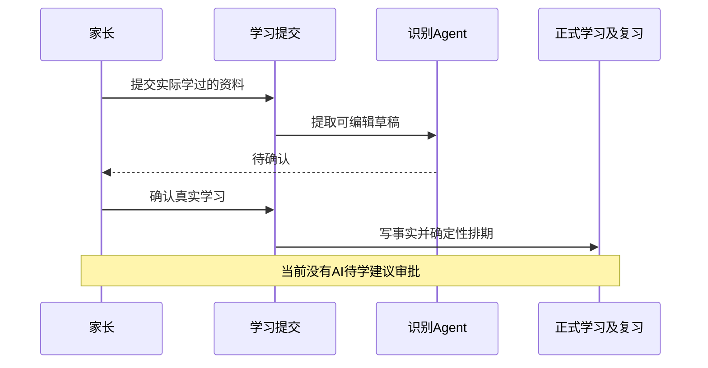
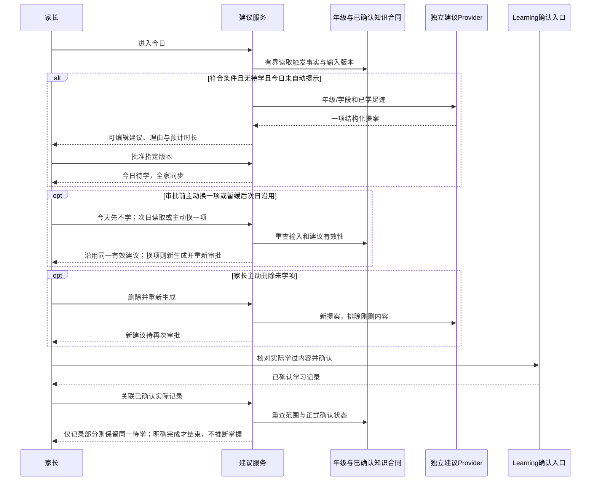
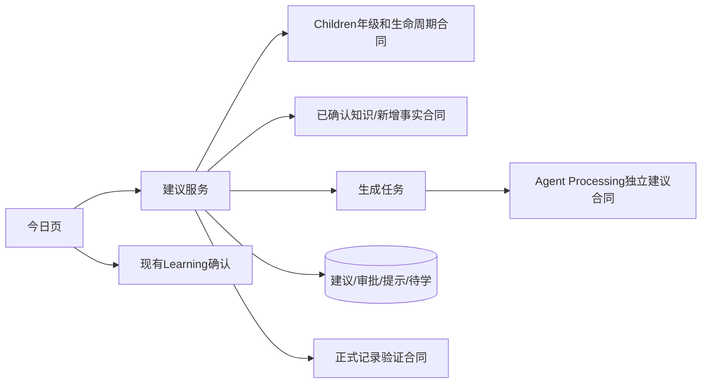
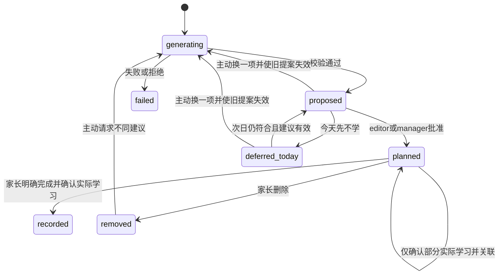
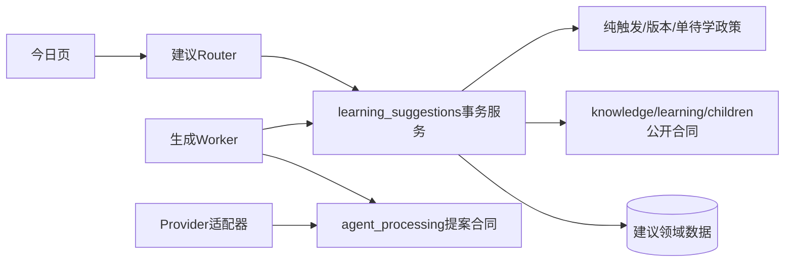

# FEAT-004 — 连续两日无新增知识时的单项增量学习建议

- Status: VERIFYING
- Risk: R3（儿童内容、AI服务、隐私与产品边界扩展）
- Spec owner: 产品负责人（用户）
- Implementer: Codex；已按批准范围完成本地业务实现
- Reviewer / Verifier: Codex执行本地验证；独立实现评审、内容与真机验收仍待完成
- Created / Last updated: 2026-10-24
- Target release: 未安排，不进入其他聊天正在冻结的发布包
- Spec revision: SPEC-20261024-INCREMENTAL-LEARNING-PATH-04
- Architecture candidate: ARCH-20261024-INCREMENTAL-LEARNING-PATH-03（APPROVED）
- User confirmation: 产品负责人2026-10-24先以「按照这个方案 落地」批准Spec03及完整需求，再针对两份Spec04、Architecture02/03与首次Design01明确回复「批准，按此实现」；已获本修订实施授权
- Additional R2/R3 approval: APPROVED；产品负责人2026-10-24在明确列出两份Spec04、Architecture02/03和DREV01的审批问题后回复「批准，按此实现」；实际主体类目与内容条件是发布前验收，不冒充已核验
- Affected Feature IDs: FEAT-004（已本地实现，默认关闭）；FEAT-001（受限提案例外与今日学习）
- Feature current-state documents: [FEAT-004](../../docs/domain/features/FEAT-004-daily-learning-suggestions.md)；[FEAT-001](../../docs/domain/features/FEAT-001-push-kids-mvp.md)
- Feature baseline: FEAT-001现行已学确认/非预测边界；实施前重读最新revision，不借用其他聊天验收事实
- Feature merge owner: Codex；本地已验证事实合并，未通过的发布验收单独保留
- Historical proposal: [2026-09-05草案](../rejected/FEAT-004-DAILY-LEARNING-SUGGESTIONS.md)继续REJECTED；本文件名沿用首稿便于追溯，本轮不实现长期路线管理。
- Approved title follow-up: [Title Limit Spec01 / Architecture01](FEAT-004-SUGGESTION-TITLE-LIMIT.md)与DREV04获用户「批准，按此实现」，已本地实施。新生成/重新编辑标题1–20码点，旧21–120字读取/审批/待学记录/删除兼容；该增量的自动化、39态原生及独立复核通过，真机/可访问性待验，见[证据](../../docs/quality/evidence/SUGGESTION-TITLE-IMPLEMENTATION-20261024.md)。不替代本主Spec其余开放门禁。

## Frontend Design Impact and Repository-native Approval

- Frontend impact / Frontend engineering impact: yes / yes；今日建议弹窗、编辑审批、跨日待学卡、换一项/删除再生成与部分/完成记录。
- Affected UI IDs: UI-001；不新增年龄表单、长期路线页或预算设置。
- UI current-state: [UI-001](../../docs/design/frontend/ui/UI-001-parent-miniapp.md)，已同步本地实现及未验收边界
- Baseline: FDB-20260913-04；FEC-20261007-NATIVE-GEOMETRY-02；实施前确认仍为最新有效修订。
- Quality dimensions: component/state/form/responsive/a11y/browser-device/performance/security/privacy/AI/observability。
- Quality budgets: 320×568、390×844、430×932；普通触控≥44px；FEC-PERF-READ-001..004；有界正文与列表、迟到响应隔离和跨孩子/跨家长一致性。
- Approved Design Revision: DREV-20261024-TODAY-LEARNING-01；两份Spec共用，2026-10-24获批，HTML/PNG/SHA冻结
- Editable design source / SHA-256 / exports / manifest: [逐屏规格及HTML](../../docs/design/frontend/prototypes/DREV-20261024-TODAY-LEARNING-01/FRONTEND-SPEC.md)；[78份三视口导出及SHA清单](../../docs/design/frontend/snapshots/UI-001/DREV-20261024-TODAY-LEARNING-01/APPROVAL.md)。APPROVED；原生/真机验收另记。
- Required state matrix: 不满足触发、生成中/失败/拒绝、建议弹窗/编辑、今日不学/次日沿用、换一项/重新审批、审批冲突、已批准待学/跨日、删除确认/再生成、完成实际内容确认/部分后继续待学、只读、来源失效、切换孩子与迟到响应；三视口精确矩阵在设计阶段实例化。
- Prototype status: APPROVED；Spec04/Architecture03/DREV-20261024-TODAY-LEARNING-01于2026-10-24经用户回复「批准，按此实现」批准；permitted deviations: none。
- Visual/native/device/engineering evidence: PARTIAL；390×844十二态合成原生几何通过，完整矩阵/键盘/读屏/真机待补；External design dependency: none。

## 0. Executive summary

问题：App能够记录已学和安排复习，但新内容录入少时，家长缺乏沿既有基础延展的具体建议。用户现已把首版收敛为“连续两天无新增知识→一项建议→家长审批→今日待学→实际学习后记录”，长期路线管理后置。

目标：使用现有年级/学段、至少一条已确认知识及有界学习足迹提出一项可编辑、可执行的增量内容；保留建议之间的衔接理由。家长采纳不是已学事实，未学任务跨日保留且可删除重生。

范围变化：相对01删除新增年龄字段/填写、完整路线实体与管理页、新学分钟硬上限和与复习共享预算。现有识别Agent的非预测规则保持；独立建议能力的受限例外需在具体Spec批准时明确，批准后已将受限提案与真实入档分离写入AGENTS和当前能力正文。

## 1. Facts, decisions, assumptions, questions

### Confirmed facts

| ID | Fact | Evidence |
|---|---|---|
| F-001 | Child有grade，没有年龄/生日字段；用户选择直接复用年级 | children/schemas.py、persistence/models.py；Q8 |
| F-002 | 新LearningRecord、重复KnowledgeOccurrence与首次KnowledgeItem不同 | learning/service.py中_create_learning_record；persistence/models.py |
| F-003 | Submission有occurred_at/created_at/confirmed_at；纯复习可无新Record | learning/service.py、learning/history.py；只读事实核对 |
| F-004 | 现有今日“学习”显示实际Record，没有待学计划实体 | reporting/service.py、今日页当前实现；只读核对 |
| F-005 | 现有编辑权限包含editor/manager，viewer只读；无独立审批角色 | platform/context.py |
| F-006 | 通知续订提示是成员级专用合同，不能冒充建议的家庭/孩子/日去重 | notifications/renewal_policy.py；既有事实核对 |

### Confirmed product decisions

| Q | Decision | User reply |
|---|---|---|
| Q3 | 两天只有复习、重复旧知识或活动仍可触发；未确认草稿不算新增知识 | 触发 |
| Q4/Q14 | 北京时间自然日；按新知识确认入库日期计；补录历史新知识也中断无新增 | 自然日／是 |
| Q5 | 每次一项具体内容，与已学及此前采纳内容衔接；完整路线管理后置 | 对，一项 |
| Q6/Q7 | 新学不共享复习预算，只提供预计时长；无硬性10分钟审批上限 | 不用／可以 |
| Q8 | 直接使用现有年级/学段，不新增年龄填写 | 已经有年级，可以从这里直接获取 |
| Q9 | 每孩子每天首次进入今日自动弹一次，跨家长同步；当天暂缓后不再自动弹 | 是的 |
| Q10 | editor/manager均可审批；一人批准后全家同步且不重复加入 | 是的 |
| Q11 | 一次最多一项待学；未学跨日保留；家长可删除后重新生成 | 是，允许删除后重新生成 |
| Q12 | 完成时核对/编辑实际学习内容再保存，不强制照片；实际部分可单独记录 | 是的 |
| Q13 | 删除立即生成另一项，避开刚删除内容，必须重新审批；主动重生不受每日自动弹一次限制 | 是 |
| Q15 | 至少一条已确认知识才建议；零历史先提示录入已有学习 | 是 |
| Q16 | 只在已启用learning科目建议，不自动创建科目 | 是 |
| Q19 | 实际只学部分则只记录该部分，保留同一待学，不自动拆分或叠加任务；可继续或删除后重新生成 | 是 |
| Q20 | 今天不学后次日优先沿用同一有效建议；允许主动换一项，新内容需重新审批；依据变化须重查/重新分析 | 是，也支持换一项 |

Q1/Q2/Q17/Q18属于[空白日复习Spec](FEAT-001-EMPTY-DAY-EARLY-REVIEW.md)。上述回答是产品决定记录，不能外推为技术/设计或发布批准。

### Open questions / assumptions

- Q1–Q20产品选择及最终需求汇总共同理解已由「按照这个方案 落地」确认，无未决产品访谈问题。
- Q19/Q20已确认：部分学习保留同一待学；暂缓后次日沿用有效建议，主动换一项须重新审批。已学内容/年级或引用变化时重查或重新分析，不无限自动出新题。
- A-001：年级足以作为部分内容的适龄参考，不是精确年龄事实。未知/非标准年级不得擅自补写年龄，生成不足时可拒绝。
- 04固定下述DDL/索引、API/DTO、并发/失败/限额及DREV01；新增技术与设计需具体批准，内容与原生验收在实施后执行。
- 合规待核：实际小程序主体/类目、AI应用义务、隐私与教育服务性质；家长确认不替代核验。

## 2. Current behavior and evidence

权威相关点：BHV-005（新学/复习去重）、BHV-034（复习）、BHV-035（每日任务）；learning/service.py、learning/history.py、reporting/service.py、agent_processing/prompt.py。当前日常任务不是本功能的待学建议，不直接复用其完成事实。没有读取或改写新的生产资料。

## 3. Target behavior

### Trigger

1. 以服务端Asia/Shanghai当前日D判断。计时投影已可靠观察D−2与D−1两个完整自然日，期间均没有首次确认创建的新知识，且D也没有新增，才进入自动建议候选；首次接入计时的观察窗见5.1，不能从已删除后的残缺历史证明无新增。
2. 使用服务端确认交易内形成的新知识入库事实；不能靠有无Record或grade推断。历史补录新知识计在确认日；旧知识再次出现、Review反馈、活动、未确认草稿均不重置计时。
3. 当前有至少一条可用的已确认知识、现有年级/学段和启用学习科目；零历史提示先录入；年级缺失/不可用提示完善现有字段，不强制收集生日/年龄。
4. 已有待学项时继续展示，不因两天无新增而叠加。不存在待学时，处理当天家庭/孩子共享的自动展示记录；每天至多一次自动弹出。
5. 不因复习负荷/预算而抑制新学建议；预计时长仅供家长参考。
6. “今天先不学”只暂停当天自动弹出；次日仍满足资格时沿用同一有效建议。审批前可主动“换一项”，排除刚替换内容并重新审批，不受每日自动弹出配额限制；已批准内容须先删除再生成，不能借换项绕过单待学约束。
7. 实际只学部分时，家长只确认该部分的真实记录，同一待学继续保留；不自动拆分或增加待学。家长明确完成并确认实际内容后才结束待学，也可删除后重新生成。

### Primary sequence

| Case | Expected result | Forbidden result |
|---|---|---|
| 两个完整自然日无新增、今天也无新增 | 按家庭/孩子触发一项建议 | 滚动48小时、按单科缺记录触发 |
| 今天补录首次入库历史知识 | 中断触发；已批准待学保留 | 因补录删除家长已选任务 |
| 只有复习/旧知识重复/活动/草稿 | 不算新增知识 | 将复习完成数当新学 |
| 自动提示已关闭 | 当天不再自动弹，其他家长共享状态 | 多设备/多家长轮流弹 |
| 今天不学，次日仍符合且建议有效 | 复用同一建议，不随机每日重生 | 暂缓视为同意或直接新增待学 |
| 审批前主动换一项 | 排除刚换内容生成替代建议，必须重新审批；不占自动弹出配额 | 新内容继承旧批准或出现第二待学 |
| 一位editor/manager批准 | 同一项今日待学，全家同步 | 重复审批生成多任务；viewer写入 |
| 已批准未学，跨日 | 保留同一待学且不新增，不标逾期 | 每天复制待学或累计债务 |
| 删除未学任务 | 删除待学、立即请求替代建议、必须再批 | 新内容继承旧批准；删除学习历史 |
| 审批或删除重试/并发 | 幂等、版本冲突安全返回 | 两项同时处于待学 |
| 完成并记录 | 人工核对实际内容；仅真实确认后入档、确定性复习 | 审批即已学、无实际确认自动入库 |
| 只确认实际学过的部分 | 仅该部分入档，保留同一待学，可继续或删除再生成 | 自动结束整项、拆分或叠加新待学 |
| 新科目/过期引用/资料不足/失败 | 拒绝或安全降级，可手动重试 | 自动加科目、伪造来源、影响手工输入 |

建议包含具体内容、与既有知识衔接的理由、可执行尝试方式、预计分钟、输入覆盖范围与不确定性。模型不宣称掌握、能力定位或虚构教材出处。家长始终可编辑实际学习内容。

## 4. Scope

In scope：两日无新增判定、基于现有年级/知识的单项延展、共享自动提示、暂缓沿用/主动换一项、编辑审批、单待学跨日/删除重生、人工部分/完成记录与回归。

Out of scope：年龄字段/生日采集、完整长期路线管理、共享预算或新增分钟限制、自动新增科目、儿童直接AI授课/对话、判分/掌握评估、模型复习日期、自动学习事实、上线授权。

Invariant：学习事实需实际发生且家长确认；occurred_at与created_at独立；建议/待学与正式知识隔离；学习新科目仍经既有家长许可；家庭/孩子边界及手工路径不变。

Feature closure：验收后在FEAT-001明确独立提案例外并替换冲突正文，创建FEAT-004最终能力文档；同步Behavior、Architecture/ADR、UI与证据。当前不改CURRENT事实或AGENTS。

### Link/call graph

## 5. Domain and data design

建议领域拥有LearningSuggestion、DailyPromptState、单项StudyTask及记录关联；不新增LearningRoute或AgeContext。所有业务行family/child-scoped，审批/删除记录actor身份与版本。保留结构化有效提案和审计，不存原始模型payload。

StudyTask区分待学与已完成；部分真实记录可关联同一待学，不自动结束或拆分。同家庭/孩子最多一项未完成，不以日期唯一键允许跨日复制。记录关联读取也须有界分页，不返回无限内嵌历史。提示按家庭/孩子/上海日期持久化，不能用本机Storage或通知授权偏好冒充共享状态。04选择先持久消费自动展示资格再返回的一次性合同；展示ack只记结果，不因网络未知释放并再次自动弹出。

Q19/Q20已确认上述部分记录、次日复用和主动换项的产品转移；生成成功的任何替代提案都必须重新审批。04将首次知识入库计时的窄合同交给现有knowledge领域，供learning确认和planning删除消费，避免planning→learning→planning循环；正式LearningRecord确认仍只由learning拥有。

### 5.1 字段、唯一约束与owner（Architecture03）

所有id使用VARCHAR(36)，family_id VARCHAR(80)，child_id VARCHAR(36)，日期DATE，时刻沿用UTCDateTime，版本/次数INTEGER；正文为有DTO字节上限的TEXT，不依赖MySQL CHECK或部分唯一索引。

| 表/owner | 字段与唯一合同 |
|---|---|
| knowledge_input_clocks / knowledge | PK(family_id,child_id)，observed_since DATE、last_new_confirmed_on DATE NULL、input_revision INTEGER；只记录确认时新增身份的最近日期及输入代次，不含儿童正文 |
| learning_suggestion_states / learning_suggestions | PK(family_id,child_id)，version、current_suggestion_id、pending_task_id、active_job_id可空；Child行锁下维护单待学、单当前提案与单活跃生成；不以日期创建第二项待学 |
| learning_suggestions / learning_suggestions | id/scope、version、status（proposed/deferred_today/approved/replaced/stale）、subject_id、validated_content_json、input_fingerprint、created_at、expires_at、approved_by/approved_at；引用最多5条知识，输出不含排期/掌握字段 |
| learning_suggestion_prompt_days / learning_suggestions | PK(family_id,child_id,prompt_on)，consumed_at、consumed_by、request_id、displayed_at可空；不同父母/设备共享；不将ack当再次自动弹出的授权 |
| learning_suggestion_jobs / learning_suggestions | id/scope、request_id、state（queued/running/succeeded/failed/cancelled）、attempts、available_at、lease_until、lease_token、input_revision/fingerprint、bounded_context_json、excluded_content_hash、result_suggestion_id、safe_error_code、created/updated；UNIQUE(family_id,child_id,request_id) |
| study_tasks / learning_suggestions | id/scope、suggestion_id、version、state（planned/recorded/removed）、approved_by/approved_at、last_partial_at NULL、completed_at/removed_at NULL；跨日不复制、不设逾期字段；单planned由states.pending_task_id及Child锁保证 |
| study_task_record_intents / learning_suggestions | id/scope、task_id、task_version、mode（partial/complete）、created_by、request_id、submission_id NULL、state（draft/linked）、created_at、recovery_after（有界轮转恢复，防止旧草稿阻塞后续）；UNIQUE(family_id,child_id,request_id) |
| study_task_records / learning_suggestions | id/scope、task_id、record_id、intent_id、confirmed_at、created_at（冻结关联页快照）；UNIQUE(family_id,child_id,task_id,record_id)；关联已确认真实记录，不拥有或复制LearningRecord事实 |

tenant-leading索引：suggestions(scope,created_at,id)、jobs(scope,state,created_at,id)、tasks(scope,state,approved_at,id)、intents(scope,state,created_at,id)、records(scope,task_id,confirmed_at,id)。Worker内部全局发现另用jobs(state,available_at,id)索引；只能发现ID，再以scope重新锁业务行。Job清理按(updated_at,id)，每批100，禁止在用户读路径做全量清理。

迁移20261024_0024_learning_suggestions接0023；只加表/索引。knowledge_input_clocks从现有KnowledgeItem取MAX(created_at经UTC+8转换的日)，同时记录迁移日observed_since。已有已删除身份的历史不可恢复，所以旧孩子须在observed_since之后观察两个完整自然日后（起始日可能不完整，不计入）才启用自动触发；迁移后的新增身份确认在原事务内更新last_new_confirmed_on和input_revision，部分/重复确认只增加输入代次，不重置新增日期。这个一次性观察窗是04明确新增的兼容取舍，不伪造历史“没有新增”；新孩子同样需两个完整自然日。单知识删除只递增代次，不清除已发生新增日期；永久删除孩子/家庭才清除此无正文计时投影。

提案7日有效，次日优先复用未失效提案；已批准待学不自动过期。未采纳/替换提案在终态30日后清理，终态Job/未完成且无正式记录的废弃intent在7日后清理；审批审计、Task及正式记录关联保留到家长移除记录或档案清理。提示去重至少保留最近7个自然日，当前日绝不清理。所有清理由owner公开purge合同供data_management调用，不能跨域直接写表。

### 5.2 精确并发与真实记录恢复

锁序：Family（涉及生命周期/既有确认时）→Child→suggestion_states→Job/Proposal/Task；调用公开合同前不反向持有其他域行锁。生成在事务外；写回重新校验孩子生命周期、input_revision、年级/启用科目摘要、source指纹、当前Job及lease_token。任何变化作stale/cancelled，不覆盖家长后来采纳的任务。

一位家长批准后states.pending_task_id原子指向唯一planned；重复同版本返回同Task，另一建议或陈旧版本409。删除只把原Task改removed并清空指针、取消对应intent的任务效果；然后创建排除刚删内容hash的Job。模型失败仍维持removed，展示可重试，不能撤销删除或自动批准替代。

真实记录沿用现有create_manual/confirm，不把提案当作已学。家长选择“记录部分/完成并记录”先创建mode明确的intent，使用服务端返回的幂等键创建提交；编辑实际内容后走既有人工confirm。建议服务通过learning新增只读confirmation_query公开合同验证scope、Submission已confirmed、幂等键/intent绑定和全部Record ID，再幂等关联。确认成功而关联失败可由相同intent重试或后台恢复；先前mode和批准状态持久化，不重新询问已确认的事实，不补造Record。partial只更新last_partial_at，Task保持planned；complete才recorded并释放指针。并发删除后的记录可保留关联审计，但不能复活旧Task或完成新Task。正式Record删除后通过owner查询安全显示“记录已移除”，原学习是否存在不由建议反向恢复。

## 6. Interfaces and errors

拟议用例：读取建议资格/共享状态、显式claim自动提示、读取生成Job、编辑/批准、今天不学、主动换一项、删除并再生成、部分/完成记录关联。旧dashboard可用加法投影，新命令经明确写权限；GET不直接启动收费模型调用。

editor与manager可审批/删除/记录；viewer只读且不抢占自动提示claim。跨scope404、只读403、陈旧版本409、非法合同422、生成限流429；所有变更幂等，审批与删除重查输入/任务版本。每次只返回一项建议；历史列表须稳定游标分页。

### 6.1 API与DTO

统一前缀/children/{child_id}/learning-suggestions；scope来自可信RequestContext，写操作要求editor/manager、active child，Idempotency-Key沿用8..100字符的现有合同。除actual-record流程外不调用LearningService.confirm。

| 方法/后缀 | 输入 | 输出/副作用 |
|---|---|---|
| GET /current | 无 | eligibility字符串（eligible/no_history/missing_grade/no_subject/recent_new/warming_up/pending/disabled）、day、can_regenerate、当前建议/待学/Job的有界投影；纯读、不调用模型 |
| POST /automatic-prompt | request_id | Child锁下重查资格，原子消费当天唯一提示；首次返回can_auto_open=true及提案/Job，重放/其他成员false；可复用有效提案，生成中弹层也是本次唯一自动展示 |
| POST /prompt-displayed | prompt_on、request_id | 只确认展示结果，无新展示授权；网络未知不释放已消费配额，家长可主动打开/重试 |
| POST /generate | expected_version、replace_suggestion_id可空 | 首次、重试或主动换项，202返回Job；已有planned则409；替换内容必须不同，不消耗自动提示配额但受资源限额 |
| GET /jobs/{job_id} | 无 | 明确queued/running/succeeded/failed/cancelled及安全错误码；不返回原始prompt/payload |
| PATCH /{suggestion_id} | expected_version、title、instructions、estimated_minutes可空 | 仅编辑尚未批准提案；科目必须仍启用，服务端保留来源/理由/标识，版本递增 |
| POST /{suggestion_id}/approve | expected_version | 201/幂等200同一StudyTask，正式Record/Knowledge/Review零写入 |
| POST /{suggestion_id}/defer | expected_version | 暂缓今日自动弹，保留有效提案；跨日仍须满足触发 |
| POST /tasks/{task_id}/remove | expected_version | 原Task removed，202返回替代Job；失败可显式重试，不再审批前入待学 |
| POST /tasks/{task_id}/record-intents | expected_version、mode、request_id | intent_id及绑定提交幂等键；不创建已学事实 |
| POST /tasks/{task_id}/records | intent_id、submission_id | 仅关联已由家长人工确认的实际Record；返回同Task及部分/完成状态 |
| GET /tasks/{task_id}/records | cursor、limit=20/max50 | 按confirmed_at DESC,id DESC稳定游标，绑定family/child/task和snapshot；删除后安全可空，不无限内嵌 |

Suggestion DTO：title新生成/重新编辑为trim后1–20个Unicode码点、无内部CR/LF/U+2028/U+2029，由已批准Title Limit Spec01取代原120字新写入规则；旧21–120字JSON不迁移，完整读取/审批/实际记录/删除继续兼容，重新编辑必须由家长精简。instructions≤1000、rationale≤300、subject_id只能来自启用learning科目、source_aliases≤5、estimated_minutes为正整数或null且不参与预算/审批限制，uncertainty≤200。外层extra=forbid，输出UTF-8≤6KiB；拒绝model_due_date、mastery、grading等越权字段。服务端映射source别名，不信任模型或客户端提供的跨scope ID。/current不超过16KiB，记录页20条不超过64KiB，错误正文≤1KiB。

旧后端404/无能力字段时新客户端静默不显示此功能；模型失败保留正常今日/手工记录。功能默认关闭，由learning_suggestions_enabled控制；开关关闭时拒绝新生成/审批但保留已批准待学读取、删除和实际记录能力。不得在通用GET中调用收费Provider。

## 7. Authorization, security, and privacy

所有资源家庭/孩子范围，确认写入重查权限、归档/删除冻结及引用状态。使用年级/学段和最少已学上下文，不补写精确年龄，不发送非必要姓名/照片/生日；不在日志记录儿童正文、模型payload、标识或密钥。

输入/输出严格校验来源别名、科目、类型、长度、禁用结论与内容安全；生成内容标识、隐私告知、监护人同意及投诉路径按适用要求设计。人工审批不替代技术内容控制或业务资质核验。

本聊天已查阅的规则入口，不是已合规结论：
- [腾讯AI接入要求](https://docs.cloudbase.net/ai/release/algorithm-filing)
- [应用登记与公示](https://www.cac.gov.cn/2026-01/09/c_1769688009588554.htm)
- [生成内容标识](https://www.cac.gov.cn/2025-03/14/c_1743654684782215.htm)
- [个人信息保护法](https://www.miit.gov.cn/jgsj/zfs/fl/art/2022/art_515a4b20c12f430eab54bb4f56d89f56.html)
- [教育部学前线上培训要求](https://www.moe.gov.cn/jyb_xxgk/xxgk_jyta/jianguansi/202204/t20220429_623353.html)

风险包括年级与实际年龄/基础不一致、样本过少而虚假定位、生成内容不适合、删除重生滥用、并发审批、跨家庭引用与晚到写入。通过明确参考范围/未知、允许拒绝、独立内容样本、安全DTO、速率与资源硬上限、版本化单待学及生命周期重查控制。资源限额属于服务安全，不作为用户拒绝的学习分钟预算重新引入。

## 8. Architecture and implementation boundaries

推荐learning_suggestions领域拥有触发政策、提案/提示/审批/待学与关联；消费children、knowledge、learning、agent_processing公开合同。knowledge拥有首次知识确认计时/输入代次及有界知识上下文；现有提取Agent保持只识别已学，新提案独立prompt/DTO。Learning确认保留唯一正式事实写入权，Planning继续确定性复习。

DAG禁止learning/planning/children导入建议内部表；reporting调用有界投影。正式记录与关联之间使用可恢复幂等流程，关联失败不能补造或回滚真实学习；其具体接线和删除竞态需核验后批准。无新增通用utils/common或课程引擎。

| Alternative | Decision / trade-off |
|---|---|
| 仅提前复习 | 保留独立FEAT-001，不能产生学习增量 |
| 完整学习路线/新增年龄体系 | 本轮后置，减少家长输入和管理面 |
| 每天无条件出题、审批即入档 | 不符合触发、单待学及真实记录边界 |
| 单项有依据提案、审批后待学 | 推荐；须增加共享提示、幂等与内容验收成本 |

共享抽象只复用scope、Job、公开有界历史与分页的稳定语义；不借通知续订模块管理建议弹窗。首版Provider/工具/内容合同closed；外部教材库、全科图谱与儿童聊天deferred；无新增open插件点。

Architecture confirmation: APPROVED，2026-10-24「批准，按此实现」；[ADR](../../docs/architecture/decisions/ADR-EMPTY-DAY-AND-PARENT-APPROVED-LEARNING.md)记录owner/DAG、事实隔离、投影与一致性取舍。

### 8.1 文件职责与依赖

learning_suggestions/policy.py为无框架纯触发/状态政策；schemas.py为传输DTO；queries.py负责有界读取；service.py负责审批/暂缓/删除事务；generation.py负责入队/版本提交；worker.py负责lease/重试；recording.py负责真实确认关联与恢复；router.py只映射传输。agent_processing/suggestion_contracts.py定义独立生成输入输出；suggestion_provider.py实现现有Ark适配，不能从domain直接调用Ark。bootstrap注入Provider/Worker，不创建运行时反向回调。

knowledge/learning_context.py公开record_confirmation、invalidate_input、get_context：可复用并验证调用方已锁定Child快照；前两者在调用方事务内工作；learning调用record_confirmation，planning删除调用invalidate_input，建议只读get_context；文件不依赖learning/planning/agent。上下文SQL按created_at DESC,id DESC最多20条，启用科目最多30；不把既有Submission专用context或history搜索伪装成通用合同。learning/confirmation_query.py只读返回确认状态、幂等提交绑定及有界Record ID，不导入建议模块。learning/planning/children不依赖learning_suggestions，reporting可调用其只读投影。

相对03的取舍：计时放knowledge而非learning，避免已有learning→planning与删除路径形成环；自动提示先消费后送达，保证跨成员至多一次，网络丢失时靠主动查看而非重复自动弹；单Child指针与行锁代替MySQL5.7不支持的部分唯一索引；代价是增加少量持久状态与恢复用例。首次启用两日观察窗优先避免把删除后的残缺历史当作没有新增。

## 9. Expected file changes, replacement, and deletion plan

| Path | Action / necessity |
|---|---|
| 本Spec、specs/README.md | modify，本轮只合并访谈决定及索引 |
| AGENTS、FEAT-001、Behavior、Architecture/ADR、UI | 当前retain；获批并验证后精确合并受限例外和当前事实 |
| learning_suggestions新领域 | proposed add，纯政策/服务/Job/投影/Router/DTO窄职责分解，尚不创建空代码目录 |
| knowledge/learning_context.py、learning/confirmation_query.py | proposed add，计时/有界知识与只读正式确认合同；保留正式事实唯一owner，避免依赖环 |
| agent_processing独立建议Provider/合同 | proposed add/modify，不放开现有提取prompt |
| persistence迁移、bootstrap、reporting、data_management | proposed modify，接线、共享提示/单待学约束、有界聚合与owner清理 |
| 今日页组件/API客户端及对应测试 | proposed modify/add，具体路径由已批准设计确定 |
| FEAT-004最终文档、内容/技术/UI证据与发布文档 | proposed add/modify，仅记录实际验证事实 |
| Child年龄Schema、长期路线页/实体、拒绝过的原Spec | retain，不在本范围新增/复活 |

无既有同类待学实现需要删除；不得增加第二套正式学习确认权威路径。临时并存none。

## 10. Non-functional requirements

- 服务端SQL聚合两日新增并按索引有界抽样历史，不把全量知识发送给模型或客户端；标明抽样/截断范围。
- 异步生成不持有DB事务，不阻塞正常今日读取；受限重试/并发/成本、取消、过期与晚到重查。
- 同scope最多一项待学；跨成员/设备审批与弹窗去重持久化。模型失败仍可手工记录与复习。
- 按下述04量化预算执行SQLite/真实MySQL5.7规模/EXPLAIN；无测量不声称达标。

04量化预算：/current≤8条SQL、普通命令≤15条领域SQL（认证固定查询另计；不含真实Learning确认既有路径），与返回条数无关；读取p95≤500ms、20条关联页≤64KiB、单上下文≤24KiB UTF-8且只取20条知识/6条先前采纳摘要，超限按旧到新裁减并返回coverage/truncated。Provider单次60秒、输出≤6KiB/2048tokens，最多3次attempt（10/60秒退避），lease90秒带token；崩溃恢复不重置attempts。Job轮询2/4/8秒递增、最多8次后显示可稍后查看，切孩子/离页停止；禁止永久定时器。

资源安全限额为每孩子10次生成尝试/日、3次/小时，每家庭2个并发Job；每次Provider尝试计数，幂等重放不再计，内部重试也不得越日/小时限额。与学习预计分钟或家长是否采纳无关。没有不同且合适的替代内容时明确失败，不用重复题假装“换一项”。日志只记安全错误类别/尝试次数/耗时，不记family/child ID、正文或payload。

## 11. Acceptance criteria

- AC-001：计时已覆盖两个完整自然日后，严格以D−2/D−1及今日的新知识确认入库自然日判断；补录计入、旧知识/复习/活动/草稿不计，缺失的已删除历史不冒充无新增。
- AC-002：至少一条可用已确认知识、现有年级/学段与启用科目；生成一项具体增量内容，引用真实足迹、不推断掌握、不新增年龄或科目。
- AC-003：每家庭/孩子/日自动弹至多一次，跨成员共享；审批/今天不学/删除/再生均幂等，viewer不写。
- AC-004：一次一项待学、跨日保留、无逾期债务；暂缓后次日沿用同一有效建议，主动换一项或删除后立即重生均须再批并避开刚换/删内容，手动操作不受自动弹出配额限制；新学无硬分钟限制或复习共享预算。
- AC-005：审批不生成正式学习/知识/复习；实际学习后家长核对、可编辑且无需照片，经既有确认入档/去重/确定性复习。部分学习只记录部分并保留同一待学，不自动拆分/新增；家长明确完成且确认实际内容才结束。
- AC-006：跨家庭/孩子、来源失效、并发、归档清理、晚到任务安全；手工/复习/通知回归无变化。
- AC-007：内容适龄/增量/标识/隐私/业务资质、原生三视口/真机、规模/迁移/混合版本及回滚有独立真实证据。

## 12. Verification plan

| TP | Current result / remaining gate |
|---|---|
| TP-001 | 自然日/可靠观察窗、重复与首次新知识、事务回滚已自动化；历史occurred_at继续沿用既有确认测试 |
| TP-002 | 严格字段、真实alias/科目引用、禁止掌握/教材伪称、替换差异与输出预算合同已自动化；真实模型独立分层内容样本NOT_RUN |
| TP-003 | 共享一次消费/ack、暂缓次日同项、删除后差异再批、输入变化/7日过期已自动化；真实MySQL并发与多设备待补 |
| TP-004 | 审批零正式写入、部分/明确完成、幂等与确认后关联丢失恢复、删除晚到审计已自动化 |
| TP-005 | family/child边界、真实成员editor→viewer/移除拒写、开关回退、owner清理、旧草稿不阻塞恢复、生成三次失败/限额/重放、迟到UI结果已自动化；自动/主动生成和删除再生成领域SQL≤15通过；真实设备权限生命周期与其余状态预算待补 |
| TP-006 | SQLite0022→0024/旧计划兼容/降级重升与10k/50k读取预算通过；MySQL5.7下载超时，NOT_RUN |
| TP-007 | 前端状态测试、批准设计SHA、原生合成建议/待学矩形截图执行结果见证据；后续已批准Refinement Spec01/DREV02的建议相关三视口45组通过，完整今日26态/复习组合/真实键盘/真机矩阵仍未闭合 |
| TP-008 | 实际类目/应用义务、隐私与教育性质核验NOT_RUN，技术mock不能代验 |

实际命令、最终数字、原生范围、失败及未执行项统一见[实现证据](../../docs/quality/evidence/TODAY-LEARNING-IMPLEMENTATION-20261024.md)。未覆盖项不写为PASS。

## 13. Rollout, migration, rollback

无发布授权。按docs/deploy/README.md准备加法Schema、旧客户端/Job消费者兼容、默认关闭开关和受控试点。停用建议不影响正式已学与复习；不靠回滚删除实际学习。保留/清理、0023/0024加法迁移顺序与恢复方案已实现并记录于本地发布记录；真实引擎/完整设备与内容门禁未齐，不提升为发布通过。

## 14. Implementation plan

1. 需求汇总及Spec03已批准；本修订固定DDL/API/并发/限额/依赖和Design01，取得本次Spec04/Architecture03/Design01批准后生产编码。
2. 实现触发→生成→共享提示→单项审批/待学→暂缓沿用/换项/删除再生；保持正式事实隔离，运行TP-001/002/003/005。
3. 实现实际记录确认/关联、清理与兼容；执行全部适用证据和独立只读Review，核对当前文档后按发布门禁交付。

## 15. Review plan

产品与内容：增量是否衔接、年级参考是否夸大定位、家长能否审核、未完成/暂缓是否有压力。技术/安全：新增事实计时、共享claim、单待学/版本与幂等、受限Provider、DAG、有界历史、正式写入与恢复。具体Reviewer/Verifier在READY_FOR_REVIEW前指定。

## 16. Implementation and verification record

- 当前：Spec04/Architecture/Design已批准，本地实现完成，验证状态VERIFYING。先前01–04准备阶段的只读/NOT_RUN记录仅代表当时，不能替代[本轮实现证据](../../docs/quality/evidence/TODAY-LEARNING-IMPLEMENTATION-20261024.md)。当前Feature/Behavior/Architecture/UI/测试和发布文档已按实际diff核对并同步；生产和真机状态未提升。
- 后续弹层呈现由另行批准的[Refinement Spec01](FEAT-004-SUGGESTION-SHEET-REFINEMENT.md)/DREV02管理；已本地实施且三视口45组几何通过，不改变本Spec领域合同或解除其他验收门禁。
- 后续今日卡片由另行批准的[Visibility Spec01](FEAT-004-TODAY-CARD-VISIBILITY.md)/DREV03管理，已本地实现空区隐藏、具体标题和风格统一；当前327项前端及320/390/430三视口81组原生通过，设备/可访问性和独立复核待补，见[卡片证据](../../docs/quality/evidence/TODAY-CARD-IMPLEMENTATION-20261024.md)。不改变两日资格、提示/生成/审批或正式记录合同，不解除本Spec其他门禁。

- 01为初步路线草案；02依据本聊天grilling Q1–Q17替换目标正文，去除已被用户否决的年龄填写、长期路线管理和预算约束。
- 03合并Q18–Q20最后回答；本稿补齐部分学习保留同一待学、暂缓次日沿用及主动换项重新审批的正文、状态与验收点。
- 本轮只修改两份Spec与索引，未改代码、Schema、现行AGENTS/Feature/UI正文、儿童档案或学习/复习数据。
- 已执行只读代码事实发现：记录/知识/确认时间、权限、现有提示状态、年级字段；不复用既往运行测试证明本功能。
- 本轮文档检查PASS：两稿0–18章节、围栏、相对链接、唯一索引、问答覆盖、否决设计残留、尾部空白与敏感文字；原REJECTED与现行AGENTS非预测边界保留；git diff --check -- specs/README.md退出0。仅证明这些文档检查，不是实现或合规验收。
- TP-001..008、产品回归、原生/真机、独立Review及内容/合规验收均NOT_RUN；没有实现可验收。
- 本轮03文档检查PASS：2026-10-24执行两稿0–18章节、围栏、相对链接、03/DRAFT、索引唯一入口、Q1–Q20覆盖、部分/换项状态、尾部空白与敏感文字检查；现行AGENTS非预测边界及原REJECTED保留；`git diff --check -- specs/README.md specs/active/FEAT-001-EMPTY-DAY-EARLY-REVIEW.md specs/active/FEAT-004-INCREMENTAL-LEARNING-PATH.md`退出0。仅为文档检查，业务、内容与原生验证仍NOT_RUN。
- 2026-10-24产品负责人在两稿03和最终汇总后回复「按照这个方案 落地」：Spec03需求及共同理解APPROVED。04新增具体技术/Architecture03/首次Design01，状态READY_FOR_REVIEW，待批准本次新增范围，不重复询问已确认产品选择。
- 04已形成可编辑设计及78份三视口候选；浏览器设计检查与SHA校验单独记录在[设计规格](../../docs/design/frontend/prototypes/DREV-20261024-TODAY-LEARNING-01/FRONTEND-SPEC.md)，不当作TP-001..008的通过证据。
- 04准备验证PASS：78份合成HTML导出/尺寸审计、8条原型点击与Tab焦点循环；candidate manifest运行`validate_design_evidence.py --allow-pending --check-current-policy`返回DESIGN_EVIDENCE_VALID；Spec章节/链接/索引/批准追溯/状态与JS/Python语法通过；设计导出脚本Ruff check与format-check通过；限定路径git diff --check退出0。当前仓库架构检查为ARCHITECTURE_VALID policies=4 modules=130，不证明待实现模块。已核对Feature/Behavior/Architecture/UI/测试/发布事实：本轮只新增提案和设计工具，不修改CURRENT运行正文，不复活旧REJECTED提案，不沿用其他任务测试/发布证据。

## 17. Completion gate

- [x] Q1–Q20产品选择及最后的部分学习/换一项回答已记录。
- [x] 最终需求汇总共同理解与Spec03获「按照这个方案 落地」确认。
- [x] 受限提案、Spec04/Architecture03/Design01获明确批准；内容样本与类目条件属于尚未通过的验收。
- [ ] 全部必需自动化、内容、原生/真机和适用合规门禁有实际证据。
- [x] Feature/Behavior/Architecture/UI/证据/发布事实与本轮diff核对；索引保留active/VERIFYING。
- [ ] 实际完成后迁移completed；仅需求访谈完成不等于功能验收完成。

Final status: VERIFYING；保留specs/active/。本地代码已实现，真实MySQL5.7、独立Review、完整原生/真机与内容/适用条件验收未齐，不满足DONE门禁；补齐第12节证据后再评估迁入completed。

## 18. Revision history

| Date | Change | Reason | Approved by |
|---|---|---|---|
| 2026-10-24 | SPEC-20261024-INCREMENTAL-LEARNING-PATH-01 | 年龄/已学分析后路线草案，未批准 | PENDING |
| 2026-10-24 | SPEC-20261024-INCREMENTAL-LEARNING-PATH-02 | 合并Q1–Q17，收敛为两日无新增后的单项建议；年级、单待学、共享提示与真实入档 | 产品选项按用户回答；全文/技术/设计PENDING |
| 2026-10-24 | SPEC-20261024-INCREMENTAL-LEARNING-PATH-03 | Q19部分学习保留同项；Q20暂缓次日沿用且支持换一项、替代需再批；汇总全部20项 | 产品选项已确认；共同理解/全文/技术/设计PENDING |
| 2026-10-24 | 03批准记录 | 最终汇总后用户明确要求「按照这个方案 落地」 | 产品负责人；03需求及共同理解APPROVED，不追认尚未存在的设计 |
| 2026-10-24 | SPEC-20261024-INCREMENTAL-LEARNING-PATH-04 / Architecture03 | 固定计时owner/兼容观察窗、共享提示至多一次、单待学/Job/真实记录恢复、API/限额及Design01 | 产品负责人2026-10-24「批准，按此实现」 |
