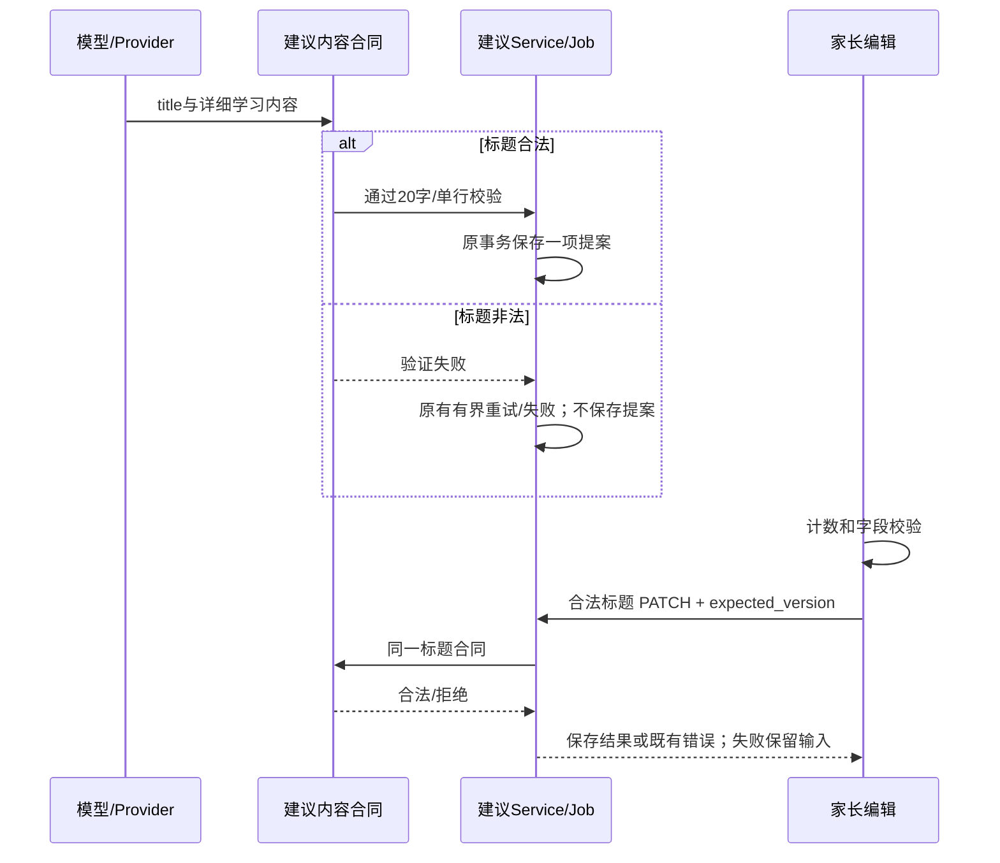
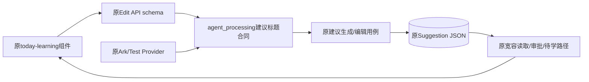

# FEAT-004 — 学习建议标题约束

- Status: VERIFYING
- Severity: 推荐标题过长，占用弹层大量空间，学习步骤与操作难以浏览。
- Risk: R2，收紧新生成/编辑的字符串合同；兼容既有提案与已批准待学，无数据库迁移。
- Owner: 产品负责人（用户）；Implementer: Codex；Reviewer/Verifier: fresh-context独立只读复核PASS，本地自动化/原生已验；设备/可访问性待验。
- First observed: 2026-10-24，本地今日学习弹层截图；未推断为线上模型输出。
- Related request: 用户「这里需要约束 推荐的学习内容的标题。过长会有显示问题。」
- Spec revision: SPEC-20261024-SUGGESTION-TITLE-LIMIT-01
- Architecture revision: ARCH-20261024-SUGGESTION-TITLE-LIMIT-01，沿用现有模块/依赖，仅收紧写入合同。
- User confirmation: 用户于2026-10-24针对call_39aaa3dd3cdf4a52b2bfc9c4d862ee58回复「批准，按此实现」，明确批准本Spec01（含Architecture01）与DREV04；批准后开始实现。
- Affected Feature IDs: FEAT-004 / UI-001 / BHV-045。
- Feature current-state documents: [FEAT-004](../../docs/domain/features/FEAT-004-daily-learning-suggestions.md)。
- Feature baseline revision: FEAT-STATE-20261024-INCREMENTAL-LEARNING-06-LOCAL。
- Feature merge owner: Codex。

## Frontend Design Impact and Repository-native Approval

- Frontend impact: yes，标题有效长度及编辑字数、字段错误提示。
- Frontend impact reason: 正常建议显示简短活动标题，编辑展示有效保存上限与超限反馈。
- Frontend engineering impact: yes，表单本地校验、计数及既有请求入口回归。
- Affected UI IDs: UI-001；[当前UI](../../docs/design/frontend/ui/UI-001-parent-miniapp.md)。
- Frontend baseline revision: FDB-20260913-04，APPROVED。
- Frontend engineering constraint revision: FEC-20261007-NATIVE-GEOMETRY-02，APPROVED，含已批准的界面文案减法附加条款。
- Affected frontend quality dimensions: component/state/form、a11y、responsive/i18n、browser/device、performance/resource、security/privacy、motion-media-AI、observability。
- Frontend quality budgets/requirements: 320×568、390×844、430×932；正常字体20字CJK标题两行内，字体保持20px/600/1.45，不靠缩字/省略或隐藏溢出；操作≥44px、字段信息≥14px；常规横向溢出为零；初始包≤1.5MiB；不增依赖、请求或计时器。
- Frontend quality verification plan: 三视口×11设计态及输入交互；批准后真实组件单元/请求校验、ESLint/静态预算、三视口原生节点/截图、实际键盘/大字体/读屏和代表设备；设计不代验原生。
- Approved frontend engineering deviations: none。
- Current Design Revision(s): DREV02弹层 / DREV03卡片，标题输入及相关反馈由已批准DREV04覆盖；三份源/导出保持冻结。
- Approved Design Revision: DREV-20261024-TODAY-LEARNING-04，仅标题输入约束和相关反馈，已本地实现。
- Editable design source path(s): [self-contained HTML](../../docs/design/frontend/prototypes/DREV-20261024-TODAY-LEARNING-04/index.html)。
- Design source SHA-256: 见[候选清单](../../docs/design/frontend/snapshots/UI-001/DREV-20261024-TODAY-LEARNING-04/APPROVAL.md)。
- Required viewport/state exports: 11态×3视口，共33张；[具体矩阵](../../docs/design/frontend/prototypes/DREV-20261024-TODAY-LEARNING-04/FRONTEND-SPEC.md)。
- Prototype status: APPROVED。
- Approved Task Spec revision / Approved Design Revision / Design approval evidence: SPEC-20261024-SUGGESTION-TITLE-LIMIT-01 / DREV-20261024-TODAY-LEARNING-04；用户，2026-10-24，call_39aaa3dd3cdf4a52b2bfc9c4d862ee58「批准，按此实现」。
- Snapshot manifest path: docs/design/frontend/snapshots/UI-001/DREV-20261024-TODAY-LEARNING-04/APPROVAL.md。
- Permitted implementation deviations: none；超出合同的兼容/截断/自动改写须更新revision。
- UI current-state merge owner: Codex；已同步UI-STATE-20261024-SUGGESTION-TITLE-04及FEAT-STATE-20261024-INCREMENTAL-LEARNING-07-LOCAL，区分新写入20和旧数据兼容。
- Frontend visual/a11y/resolution verification: [批准前设计证据](../../docs/quality/evidence/SUGGESTION-TITLE-DESIGN-20261024.md)独立保留；当前三视口39态原生PASS，实际键盘/系统大字体/读屏与真机NOT_RUN。
- Frontend engineering verification evidence: [实现与验收](../../docs/quality/evidence/SUGGESTION-TITLE-IMPLEMENTATION-20261024.md)，前端332、后端780通过/40个MySQL环境相关跳过；静态/预算/独立复核PASS。
- External design dependency: none。

## 1. Symptom and impact

用户截图中的重复长标题占用弹层大部分顶部。修复前provider提示、LearningSuggestionContent、PATCH Edit及原生编辑input均允许120，标题区仅对超过60的旧长标题采用30vh完整滚动。这个防溢出分支没有约束内容生成，正常建议仍可能拥有类似一段正文的标题。当前新生成/编辑有效合同已收紧为20，input的120只保留为输入防护及历史编辑承载。

已证实的是修复前120字合同和截图症状；未将该标题归因为真实模型生成，也未查询或修改真实孩子数据。本次20字合同使用独立的新回归及原生取证，不借用上一个卡片/弹层结果。

## 2. Reproduction

合成条件：启用本地建议，manager/editor已有一项历史120字重复标题的提案。打开今日建议弹层，长标题完整占据多行/30vh标题滚动区，学习步骤的可用面积变小。无需真实模型即可用修复前120字合同构造该输入；新生成现在会拒绝它，已有内容继续完整可读。

预期：新生成或重新编辑的标题为一个简短活动名，最多20个Unicode码点；步骤在instructions，理由在rationale。不是把120字在显示层直接切成20字。

## 3. Triage and impact map

| Confirmed pre-fix fact | Evidence |
|---|---|
| AI内容与编辑API都允许120 | agent_processing/suggestion_contracts.py、learning_suggestions/schemas.py |
| Prompt仍要求120字以内，TestProvider可拼接长知识名 | agent_processing/suggestion_provider.py |
| 编辑只有非空检查，未执行20字有效保存校验 | today-learning/index.js saveEdit、index.wxml maxlength=120 |
| 存储读取直接投影validated JSON | learning_suggestions/queries.py proposal_view/task_view；可不迁移兼容旧数据 |
| 审批创建StudyTask，实际学习确认独立 | learning_suggestions/service.py approve、recording.py |

Link/call graph：

```text
Job → SuggestionProvider / prompt → LearningSuggestionContent → validate_content / commit_result
    → Suggestion.validated_content_json → queries → 今日卡片 / 建议弹层
家长编辑 → today-learning.saveEdit → PATCH Edit → service.edit → 同一Suggestion
家长审批 → service.approve → StudyTask（不创建正式学习事实）
```

家长/孩子scope、授权、版本与现有幂等/迟到保护不变。正式学习内容、知识名和其他页面的标题上限不纳入本次20字合同。

## 4. Root cause

修复前标题和详细内容虽然分字段，标题预算仍设为120；提示和服务端共同接受冗长标题，前端仅负责完整显示。缺失的是标题有效内容预算及编辑反馈。只增加CSS截断或只修改提示词均不能阻止无效标题进入新提案；本轮已在原合同和编辑入口补齐。

批准后先执行新增回归，后端11失败/9通过、前端4失败，复现21字被接受、内部换行及未验证provider实例绕过、缺少计数/错误等问题。修复后专项后端52、前端18通过；全量结果与范围见下表和实现证据。设计中的示范校验不替代这些测试。

## 5. Fix contract

### 5.1 新生成与重新编辑

- title：去首尾空白后1–20个Unicode码点；汉字、标点、空格、英文各按码点计1，非BMP字符按1；Python len与JS Array.from口径一致。不按字节、UTF-16单元或视觉宽度计数。
- 去首尾空白后不得含内部CR/LF/U+2028/U+2029换行；标题为单行文本语义，显示时仍正常换行。全空白无效；内部普通空格保留且计数。不自动裁切标题，也不静默改写学习语义。
- Prompt建议6–16字、硬上限20，概括一个动作/对象。详细步骤、来源、理由、科目和时长分别放已有字段，不复制长知识名或重复拼接，不给必学下一课/掌握判断。
- provider输出须过同一标题合同；写入提案前再次验证，防止provider适配或未验证实例绕过。非法结果不持久化为建议/待学/正式记录。沿用既有Job最多3次尝试、退避和终态错误，不额外增加修复模型调用或额度。
- PATCH Edit使用相同标题合同；绕过客户端的无效请求返回既有422字段校验错误，Suggestion内容、version及任务数均不变。TestProvider也须能从长知识名构造合法且换项不同的标题。

### 5.2 家长编辑交互

- 学习标题标签右侧显示`当前字数/20`；只增加必要约束反馈，字体14px，沿用现有暖白纸面/松绿及输入控件样式。
- 普通输入/粘贴超过20不在20处静默裁剪，保留输入；沿用原input 120的输入防护上限，20才是服务端有效保存上限。不得依赖原生maxlength计数来实现Unicode合同。
- 超限立即提示「标题最多20字，请精简。」；空值保存提示「请填写学习标题。」；内部换行提示「标题请写成一行。」。字段错误贴近输入，以文字及边框共同表达。
- 无效保存零PATCH，并将焦点定位标题。20字可保存；保存成功回建议弹层显示完整新标题；网络/版本等错误沿用既有错误与输入保留，保存中禁用关闭/重复操作，切换scope仍丢弃迟到结果。输入计数/校验不能生成建议或确认学习。

### 5.3 旧数据兼容

已有21–120字提案/已批准StudyTask/关联记录不批量修改、不重写JSON、不裁切标题。GET、已有提案审批、暂缓/换项、已批准任务实际记录/删除沿用原合同与完整显示，超过60字仍采用现有30vh标题滚动。新上限不反向阻断已经生成或批准的内容。

打开旧提案编辑时，完整带入旧标题并显示例如120/20；重新保存必须由家长精简至20字内，可将细节移至已有具体内容字段。取消/关闭不改旧数据，不自动复制/迁移正文，不强迫模型二次生成。换一项得到的新提案适用新合同。

### 5.4 不变与事实合并

两日资格、年级来源、家长审批、实际学习确认、复习排期/10分钟预算、小时/日配额、数据库结构和默认关闭保持不变。验证后更新FEAT004、BHV045、UI001当前正文中的标题事实，主Spec04的120字记录明确标为由本修订取代的新写入上限，而非无标识保留冲突。Architecture只记现有合同owner/消费者，不新建domain或通用工具；测试和发布记录区分本地、原生/真机及未部署。

## 6. Fix design — Architecture01

现有agent_processing/suggestion_contracts拥有闭合的建议输出形状；复用该处的标题验证声明供Edit和生成写入消费。learning_suggestions本已消费agent_processing合同，不增加反向边或新扩展点。前端本地验证提供即时反馈，服务端始终是权威。保持读取路径宽容以支持历史数据，无response字段和DB更改。



State machine：`编辑合法草稿→保存中→成功/可重试错误`；`空/超限/换行草稿→本地字段错误（零请求）→家长精简→合法`。远端Job合法转换不变：queued/running/succeeded/failed/cancelled，非法标题沿用原失败路径。旧提案读取/审批不重新套新写入校验。

Architecture diagram：



图示数据流不代表逆向import；依赖仍为learning_suggestions→agent_processing，后者不依赖suggestions。没有新的共享包、provider或扩展注册。

| Option | Benefit | Cost/risk | Decision |
|---|---|---|---|
| 20字硬合同+简短prompt+字段计数，旧数据宽容读取 | 控制新内容密度且保留家长内容；320正常字体两行 | 收紧API；旧提案仅重新编辑时要求精简 | 推荐 |
| 只让AI“简短一点” | 最少代码 | 无法拦截超长生成和编辑 | 拒绝 |
| CSS两行省略/保存时直接截20字 | 显示短 | 丢失家长确认所需语义，掩盖内容问题 | 拒绝 |
| 24–30字上限 | 容纳更多信息 | 320正常标题可能三行；活动名无需承载步骤 | 本次不选 |
| 批量重写历史标题/强制旧提案先编辑才能审批 | 所有存量立即变短 | 改写旧内容或增加无关阻断/修复迁移 | 本次不选 |

### Expected file changes

| File/path | Action | Expected change / necessity |
|---|---|---|
| 本Spec、DREV04源/33导出/清单/设计证据 | add | 可审阅方案；不改冻结DREV02/03 |
| agent_processing/suggestion_contracts.py、suggestion_provider.py | modify，批准后 | 标题权威合同、prompt和TestProvider；删除120字新生成规则 |
| learning_suggestions/schemas.py、generation.py | modify，批准后 | 编辑复用合同、持久化前校验；读取/审批不加新阻断 |
| components/today-learning/index.js/wxml/wxss | modify，批准后 | 原编辑表单计数/字段错误/焦点，无平行组件 |
| tests/unit/test_today_learning_policy.py、tests/integration/test_learning_suggestions.py、tests/frontend/today-learning.test.js | modify，批准后 | 边界/零写入/旧数据兼容及失败保留 |
| tools/prepare_today_learning_native.py、tools/today_learning_geometry.js（必要时） | modify，批准后 | 仅合成夹具与原生输入/边界节点验证；单独新证据目录 |
| Feature/Behavior/UI/主Spec04/Architecture/测试/发布记录和索引 | modify | 合并已验证正文；保留历史与发布边界 |

保留旧长标题滚动和已有读取路径有明确兼容消费者；不新增无退出依据的替代服务或临时数据修复。数据库迁移/后台批量写为N/A。

### Compatibility and rollout

这是一项有意收紧的新写入合同，旧客户端超长编辑收到422，原文仍在服务端，短标题写入和其他命令兼容。若未来发布，先部署可兼容旧读取的后端，再上传含字段提示的客户端；按仓库发布流程单独授权。原有建议flag仍默认false，不引入新flag。回滚代码恢复原120写入合同，不需要回滚数据。观察既有safe generation_unavailable/校验失败信号，不记录标题或模型原文，不添加内容日志/分析事件。

## 7. Acceptance and regression verification

AC-001：AI生成和PATCH新写入都只接受trim后1–20码点且无内部换行的标题。20接受、21拒绝，输出/编辑无效不生成新提案/任务/正式事实；模型失败重试仍有界。

AC-002：前端计数与服务端一致，无效保存零请求并保留/定位输入；有效保存展示完整标题，失败保留草稿，保存中防重和scope迟到保护继续有效。

AC-003：旧120字提案/任务可完整读取并按既有流程审批/记录/删除；打开编辑不裁剪，必须主动精简才能重新保存。正式知识名与实际学习内容上限不被误改。

AC-004：延续DREV02/03字体/操作；三视口正常字体20个CJK字符标题最多两行，无横向溢出或操作遮挡；编辑错误、保存中、旧内容在原生节点和截图中可用。真实键盘/系统字体/读屏与设备另有证据。

| TP | AC | Test / command | Required result | Current result |
|---|---|---|---|---|
| TP-001 | 001 | unit：0/1/20/21/120、trim/内部换行/非BMP、Provider长来源、非法实例进入commit；uv run pytest tests/unit/test_today_learning_policy.py -q | 新边界先红后绿，不能绕过写入校验 | PASS，与TP-002合计52；先红结果已记录 |
| TP-002 | 001/003 | integration：PATCH20/21及版本/JSON零变更、旧JSON读取/审批/任务记录、Job非法结果有界失败；uv run pytest tests/integration/test_learning_suggestions.py -q | HTTP与DB合同一致，无新增事实或历史改写 | PASS，SQLite HTTP/DB与历史120兼容 |
| TP-003 | 002 | frontend：计数/超限不请求/旧编辑/失败保留/等待/切scope；npm test、npm run lint:miniapp | 全部适用回归通过，无请求副作用 | PASS，专项18/全量332，ESLint通过；异步focus重置与幂等键变异复核通过 |
| TP-004 | 004 | 本DREV04 renderer、33张SHA及冻结DREV01/02/03完整性 | 布局/边界交互通过，正常CJK20字≤2行 | 设计结果见独立证据 |
| TP-005 | 002–004 | 批准后三视口原生标题/编辑计数/字段错误/保存、长标题读取与操作节点/截图 | 精确viewport、包含/无重叠/44px/字体与输入一致 | PASS，320×568/390×844/430×932各13态，共39份PNG/节点，SHA及源码绑定 |
| TP-006 | 001–004 | uv run ruff check/format、uv run mypy apps/api/src、uv run python tools/check_architecture.py、validate_miniprogram.py及设计检查；全量适用后端 | 类型/静态/依赖DAG/包预算无退化 | PASS，后端780通过/40个MySQL环境相关跳过；Ruff731、mypy150、DAG150，源码1,221,025字节；设计/静态均通过 |
| TP-007 | 004 | 代表iOS/Android、实际键盘/读屏/系统大字体及独立只读复核 | 记录实际结论，缺项不得DONE | PARTIAL，独立只读复核PASS（CR-001测试覆盖补强已关闭）；真实设备/键盘/读屏/大字体NOT_RUN，本机合成模拟器无法代验 |

## 8. Review and closure

已在批准后修改原有合同、Provider提示/TestProvider、生成写入再验证、Edit schema和today-learning表单，未新增并行组件/通用工具/扩展点。独立只读复核无生产阻断问题；唯一CR-001是幂等键测试假阳性，已用递增键/次数及内存变异验证关闭。实际原生39态通过；Feature、BHV045、Architecture、UI/Design、主Spec04、测试、发布记录及索引正文已同步新20/旧120区别，无当前代码/文档冲突。

本Spec保持`specs/active/FEAT-004-SUGGESTION-TITLE-LIMIT.md`、VERIFYING，completed无副本；缺少真实iOS/Android、实际键盘/系统大字体/读屏结论，恢复条件为取得代表设备并按TP-007验收。没有新增实现批准需求；不能仅因代码完成设DONE。DREV02只添加本标题范围Superseded by，DREV03及其他批准源/快照冻结，主功能/卡片的其余缺口不被本次复核覆盖。本轮未提交、上传、部署、访问真实学习数据或改变开关。
