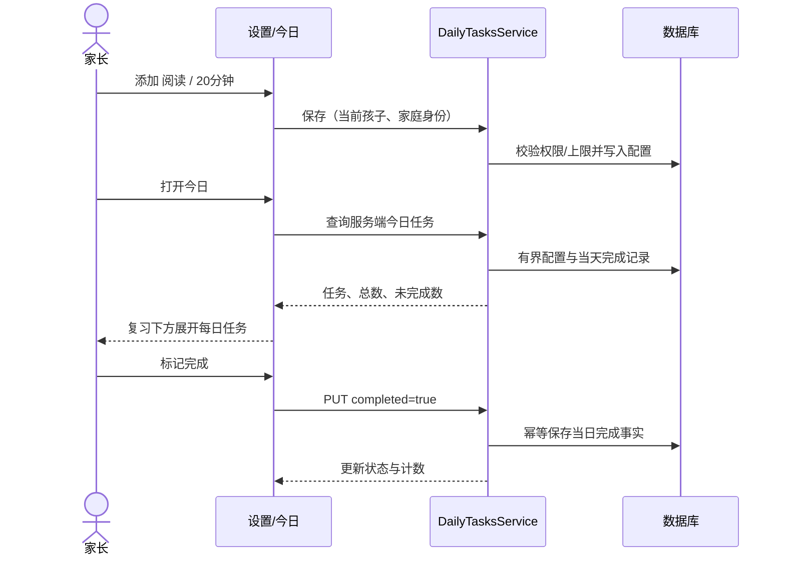
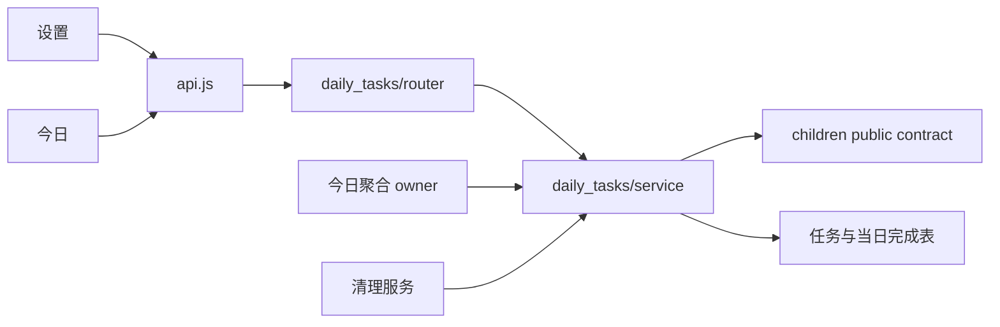
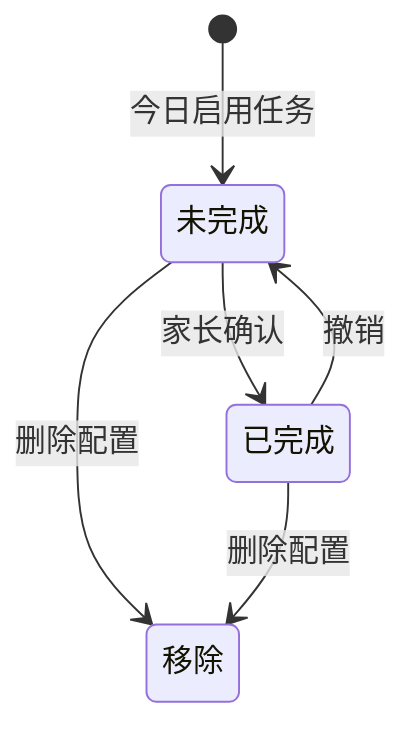
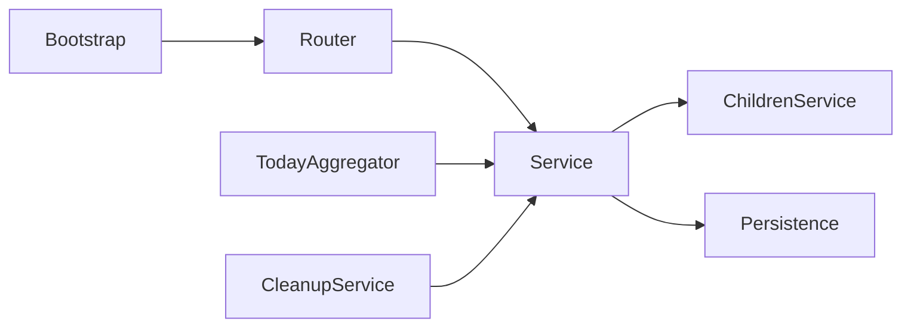

# FEAT-010 — 每日任务与今日区块自动折叠

- Status: VERIFYING
- Risk: R2
- Spec owner / Implementer / Verifier: Codex
- Reviewer / Approver: 产品负责人（用户）
- Created / Last updated: 2026-10-12
- Spec revision: SPEC-20261012-DAILY-TASKS-01
- Architecture revision: ARCH-20261012-DAILY-TASKS-01
- User confirmation / Additional R2 approval: 产品负责人（用户），2026-10-12，消息「好的按照这个方案实现前后端代码。」；明确对应本聊天唯一待批准的 SPEC-20261012-DAILY-TASKS-01、DREV-20261012-DAILY-TASKS-01 和 ARCH-20261012-DAILY-TASKS-01。
- Target release: N/A（本次前后端本地实施；不含部署，发布另遵循 docs/deploy/README.md）
- Affected Feature IDs: FEAT-010（新增）、FEAT-001、FEAT-005、FEAT-006（清理生命周期）
- Feature baseline: FEAT-STATE-20261006-REVIEW-MANAGEMENT-03-LOCAL；FEAT-005 当前多孩子生命周期。
- Current-state targets: docs/domain/features/FEAT-010-daily-tasks.md（实施后新增）；FEAT-001、FEAT-005、FEAT-006 对应文档。
- Feature / UI merge owner: Codex；已合并本地实现及验证边界，未部署。

## Frontend Design Impact and Repository-native Approval

- Frontend impact / engineering impact: yes；设置新增任务配置，今日新增区块及默认折叠规则。
- Affected UI: UI-001；docs/design/frontend/ui/UI-001-parent-miniapp.md。
- Frontend baseline: APPROVED FDB-20260913-04（纸·芽）。
- Frontend engineering constraint: APPROVED FEC-20261007-NATIVE-GEOMETRY-02。
- Proposed Design Revision: DREV-20261012-DAILY-TASKS-01。
- Editable source: docs/design/frontend/prototypes/DREV-20261012-DAILY-TASKS-01/design.html。
- Prototype status: APPROVED。
- Required exports: 320×568、390×844、430×932；settings / today / completed / empty / form-error。
- Manifest: docs/design/frontend/snapshots/UI-001/DREV-20261012-DAILY-TASKS-01/APPROVAL.md。
- Approved Task Spec / Design Revision / approval evidence: SPEC-20261012-DAILY-TASKS-01 / DREV-20261012-DAILY-TASKS-01；产品负责人2026-10-12消息「好的按照这个方案实现前后端代码。」。
- Permitted deviations / engineering exceptions: none；External design dependency: none。
- Quality: component/state/form、a11y、长中文、原生设备、资源预算、权限与隐私、失败可恢复、观测。
- 目标：控件 ≥44px、无重叠/越界；三视口原生节点矩形及截图；iOS/Android 键盘态；沿用现有 FEC 资源预算及 FEC-PERF-READ-001～004。
- Verification evidence: docs/quality/evidence/DAILY-TASKS-20261012.md；三视口基础原生节点/截图通过，完整状态与真机待补；HTML设计导出不替代原生验收。

## 0. Problem and intended outcome

家长需要配置每天固定做的任务及目标分钟数，并在今日完成。今日的复习、每日任务、学习记录、课外活动根据数据自动展开或收起，减少已完成或空内容的占位。

## 1. Facts, decisions, assumptions, questions

已确认：用户要求设置每日任务、阅读/跳绳等默认选项、分钟单位、放在今日复习安排下面；空或全部完成的折叠框默认收起。
代码证据：apps/miniprogram/pages/today/index.js 当前 DEFAULT_SECTIONS 固定默认值并读取 todaySections 偏好；index.wxml 对学习/活动空态强制展示。settings/index.wxml 按孩子配置科目与活动。

以下为推荐决策，随本 Spec 一并审批：
- 任务按家庭/孩子独立配置；默认选项为阅读、跳绳、练字、户外运动，仅作快捷候选，不自动启用。
- 可添加自定义名称、编辑名称/分钟、删除；名称 trim 后 1～30 字符，分钟为 1～180 整数，每个孩子最多 20 个启用任务，名称不重复。
- 今日一键标记完成及撤销；不计时、不记录实际耗时。次日重新开始；历史未完成不产生债务。
- 当日改名称/目标分钟立即作用于今日展示；已完成记录保留完成时名称/分钟快照。删除任务立即从今日移除，历史快照保留至清理。
- 学习记录没有“完成”语义：非空展开、空收起。课外活动使用已有实际完成记录判断，候选建议视为未完成；不能仅因时间已过认定完成。
- 无阻塞产品问题；以上假设可在审批前修改。

## 2. Current behavior and evidence

当前只有复习、今天记录的学习和课外活动三个区块，没有每日任务配置或完成数据。复习默认收起，活动默认展开，偏好持久化。现有 family/child 授权与只读成员限制继续有效。
相关状态文档：FEAT-001 MVP、FEAT-005 多孩子、FEAT-006 清理；UI-001。
Runtime evidence: N/A，本阶段只读代码发现，尚无新增功能运行态。

## 3. Target behavior

| Case | Expected result |
|---|---|
| 有未完成任务 | 默认展开；名称、目标分钟、完成操作、已完成/总数 |
| 全部完成 / 无任务 | 默认收起；标题摘要仍可见；空态可手动展开并前往设置 |
| 学习记录非空 / 空 | 默认展开 / 收起 |
| 部分完成 | 未完成在前，同组按创建顺序、ID；已完成标注文字并可撤销 |
| 同一天重新进入 / 切孩子 / 跨日 | 用完整服务端计数重新计算默认状态；不读旧折叠偏好 |
| 当前页面手动切换 | 保留本次浏览选择；写操作刷新不抢先自动折叠 |
| 无手动选择且完成最后一项 | 自动收起；撤销后自动展开 |
| 请求失败 | 保留输入/原状态、可重试、不显示假成功 |
| 重复完成请求 | 单条事实，无重复累计 |
| viewer / 外家庭 / 归档孩子写入 | 服务端拒绝；viewer 可读，归档保留历史 |

复习默认值根据整个当日计划的剩余计数判断，不能只看首页前三条；活动根据完整有界服务端聚合判断，不能只看当前渲染项。

## 4. Scope and link/call graph

In scope: 每日配置、当日完成/撤销、今日排列及四区块折叠；多孩子隔离与清理。
Out of scope: 通知、星期/时刻设置、倒计时、连续打卡、AI 建议、学习知识点/复习规划、报告新指标、发布。
Invariants: AI 不创建正式学习记录、不评分；确定性复习策略不变；保留 occurred_at / created_at；任何写入均鉴权。

## 5. Domain and data design

DailyTask: id、family_id、child_id、name、target_minutes、active、created_at、updated_at。
DailyTaskCompletion: family_id、child_id、task_id、day、occurred_at、created_at、name_snapshot、minutes_snapshot；唯一键 (family_id, child_id, task_id, day)。day 为 Asia/Shanghai 服务端日期；客户端不能通过时区改变日期。
查询索引 tenant-leading；配置通过事务和孩子锁保障并发 20 项上限/重名限制。完成 PUT 表示期望状态；并发相反写入按服务端事务提交顺序决定。

次日按新 day 投影未完成，不创建后台任务或过去的待办。配置软删除、完成事实按家庭/孩子删除协议硬清理；适配 FEAT-006 数据清理与家庭重置。迁移为新增表/索引，不回填旧家庭默认任务。SQLite 和真实 MySQL 5.7 均需验证；上线后端先于前端；回滚前端入口后停止新写，保留表内事实，删表须先评估数据备份。

## 6. Interfaces and errors

拟新增（审批后按现有路由命名惯例落定，语义不得变化）：
- GET /children/{child_id}/daily-tasks：最多20项启用配置。
- POST /children/{child_id}/daily-tasks：name / target_minutes，返回配置。
- PATCH /children/{child_id}/daily-tasks/{id}：只修改显式传入字段；null 非法。
- DELETE /children/{child_id}/daily-tasks/{id}：软删除，重复请求幂等。
- GET /children/{child_id}/daily-tasks/today：day、items、total_count、remaining_count；最多20项，单次有界联查，不拉历史。
- PUT /children/{child_id}/daily-tasks/{id}/today-completion：completed 布尔必填；重复同状态幂等。

空列表为 []，缺失字段保持旧值，null 不表示清空。无记录表示未完成。非法输入422；不存在/跨家庭404；只读或归档写403；超限/重名409；依赖故障沿用平台安全错误。所有日期来自服务端今天；跨午夜写后重新读取当前 day。

## 7. Authorization, security, privacy

身份沿用现有 family actor/local X-Family-ID；所有 ID 校验 family+child+task 的完整所有权。manager/editor 写，viewer 读；不引入管理绕过。输入为不可信文本，安全渲染，禁止 HTML 执行。日志只记 route/error/耗时，不记录任务名称、孩子内容或身份密钥。重试不生成重复完成事实；服务端验证归档状态。沿用现有审计约定，不另建日志框架。

## 8. Architecture and trade-offs

推荐新增 daily_tasks 领域拥有配置与完成事实；router 做传输验证，service 管权限、用例、事务，schemas 定义契约。今日聚合通过服务契约访问，不直接跨模块写表。planning 不依赖 daily_tasks；日报复习预算不包含任务分钟。

不新增共享抽象；闭合职责放在领域模块。架构检查验证无反向依赖/循环。
替代方案：复用活动安排能少建表，但混淆固定每日目标和课外课程/实际活动记录；存前端本地最快，但无法家庭协作/跨设备同步，因此不采用。预生成每日实例可保留完整历史，但产生无必要后台任务和未完成债务，暂不采用。
扩展性：自定义任务名称为有界数据配置（非代码扩展）；提醒、周计划、实际时长统计 deferred；计划/AI 插件 closed。本 revision 为架构确认对象，审批 APPROVED。ADR: 不单建，当前 Spec 已记录局部边界与权衡，已合并 Architecture。

## 9. Expected file changes and replacement/deletion

| Path | Action / purpose |
|---|---|
| apps/api/src/push_kids/daily_tasks/{router,schemas,service}.py | add，领域职责 |
| 现有 persistence models / bootstrap router 注册 / Alembic migration | modify/add，存储与装配 |
| 今日聚合 owner / 清理服务 | modify，通过领域服务集成 |
| apps/miniprogram/pages/settings/index.{js,wxml,wxss} | modify，任务配置及表单状态 |
| apps/miniprogram/pages/today/index.{js,wxml,wxss} | modify，任务区块与数据默认折叠 |
| apps/miniprogram/utils/api.js / contracts | modify，新接口与契约 |
| tests/unit、integration、contract、frontend | add/modify，验收证据 |
| Feature/UI/Architecture/Behavior current-state | modify/add，验证后的最终事实 |
| tools/daily_task_geometry.js / docs/quality/evidence/ | add，原生验收采集与记录 |

替换 todaySections 持久化读取/写入以及空学习/活动强制展开分支；保留 reviewReturn 定位指定复习项时显式展开的行为。无临时双实现；禁止无关重构。

## 10. Non-functional requirements

每日任务最多20项，服务查询数量 O(1)、无历史加载、响应 ≤16KiB。默认折叠使用完整聚合；加载中不推断为空。写入 pending 禁止重复点击；失败输入保留；慢请求沿用平台观测且不含内容。严格遵循原生三视口、安全区、44px触控、文字放大和键盘可用性。

## 11. Acceptance criteria

- AC-001：当前孩子添加阅读20分钟，刷新/另一家长设备可读；编辑与删除正确，切孩子不串数据。
- AC-002：在复习下面显示每日任务；完成/撤销持久化；次日未完成，前日不形成债务，不影响复习规划与报告。
- AC-003：四区块遵循非空未完成展开、全完成/空收起；学习非空展开；手动切换有效；分页剩余项不被漏判；reviewReturn 仍能定位。
- AC-004：非法、并发、重试、viewer、外家庭、归档写与清理路径符合约束；不产生越权或重复完成。
- AC-005：三视口长文本、错误、pending、键盘、只读、空态均可用；原生矩形及iOS/Android evidence齐全。

## 12. Verification plan

| Required point | Acceptance / verification |
|---|---|
| TP-001 | AC-001；真实API+DB CRUD、上限20、重名、1/180分钟边界、零/小数/null拒绝、并发配置 |
| TP-002 | AC-002；完成重复与撤销、并发相反命令、上海跨日、当天编辑/删除快照、无历史债务 |
| TP-003 | AC-003；frontend页面测试四区块空/全完成/部分/分页未完成、手动选择、刷新切孩子跨日、旧偏好、reviewReturn |
| TP-004 | AC-004；跨家庭/孩子ID、viewer、归档、家庭重置及孩子删除、迁移SQLite/MySQL5.7 |
| TP-005 | AC-005；三视口原生几何、长名称、表单键盘与错误、pending/read-only；iOS/Android走查 |
| TP-006 | AC-001～004；20任务+大历史常数查询、tenant-leading EXPLAIN、响应预算 |
| TP-007 | 旧功能回归；学习确认/复习/活动/报告与孩子切换；架构无环 |

审批后执行：uv run pytest tests/unit tests/integration tests/contract -q；uv run ruff check .；uv run ruff format --check .；uv run mypy apps/api/src；npm test；uv run python tools/check_architecture.py；uv run python tools/validate_design_evidence.py --check-current-policy；uv run python tools/validate_miniprogram.py。
TP-001/003 对旧实现应失败（接口缺失/默认折叠错误）；TP-007 证明旧流程不变；TP-002/004 证明禁止副作用。原生设备与MySQL无法用mock代替。

## 13–15. Rollout, implementation, review

批准 Spec+DREV+架构后：迁移/领域契约 → 设置与今日 → 聚焦验证/原生证据 → 只读审查及事实同步。先后端再前端；不包含部署授权。发布遵循 docs/deploy/README.md；遇人工门禁输出标准块。失败回滚入口与调用，保留事实。
审查必须覆盖正确性、设计合理性、文件必要性/放置位置、残留；使用独立只读阶段，不预先声称通过。

## 16. Implementation and verification record

生产代码本地实施完成：daily_tasks领域/两表迁移/聚合/清理合同，设置表单与今日任务/折叠规则；未部署。
自动化：510 passed / 19 skipped；npm231 passed；新增每日任务SQLite22 passed、前端12 passed。
类型、受影响Python lint/格式、小程序lint、设计manifest、架构纯政策/103模块无环、16页面静态检查均通过。
全局Ruff142项和format6文件失败全部在6个其他设计render.py；保留无关工作。uv本机panic后使用仓库现有.venv等效命令。
原生：三视口设置与今日基础数字几何/截图及390真实全部完成自动收起通过；完整状态矩阵/真机待补。
真实MySQL5.7未运行（无测试URL），生产迁移未运行（不在本次授权范围）。
AC-001～004本地功能已验证；TP-004MySQL和AC-005/TP-005完整原生设备验收仍缺证据。
所有命令、结果及原生隔离配置见docs/quality/evidence/DAILY-TASKS-20261012.md。只读复核为最后阶段，结论留于聊天。
Deviations: 无产品/架构/设计scope偏离；复用现有api.request无需修改api.js；验证环境差异如上。

## 17. Completion gate

- [x] 具体 Spec + Design + Architecture revision 获批准
- [x] AC-001～005 和 TP-001～007 结果记录，缺项标风险
- [ ] 全部 required checks 与独立审查通过
- [x] Feature/UI/Architecture/Behavior 合并最终事实
- [x] 无无关改动、旧折叠分支已移除
- [ ] DONE 后移至 specs/completed/；当前VERIFYING，等待真实MySQL与完整原生验收，不能提前关闭

## 18. Revision history

2026-10-12：初稿，依据用户新增每日任务与折叠优化请求；产品负责人通过消息「好的按照这个方案实现前后端代码。」批准本 Spec、Design 和 Architecture revision。
2026-10-12：前后端实施及本地回归完成，更新为VERIFYING并同步当前事实，剩余验收明确记录。
