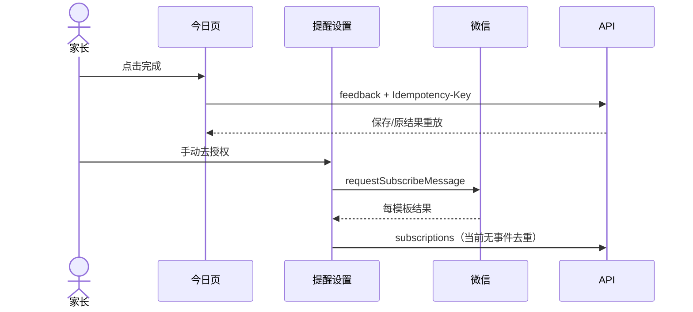
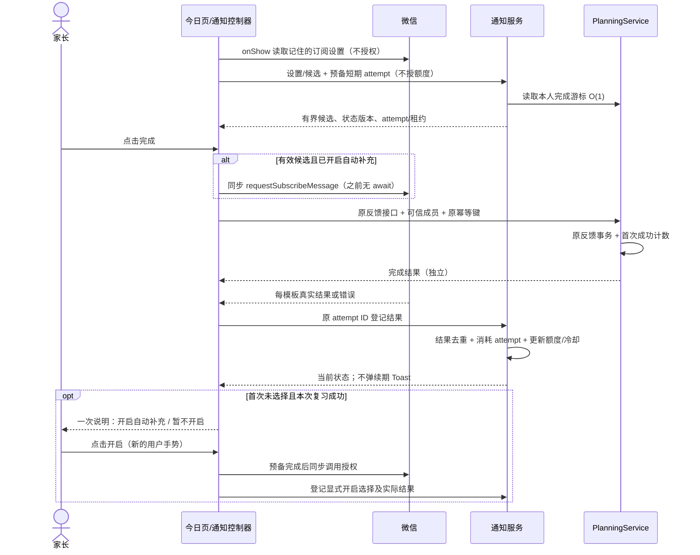
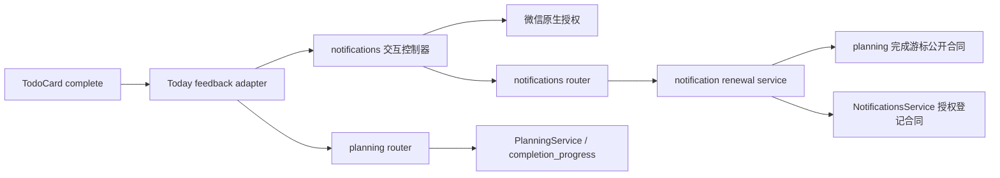
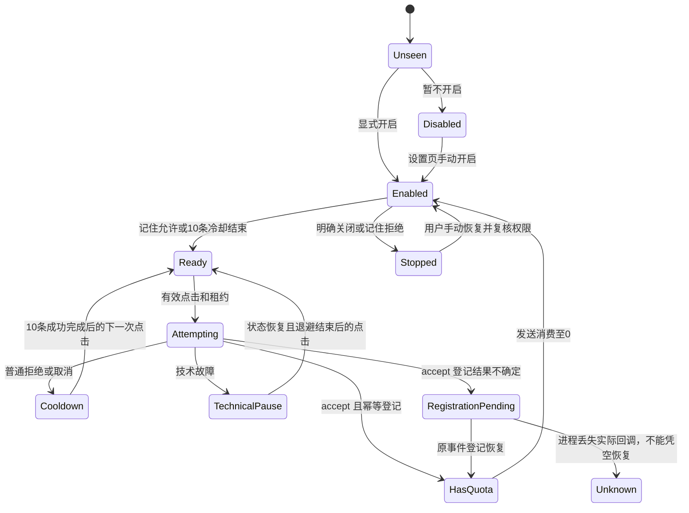
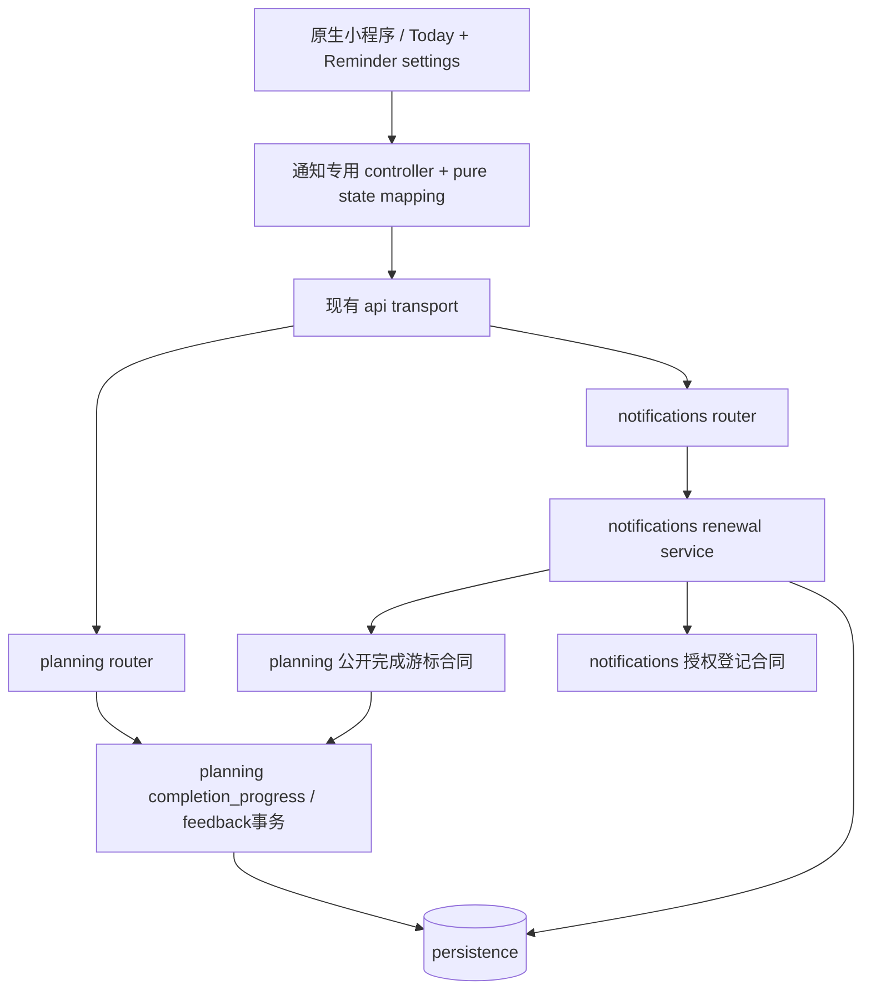

# FEAT-011 — 提醒授权自动补充

- Status: VERIFYING
- Risk: R2
- Spec owner: 产品负责人（用户）
- Implementer / Reviewer / Verifier: Codex；实现后独立只读评审；用户负责真机确认
- Created: 2026-10-17
- Last updated: 2026-10-17
- Target release: 本地实施与验收；不提交、上传、部署或发送通知
- Spec revision: SPEC-20261017-NOTIFICATION-AUTO-RENEWAL-01
- Architecture revision: ARCH-20261017-NOTIFICATION-AUTO-RENEWAL-01（APPROVED）
- User confirmation: 2026-10-17 用户回复“需求确认”，确认 Q1—Q15 汇总；**不是本 Spec / 架构 / DREV 的实施批准**
- Additional R2/R3 approval: APPROVED — 用户，2026-10-17，紧接本版 Spec/架构/DREV 审阅链接回复“按照这个方案落地”；批准本 revision 及 DREV-20261017-NOTIFICATION-AUTO-RENEWAL-01 的实施。
- Affected Feature IDs: FEAT-011（新用户能力）、FEAT-003（通知领域所有权）、FEAT-001（复习完成入口）
- Feature current-state documents: [FEAT-011](../../docs/domain/features/FEAT-011-notification-auto-renewal.md)、[FEAT-003](../../docs/domain/features/FEAT-003-notification-channel.md)、[FEAT-001](../../docs/domain/features/FEAT-001-push-kids-mvp.md)
- Feature baseline revision: FEAT-011=PLANNED；FEAT-003=FEAT-STATE-20261017-NOTIFICATION-LIVE-RECEIPT-05；FEAT-001=FEAT-STATE-20261016-REVIEW-SUBJECT-ORDER-01-GRAY，实施前重新核对
- Feature merge owner: Codex
- Discovery code baseline: 8f3c5b04e61c96d4c19cf9eefd26514a8a095e1a；原有诊断修改保留，不纳入本次实现

## Frontend Design Impact and Repository-native Approval

- Frontend impact: yes — 今日首次说明、提醒设置新增自动补充开关和逐类型状态
- Frontend engineering impact: yes — 手势链、跨设备远端状态、幂等恢复与迟到回调
- Affected UI IDs: UI-001 / UI-011
- UI current-state documents: [UI-001](../../docs/design/frontend/ui/UI-001-parent-miniapp.md)、[UI-011](../../docs/design/frontend/ui/UI-011-reminder-settings.md)
- Frontend baseline revision: FDB-20260913-04，APPROVED
- Frontend engineering constraint revision: FEC-20261007-NATIVE-GEOMETRY-02，APPROVED
- Affected frontend quality dimensions: component/state/form、a11y、native/device、performance、security/privacy、observability、中文长文案
- Frontend quality budgets/requirements: FEC 远端状态归属、44px 触控/14px 正文、三视口原生几何、1.5MiB 包体、FEC-PERF-READ-001..004
- Frontend quality verification plan: TP-008..012；HTML 设计证据不能替代原生证据
- Approved frontend engineering deviations: none
- Current Design Revision(s): UI-001 现有增量见 current-state；UI-011 旧实现无独立批准 manifest，不追认
- Editable design source path(s): docs/design/frontend/prototypes/DREV-20261017-NOTIFICATION-AUTO-RENEWAL-01/index.html
- Design source SHA-256: 见两个候选 manifest 的 Editable source SHA-256
- Proposed Design Revision: DREV-20261017-NOTIFICATION-AUTO-RENEWAL-01
- Required viewport/state exports: 320×568、390×844、430×932；UI-001 2态、UI-011 12态，见 FRONTEND-SPEC
- Prototype status: APPROVED
- Approved Task Spec revision: SPEC-20261017-NOTIFICATION-AUTO-RENEWAL-01
- Approved Design Revision: DREV-20261017-NOTIFICATION-AUTO-RENEWAL-01
- Design approval evidence: 用户，2026-10-17，审阅本版方案后回复“按照这个方案落地”；保留源 SHA 与42张导出不变。
- Snapshot manifest path: [UI-001](../../docs/design/frontend/snapshots/UI-001/DREV-20261017-NOTIFICATION-AUTO-RENEWAL-01/APPROVAL.md)、[UI-011](../../docs/design/frontend/snapshots/UI-011/DREV-20261017-NOTIFICATION-AUTO-RENEWAL-01/APPROVAL.md)
- Permitted implementation deviations: 无可见偏离；微信原生授权面板由微信控制，设计稿不模拟其外观
- UI current-state merge owner: Codex
- UI current-state merge evidence: UI-001/UI-011已合并本地实现事实，见NOTIFICATION-AUTO-RENEWAL-IMPLEMENTATION-20261017；不等同发布。
- Frontend visual/a11y/resolution verification: 设计期证据见 [记录](../../docs/quality/evidence/NOTIFICATION-AUTO-RENEWAL-DESIGN-20261017.md)
- Frontend engineering verification evidence: 本地前端自动化、静态和原生几何见实现证据；完整截图、字体放大/读屏和真机未完成。
- External design dependency: none

## 0. Executive summary

### Problem

一次性订阅发一条就消耗一次额度。变更前只有“设置 → 提醒设置”中的手动授权，家长容易用完后忘记补充。
用户希望首次说明、明确开启后，借助经常点击的复习完成动作尽量减少中断；不能伪造授权或强制记住选择。

### Intended outcome / Why now

符合条件的本人提醒在复习点击中补充；普通拒绝降低频率，明确关闭不再打扰；复习完成始终独立。
已验证当前账号单条日程收件，但该历史结果不证明本功能或授权 UI 通过。

## 1. Facts, decisions, assumptions, questions

### Confirmed discovery facts（变更前基线，当前事实见第16节）

| ID | Fact | Evidence |
|---|---|---|
| F-001 | 三类通知、成员级偏好/额度，成功投递消费一次额度 | FEAT-003；notifications/service.py |
| F-002 | 当前授权仅提醒设置页主动调用；结果只有 accept 计同意 | pages/notifications/index.js；utils/notifications.js |
| F-003 | 复习完成有幂等键，但没有本人维度完成计数；不能从旧家庭反馈补算本人历史 | planning/router.py:145；service.py:1325；persistence/models.py |
| F-004 | rejected 覆盖状态/清零额度，但保留 granted_at；数据库没有同意对应的 template_id | notifications/service.py:382–408；NotificationSubscription 模型 |
| F-005 | 当前登记接口缺少授权事件幂等，重复 accepted 会重复 +1 | notifications/router.py:48；service.py:399 |
| F-006 | notifications 已依赖 planning 的公开服务，禁止新增反向依赖 | notifications/service.py、planner.py；ARC-003 |
| F-007 | requestSubscribeMessage 无“强制记住/默认允许”选项；getSetting 的 itemSettings 仅返回记住的选择，不能查询剩余额度 | [微信官方接口类型](https://github.com/wechat-miniprogram/api-typings/blob/master/types/wx/lib.wx.api.d.ts)（2026-10-17 核查） |

### Decisions

| ID | 用户确认的规则 | Evidence |
|---|---|---|
| D-001 | 只在复习 complete 点击中触发；覆盖本人有权限的全部提醒类型 | Q2、Q3、Q4 |
| D-002 | 已开启、曾同意当前模板、额度0才补；不囤额度，不修改家庭其他成员 | Q4、Q11、Q15 |
| D-003 | 首次说明，显式开启；暂不开启/后续关闭停止自动申请 | Q6、Q10 |
| D-004 | 微信记住允许时尽量无提示；未记住允许、普通拒绝/取消按10次冷却 | Q1、Q7—Q10 |
| D-005 | 累计本人成功完成10条，下一次点击申请；逐类型独立；询问结束后重新计数 | Q8、Q9、Q13 |
| D-006 | 复习保存与授权独立；网络失败不是拒绝；accept 登记失败只补登记，不能重复加额度 | Q5、Q14 |
| D-007 | 开关与计数服务端跨设备保存；实际微信偏好读取当前客户端；成功失败不额外 Toast，设置页可查 | Q11、Q12 |
| D-008 | 新/换模板须先明确同意一次 | Q15 |

### Assumptions / Open questions

- NEEDS_VERIFICATION：当前手机为何没有“保持以上选择”入口；不假设升级、模板或账号变更能修复。
- NEEDS_VERIFICATION：微信真机回调能区分的取消/拒绝/技术错误范围；未知错误不得伪装为拒绝或同意。
- 产品问题已收敛；本Spec、架构和DREV已批准并本地实现。真实 API 行为仍须TP-011，不能承诺审核结果。

## 2. Discovery baseline behavior and evidence（变更前；当前实现见16节）

- 原生完成按钮 → todo-card.feedback → today.feedback；当前页只持有复习幂等键，不读取通知设置。
- 既有提醒设置、投递计划、19:00 摘要、发送消费与30天历史继续有效。
- 关联行为：BHV-028（通知）；完成保序修复与学习确定性政策不改变。

## 3. Target behavior

### Primary sequence diagram

### Behavior matrix

| Case | Preconditions/action | Expected result | Forbidden result |
|---|---|---|---|
| 首次说明 | 存在本人已开启、曾同意类型且额度0；选择尚未记录；复习成功 | 准备好后显示一次说明；暂不开启持久化关闭 | 没有选择就开启；为 never-granted 类型后台授权 |
| 自动补充 | opt-in；当前模板有同意证据；额度0；微信记住 accept；候选新鲜 | 当前点击调用一次微信，实际 accept 才 +1 | 仅据 getSetting 或点击完成就 +1 |
| 首次当前模板证明 | 旧 granted_at 无模板绑定，或模板改变 | 设置页手动明确同意；首次引导的显式授权也可建立当前模板证明 | 将旧模板同意直接绑定新模板后静默申请 |
| 低频询问 | 未记住 allow，或普通拒绝/取消 | 上次询问基准后10条成功 complete，下一次手势申请 | 第10条尚未保存便把它计入；每次点击反复弹 |
| 混合结果 | 同批部分 accept、reject、filter | 各类型按真实结果独立更新，最多现有3类 | 一类拒绝阻断其他类；filter 当普通用户拒绝 |
| 明确关闭 | opt-out、总开关关、记住拒绝 | 停止；设置页显示手动恢复入口 | 10条后再次强行询问 |
| 完成失败 | 微信可能已 accept，feedback 保存失败 | 原复习回滚；授权按实际保留；不增加完成计数 | 伪造撤销微信授权 |
| 技术失败 | 设置/候选/微信网络异常 | 不判拒绝，静默暂停；后续点击有界再试 | 阻断完成、紧循环/自动弹窗重试 |
| accept 后登记超时 | 有实际结果及 attempt ID | 查询原事件；仅补登记，+1 最多一次 | 再调用微信以“恢复”旧申请 |
| 缓存过期/切换 | 候选超时、成员/家庭切换、迟到回调 | 当前点击跳过授权并刷新；原 scope 回调不污染新页 | await 网络后补拉微信，或跨成员写状态 |
| 长期/有额度/未开启 | quota=-1、quota>0 或开关关 | 不申请、不消耗/囤积额度 | 因完成次数多便额外增加额度 |

## 4. Scope

### In scope / invariants

服务端成员计数、逐类型冷却、本人 opt-in、授权事件幂等、手势控制器、设置状态、additive migration 与验收。
不改变复习日期、排序、每日任务完成、AI 确认、家庭通知受众或发送调度。不补发旧失败，不做后台定时授权。
不提交、推送、部署、修改云权限或创建真实通知测试；这些操作需要后续明确范围及发布门禁。

### Link/call graph

### Feature current-state impact

- FEAT-011已更新为LOCAL_IMPLEMENTED / VERIFYING；本地接口和交互接入，未发布。
- FEAT-003 替换“只能回本页授权”的当前行为，保留发送/权限事实；FEAT-001 更新 complete 协作说明。
- UI-001 / UI-011 实施后更新正文、revision 和 Change Reference；不是追加与旧正文矛盾的补丁。
- Behavior Catalog 新行为建议 BHV-037，实施时确认未占用；BHV-028 同步授权去重合同。
- 当前架构正文、发布手册与测试策略本轮不改成目标事实；实施后逐项语义核对。

## 5. Domain and data design

### Terms / entities（已本地实现，生产未迁移）

| Entity | Owner / identity | Fields and invariant |
|---|---|---|
| ReviewMemberCompletionProgress | planning；family_id + member_id | 单调 total_completed；只读公开游标，不存学习内容 |
| ReviewMemberCompletionReceipt | planning；family_id + member_id + review_id + Shanghai day | 只有新成功手动 complete 计一次；原请求幂等重放不计；同任务同日重复键也不重复计 |
| NotificationRenewalPreference | notifications；family_id + member_id | choice=unseen/enabled/disabled，version；默认 unseen；不替全家开启 |
| NotificationRenewalState | notifications；family_id + member_id + type | template_fingerprint、已明确同意当前模板证据、last_prompt_cursor、stop_reason、technical_retry_after |
| NotificationGrantAttempt | notifications；family_id + member_id + opaque ID | mode、绑定模板/版本、最多3个结果、60秒租约、结果指纹、终态；不是实际授权证明 |

完成计数从新功能启用后开始；历史无 actor，不回填。跨当前家庭的孩子累计，但不同成员/家庭隔离。
receipt 由规划服务与反馈同事务写入；在事务内部先判原幂等重放，再新增当日 receipt 并原子递增游标。
同任务跨日新的有效完成可计；reinforce/partial/defer、每日任务、AI observed、批量自动确认均不计本触发器。

### Eligibility and timing

- 基础资格：active member、类型角色、通道 available、enabled、once quota=0、当前模板曾明确同意、本人 choice=enabled。
- remembered accept 可立即尝试；明确拒绝/总开关关闭优先停止，不能被旧缓存中的 accept 覆盖。
- 未记住选择时：`current_cursor - last_prompt_cursor >= 10`；首次开启的显式授权不受10条限制。
- 每类普通拒绝/取消或成功询问后，基准取**结果登记时的当前完成游标**；并发中的完成不会回溯算作询问之后。
- 预备候选绑定身份、模板 fingerprint、choice version、游标门限与短租约；一成员同一类型最多一个未完成 attempt。
- 短租约仅供调用前的新鲜度判定；已开始调用而回调未决的 attempt 不得因60秒到期重新开放自动申请，进入unknown并先恢复原事件。首个同步wx调用后可并行登记started（不得await后才调wx）；若started未送达而回调又丢失，按未知结果保守暂停，不声称外部微信副作用具有exactly-once保证。
- onboarding/manual 只能由对应显式按钮使用，不受choice=enabled的自动资格限制；首次引导仅针对已有类型的历史同意，当前模板绑定由这次真实同意建立。预备记录本身不是开启或授权。
- 微信调用失败：仅明确且可识别的 cancel 进入10条冷却；未知/技术错误保留原冷却基准，60秒技术退避，每次后续手势最多尝试一次。
- filter / ban 是固定原因暂停，设置页给出原因；不伪称用户拒绝。API 不支持、无模板、离开/冻结家庭不申请。
- 技术查询恢复可以后台进行，但 `requestSubscribeMessage` 只能在后续有效点击中调用。没有新点击就不申请。

### State machine

### Migration / retention / deletion

- 已基于0019创建增量迁移`20261017_0020`，SQLite及隔离MySQL5.7已升级核验；生产未迁移。
- 新表、tenant-leading 唯一/查询索引；SQLite + MySQL5.7，禁止窗口函数、CTE、依赖 CHECK。
- 旧订阅不改额度；granted_at 不能证明当前模板，标 legacy_unbound，需一次显式当前模板授权后绑定。
- receipt 按当前日去重，保留30天；累计游标不回退。授权 attempt 终态30天后清理；未决 attempt 到期成为 unknown，不回收重用 ID。
- 家庭永久删除清理本域数据；孩子删除经 planning 清理该孩子 receipt，累计游标不包含内容且不回退；成员离开停止、失效预备租约，不复活旧偏好。
- 运行中 accept 结果只保存在内存并用原 ID 恢复登记；不把额度/原生回调业务状态写 Storage。若进程退出且结果丢失，显示“授权结果待确认”，不能从 getSetting 推导一次额度；允许用户手动新授权，旧事件不伪造入账。
- 发布前证明先扩 schema、兼容后端、最后新前端；回退保留新表和数据，拒绝带数据破坏性降级。

## 6. Interfaces and errors

所有新接口仅当前可信 member，无任意 member_id 入参；列表最大现有3类型，稳定 type 顺序，未知/新类型需另批准。

| Contract | Input / output | Idempotency / compatibility |
|---|---|---|
| GET /notifications/renewal | choice/version、逐类状态/quota/cooldown_remaining、member completion_cursor；<=3类 | 无缺省等于允许；未知为 unknown；服务器决策为权威 |
| PATCH /notifications/renewal | choice enabled/disabled + expected_version；仅设置页主动操作 | 稳定 Idempotency-Key，版本冲突409；失败不显示假开关 |
| POST /notifications/grant-attempts | mode=auto/onboarding/manual；最多3个 type；当前平台 mainSwitch 与 remembered decision 为不可信观测输入 | 幂等预备；按服务器资格复核；返回 attempt_id、expires_at、template_ids、版本；无额度副作用 |
| POST /notifications/grant-attempts/{id}/started | 当前attempt，在同步调用wx之后并行记录 | 无额度副作用；同ID幂等；未决回调暂停其他自动申请，不能等待此接口后再调wx |
| POST /notifications/grant-attempts/{id}/result | 每个绑定模板的 accept/reject/cancel/ban/filter/technical/unknown；onboarding 可携带显式 choice | 首次结果指纹冻结；同 payload 重放原结果，变 payload409；accept 最多+1，不能重放 grant API |
| GET /notifications/grant-attempts/{id} | bounded exact lookup；prepared/registered/unknown + 登记结果 | 只用于判断服务器是否已提交，prepared 不能当 accepted |
| POST /reviews/{id}/feedback | 保留原 action 和 Idempotency-Key，可信 actor 由 context 注入；可增量返回 completion_cursor | 旧响应字段语义保留；无可信 member 不计数；新客户端不能按任意200自行+1 |
| POST /notifications/subscriptions | 旧客户端兼容；新客户端手动入口迁移统一 attempt 登记 | 旧格式不参与新自动恢复；不得将无事件ID的请求盲目重试；记录退出条件 |

- null=没有证据，不能当 false/accept；空候选=[] 是当前无可申请项。
- UTC 时间传输，计数按完成提交、当日去重按 Asia/Shanghai；客户端时钟不授权。
- 常规401/403、404（无权限资源不泄露）、409版本/结果冲突、422有界枚举验证、429有界重试；错误无 OpenID、模板原始回调或儿童内容。
- 首次说明“开启”点击：先同步微信调用，再登记本次显式 opt-in 和真实结果；choice CAS 不得覆盖另一设备后来的关闭。
- 当前小程序继续最多3类，不将历史文档中的“3是平台最新上限”当作已验证事实，也不扩大模板批量范围。

## 7. Authorization, security, and privacy

可信 WeChat context + active membership；viewer 可管理本人通知，但不能因此获得复习写权限。
member_application 仍仅管理员。attempt 预备和结果均复核 family/member、删除冻结、模板、角色、开关和版本。
nonce/ID 不证明微信已经同意：客户端回报为外部输入；只有真实 API accept 才由前端映射 accepted，服务端限制事件范围、次数和重放。
无儿童正文、图片、OpenID、token、原始 wx payload 或新产品埋点。仅安全错误码、耗时、幂等冲突计数。
无业务状态 Storage；每个类型单活跃 attempt、60秒租约、最多3类、单次恢复最多2次退避后等待下次页面进入/有效点击。

## 8. Architecture and implementation boundaries

推荐：继续使用原模块化单体。FEAT-011 是用户能力标识，**不创建新的顶级业务域或通用事件总线**。

- planning 新完成事实和游标由 planning 拥有；notifications 只通过公开服务读取，绝不反向导入 notifications。
- 事务先后：可信 family/身份锁 → child/review → member progress；通知事务 family/member → renewal state/type稳定序 → subscription/attempt；不得取得 member progress 后反向锁 child。
- `planning/domain.py` 不接触设置/SQL/微信。router 仅映射 context 和传输；计数与授权登记在 owning service。
- 新通知 controller 是专有职责，供 Today 与设置两个消费者共享微信手势、结果分类、事件去重；不放进无 owner common。
- 删除/离开由各 owner 提供清理合同，data_management/families 既有上层编排调用，不跨表写。
- 架构自动检查 + 显式 import graph 断言，覆盖间接/测试依赖；当前图无须引入新的跨域反向边。

### Trade-offs and alternatives rejected

| Alternative | Benefit | Why rejected / revisit |
|---|---|---|
| 本机 Storage 计数 | 无迁移 | 换设备丢失、家庭身份不可信，违反 FEC；不采用 |
| 点击后先请求实时额度再微信授权 | 读取更新 | 异步可能丢手势；采用提前准备+短租约，过期跳过一次 |
| planning 调通知服务更新冷却 | 少一个读取合同 | 现有 notifications→planning，反向产生环；改为 planning 自有游标 |
| 通用事件总线/队列 | 更大扩展空间 | 当前无此异步需求，增加故障链；真实多消费者再重审 |
| 每次 complete 都申请 | 简单 | 违背额度0、10次冷却和明确关闭规则 |
| 按旧 granted_at 回填当前模板 | 迁移后更少一次操作 | 没有模板同意证据；首次明确同意后绑定，代价是一轮初始化确认 |

### Extensibility policy / architecture confirmation

微信渠道、3类通知、阈值10、单次额度+1为 closed；后台授权、其他业务点击、管理员替他人开启为 deferred。
无新增 open extension。既有模板配置仅按既有注册合同；新/换模板必须失效旧证明并通过模板隔离测试。
Architecture revision=ARCH-20261017-NOTIFICATION-AUTO-RENEWAL-01，确认=APPROVED（用户，2026-10-17，“按照这个方案落地”）。
ADR required: No，当前有界增量由本 Spec 记录；若独立通用事件设施或域边界变化，再申请 ADR/新 revision。

## 9. Expected file changes, replacement, and deletion plan

| File/path | Action | Purpose / replacement |
|---|---|---|
| apps/api/src/push_kids/planning/completion_progress.py | add | 本人去重完成事实、公开 O(1) 游标合同；不承担通知策略 |
| planning/service.py、router.py | modify | 单条成功 complete 事务接入 actor 与计数；保留原幂等与排序 |
| notifications/renewal_policy.py、renewal_service.py | add | 纯资格/冷却策略与持久化 attempt/偏好用例，分清职责 |
| notifications/service.py、schemas.py、router.py | modify | 复用唯一授权入账事务，增量接口/结果分类；不复制+1逻辑 |
| persistence/models.py；apps/api/migrations/versions/下一迁移 | modify/add | 增量模型/索引与 SQLite/MySQL5.7迁移；新revision实施时基于实际单head确定 |
| planning/notifications 的 purge 与家庭离开编排 | modify | 各域自清理与冻结复核；无跨域表写 |
| families/service.py | modify | 既有成员持锁复核合同增加可选expected_role，拒绝角色已变化的授权写入 |
| apps/miniprogram/utils/notification-renewal.js | add | 通知专用手势/attempt 控制器、内存恢复与 scope generation |
| utils/notifications.js、pages/notifications/index.js/wxml/wxss | modify | 替换现有无事件去重手动登记调用；自动开关、状态、不再误报ready |
| pages/today/index.js/wxml/wxss；components/notification-renewal-guide/ | modify/add | 完成适配、首次说明；完成按钮与列表结构保留 |
| custom-tab-bar/index.wxml | modify | 仅首次说明显示时隐藏导航，防止原生独立层遮挡说明按钮；关闭恢复 |
| tests/unit、integration、contract、frontend、performance | add/modify | TP-001..012；不写镜像实现的低价值测试 |
| Feature/UI/Behavior/Architecture/测试策略/发布记录 | modify | 仅实现后合并最终已验证事实与本轮证据 |

临时共存仅旧客户端 subscriptions 请求格式；新客户端全部切到统一事件入口。不维护两套入账逻辑。
旧格式退出需后续最旧支持版本证明/兼容评估，不能本次直接移除。现有批准快照不改，只新增 DREV。

## 10. Non-functional requirements

| ID | Requirement | Target / measurement |
|---|---|---|
| NFR-001 | 首要操作独立 | complete 不等待授权或通知网络；无授权成功/失败 Toast |
| NFR-002 | 有界读取 | 设置/候选<=3类，<=12KiB；游标/状态读取<=6条SQL，与历史量无关；10k/50k scale/plan测试 |
| NFR-003 | 写入去重 | 同反馈/同日任务最多计1；同授权 attempt最多+1；跨设备互斥与 CAS |
| NFR-004 | 资源 | 无新增框架/远程字体/图像；包体<=1.5MiB；页面进入并行读取，不持续轮询 |
| NFR-005 | 可用性 | 320/390/430，字体放大，所有操作>=44px，正文>=14px；读屏/焦点/换行/安全区 |
| NFR-006 | 安全观测 | 只固定原因码；无身份或儿童内容；bounded error/retry，无真实微信 CI调用 |

## 11. Acceptance criteria

| ID | Given / When | Then |
|---|---|---|
| AC-001 | 首次有资格，复习成功 | 一次说明；开启才启用；暂不开启不再自动打扰 |
| AC-002 | 已启用/额度0/当前模板已同意/记住allow，点击complete | 同步微信调用；accept才+1；其他数据不造假 |
| AC-003 | 普通拒绝或未记住allow | 0..9新成功完成不问；完成10条后下一手势问；按类型隔离 |
| AC-004 | 任一明确关闭/记住拒绝 | 任意次数不自动申请；手动恢复须复核 |
| AC-005 | 完成失败或微信失败 | 相互独立；不增加失败完成计数，无额外续期提示 |
| AC-006 | 微信accept登记重放/超时/双设备 | 最多+1；只补登记；不再请求微信；关闭CAS不被迟到开启覆盖 |
| AC-007 | 换设备/孩子/成员/家庭/离开/删除/模板变更 | 该保留的本人状态保留；旧scope/模板不串用；新模板明确同意 |
| AC-008 | 新客户端/旧接口/SQLite/MySQL5.7 混用 | 原反馈/发送/手动授权兼容；迁移可滚回应用，数据不丢 |
| AC-009 | 全部设计态/权限/弱网/长中文 | 三视口可操作、读屏可理解，微信面板不被伪造，API不支持有手动降级 |

## 12. Verification plan

| Test point | AC | Level / required evidence |
|---|---|---|
| TP-001 | 001..004 | 纯策略状态表：0/9/10边界、quota=-1/0/1、部分类型与全部停止原因 |
| TP-002 | 003/005 | 真 feedback事务：actor隔离、同日receipt、幂等重放/换key、失败回滚、其他action/AI/每日任务不计 |
| TP-003 | 002/006 | grant attempt 原事件重放、payload冲突、accept超时恢复、进程结果丢失不可伪造额度 |
| TP-004 | 006/007 | SQLite及真实MySQL5.7双会话：完成计数并发、逐类型租约、关闭CAS、锁序与死锁重试 |
| TP-005 | 004/007 | 实际API wiring家庭/成员/角色隔离、viewer不可复习写、冻结/离开/模板变更 |
| TP-006 | 008 | fresh/现有0019升级、alembic check、带数据拒绝破坏性降级，旧新客户端合同 |
| TP-007 | 003/006 | 10k/50k receipt/attempt 数据，SQL query count、响应预算与 SQLite/MySQL EXPLAIN，索引无全史扫描 |
| TP-008 | 001/002 | 前端真实todo-card→today链；第一项native请求在任何await前；仅complete调用，过期跳过 |
| TP-009 | 005..007 | 假wx脚本覆盖accept/reject/cancel/ban/filter/error、迟到scope、全局锁、内存登记恢复、无额外toast/Storage |
| TP-010 | 009 | 本地HTML全42态截图/manifest SHA；实现后原生320×568/390×844/430×932几何+截图+字体放大/读屏 |
| TP-011 | 002..005/009 | iOS/Android真机：首次/记住allow与reject/10条低频/取消/总开关/后台恢复；不得以HTML代替；受控授权及发送需单独执行范围 |
| TP-012 | 008/009 | 完整适用后端/前端回归、Ruff/format/mypy、架构、设计证据、小程序静态、包体；独立只读review |

预变更必失败：不存在 renewal合同/actor计数/attempt去重；新增测试应明确这些差异。
回归：原手动授权、发送额度消费、复习结果/科目保序、既有其他action与历史权限。
禁止副作用：CI不访问真实微信、不发通知；只有真实accept映射入账；没有后台授权。
真机面板/记住选项属于平台，不可纯自动化证明；所有未执行点保留 NOT_RUN。

## 13. Rollout, migration, rollback

本轮已本地实现并验证自动化/隔离MySQL5.7，未提交或发布；发布执行遵循 [发布手册](../../docs/deploy/README.md)。剩余顺序：独立评审与完整原生/真机→schema兼容门禁→不可变后端灰度→小程序体验→正式平台门禁。后续发布需明确授权，不沿用开发意图。
默认 unseen，不自动为既有成员开启，不回填历史完成；先支持旧客户端。回退到旧应用后保留新增表，不回滚已实际消费的微信授权。
监控安全错误码/attempt重放/未知比例；任何重复+1、跨成员作用、授权阻断完成或关闭后重复弹窗立即停止新功能，保留原复习/手动提醒。
真实发送验证不沿用本次历史0F58记录作为证据；后续若需测试须明确收件范围、消耗额度和清理动作。

## 14. Implementation plan

1. actor完成事实与游标，增量迁移和幂等/隔离/双会话测试；不接微信。
2. notifications策略、偏好、attempt和唯一入账合同；迁移原手动授权消费者、保留旧格式兼容。
3. Today控制器与首次说明、设置UI；状态缓存新鲜度/迟到/降级与原生几何。
4. 完整验证、独立只读评审，核对所有受影响文档；只有完成门禁通过才DONE并移到completed。

## 15. Review plan

实现后独立只读评审：正确性、设计合理性、每文件必要性、代码放置、残留/冗余、模块DAG与真实wiring；报告逐文件 necessary/questionable/unnecessary。
重点审查事务一致性、native手势、按类型计数基准、旧客户端无事件登记、未知授权结果与新模板初始化。

## 16. Implementation and verification record

- Changed local production code: 成员完成游标/receipt与反馈原子事务、选择CAS/逐类型模板证明和冷却、短租约及幂等授权登记、Today同步手势控制器和首次说明、提醒设置状态与手动恢复。
- Replaced local behavior: 新客户端不再调用无事件去重的旧subscriptions格式；删除其无消费者辅助函数。旧API保留兼容，原发送/受众/排期/排序不变。
- Files changed: 第9节的领域/API/持久化/前端/测试工具及相关Feature/Behavior/Architecture/UI/质量/发布文档；保留原有诊断差异。
- Evidence: [实现记录](../../docs/quality/evidence/NOTIFICATION-AUTO-RENEWAL-IMPLEMENTATION-20261017.md)；[批准设计记录](../../docs/quality/evidence/NOTIFICATION-AUTO-RENEWAL-DESIGN-20261017.md)保持设计用途。
- Automated evidence: 完整后端617 passed/21 skipped；前端247 passed；真实MySQL5.7迁移/并发/50k测试2 passed，head0020全量alembic check通过。Ruff/format/mypy、架构/小程序/设计静态通过，最终证据绑定见实现记录。
- Review: 实现期间事务、手势、身份迟到、文件职责自查；独立只读评审NOT_RUN，不冒充独立验收。
- Remaining verification: SQLite全量schema check有4个历史learning_records索引差异，新增五表metadata比较通过；iOS/Android授权、读屏/焦点、字体放大及完整原生截图、SQLite独立双会话矩阵仍未完成。
- Residual risk: 不能强制微信显示记住选项；旧模板无绑定证明；进程退出丢失未提交回调时只能显示未知；短租约过期可能跳过一次点击。这些均为本提案显式边界。

## 17. Completion gate

- [x] 需求访谈与共识确认；图、合同、取舍、文件与验收计划已形成。
- [x] 用户批准本 Spec / Architecture / DREV（2026-10-17，“按照这个方案落地”）。
- [ ] TP-001..012按实际范围执行并保留证据；独立评审无重大问题。
- [x] 各 Feature/UI/Behavior/Architecture/质量与发布文档按实际diff语义同步；未验证项明确保留。
- [ ] 完成验收后DONE并迁移completed、修复引用；当前保留active，原因是真机/完整原生与独立评审等缺口，恢复条件见实现证据。

Final status: VERIFYING（本地实现与自动化/隔离MySQL已验证，完整验收尚未完成；未发布）

## 18. Revision history

| Date | Change | Reason | Approved by |
|---|---|---|---|
| 2026-10-17 | -01 初始提案 | Q1—Q15与“需求确认”形成Spec/架构/设计候选 | 需求：用户；本revision实施：PENDING |
| 2026-10-17 | -01 批准实施 | 用户审阅本版具体方案后回复“按照这个方案落地” | 用户；Spec/Architecture/DREV全部批准 |
