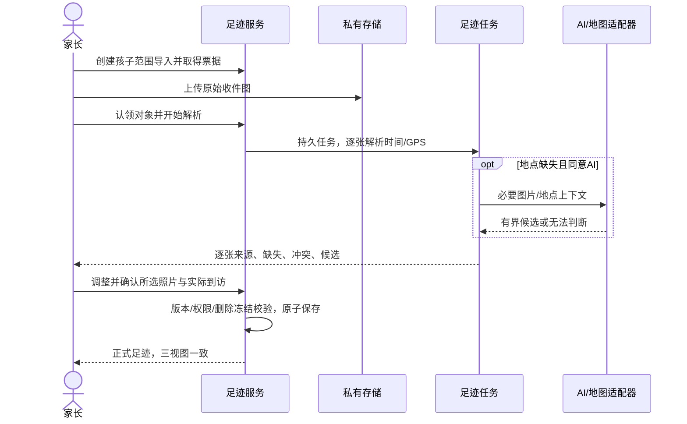
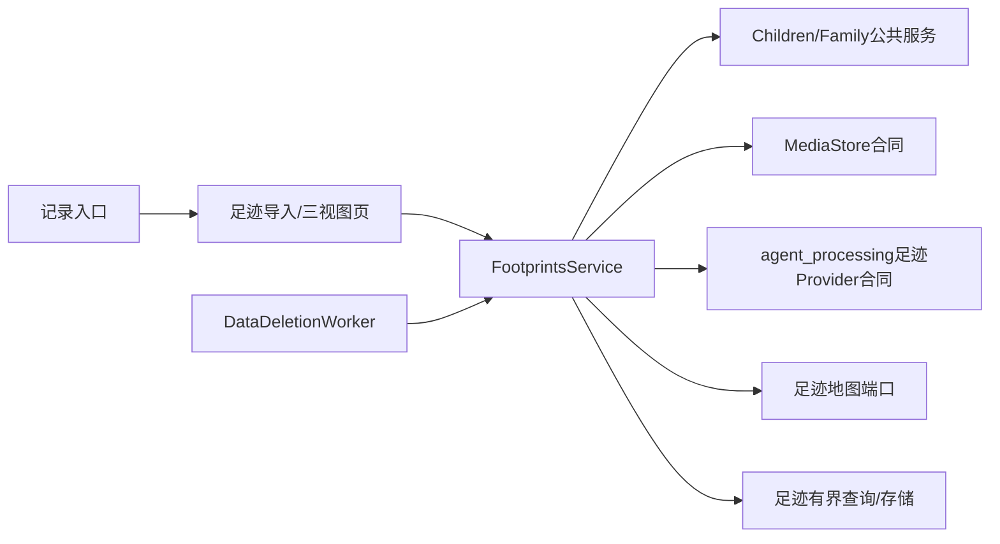
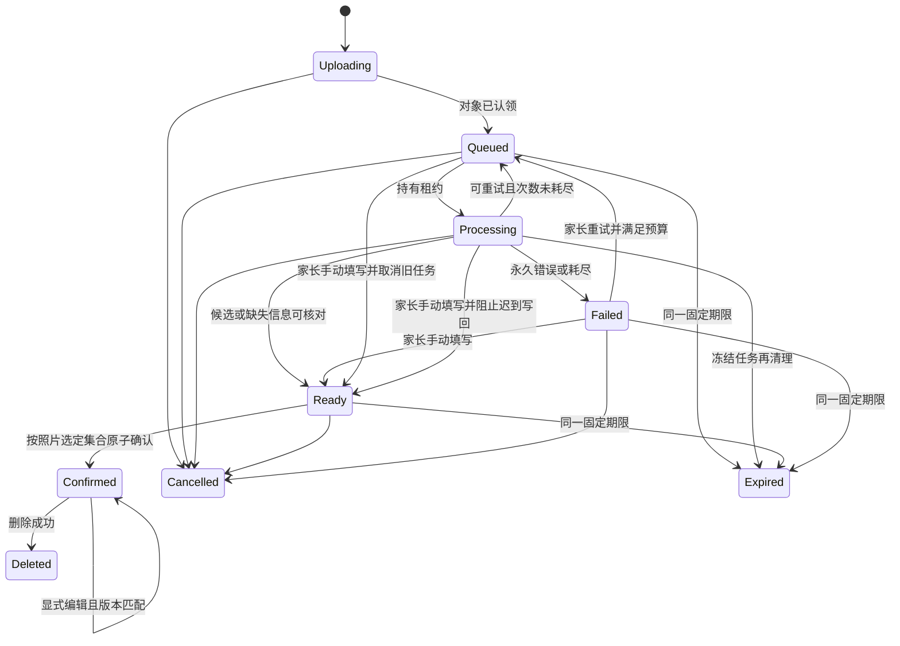
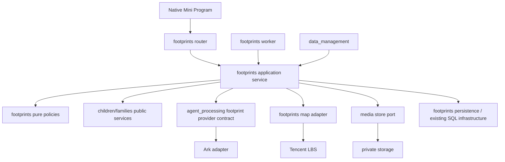

# FEAT-012 — 孩子照片足迹

- Status: VERIFYING
- Risk: R3（儿童照片、精确位置/行踪、第三方处理、新数据域）。
- Spec owner: 产品负责人（用户）；本稿由 Codex 整理。
- Implementer: Codex；Reviewer: 独立只读footprints_readonly_review；Verifier: 本地自动化由Codex运行，原生/真机及真实账号由后续验收补齐。
- Created / Last updated: 2026-10-17 / 2026-10-23
- Target release: 本地实现；未授权部署/上传/发布。
- Spec revision: `SPEC-20261017-CHILD-PHOTO-FOOTPRINTS-04`
- User confirmation: R1–R4共18项已确认；Q19批准需求/设计（[历史范围](../../docs/research/child-footprints/20261017-grill-review.md#q19-整体确认记录)）。2026-10-18用户“落地编写代码”，明确承接本轮唯一Spec04/Architecture03/DREV01并批准本地实施，批准记录见§19。
- Additional R3 approval: 本地实施含合成夹具验证已批准；真实儿童素材外发、供应商隐私/账号和发布验收未批准或执行。
- Affected Feature IDs: `FEAT-012`；集成 `FEAT-002`（家庭权限）、`FEAT-005`（档案）、`FEAT-006`（删除）；`FEAT-007` 仅作语义边界对照，不修改。
- Feature current-state documents: [FEAT-012](../../docs/domain/features/FEAT-012-child-photo-footprints.md)、[FEAT-002](../../docs/domain/features/FEAT-002-family-collaboration.md)、[FEAT-005](../../docs/domain/features/FEAT-005-multi-child-profiles.md)、[FEAT-006](../../docs/domain/features/FEAT-006-data-cleanup-and-family-reset.md)。
- Feature baseline revision: FEAT-STATE-20261018-PHOTO-FOOTPRINTS-06（本地实现，未发布）。
- Feature merge owner: Codex按真实diff更新，产品负责人审阅；真实服务验收未完成不标DONE。
- Research evidence: [2026-10-17可行性报告](../../docs/research/child-footprints/20261017-feasibility.md)，含官方来源、事实/估计/未知项区分。

## Frontend Design Impact and Repository-native Approval

- Frontend impact: yes，原生pages/footprints与记录入口已本地实现。
- Frontend engineering impact: yes，照片输入、地图/动画、分页、隐私及异步恢复。
- Affected UI IDs: `UI-018-child-photo-footprints`、`UI-001`记录入口。
- UI current-state documents: [UI-018](../../docs/design/frontend/ui/UI-018-child-photo-footprints.md)、[UI-001](../../docs/design/frontend/ui/UI-001-parent-miniapp.md)，均区分本地实现和未完成原生验收。
- Frontend baseline revision: `FDB-20260913-04`，APPROVED；工程约束以当前 FEC 独立正文为准。
- Frontend engineering constraint revision: `FEC-20261007-NATIVE-GEOMETRY-02`，APPROVED。
- Quality dimensions: component/state/form、原生视口/a11y、iOS/Android、图片/地图/动画、性能、安全/隐私、可观察性。
- Requirements: FEC 44px 操作区、14px 正文、安全区、数据过期隔离、`FEC-PERF-READ-001..004`；候选具体预算见§10。
- Quality verification: `npm test`、小程序静态检查、设计完整性检查；三视口原生截图与节点几何、iOS/Android真机地图和选图验证。
- Current / Proposed Design Revision: 基础设计 `DREV-20261017-CHILD-PHOTO-FOOTPRINTS-01`保持冻结；原生实现一致性待验，日期/时刻清空、同日排序及全球总览呈现需设计核对，未申请豁免。2026-10-23用户批准并本地实施[文案Spec01](FEAT-012-FOOTPRINTS-UI-COPY.md)/DREV02和[标题入口Spec01](FEAT-012-RECORD-TYPE-SWITCHER.md)/DREV-20261023-RECORD-TYPE-SWITCHER-01，两项增量单独跟踪验收，不表示主功能门禁通过。
- Editable design source: [自包含HTML](../../docs/design/frontend/prototypes/DREV-20261017-CHILD-PHOTO-FOOTPRINTS-01/index.html)；[逐态规格](../../docs/design/frontend/prototypes/DREV-20261017-CHILD-PHOTO-FOOTPRINTS-01/FRONTEND-SPEC.md)。
- SHA-256 / snapshot manifest: [UI-018批准清单](../../docs/design/frontend/snapshots/UI-018/DREV-20261017-CHILD-PHOTO-FOOTPRINTS-01/APPROVAL.md)，冻结源与27态×3视口导出哈希；实际当前结果见§16，不是原生或生产验收。
- Required exports: 320×568、390×844、430×932；空态、导入中、解析失败、候选/批量编辑、确认、时间线、回放/暂停、地图聚合/地点抽屉、权限拒绝、只读、地图不可用、未知时间/地点。
- Prototype status: DESIGN_APPROVED / LOCAL_IMPLEMENTATION_VERIFYING；Approved Task Spec: SPEC-20261017-CHILD-PHOTO-FOOTPRINTS-04（2026-10-18）；Approved Design Revision: DREV-20261017-CHILD-PHOTO-FOOTPRINTS-01（2026-10-17 Q19）。
- Permitted deviations: none；Approved engineering deviations: none。
- UI merge owner/evidence: Codex；本地实现事实及未完成门禁见§16与实现证据。
- External design dependency: none。

## 0. Executive summary

用户希望给一个孩子上传一张或多张照片，取得每张照片的时间、地点，缺地点时由 AI 辅助，并在时间线、地图回放与地图点亮之间切换。推荐定义为“照片足迹”：记录经家长确认的历史到访，连接已知点，不承诺连续真实路线或无元数据照片的精确拍摄时间。

四轮grill与Q19确认后，2026-10-18用户批准本地实施。首版全球与主要区域自适应仍为合同；海外底图/检索与全球总览未通过验收，不降为后续范围。草稿7天、原件24h条件清理、到访日、镜头跟随、分批继续、归档收尾、纠正删除已编码；真实链路验证仍开放。

## 1. Facts, decisions, assumptions, questions

确认事实：已有 FEAT-007 是固定出行时段；学习入口使用压缩图；媒体对象绑定学习 Submission；现有 Ark DTO 是学习专用；可信家庭/孩子与删除能力存在。证据逐项见调研报告§2。

已确认产品方向：事后出游回忆、家长确认后入正式足迹、足迹相册不承诺原画备份、首版全球；当前日期筛选下主要区域优先、可看全部、空态中国；点亮地点并汇总城市/国家；每批一个孩子；有日期无地点可入时间线、无日期留草稿；记录页进入、按日期自动整理。独立footprints域、地图技术、来源解析和其他工程合同仍为推荐。[逐轮决策树](../../docs/research/child-footprints/20261017-grill-review.md)登记原话、当前前沿和未决项。

R3/R4进一步确认固定7天未确认草稿清理、条件原件24h清理、首次开启后按需AI、到访日统计、回放镜头跟随、几十张分批继续、足迹内归档旧草稿入口、正式照片逐张纠正/删除。产品决策分支及整体共同理解/交互确认已由Q19收敛，事实验证不以用户偏好代替。

| ID | 未决问题/假设 | 推荐 | 实施阻断/验证 |
|---|---|---|---|
| Q01 | 全球、自适应、空态与回放镜头已确认 | 点亮主要区域优先，提示范围外数量+看全部；无足迹时中国；回放跟随当前地点 | 全球底图/海外检索/总览分别验证；原生scale为3–20，不能后置海外 |
| Q02 | 地点点亮、城市/国家汇总与到访日已确认 | 同地＋当地日期为一个到访日，显示“来过几天”；同日多次进入不另计 | 地点去重/城市精度/日期修改删除后统计守恒需验证 |
| Q03 | 相册、未确认草稿7天与原件清理规则已确认 | 每张接收成功起固定168h，编辑/重试不延长；元数据提取与派生图成功后原件24h清理；失败原件最迟第7天清理；正式展示图不随草稿到期 | 2048长边是待真机质量验证候选；完整清理/并发合同见§5 |
| Q04 | 家长确认入档与AI触发已确认 | 当前家庭/成员首次主动开启后，后续仅缺可用地点照片自动候选，可关闭；GPS/人工地点不送图AI | 偏好、同意与第三方声明不得替其他成员默认开启；现有候选不自动入档 |
| Q05 | HEIC、>10MiB、微信转发照片占比 | 原生选图40样本先验证，再冻结格式/容量策略 | yes，当前完整保留率未知 |
| Q06 | 每批一个孩子已确认 | 合照分别导入，不自动识别人脸；沿用当前家庭角色 | 服务端归属/角色/删除必须验证；不建设跨孩子共享媒体 |
| Q07 | 地图/AI账号能力、商用费用与第三方处理条件 | 使用当前境内平台，地图能力逐项核对 | yes，影响上线成本及隐私声明 |
| Q08 | 归档足迹访问与旧草稿收尾已确认 | 服务端已建立ImportBatch作为已开始边界；归档禁新批，足迹子页可看归档历史并继续旧草稿，固定7天仍生效；deleting冻结优先 | 现有include_archived列表可复用；新增足迹页面/接口和owner清理仍须实现/测试 |
| A01 | 记录页入口与日期组织已确认 | 保留五Tab，独立子页，无须先建行程相册 | DREV已获设计批准；入口生产实施仍须Task Spec/架构批准 |
| Q09 | 每次几十张、可分批继续已确认 | 新批追加，不覆盖旧批/草稿；离开可恢复；不继承学习9张业务限制 | 单次原生可选量、服务批次cap与会话cap在真机/内存/上传/确认测试后冻结 |

上述阻断项解决并取得 Spec/架构/DREV 明确批准前不进入生产实现。

## 2. Pre-change baseline and evidence（2026-10-17）

实施前流程为家长选择学习照片 → 学习Submission → 学科/知识/Todo候选 → 确认学习记录，与足迹不兼容。2026-10-17尚无到访API/地图页；当前已新增独立足迹实现见§16，不把已有travel视作照片地点。

基线证据：`apps/miniprogram/pages/records/index.js`、`utils/cloud-media.js`、`persistence/models.py::MediaObject`、`learning/service.py`、`agent_processing/contracts.py`、`data_management/worker.py`；相关行为BHV-020/023..025/029。当时未执行运行验证；2026-10-18当前结果独立见§16，不借用旧证据。

## 3. Target behavior

| 情况 | 目标 | 禁止结果 |
|---|---|---|
| 多张来自不同时间地点 | 每张独立候选，可批量编辑选中项 | 全部默认套成上传时刻/同一地点 |
| 有GPS/时间 | 可核对、可修正，标明来源和精度 | 元数据被当作到访真实性证明 |
| 地点缺失/模型不确定 | AI可选、候选≤3、地图检索或人工输入 | 编造坐标、以模型自报概率自动确认 |
| 日期未知 | 保留草稿待补，用户可批量补日期 | 用created_at替代拍摄时间 |
| 日期已知、地点未知 | 确认后进入时间线，地图说明缺位置项 | 无声丢照片或以(0,0)占位 |
| 只有日期精度 | 日期显示、当日手动排序；回放说明顺序性质 | 假造时分秒或交通速度 |
| AI/地图/单图失败 | 成功图结果保留，单图重试/手填 | 整批阻塞或静默成功 |
| 重复请求/重复图 | 幂等重放；同域同孩子hash重复提示可选择 | 跨家庭哈希探测，误删不同到访 |
| 双家长并发/迟到分析 | version冲突可恢复，已确认值优先 | 旧任务覆盖家长修改 |
| 跨家庭/孩子/只读角色 | 服务端双范围校验，viewer只读 | 只靠客户端隐藏按钮或对象ID授权 |
| 档案归档/删除 | 按批准的已开始事务边界；删除冻结拒绝写回 | 已删除数据被任务重建 |
| 同地同当地日期多图/纠正/删除 | 合一个到访日；逐张修改后重分组，删最后一张才移除该日 | 将照片数当来过次数，删除一张误删同地其他照片 |
| 到期与部分确认 | 每张168h固定期限，到期拒绝确认并清草稿；正式照片保留 | 编辑/重试偷偷续期或同批正式媒体被连带删除 |

## 4. Scope and Feature impact

候选一期：从记录页进入、每批当前一个孩子、按日期自动整理；全球单/多照片导入、元数据读取、按需地点候选、人工/批量修正、确认、时间线、简版点回放、具体地点点亮并汇总城市/国家、照片预览、编辑删除与完整隔离/清理。已确认当前筛选下主要区域优先、提示范围外数量并可看全部，没有足迹时中国；有日期无地点可确认进时间线，无日期留草稿。

首版范围外：行政区填色、跨孩子共用媒体、命名行程相册；日期组织不依赖Journey实体。原画永久备份不在已确认目标内；分享导出未提出。非目标：持续GPS追踪、真实道路恢复、人脸识别、自动证明孩子到访、学习评价/复习计划联动。全球地点服务不能列为后置。

不变量：学习与规划域无新写入；原出行安排容量/冲突不变；身份只信服务端；`occurred_at` 与 `created_at` 分开；全部集合有界；原生设计验收不能用HTML预览替代。

Feature 合并：FEAT-012从PLANNED仅在实现后改为相应本地状态；FEAT-005补足已验证的归档/删除边界；FEAT-006同步owned-data清单；FEAT-002仅同步确有变化的足迹权限，不改角色定义。Behavior Catalog新增足迹不变量；Architecture新增真实模块；UI-018与UI-001同步真实交互。尚无旧生产足迹描述需要删除；不能重写FEAT-007为足迹。

### Link/call graph

## 5. Domain, data and state

ImportBatch拥有一个孩子、发起成员、逐张处理与确认清单；PhotoAsset拥有私有收件、展示图/缩略图、校验hash和候选；Visit/VisitPhoto拥有正式到访日及照片引用；PlaceSnapshot保存已确认地点的最小快照。首版不引入Journey；同地＋当地日期聚合为一个到访日，不区分同日第二次进入，照片数独立。所有对象带family/child归属；不会创建占位学习Submission。

照片正式编辑是显式家长写入，更新日期/地点后对旧/新到访日与城市/国家汇总在同一revision重算；删除单张不影响同地其他照片，空到访日移除。地点未明确者可保留时间线，不能编造坐标；城市精度与具体POI不能按显示名强行合并。具体照片编辑/删除拥有独立版本和媒体引用校验。

时间：`occurred_at`只在精确时刻可解释时保存UTC，否则null；独立保存本地日期/时间、时区/偏移、精度与来源。时区未明的墙上时间不可当UTC；同日排序用显式ordinal。`created_at`与`confirmed_at`独立。地点坐标系、粒度和拍摄点/地标候选分开；null表示缺失，不用(0,0)。候选不可变成正式事实而没有家长确认；版本号保护更新。

归档“已开始”细化为归档前服务端已创建批次及照片槽位；旧批可补齐这些已有照片，不能借旧批追加新PhotoAsset绕过归档禁新增。`GET /children?include_archived=true`可复用现有按家庭过滤列表，足迹自行提供归档历史/草稿入口；读取和旧草稿命令显式检查deleting，不能仅调用允许归档的get_child。viewer可读但不能确认/修改/删除。批次、照片草稿列表均按cap/游标分页有界返回。

图表示单张业务生命周期；任务另有queued/running/succeeded/failed/cancelled终态与租约，**任务成功不等于家长确认**。批次以逐张状态汇总；部分成功/确认不覆盖其余照片，确认只提交明确选中子集。

Cancelled/Deleted/Expired触发对应资源清理，不再进入分析；业务状态与对象清理成功/失败独立记录，失败持久重试，不能只改状态不删对象。`received_at`由服务端验证认领成功记录，`draft_expires_at = received_at + 168h`；编辑、AI重试、归档不重置。未上传/未认领票据有独立短期技术过期，不假装照片已成功收件。

到期资格必须在读取/重试/确认边界按服务端时钟验证，不等待清理worker执行才拒绝确认；到期与确认竞争同一照片锁/版本，最多一方获得状态转换。只清未确认照片的收件/派生图/候选/任务；同批已确认照片的展示资源与正式记录不在草稿清理集合。逐张到期可使同批不同照片有不同期限，界面显示清理日期。

原件与展示图生命周期独立：必要元数据提取、展示图/缩略图生成均成功后，原件安排24h清理；失败原件最迟received_at+168h清理，家长手工确认不构成无限延长原件理由。未确认草稿若更早到期/主动删除则先清理；正式展示图/缩略图保留至照片或孩子/家庭删除。2048长边为清晰度候选，不上采样小图，方向纠正/去EXIF/编码和缩略图预算经真机验证后冻结。

Schema为新增足迹表与自有上传票据，设计评审后冻结列/索引/迁移编号；不修改现有MediaObject外键为可空来混装所有权。无历史数据回填；遵循单Alembic链，迁移head在实施时重新确认，不能基于并行工作树臆造版本号。目标MySQL5.7与SQLite；经纬度/格网与tenant-leading索引、预聚合策略必须有实测计划。删除覆盖对象、候选/任务、聚合与正式行；TTL已按R3/Q10和R4/Q15/16明确，worker实际收敛仍待验证。已有数据时降级不得直接删足迹表；关入口可回滚代码，已接受删除任务仍须收敛。

## 6. Interfaces and errors（本地实现，未部署）

| 合同 | 目的 | 范围/有界/幂等 |
|---|---|---|
| POST `/footprints/imports` | 创建批次 | child_id+Idempotency-Key及请求指纹；单批1–20、孩子待整理200，不传任意远端图片URL |
| POST `/footprints/photos/{id}/upload-ticket` / `claim` / `upload` | 签发/认领或本地上传照片 | 精确槽位/路径+上传者校验；内容/尺寸/hash；单张10MiB，格式见§19 |
| GET `/footprints/imports/{id}`；GET `/footprints/drafts` | 批次/待整理结果 | 批次≤20；草稿默认20/max50游标；候选≤3/张；不返回完整EXIF/模型载荷 |
| POST `/footprints/imports/{id}/confirm` | 选定集合确认 | 照片id/version集合；成功后原版本重放幂等；明确实际到访确认；无日期留草稿 |
| POST `/footprints/photos/{id}/retry`；DELETE photo | 重试/删除并取消 | version/冻结校验；正式内容不被分析重写；无独立visit删除接口 |
| PATCH `/footprints/visits/{id}/order` | 同日回放顺序 | scope revision+day_order；正式photo patch亦可携带同日顺序 |
| PATCH/DELETE `/footprints/photos/{id}` | 逐张正式照片纠正/删除 | version+照片归属；重算旧/新到访日、城市/国家；保留其他照片 |
| GET/PATCH `/footprints/preferences` | 当前成员AI启用偏好 | family+member作用域、明确开启/关闭；不替其他成员同意 |
| GET `/footprints/visits` | 时间线/地点到访列表 | 默认20、最大50；稳定cursor绑定家庭/孩子/筛选/排序与revision |
| GET `/footprints/map` | bbox/缩放/日期聚合 | ≤200点簇，计数与范围说明同一快照；不客户端全量聚合 |
| GET `/footprints/playback` | 有界回放 | 当前孩子+日期筛选，≤100到访日地点/快照；一致revision，超量分段；镜头跟随当前点 |
| scoped media preview | 展示图/缩略图 | 每次鉴权并签短期能力，云端目标≤60秒；不暴露storage_ref |

absent表示不修改（PATCH）；null表示明确未知/清除；空列表表示没有结果，不能当任务成功。经纬度按坐标系声明、纬度[-90,90]/经度[-180,180]，日期按照片当地日期；API只接收经校验的时间精度。稳定排序为本地日期/可用时刻+确认顺序+id；跨时区的真实时刻排序只用已知UTC，不把未知偏移补成0。cursor失效返回明确错误要求刷新。

错误：401身份无效、403角色拒绝、404归属不匹配/不存在、409版本/归档/冻结冲突、410删除/到期、422输入或格式/容量不合法、429限流、503依赖不可用。错误为静态安全码，不返回位置/路径/供应商原文/密钥。暂时依赖失败持久重试最多3次，格式不合法终止；无证据返回无法判断；人工确认结束分析。

## 7. Authorization, security and privacy

可信微信actor解析活动家庭与member；全部命令及读取校验family+child，私有媒体额外校验import/photo/visit归属。manager/editor写、viewer读；家庭角色不自动证明监护权，同意流程与专门儿童信息规则由产品负责人确认。无管理员越权读任意家庭的位置能力。

EXIF、图片文字和模型输出全不可信：限像素/文件大小/解析时间，拒绝畸形分母、NaN/Inf和越界坐标；图中文字不能成为工具指令；禁止模型提供任意URL触发下载或拼接查询。第三方只收到必要输入；AI可拒绝、手动可用；map不默认show-location或调用当前定位。

| 威胁 | 控制/必测证据 |
|---|---|
| 猜对象ID/跨孩子/成员退出 | API/预览逐次鉴权；两家庭两账号合同测试 |
| 图片/EXIF解码资源攻击 | 内容解码验证、像素/字节/时限预算；恶意夹具 |
| 伪元数据/地点幻觉 | 标明来源和精度，家长确认；不做自动孩子身份推断 |
| 日志、缓存、分享泄露轨迹 | 日志仅静态码/计数/耗时；无照片/GPS/地名/完整载荷；不默认分享 |
| 删除与任务竞态 | freeze、租约、版本、对象删除重试、统计失效；真实worker验证 |
| AI或地图成本滥用 | family/member配额、按需调用、并发和deadline、幂等 |

保留最小确认操作审计，不记原图/精确位置正文。开启足迹的敏感信息处理同意、监护人同意、第三方条款、影响评估与Q07供应商核查仍是发布门禁；原件/草稿留存依§5已确认合同落实，不能因隐私声明待核查而变更已确认7天规则。没有经过验收的声明不得预标完成。

## 8. Architecture and implementation boundaries

Architecture revision: `ARCH-20261017-CHILD-PHOTO-FOOTPRINTS-03`（APPROVED，2026-10-18用户实施指令承接本Spec与已确认设计；在全球地图、自适应聚合边界上明确逐张到期/媒体清理、成员AI偏好、归档收尾与到访日重算）。

| Owner/module | 职责 | 禁止职责 |
|---|---|---|
| footprints router/schemas | 传输校验与受限DTO | 直接调用模型/跨域写表 |
| footprints service/policies/read_models | 确认事务、时间/地点精度、分组、分页/聚合、owned purge | 学习/规划写入、从未确认值生成到访 |
| footprints jobs/worker | 独立任务状态、租约/重试、取消/迟到防护 | 复用学习Job的Submission归属或伪成功 |
| footprints metadata/media lifecycle | 必要EXIF提取、私有资源归属与派生图清理 | 全量EXIF或子女图片进日志/仓库 |
| agent_processing足迹合同/adapter | 足迹专用候选DTO和Ark传输 | 学科/知识/Todo语义混用；依赖footprints ORM |
| footprints map adapter | 正逆解析/地点检索/坐标转换合同 | 传整份相册/儿童身份；无界搜索 |
| media基础设施 | 沿用私有store及必要狭窄扩展 | 把学习MediaObject变成无owner混合表 |
| data_management | 调用足迹owner清理并协调冻结 | 直接理解/改写足迹表 |

先按目的拆分服务、纯策略、元数据、查询、媒体、任务和provider；不增加generic common/utils/provider平台。模型定义位置和公共Base依赖在验证后冻结，避免继续把所有足迹职责堆进现有大型文件。只有相同存储/签发语义才考虑复用媒体底层；学习上传/分析业务合同不抽成共享抽象。

### Dependency DAG / architecture

禁止footprints→learning/planning/travel、AI足迹adapter→footprints ORM、children/families→footprints实现、media→业务service。实施需扩展实际依赖检查并审查间接/test-only边；现有架构脚本只能证明其已实现的少数约束，不能冒称全DAG已自动校验。

备选与权衡见报告§6：直接扩travel破坏领域语义；全AI增加不可验证事实与成本；第三方轨迹云缺少连续样本价值；WebView增域名/身份/资源成本；自绘行政区填色增加地图素材/表达门槛。推荐原生独立域以减少无关改造。

扩展策略：时间精度/确认语义 `closed`；足迹AI/全球地图服务仅允许内置、显式配置的固定适配器 `closed`，不允许动态插件；第二供应商、HEIC decoder、行政区填色 `deferred`，重开需新revision。全球底图/检索与自适应投影是首版必须验证的合同，不能以deferred避开。当前没有`open`扩展点，不建设插件注册框架。

Architecture confirmation: 2026-10-18产品负责人（用户）“落地编写代码”，承接唯一待实施的Spec04/Architecture03与已确认DREV01，授权本地开发。未授权部署、发布或使用真实儿童素材进行第三方实验。

## 9. Expected file changes, replacement and deletion plan

| 路径/领域 | 预期动作/原因 |
|---|---|
| 本Spec、报告、grill记录、FEAT-012、UI-018、两个目录README与设计索引 | 本次add/modify；研究、规划、逐轮答复与设计状态 |
| 本DREV的HTML、FRONTEND-SPEC、render.py、PNG/manifest/audit | 本次add/modify；隔离设计候选与浏览器证据，无生产连接 |
| `apps/api/src/push_kids/footprints/` | 已add：分离传输、命令、导入、查询、纯策略、元数据、任务、地图和媒体职责 |
| `agent_processing/footprint_provider.py` | 已add足迹专用候选合同/adapter，学习provider不变 |
| `media/store.py` | 已modify狭窄write_derived合同，保留学习路径 |
| database/migrations注册、bootstrap/config、pyproject/uv.lock | 已modify；Pillow运行依赖、0021五表、地图密钥配置和worker健康检查 |
| families/children公共scope合同、data_management worker | 已modify：范围锁/eligibility与调用足迹owner清理，不跨域写表 |
| `apps/miniprogram/pages/footprints/`、`utils/api.js` | 已add/modify三视图、上传/核对、鉴权预览与失败恢复 |
| `pages/records/`、`app.json` | 已modify入口、路由及chooseLocation隐私声明；学习压缩上传保持 |
| `tests/{unit,integration,performance,frontend}/` | 已add元数据、确认、隔离、删除、并发、迁移、分页/动画及50k预算；HTTP合同由integration覆盖 |
| Feature/Behavior/Architecture/UI/quality/deploy文档 | 已按本地事实合并；发布状态明确NOT_RUN |

替换/删除：没有旧足迹生产路径；不得删除学习照片能力或travel安排。TTL只清已批准范围且留存策略明确的收件/草稿对象；不做未授权历史数据迁移。无临时双写或旧媒体表改造；如果未来决定抽取媒体所有权，必须单独形成替换/迁移revision。

## 10. Non-functional requirements（批准合同；验收状态见§16）

| ID | 目标 | 测量/失败响应 |
|---|---|---|
| NFR01 | 几十张分批继续；候选≤3/张、每批≤20、单张≤10MiB；格式/展示细化见§19 | 真机选择器/EXIF路径cap待验；旧SDK选图9张可分批；不宣称HEIC已支持 |
| NFR02 | 列表20默认/50最大、卡内4缩略图、窗口≤100卡；地图≤200簇且≤256KiB | 固定5万数据集query/size/memory证据；超量分页/聚合，不静默截断总数 |
| NFR03 | 回放≤100点/快照，服务端集合读取页查询O(1) | 聚合与tenant-leading索引、SQLite/MySQL5.7 EXPLAIN；新鲜度冲突刷新 |
| NFR04 | 固定环境普通读p95≤500ms（不含网络/第三方） | 原生地图帧/资源预算在DREV后补；未实测不能写PASS |
| NFR05 | 任务最多3次持久attempt、显式终态/取消、单批部分成功可恢复 | 故障注入与真实worker；不得无限模型重试 |
| NFR06 | 0跨租户泄露、0未确认正式写入、0删除后迟到复活 | 契约/竞态/日志捕获；任一失败阻止发布 |

## 11. Acceptance criteria

| ID | Given / When / Then（候选验收） |
|---|---|
| AC01 | 有/无/异常EXIF的照片经过完整上传链后逐张提取正确或明确缺失，来源/精度保留，原件处理不覆盖时间 |
| AC02 | 日期未知、时区缺失、GPS冲突或AI候选存在时，家长可修正/拒绝；正式记录仅在显式确认后产生；AI不输出可靠性承诺 |
| AC03 | 同一已确认集合在时间线、点回放、地图点亮中数量/日期/地点一致；支持全球与自适应，范围外点有明确入口；重复到访不与照片数混淆；非真实路线与排除项明确 |
| AC04 | 取消、断网、重复提交、单图失败、手填中AI返回、双家长编辑、切孩子时不会丢已确认值或串数据 |
| AC05 | viewer/跨家/跨孩子/退出成员、归档/删除冻结分别按批准权限返回；私有预览与所有派生对象同样受限 |
| AC06 | 足迹删除与孩子/家庭清理覆盖全部资源并最终收敛；任务迟到/重试不能复活，其他孩子与家庭数据不变 |
| AC07 | 大历史读有界、O(1)页query与索引/快照一致，三视口原生操作/动画可用，地图故障可退回列表 |
| AC08 | 元数据来源实验、AI分层试点、地图账户/商用/隐私核查形成可审查结果；新旧学习/日程/清理路径回归通过 |

## 12. Verification plan

| Test point | AC | 层级/必需证据 |
|---|---|---|
| TP01 | AC01/02 | 时间字段优先级、无offset、时区/夏令时/日期线、日精度、非法GPS/分母/畸形图/方向；合成夹具单元与contract |
| TP02 | AC01/08 | 至少40来源路径样本在iOS/Android真实选图→存储→解析；各来源保留率；HEIC转换结论 |
| TP03 | AC02/08 | 至少100张分层地点真值评估，Top-1/3、粒度、拒答/误判、修正率、耗时成本；目标见报告§8，失败缩小范围后重审 |
| TP04 | AC02/04 | 导入/票据/确认幂等、部分成功/原子确认、乐观并发、手动完成与迟到结果；API+真实worker integration |
| TP05 | AC05 | 两家庭/两孩子/三角色与退出/归档/删除，所有route和原图/缩略图预览；contract+双账号staging |
| TP06 | AC06 | 对象删除失败/重试、数据库回滚、已删除任务迟到、聚合/预览缓存失效；真实删除编排integration |
| TP11 | AC02/04/05/06 | received_at+168h边界、编辑/重试不延期、部分确认保护正式对象、到期与确认竞争、24h原件清理资格、归档草稿入口/收尾；成员AI偏好隔离和关闭后不发起新请求 |
| TP07 | AC03/07 | 多次同地、同名异地、城市精度、0/1/多点、同日无时刻、跨天/跨境；服务投影与前端状态/动画事件 |
| TP08 | AC07 | 5万样本SQL计划、O(1)query、响应/内存/窗口预算、聚合守恒；SQLite和真实MySQL5.7 |
| TP09 | AC03/04/07 | 三视口原生截图+节点几何、iOS/Android、前后台/拖动/暂停/切孩子、授权拒绝和地图失败 |
| TP10 | AC08 | 学习上传/AI/确认、travel日程容量/冲突、孩子/家庭清理回归；隐私/日志与账号条款人工核查 |

pre-change新增route/提取测试将因功能不存在而失败；旧行为由TP10证明，禁止副作用由TP04/05/06/11及learning/planning零写断言证明。TP02/03/05/09依赖真机、授权样本/账号，无法仅靠mock替代。确定性自动化可离线；真实外部调用另行受控，儿童素材不入仓库。

后续按diff执行pytest unit/integration/contract与适用performance、ruff/format、mypy、npm test/lint、architecture/design/miniprogram validators；新SQL的真实MySQL5.7为后端发布阻断门禁。每项单列PASS/FAIL/NOT_RUN，未运行不借用历史证据。

## 13. Rollout, migration, rollback

按[发布手册](../../docs/deploy/README.md)先验证迁移和兼容后端，再灰度，再上传开发版本、体验验收、审核、正式发布，逐一记录状态；本轮不执行。原客户端没有足迹入口不受影响，新入口只在后端能力就绪时开放。无历史自动回填；足迹开关关闭不删除正式数据或停止已接受删除的收敛。

出现租户泄露/未确认写入/删除复活立刻关入口并停止新增导入；供应商不可用保留人工路径。上线观察窗/AI配额和错误阈值在验证后冻结，不能留空直接发布。回滚保留新增数据表/对象并保持鉴权与清理兼容，不把drop表当回滚。

## 14. Implementation plan

1. 已获实施批准并完成领域/迁移、元数据/人工→确认→三视图、删除与按需AI适配器的本地代码。
2. 已完成合成夹具和SQLite容量/权限/清理验证；独立审查发现逐项修复并回归。
3. 真实MySQL5.7.44迁移/同确认竞争和两种五万照片分布查询计划/预算已于2026-10-23从最终冻结包验证，见[BUG-031证据](../../docs/quality/evidence/FOOTPRINT-PREVIEW-MYSQL57-20261023.md)；真机选图保留率、授权AI分层试点和全球地图账号/费用核查仍待完成。

2026-10-24补齐冻结包镜像源匹配/非root/健康/SIGTERM，BUG-031已[completed/DONE](../completed/BUG-031-FOOTPRINT-PREVIEW-MYSQL57.md)。用户备份后明确指定同库直接升级顺序；10:55生产0019→0022/current/check及结构/队列核验通过，035部署并由用户100%接管、删除034。11:01–11:03旧实例0、035 normal/100%/1实例、coverage=false；真实微信18项读取200，完整本地客户端已重开并进入旅行日记。全量前定向验收未执行，完整产品/真实全球/素材/真机不因部署或读取smoke闭合，见[OPS执行](OPS-20261023-FULLSTACK-TEST-DEPLOYMENT.md)。
4. 用户解锁后24态×3隔离原生布局已验证，72份节点/PNG及SHA通过；27态基线仍缺7态，恢复原语音插件完整包及真机/真实交互复验。设计差异形成新DREV并批准后方可完成验收。全部门禁满足才转DONE，发布另行授权。

## 15. Review plan

产品范围/设计已批准。独立只读Reviewer审查所有权、权限、生命周期、并发与前端恢复，实施者负责修复和测试；复审结论见实现证据。隐私负责人、真实素材/AI与真机验证尚未完成，不用自动化或演示替代。

## 16. Implementation and verification record

Changed production-source behavior: 新增足迹领域/API/持久任务、私有派生媒体与清理、三视图和记录入口；没有旧足迹路径被替换，学习/复习/日程语义未扩展。0021接在本地既有通知0020后，两者发布验收分别记录。DREV01冻结文件未改；已有通知未提交修改完整保留。当前自动化结果、命令、失败修正与开放门禁统一见[2026-10-18实现证据](../../docs/quality/evidence/CHILD-FOOTPRINTS-IMPLEMENTATION-20261018.md)。

下表为**2026-10-17研究/设计历史证据**，不代替当前代码验证；其中“尚未实施/NOT_RUN”仅描述当时状态。2026-10-18当前状态以本节首段、实现证据和§17为准。

| 检查 | 状态 | 范围/原因 |
|---|---|---|
| 当前代码/Feature/Behavior/Architecture/设计/测试/发布合同阅读 | 已完成静态核查 | 证据见调研报告§2/10，不表示运行正确性通过 |
| 官方资料/反例查证 | 已完成并登记限制 | 微信/腾讯文档站部分无法直读，使用第一方类型/仓库交叉核查；费用/账号未验证 |
| 引用结构审计 | PASS | `python3 /Users/bytedance/.agents/skills/deep-research/scripts/audit_markdown_citations.py docs/research/child-footprints/20261017-feasibility.md`，正文链接结构通过；不证明运行能力 |
| 新文档本地链接/代码围栏/尾随空白 | PASS | Q19收尾后重新检查6份研究/Spec/Feature/UI/设计文档相对引用存在、围栏成对、无尾随空白；不校验拟议代码路径是否已实现 |
| 索引差异空白检查 | PASS | `git diff --check -- docs/domain/features/README.md specs/README.md docs/design/frontend/FRONTEND-DESIGN.md` |
| 现有架构脚本 | PASS（有限范围） | `python3 tools/check_architecture.py` → `ARCHITECTURE_VALID checked=3`；没有生产架构改动，不宣称此脚本验证了完整DAG |
| 隔离HTML交互稿 | PASS（设计范围） | Spec04对应render.py已运行：27态×3视口=81手机PNG+1桌面图；JS错误/44px/水平边界/底部关键控件可见；主流程、分批追加/部分确认、AI开启/刷新沿用/关闭、草稿刷新继续、到访日重算/单图删除、归档收尾、模拟168h边界、主动删草稿/重置及照片前后翻页通过；目检320回放/处理说明/照片翻页和390核对/删除确认。见清单/audit；不是原生、AI、真实地图或服务端清理验收 |
| 设计证据及现行政策校验 | PASS（批准清单严格模式） | `python3 tools/validate_design_evidence.py --manifest docs/design/frontend/snapshots/UI-018/DREV-20261017-CHILD-PHOTO-FOOTPRINTS-01/APPROVAL.md --check-current-policy` → DESIGN_EVIDENCE_VALID；用户设计批准单独依据Q19，不推导生产实施批准 |
| 本轮独立导出工具lint/format | PASS | `.venv/bin/ruff check`和`ruff format --check`只对本DREV/render.py运行；首次长行/格式问题已修正，不宣称全仓lint通过 |
| TP01..TP11及生产检查 | NOT_RUN | 尚未实施，技术实验/原生/外部账号也未执行；HTML演示不是这些测试的替代 |
| 上传/体验/审核/正式发布 | NOT_RUN | 本次没有发布任务 |

Open acceptance differences: 全球总览目前为经纬度点位图/列表，真实全球底图合同未满足验收；原生未知字段清空/同日排序控件需设计一致性核对。未批准任何豁免，不以文档降低原始合同。历史HTML修正与虚构续接仅为设计证据。

文档冲突核对：已把Feature/UI/Spec/索引中的“未批准实施、无API/页面”更新为本地实现，Architecture/Behavior/UI-001/关联归档/清理合同与实际代码核对。解锁后WXSS几何修正未改变模块边界或业务语义；Feature/UI/测试证据/发布记录的当前锁屏措辞已替换为24态×3隔离布局通过、完整TP09仍PARTIAL。研究与Q19记录保留历史语境，旧快照不改。真实服务NOT_RUN和发布NOT_RUN单列，不把设计或历史通知证据冒充本次验收。详见[原生范围与清单](../../docs/quality/evidence/child-footprints-20261018/native/README.md)。

## 17. Completion gate and lifecycle

- [x] Feature身份、当前边界、研究结论与待定事项有记录。
- [x] link/call graph、sequence、state machine、architecture、trade-offs、预期文件与测试点已形成候选。
- [x] R1–R4共18项产品选择已回答并合并正文。
- [x] Q19“认可，评审收敛”，整体需求共识/交互设计确认，DREV01冻结。
- [ ] Q01–Q09工程验证与详细接口/模型/容量合同冻结。
- [x] Task Spec04、Architecture03于2026-10-18获本地实施批准；真实素材外发/发布边界仍待受控验收。
- [ ] TP01–TP11、适用自动化、原生/设备与发布门禁通过。
- [x] 本地实现事实合并Feature/Behavior/Architecture/UI/测试与发布状态文档，未完成项明确标注。
- [ ] 功能完成后标为DONE并迁移至specs/completed/；取消/拒绝则记录理由迁移specs/rejected/，同步索引。

Final status: **VERIFYING，保留在specs/active/**。本地代码、真实MySQL专项及生产迁移0022已验证；035由用户100%接管/删除034，真实微信18项读取200，本地客户端进入旅行日记。见[OPS Spec04](OPS-20261023-FULLSTACK-TEST-DEPLOYMENT.md)。coverage=false，全量前定向验收NOT_RUN；真实样本/AI效果、全球账号/底图、隔离、设计一致性和真机仍未闭环，满足全部完成门禁才标DONE迁入completed。临时维护提案撤回未实施，不再作为等待条件。

2026-10-23配套入口/文案本地增量已实现，当前源码复验见[证据](../../docs/quality/evidence/RECORD-TYPES-IMPLEMENTATION-20261023.md)。records标题内切换学习/旅行，旧足迹Page与内嵌组件共享控制器；再次解锁后最终29态×3共87份合成原生节点/PNG通过，完整设计/真机及真实服务仍待验收。本Spec领域、数据、确认和地图合同不变。§16的2026-10-17/18历史结果保留原范围，不作为本次源码的验证。主Spec仍VERIFYING、位置不变，未部署上传。

## 18. Revision history

| Date | Revision | Change | Approved by |
|---|---|---|---|
| 2026-10-17 | SPEC-20261017-CHILD-PHOTO-FOOTPRINTS-01 | 用户授权可行性调研；建立三视图、信息来源、域隔离与验证候选 | 未批准实施 |
| 2026-10-17 | SPEC-20261017-CHILD-PHOTO-FOOTPRINTS-02 | 用户授权grill review和交互稿；记录第一轮答复，改为首版全球/自适应，新增UI-018与DREV候选；第二轮待答 | 未批准实施 |
| 2026-10-17 | SPEC-20261017-CHILD-PHOTO-FOOTPRINTS-03 | R2五项确认进入正文；不依赖行程实体，撤除足迹固定9张假设；R3草稿/AI/到访日/回放镜头/整理规模待答；补充归档/删除事实核查 | 未批准实施 |
| 2026-10-17 | SPEC-20261017-CHILD-PHOTO-FOOTPRINTS-04 | R3/R4共9项确认进入正文；架构03、27态交互与语义验证；Q19认可需求共识和DREV01交互稿，结束grill review，未扩展实施授权 | 用户批准需求共识/交互设计；生产实施另批 |
| 2026-10-18 | SPEC-20261017-CHILD-PHOTO-FOOTPRINTS-04 | 用户“落地编写代码”，承接本轮唯一待实施Spec04/Architecture03/DREV01，授权本地代码与验证；不包含部署/发布或真实儿童素材实验 | 产品负责人（用户），本对话2026-10-18实施消息 |
| 2026-10-18 | SPEC-20261017-CHILD-PHOTO-FOOTPRINTS-04 | 用户“已解锁，可以继续原生验证”；修正原生默认按钮几何，24态×3隔离布局/截图通过，更新验证事实；完整验收未闭环，VERIFYING不变 | 本对话用户恢复消息；产品范围/设计批准未扩大 |

## 19. Local implementation authorization — 2026-10-18

Approver: 产品负责人（用户）。Message reference: 本对话“落地编写代码”，紧接Spec04与DREV01确认收尾；无其他待选方案。批准本Spec04与Architecture03的本地实施，DREV01沿用Q19批准版本。

执行顺序：领域/纯策略与元数据 → 持久导入/确认/私有媒体/清理 → 有界查询及地图/AI适配 → 原生三视图 → 自动化与独立只读review → 按真实结果更新当前状态。此前“尚未批准实施”描述保留于2026-10-17历史记录，当前授权以本节为准。

工程细化仍在既定范围内：每批最多20张，旧基础库选择器分批；列表20/50、地图200簇、回放100点分页；JPEG/PNG/WebP和10MiB/张，HEIC明确提示转换，不假装支持。展示图长边2048、缩略图320，不上采样、去EXIF；真机质量仍待验收。服务端为导入预分配槽位，归档后不可增加。新增模型放在footprints自有models，复用SQLAlchemy Base并显式注册，不扩大既有学习媒体表。Visit与照片引用由同一确认事务维护，聚合不保存第二套统计事实。

真实照片保留率、AI分层效果、地图商用账号/全球能力与完整原生/真机矩阵不具备当前通过证据；真实MySQL5.7.44专项及最终两种规模预算/计划已独立通过，不等于生产数据库已迁移。24态×3及后续29态×3隔离原生布局子集各保留原范围，不扩展为整体通过。未通过的能力不宣称可上线。若实验要求改变产品范围或上述已确认合同，另立revision再确认。
