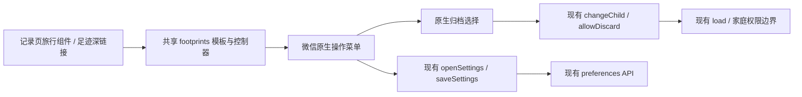
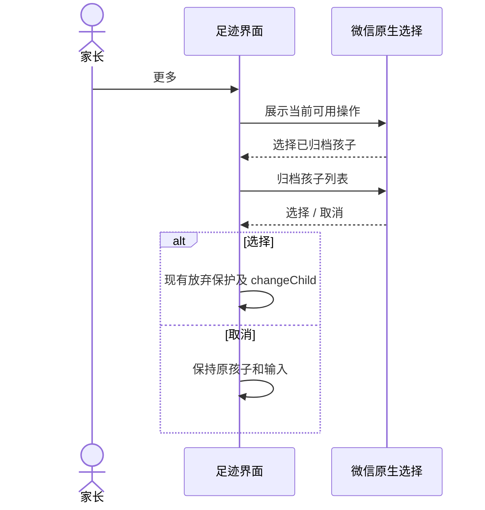

# FEAT-012 — 足迹界面减法与 UI 文案要求

- Status: VERIFYING
- Spec revision: SPEC-20261024-FOOTPRINTS-MINIMAL-UI-01
- Date: 2026-10-24
- Risk: R2，次要入口位置和原生操作菜单变化；无服务端或数据变更。
- Owner / Feature merge owner: 产品负责人（用户）/ Codex
- Implementer: Codex
- Reviewer: 独立只读评审及家长原生验收，尚未执行。
- User confirmation: APPROVED，产品负责人（用户），2026-10-24；本会话针对 call_3e246df48da4467983d023b06a443aeb 的明确回复：“批准 Spec01 + DREV01，按此实施并合并 UI 规范”。批准 SPEC-20261024-FOOTPRINTS-MINIMAL-UI-01 + DREV-20261024-FOOTPRINTS-MINIMAL-01 及工程文案附加条款；实施前已记录。
- Affected Feature IDs: FEAT-012；FEAT-001 仅记录页组合。
- Feature current state: [FEAT-012](../../docs/domain/features/FEAT-012-child-photo-footprints.md)，FEAT-STATE-20261024-PHOTO-FOOTPRINTS-18；[FEAT-001](../../docs/domain/features/FEAT-001-push-kids-mvp.md)。
- UI current state: [UI-018](../../docs/design/frontend/ui/UI-018-child-photo-footprints.md)，UI-STATE-20261024-PHOTO-FOOTPRINTS-15；[UI-001](../../docs/design/frontend/ui/UI-001-parent-miniapp.md)。
- Architecture: 沿用 ARCH-20261023-RECORD-TYPE-SWITCHER-01；领域、共享组件、依赖方向及扩展点不变。
- Source baseline: HEAD 82ca52775bc948f2a963a8f4ed614322d8859de8 + 现有 dirty worktree；保留其他任务变更。

## Frontend Design Impact and Repository-native Approval

- Frontend impact: yes，移除重复标题/常驻次要文字入口，精简设置内容及高度。
- Frontend engineering impact: yes，模板、原生次要菜单、已有 handler 的调用与工程 UI 文案规则。
- Frontend baseline revision: FDB-20260913-04，APPROVED。
- Frontend engineering constraint revision: FEC-20261007-NATIVE-GEOMETRY-02，APPROVED；新增文案规则已作为获批附加条款合并，不改已有预算。
- Affected UI IDs: UI-001、UI-018。
- Quality dimensions: component/state/form、responsive、a11y、native browser/device、performance、privacy、AI proposal semantics、error recovery。
- Requirements: 44px 触控目标、14px 操作文字；320×568 / 390×844 / 430×932 无裁切、间距≥8px；仍使用既有 token/线性图标；不增加依赖、请求、缓存或日志；1.5MiB 源预算不变。
- Proposed Design Revision: DREV-20261024-FOOTPRINTS-MINIMAL-01。
- Editable source: [index.html](../../docs/design/frontend/prototypes/DREV-20261024-FOOTPRINTS-MINIMAL-01/index.html)。
- Frontend spec: [FRONTEND-SPEC.md](../../docs/design/frontend/prototypes/DREV-20261024-FOOTPRINTS-MINIMAL-01/FRONTEND-SPEC.md)。
- Required exports: 三视口 × overview / empty / actions / settings / archived / viewer / long / standalone，共24张；每张1x，SHA见[候选清单](../../docs/design/frontend/snapshots/UI-018/DREV-20261024-FOOTPRINTS-MINIMAL-01/APPROVAL.md)。
- Prototype status: APPROVED；源文件及24张导出冻结。
- Approved Task Spec revision / Design Revision / engineering deviations: SPEC-20261024-FOOTPRINTS-MINIMAL-UI-01 / DREV-20261024-FOOTPRINTS-MINIMAL-01 / none。
- External design dependency: none。

## 1. Problem and outcome

截图中“某某的足迹”重复顶部孩子身份；“足迹设置”“查看已归档孩子”占据日常浏览空间；设置中的供应商、7天/24小时、原件和派生图处理说明使一个开关变成长文面板。用户要更简单的日常界面，而不是展示 AI 的推理过程、实现细则或预防性解释。

目标：默认界面只保留孩子、真实统计、三视图、照片/到访和动作。删除重复身份标题，次要功能在需要时展开，设置只显示当前可操作的选项。具体业务规则保持原样，不把 UI 删字误作数据清理。

## 2. Scope and invariants

1. 删除 `{{child.name}}的足迹` 标题，直接衔接统计和三视图。测试孩子名称由合成 fixture 提供，不改任何家庭/孩子数据。
2. 删除常驻“足迹设置”“查看已归档孩子”两行；统计右侧一个44px线性更多按钮，使用既有 `ico-more`。点击使用微信原生操作菜单：可写成员可选“足迹设置”；确有归档孩子时可选“已归档孩子”。只有一个可用操作也可直接执行，避免一项菜单；没有可用操作时不显示更多按钮。
3. “已归档孩子”在菜单后用原生选择列表列出归档孩子，调用现有切换/放弃保护；取消不切孩子、不清输入。不要求家长先读“已加入列表”说明再另找入口。归档标签仍保留，且不允许新增照片。原生列表每页最多4个孩子，附必要的“上一页/下一页”，单页最多6项，所有归档均可触达；这是大量归档时的有界呈现，不截断名单或新增业务上限。
4. 设置保留“AI 地点候选”开关、关闭和保存；删除两段解释文字。设置 sheet 由内容决定高度，不保留通用52vh空白。保存失败仍保留开关值和重试反馈。
5. 工程规则见[UI-COPY-REQUIREMENTS.md](../../docs/design/frontend/prototypes/DREV-20261024-FOOTPRINTS-MINIMAL-01/UI-COPY-REQUIREMENTS.md)，批准后合并到 FRONTEND-DESIGN 与 FEC。

不改变导入同意、AI 主动启用/按需候选、家长确认、真实草稿到期日期、删除及放弃的必要后果、权限和服务端校验。首次授权处的简短处理范围和供应商信息仍在原操作处；本轮不重新设计上传流程。7天/24小时、格式/画质等规则仍记录在 Feature/Spec，后台照常执行，不另造帮助页或折叠长文。

不扩展到其他页面的批量删文案，不修后端/地图/EXIF，不上传或部署。立项时上一轮 CR-001 预览竞态仍未解决，不能由文案验收抵消；本次已在 BUG-032 的原批准防迟到范围修复并重验，结果见第6节，独立复核仍待补。

## 3. Impact map and design views

状态机：`浏览 → 原生操作菜单 → 设置/原生归档选择 → 浏览`；任意选择取消回原状态；`设置 → 保存中 → 成功关闭 / 失败保留可重试`。原照片导入/确认状态机不变。

Architecture diagram：上方调用图即本次架构图；组件仍归 footprints 领域拥有，records 仅承载，没有新增跨领域依赖、共享抽象或开放扩展点。

| 方案 | 收益 | 代价 | 结论 |
|---|---|---|---|
| 删除重复文案，次要动作进原生菜单，设置按内容收高 | 默认页面干净，既有功能仍可找到；小量局部改动 | 低频功能多一次点击 | 推荐 |
| 删除设置/归档功能 | 页面最短 | 无法关闭已有 AI 偏好、找回归档照片 | 不采用 |
| 长文改帮助折叠/新帮助页 | 保留全部说明 | 增加入口和阅读，不解决本次问题 | 不采用 |

## 4. Expected file changes and deletion plan

| 文件 | 变更 | 必要性 |
|---|---|---|
| `pages/footprints/index.wxml` | 删除重复标题、独立次要入口和设置两段长文；增加更多按钮 | 用户直接批注 |
| `pages/footprints/index.wxss` | 删除无人使用的标题/入口样式；统计布局、44px按钮、设置内容高度 | 删除后布局须收紧 |
| `pages/footprints/controller.js` | 原生操作与归档选择适配；复用原保护和切换 | 保留可达功能及取消语义 |
| `tests/frontend/footprints.test.js`、`record-types.test.js` | 操作项权限/空归档/取消/保护/翻页/失败重试；旧归档入口测试随真实新路径更新 | 验证真实行为，不写镜像文案测试 |
| `tools/prepare_footprints_minimal_native.py`、`footprints_minimal_geometry.js`、`footprints_minimal_interactions.js` | 独立离线副本及当前diff节点/截图、实际系统菜单观察，生产transport不替换 | 不覆盖旧验收文件 |
| FRONTEND-DESIGN / FEC | 合并拟定最小文案要求，记录产品方明确要求和批准范围 | 用户要求长期沉淀 |
| FEAT-001/012、BHV-041、UI-001/018、Spec/设计索引、证据和本地发布记录 | 替换过期当前正文，保留历史和验证边界 | 文档闭合 |

原 DREV02、RECORD-ENTRY-01 及批准快照保持不可变；新稿只覆盖本文列出的界面减法，不重画学习页/三视图。批准后旧清单仅加局部 Superseded by。

## 5. Acceptance and test points

| ID | 必须证明 | 验证 |
|---|---|---|
| TP01 | 无重复身份标题、常驻次要文字入口及设置长文；设置随内容收高 | 24张三视口候选 + 批准后相同原生节点/截图 |
| TP02 | 更多操作按实际权限/归档显示，原生菜单/归档选择取消无副作用 | 前端 handler 回归及开发者工具实际打开/选择/取消 |
| TP03 | 归档孩子不新增；放弃保护有效；设置保存/失败重试保持 | 既有 footprint 回归 + 新行为测试 |
| TP04 | 三视口44px/14px、长名、按钮/安全区、菜单与真实照片图层正常 | 候选 DOM；批准后三视口原生及真机边界诚实记录 |
| TP05 | 批准后无 API/数据/权限/授权边界变化和资源预算退化 | npm test、lint:miniapp、validate_miniprogram、check_architecture、设计清单、diff check |
| TP06 | 新文案规则进入两份工程正文，旧长文规则不再作为当前要求；已批准快照冻结 | 文档链接/SHA/冲突复核，原生证据不复用旧图 |

## 6. Verification and lifecycle

用户已明确批准 Spec01 + DREV01；本地生产模板/控制器/样式已按范围实施，UI文案规则已合并到两份工程正文。`npm test`最终331/331通过（含并行任务新增）；lint、Mini Program校验、架构DAG和批准设计检查通过。首次全量回归发现旧归档测试仍断言“展开孩子列表”，已改为真实原生选择后的picker对齐验证，复跑全部通过。足迹文件共26项用例含10项本轮回归，不复用BUG-032的313/51结果作为本次证据。

候选渲染 PASS：24张三视口导出及三视口的设置/取消/归档/viewer/焦点交互通过；目视390主界面及320设置，见[设计证据](../../docs/quality/evidence/FOOTPRINTS-MINIMAL-DESIGN-20261024.md)。内置浏览器自动打开新 file URL 被安全策略拦截，未尝试换协议、代理或绕行；可通过本地文件链接及导出PNG审阅。

本轮当前源绑定的自动化、原生进度与完整验收边界见[实施证据](../../docs/quality/evidence/footprints-minimal-20261024/README.md)。最终三视口各9态、共27份原生节点/PNG通过；430实际更多菜单取消、设置打开/关闭、归档取消/选择通过。系统菜单不包含在官方手机截图中，实际选择以CUA/AX与合成状态记录，不能冒充菜单视觉/真机证据。设备/可访问性、独立复核及家长验收仍未齐；全部门禁通过才标DONE并移completed，目前保留active/VERIFYING。

CR-001按BUG-032已批准TP04/TP10修复：时间线分页返回前若已进入照片面板/其他视图则丢弃该分页结果，保留原窗口与游标，不回收新面板预览；关闭面板后可重新读取。新load重置过期busy标记，刷新期间拒绝续看。已加载/在途两种预览回归及失效请求失败回归通过；不增加按区域缓存抽象或模块边界变化。
