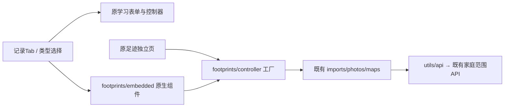
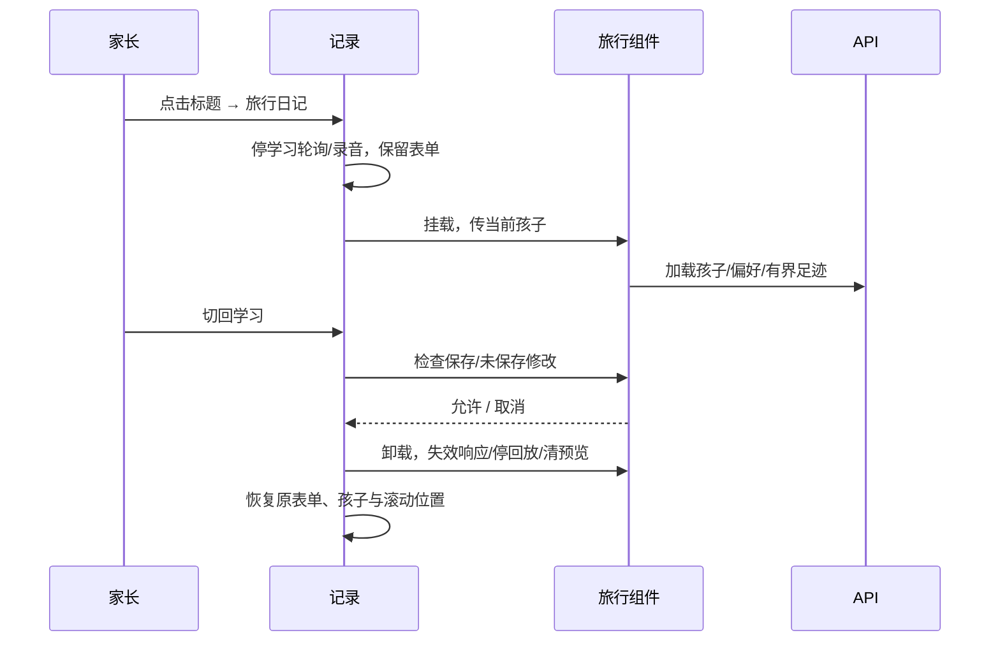
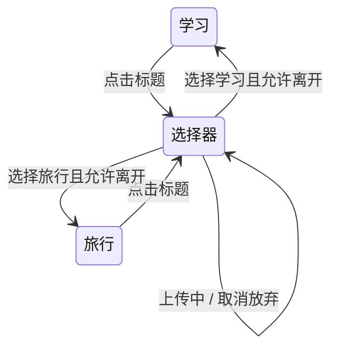

# FEAT-012 — 记录类型标题切换

- Status: VERIFYING
- Risk: R2，原生页面组合与生命周期。
- Date: 2026-10-23
- Spec revision: SPEC-20261023-RECORD-TYPE-SWITCHER-01
- Architecture revision: ARCH-20261023-RECORD-TYPE-SWITCHER-01
- Design Revision: DREV-20261023-RECORD-TYPE-SWITCHER-01
- Affected Features: FEAT-001、FEAT-012；UI-001、UI-018。
- Approval: 产品负责人（用户），2026-10-23。用户选中交互稿“标题切换 · 推荐”后要求“完成这个功能的代码编写”；据此批准该唯一选中方案、本Spec01及对应设计。此前要求删除解释性提示，本次同时授权SPEC-20261018-FOOTPRINTS-UI-COPY-01 / DREV-20261018-CHILD-PHOTO-FOOTPRINTS-02的既定精简清单。
- Baselines: FDB-20260913-04 / FEC-20261007-NATIVE-GEOMETRY-02，均APPROVED。
- Current states: [FEAT-012](../../docs/domain/features/FEAT-012-child-photo-footprints.md)、[UI-018](../../docs/design/frontend/ui/UI-018-child-photo-footprints.md)、[UI-001](../../docs/design/frontend/ui/UI-001-parent-miniapp.md)。

## Outcome and scope

“记录”Tab内点击页标题，底部选择“学习记录 / 旅行日记”。当前项有勾选，不展示未实现类型；五个底部Tab保持。首次进入默认学习记录，本次会话记住所选类型。学习输入、照片、日期、孩子保留；切换类型本身不提交、不确认也不清空内容。标题右侧使用当前类型的孩子选择器。旅行日记首次采用学习页当前孩子；旅行中主动换孩子不覆盖学习未提交内容，回到学习仍使用原孩子。归档孩子仅旅行可选。

旅行上传中不可切换；旅行编辑返回学习须沿用放弃修改确认。后台处理继续，视图离开停止回放、轮询、失效响应与预览资源。学习录音切换时取消，已有文字保留。切换回学习恢复其原滚动位置。旧足迹深链接保留独立页，使用同一控制器、模板和样式。

普通Tab往返记住旅行视图；今日等入口携带明确学习recordIntent时，通过相同离开保护切回学习，取消放弃不消费意图。类型菜单或旅行面板打开时隐藏底部导航并标记背景aria-hidden，关闭后恢复，避免遮挡面板操作。

不新增后端接口、存储、权限、AI调用方式、导航Tab或动态插件机制。记录类型列表是closed的两项；未来新增类型需新Spec。主Spec04的真实全球底图、素材、MySQL和真机门禁继续VERIFYING。

## Design and engineering evidence

编辑源：[HTML](../../docs/design/frontend/prototypes/DREV-20261023-RECORD-TYPE-SWITCHER-01/index.html)。
清单：[APPROVAL-CORRECTED](../../docs/design/frontend/snapshots/UI-001/DREV-20261023-RECORD-TYPE-SWITCHER-01/APPROVAL-CORRECTED.md)，只更正前端规格路径元数据，批准源/PNG不变；旧清单保留Superseded by指针。
来源为用户选中的标题方案；延续当前原生“知芽”品牌栏，标题与孩子控件在内容首行，替代原学习装饰头图与足迹提示条。320×568 / 390×844 / 430×932，学习、旅行、选择器、长孩子名四态。正文≥14px、操作≥44px，安全区避让，不通过隐藏溢出通过验收。无新增依赖，预算1.5MiB不变。其余旅行状态沿用DREV02文案及主Spec04约束。HTML只证明设计，原生节点与截图另验。

## Architecture and alternatives

推荐在记录Tab按需挂载领域内的旅行组件。把现有足迹Page定义机械提取为controller工厂，独立页与组件共享；旅行业务方法继续归footprints，不并入学习控制器。记录页只负责两项类型选择、学习生命周期以及当前孩子的显示桥接。

独立跳转方案改动较少，但旅行页缺少固定五Tab且返回语义与标题切换不一致，未采用。复制旅行控制器会产生两套业务，拒绝。动态注册器没有当前消费者，deferred。

边界兼容：原Page路径不变，领域API不变，组件实例独立data；隐藏/卸载失效代次保护，清理幂等。仅父页通过组件公开方法调用生命周期、分页、孩子选择；不写领域表。所有输入使用普通文本绑定，不新增本地照片持久化或日志。可观测性沿用可恢复错误及原生几何证据，不记录孩子素材。

## Expected files

records/index及record-types.js；footprints/controller.js、embedded.{js,json,wxml,wxss}与index.js薄包装；footprints原WXML/文案（并行copy Spec）。tests/frontend新增类型切换行为测试；保留原足迹回归。设计源/导出、原生证据、Feature/Behavior/Architecture/UI/Spec/发布本地事实闭环。无废弃双实现。

## Acceptance / required tests

1. 类型菜单只有两项，有当前态；遮罩/关闭取消；选择当前项只关闭。
2. 学习文字、照片、日期、孩子、幂等键跨往返保留；隐藏时无学习刷新覆盖；后台返回按所选类型恢复。
3. 旅行编辑取消不切换，上传不可切换；卸载停轮询/回放/清预览，迟到响应不写新状态；两个控制器实例状态隔离。
4. 孩子选择无串档；旅行归档/只读、家长确认、AI候选、分页、删除、固定7天均保持。
5. npm test、lint:miniapp、validate_miniprogram、check_architecture、validate_design_evidence、git diff --check；受影响后端回归。精确三视口原生菜单/学习/旅行/长名/表单及变更文案面板节点与截图；独立只读review。

## Verification / lifecycle

IMPLEMENTING前生成设计导出并冻结SHA。当前批准范围仅本地实现和验证，无上传/部署/发布。未完成原生门禁时状态为VERIFYING并列恢复条件；全部本Spec验收通过才DONE迁移completed。主Spec04状态独立，不以本Spec验收替代其真实服务与真机门禁。

2026-10-23本地代码已实现，前端275项、ESLint及小程序静态检查通过；后端足迹相关24 passed / 1 MySQL环境skip。最终原生与独立评审、文档核对见[实现证据](../../docs/quality/evidence/RECORD-TYPES-IMPLEMENTATION-20261023.md)。当前保留active/VERIFYING：字体放大、键盘、读屏及iOS/Android完整包真机未验收，主Spec04全球底图/真实素材等不被本地几何代验。补齐验收和具体结果后才迁移completed。

用户再次解锁后，最终320×568和390×844各29态重新采集全部通过，与430×932形成87份当前源码节点/PNG矩阵；38源SHA未变，隔离副本33源扣除声明注入后逐字节匹配。菜单、表单与照片面板操作可达，原生往返保留学习内容。锁屏阻塞已解除，既有字体/键盘/读屏/完整包真机门禁仍开放，Status与active位置不变。
