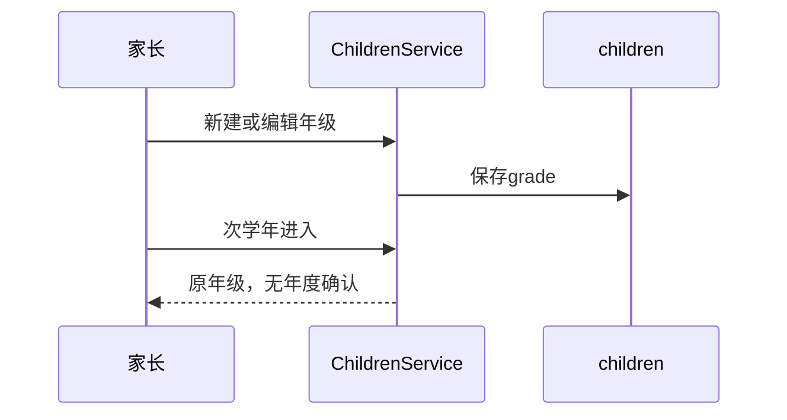
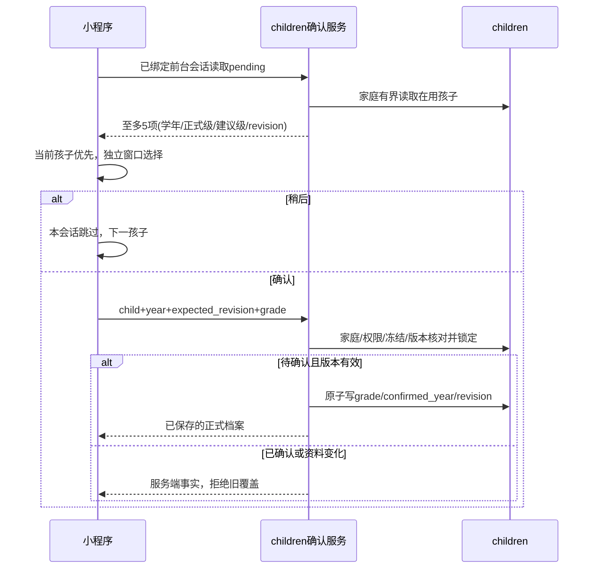
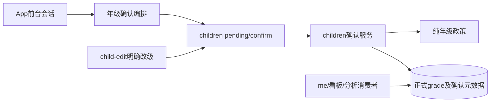
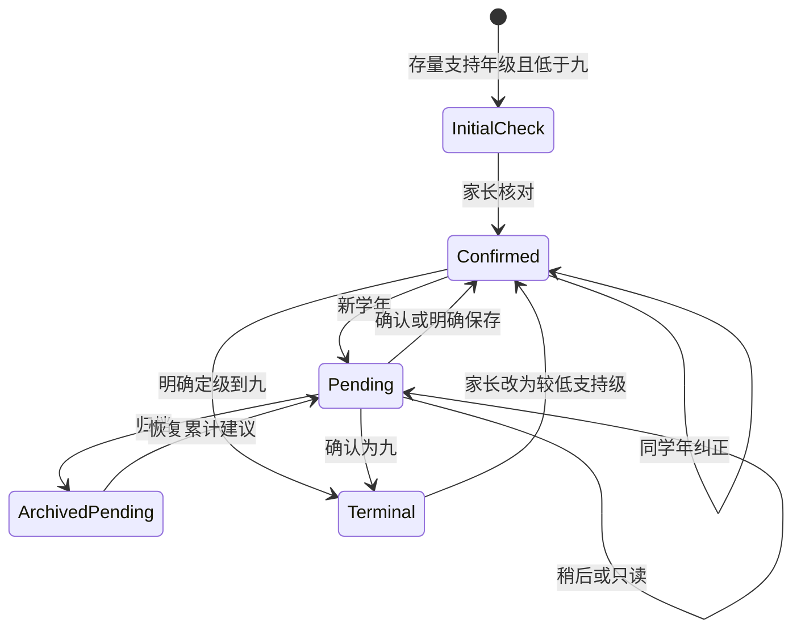
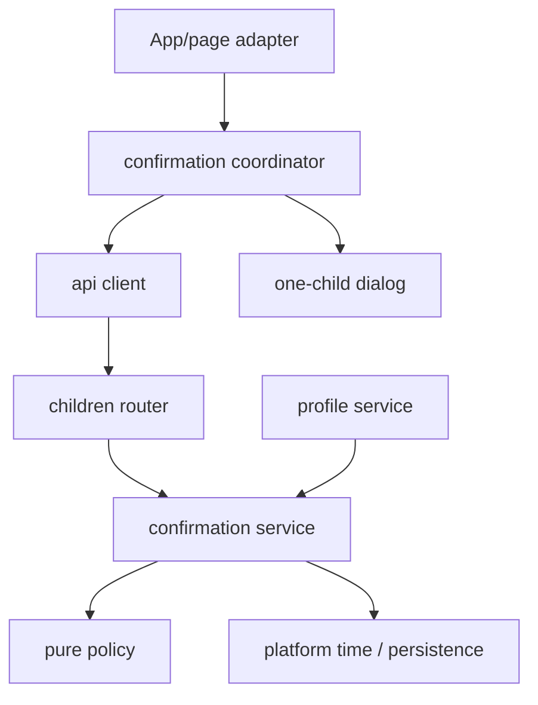

# FEAT-013 — 学年升年级建议与家长共享确认

- Status: VERIFYING
- Readiness: Spec02 / Architecture02 / DREV01已批准；本地代码、自动化、三尺寸原生呈现/控件及独立只读评审完成，真实设备/修复后原生端到端/可访问性待补；部署由独立OPS记录，037/0025与候选读取通过不替代产品/设备验收。
- Risk: R2（跨模块/API/持久化/前端会话与并发）
- Spec owner: 产品负责人（用户）
- Implementer / Verifier: Codex（批准后）；产品负责人验收
- Reviewer: 独立上下文 `/root/grade_dialog_facts`，第三轮PASS，无剩余Blocker/Major；[评审记录](../../docs/quality/evidence/grade-confirmation-20261024/independent-review.md)
- Created / Last updated: 2026-10-24
- Target release: 本Spec实施范围不变；后续经独立[OPS Spec01](OPS-20261024-LATEST-BACKEND-TEST-DEPLOYMENT.md)批准，26714b9已生产迁移0025，另获批CRUD启动修复后的037 normal/100%、候选读取200，客户端仍本地；本Spec产品/设备验收继续VERIFYING。
- Spec revision: `SPEC-20261024-ANNUAL-GRADE-PROMOTION-02`
- Architecture revision: `ARCH-20261024-ANNUAL-GRADE-PROMOTION-02`（APPROVED）
- User confirmation: Q18“是（推荐）”确认完整产品规则；后续“好的 按照这个方案落地”批准具体Spec02 / Architecture02 / DREV01及实施
- Additional R2 approval: 用户于2026-10-24回复“好的 按照这个方案落地”，明确对应上一条Spec02 / Architecture02 / DREV01批准请求
- Affected Feature IDs: FEAT-013（新）、FEAT-005（档案）、FEAT-002（启动/成员）、FEAT-001（看板/分析消费者回归）
- Current-state documents: [FEAT-013](../../docs/domain/features/FEAT-013-annual-grade-promotion.md)、[FEAT-005](../../docs/domain/features/FEAT-005-multi-child-profiles.md)、[FEAT-002](../../docs/domain/features/FEAT-002-family-collaboration.md)、[FEAT-001](../../docs/domain/features/FEAT-001-push-kids-mvp.md)
- Baselines: FEAT-013 `FEAT-STATE-20261024-ANNUAL-GRADE-PLANNED-03`（仅需求/设计候选）；FEAT-005 `FEAT-STATE-20260906-02-MULTI-CHILD` + `FEAT-STATE-20261018-FOOTPRINTS-ARCHIVE-01`；FEAT-002 `FEAT-STATE-20260913-BUG015-SIX-DIGIT-INVITE` + `FEAT-STATE-20261018-FOOTPRINTS-SCOPE-01`；FEAT-001 `FEAT-STATE-20261020-AUTO-SUPERSEDED-FULLSTACK-02-LOCAL`
- Feature/UI merge owner: Codex；实施前重读最新状态，验收后语义合并，不覆盖其他任务

> Spec01从未获批。本revision整体替换其“按日期直接投影正式年级、初一封顶、纯后端”提案；旧提案不再是目标合同。当前为本地实现，未发布；验收缺项见第16/17节。

2026-10-24局部呈现增量：[年级弹窗精简Spec01](FEAT-013-GRADE-DIALOG-SIMPLIFICATION.md)及DREV02获用户“继续”批准并本地实现，仅替代本Spec的弹窗信息层级/文案与按钮排列；领域规则、Architecture02及档案表单不变。最终327项前端/53项定向、三尺寸51组新呈现和实际选级/重试/稍后通过；真实设备/可访问性及全业务原生端到端仍待补。新证据见[精简实施记录](../../docs/quality/evidence/GRADE-DIALOG-SIMPLIFICATION-IMPLEMENTATION-20261024.md)，不能以DREV01旧呈现代替新布局验收；下文原DREV01采集仍属主任务历史证据。

## Frontend Design Impact and Repository-native Approval

- Frontend impact: yes；新增每孩子独立确认弹窗、串行队列和一至九年级显示/选项，不增加常驻升级说明。
- Frontend engineering impact: yes；组件/状态/表单、前后台会话、并发/迟到结果、a11y、视口、资源、安全/隐私、可观测性。
- Affected UI/current-state: [UI-015](../../docs/design/frontend/ui/UI-015-child-profile.md)（档案编辑/年级）、[UI-001](../../docs/design/frontend/ui/UI-001-parent-miniapp.md)（五Tab共享弹窗）。
- Approved baseline / engineering: `FDB-20260913-04` / `FEC-20261007-NATIVE-GEOMETRY-02`；UI-015头部旧摘要不替代当前有效合同。
- Visual direction: 沿用知芽“纸·芽”的暖纸底、松绿主操作和既有圆角/字号；一个孩子一个短表单，原生picker，无新装饰图或说明卡。
- Original approved Design Revision: `DREV-20261024-ANNUAL-GRADE-PROMOTION-01`（APPROVED，2026-10-24）；当前弹窗由另批精简Spec01 / `DREV-20261024-ANNUAL-GRADE-PROMOTION-02`局部替代，档案表单继续DREV01。
- Editable source: [自包含交互HTML](../../docs/design/frontend/prototypes/DREV-20261024-ANNUAL-GRADE-PROMOTION-01/index.html)；SHA-256 `94e80e4b10cc27b268d3a57daca8657a8860083eaad1a78fb2c511b1631c452c`。
- Frontend spec / viewport-state exports: [设计合同](../../docs/design/frontend/prototypes/DREV-20261024-ANNUAL-GRADE-PROMOTION-01/FRONTEND-SPEC.md)；[57张PNG与SHA清单](../../docs/design/frontend/snapshots/UI-015/DREV-20261024-ANNUAL-GRADE-PROMOTION-01/APPROVAL.md)，19态均覆盖三精确视口。
- Prototype status: CREATED / HTML_CHECKED；Approved Task Spec / Design Revision / approval evidence: 用户2026-10-24在具体Spec02/Architecture02/DREV01批准请求后回复“好的 按照这个方案落地”；原设计源与57张导出冻结。
- Existing design references: 通知独立说明弹层可参考，批准范围不能覆盖新年级弹窗；既有批准快照保持不可变。
- Exact viewports: 320×568、390×844、430×932 logical px；记录renderer/base library/DPR/font scale/source revision。正文≥14px，触控≥44px，最大内容宽480px。
- Required states: 首次核对、年度升级、跨年累计、修改/保持原级、多孩子串行、稍后、提交中、失败保留输入、另一家长已确认/冲突、身份/归档变化、档案编辑和七至九年级显示；长姓名与picker打开覆盖三视口。
- Budgets/requirements: FEC-PERF-READ-001..004；无重复提交/迟到覆盖、背景可访问性隔离、页内错误可重试、无敏感本地持久化、无横向溢出/遮挡。
- Verification: reducer/page/component测试、ESLint、miniapp/design校验、三视口原生节点矩形与截图、iOS/Android。HTML导出不能替代原生验收。
- Engineering/implementation deviations: none；UI merge/visual/engineering evidence待实际验证，不抵扣其他任务门禁。
- External design dependency: none。

## 0. Executive summary

每年北京时间9月1日进入新学年，系统提出升年级建议，**家长确认前正式年级保持原值**。首次进入小程序时，对待确认的在用孩子逐个弹窗，可直接选择实际年级后确认，也可稍后处理。确认按孩子＋学年保存于服务端，一位有编辑权限的家长确认后全家共享。

范围为小班→中班→大班→一年级→…→九年级。首次启用只核对原年级；新建/明确保存年级算当学年确认。归档不弹窗，恢复或多年未用时按最后确认学年累计建议，只核对当前学年一次。九年级为终点，不自动归档或升高中。

## 1. Facts, decisions, assumptions, questions

### Confirmed product decisions（2026-10-24本聊天grilling回答）

| ID | Confirmed rule | Message reference |
|---|---|---|
| D-001 | 小/中/大班、一至九年级；九年级后不再升级/弹窗，保留档案与编辑 | Q1自由回答；Q9是 |
| D-002 | 每孩子独立弹窗，当前孩子先，再其他在用孩子；一次只一个 | Q11自由回答；Q15是 |
| D-003 | 建议由系统提出，家长确认后才正式生效 | Q6是 |
| D-004 | 每孩子每学年一次，全家/跨设备/登录共享 | Q2自由回答；Q7是 |
| D-005 | 首次上线只核对当前年级，不默认多升一级 | Q8是 |
| D-006 | 直接修改处理例外，无暂停开关；弹窗可选实际年级或保持原级 | Q3自由回答；Q16是 |
| D-007 | 稍后不改年级/共享状态，本次不重复，下次进入再提醒；仍继续下一孩子 | Q10是；Q15是 |
| D-008 | 新建填年级/明确修改保存算本学年确认，名字/时长修改不算 | Q12是 |
| D-009 | 空、其他、旧未细分学前、自定义未知值不猜不弹 | Q13是 |
| D-010 | 归档期间学年继续累计但不弹；恢复/多年未用时一次核对当前建议，不逐年追弹 | Q4是；Q14是 |
| D-011 | 保存年级属于保存当天所在学年；不加本/下学年选项；暑假提前填可在9月核对保持原级 | Q17是 |
| D-012 | 不加常驻自动升级说明文案 | Q5否；不据此否决Q2要求的确认弹窗 |
| D-013 | 上述完整产品规则准确，结束访谈进入前端设计准备 | Q18“是（推荐）”；questionItemId `call_a6371e87b283430b984721e898027ba3/0` |

### Confirmed code facts

| Fact | Evidence |
|---|---|
| grade可空、最长20字，无确认学年/版本 | `children/schemas.py`、`persistence/models.py` |
| /me、看板、分析上下文消费正式Child.grade | `families/service.py`、`reporting/service.py`、`agent_processing/context.py` |
| App无全局onShow会话合同；page onShow也会在切Tab/返回触发 | `apps/miniprogram/app.js`、`pages/today/index.js` |
| child-edit每次PATCH带grade，无touched，字段存在不能证明明确确认 | `pages/child-edit/index.js`的chooseGrade/formPayload/save |
| manager/editor可改档案，viewer不可写；归档恢复只限manager | `platform/context.py`、`children/router.py`、`settings/index.js` |
| 在用档案上限5，现有目录最高初中一年级 | `children/service.py`、`utils/child-context.js` |

UI-015仍引用旧baseline/FEC且没有本功能批准快照，实施时按顶层现行合同补齐本范围，不能宣称旧manifest存在或新弹窗已获批。

Open product questions: 无；Q18已确认汇总理解。具体技术方案与新生成的DREV仍需批准，不重复询问已确认产品规则。

## 2. Pre-change behavior and discovery evidence（实施前基线）

当前无年度升级/弹窗。新建/编辑直接保存grade；下一学年仍原值。家庭启动先区分未绑定/待审批/已绑定，未进入业务态不能弹孩子窗口。既有归档可见性、写入权限与清理冻结保持现状。



相关测试：`test_multi_child_profiles.py`、前端`child-profiles.test.js`、`test_analysis_context_contract.py`、`test_api_contract.py`；行为BHV-001/014/025。本轮仅阅读，未重跑历史测试，不借历史PASS证明新功能。

## 3. Target behavior

### Academic year and proposal

- 时区Asia/Shanghai；9月1日00:00换学年。2026学年=2026-09-01至2027-08-31，1月1日不另升。每请求固定一次服务端日期，不接受客户端指定时钟。
- 正式年级＋上次家长确认学年为基准；建议前进`max(0,current_year-confirmed_year)`级，最多九年级。确认前所有读仍是正式级。
- 存量无可信确认基准，首次建议保持原级；即使首次核对拖到更晚也不按建档年份猜补升。
- 新建/明确保存以当天学年为准；8月30日提前填一年级，9月可建议二年级，但家长可确认保持一年级。
- 正式九年级、无有效年级、deleting、归档不进入启动候选。归档不重置基准；恢复按last-confirmed学年累计。

### Foreground session and individual dialogs

一次使用=一次App前台会话：冷启动或后台再次回前台。切Tab、页面onShow、picker关闭、编辑返回不重置本次已展示/稍后集合；运行中流程不因生命周期回调重复入队。

家庭bound、角色可编辑、业务页安全承载时读取候选。当前选中孩子优先，其余按created_at,id稳定顺序。当前弹窗呈现由另批DREV02定义：标题“孩子名的年级”、默认选中建议级的原生picker，左“稍后”/右“确认”并排；正常态不再显示原年级或解释段落。处理非当前孩子不改变全局选中孩子。

稍后只记内存会话集合，无共享写入/本地持久忽略；确认/稍后/发现他人已确认后再进入下一孩子。与现有来源、删除、切换、通知等弹层互斥；未保存表单、拍照/提交等不安全时等待业务安全承载点，不抢盖窗口。

继续采用底部弹层；遮罩/返回的退出语义等同稍后，提交期间禁用退出。版本冲突先停止旧提交、读取最新正式结果，再继续队列；不把旧选择改造成覆盖操作。原交互语义已经随Spec02/DREV01获批，精简后的视觉按另批DREV02执行。



| Case | Expected | Forbidden |
|---|---|---|
| 首次启用旧二年级 | 默认二年级，可纠正 | 猜升三年级 |
| 2026确认一年级，2027年9月后进入 | 建议二年级，确认后生效 | 只打开窗口就写库 |
| 多年未用/归档恢复 | 累计建议，一次核对当前学年 | 逐年追弹、重置归档基准 |
| 多孩子 | 最多5个独立窗口串行 | 批量合并、叠窗、误切当前孩子 |
| 稍后 | 不写库，本次不重弹，日常功能继续 | 记全家已确认、阻断业务 |
| 明确保存年级/保持原级 | 当学年确认，次年再建议 | 名字/时长保存误确认 |
| 他人已确认/改级 | 以服务端当前事实刷新/结束 | 旧窗覆盖新值 |
| viewer/跨家庭/deleting | 原权限/404/冻结边界 | 因共享确认绕授权 |
| 网络/服务失败 | 保留选择、页内错误可重试/稍后 | 假成功、丢表单、影响学习复习 |
| 旧学年/归档/退家庭 | 拒绝旧快照，刷新/清队列 | 旧上下文写入 |

看板、报表、AI只消费正式grade，建议不注入分析；不按材料occurred_at/报表筛选日倒推档案年级。已有草稿、学习记录、Review、Todo和确定性排期不变。

## 4. Scope, invariants and Feature merge

In scope: 年级顺序/旧值、只读建议、孩子学年共享确认、独立串行弹窗、明确改级意图、并发/混合版本、归档恢复、迁移与验证。

Out of scope: 日期直接改变正式级、年龄生日、高中、开学日配置、暂停开关、常驻升级说明、订阅通知、学籍历史系统、AI定级、学习记录生成、复习重排、生产部署。

Invariants: 家庭隔离、角色/归档许可、删除冻结优先、明确确认才写；不动occurred_at/created_at，不记录儿童内容/身份日志，无定时扫表。

| Document | 验证后语义合并 |
|---|---|
| FEAT-013 | PLANNED更新为真实阶段、规则/合同/限制/证据 |
| FEAT-005 / UI-015 | 一至九年级显示、明确改级意图、共享学年、归档恢复 |
| FEAT-002 / UI-001 | bound可编辑家长的前台会话、独立串行窗/跨设备共享；启动分流不变 |
| FEAT-001 / BHV-014 | 看板/AI只读正式级；确认不写学习/复习事实 |
| Architecture / Behavior / Test Strategy | owner、DAG、事务、会话、SQL/原生门禁 |
| Spec / 索引 / 发布资料 | 生命周期/引用与实际事实一致；未发布不改其他release |



## 5. Domain and data design（推荐，待Architecture02批准）

- children.grade继续代表正式级，放弃Spec01“数据库旧基准/响应虚拟年级”的双重口径。
- 新增`grade_confirmed_school_year INTEGER NULL`：最后明确确认/保存时的学年，兼作建议基准和本学年共享确认标记；存量为NULL，迁移不能伪造父母确认。
- 新增`grade_revision INTEGER NOT NULL DEFAULT 0`：所有正式改级/确认事务递增；名字/时长不递增。首次同级确认也更新学年/版本。
- 不新增每家长确认表/逐学年历史表，不依赖本地storage；只需当前定级基准。
- 内部值尽量保留现有学前-小/中/大班、小学一至六年级、初中一年级，增加初中二/三年级；用户统一显示小/中/大班、一至九年级，七/八/九对应初中一/二/三。唯一目录/显示函数转换，不在页面复制。
- 旧值只做一对一精确目录映射（如小学二年级/二年级、初中一年级/七年级）；空/其他/未细分学前/无法精确对应的自由文本保留，不猜任意文字。
- 缺基准走首次核对，GET零写入；非法/未来元数据安全失败，不能负数降级或编造确认。
- pending只读可信家庭在用非deleting，`LIMIT MAX_ACTIVE_CHILDREN+1`；超过5返回一致性错误，不静默漏孩子，不加载归档全集。
- 必要tenant-leading索引建议`(family_id,active,deleting,created_at,id)`；实际方案以MySQL5.7/SQLite查询计划验证。
- 迁移接实施时实际head；初次发现为20261020_0022，设计准备时工作区已有其他任务的0023/0024文件，不能沿用旧的0023占位编号。只加列/索引，旧grade不改；本地自愈/Alembic一致，重启不重置；删除随Child清理。



空/未知是流程外状态，明确填写支持级后进入Confirmed；Terminal不自动归档。

## 6. Interfaces, concurrency and errors（已批准）

| Contract | Input/output and compatibility |
|---|---|
| GET `/api/v1/children/grade-confirmations` | 可信家庭；`school_year,can_confirm,items[]`，每项id/name/current_grade/suggested_grade/reason(initial_check/annual_progression)/revision；viewer无可操作候选 |
| POST `/api/v1/children/{child_id}/grade-confirmation` | `{school_year,expected_grade_revision,grade}`；manager/editor，支持级枚举；返回已保存ChildView及确认学年/版本、静态outcome |
| POST children / 家庭首档案 | 明确填写支持级以当前学年定基准；空/未知无弹窗 |
| PATCH child | 增量年级意图/version字段，新表单只在明确触碰年级时提交意图与expected revision；名字/时长不能隐式确认 |
| 既有children/me/看板 | grade仍正式级；元数据只增量，建议不得塞入原grade |

服务按family/child锁定并复核active/deleting、服务端学年和revision，原子写三个字段。同学年同结果重试返回已确认事实；不同结果/新版本返回`409 grade_confirmation_conflict`与可刷新的当前状态，旧窗口不能覆盖。如需纠正已确认级别，走显式编辑入口。

客户端school_year只防旧快照，不能决定时钟；跨学年`409 grade_school_year_changed`。跨家庭404，viewer写403，归档/清理按既有409，非法字段/枚举422。固定路径先于动态路径匹配，不泄露其他家庭是否存在。

PATCH的grade absent表示不改变年级或其确认元数据；显式null表示清空，空字符串/其他/未知字符串按既有最长20字符合同保存，不自动猜测进入年度流程。明确改级需同时携带意图与期望版本；清空/改为未知值后退出候选，未来重新明确填支持级时按保存当天学年定基准。弹窗仅提供小/中/大班及一至九年级的确定选项，原有档案页仍保留清空/其他/历史自定义值路径。

旧客户端完整PATCH的grade存在本身不算确认。无意图且值与库中相同，保留普通保存，不写确认元数据；会改变年级却缺版本/意图的旧写不能覆盖新事实，应返回既有升级要求类409并保留输入。新人工编辑可用；上线前明确验证旧读、同级普通保存与旧改级拒绝边界，不承诺旧writer长期混用安全。

幂等由child+year+revision及原子提交实现，无无界幂等表。SQLite使用等价条件更新，不能用其FOR UPDATE编译冒充并发证据；真实MySQL5.7专测并行事务。失败一起回滚grade/year/revision。

## 7. Authorization, security, privacy

确认沿用档案写权限manager/editor；全家共享不授予viewer写权限。先可信成员/家庭/孩子校验，版本/建议/客户端时间都不是授权。提交和结果应用复核归档、清理、退家庭/换身份。

稍后集合只在内存按family/child/year/session隔离，不作为共享事实，不持久化忽略。日志不含孩子姓名/年级/具体ID、OpenID、密钥或响应原文。无外发/订阅/AI调用、无儿童副本；失败可恢复，不假确认。

## 8. Architecture and alternatives

| Owner/file | Responsibility and restriction |
|---|---|
| children/grade_policy.py | 纯目录/学年/建议/终点；无框架/ORM/时钟 |
| children/grade_confirmation.py | 有界读、原子确认、版本幂等、人工定级元数据；只写children |
| children/service.py | 建档/编辑接入grade owner，保留生命周期用例 |
| router/schemas | 验证运输并委托，无升年级政策 |
| miniapp utils/grade-confirmation.js | 前台会话、至多5人排序/展示、代际/身份；不自行算升几级 |
| components/grade-confirmation | 单孩子picker/确认/稍后/失败/提交态，发事件而非拥有业务写规则 |
| app.js/业务页宿主 | bootstrap/前台/弹层互斥接线，不让每页复制流程 |
| child-context/child-edit | 唯一显示目录、旧值、touched与版本意图，保留人工入口 |



DAG：children不反向依赖families/reporting/agent_processing；grade_confirmation不反向import children/service。coordinator不import页面，组件不反向拥有App。architecture检查与针对性合同验证。

共性限有owner的年级规则/流程，不建泛化弹窗框架、无主utils或学籍引擎；接入现有宿主边界，不为此重写其他弹窗。

| Alternative | Decision / trade-off / revisit |
|---|---|
| 日期投影/定时写正式级 | 与Q6冲突，Spec01方案淘汰 |
| 每家长/设备本地确认 | 不满足全家共享，不采用 |
| 多孩子批量窗 | 与Q11冲突，不采用 |
| 学年历史表 | 本期无历史需求，当前锚点/版本足够；明确需要历史时另审 |
| 每个page onShow都弹 | 会切Tab重弹，改用App前台会话/内存去重 |
| PATCH有grade即确认 | 现有表单每次都有，会误确认；必须明确意图/版本 |

Extensibility: 日期/时区/序列/共享键closed；高中/暂停/历史/多时区deferred；无新增open点。Architecture02包含文件职责/事务/兼容，已获批准；不改部署拓扑，ADR不另建，理由在本Spec。

## 9. Expected file changes, replacement, deletion

| Path（仓库相对） | Action | Reason |
|---|---|---|
| apps/api/src/push_kids/children/grade_policy.py、grade_confirmation.py | add | 纯政策与原子/有界用例 |
| apps/api/src/push_kids/children/service.py、router.py、schemas.py | modify | 接入、DTO、意图/version |
| apps/api/src/push_kids/persistence/models.py | modify | 学年/版本及索引 |
| apps/api/migrations/versions/YYYYMMDD_NNNN_grade_confirmation.py | add | 实施前重核实际head并分配未占用编号，增量列/索引 |
| apps/api/src/push_kids/platform/database.py | modify | revision及本地兼容 |
| apps/api/src/push_kids/families/service.py | modify only if required | 首档案走children公开用例，不复制规则 |
| apps/miniprogram/utils/child-context.js、grade-confirmation.js | modify/add | 1–9显示/选项、会话编排 |
| apps/miniprogram/components/grade-confirmation/ | add | 独立确认组件 |
| apps/miniprogram/app.js、五Tab必要js/json/wxml | modify | App会话、共享宿主、互斥 |
| apps/miniprogram/pages/child-edit/必要js/wxml/wxss | modify | touched/version、普通保存不确认、冲突草稿恢复及批准FEC要求的44px保存目标 |
| tests/unit/test_grade_policy.py | add | 全序列与时间/首次/累计/终点 |
| tests/integration/test_grade_confirmation.py、test_grade_confirmation_migration.py、test_grade_confirmation_mysql.py | add | 真API、共享并发、迁移/双数据库 |
| tests/performance/test_grade_confirmation_reads.py | add | 50k归档+5在用、查询计划/预算 |
| tests/frontend/grade-confirmation.test.js与既有profile/bootstrap合同 | add/modify | 独立窗口/会话/意图/竞态 |
| tools/grade_confirmation_geometry.js | add | 原生三视口采集/审计 |
| docs/design/frontend/prototypes/<DREV>/、snapshots/UI-015/<DREV>/ | add after shared understanding | 可编辑源、三视口全状态、SHA候选清单 |
| 第4节当前文档、专项evidence、Spec/两个索引 | modify/add after verification | 正文事实/状态/引用闭合 |

替换编辑路径“总带grade”的隐含确认语义，清除不再用的import/分支，不保留第二套政策。Spec01无代码可删除，不再实现其读时投影。Temporary coexistence: none；旧写拒绝边界显式，不覆盖其他任务工作。

## 10. Non-functional requirements

| ID | Budget/measurement |
|---|---|
| NFR-001 | 候选≤5、SQL LIMIT6一致性哨兵、业务查询O(1)、响应≤8KiB，不加载归档全集 |
| NFR-002 | 单孩子计算O(1)，GET零写/commit，无历史扫描/AI网络 |
| NFR-003 | SQLite/真实MySQL5.7同义；tenant-leading索引；50k归档+5在用及多家庭实际SQL计划/查询数/字节验证 |
| NFR-004 | 无轮询/重复pending；一次会话合并就绪请求，≤5串行窗，双击防重 |
| NFR-005 | 无新框架/图像依赖，初始包≤1.5MiB、触控≥44px/正文≥14px，三视口无溢出遮挡 |

## 11. Acceptance criteria

| ID | Given/When/Then |
|---|---|
| AC-001 | 9月新学年正确逐级/累计建议，1月不误升、最多9；确认前正式级不变 |
| AC-002 | 存量首次只核对原级，不按建档年猜历史，GET不造确认 |
| AC-003 | 一家长确认，当学年全家/跨设备不再弹；次年再核对，同时提交不重复不覆盖 |
| AC-004 | 多孩子当前优先独立串行，稍后继续下一位，不叠窗/误切孩子 |
| AC-005 | 稍后本次不重复，切Tab/返回/picker不重置；下次前台再核对，日常可继续 |
| AC-006 | 新建/明确改级含保持原级算当年；名字/时长不算；暑假按保存日学年 |
| AC-007 | 归档恢复/未知空值/9/viewer/跨家庭/deleting守边界，学习/复习事实不变 |
| AC-008 | 失败/旧版本/旧学年/旧payload/身份变化保留输入与事实，明确拒绝/刷新，原子回滚 |
| AC-009 | 新旧库/重启/迁移与双引擎50k规模无伪确认/重置，查询/响应预算满足 |
| AC-010 | DREV批准、三视口原生/设备、适用门禁、独立评审和文档按真证据闭合 |

## 12. Required verification plan

| Test point | AC | Required coverage/command | Status |
|---|---|---|---|
| TP-001 | 001/002/007 | `uv run pytest tests/unit/test_grade_policy.py -q`：12级/旧值/9封顶/首次/多年、8/31→9/1及UTC15:59:59→16:00、1月/闰年/非法基准 | PASS；与002/SQLite003/005共43项，实际使用.venv/bin/pytest |
| TP-002 | 002/003/006/007/008 | `uv run pytest tests/integration/test_grade_confirmation.py -q`：真路由、双家庭/家长/孩子、重试/冲突/午夜、意图/只读/归档/冻结、零学习复习写入 | PASS；含真实家庭邀请/角色边界、事务失败回滚、GET零DML |
| TP-003 | 003/008/009 | SQLite迁移/重启/条件并发，真实独立MySQL5.7的test_grade_confirmation_mysql.py并行事务/迁移/schema/索引 | PASS；SQLite及独立MySQL5.7.44的4项检查；未执行生产DDL |
| TP-004 | 004/005/006/008 | `node --test tests/frontend/grade-confirmation.test.js tests/frontend/child-profiles.test.js`：5独立窗/App-session-page、picker/编辑/弹层互斥、意图/身份/迟到/失败 | PASS；独立审查修正后npm test 313项，含启动的定向53项通过；微任务避免同步递归，覆盖恢复安全刷新、归档/人工确认后的在途失效、报表筛选互斥及人工冲突保留草稿/重新选择；真实设备生命周期不由mock替代 |
| TP-005 | 009 | `uv run pytest tests/performance/test_grade_confirmation_reads.py -q`：双引擎各50k归档+5在用，多家庭，真实ORM SQL/key/查询数、5项/8KiB | PASS；SQLite与真实MySQL5.7查询计划/单SQL/响应预算 |
| TP-006 | 001/007/010 | `uv run pytest tests/unit tests/integration tests/contract -q`、`npm test`；既有档案/启动/看板/AI/复习回归，始终只消费正式grade | PASS；后端752 passed/39 skipped，前端最终313 passed；MySQL另跑4通过，不将skip算通过。后台代码此后未改；共享工作区中间其他任务失败及前端定向首跑失败日志保留，随后重跑通过 |
| TP-007 | 010 | Ruff check/format、Mypy、ESLint、architecture/design/miniapp校验；可编辑设计/三视口/SHA先批准 | PASS；本功能及全仓Ruff/format、Mypy、ESLint/架构/小程序/批准设计校验通过；全仓format最终694文件通过，中间其他任务失败日志保留 |
| TP-008 | 004/005/008/010 | 批准后320×568/390×844/430×932原生矩形+截图：长姓名/picker/失败/冲突/背景及编辑；iOS/Android重进/双家长/旧端 | PARTIAL；三尺寸各17态共51组节点/截图及三尺寸九年级编辑控件通过；系统picker三尺寸实际打开/取消；320错误提示实际滚动可读。修正原生按钮缩宽、同步递归和320档案保存按钮高度；后续恢复/互斥/冲突/在途修复仅自动化验证，原生端到端、真实iOS/Android、读屏/字体/焦点及双家长旧端未验收 |
| TP-009 | 010 | 独立只读review；功能/设计/必要性/位置/残留；逐文档冲突核对 | PASS；本功能文档已同步与自检，独立上下文三轮评审关闭CR-001～004，无剩余Blocker/Major；[报告](../../docs/quality/evidence/grade-confirmation-20261024/independent-review.md)，不抵扣TP-008 |

Pre-change失败：pending/共享确认/独立会话窗均不存在。Regression：原多孩子/启动/学习AI/看板/规划合同。禁止副作用：GET零UPDATE/commit、稍后零共享请求、确认不改学习/Review/Todo。真实wiring走API与App/page生命周期，不只mock policy；时间注入，不用测试机当天。

HTML/mock不能抵扣真实微信前后台/picker/双家长、原生节点/截图、iOS/Android可访问性。未完成就按实际保留VERIFYING，不能标DONE。

## 13. Rollout, migration, rollback

当前不部署，未来按[发布手册](../../docs/deploy/README.md)独立冻结范围，不混入其他任务发布包。

先增量列/索引，旧grade不变/不伪确认；验证新旧读写边界后灰度后端/客户端。新UI只在后端支持、家庭bound、角色可编辑时接入。旧客户端无弹窗时不自动改变正式级，不能绕version写年级。生产管理员门禁按playbook，秘密不入聊天。

回退可保留增量列，grade仍是最后正式值，不会像Spec01显示退级；退旧writer前必须停止确认并核验基准/版本兼容，不能无条件混用。存在非空确认事实时downgrade拒绝删列，直到另行批准保留/恢复方案；空库可验证回退。当前未授权生产数据改写。

观测沿用静态route/outcome/error及耗时/计数，无儿童内容。共享事实丢失、覆盖、元数据分裂、越权/schema错误立即停止推进，不用静默隐藏窗口掩盖。

## 14. Implementation plan and gates

1. Q18已确认完整产品规则，访谈完成，不重开已收敛问题。
2. 本地设计源/19态三视口/SHA已完成；明确批准Task Spec02＋Architecture02＋DREV01并记录后再编码。
3. 实施纯规则/Schema/有界读/原子确认，真路由/双数据库守住正式事实；重核最新迁移head，不改其他历史迁移。
4. 接入独立窗/App会话/明确意图/旧值显示，验证并发恢复和原生几何，不建第二套升年级规则。
5. 适用门禁/独立review、逐文档正文合并与生命周期；未经验证不写CURRENT。

改变用户已确认规则/API兼容/设计/架构需新revision，不弱化required tests适配实现。

## 15. Review plan

独立上下文只读review全部AC/TP、建议/正式隔离、权限/共享、事务/午夜/版本、旧完整表单、App生命周期/弹层互斥、归档恢复/有界SQL。核对必要性、owner/放置、冗余残留及修改理由。三轮实际评审后CR-001～004全部关闭，无剩余Blocker/Major；报告及执行边界见TP-009。设备与原生端到端仍独立验收。

## 16. Implementation and verification record

用户批准后已本地实现children纯政策/确认用例、0025增量迁移及SQLite兼容、五Tab/App会话/独立弹窗、人工改级意图与版本。完整当前证据见[ANNUAL-GRADE-IMPLEMENTATION-20261024](../../docs/quality/evidence/ANNUAL-GRADE-IMPLEMENTATION-20261024.md)。解锁后补齐三尺寸呈现矩阵、系统picker与档案控件、320错误滚动核验；随后修复恢复漏核对、筛选互斥、人工改级冲突恢复及归档/确认在途竞态，独立评审第三轮通过。真实设备/修复后原生端到端/可访问性仍未完成，线上行为未因本任务改变。首轮全仓暴露历史Schema测试使用当前ORM默认列，已改成冻结列清单；worker readiness单次失败后定向9项及最终全仓通过。MySQL首轮latin1测试库不支持中文，重建仅本任务隔离库为utf8mb4后4项通过；不是生产修复。

以下为**实施前设计准备的历史记录**；其待批准/未实施状态不代表本轮收尾状态。当前结果以第12节及专项证据为准。

| Actual action/command | Result | Limit |
|---|---|---|
| rg/文件/Git及只读子任务：App会话/表单/权限/设计引用 | EXECUTED | 事实发现，不是运行时或测试通过 |
| `git diff --check`（限定两个索引、FRONTEND-DESIGN及UI-001/015） | PASS | 本次编辑涉及的跟踪文档无空白错误；不宣称其他任务已检查 |
| Python内联检查Spec/Feature/设计合同链接行尾、五个索引或UI引用、模板章节/访谈引用 | PASS | `DOC_LINKS_CHECKED=33; SPEC_SECTIONS=19; INTERVIEW_REFERENCES=18; ERRORS=0`；仅文档检查 |
| `python3 docs/design/frontend/prototypes/DREV-20261024-ANNUAL-GRADE-PROMOTION-01/render.py` | PASS | `DESIGN_EXPORTS=57; INTERACTION_SETS=3; HTML_ONLY`；初次Chrome启动受沙箱限制，允许本地渲染后执行；初次几何断言将滚动页当固定弹窗，已调整为编辑页可滚至保存、弹窗按钮在视口内后重跑通过 |
| 设计目视检查 | EXECUTED | 390年度态、320长姓名/失败态；短屏正文可滚动，底部操作保持可达，不代表原生验收 |
| `.venv/bin/python tools/validate_design_evidence.py --manifest docs/design/frontend/snapshots/UI-015/DREV-20261024-ANNUAL-GRADE-PROMOTION-01/APPROVAL.md --allow-pending --check-current-policy` | PASS | `DESIGN_EVIDENCE_VALID`；源及57张尺寸/SHA匹配，候选状态合法；不是APPROVED |
| `.venv/bin/ruff check`及`ruff format --check`（仅设计render.py） | PASS | 首轮loop capture/长行已修正并格式化；最终静态检查及57张重渲染通过 |
| TP-001..009 | NOT_RUN | 待具体架构/设计/实施批准，尚无本功能生产实现；设计检查不抵扣功能测试 |

本轮代码/文档核对：Feature013及受影响005/002/001、BHV-042、Architecture、UI001/015、设计索引、测试策略、发布本地记录、Spec与两个索引已合并当前事实，移除本功能“待批准/未实施”正文。批准HTML与57导出字节不改，manifest只记录批准。既有归档资料编辑描述与实施前实际active门禁的差异单列证据，不把它作为本功能行为变更。无生产部署或真实数据改写。

## 17. Approval and completion gate

```text
Interview decisions: Q1–Q18, section 1
Shared-understanding confirmation: CONFIRMED / 用户 / 2026-10-24 / Q18“是（推荐）”
Approved scope / approver / date / message reference: Spec02 + Architecture02 + DREV01 / 用户 / 2026-10-24 / 本聊天“好的 按照这个方案落地”（紧接具体revision审阅请求）
Spec revision: SPEC-20261024-ANNUAL-GRADE-PROMOTION-02
Architecture revision: ARCH-20261024-ANNUAL-GRADE-PROMOTION-02 (APPROVED)
Design revision: DREV-20261024-ANNUAL-GRADE-PROMOTION-01 (APPROVED)
Known accepted implementation risks: 按Spec02兼容/事务/双引擎/原生门禁执行；未授权生产部署或迁移
```

- [x] 分项产品决定、调用/时序/状态/架构/取舍/文件/验收/测试点已整理。
- [x] 整体产品理解由Q18确认，需求访谈结束。
- [x] 具体Spec/Architecture/DREV批准齐全。
- [x] 设计源/19态三视口/SHA完整，历史批准快照未改。
- [ ] 仅批准范围，AC/TP真证据完成，MySQL/原生/设备缺项不冒充PASS。
- [x] 独立review无Blocker/Major，CR-001～004全部关闭；代码兼容/回退自动化通过，真实旧端验收仍属TP-008。
- [x] 本功能Feature/Behavior/Architecture/UI/Spec/测试/发布已逐项同步；既有归档编辑文档差异单列证据，未静默扩展行为。
- [x] 未完成验收，保留active/VERIFYING并记录恢复条件；不设DONE或迁completed。

Final status: VERIFYING，保留specs/active/。恢复条件：完成真实iOS/Android前后台、修复后原生端到端、读屏/字体/焦点及双家长旧端验收。三尺寸呈现/系统picker/档案控件、短屏错误滚动、适用静态门禁与独立只读评审已完成，不再以锁屏、全仓格式或独立评审作为当前阻塞。未满足AC-010/TP-008，不设DONE、不迁completed；不需要重复产品/方案批准。

## 18. Revision history

| Date | Revision | Final change | Approval |
|---|---|---|---|
| 2026-10-24 | 01 | 初始纯投影/初一封顶提案 | 未批准，被02整体替代 |
| 2026-10-24 | 02 | grilling收敛及DREV01；批准后本地实现迁移0025、自动化/隔离MySQL、三尺寸呈现及四项评审修复；独立review通过，原生端到端/设备待补 | Q18确认产品，后续“好的 按照这个方案落地”批准Spec02/Architecture02/DREV01；VERIFYING |
