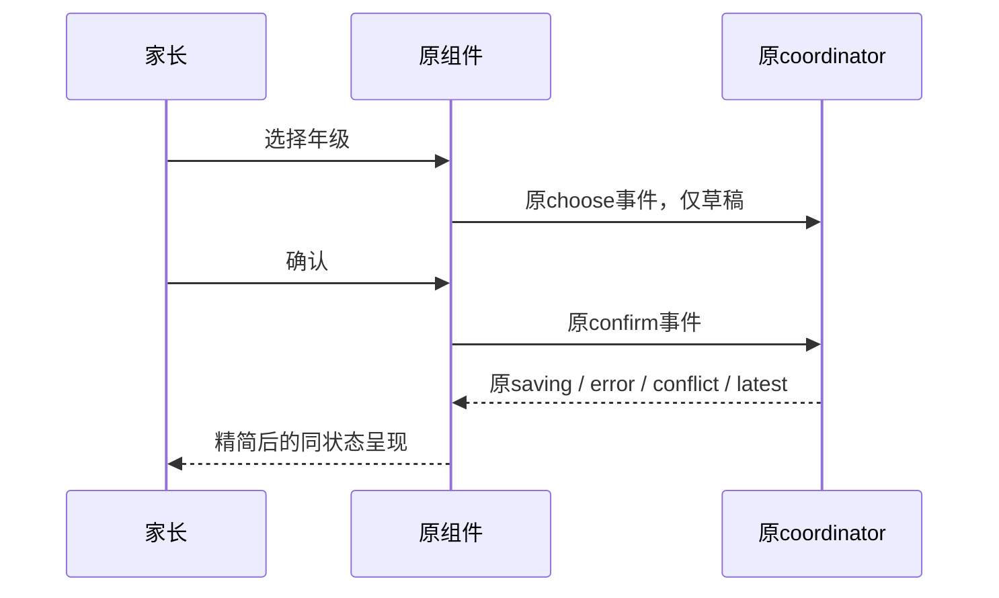
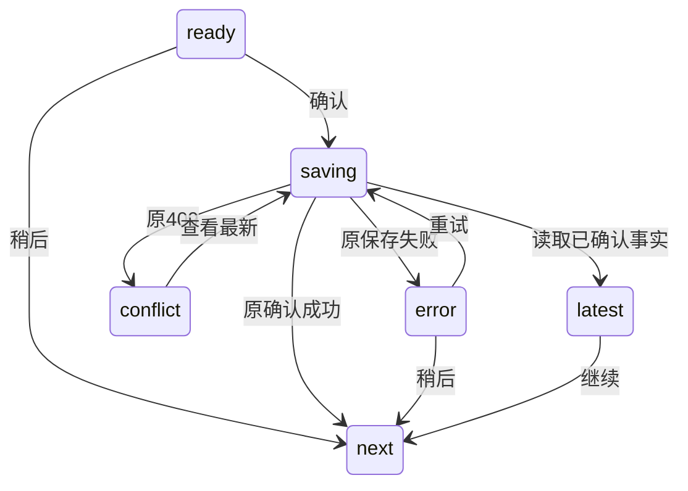

# FEAT-013 — 年级确认弹窗精简（Spec Lite）

- Status: VERIFYING
- Risk: R1；现有共享组件的局部呈现与提示文案，不改API、数据、权限、队列或并发流程。
- Owner: 产品负责人（用户）
- Implementer: Codex
- Reviewer: Codex，同上下文局部diff只读复核已执行；不冒充独立上下文评审。
- Date: 2026-10-24
- Spec revision: `SPEC-20261024-GRADE-DIALOG-SIMPLIFICATION-01`
- User confirmation: 用户，2026-10-24，本聊天在展示简化稿并明确请求“Spec01＋DREV02落地”后回复“继续”；两次桌面协调通知未改变本设计，批准映射唯一。
- Affected Feature IDs: FEAT-013。
- Feature current-state: [FEAT-013](../../docs/domain/features/FEAT-013-annual-grade-promotion.md)，baseline `FEAT-STATE-20261024-ANNUAL-GRADE-LOCAL-06`。
- Feature/UI merge owner: Codex，按验证后的实际diff更新。
- Existing approved business scope: [主Spec02 / Architecture02](FEAT-013-ANNUAL-GRADE-PROMOTION.md)，维持VERIFYING；本局部修订不重开Q1–Q18。

## Frontend Design Impact and Repository-native Approval

- Frontend impact: yes；共享年级弹窗的信息层级、按钮排列与错误提示。
- Frontend engineering impact: yes；原组件WXML/WXSS和coordinator错误文案。
- Affected UI IDs: [UI-001](../../docs/design/frontend/ui/UI-001-parent-miniapp.md)、[UI-015](../../docs/design/frontend/ui/UI-015-child-profile.md)。
- Approved baseline / engineering: `FDB-20260913-04` / `FEC-20261007-NATIVE-GEOMETRY-02`。
- Quality dimensions: component/state/form/responsive/a11y/i18n/browser/performance/security/privacy/observability；无新图表、媒体或动画。
- Requirements: 暖纸/松绿和既有圆角；正文≥14px、触控≥44px、主操作48px；短屏/长名自然换行，正文必要时滚动，操作固定；禁止隐藏溢出抵扣验收。
- Resource budget: 维持1.5MiB首包和FEC-PERF-READ-001..004；0新增请求/依赖/日志/儿童信息持久化。
- Previous Design Revision: `DREV-20261024-ANNUAL-GRADE-PROMOTION-01`（已批准、冻结）。
- Current approved Design Revision: `DREV-20261024-ANNUAL-GRADE-PROMOTION-02`；仅替代年级弹窗，档案表单/年级选项仍沿用DREV01。
- Editable source: [index.html](../../docs/design/frontend/prototypes/DREV-20261024-ANNUAL-GRADE-PROMOTION-02/index.html)。
- Design source SHA-256: `79c99d4b9cb9ffbc1b04fb226244e0bdaeb7c6baf3d2fa3645ceace58386a98a`。
- Frontend contract: [DREV02](../../docs/design/frontend/prototypes/DREV-20261024-ANNUAL-GRADE-PROMOTION-02/FRONTEND-SPEC.md)。
- Snapshot manifest: [33张导出与SHA](../../docs/design/frontend/snapshots/UI-015/DREV-20261024-ANNUAL-GRADE-PROMOTION-02/APPROVAL.md)。
- Required exports: 320×568、390×844、430×932，11态×3，DPR1，字体100%。
- Prototype status: APPROVED；Approved Task Spec: `SPEC-20261024-GRADE-DIALOG-SIMPLIFICATION-01`；Approved Design: `DREV-20261024-ANNUAL-GRADE-PROMOTION-02`；approval evidence: 本聊天2026-10-24用户“继续”。
- Permitted deviations: 平台原生picker外观、安全区与系统字体差异；不许增加正常态解释段落或改变确认语义。
- UI current-state merge: 本地组件已实现，Feature/UI合并本轮实际验证事实；原生/设备缺项独立记录。
- Approved engineering deviations: none。External design dependency: none。

## 1. Problem and outcome

用户截图中，选择年级前堆叠学年标题、姓名、旧年级、开学解释和字段标签，选择之后又显示共享说明及大面积错误卡，两个按钮各占一行。实际任务只是核对一个孩子的年级。

结果应为一个短表单：“小满的年级”＋年级选择框＋并排“稍后 / 确认”。正常态没有辅助段落；需要恢复时才出现一行短提示。

## 2. Scope

- 标题直接结合孩子名与“的年级”，删除另起一行的姓名、学年、旧年级、开学说明、重复字段标签和共享说明。
- 保留原生年级picker；无可见字段标签时保留可访问名称。默认选项仍来自原view，不改变建议/保持原级。
- 两个操作并排，左“稍后”、右松绿“确认”；48px高，flex可分配宽度1:2，另含各自左右12px内边距（与批准HTML一致，390内容列下约121/217px）。保存中两个按钮/picker禁用，主操作“保存中…”。
- 保存失败只显示“保存失败，请重试。”，去掉错误卡底色/内边距；保留实际选择，允许重试或稍后。
- 冲突只显示“年级已变化，请查看最新结果。”，主操作“查看最新”；picker禁用。读取失败沿用“读取失败，请重试。”；必须读取最新，不能提交旧事实。
- 已确认最新态显示最新正式年级、“家人已确认，已更新。”和唯一“继续”；没有可覆盖的picker。

Non-goals：修改每年9月1日/首次核对/权限/CAS/稍后队列/归档恢复规则、自动提交、合并孩子、档案归档区、档案编辑表单、后端/数据库或发布。

Must not change：任意选级只更新草稿，显式确认才写入；每孩子独立弹窗及全家共享；旧窗口不能覆盖最新事实；遮罩/返回等同稍后，保存中不退出；微任务宿主通知和已有弹层互斥。

Feature impact：验收后更新FEAT-013/UI-001/UI-015的弹窗呈现与引用；Behavior Catalog的确认语义、Architecture的owner/依赖无变化，核对后记录无冲突。主Spec02中原视觉合同须明确由本修订局部替代，不能把新方案当成原批准内容。

## 3. Impact map

- Entry: App前台会话→五Tab安全宿主→原grade-confirmation共享组件。
- Authoritative path: `apps/miniprogram/components/grade-confirmation/index.wxml`、`index.wxss`。
- Copy-only dependency: `apps/miniprogram/utils/grade-confirmation.js`两句错误文案；状态、请求和迟到失效逻辑保持原路径。
- Existing tests: `tests/frontend/grade-confirmation.test.js`和组件/宿主相关测试；不为CSS或短文案写镜像测试。

## 4. Required design views

### Link/call graph

```text
App前台 → 原coordinator候选/队列 → 五Tab原宿主 → 原共享年级组件
                                             ├─ choose：原本地草稿
                                             ├─ confirm：原服务端CAS确认
                                             └─ later：原本会话跳过
```

### Sequence diagram



### State machine



沿用原状态；读取后仍待确认时由原coordinator回到ready，读取失败回到conflict。不引入新状态或自动保存。

### Architecture diagram

N/A：原组件只呈现/发事件，coordinator拥有会话/请求，children服务拥有确认；无模块边界、依赖方向、事务或开放点变化。

### Trade-offs

| Option | Benefit | Cost/risk | Decision |
|---|---|---|---|
| 孩子名标题＋一个picker＋并排操作 | 正常态没有说明负担；兼容原生选择习惯 | 家长通过交互理解功能，恢复提示按需显示 | selected |
| 直接滚轮占满弹窗 | 少点一次picker | 默认占更多空间，改变原生打开/取消交互 | rejected |
| 选中立即提交 | 少一次确认 | 误选即写入，违背已批准显式确认规则 | rejected |

## 5. Expected file changes and deletion plan

| File/path | Action | Purpose |
|---|---|---|
| grade-confirmation/index.wxml、index.wxss | modify after approval | 删除冗余文本及对应样式，统一标题/字段，操作并排，错误改行内 |
| utils/grade-confirmation.js | copy-only after approval | 精简两句提示，保留错误分支/状态/草稿/版本 |
| tests/frontend/grade-confirmation.test.js、tools/grade_confirmation_geometry.js、tools/prepare_grade_confirmation_native.py | scoped update | 更新旧长文案断言；新布局原生审计与只读副本的实际控制器交互夹具；所有写入拒绝，新证据另目录，不覆盖旧取证 |
| 本Spec、DREV02源/合同/导出 | add | 具体可审阅方案与SHA证据 |
| FEAT-013、UI-001/015、FrontendDesign、Spec索引、实施证据 | scoped update | 区分候选、实现、原生与发布；修复最终引用 |

最终权威路径仍是原组件；删除旧kicker/name/current/intro/label/shared样式，无新组件、框架或备用路径。DREV01源和57张导出不可改；批准后只按治理追加本范围Superseded by指针。

## 6. Acceptance criteria

- AC-001：正常态只显示孩子名标题、所选年级和两个操作；无旧年级、学年或说明段落。
- AC-002：选级不写，确认写、稍后不写；保留原级/纠正/下一孩子路径保持。
- AC-003：保存中全组禁用；失败保留选择；冲突只能刷新最新，最新态不可覆盖。
- AC-004：三视口、长名、错误均不重叠；≥14px/44px；原生矩形与截图分别留证，不靠HTML/隐藏溢出替代。
- AC-005：既有微任务通知、共享确认和宿主互斥回归通过；文档/旧批准/当前证据不混淆。

## 7. Required test points

| Point | AC | Command/case | Required result |
|---|---|---|---|
| TP-001 | 001/004 | DREV02/render.py、manifest validator | 33导出/SHA，三视口几何/字体、选择/禁用/失败/稍后/冲突最新HTML检查通过 |
| TP-002 | 002/003/005 | `node --test tests/frontend/grade-confirmation.test.js`；既有组件/宿主用例 | 同一队列/提交/共享/冲突/微任务约束保持；无新镜像测试 |
| TP-003 | 001/005 | `npm test`、`npm run lint:miniapp`、`uv run python tools/validate_miniprogram.py`、architecture/design验证、`git diff --check` | 对应本diff的适用检查通过；后端未改不重复全后端 |
| TP-004 | 001/003/004 | 原生320×568/390×844/430×932：正常/长名/保存/错误/冲突/最新；实际选择/稍后/重试；字体放大/读屏、iOS/Android | 三视口节点矩形/截图与操作记录；未执行项明确NOT_RUN，不能DONE |
| TP-005 | 005 | 最终只读复核与Feature/Behavior/Architecture/UI/Spec/证据/发布逐项核对 | 无代码文档冲突，无未使用样式；未发布如实记录 |

## 8. Plan

1. 生成可编辑简化稿、33导出与具体Spec，获得Spec01+DREV02批准。
2. 在原呈现路径替换，定向/全前端及静态验证。
3. 原生/设备验收、只读复核和文档闭合；完成门禁才DONE并迁completed。

## 9. Verification

| Check | Result | Evidence |
|---|---|---|
| TP-001 | PASS / HTML_ONLY | [设计证据](../../docs/quality/evidence/GRADE-DIALOG-SIMPLIFICATION-DESIGN-20261024.md)，33导出与render-report |
| TP-002 | PASS | 年级/档案/启动53项；保留实际选择/重试相同payload/冲突最新/微任务语义，初次一条旧长文案断言已更新 |
| TP-003 | PASS | 初轮全前端317项，最终共享工作区327项；ESLint、miniapp、architecture、批准清单、脚本Ruff/format及语法检查通过；详见本轮实施证据 |
| TP-004 | PASS_LOCAL / PARTIAL_DEVICE | 最终320/390/430共51组原生矩形/截图和按钮文字对比度通过；三尺寸实际picker选四年级、两次失败重试保留选择、稍后关闭/恢复导航通过。真实设备/系统大字体/读屏/焦点及全业务原生端到端NOT_RUN，阶段与SHA见本轮实施证据 |
| TP-005 | PASS / LOCAL_DIFF | [局部只读复核](../../docs/quality/evidence/grade-dialog-simplification-20261024/review.md)未发现Blocker/Major；同上下文复核，非独立上下文验收。Feature/Behavior/Architecture/UI/Spec/测试/发布事实已核对，原生/设备门禁单列 |

## 10. Completion

2026-10-24具体Spec01+DREV02获用户“继续”批准；原组件/两句提示已精简，53项定向、最终327项全前端、三尺寸51组原生及实际选级/重试/稍后通过。修正平台默认禁用态覆盖，最终样式与批准稿一致。真实设备/系统大字体/读屏/焦点及全业务原生端到端未验收，Spec保留active/VERIFYING，不能DONE。主年级Spec02仍active/VERIFYING；此前归档区BUG-033候选仍待批准，不在本修订中实施。API/数据库/架构/发布事实未改。

- [x] 具体设计、取舍、视图、精确矩阵与验证计划。
- [x] Spec01+DREV02明确批准。
- [x] 生产实现、适用自动化及三尺寸原生呈现/局部交互。
- [x] 最终文档核对与同上下文局部只读复核。
- [ ] 真实设备、系统大字体/读屏/焦点及全业务原生端到端；不以局部复核冒充独立上下文验收。
