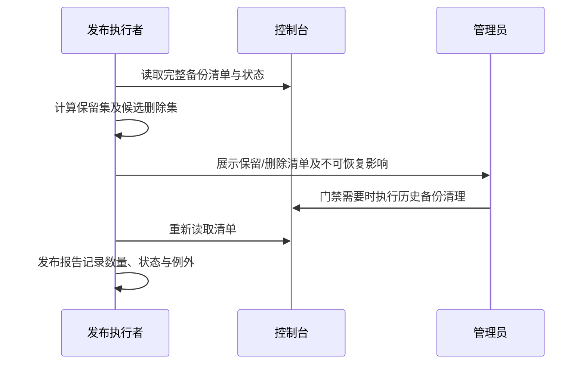

# OPS-20261010 — 云资源成本审计与发布后备份保留（Spec Lite）

- Status: DRAFT
- Risk: R1（本修订仅发布文档；云端永久删除另行核验与执行）
- Owner: 用户
- Implementer: Codex
- Reviewer: 用户
- Date: 2026-10-10
- Spec revision: SPEC-20261010-CLOUD-COST-01
- User confirmation: 待批准本修订。用户本轮已要求保留3份数据库备份、每次发布后检查并清理；具体保护集和流程尚待批准。
- Baseline commit: babb56c
- Affected Feature IDs: FEAT-001、FEAT-006（审计关联；本修订不改变产品行为）
- Feature current-state documents: docs/domain/features/FEAT-001-push-kids-mvp.md、docs/domain/features/FEAT-006-data-cleanup-and-family-reset.md
- Feature baseline revision: FEAT-STATE-20261006-REVIEW-MANAGEMENT-03-LOCAL / FEAT-STATE-20260919-MYSQL57-WORKER-04-LOCAL
- Feature merge owner: Codex；核验后只合并实际完成的运维事实。

## Frontend Design Impact and Repository-native Approval

- Frontend impact: no；发布文档修改，无UI变化。
- Frontend engineering impact: no；无客户端实现变化。
- UI、FDB、FEC、Design Revision、设计源与快照、视觉验收: N/A；无前端变更。
- External design dependency: none

## 1. Problem and outcome

用户报告数据库已有十几个备份，要求保留3份并纳入每次发布后检查。当前发布手册要求保留发布前备份至观察窗口结束，但没有数量检查和清理证据。目标是使每次前端、后端、数据库及组合发布都有明确检查结果；安全条件满足时只保留3份可用备份。

## 2. Scope

- 更新发布手册及前后端清单；不修改API、数据库Schema、业务代码、对象存储权限或实例规格。
- 保留集：最新成功备份、仍需要的发布前回滚备份，再按完成时间降序补足3份成功备份；同一份可以同时满足两项。
- 所有备份列表必须完整翻页，记录类型、完成时间、状态、恢复路径及是否允许删除；不可删除的自动备份需核验平台保留策略，不把其删除描述为可执行。
- 观察窗口尚未结束且保护集超过3份、成功备份不足3份、备份正在生成、无法判断可恢复性或平台权限不明时，不删除；记录例外与后续检查条件。
- 发布后健康与业务验收通过、观察窗口结束，再按完成时间从旧到新清理保护集外备份；删除后重新完整列举并记录前后数量及保留/删除ID。
- 永久删除通过浏览器时遵守操作时确认要求；受保护控制台或管理员门禁按发布手册交接人工执行。不得绕过站点保护。
- 不创建独立定时任务；检查由每次发布流程触发。

## 3. Impact map

每次发布 → docs/deploy/README.md → FRONTEND-RELEASE.md / BACKEND-RELEASE.md → 平台备份列表、恢复信息 → 清理证据及发布报告。
本次无生产代码依赖变化；现有架构与服务边界保持不变。

## 4. Required design views

### Link/call graph

### Sequence diagram

### State machine

待检查 → 清单已核验 → 可清理/保护阻塞/权限阻塞 → 清理后复核 → 完成。
任何清理失败停在待复核，不报告3份保留达成。

### Architecture diagram

N/A：仅操作流程文档，无拓扑、领域或依赖边界变化。

### Trade-offs

| 方案 | 收益 | 成本/风险 | 选择 |
|---|---|---|---|
| 发布后保留3份，保护观察窗口回滚点 | 有界保留且保留必要恢复能力 | 保护集超过3份时需记录例外 | 推荐 |
| 无条件只保留最新3份 | 操作简单 | 可能删掉仍需的回滚点 | 不采用 |
| 立即增加自动清理服务 | 减少人工 | 平台接口未核验，扩大权限与代码范围 | 延后，需完整Spec |

## 5. Expected file changes and deletion plan

| 文件 | 动作 | 内容 |
|---|---|---|
| docs/deploy/README.md | 修改 | 发布后数量检查、保护集、门禁和证据要求 |
| docs/deploy/BACKEND-RELEASE.md | 修改 | 清理检查及发布报告字段 |
| docs/deploy/FRONTEND-RELEASE.md | 修改 | 前端发布同样执行备份检查 |
| docs/domain/features/FEAT-001-push-kids-mvp.md | 修改 | 已验证运维流程引用，不宣称云端清理完成 |
| docs/domain/features/FEAT-006-data-cleanup-and-family-reset.md | 修改 | 审计引用，不把本地删除实现宣称云验收通过 |
| 本Spec | 移动 | 完成文档验证后DONE并移入completed；云端操作留明确未执行状态 |

## 6. Acceptance criteria

- AC-001：任何发布类型完成后均检查备份数量，满足条件时成功可用备份保留3份。
- AC-002：观察窗口保护、正在生成、不可删除的自动备份、成功备份不足和权限不明均不会导致盲删。
- AC-003：报告包含实际数量、保留/删除ID、状态、时间及阻塞；不能以用户估计代替云端核验。

## 7. Required test points

| 点 | 方法 | 要求 |
|---|---|---|
| TP-001 | 文档审查：前端/后端/组合/数据库发布 | 均链接统一保留规则 |
| TP-002 | 文档场景推演：15成功备份/2成功备份/4保护点/自动备份不可删除/删除失败 | 正确保留或停止，有证据字段 |
| TP-003 | uv run python tools/check_architecture.py | 无新增架构违规 |
| TP-004 | git diff --check及工作区核对 | 无格式错误，不覆盖既有用户设计文件 |

## 8. Plan

批准后更新手册、验证场景与架构、合并当前事实并完成文档Spec。云端清理按实时清单和平台门禁另行执行。

## 9. Verification / audit evidence

- 本次只读审计完成；实现与TP-001~004尚未执行，等待Spec批准。
- 云端清单/删除：NOT_RUN。cua读取cloud.weixin.qq.com控制台被站点安全策略阻止；不得尝试替代浏览器或间接绕过。
- 用户截图：日CPU13.17核·小时，内存26.97GiB·小时；对象存储31MB、月读914次、写14次、CDN回源0。截图时间范围与当天是否完整未知。
- 对象存储直接上传：apps/miniprogram/utils/cloud-media.js；选择图片请求compressed，但无显式统一像素/质量上限。
- 上传票据采用幂等key和唯一对象路径；认领后仍保留staging路径，MediaObject与SubmissionMedia为元数据引用，认领代码没有复制第二份云端图片。
- apps/api/src/push_kids/agent_processing/worker.py每60秒触发清理，最多20条；过期ticket与已取消submission的claimed对象删除成功后标deleted，异常保留待重试。
- 家庭/孩子删除通过media/cleanup.py汇总对象，再由删除worker清理；FEAT-006真实云端删除验收仍待完成。
- media/store.py materialize使用临时目录并清除本地图片；预览为60秒GET签名和no-store。
- 不能按staging前缀配置统一过期删除：正式引用图片也在此路径。不能以SHA相同认定冗余：不同记录引用可能有独立生命周期。
- 云端对象清单、版本控制、残留对象、生命周期和真实删除效果未核验；代码审计不能排除云端冗余。
- 公开价格参考 https://cloud.tencent.com/document/product/876/113602 ：容量0.0043元/(GB·天)、下载/上传各0.01元/万次。若31MB按0.031GB持续30天且无免费额度，容量约0.004元/月；请求约0.000928元/月，未计其他费用，以实际账单为准。

## 10. Completion

- 当前DRAFT；未修改发布规则、生产资源或备份。
- 待批准修订：SPEC-20261010-CLOUD-COST-01。
- 运行测试：NOT_RUN；本轮只有只读审计与Spec草案。
