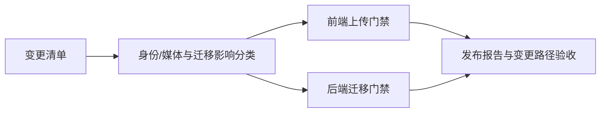
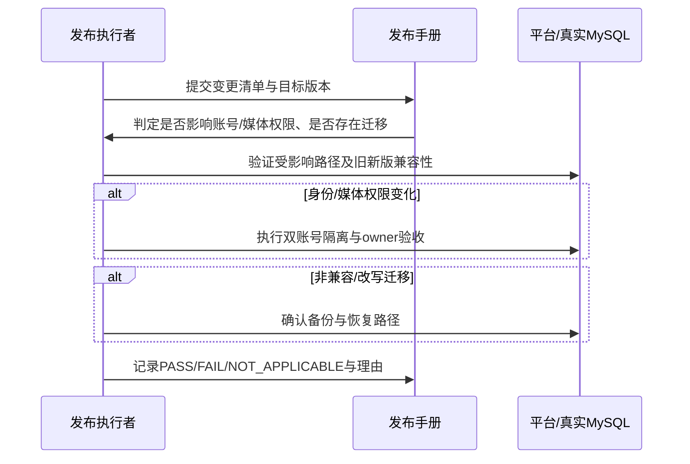

# OPS-20261011 — 按变更影响判定双账号与数据库备份门禁

- Status: READY_FOR_REVIEW
- Risk: R3（生产身份隔离与数据库恢复能力的发布规则）
- Owner / Reviewer: 产品负责人（用户）
- Implementer: Codex
- Date: 2026-10-11
- Spec revision: SPEC-20261011-RISK-BASED-RELEASE-GATES-01
- Architecture revision: N/A；仅改变发布验收决策，不改变服务拓扑、模块边界或数据库设计。
- User confirmation: PENDING；用户本轮要求按账号逻辑和数据库向上兼容性收敛门禁，具体修订待确认。
- Affected Feature IDs: FEAT-001（前端交付）、FEAT-002（账号/家庭权限）、FEAT-006（数据清理与恢复边界）
- Feature current-state documents: `docs/domain/features/FEAT-001-push-kids-mvp.md`、`FEAT-002-family-collaboration.md`、`FEAT-006-data-cleanup-and-family-reset.md`
- Feature baseline: 以各文档当前 revision 为准；本修订不改变产品行为。
- Feature merge owner: Codex；批准和文档验证后只合并实际发布规则事实。

## Frontend Design Impact and Repository-native Approval

- Frontend impact: no；无可见界面、交互或客户端代码变化。
- Frontend engineering impact: yes；前端发布验收条件变化，适用已批准的 `FEC-20261007-NATIVE-GEOMETRY-02`。
- Affected UI: `UI-001` 仅发布状态证据；组件、状态、表单、视觉、可访问性、三视口、包体预算均不改变。
- Affected quality dimensions: security/privacy、device、observability；保留变更路径检查和发布报告证据。
- Design Revision / editable source / exports / manifest: N/A；没有可见设计变化。
- FDB/FEC deviation: none；原有真机与原生几何要求继续按其适用范围执行。
- Engineering verification: 文档情景推演、交叉引用检查、架构检查；无新客户端自动化测试。

## 1. 问题、目标与范围

现行 `docs/deploy/FRONTEND-RELEASE.md` §2 要求每次上传前重做两个真实账号的家庭隔离、图片 owner 和主流程 smoke；`BACKEND-RELEASE.md` §4.2 要求每次生产 migration 前新增备份。对不涉及账号/权限的纯展示改动，以及证明旧新程序均可使用的纯增量 Schema 变更，这些固定门禁增加等待而不对应本次变化。用户要求改为条件触发。

本修订只更新发布手册、现有候选发布记录和受影响 Feature 的发布状态描述；不修改应用、Schema、云配置，不执行上传、迁移、流量切换或备份删除。已发生的历史发布记录保持原貌；`CLOUD-002` 和 `OPS-20261010` 的未批准草案中相反的备份假设不在本修订内实现，后续若继续实施须先与本修订对齐。

## 2. 推荐规则

### 双账号验收

- 对每次发布做影响判定，并在报告中记录相关文件、接口、迁移和理由。
- 只有改动可信微信身份解析、账号绑定/登录、家庭成员/角色/邀请、租户隔离、授权边界、图片 owner/私有访问、相关存储规则或平台身份配置时，才把两个真实微信账号的隔离和 owner smoke 作为本次上传/切流前的阻断门禁。无法证明未涉及这些边界时按“涉及”处理。
- 其他改动复用已有双账号安全基线，不要求重做整套双账号验收；仍测试本次变更的主路径、云端目标版本兼容性及应适用的真机/视口检查。发布报告写 `NOT_APPLICABLE` 与不触发理由，不写 `PASS`。
- 首次公开生产发布仍须确认身份和私有媒体的既有基线有效；本规则不豁免平台资质、隐私、提审或正式发布门禁。

### 数据库备份

- 无 Schema/数据迁移时：不要求为本次发布新建数据库备份。
- 有迁移且仅作向上兼容的增量 DDL（如新增表、可空或有安全默认值的列、索引），不改写/删除既有行，且通过旧版与新版服务在目标 Schema 上的读写合同、真实 MySQL 5.7 迁移和回滚代码验证时：**不要求为本次迁移新建备份，也不触发 §4.2 的人工备份门禁**。发布报告记录兼容性证据、DDL 清单及剩余恢复风险。
- 有数据回填/改写/删除、字段收缩或删除、不可逆外部副作用、旧版不能继续服务，或兼容性证据不足时：仍要求生产备份和可用恢复路径；失败则停止迁移。事故回退优先回退代码，绝不自动执行破坏性 downgrade。
- 兼容性免备份只免“本次新增备份”；不代表数据库故障恢复能力、平台已有备份保留、隐私删除或备份清理政策已通过。

## 3. 影响路径和设计视图

### Link/call graph

### Sequence diagram

### State machine

`未分类 → 已列变更 → 证据通过 → 可上传/迁移`；任一证据不足进入 `阻断待核验`。分类结论发生变化时返回 `未分类`，不得沿用旧豁免。

### Architecture diagram

N/A：生产调用链、数据 owner 和部署拓扑不变；仅发布决策与证据路径变化。

### Trade-offs

| 方案 | 收益 | 成本/风险 | 决定 |
|---|---|---|---|
| 每次固定双账号+新增备份 | 判断简单 | 纯展示及安全增量改动反复等待 | 不采用 |
| 无条件跳过双账号和备份 | 发布快 | 权限回归和数据不可恢复风险高 | 不采用 |
| 变更影响分类，明确证据与保守回退 | 缩短低风险发布，同时保留高风险门禁 | 分类及兼容性验证需要审计 | 推荐 |

## 4. 预计文件与状态更新

| 文件 | 动作 | 内容 |
|---|---|---|
| `docs/deploy/README.md` | 修改 | 固定顺序改为条件化备份；说明报告分类证据 |
| `docs/deploy/FRONTEND-RELEASE.md` | 修改 | 双账号仅在身份/权限/媒体归属变化时强制；保留变更主路径验证 |
| `docs/deploy/BACKEND-RELEASE.md` | 修改 | 兼容增量迁移免新增备份；报告备份字段允许 `NOT_APPLICABLE` |
| `docs/deploy/releases/20261011-report-disclosures-frontend.md` | 修改 | 按新规则复核本次候选，保留仍未满足的后端流量兼容门禁 |
| FEAT-001/002/006 current state | 修改 | 只记录已批准的发布门禁事实，不重写历史验收结果 |
| 本 Spec | 完成后移动 | 验证通过后 `DONE` 并移入 `specs/completed/` |

## 5. 验收条件与测试点

| 条件 | 验证点 | 预期 |
|---|---|---|
| AC-001 非身份改动免双账号重复验收 | TP-001：纯报表展示、角色权限、图片 owner 三情景 | 仅纯报表情景为 `NOT_APPLICABLE`；其他仍阻断 |
| AC-002 兼容增量免新增备份 | TP-002：无迁移、纯新增表/列/索引、数据回填、删列、证据不足五情景 | 前两类无备份门禁；后面三类仍要求备份 |
| AC-003 不丢失其他发布检查 | TP-003：对照 README、前后端手册、当前候选记录和 Feature 状态 | 云端版本兼容、主路径 smoke、MySQL 5.7、真机/平台门禁仍明确 |
| AC-004 文档与架构整洁 | TP-004：`git diff --check`、`python3 tools/check_architecture.py`、交叉引用审查 | 均通过，无历史事实篡改 |

批准后执行 TP-001～004 并记录实际 PASS/FAIL/NOT_RUN。文档门禁无需新增镜像或数据库测试；具体迁移发布仍须单独运行其真实 MySQL 5.7 与兼容性测试。

## 6. 完成状态

- 当前仅完成 Spec 草案；发布手册、发布候选和生产资源均未变更。
- 草案结构检查：`python3 tools/check_architecture.py` → `ARCHITECTURE_VALID checked=3`；正式规则情景测试 TP-001～004 尚未运行（待批准后实施）。
- 需用户明确批准 `SPEC-20261011-RISK-BASED-RELEASE-GATES-01` 后才修改正式发布手册。
