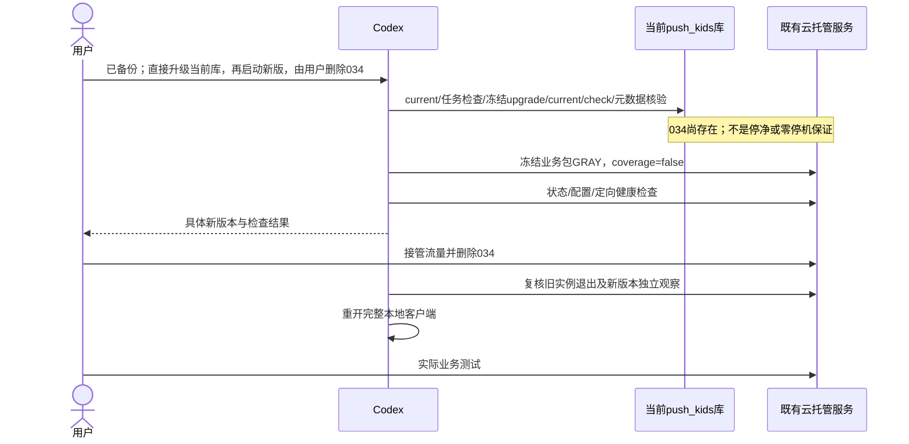
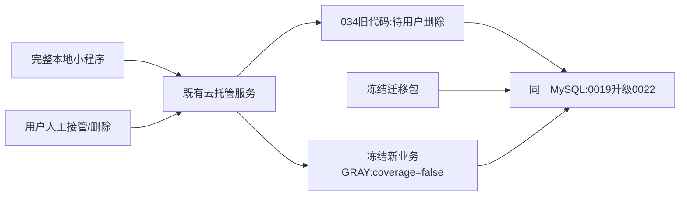

# OPS-20261023 — 当前完整代码的服务端部署与客户端本地测试

- Status: VERIFYING
- Risk: R3（现有生产库迁移和后台消费者）
- Spec revision: OPS-SPEC-20261023-FULLSTACK-TEST-DEPLOYMENT-04
- Owner / Approver: 产品负责人（用户）；Implementer: Codex
- Authorization: 原Spec02已获用户批准；本revision记录用户随后明确指定的执行顺序，不新增生产代码或Schema设计。用户在已说明同库旧进程并发风险后，要求“老的数据库已经备份……直接修改……然后拉起新版本服务，我来删除老版本”，并在`call_98faa5ae52df44ce902b9b30645c9670`明确选择“直接升级当前push_kids库”。这项具体操作指令取代原先“旧实例必须先为0”的执行前提；不冒称Spec03获批，不再重复请求相同操作授权。
- Previous proposal: [Spec03临时维护桥接](../rejected/OPS-20261024-SPEC03-MAINTENANCE-PROPOSAL.md)撤回，REJECTED，未实现或部署。
- Affected Features: [FEAT-001](../../docs/domain/features/FEAT-001-push-kids-mvp.md)、[FEAT-003](../../docs/domain/features/FEAT-003-notification-channel.md)、[FEAT-011](../../docs/domain/features/FEAT-011-notification-auto-renewal.md)、[FEAT-012](../../docs/domain/features/FEAT-012-child-photo-footprints.md)。业务批准和验收合同保持不变。
- Evidence: [发布记录](../../docs/deploy/releases/20261023-fullstack-test-deployment.md)。

## 1. 目标、基线与边界

用户要求部署当前全部后端代码（含通知续订、旅行日记、AI永久替代及已批准入口/文案），并启动完整本地微信客户端供其测试。无Git提交/推送、客户端上传、体验版、提审或正式发布。

Git基线`82ca52775bc948f2a963a8f4ed614322d8859de8`及完整已批准未提交增量；目标`wx5d2e0014690bf285 / prod-d2g14rwoycac6b45d / flask-ik19`，端口8000。10:53 CST只读核验：完整8版本中034旧代码normal/100%/1实例，其余0；031已删除；基础配置及034均coverage=false；库为MySQL5.7.18-cynos / `20261012_0019`。分析/删除running与queued、通知sending、账号可见其他事务均0。这是瞬时观察，不是写入隔离或全部消费者已停的证明。

已冻结运行包`dist/release-20261023-full-bug031-01`，134文件/1406788字节，manifest SHA256 `001c2e0be2b6f0518b74248e2e2fc2dd54c8ddf100df3fc908732d3e7d67432e`；迁移包`dist/migration-20261023-full-bug031-01`，157文件/1528565字节，manifest SHA256 `39aba303a370e8156fd61b730bb183d0367d8aba39b325bf47d12b0aa0eea31e`。10:53再次核对291项SHA、当前源和已有秘密扫描通过，镜像130源匹配。禁止使用首个性能失败候选或活动源码执行DDL。

## 2. 执行顺序、选择与代价

1. 保持现有配置和coverage=false，本地客户端暂时关闭；复核冻结摘要、目标库、0019、在途任务与可见事务。若已有在途任务则等待，不清lease或删除任务。
2. 从冻结迁移目录以已批准安全存储中的migration账号执行current、0019→0022、current/check，核对新增表、knowledge字段、queue v2触发器与派生队列一致性。只记录结构/计数/固定错误类别，不记录连接串、儿童内容或原始异常。备份成功以用户确认记录，隔离恢复未经代理独立验证。
3. 用户明确允许034在此期间仍存在。旧进程可能继续写入、请求失败，重启也可能因严格0019校验失败；不能保证零停机或无并发。0022最后安装v2触发器并重建队列；迁移后再核对派生队列，发现异常停止后续发布并记录，不自动降级/回填未知业务数据。
4. 从原冻结运行包创建唯一备注的GRAY版本（0%），继承基础配置，显式端口8000/Dockerfile/targetDir；不经CLI传秘密，不重置资源/通知/存储/入口，不用noConfirm隐式FULL。核验新版本normal、配置与镜像，真实callContainer定向live/ready与只读smoke；有必需检查失败就停止，不把normal当成业务验收。
5. 新版启动后向用户提供精确版本与控制台链接，由其处理034删除/新版本接管；代理不自行删除版本或全量切流。删除后复核全部旧版本实例、任务/事务及至少2分钟新版本独立观察，再重新启动完整本地客户端供测试。若定向访问能力不足，明确该限制，不伪造健康通过。
6. coverage保持false直到旧消费者全部退出。之后开启AI永久替代仍需独立配置灰度/验收及管理员全量；本轮不悄悄改为true。

| 方案 | 代价与结论 |
|---|---|
| 用户指定：直接升级当前库→新版启动→用户删除034 | 执行；已有备份和冻结迁移；接受旧进程尚存在的维护窗口，不能宣称已排空或兼容共存 |
| 临时维护版本先接管 | 增加临时代码、镜像、发布与切流；用户未选择，Spec03撤回，不实现 |
| 独立恢复新库 | 可隔离新旧Schema，但增加恢复/配置/数据一致性范围；用户明确未选择 |
| 新业务包先在0019启动 | 严格要求0022，不可用；不绕过Schema校验 |

## 3. 数据与失败合同

0020新增通知/完成游标五表，0021新增足迹五表，0022新增knowledge永久替代字段/索引、coverage两表及queue v2触发器。不是清库或重建历史业务库；v2安装会重算派生队列。coverage=false阻止新永久替代标记，不是旧进程写入开关。

MySQL DDL非整体事务；失败可能留下部分Schema。失败即记录current和元数据、停止自动升级/部署，不盲目重跑、downgrade、清库或恢复0019。保留0022修复向前优先；恢复备份涉及窗口内数据，须管理员另行决定，旧034不作为0022可用回滚版本。

保留既有CPU0.25/内存0.5GiB/min0/max5和通知配置，非手册历史资源示例。服务入口曾核验MINIAPP/OA、PUBLIC关闭；不把“仅MINIAPP”写成现状，不自行修改OA。地图Key缺失和真实照片/全球地图/AI地点/私有对象/双账号验收仍未完成；不得以部署结果替代产品验收。

## 4. 设计视图

### Link/call graph

```text
用户明确同库升级指令→冻结清单/任务检查→冻结Alembic0019→0022
→current/check/表字段触发器与队列核验→冻结新业务GRAY(coverage=false)
→normal/定向健康→用户删除034及接管→旧消费者退出/新版本观察
→完整本地微信客户端→用户业务测试
```

### Sequence diagram



### State machine

```text
PREFLIGHT_PASSED→MIGRATING→SCHEMA_VERIFIED→GRAY_CREATING→GRAY_READY
→WAIT_USER_HANDOFF→NEW_ONLY_OBSERVATION→LOCAL_TEST_READY
任一必需检查失败→STOPPED（保留真实Schema与版本状态，不自动降级）
```

### Architecture diagram



不新增模块、共享抽象、扩展点、云服务、数据库、临时维护程序或业务依赖；扩展性N/A，理由为执行已批准不可变迁移和发布包。

## 5. 文件及验证

预期文件：本Spec/索引、发布记录、结构性脱敏执行证据及受影响Feature/Architecture/UI当前阶段。一次性迁移runner位于`/private/tmp`，只编排冻结Alembic，不改变生产代码、迁移文件或冻结manifest。Frontend/UI设计与工程影响N/A，客户端只启动既有批准源码；设计快照不变。

| ID | 检查 | 结果 |
|---|---|---|
| R01 | 后端/前端与静态检查 | 历史PASS：671 passed/35条件skip；真实MySQL另31 passed；前端275/275、Ruff/format/mypy/DAG/design/miniprogram通过；不冒称10:53重跑 |
| R02 | 冻结MySQL5.7迁移/查询计划与规模 | 历史PASS：base→0019→0022/current/check，50k原500ms预算及无DEPENDENT；BUG-031 DONE |
| R03 | 模型质量 | 历史PASS：固定合成Ark40/40，语义各15/15，formal_write_count=0；本轮不改模型、不重发调用 |
| R04 | 冻结清单/秘密/容器 | PASS：10:53重新291项SHA与源/已有秘密扫描，镜像130源匹配；10:24非root/live/ready/SIGTERM证据见发布记录 |
| R05 | 当前库升级与结构/派生队列核验 | PASS，10:55冻结0019→0022/current/check、55表/8触发器/队列差异0；首轮仅连接检查1064、未DDL，修正runner后通过。备份成功以用户确认为据，隔离恢复未独立验证 |
| R06 | 新GRAY及配置/入口/定向健康 | 035创建normal/0%且18项配置无差异；控制面随后全量，用户确认由其操作。全量前定向健康NOT_RUN，未回填为通过；03:01实际100%时真实callContainer的18项GET（含live/ready及新足迹/续订接口）全部200，PASS |
| R07 | 用户接管/034删除/新版本独立观察 | PASS_WITH_LIMITS：用户确认“34已删除，35流量100%”；03:01:16–03:03:33 UTC四次完整清单观察跨136.753秒，034不存在、旧实例0、035 normal/100%/1实例，任务/可见其他事务0；非连续事件轨迹，应用日志TopicNotExist，不能宣称错误率0。代理未切流/删除，见handoff-observation.json |
| R08 | 完整本地客户端重开 | PASS，真实AppID/完整语音插件/正确cloud配置auto9465重新启动；真实记录标题菜单→旅行日记组件加载无错、当前timeline，无fixture注入/源码改动，不上传 |
| R09 | 用户业务/真实照片/隔离验收 | NOT_RUN；不将normal或本地启动算产品验收 |

## 6. Lifecycle / closure

当前VERIFYING，保留active。数据库/035全量/本地客户端均已有实际证据；全量前定向检查未执行（用户在等待配置时先完成接管），不改写门禁历史。用户真实写入/照片/隔离及功能验收R09仍NOT_RUN，满足相应完成条件后才评估DONE迁移；各产品Spec维持独立验收状态。Spec03已经撤回并移至rejected，其历史内容不得当作当前等待条件。
