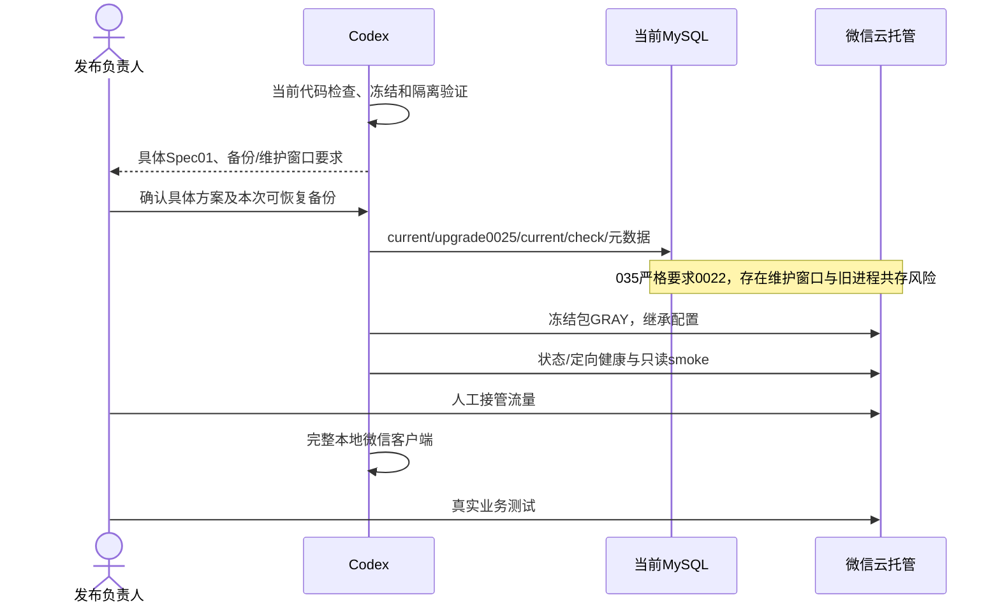
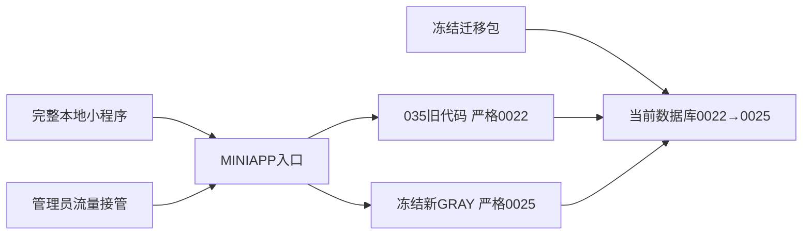

# OPS-20261024 — 最新服务端部署与完整客户端本地测试

- Status: VERIFYING
- Risk: R3（生产数据库迁移、旧版本严格Schema校验与维护窗口）
- Spec revision: OPS-SPEC-20261024-LATEST-BACKEND-TEST-DEPLOYMENT-01
- Owner / Approver: 产品负责人（用户）；Implementer / Verifier: Codex
- Date: 2026-10-24
- User request: 本聊天「检查所有代码，然后部署服务端最新代码，使用本地客户端我来进行测试」。2026-10-24用户在call_41ffceeca8634b69bb95f48b14bfd817回复「批准此Spec，已完成本次数据库备份并确认恢复路径」，批准本具体Spec01及同库迁移/维护窗口顺序。备份按管理员确认记录，不宣称代理独立恢复验证。
- Affected Features: FEAT-001、FEAT-004、FEAT-005、FEAT-006、FEAT-013；既有FEAT-002/003/011/012回归。
- Feature current-state: `docs/domain/features/`对应Feature正文；业务Spec批准沿用，不修改领域合同。
- Previous deployment: [035 / Schema0022](../../docs/deploy/releases/20261023-fullstack-test-deployment.md)。本Spec不追认上一维护窗口批准适用于新迁移。

## 1. 目标、基线与范围

部署已批准并已实现的最新后端，打开完整本地微信开发者工具客户端供用户测试。不修改业务代码、API设计、UI设计、依赖、Schema设计或云配置；不上传小程序、提审、正式发布、提交或推送Git。

检查开始时HEAD为82ca527且增量已暂存；准备过程中用户另一个操作提交全部增量，冻结基线为`26714b997465fd2d1d9199f45ed931bd85c39405`，冻结时工作区干净。发布仅使用冻结白名单目录，不从活动仓库根上传。

目标：AppID `wx5d2e0014690bf285`；环境`prod-d2g14rwoycac6b45d`；服务`flask-ik19`；端口8000。只读实查035 normal/100%/1实例，其他版本0；生产MySQL5.7.18-cynos / `20261020_0022`。入口MINIAPP/OA、PUBLIC关闭；保持实际资源与现有秘密配置，不套用手册历史示例。

冻结运行包`dist/release-20261024-latest-0025-01`：154文件/1512935字节，manifest SHA256 `abbafd997450213e26c467823de89223bb47e5f6105af5f9b352d109ea4b240c`。
冻结迁移包`dist/migration-20261024-latest-0025-01`：182文件/1647519字节，manifest SHA256 `8ff4d5fd9e508613cda6ae4397d60789db85a8168d92dd89d5e3331ce58339bc`。两包源码匹配及本地已知秘密值扫描通过。

## 2. 迁移、兼容与恢复合同

- 0023：旧计划增加安全默认列，计划项增加来源/日期/版本列，新建early槽表、索引和9个触发器，并有界初始化派生槽。
- 0024：新增8张建议/任务/计时表和索引；从已有孩子/知识初始化knowledge_input_clocks，不改写既有grade、知识或学习记录。
- 0025：children新增可空确认学年、默认0的grade_revision及tenant-leading索引，不补升旧年级。
- 0024包含新表的数据初始化；035严格要求0022，迁移后其ready与重启不再满足Schema合同。因此不符合免新增备份条件，生产DDL前必须由管理员确认本次可恢复备份和恢复路径。原0019→0022的备份/维护窗口批准不自动覆盖本次。
- 推荐：管理员确认本次维护窗口/恢复点后，同库0022→0025，再启动新GRAY并验收、由管理员接管流量。不能承诺零停机；迁移与新版就绪之间旧版ready会失败，旧实例可能仍处理请求。执行前重新核对任务/事务，不清lease、不删除业务任务。
- MySQL DDL非整体事务；失败即停止，记录实际revision/结构和固定错误类别，不盲目重跑、降级、清库或自动恢复。优先修复向前；恢复备份由管理员另行决定窗口内数据的处理。
- 035保留作历史镜像，不能把它写成0025的可用回滚目标。上线失败时停止放量；同Schema兼容镜像尚无已验收目标，备份恢复仍是人工决策。

## 3. 执行顺序及人工边界

1. 完整自动化、实际MySQL5.7迁移/合同/计划、冻结完整性、秘密扫描、本地容器非root/live/ready/SIGTERM和CLI dry-run。
2. 取得本具体Spec01的迁移方案确认；管理员确认本次数据库备份成功及可隔离恢复。若不接受旧进程共存风险，则保持035并先确定可验证的维护隔离方案，不自行删除/停服务。
3. 从冻结迁移包执行current→upgrade0025→current→check；核验表/列/索引/触发器和派生槽，不写生产合成学习或儿童数据。
4. 从冻结运行包提交唯一备注的GRAY，0%流量；显式Dockerfile/targetDir/8000，继承实际现有配置，不传秘密参数、不用noConfirm、不自动FULL。
5. 核验新版本normal、配置与镜像、PUBLIC关闭；管理员提供定向访问时通过真实callContainer检查live/ready、年级候选和主要只读业务。没有定向能力时明确NOT_RUN，不把normal算smoke通过。
6. 管理员完成流量接管；核验旧实例、任务与至少2分钟状态观察；重新打开完整本地客户端供用户业务测试。真实业务写入由用户进行。

coverage继续沿用当前false。empty_day_early_review和learning_suggestions默认false；本次部署代码不自动开启它们。学习建议真实Provider/内容适配/实际类目隐私条件尚未验收，启用需独立配置及门禁，不能把假Provider或用户确认代替内容证据。年级确认不设开关，会随新后端提供。

## 4. 设计视图与取舍

### Link/call graph

```text
全仓检查→冻结源码/迁移→隔离MySQL5.7/容器验证
→具体Spec/备份/维护窗口确认→冻结Alembic0022→0025
→新GRAY→真实定向smoke→管理员接管→完整本地客户端→用户测试
```

### Sequence diagram



### State machine

```text
PREPARING→CHECKED→WAIT_SPEC_BACKUP→MIGRATING→SCHEMA_VERIFIED
→GRAY_CREATING→GRAY_READY→WAIT_OPERATOR_HANDOFF→LOCAL_TEST_READY
必需检查失败→STOPPED；用户验收未完成→VERIFYING
```

### Architecture diagram



| 方案 | 收益 | 代价/风险 | 决定 |
|---|---|---|---|
| 备份后同库迁移→新GRAY | 使用已有批准业务路径，无新模块 | 维护窗口，035不能直接回滚 | 已获本次具体批准 |
| 保持035先完成全部产品验收 | 不影响现有服务 | 新年级后端无法线上联调 | 不作为本次目标 |
| 临时兼容桥接或独立库 | 可能隔离窗口 | 新代码/服务/配置/数据一致性范围 | 不自动引入，需另行Spec |

本OPS不重新设计模块边界、共享抽象、依赖方向或扩展点；部署中发现的启动权限合同修复另由已批准[CRUD Spec01/Architecture01](BUG-CRUD-SCHEMA-READINESS.md)实施，未改变模块依赖。
Frontend design/engineering impact均N/A：仅启动已有批准源码，设计快照、FEC、UI合同不变；既有真机/可访问性验收不由部署代替。

## 5. 预期文件与事实合并

新增本Spec、发布记录与脱敏证据并更新索引；受影响Feature、Behavior、Architecture、UI、测试/发布正文按实际diff同步，批准设计快照不变。原OPS无生产代码范围；随后两项独立具体Spec获批，分别修历史测试隔离和单文件CRUD启动检查，新增只读发布工具/权限回归，未扩展业务合同。冻结02记录基线26714b9＋批准修复SHA；临时runner位于/private/tmp，未提交/推送。

## 6. 验收与测试点

| ID | 要求 | 当前证据/结果 |
|---|---|---|
| R01 | 后端全量 | PASS：780 passed/40 MySQL条件skip，110.34s；本轮独立运行，不借用提交消息里的超时重试结果 |
| R02 | 前端/静态/政策 | PASS：332/332，ESLint、Ruff/733文件format、mypy150、DAG150、design、miniapp17页/1221025字节；Git diff --check通过 |
| R03 | SQLite规模 | PASS：11项，32.29s，覆盖今日/年级/目录/读路径 |
| R04 | 实际MySQL5.7 | PASS：5.7.44空库base→0025/current/check、全部32项MySQL用例通过；独立冻结包0022→0025守恒/结构、10k/50k实际新SQL/计划与预算通过。历史降级失败经已批准[测试隔离Spec01](../completed/BUG-MYSQL-SUPERSESSION-MIGRATION-ISOLATION.md)修复，全文件13项及年级4项复测通过；SQLite迁移4项通过。首次runner1049及修复前失败保留 |
| R05 | 冻结/秘密/容器 | PASS：两包源码匹配/秘密扫描；镜像150源码匹配、UID10001、live/ready200、SIGTERM4.854秒/exit0；CLI dry-run退出0。离线构建缓存网络模式不命中失败，默认模式复用锁定依赖层成功，失败保留 |
| R06 | 具体方案/本次备份 | APPROVED / OPERATOR_CONFIRMED：用户批准本Spec并确认本次备份成功/恢复路径可用；不冒充独立读取/恢复验证 |
| R07 | 生产迁移与新GRAY | PASS：生产0025/current/check/结构/投影/年级守恒；036旧失败经批准CRUD Spec01修复，冻结02/两类账号只读门禁通过，037 normal/0%创建后由用户切100%，配置18项/资源一致、PUBLIC关闭 |
| R08 | 真实微信smoke/接管/本地客户端 | PASS（接管后读取）：用户call_e70f1ec5975643a7be0a1580e08e766b确认100%，官方API复核；完整本地真实AppID客户端20项GET全部200，含live/ready/年级/建议，useCloud/env/service匹配；239.699秒控制面观察稳定，末次live/ready再200。035仍0%/1、036失败/0%/1保留。全量前定向smoke NOT_RUN，不倒写为通过 |
| R09 | 用户真实业务/设备/内容验收 | NOT_RUN；用户本地测试不等于全部产品门禁通过 |

本地已有依赖可用，未重复uv sync/npm install；Docker使用冻结锁定依赖。代理未发送通知、未上传照片、未写生产合成记录、未改变云运行配置或流量；037流量由用户人工调整。

## 7. Approval / lifecycle

本Spec01已批准、备份按管理员确认；两项独立修订均批准并验证，历史测试Spec DONE/completed。生产0025/037已部署接管，780后端/26相关实库、冻结02/容器和20项真实GET通过；末次健康检查再通过。Feature/Behavior/Architecture/UI/Spec/测试/发布事实与实际diff核对无冲突，无业务/UI合同变更。当前为LOCAL_USER_TEST_READY；R09用户业务/设备/内容验收仍NOT_RUN，按本Spec状态机留active/VERIFYING。恢复/完成条件：用户反馈实际本地测试结果，再按覆盖范围评估DONE及迁completed；不得将本地客户端可用等同全部产品门禁通过。
