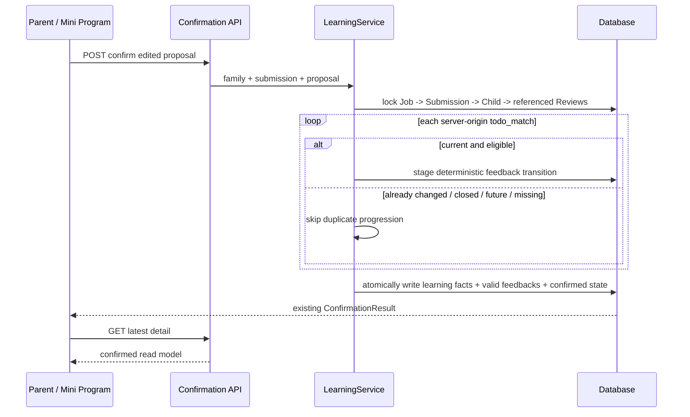
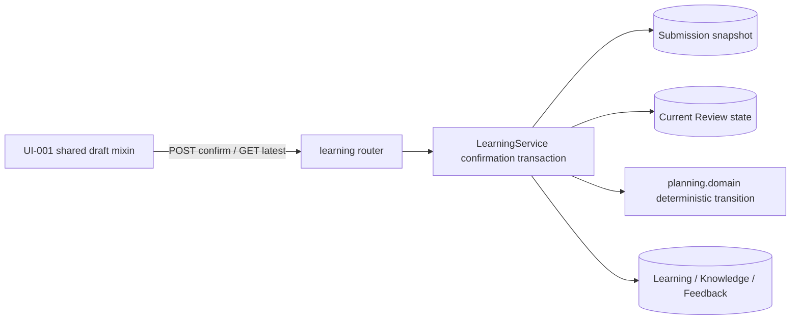

# BUG-020 — 过期复习匹配导致草稿无法确认

- Status: `DONE`
- Severity: `high — 家长无法完成学习确认，且已成功的确认可能被误报为失败`
- Risk: `R2 — 修改确认事务中的并发收敛规则，并删除一个前端冲突提示分支`
- Owner: `产品负责人（用户）`
- Implementer: `Codex（批准后）`
- Reviewer/Verifier: `Codex / automated local verification`
- First observed: `2026-09-12 / 微信小程序真实页面截图`
- Related incident/ticket: `用户截图 SHA-256 3c8e31e3826fbb9dc55eb82bfa322162adc1452f1cc88e6c99b6e16a6255fd9d`
- Spec revision: `BUG-SPEC-20260912-STALE-CONFIRM-01`
- User confirmation: `APPROVED 2026-09-12 — 在收到本 revision、推荐方案与准确批准提示后，用户回复“修复”`
- Affected Feature IDs: `FEAT-001`
- Feature current-state documents: `docs/domain/features/FEAT-001-push-kids-mvp.md`、`docs/domain/BEHAVIOR-CATALOG.md`
- Feature baseline revision: `FEAT-STATE-20260911-READ-PERF-01-LOCAL`
- Feature merge owner: `Codex after verification`

## Approval block

- Approved scope: `BUG-SPEC-20260912-STALE-CONFIRM-01 全部本地实现与验证；DREV-20260912-STALE-CONFIRM-01；不含部署、上传或发布`
- Approved by: `产品负责人（用户）`
- Approval date: `2026-09-12`
- Spec revision: `BUG-SPEC-20260912-STALE-CONFIRM-01`
- Known accepted risks: `stale Review 将在确认事务内安全跳过；FEAT-001 Figma waiver 继续在公开生产发布前到期；原生三视口/iOS/Android 仍是发布门禁`

## Frontend Design Impact and Figma Approval

- Frontend impact: `yes — 删除“刷新会离开当前编辑的草稿/查看最新”冲突提示；记录已进入终态时自动展示最新只读详情`
- Frontend impact reason: `当前提示要求用户执行一个不能解除过期复习快照的动作，并把已成功但响应丢失的确认误报为持续失败`
- Frontend engineering impact: `yes — 修改共享草稿状态、错误恢复和异步重载行为`
- Frontend engineering impact reason: `pages/submission/confirm 与 pages/record-detail 共用 draft.js/wxml，必须同时保持一致`
- Affected UI IDs: `UI-001`
- UI current-state documents: `docs/design/frontend/ui/UI-001-parent-miniapp.md`
- Frontend baseline revision: `FDB-20260906-03 (APPROVED)`
- Frontend engineering constraint revision: `FEC-20260911-READ-PERF-01 (APPROVED)`
- Affected frontend quality dimensions: `state/form/a11y/i18n/browser/security/privacy/observability`
- Frontend quality budgets/requirements: `server authoritative remote state；form recoverable-error preservation；no duplicate submit；critical errors not toast-only；320×568 / 390×844 / 430×932；no child content in logs`
- Frontend quality verification plan: `共享草稿 VM 回归、全量 npm test、ESLint、小程序静态校验；三视口检查确认中/自动最新/普通失败；代表性 iOS/Android 真机留作发布门禁`
- Approved frontend engineering deviations: `none`
- Current Design Revision(s): `DREV-20260906-PKDS-01 confirmation states`
- Figma project/file URL: `https://www.figma.com/design/FAyfmjNrA3btWztwyxI6Zj`
- Figma node URL(s): `N/A — 沿用 FEAT-001 scoped Starter-plan waiver；根节点不冒充新增 node-specific 证据`
- Proposed Design Revision: `DREV-20260912-STALE-CONFIRM-01`
- Required viewport/state exports: `VP-MIN 320×568、VP-PRIMARY 390×844、VP-WIDE 430×932；saving、confirmed-latest、recoverable network error`
- Prototype status: `APPROVED — 本 revision 是状态删除/自动转换的文本交互稿，不新增布局、token 或组件`
- Approved Task Spec revision: `BUG-SPEC-20260912-STALE-CONFIRM-01`
- Approved Design Revision: `DREV-20260912-STALE-CONFIRM-01`
- Design approval evidence: `产品负责人（用户）2026-09-12 回复“修复”，紧接本 revision 的推荐方案与批准提示`
- Snapshot manifest path: `docs/design/frontend/snapshots/UI-001/DREV-20260912-STALE-CONFIRM-01/APPROVAL.md (approval 后创建)`
- Permitted implementation deviations: `none`
- UI current-state merge owner: `Codex after verification`
- UI current-state merge evidence: `docs/design/frontend/ui/UI-001-parent-miniapp.md revision UI-STATE-20260912-STALE-CONFIRM-01-LOCAL`
- Frontend visual/a11y/resolution verification: `source/state contract covered; native 320×568/390×844/430×932, font scaling and iOS/Android NOT_RUN because this delivery was local-only and no DevTools/device session was used`
- Frontend engineering verification evidence: `focused frontend 28 passed; full frontend 155 passed; ESLint, architecture and Mini Program static validation passed`
- Figma waiver: `继承 FEAT-001 scoped waiver；Owner：用户；仅覆盖 UI-001 既有确认页/记录详情页的本次错误恢复；公开生产发布前到期；不免除原生三视口与 iOS/Android 发布验收`

## 1. Symptom and impact

- Who/what is affected: `打开含“可能已完成的复习”的 AI 草稿并点击确认的可写家庭成员；以及首次确认成功但响应丢失后重试的成员`
- Frequency: `草稿生成后关联 Review 被 Todo 反馈或另一确认推进时确定发生；响应丢失场景按网络条件偶发`
- User-visible symptom: `按钮变成“重试确认”，页面持续显示“这条记录已经被处理过了。刷新会离开当前编辑的草稿”，点击查看最新后仍可能回到同一份过期草稿，后续确认继续失败`
- Business/data/security impact: `确认流程不可达；没有证据表明正式记录重复写入或跨家庭泄漏`
- First known good version: `unknown — stale snapshot 的 409 与当前通用冲突 UI 同时引入后即存在`
- First known bad version: `commit 80b07a4 / 2bb4813 组合后的确认路径`
- Workaround: `逐项点“不标记”移除已变化复习后再确认；该操作要求用户猜测服务端状态且不符合目标交互`

## 2. Reproduction

### Preconditions

- Environment/version: `当前 main e0b3cf9d06da768c9fd275c03d5a9bb5886f2cc4`
- Actor/permissions/tenant: `同一家庭内可写成员`
- Data/fixture: `pending_confirmation submission 的 proposal.todo_matches 至少包含一个当时到期的 Review`
- Feature flags/config: `standard FEAT-001 flow`
- External dependencies: `none for deterministic integration reproduction`

### Steps

1. AI 为草稿保存 Review A 的 `step/due_date/eligible_on/name/subject` 快照。
2. 在确认草稿前，通过 Todo 反馈让 Review A 前进或结束。
3. 回到草稿点击“确认并保存学习记录”。
4. 点击当前页面出现的“查看最新”，再点击“重试确认”。

### Actual result

第一次确认在 `LearningService.confirm` 的 stale 判断返回 `409 review_state_changed`。客户端把该错误和
submission 已确认/取消等其他 409 合并为 `conflict=true`。GET submission 继续返回持久化的原始
`proposal.todo_matches`，没有投影 Review A 的当前状态，因此“查看最新”并未解除冲突，重试再次 409。

### Expected result

- 家长一次确认即可完成：仍有效的复习匹配各推进一次；已经变化的复习匹配不重复推进；学习内容正常入档。
- 若 submission 已由先前请求或其他端进入 confirmed/cancelled，客户端不显示刷新提示，直接重载并展示服务端最新只读状态。
- 真正的网络、权限、输入校验和新增科目确认仍使用各自现有错误路径。

### Reproduction evidence

- Screenshot: `用户提供的 2026-09-12 截图；SHA-256 见页首`
- Frontend code: `apps/miniprogram/pages/submission/draft.js:235-237`、`draft.wxml:199-203`
- Backend code: `apps/api/src/push_kids/learning/service.py:1013-1047`
- Persistent stale source: `LearningService.get_view/list projection returns stored proposal_json without live Review reconciliation`
- Existing test proving current UI branch: `tests/frontend/learning-history.test.js “viewer sees submitted material without write affordances; conflicts preserve edits”`
- Reproduction rate: `deterministic once a saved todo_match snapshot differs from current Review state`

## 3. Triage

### Confirmed facts

| Fact | Evidence |
|---|---|
| 除 `consent_required` 外所有 409 都设置 `conflict=true` | `draft.js:235-237` |
| 冲突提示的“查看最新”只调用页面 `load` | `draft.wxml:199-203` |
| `load` 重新获取 submission，但 proposal 仍来自保存的 `proposal_json` | `record-detail/index.js:55-85` 与 `learning/service.py` view projection |
| 任一 todo_match 过期会中止整个确认事务 | `learning/service.py:1013-1047` |
| 过期判断发生在任何正式记录/反馈写入之前 | `learning/service.py:1051+`，满足当前原子失败合同 |
| 截图中的草稿恰有 2 个“可能已完成的复习” | 用户截图 |

### Hypotheses

| Hypothesis | Supports | Contradicts | Experiment | Result |
|---|---|---|---|---|
| 截图由 `review_state_changed` 触发 | 草稿有两个 Todo 匹配；刷新后可继续看到同一旧 proposal | 未取得真实响应 code | 新增 integration + frontend 联合回归 | confirmed: pre-fix regression failed，post-fix all-stale/mixed cases pass |
| 首次确认成功但响应丢失，重试因 submission 已 confirmed 而 409 | 同一 UI 会吞并 generic conflict | 截图无法证明首次是否成功 | 前端以 GET confirmed 模拟响应丢失 | confirmed as covered failure mode: terminal 409 auto-latest regression passes |

### Blast radius

- Entry points: `POST /submissions/{id}/confirm`；`pages/submission/confirm`；`pages/record-detail`
- Callers/consumers: `所有 AI/人工草稿确认；只有 AI todo_matches 触发 stale Review 分支`
- Data already affected: `无已知损坏；失败事务回滚；响应丢失时数据可能已经正确确认`
- Security/tenant boundary: `必须保持 family/child/learning subject 校验；只允许忽略原始服务端 proposal 已列出的 stale review_id`
- Related behaviors: `BHV-004、BHV-005、BHV-011、BHV-022、BHV-025`
- Other code with the same pattern: `Todo 主动反馈继续使用自己的版本/幂等合同，不在本修复范围`

### Link/call graph

```text
draft CTA -> draft.confirmDraft -> POST /submissions/{id}/confirm
                                -> LearningService.confirm
                                -> validate stored todo_match snapshot
                                -> one stale Review => 409 review_state_changed
                                -> client conflict=true
                                -> load GET submission -> same stored stale todo_matches
                                -> retry -> same 409
```

## 4. Root cause

### Fault mechanism

服务端把“AI 提案生成时的 Review 快照必须与确认时完全一致”当成整份 submission 的硬前置条件；前端又把
该可收敛并发变化当成“记录已处理”的通用冲突。恢复动作只刷新 submission，不刷新或剔除 proposal 内
的 Review 快照，因此状态没有任何可导致下一次确认成功的变化，页面形成确定性的重试死循环。

### Why existing controls missed it

- Missing/incorrect test: `后端只验证 stale 时 409/零写入，前端只验证 409 保留编辑；没有跨层验证“恢复动作能改变下一次结果”`
- Review/spec gap: `旧合同强调不静默忽略，但没有定义已完成 Review 与同一草稿剩余学习内容如何收敛`
- Monitoring gap: `前端没有按安全 error code 记录确认失败类别；本修复也不会新增儿童内容日志`
- Architecture/process contributor: `submission proposal 是历史快照，Review 是当前事实；旧设计要求客户端用刷新协调两个不同时间语义，却没有最新投影接口`

### Root-cause evidence

- Code locations: `learning/service.py:1002-1047`、`draft.js:235-237`、`draft.wxml:199-203`
- Failing regression: `TP-001/TP-002 approval 后先在旧实现上证明失败`
- Runtime evidence: `用户截图；真实响应 code 尚不可见，因此同时覆盖 stale Review 与已确认响应丢失两条确定性路径`

## 5. Fix contract

### Required behavior

- 确认请求只能引用服务端保存的原始 `todo_matches`；客户端注入 review_id、篡改知识名或跨家庭/孩子引用仍拒绝且零写入。
- 对每个合法原始匹配，确认事务按锁后的当前 Review 状态分类：
  - 快照仍有效且今天到期/逾期：恰好推进一次并写一条 complete feedback；
  - Review 已结束、已推进、改期到未来、删除或身份事实变化：视为已变化，本次不再推进；
  - 其他仍有效匹配和新学习内容继续处理。
- 即使全部 Review 匹配都已变化，纯复习草稿也可以确认成终态，返回既有空 `records[]/updated_reviews[]` 形状，不制造第二条反馈。
- submission、LearningRecord/Occurrence/Review 创建、有效 Review 反馈和 stale 跳过仍在同一事务与锁顺序内完成。
- 客户端不再呈现 `conflict` 刷新提示。确认收到非 `consent_required` 的 409 时自动 GET 最新 submission：
  - 已 confirmed/cancelled：直接展示最新只读详情；
  - 仍可编辑或最新读取失败：显示现有可恢复错误，不假成功。
- `consent_required` 的显式家长同意流程不变；401/403/404、400、5xx 和网络错误不自动伪装为最新成功。

### Must not change

- 只有家长确认才创建正式学习记录；AI 仍不能自动写入。
- Review 日期和转移继续由 deterministic planning policy 产生。
- family/child scope、subject consent、activity 拒绝、manual-entry 边界不变。
- API 成功响应 schema 不变；不增加表、列、迁移、并行 endpoint 或新的全局抽象。
- 真正可恢复的非冲突错误继续保留本地编辑内容和页内错误。

### Feature current-state impact

- Current Feature sections affected: `Current invariants / Current contracts / Verification evidence / Change references`
- Incorrect/obsolete statement to correct: `“step/due/active/确认日变化时返回 409 review_state_changed 并保持草稿，不再静默忽略”`
- Final facts to merge after verification: `确认事务跳过已变化的服务端原始 Review 匹配、处理其余内容；终态冲突自动展示最新详情`
- Change Reference to add: `BUG-SPEC-20260912-STALE-CONFIRM-01 / DREV-20260912-STALE-CONFIRM-01`

### Non-goals

- 不修改 Todo 主动反馈 API 的 version conflict 或 idempotency contract。
- 不给 confirmation 新增数据库幂等请求表。
- 不实时重写/保存 AI proposal，也不在用户尚未点击确认时自动删除草稿项目。
- 不改变确认页布局、视觉 token、CTA 层级、科目/知识编辑交互。
- 不部署后端、不上传小程序、不发布版本。

### State/data repair

- Existing formal data repair required: `no`
- Existing stuck drafts: `部署修复后下一次确认会按最新 Review 状态收敛，无需批量改库`
- Reversibility: `代码回滚即可；无 schema/data migration`
- Audit: `不记录儿童内容或原始 proposal；沿用现有安全日志边界`

## 6. Fix design

### Selected change

1. 在 `LearningService.confirm` 中保留现有 Job -> Submission -> Child -> Review 锁顺序和原始 proposal
   allowlist。把合法 todo_match 的“状态已变化”从整单异常改为 `continue`；仍有效项照常生成 transition。
2. 先严格验证客户端 match 的 `review_id/knowledge_name` 来自原始 proposal，再允许 current row
   不存在或 snapshot/current state 不同被安全跳过，避免用“忽略过期”吞掉篡改输入。
3. 删除共享草稿的 `conflict` view state 和 WXML 提示。对 409 调用页面现有 `load()`；只有最新读取
   成功并进入只读终态才清除错误。其余错误继续保留编辑和明确错误。
4. 不新增 shared utility：逻辑分别属于 learning service 的确认用例与 draft mixin 的页面恢复责任。

### Trade-offs and alternatives rejected

| Alternative | Why rejected |
|---|---|
| 保持 409，仅让客户端删除全部 todo_matches 后自动重试 | 客户端承担业务策略；会丢掉同批仍有效的复习反馈；旧后端/弱网下还可能重复提交 |
| 新增“刷新 proposal”接口或 GET 时实时改写 todo_matches | 引入第二条 proposal 权威路径；读操作产生或暗示持久化变更；不能解决首次确认已成功但响应丢失 |
| 给 confirmation 增加 Idempotency-Key 持久表 | 可解决响应丢失，但不能解决 Review 在草稿期间合法变化；需要 migration 与更大 rollout，超出最小修复 |
| submission 已 confirmed 时无条件返回 200 | 无法证明重试 payload 与已入档内容一致，可能把另一端确认后的不同编辑误报成当前请求成功 |
| 保持当前硬失败并只改文案 | 死循环仍存在，不能满足“点击能保存” |

### Sequence diagram



For a request whose submission is already terminal, POST remains 409; the Mini Program immediately performs the
GET latest branch and renders the authoritative read-only result without a refresh notice.

### State machine

```text
pending_confirmation
  + valid learning / valid reviews       -> confirmed (write learning + advance valid reviews)
  + valid learning / some stale reviews  -> confirmed (write learning + skip stale + advance valid)
  + pure review / all stale               -> confirmed (no duplicate feedback, no learning record)
  + consent missing                       -> pending_confirmation + consent_required
  + invalid/injected reference            -> pending_confirmation + validation error

confirmed | cancelled + confirm request   -> 409 + client GET latest -> read-only latest
network/5xx                               -> editable draft + visible retry error
```

### Architecture diagram



No module boundary, dependency direction, extension point, schema or deployment topology changes.

### Expected file changes

| File/path | Action | Expected change | Why required |
|---|---|---|---|
| `apps/api/src/push_kids/learning/service.py` | modify | validate server-origin matches; skip current-state-stale matches; preserve valid transitions | repair authoritative confirmation transaction |
| `apps/miniprogram/pages/submission/draft.js` | modify | remove generic conflict state; auto-load authoritative latest for terminal 409 | remove false recovery loop |
| `apps/miniprogram/pages/submission/draft.wxml` | modify | delete refresh warning/action | approved visible behavior |
| `tests/integration/test_learning_flow.py` or focused learning test | modify | mixed-valid/stale and all-stale confirmation regressions | prove no duplicate feedback and successful confirmation |
| `tests/frontend/learning-history.test.js` | modify | replace conflict-preserves-edit assertion with terminal-conflict auto-latest and failed-latest cases | prove UI recovery |
| `tests/frontend/draft-subjects.test.js` | modify if needed | consent and normal confirmation remain unchanged | adjacent regression |
| `docs/domain/features/FEAT-001-push-kids-mvp.md` | modify after verification | merge final concurrency behavior and evidence | current-state source of truth |
| `docs/domain/BEHAVIOR-CATALOG.md` | modify after verification | update BHV-005 | behavior source of truth |
| `docs/design/frontend/ui/UI-001-parent-miniapp.md` | modify after verification | merge automatic-latest state and evidence | UI current state |
| `docs/design/frontend/snapshots/UI-001/DREV-20260912-STALE-CONFIRM-01/APPROVAL.md` | add after approval | immutable textual approval/waiver snapshot | frontend gate evidence |
| this Spec | modify/move | record approval, test evidence, DONE; move to completed | lifecycle closure |

### Compatibility and rollout

- Deployment order: `backend first, then Mini Program package；旧客户端在新后端上 stale Review 确认可成功；新客户端不应先连接旧后端作为正式发布组合`
- Feature flag: `none`
- Migration/backfill: `none`
- Rollback/restore: `回滚两个代码发布物；无数据回退`
- Success metrics: `stale fixture confirmation 200；valid Review exactly one new feedback；stale Review zero new feedback；terminal conflict renders latest`
- Abort criteria: `任一跨家庭引用被忽略而非拒绝、产生重复 ReviewFeedback、正常确认不再原子、400/403 被误当成功`

## 7. Regression verification

### Required regression tests

#### TP-001 — stale Review does not block remaining confirmation

- Acceptance: `一个原始 todo_match 已推进、另一个仍有效时，确认 200；stale 项无新 feedback，有效项恰好推进一次；新学习正常写入；submission=confirmed`
- Test level: `backend integration / SQLite transaction`
- Pre-fix failure evidence: `current implementation returns 409 at first stale item and writes nothing`
- Post-fix evidence: `PASS — test_stale_review_is_skipped_while_current_review_and_new_learning_are_confirmed`

#### TP-002 — all-stale pure-review draft closes without duplicate writes

- Acceptance: `全部匹配已处理时确认 200，records=[]、updated_reviews=[]，feedback count 不变，submission=confirmed`
- Test level: `backend integration`
- Pre-fix failure evidence: `current implementation returns review_state_changed and leaves draft pending forever`
- Post-fix evidence: `PASS — test_duplicate_matches_advance_once_and_all_stale_draft_closes_without_advancing_again`

#### TP-003 — terminal conflict automatically renders latest

- Acceptance: `POST 409 后 GET 返回 confirmed/cancelled；共享页面不设置 retry/conflict notice，直接进入 read-only latest；无第二次 POST`
- Test level: `frontend Node VM page state`
- Pre-fix failure evidence: `current test asserts conflict=true and WXML renders manual refresh notice`
- Post-fix evidence: `PASS — a terminal confirmation conflict automatically renders the latest read-only result; exactly one POST`

#### TP-004 — non-terminal failure remains recoverable

- Acceptance: `POST 5xx/network or 409 followed by failed GET keeps edited proposal and visible error；不假成功、不清空表单`
- Test level: `frontend Node VM`
- Post-fix evidence: `PASS — unresolved 409 restores edited proposal and exposes saveError; existing network/error regressions remain green`

#### TP-005 — reference and authorization boundaries

- Acceptance: `client-injected/tampered/cross-family review reference is rejected with zero formal writes；consent_required still asks explicit parent consent`
- Test level: `backend integration + existing frontend regression`
- Post-fix evidence: `PASS — tampered match returns 400 with zero feedback; existing authorization and consent regressions remain green`

### Adjacent cases

| Case | Expected |
|---|---|
| Original reproduction | 一次确认后展示最新正式结果，无刷新提示 |
| All matches current | unchanged: every valid Review advances once |
| One stale + one valid | stale skipped; valid advances; learning persists atomically |
| All stale, pure review | confirmed with no duplicate feedback |
| Submission already confirmed | POST 409, automatic GET confirmed detail, no false retry state |
| Submission cancelled | automatic GET cancelled read-only state |
| Consent required | existing modal and editable draft retained |
| Invalid/tampered reference | rejected, no side effect |
| Cross-family/unauthorized | 404/403, no side effect, no protected detail retained |
| Network/5xx | edited draft and visible recoverable error retained |

### Verification commands

| Test point | Command/case | Environment | Result | Evidence |
|---|---|---|---|---|
| TP-001/002/005 | `uv run pytest tests/integration/test_ai_analysis_reliability.py -q` | local SQLite | PASS | 25 passed, 1 warning; pre-fix run was 3 failed/22 passed |
| TP-003/004/consent | `node --test tests/frontend/learning-history.test.js tests/frontend/draft-subjects.test.js` | local Node | PASS | 28 passed; pre-fix learning-history run was 3 failed/18 passed |
| Full backend | `uv run pytest tests/unit tests/integration tests/contract -q` | local SQLite | PASS | 297 passed, 4 skipped, 57 warnings in 342.83s |
| Full frontend | `npm test` | local Node | PASS | 155 passed, 0 failed |
| Python quality | `uv run ruff check .`; `uv run ruff format --check .`; changed-file format check; `uv run mypy apps/api/src` | local | PARTIAL | Ruff check PASS; Mypy PASS (81 files); changed Python files formatted; full format FAIL only on untouched `apps/api/migrations/env.py` and `tools/release/miniprogram_version.py` |
| Frontend/static | `npm run lint:miniapp`; `uv run python tools/validate_miniprogram.py` | local | PASS | ESLint PASS; `MINIPROGRAM_VALID pages=15 source_bytes=644006` |
| Architecture | `uv run python tools/check_architecture.py` | local | PASS | `ARCHITECTURE_VALID checked=3` |
| Database/schema | `uv run alembic heads`; `uv run python tools/audit_database.py data/push_kids.db --require-empty` | local | PASS | head `20260911_0011`; schema unchanged; empty runtime database audit PASS |
| Diff | `git diff --check` | local working tree | PASS | no whitespace errors; unrelated user changes preserved |
| Visual/native | 320×568 / 390×844 / 430×932 plus iOS/Android | WeChat DevTools/devices | NOT_RUN | local-only change used no DevTools/device session; remains a release gate |
| Cloud/upload/deploy | API deployment + Mini Program preview/upload | cloud/platform | NOT_RUN | outside approved scope; no external state changed |

## 8. Completion gate

- [x] User explicitly approves `BUG-SPEC-20260912-STALE-CONFIRM-01` and `DREV-20260912-STALE-CONFIRM-01` under the recorded FEAT-001 waiver.
- [x] Approval snapshot is created.
- [x] TP-001..TP-005 pass.
- [x] Required repository checks run and evidence is recorded; skipped native/cloud checks state why.
- [x] FEAT-001, BHV-005 and UI-001 current-state documents are updated with verified final facts.
- [x] No unapproved API/schema/architecture/release changes are present.
- [x] Spec is marked `DONE` and moved from `specs/active/` to `specs/completed/`.

## 9. Decision requested

Recommended approval text:

> 批准 BUG-SPEC-20260912-STALE-CONFIRM-01 和 DREV-20260912-STALE-CONFIRM-01，按推荐方案修复。

This approval authorizes local implementation and verification only. It does not authorize deployment, Mini Program
upload, experience release, review submission or production release.
