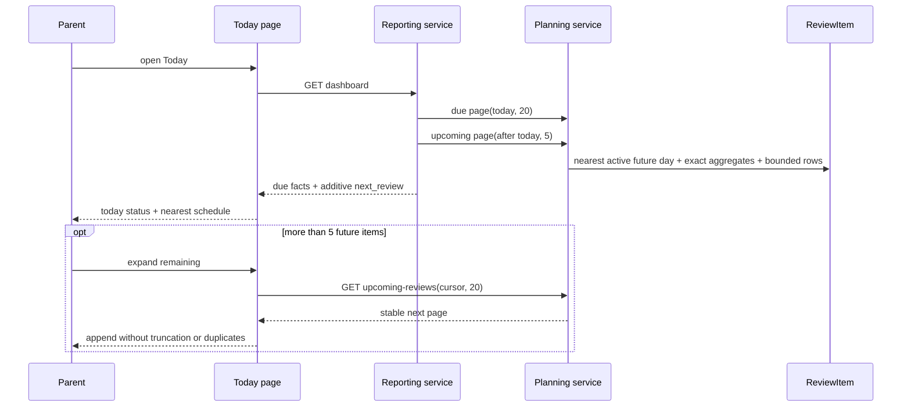
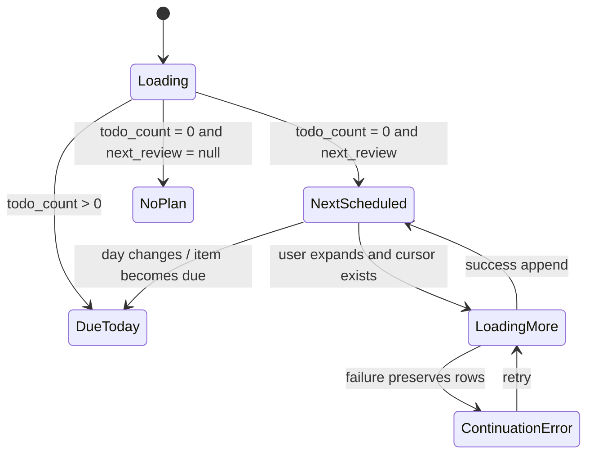
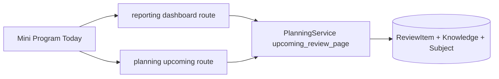

# BUG-021 — 今日页复习计划不可见且内容截断

- Status: `DONE`
- Severity: `medium — 正式记录已生成复习计划，但家长在今日页看不到最近日期与内容，容易判断为计划未生成`
- Risk: `R2 — additive planning/reporting read contract + Today interaction and responsive state change`
- Owner: `产品负责人（用户）`
- Implementer: `Codex after approval`
- Reviewer/Verifier: `independent read-only review after implementation`
- First observed: `2026-09-12 / 微信小程序真实页面截图`
- Related incident/ticket: `用户截图 SHA-256 4c21c6599da229fb9e5d6137a58bb42b294bb80f90f8beea08551bcfbb18b72b`
- Spec revision: `BUG-SPEC-20260912-REVIEW-VISIBILITY-01`
- User confirmation: `APPROVED 2026-09-12 — 用户在收到本 revision、Design Revision 与候选图后回复“按照这个修复”`
- Affected Feature IDs: `FEAT-001`
- Feature current-state documents: `docs/domain/features/FEAT-001-push-kids-mvp.md`、`docs/domain/BEHAVIOR-CATALOG.md`
- Feature baseline revision: `FEAT-STATE-20260912-STALE-CONFIRM-01-LOCAL`
- Feature merge owner: `Codex after verification`

## Frontend Design Impact and Figma Approval

- Frontend impact: `yes — rename Today review section, replace misleading empty state with nearest scheduled review, show full wrapping knowledge names and bounded expansion`
- Frontend impact reason: `current visible state hides an already-created plan and truncates long knowledge names`
- Frontend engineering impact: `yes — Today remote state, bounded pagination, component text layout, recovery and responsive behavior`
- Frontend engineering impact reason: `new additive read model and continuation state must not duplicate, race or erase loaded Today data`
- Affected UI IDs: `UI-001`
- UI current-state documents: `docs/design/frontend/ui/UI-001-parent-miniapp.md`
- Frontend baseline revision: `FDB-20260906-03 (APPROVED)`
- Frontend engineering constraint revision: `FEC-20260911-READ-PERF-01 (APPROVED)`
- Affected frontend quality dimensions: `component/state/responsive/a11y/i18n/browser/performance/security/privacy/observability`
- Frontend quality budgets/requirements: `320×568 / 390×844 / 430×932; >=44px touch; >=14px body; no horizontal overflow; full CJK wrapping; O(1) bounded reads; family-scoped; no child content in logs`
- Frontend quality verification plan: `planning integration/API contract; MySQL 5.7 SQL guard/query plan; Today VM state/race/pagination tests; three native viewports and long-copy state; ESLint/static/architecture/full suites`
- Approved frontend engineering deviations: `none`
- Current Design Revision(s): `DREV-20260912-STALE-CONFIRM-01 and PKDS-2.0 baseline`
- Figma project/file URL: `https://www.figma.com/design/FAyfmjNrA3btWztwyxI6Zj`
- Figma node URL(s): `N/A — FEAT-001 scoped Starter-limit waiver; root URL is only an anchor`
- Proposed Design Revision: `DREV-20260912-TODAY-NEXT-REVIEW-01`
- Required viewport/state exports: `VP-MIN 320×568 / VP-PRIMARY 390×844 / VP-WIDE 430×932; due, next-only, no-plan, loading, continuation-error, viewer, old-server fallback`
- Prototype status: `APPROVED_AND_IMPLEMENTED_LOCAL`
- Approved Task Spec revision: `BUG-SPEC-20260912-REVIEW-VISIBILITY-01`
- Approved Design Revision: `DREV-20260912-TODAY-NEXT-REVIEW-01`
- Design approval evidence: `产品负责人（用户）2026-09-12 回复“按照这个修复”`
- Snapshot manifest path: `docs/design/frontend/snapshots/UI-001/DREV-20260912-TODAY-NEXT-REVIEW-01/APPROVAL.md`
- Permitted implementation deviations: `none`
- UI current-state merge owner: `Codex after verification`
- UI current-state merge evidence: `UI-STATE-20260912-TODAY-NEXT-REVIEW-01-LOCAL`
- Frontend visual/a11y/resolution verification: `source/state PASS; native 320/390/430 and iOS/Android NOT_RUN as release gates`
- Frontend engineering verification evidence: `161 frontend tests, ESLint, validator and independent R2 review PASS`
- Figma waiver: `inherit FEAT-001 scoped waiver; Owner user; only this existing Today surface; expires before public production; native viewport/device evidence still mandatory`

## 1. Symptom and impact

- Who/what is affected: `家长在当天确认新学习后回到今日页查看复习计划`
- Frequency: `deterministic for current-day learning because initial review is normally learned_on + 1 day`
- User-visible symptom: `“待复习 0 项 · 约 0 分钟”下显示首次记录式空态，最近已生成的复习日期和知识点不可见；长 Todo 名称还会单行省略`
- Business/data/security impact: `无数据损坏；降低计划可信度并可能导致家长重复录入或误以为保存失败`
- First known good version: `none for this state`
- First known bad version: `current Today due-only design`
- Workaround: `进入已确认记录详情逐条展开复习情况；路径深且不能从今日页总览最近计划`

## 2. Reproduction

### Preconditions

- Environment/version: `current local base e0b3cf9d06da plus uncommitted BUG-020 fix`
- Actor/permissions/tenant: `family-scoped viewer or writable member with an active child`
- Data/fixture: `today has one confirmed learning record, no Review due today, and active ReviewItem rows due tomorrow`
- Feature flags/config: `none`
- External dependencies: `none`

### Steps

1. Confirm a learning record today.
2. Return to Today and expand the review section.

### Actual result

Header reports zero and the body says a review date will appear after confirmation, while the already-created future
ReviewItems are not queried or rendered.

### Expected result

Today remains the action authority, but the same section states the nearest scheduled date, exact total/minutes and
readable knowledge names. Future items remain read-only until they become due.

### Reproduction evidence

- Screenshot: `user-provided image hash above`
- Policy: `planning/domain.py::initial_review_date`
- Backend: `PlanningService.daily_todo_page` filters `due_date <= target`
- Frontend: `pages/today/index.wxml:91-108`
- Truncation: `components/todo-card/index.wxss .pt-n uses nowrap + ellipsis`
- Reproduction rate: `100% for the stated fixture`

## 3. Triage

### Confirmed facts

| Fact | Evidence |
|---|---|
| Current Dashboard only embeds due/overdue reviews | `ReportingService.dashboard -> daily_todo_page`; `due_date <= target` |
| A learning confirmed today normally receives tomorrow as first review | `initial_review_date(learned_on, today)` and policy unit test |
| Empty copy claims confirmation is still needed | `today/index.wxml` |
| Existing Todo names are visually truncated | `.pt-n { white-space: nowrap; text-overflow: ellipsis }` |
| Future Review feedback is not allowed by current product contract | FEAT-001 current state and BUG-020 regression |

### Blast radius

- Entry points: `GET /children/{id}/dashboard`; proposed `GET /children/{id}/upcoming-reviews`; Today section; TodoCard text layout`
- Callers/consumers: `Today Mini Program only; old clients ignore additive dashboard field`
- Data already affected: `none; existing ReviewItem rows are authoritative and require no repair`
- Security/tenant boundary: `both reads must retain family + child scope and learning-subject filter`
- Related behaviors: `BHV-006, BHV-010, BHV-019`
- Other code with same pattern: `record detail already exposes per-record next review, but it is not a Today aggregate and must not become a waterfall source`

### Link/call graph

```text
Today.load -> GET dashboard -> ReportingService.dashboard
                         -> PlanningService.daily_todo_page -> ReviewItem due <= today
                         -> proposed upcoming_review_page -> nearest ReviewItem due > today
Today.expandUpcoming -> GET upcoming-reviews(cursor) -> same planning service contract
```

## 4. Root cause

The read model equates “not due today” with “nothing useful to show in the review section.” This is correct for action
eligibility but incomplete for schedule transparency. The generic empty copy then describes a pre-confirmation state even
when ReviewItems already exist. Separately, the TodoCard layout optimizes row height by truncating the authoritative name.

Existing tests assert zero-due collapse behavior and bounded due pagination, but do not cover a zero-due/nonzero-future
fixture or full long-name rendering.

## 5. Fix contract

### Required behavior

- Rename the section to `复习安排` and expose both the today-due summary and the nearest future scheduled day.
- When today has no due items and a future plan exists, expanded state directly renders the nearest day, exact total,
  exact total estimated minutes and server-origin knowledge names.
- Initial future preview returns at most 5 items; explicit continuation returns at most 20 per request with stable cursor,
  exact remaining count and deduplication.
- Future items are read-only. They cannot call feedback/practice or change Review state.
- Knowledge names in due and future rows wrap fully without ellipsis.
- Missing additive fields from an older backend degrade to the accurate statement `今天没有到期的复习`; the client
  must not infer tomorrow from policy.
- When today's due list exists, it remains primary; the nearest future plan is a low-emphasis disclosure after it.

### Must not change

- Review dates and feedback transitions remain deterministic server policy.
- Current Todo feedback, budget required/optional split, optimistic rollback and pagination remain unchanged.
- No future 7-day load graph, mastery judgment, early completion or automatic feedback.
- Family/child scoping, learning-only boundary, API auth and privacy remain unchanged.

### Feature current-state impact

- Current Feature sections affected: `Current invariants, bounded reads, verification, change references`
- Incorrect/obsolete statement to correct: `Today only makes scheduled ReviewItems visible after they are due`
- Final facts to merge after verification: `Today exposes nearest future day as bounded read-only transparency while due items remain the only actionable set; knowledge names wrap fully`
- Change Reference to add: `BUG-SPEC-20260912-REVIEW-VISIBILITY-01 / DREV-20260912-TODAY-NEXT-REVIEW-01`

### Non-goals

- No calendar/tab/new page, future workload chart or configurable review interval.
- No schema/migration/backfill/provider prompt change.
- No notification or report changes.
- No deployment, upload or release without a separate request and release playbook.

### State/data repair

- Existing data repair required: `no`
- Restore/rollback: `code-only; additive response field can be removed after old-client compatibility check`

## 6. Fix design

### Selected change

1. Add one Planning-owned bounded `upcoming_review_page` contract: nearest active learning Review date strictly after the
   dashboard day, exact aggregate, stable ordered item page and cursor.
2. Embed its first five items as additive nullable `next_review` in Dashboard; expose the same contract through
   `GET /children/{id}/upcoming-reviews?after=&limit=&cursor=` for continuation. Do not create a reporting duplicate.
3. Today derives presentation labels and merges continuation groups without duplicates. Remote state remains server-owned;
   disclosure/pagination state remains page-owned.
4. Keep future markup local to Today because it has one consumer and different semantics from actionable TodoCard.
5. Remove the misleading generic empty copy and the TodoCard single-line truncation rule.

### Sequence diagram



### State machine



### Architecture diagram



Dependency direction remains `Mini Program -> routers/services -> planning domain/data`. Reporting consumes Planning's
public read contract; Planning does not import Reporting.

### Trade-offs and alternatives rejected

| Alternative | Why rejected |
|---|---|
| Copy 1/3/7 policy into client | creates a second authority and fails for feedback/history changes |
| Use record-detail requests for every record | unbounded N+1 waterfall and incomplete aggregate |
| Show all future dates | turns Today into a planning dashboard and violates the approved product focus |
| Show only count/date | does not solve content visibility |
| Reuse TodoCard for future items | brings actionable feedback semantics into a read-only state |
| Return all nearest-day items in dashboard | unbounded payload after long-term use |

### Expected file changes

| File/path | Action | Expected change | Why required |
|---|---|---|---|
| `planning/service.py` | modify | Planning-owned upcoming page/query/cursor | one authoritative bounded read |
| `planning/router.py` | modify | additive upcoming route | continuation without dashboard reload |
| `reporting/service.py` | modify | embed first preview page | one-screen no-waterfall load |
| API schemas/OpenAPI if explicit | modify | document additive response | consumer contract |
| `pages/today/index.js` | modify | derive labels, preserve/merge/retry future pages | interaction state |
| `pages/today/index.wxml` | modify | new section header/states/read-only future rows | visible contract |
| `pages/today/index.wxss` | modify | local nearest-plan geometry only | responsive hierarchy |
| `components/todo-card/index.wxss` | modify | remove name ellipsis, allow full wrapping | complete content |
| backend/frontend tests | modify/add | regression, auth, bounds, state/race/layout | acceptance evidence |
| FEAT/BHV/UI docs | modify after verification | merge final facts | current-state sources |

No migration, new component, shared utility, dependency or duplicate service is expected.

### Compatibility and rollout

- Deployment order: `backend additive contract first, then Mini Program`; old clients ignore fields/route.
- Mixed versions: `new client + old backend hides unavailable next preview and keeps accurate due-only copy`.
- Feature flag: `none`.
- Migration/backfill: `none`.
- Rollback: `front then backend; Review data unchanged`.
- Abort: `query count becomes unbounded; cross-family row leaks; future item can feedback; old dashboard schema breaks`.

## 7. Regression verification

### Required test points

| ID | Acceptance | Level/case |
|---|---|---|
| TP-001 | today 0 + tomorrow items returns exact nearest date/count/minutes and first five | planning/reporting integration |
| TP-002 | multiple future dates only returns nearest exact date; learning subjects only | integration |
| TP-003 | cursor pages are stable, bounded, deduplicated and family/child scoped | integration + contract |
| TP-004 | today 0 renders compact status + full wrapping names + future no feedback controls | frontend VM/source contract |
| TP-005 | today due remains primary; next plan is low-emphasis disclosure | frontend state |
| TP-006 | missing field/no plan/loading/continuation failure/viewer preserve correct state | frontend state/recovery |
| TP-007 | MySQL 5.7 query contains no CTE/window and uses tenant-leading due index | SQL guard/plan test |
| TP-008 | 320/390/430 long CJK names have no horizontal overflow and all touch targets remain >=44px | native viewport evidence |

### Verification commands

| Command/case | Result | Evidence |
|---|---|---|
| focused backend planning/reporting/API contract | `PASS` | 16 passed; bounded suite includes nearest day, exact totals, isolation and limit=20 |
| focused frontend Today/Todo tests | `PASS` | 18 passed; includes old-backend tri-state, paging/race/error and full-name source contract |
| `uv run pytest tests/unit tests/integration tests/contract -q` | `PARTIAL` | unit/integration 281 passed + 4 MySQL skipped; other contract 10 passed; worker-readiness 8 tests hang in existing lifespan teardown and were interrupted, so full command is not claimed passed |
| `npm test` | `PASS` | 161 passed |
| Ruff format/check + Mypy + ESLint | `PARTIAL` | Ruff check, changed-file format, Mypy 81 files and ESLint PASS; full format is blocked only by two unchanged pre-existing files |
| architecture + Mini Program validator | `PASS` | `ARCHITECTURE_VALID checked=3`; `MINIPROGRAM_VALID pages=15 source_bytes=656637` |
| 10k future review read | `PASS` | exact 10,000 total, 20 returned, <=4 queries, response/memory/latency budgets and tenant-leading index |
| independent R2 read-only review | `PASS` | initial CR-001..005 fixed; re-review found no actionable findings |
| native three-viewports/iOS/Android | `NOT_RUN` | external release gate; local-only approval explicitly excludes upload/deployment |
| actual MySQL 5.7 execution | `NOT_RUN` | `PUSH_KIDS_TEST_MYSQL_URL` unavailable; affected-path plan test added |

## 8. Completion gate

- [x] User explicitly approves `BUG-SPEC-20260912-REVIEW-VISIBILITY-01`, `DREV-20260912-TODAY-NEXT-REVIEW-01` and the candidate snapshot under the FEAT-001 waiver.
- [x] Candidate hash and approval evidence are recorded.
- [x] TP-001..TP-007 pass locally; TP-008 remains an explicitly out-of-scope release gate under the local-only approval.
- [x] Independent R2 review finds no blocker/major issue after CR-001..005 remediation.
- [x] FEAT-001/BHV/UI-001 current-state documents are merged with verified facts.
- [x] No schema, early feedback, future-seven-day load, deployment or unrelated changes are present.
- [x] Spec is DONE and moved to `specs/completed/`.

## 9. Approval decision

The user approved this revision with “按照这个修复”. That authorization covered local implementation and
verification only; no deployment, upload, experience release or production action was performed.
