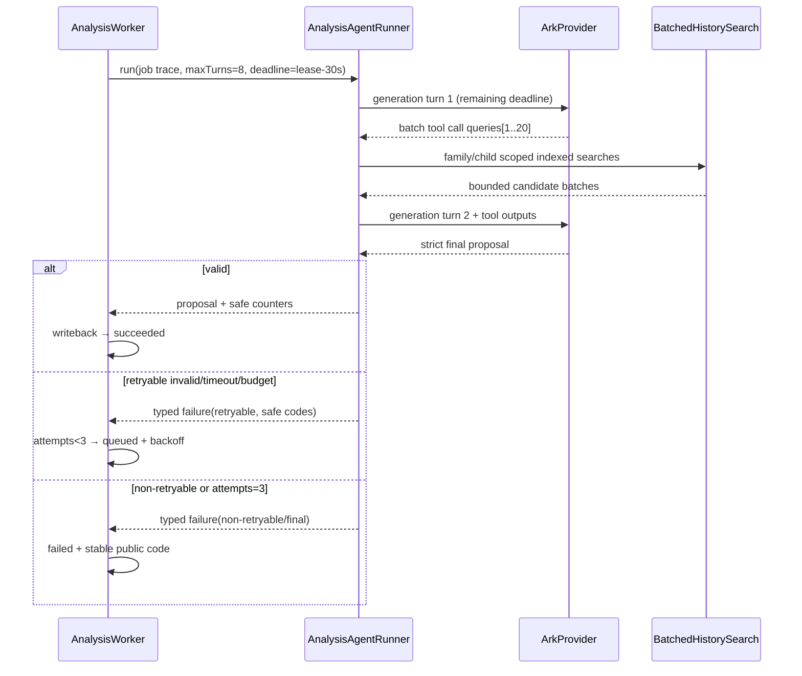
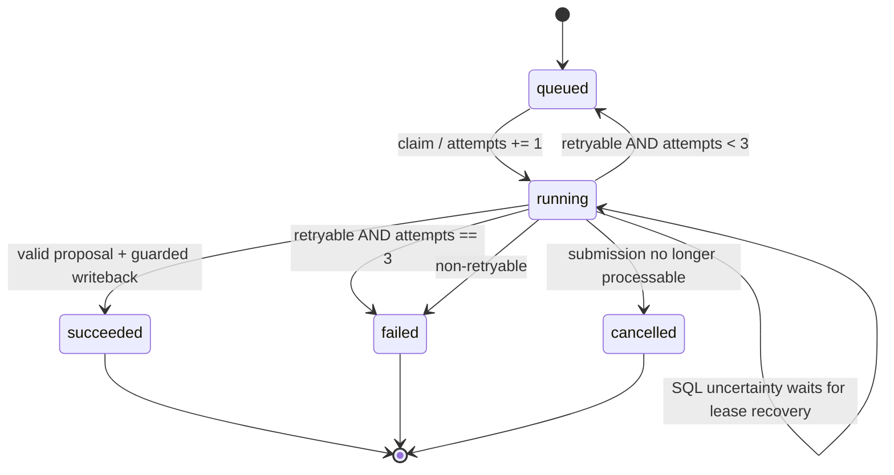
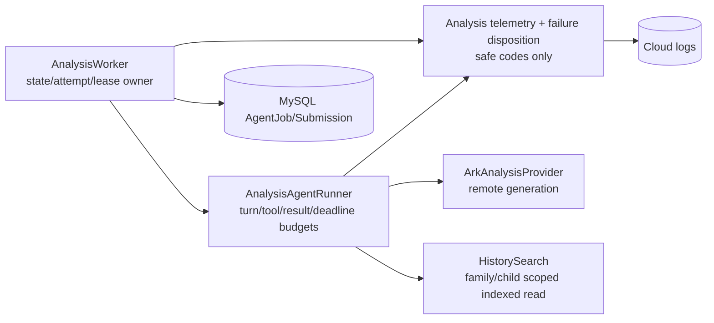

# BUG-022 — 图片分析 Agent 逐轮观测、容量与分类重试

- Status: `DONE`
- Severity: `P1 — 图片材料可以完成上传，但一次 Agent 轮次耗尽会直接终态失败，家长无法进入可编辑确认`
- Risk: `R2 — 修改异步任务失败分类、Provider tool loop 和日志；不改正式学习写入语义`
- Owner: `产品负责人（用户）`
- Implementer: `Codex`
- Reviewer/Verifier: `Codex 独立只读 review + 产品负责人受控验收`
- First observed: `2026-09-19 / 生产 flask-ik19-022`
- Related incident/ticket: `生产 Job 后缀 58046565；完整 ID 不写入本文`
- Spec revision: `BUG-SPEC-20260919-AGENT-RETRY-02`
- User confirmation: `APPROVED — 用户于 2026-09-19 先回复“按照这个方案实现”批准 revision 01，随后明确要求超时从当前 5 分钟 lease 推导，并让模型在 tool 参数错误时同 loop 重试，批准 revision 02`
- Affected Feature IDs: `FEAT-001`
- Feature current-state documents: `docs/domain/features/FEAT-001-push-kids-mvp.md`
- Feature baseline revision: `FEAT-STATE-20260913-UNIFIED-REVIEW-BACKEND-02-LOCAL`
- Feature merge owner: `Codex；仅在实现及验证完成后合并最终事实`

## Frontend Design Impact and Repository-native Approval

- Frontend impact: `no — 不修改页面、文案、交互、接口响应形状或小程序包`
- Frontend impact reason: `现有失败、重试和人工补充说明入口保持不变`
- Frontend engineering impact: `no — 不修改前端代码、工具链或质量预算`
- Frontend engineering impact reason: `纯后端 Agent、Worker、日志和测试修改`
- Affected UI IDs: `N/A`
- UI current-state documents: `N/A`
- Frontend baseline revision: `N/A`
- Frontend engineering constraint revision: `N/A`
- Affected frontend quality dimensions: `N/A`
- Frontend quality budgets/requirements: `N/A`
- Frontend quality verification plan: `N/A；只运行既有前端回归，证明无意外影响`
- Approved frontend engineering deviations: `none`
- Current Design Revision(s): `N/A`
- Editable design source path(s): `N/A`
- Design source SHA-256: `N/A`
- Proposed Design Revision: `N/A`
- Required viewport/state exports: `N/A`
- Prototype status: `N/A`
- Approved Task Spec revision: `BUG-SPEC-20260919-AGENT-RETRY-02`
- Approved Design Revision: `N/A`
- Design approval evidence: `N/A`
- Snapshot manifest path: `N/A`
- Permitted implementation deviations: `none`
- UI current-state merge owner: `N/A`
- UI current-state merge evidence: `N/A`
- Frontend visual/a11y/resolution verification: `N/A`
- Frontend engineering verification evidence: `N/A`
- External design dependency: `none`

## 1. Symptom and impact

- Who/what is affected: 使用图片记录学习内容的家庭；已知生产案例为同一提交的 3 张图片。
- Frequency: 生产最近 7 天 21 个图片 Job 成功、1 个 `analysis_output_invalid` 失败、3 个取消；
  当前证据说明不是全局中断，但合法输入仍可触发。
- User-visible symptom: 图片上传后长时间“整理中”，约 17 分钟后显示“图片内容暂时无法整理成有效条目”。
- Business/data/security impact: 没有正式学习数据写入或损坏；本次 proposal 未生成，家长必须补充说明并手动重试。
- First known good version: 同一线上版本在 2026-09-18 已成功处理多笔图片任务，包括一笔 3 图任务。
- First known bad version: `flask-ik19-022` 的 2026-09-19 真实任务。
- Workaround: 家长补充简短文字后手动重试；不能保证避免再次耗尽。

## 2. Reproduction

### Preconditions

- Environment/version: `prod-d2g14rwoycac6b45d / flask-ik19-022 / MySQL revision 20260913_0014`。
- Actor/permissions/tenant: 已绑定家庭且有写权限；身份细节不进入 Spec 或日志。
- Data/fixture: 3 张已 claim 图片，合计约 1.2 MB，无补充文字，3 个 active learning subjects，
  当日 5 个 plan items、0 个同日已确认知识。
- Feature flags/config: Ark Provider；历史知识通过 Agent tool 检索。
- External dependencies: 微信私有对象存储、Ark Responses API、MySQL。

### Steps

1. 创建 3 图学习提交并完成 upload/claim/finalize。
2. Worker 领取 Job，读取图片、构建上下文并进入 Agent Provider。
3. Agent 在最多 8 轮内执行历史检索/结构化输出。
4. 观察数据库 Job、Submission 状态和脱敏阶段日志。

### Actual result

- 12:25:05 图片查询、materialize（197 ms）和上下文构建（10 ms）成功。
- Provider 从 12:25:05 运行至 12:42:05，未记录逐轮生成、工具调用数量或最后校验码。
- 第 1 个 Job attempt 抛出 `AnalysisOutputExhaustedError`，被当作 terminal；
  `attempts=1/max_attempts=3` 但未重新排队，最终 `analysis_output_invalid`。

### Expected result

- 每一次 Provider 生成都留下可关联、脱敏、有界的进度事件。
- 8 轮容量必须能覆盖合法的最多 20 个候选历史检索；若不能完成，应给出明确的安全原因。
- 可恢复的模型输出、Agent 预算和传输故障最多执行 3 个 Job attempts；确定性能力/配置/输入错误不重试。
- 无论重试与否，家长确认前都不得写正式学习、知识、Review 或 Feedback。

### Reproduction evidence

- Database: submission/job 为 failed，`error_code=analysis_output_invalid`，proposal 为空，图片均为 claimed。
- Cloud log: `analysis_provider_started` 后 17 分钟直接出现
  `analysis_job_failed stage=provider error_type=AnalysisOutputExhaustedError`。
- Comparable task: 2026-09-18 的 3 图 Job 第 1 次 `AnalysisOutputValidationError` 后重新排队，
  第 2 次 Provider 247865 ms 后成功写回。
- Reproduction rate: 真实线上 1 次；修复前用 scripted Responses fixture 稳定复现。

## 3. Triage

### Confirmed facts

| Fact | Evidence |
|---|---|
| 上传、claim、图片读取和上下文构建成功 | 生产 DB + `analysis_media_*` / `analysis_context_*` 日志 |
| 失败发生在 Provider/Agent loop | `stage=provider`、`AnalysisOutputExhaustedError` |
| 当前 `AnalysisOutputExhaustedError` 继承 terminal 错误 | `agent_processing/contracts.py` + `worker.py` |
| 当前 loop 最多 8 轮，但工具预算允许 20 次调用/最多 20 个输出项 | `runner.py`、`providers.py`、Feature current-state |
| 当前工具 schema 一次只描述一个 candidate；模型可每轮只发一个调用 | `providers.py` |
| Provider 不记录 turn、response kind、工具批次、校验码或预算消耗 | `providers.py` / `runner.py` |
| 当前一次失败可运行 17 分钟，已远超 5 分钟 lease | 生产日志与 Worker lease 常量 |

### Hypotheses

| Hypothesis | Supports | Contradicts | Experiment | Result |
|---|---|---|---|---|
| 模型每轮只检索少量候选，8 轮前不能 final | 单候选工具 schema；17 分钟与 8 次远程生成相符 | 当前没有 turn 日志 | scripted 单调用/轮 fixture + 新逐轮日志 | confirmed as a reachable capacity defect; batch schema removes it |
| 模型反复输出不合规 final 并耗尽 8 轮 | Provider 会带脱敏代码要求修正 | 没有保存最后代码 | scripted invalid-output fixture | remains a possible runtime cause; now observable and retryable |
| Ark/网络临时故障 | 外部依赖可能抖动 | 异常类型不是 transport dependency | timeout/incomplete fixture | 当前案例不支持 |
| 图片读取或数据库写回失败 | 均可能导致整理失败 | 相应阶段已成功且未进入 writeback | 阶段日志 | rejected |

### Blast radius

- Entry points: photo/manual-with-photo submission finalize → AgentJob。
- Callers/consumers: `AnalysisWorker`、`AnalysisAgentRunner`、`ArkAnalysisProvider`、history search tool。
- Data already affected: 已知一个 failed submission；无需回填或删除。
- Security/tenant boundary: 不改变 family/child 注入；日志不得出现家庭、孩子、正文、图片、关键词或 Provider 原文。
- Related behaviors: `BHV-003`、`BHV-014`、`BHV-015`。
- Other code with same pattern: Worker 对通用异常已有三次 Job attempts；只有 terminal 输出耗尽绕过该策略。

### Link/call graph

```text
Learning finalize
  → AgentJob(queued, max_attempts=3)
  → AnalysisWorker.process_one()
  → AnalysisAgentRunner.run(max_turns=8, max_tool_calls=20)
  → ArkAnalysisProvider.analyze_with_history()
       → Responses generation turn
       → search_history_items(single candidate) × N
       → strict final validation
  → Worker retry disposition
  → queued / failed / pending_confirmation
```

## 4. Root cause

### Fault mechanism

当前约束不一致：Proposal/工具预算允许最多 20 个候选与 20 次逻辑查询，但 Agent loop 只有 8 个
Provider generation turns，且工具参数一次只表达一个候选。只要模型采用合法的逐候选检索策略，
第 8 轮之前就可能没有机会生成 final。loop 耗尽统一抛出 `AnalysisOutputExhaustedError`；该异常又被
Worker 视为不可重试 terminal，于是 `max_attempts=3` 在第一次失败后失效。与此同时，Provider/Runner
不输出逐轮脱敏事件，无法区分“持续工具调用”“持续 schema 修正”或“耗时/状态异常”。

### Why existing controls missed it

- Missing/incorrect test: 只验证了单次 tool call + final，没有覆盖最多 20 个候选、逐轮工具调用和 turn exhaustion。
- Review/spec gap: 原 Spec 同时批准 8 turns 和 20 tool calls，但没有证明二者在工具 schema 下可达。
- Monitoring gap: Worker 只有 Provider 外层 started/failed，缺少每次生成和安全校验原因。
- Architecture/process contributor: “public error type”和“是否可重试”由继承关系隐式绑定，没有独立 retry policy。

### Root-cause evidence

- Code locations: `agent_processing/providers.py`、`runner.py`、`contracts.py`、`worker.py`。
- Failing tests to add: `TP-001..TP-006`。
- Runtime evidence: 生产 attempt 1/3 在 8 轮耗尽后直接 terminal，Provider 总耗时约 1020 秒。

## 5. Fix contract

### Required behavior

1. 每次远程生成记录 started/completed/failed，字段只允许：Job ID、Job attempt、agent turn、
   duration_ms、response kind、provider status、output item count、本轮/累计 logical tool calls、
   本轮/累计候选数、剩余 turn/time budget、静态脱敏 validation codes。
2. history search 批次记录 request_count、result_count、累计 budget 和 outcome；不记录 subject、
   candidate、keywords、返回 Item、family/child/submission 或模型内容。
3. 只允许有限静态 validation code 进入日志；动态 subject/key/index/模型字段值统一归一为
   `schema.fields` 或 `validation.other`。
4. 原始 prompt、图片、base64、模型 request/response、候选名、搜索词、家庭/孩子/OpenID、异常文本、
   token/key 永不进入普通日志。
5. history search tool 改为一次携带 `queries[1..20]`；每个 query 仍按一个 logical tool call 计费，
   保持 20 calls / 100 unique results / 20 results per query 的现有边界。
6. `MAX_AGENT_TURNS=8` 保留；第 8 轮只允许 final，不再接受新的工具请求。正常最多 20 个未匹配
   候选应能在一个批次搜索轮 + 一个 final 轮完成；后续 refinement 仍有 6 轮余量。
7. 单个 Job attempt 的 Agent 截止时间从当前持久化 5 分钟 lease 动态推导：进入 Provider 前重新计算
   `lease_until - now - 30秒写回余量`，因此满额时最多约270秒，图片读取/上下文耗时会自动扣除。
   所有 generation turns 共享该剩余预算；每次 Provider 调用使用剩余预算作为 timeout，并关闭 SDK
   内部网络重试，防止一次调用重复消耗预算。持久化 Job attempts 是唯一重试所有者。
8. Provider 返回的 tool 参数若 JSON/shape/type/range/subject 不合法，在剩余 Agent turn 内只回传静态
   `tool.arguments` 反馈并要求模型修正；不执行该批查询、不泄露原参数。最终轮或预算耗尽时才退出
   当前 attempt，并按输出非法处理。
9. 建立显式 failure disposition，不根据异常文案判断：
   - retryable，最多 3 个 Job attempts：Provider transport/timeout/incomplete、对象存储临时错误、
     模型输出/引用校验失败、turn/time/tool/result budget exhaustion。
   - non-retryable，立即 failed：schema capability 不支持、确定性输入/配置不变量失败、任务已取消、
     lease/state 已变化。
   - SQLAlchemy write/commit uncertainty 保持现有 lease recovery，不伪造成功/失败结果。
10. 第 1/2 次 retryable failure：Job 回到 queued，Submission 回到 queued，沿用现有有界 backoff；
   第 3 次：Job/Submission failed。output/引用/Agent 预算失败最终码为 `analysis_output_invalid`；
   transport/storage/timeout 最终码为 `analysis_failed`；capability 为 `analysis_schema_unsupported`。
11. 重试永远不复制 Submission、Media 或正式数据；同一 Job attempts 原子递增，最多为 3。

### Must not change

- 只有家长确认才创建正式学习、Knowledge、Review 和 Feedback。
- family/child scope、私有图片 owner 校验、proposal 最多 20、工具候选/结果上限保持不变。
- 现有 API schema、用户文案、手动确认/取消、迟到结果保护、5 分钟 lease 不变。
- 不新增数据库表/列，不保存原始模型 payload 或儿童图片。

### Feature current-state impact

- Current Feature sections affected: AI history Agent contract、Worker retry、脱敏 observability。
- Incorrect/obsolete statement to correct: “最终非法输出终态”需改为“单 attempt 非法输出可重试，3 次后终态”；
  8 turns 的容量需注明 batch contract 与 final-turn reserve。
- Final facts to merge after verification: 新逐轮日志、batch tool、lease-derived deadline、tool 参数同 loop 修正、retry matrix。
- Change Reference to add: `BUG-022 / BUG-SPEC-20260919-AGENT-RETRY-02`。

### Non-goals

- 不改变 AI 提案内容规则、复习算法、历史索引算法或确认事务。
- 不上传/部署云版本，不执行生产任务重试，不查看或记录原始儿童图片/模型输出。
- 不通过无限增加 turns、lease 或 retries 来掩盖模型行为。
- 不新增前端重试按钮或用户文案。

### State/data repair

- Fix prevents new premature terminal failures; no corrupted formal data exists。
- Existing failed submission 保留可审计状态，可由家长使用现有 retry API 手动重试。
- 不自动重跑生产失败任务，不做 SQL UPDATE/DELETE。

## 6. Fix design

### Selected change

- 在 `agent_processing` 内新增窄职责 telemetry/retry policy，Worker 传入安全 Job trace context。
- Provider 每轮只发结构化安全事件；Runner 负责批量 history query 的租户注入、预算和结果去重。
- 用显式 disposition 替代 Worker 当前 `isinstance(AnalysisTerminalError)` 的隐式 terminal 判断。
- 保留一个权威 Worker 状态机，不建立第二套队列或旁路重试器。
- 不改变数据库事务边界；retry 仍通过持久化 Job state/available_at 实现。

### Trade-offs and alternatives rejected

| Alternative | Why rejected |
|---|---|
| 直接把 8 turns 提高到 21/24 | 真实 8 轮已耗时约 17 分钟；会放大成本与延迟并突破 5 分钟 lease，仍没有逐轮可观测性 |
| 记录完整 prompt/output 方便排查 | 会把儿童图片、正文、历史知识和模型 payload 写入日志，违反隐私边界 |
| 所有异常统一重试 3 次 | capability、输入不变量、取消和 stale lease 不会因重试恢复，只会浪费成本或制造竞态 |
| 每轮单候选检索并把 lease 延长到一小时 | 吞吐、恢复时间和多实例安全性恶化；与 20 候选上限的容量合同不匹配 |
| 把逐轮 trace 持久化到 MySQL | 本次只需短期运维日志；新增 schema、保留期和删除责任超出范围 |
| 新建旁路 retry worker | 会复制权威状态机并增加重复执行风险；现有 AgentJob 已有 durable attempts/lease |

### Sequence diagram



### State machine



Illegal transitions: failed/succeeded/cancelled 不自动回到 queued；旧 lease 不得覆盖人工确认、取消或新 attempt。

### Architecture diagram



### Expected file changes

| File/path | Action | Expected change | Why required |
|---|---|---|---|
| `apps/api/src/push_kids/agent_processing/telemetry.py` | add | 安全 trace context、静态 code sanitizer、逐轮事件 emitter | 两个消费者共享稳定可观测合同，避免散落字段和隐私泄露 |
| `apps/api/src/push_kids/agent_processing/contracts.py` | modify | typed failure/disposition 数据；retryable 与 public code 解耦 | Worker 不再靠 terminal 继承关系猜策略 |
| `apps/api/src/push_kids/agent_processing/context.py` | modify | 确定性上下文不变量改为 typed input failure | 避免无意义的 Provider/Job 重试 |
| `apps/api/src/push_kids/agent_processing/runner.py` | modify | batch history queries、逻辑调用/结果/turn/deadline 预算、trace | 证明 8 turns 覆盖最多 20 候选并保持租户边界 |
| `apps/api/src/push_kids/agent_processing/providers.py` | modify | batch tool schema、每次 generation 安全日志、remaining-time timeout、typed failure | 记录真实生成过程并阻止 17 分钟无界 attempt |
| `apps/api/src/push_kids/agent_processing/prompt.py` | modify | Prompt revision；要求一次批量提交当前全部未匹配候选 | 让模型行为与容量证明一致 |
| `apps/api/src/push_kids/agent_processing/worker.py` | modify | 使用 disposition 执行最多 3 次、记录 retryable/reason/counters | 修复 attempt 1/3 提前 terminal |
| `tests/unit/test_analysis_agent_runner.py` | modify | batch 20、budget/final reserve、tenant/result bounds | loop 容量回归 |
| `tests/unit/test_subject_grouped_analysis.py` | modify | per-turn trace、safe codes、timeout、batch schema | Provider 合同和隐私回归 |
| `tests/unit/test_provider_evidence.py` | modify | SDK retry 必须为0 | 防止 SDK 隐式重试突破 Job lease-derived deadline |
| `tests/integration/test_worker_resilience.py` | modify | retryable 3 次、non-retryable 1 次、状态/attempt/backoff | durable retry 状态机回归 |
| `tests/contract/test_worker_readiness.py` | modify if needed | 长 Provider 与 retry 中 readiness 仍健康 | 防止 observability/retry 破坏 ready 语义 |
| `docs/domain/BEHAVIOR-CATALOG.md` | modify after verification | 更新 BHV-003/BHV-014 的真实 retry/observability | 行为事实源 |
| `docs/domain/features/FEAT-001-push-kids-mvp.md` | modify after verification | 合并最终 Agent/Worker current-state 与 Change Reference | Feature 事实源 |
| `docs/architecture/ARCHITECTURE.md` | modify after verification | 记录 batch tool、deadline 和 failure disposition 所有权 | 当前架构事实 |
| `docs/quality/TEST-STRATEGY.md` | modify after verification | 加入 Agent retry/trace privacy test points | 防止回归 |

### Compatibility and rollout

- Deployment order: 后端单一不可变版本；无 Schema/前端顺序依赖。
- Feature flag: none；修复权威路径，不保留双逻辑。
- Migration/backfill: none。
- Rollback/restore: 回退到上一不可变后端；数据库无变化。回退会恢复 output-invalid 首次终态行为。
- Success metrics: `analysis_output_invalid` 首次 attempt 后出现 requeue；attempts 永不超过 3；
  20-candidate fixture 在 8 turns 内完成；日志能还原 turn/tool/validation/deadline 且敏感标记为 0。
- Abort metrics: 重复正式写入、stale writeback、跨家庭结果、日志出现儿童内容/关键词/凭据、
  单 attempt 超过 5 分钟 lease、任务 attempts>3。

## 7. Regression verification

### Required regression tests

| ID | Acceptance/expected behavior | Level | Pre-fix expectation |
|---|---|---|---|
| `TP-001` | 每个 generation turn 有 started/completed/failed 和安全预算字段；secret/正文/subject/keyword/raw output 不出现 | unit/log capture | fail：当前无逐轮事件 |
| `TP-002` | 20 个未匹配候选一次 batch tool round + final，在 `MAX_AGENT_TURNS=8` 内成功 | unit/provider+runner | fail：当前单候选 schema 无容量保证 |
| `TP-003` | 第 8 轮拒绝新工具请求；lease-derived deadline、turn/tool/result exhaustion 产出安全 retryable disposition；SDK retry=0 | unit | fail：当前统一 terminal exhaustion 且 SDK 默认重试 |
| `TP-003A` | 非法 tool JSON/shape/type/range/subject 不执行查询，在同一 Agent loop 仅用安全 code 修正后成功 | unit | fail：当前退出 attempt 或误分类 dependency |
| `TP-004` | output invalid/exhausted 第 1、2 次回 queued，第 3 次 failed；attempts=3，最终 `analysis_output_invalid` | integration | fail：当前第 1 次直接 failed |
| `TP-005` | transport/timeout/incomplete 最多 3 attempts，最终 `analysis_failed`；backoff 有界 | integration | 部分已有，需补 timeout/deadline |
| `TP-006` | capability/input invariant non-retryable，第 1 次 failed；不浪费后续 attempts | integration | capability 已 terminal，需显式 policy 证明 |
| `TP-007` | SQL uncertainty、lease recovery、manual confirm/cancel、late result 行为不变 | integration | 应继续通过 |
| `TP-008` | readiness 在 Provider 正常执行和 Job retry 中保持健康；Worker loop 异常仍退避 | contract/integration | 应继续通过 |
| `TP-009` | 全量后端、静态分析、架构、前端兼容回归通过 | repository gates | not run |

### Adjacent cases

| Case | Expected |
|---|---|
| Original 8-turn exhaustion | retryable，最多 3 attempts，不再 attempt 1/3 terminal |
| One batch + valid final | success without extra retry |
| Malformed tool arguments before final turn | safe `tool.arguments` feedback, no query execution, model regenerates in the same Agent loop |
| Repeated schema-invalid final | safe codes only，3 attempts 后 output-invalid |
| Unsupported structured schema | immediate schema-unsupported |
| Empty/invalid deterministic context | immediate failed, zero Provider calls where detectable before boundary |
| Duplicate tool query | ledger 去重/计费稳定，不突破 20/100 bounds |
| 20 queries with overlapping results | unique result budget 100，返回仍 family/child scoped |
| Timeout near lease-derived deadline | SDK performs no hidden retry; abort current Provider call/session and requeue if attempts remain |
| Manual confirm/cancel while Provider runs | late result discarded, no retry resurrection |
| SQL commit outcome unknown | lease recovery, no fabricated terminal overwrite |

### Verification commands

| Test point | Command/case | Environment | Result | Evidence |
|---|---|---|---|---|
| `TP-001..008 focused` | provider/runner/worker/readiness focused pytest suite | local deterministic/SQLite/fakes | PASS — 63 passed | includes SDK retry=0, dynamic lease budget, malformed tool same-loop correction, privacy and retry matrix |
| `TP-009 backend` | `uv run pytest tests/unit tests/integration tests/contract -q` | local | PASS — 349 passed, 4 skipped | skipped cases require `PUSH_KIDS_TEST_MYSQL_URL` |
| `TP-009 performance/E2E` | `uv run pytest tests/performance tests/e2e -q` | local | PASS — 3 passed | bounded read and repository E2E fixtures |
| `TP-009 quality` | Ruff check/format + Mypy | local | PASS | Ruff clean; Mypy 86 source files |
| `TP-009 architecture/design/static` | architecture, design-evidence and Mini Program validators | local | PASS | checked=3; design valid; 15 pages/665198 bytes |
| `TP-009 frontend compatibility` | `npm test` + `npm run lint:miniapp` | local | PASS — 167 passed | ESLint clean |
| live Ark | controlled real image smoke after separate deployment approval | cloud | NOT_RUN | no deployment authorized |
| live MySQL 5.7 | failure/retry state-machine smoke | cloud | NOT_RUN | no deployment or cloud test authorization |

## 8. Review checklist

- [x] Observable symptom and expected contract are clear.
- [x] Root cause is evidence-backed, with the remaining turn-level ambiguity explicitly recorded.
- [x] Same pattern was searched in Worker retry and prior BUG-011 diagnostics.
- [x] Fix targets the authoritative Worker/Runner/Provider path.
- [x] No parallel queue or workaround path is proposed.
- [x] Link graph, sequence, state machine and architecture view are complete.
- [x] Expected changed/added files and necessity are listed.
- [x] Required regression tests reproduce the pre-fix capacity/retry/tool-argument gaps and pass after fix.
- [x] Every required test point ran or records residual risk.
- [x] Historical behavior tests pass.
- [x] No data repair or migration is required.
- [x] Monitoring is part of the fix and has an explicit privacy contract.
- [x] No unrelated refactor is included.

## 9. Closure and prevention

- Changed behavior: 8 turns 继续保留，但 history tool 一次批量 1–20 个逻辑查询并保留最后一轮；
  非法 tool 参数在同 loop 修正；可恢复失败最多 3 个持久化 Job attempts。
- Deleted workaround/logic: 移除 output-exhausted 首次 terminal 的隐式分支；关闭 SDK 隐式网络重试；
  删除独立固定 Agent timeout，改由当前 lease 剩余量动态推导。
- Data repaired: none；生产失败任务未自动重跑，正式学习数据无损坏。
- Monitoring added: generation/tool batch 逐轮安全 trace、静态 validation code 和 retry disposition 事件。
- Behavior catalog update: `BHV-003`、`BHV-014` 已合并验证事实。
- Feature current-state document update and Change Reference: `FEAT-001` 已合并 revision 02 和测试证据。
- Architecture/test/process change preventing recurrence: batch 容量证明、lease-derived deadline、单一 retry owner、
  显式 retry matrix、tool 参数修正与日志隐私测试。
- Independent Review: PASS；逐文件检查了正确性、边界归属、依赖方向、隐私字段、重复逻辑与测试覆盖，
  未发现阻断项；此前 CR-001（SDK retry）和 CR-002（tool 参数误分类）均已修复并有回归测试。
- Residual risk: fake Provider 可证明协议与状态机；真实 Ark 对批量 tool schema 的质量仍需受控云 smoke，
  真实 MySQL 5.7 retry smoke 也未执行。
- Follow-up owner/date: 产品负责人决定是否另行批准部署及生产手动重试；本 Spec 不授权部署。
