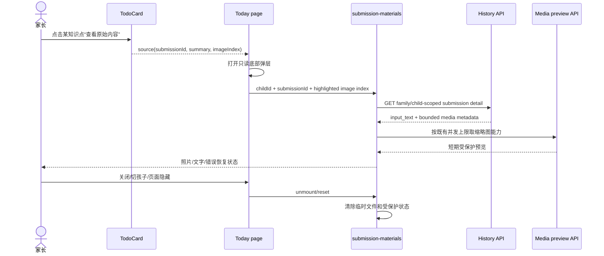
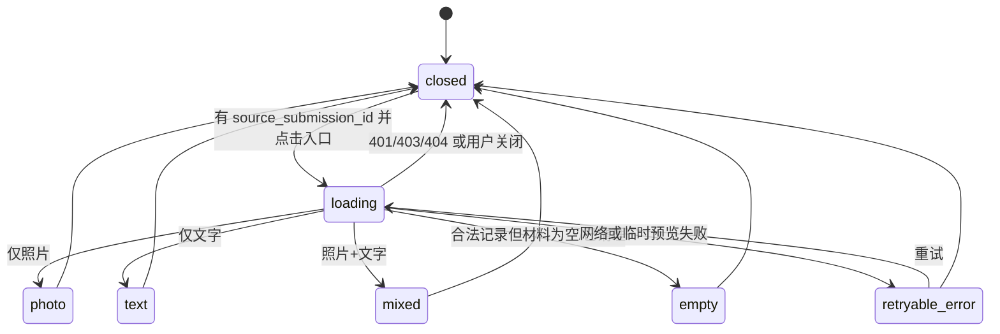
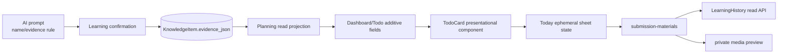

# BUG-023 — 今日复习项缺少可执行的原始材料上下文

- Status: `DONE`
- Severity: `P1 — 家长无法仅凭复习卡理解要复习的具体内容`
- Risk: `R2 — 同时影响 AI 输出规则、Todo 只读投影和小程序交互`
- Owner: 产品负责人（用户）
- Implementer: Codex
- Reviewer/Verifier: 独立只读 Review
- First observed: `2026-09-19 / 生产数据与当前小程序`
- Related incident/ticket: `N/A — 对话中发现的产品质量缺陷`
- Spec revision: `BUG-SPEC-20260919-REVIEW-SOURCE-01`
- User confirmation: `approved — 产品负责人于 2026-09-19 回复“批准”，明确对应上一条批准请求中的 BUG-SPEC-20260919-REVIEW-SOURCE-01 + DREV-20260919-TODAY-SOURCE-MATERIAL-01`
- Affected Feature IDs: `FEAT-001`
- Feature current-state documents: `docs/domain/features/FEAT-001-push-kids-mvp.md`
- Feature baseline revision: `FEAT-STATE-20260919-CONTEXT-REUSE-04-LOCAL`
- Feature merge owner: Codex

## Frontend Design Impact and Repository-native Approval

- Frontend impact: `yes — Today 复习卡信息层级、按钮高度和原始材料查看交互改变`
- Frontend impact reason: 删除“出现原因”，以知识点级原题提示和原始内容弹层取代“带练提示”。
- Frontend engineering impact: `yes — TodoCard、Today 页面瞬时状态、材料组件复用、媒体错误恢复和触控热区改变`
- Frontend engineering impact reason: 新增只读底部弹层并复用受保护媒体预览能力。
- Affected UI IDs: `UI-001`
- UI current-state documents: `docs/design/frontend/ui/UI-001-parent-miniapp.md`
- Frontend baseline revision: `FDB-20260913-04`
- Frontend engineering constraint revision: `FEC-20260913-LOCAL-DESIGN-EVIDENCE-01`
- Affected frontend quality dimensions: `component/state/responsive/a11y/i18n/browser/performance/security/privacy/motion-media-AI`
- Frontend quality budgets/requirements: `320×568 / 390×844 / 430×932；正文至少14px；实际触控热区至少88rpx；单次弹层只读取一条 family/child-scoped Submission；缩略图并发不超过既有2张；不预取原图；包体继续受现有预算约束`
- Frontend quality verification plan: `frontend VM/component tests；三视口仓库预览与原生节点几何；长中文/无证据/文字/照片/混合/410/403/404/网络失败；lint、静态小程序校验与包体；临时预览关闭清理`
- Approved frontend engineering deviations: `none`

- Current Design Revision(s): `DREV-20260913-UNIFIED-REVIEW-01`
- Editable design source path(s): `docs/design/frontend/prototypes/DREV-20260919-TODAY-SOURCE-MATERIAL-01/today-source-material.html`
- Design source SHA-256: `0aee14362353d81fa2ba743a4fca5089b534db07333b8f23d4c917b92bb9c5ce`
- Proposed Design Revision: `DREV-20260919-TODAY-SOURCE-MATERIAL-01`
- Required viewport/state exports: `photo-source-sheet + text-source-sheet @ 320×568 / 390×844 / 430×932`
- Prototype status: `APPROVED`
- Approved Task Spec revision: `BUG-SPEC-20260919-REVIEW-SOURCE-01`
- Approved Design Revision: `DREV-20260919-TODAY-SOURCE-MATERIAL-01`
- Design approval evidence: `产品负责人于 2026-09-19 回复“批准”，紧接明确列出上述两个 revision 的批准请求`
- Snapshot manifest path: `docs/design/frontend/snapshots/UI-001/DREV-20260919-TODAY-SOURCE-MATERIAL-01/APPROVAL.md`
- Permitted implementation deviations: `仅原生字体 fallback 与真实内容自然换行；不可改变入口位置、弹层语义或触控下限`
- UI current-state merge owner: Codex
- UI current-state merge evidence: `UI-STATE-20260919-TODAY-SOURCE-MATERIAL-02-LOCAL + FEAT-STATE-20260919-REVIEW-SOURCE-05-LOCAL`
- Frontend visual/a11y/resolution verification: `approved photo/text repository exports at 320×568 / 390×844 / 430×932；DevTools preview compile PASS；native geometry/font scale/iOS/Android NOT_RUN`
- Frontend engineering verification evidence: `frontend 170 passed；ESLint PASS；MINIPROGRAM_VALID pages=15 source_bytes=667541；DevTools preview 603151 bytes`
- External design dependency: `none`

## 1. Symptom and impact

- Who/what is affected: 使用 Today 复习安排的家长，特别是数天后已不记得上传材料内容的场景。
- Frequency: 任一名称只表达题型、主题或抽象能力而没有原始上下文的 Review 均可能发生。
- User-visible symptom: 卡片只显示“加减混合运算解决年龄问题”一类标签；“带练提示”只把名称插入通用学科模板，家长仍不知道具体复习哪道题。
- Business/data/security impact: 复习计划日期正确但不可执行，家长可能跳过任务或误判“完成”；无正式数据损坏或越权证据。
- First known good version: `N/A — 当前结构自引入以来没有知识点级原始材料入口`
- First known bad version: `current`
- Workaround: 跳转到历史记录并人工查找当次照片；步骤重、且 Today 当前卡片不提供直接入口。

## 2. Reproduction

### Preconditions

- Environment/version: `2026-09-19 生产数据 + 当前 main`
- Actor/permissions/tenant: 可读取所属家庭孩子学习记录的合法家长角色。
- Data/fixture: 一条由照片确认的知识点，名称为题型标签，Review 已进入 Today 稳定计划。
- Feature flags/config: `N/A`
- External dependencies: 私有媒体预览服务仅在点击原始内容时使用。

### Steps

1. 打开“今日”，展开“复习安排”。
2. 查看只写题型名称的知识点，并点击现有“带练提示”。

### Actual result

卡片显示知识点名称和“出现原因”；弹窗返回“请孩子讲一讲该名称，再做一道同类例题”的泛化模板，未展示当时上传的题目、图片或文字。

### Expected result

卡片以一句证据摘要帮助家长回忆原题，并提供当前页内“查看原始内容”；点击后在只读底部弹层查看原照片或原文字，不跳转历史页面、不生成新 review 内容、不产生任何学习或反馈写入。

### Reproduction evidence

- Test/script: `tests/frontend` 当前 TodoCard/Today 测试与 `PlanningService.practice_materials` 代码检查。
- Request/trace/log ID: `N/A — 无需记录生产身份或原始图片`
- Screenshot/data query: 2026-09-19 只读生产查询确认一条 Review 的正式 Knowledge 保存了 image evidence、source_submission_id 与原照片序号。
- Reproduction rate: `1/1` 已核查案例；结构性缺口可由代码确定复现。

## 3. Triage

### Confirmed facts

| Fact | Evidence |
|---|---|
| TodoCard 只显示 `knowledge_name`，并单独显示“出现原因” | `apps/miniprogram/components/todo-card/index.js|wxml` |
| 当前“带练提示”按学科套固定模板，不使用正式证据 | `apps/api/src/push_kids/planning/service.py::practice_materials` |
| Knowledge 首次确认已保存 `evidence_json`，Review 保存 `source_submission_id` | `persistence/models.py`、`learning/service.py`、生产只读查询 |
| 原始图片/文字已有 family/child-scoped 详情与短期预览能力 | `learning/history.py`、`components/submission-materials` |
| Current Todo 与稳定日计划均已携带 source submission/date | `planning/service.py`、`planning/selection.py` |
| Today 当前没有知识点级原始材料弹层 | `pages/today/index.*` |

### Hypotheses

| Hypothesis | Supports | Contradicts | Experiment | Result |
|---|---|---|---|---|
| 仅改知识点名称即可解决 | 更具体名称能降低理解成本 | 数天后仍无法恢复数字、原文与图片 | 用当前案例脱离图片阅读名称 | rejected |
| 新增 AI review 生成最完整 | 可生成自包含复习动作 | 增加成本、字段、生成失败面且用户明确拒绝 | 产品决策 | rejected |
| 复用 evidence + 原始材料足够 | 已有摘要、source 与安全预览链路 | 历史坏数据可能缺摘要/来源 | 定义降级矩阵并做回归 | selected |

### Blast radius

- Entry points: Today 稳定日计划卡；旧后端兼容 Todo 卡。
- Callers/consumers: Dashboard/reporting 聚合、`/todos`、小程序 Today/TodoCard；新增字段为可空 additive contract。
- Data already affected: 不改历史记录；已有有效 evidence 可立即展示，缺 evidence 按兼容矩阵降级。
- Security/tenant boundary: 原始材料仍由既有 history/preview 接口重新验证 family、child、submission、media。
- Related behaviors: `BHV-021` provenance、AI direct evidence、原始材料回看、稳定日计划。
- Other code with same pattern: upcoming review 只读卡保持现状，本次仅 Today 当前计划可操作卡。

### Link/call graph

```text
AI prompt → confirmed proposal.direct_evidence
          → KnowledgeItem.evidence_json
          → PlanningService daily selection / legacy todo projection
          → Dashboard → Today → TodoCard
                                 └─ open source event
                                    → Today source sheet
                                    → GET history/{submission}
                                    → submission-materials
                                    → signed media preview / original input_text
```

## 4. Root cause

### Fault mechanism

AI 输出的 `name` 被同时承担“稳定知识标签”和“家长当天要做什么”两种职责；`direct_evidence` 虽在确认后保存，Todo 投影和卡片没有消费它。现有“带练提示”又只按学科拼接 `knowledge.name`，因此在历史上下文消失后仍然无法定位原题。

### Why existing controls missed it

- Missing/incorrect test: 现有测试验证 schema、证据存在、来源关联与排期，但没有“家长可定位原始内容”的可执行性回归。
- Review/spec gap: UI 基线要求可追溯，但当前实现把“出现原因”当成可追溯，未验证能否查看材料本身。
- Monitoring gap: N/A；这是产品可用性，不应增加包含学习内容的遥测。
- Architecture/process contributor: 展示模型没有把已保存 evidence 投影到 Today；通用带练模板成为错误的补偿层。

### Root-cause evidence

- Code location: `todo-card/index.*`、`planning/service.py::practice_materials`、`agent_processing/prompt.py`。
- Failing test: 将新增 Todo evidence projection、source sheet 和 prompt contract 回归。
- Runtime evidence: 已核查生产条目有 evidence/source，但 Today 仍只展示标题与通用模板。

## 5. Fix contract

### Required behavior

1. Prompt 继续只生成学习提案，不新增 review 调用或复习题：
   - `name` 描述可复习的知识动作，不把年龄、购物、动物等普通故事情境直接升级为名称；
   - `direct_evidence.detail` 用一句家长可读的话概括原始题目/材料，不评价答案、不推断掌握、不编造条件；
   - 照片保留 `image_index`，文字保留 `source=parent_text`。
2. Planning 在稳定日计划与旧 Todo 兼容投影中，从 Knowledge 首次 `evidence_json` 确定性提取第一条有效证据，新增可空 `source_summary` 与 `source_image_index`；坏 JSON、空详情、越界序号降级为 `null`，不让 Todo 失败。
3. Todo 卡删除“出现原因”整块，但后端现有 provenance 字段继续保留兼容，不删除数据。
4. 每个知识点最多展示两行 `source_summary`；没有摘要时不渲染空占位。
5. 原“带练提示”及 Today 对 `/practice-materials` 的调用从当前卡片移除，改成知识点级“查看原始内容”；兼容 API 保留，不在本 Spec 删除。
6. 有 `source_submission_id` 时入口可点；点击在当前页打开底部只读弹层，复用 `submission-materials` 查看照片和/或原文，不导航历史页。
7. 弹层优先标记 `source_image_index` 对应照片；点击缩略图继续使用微信原生全屏预览。
8. 弹层支持 loading、photo、text、mixed、empty、retryable error、gone、unauthorized/not-found；关闭、切孩子、页面隐藏后清理受保护内容和临时文件。
9. “完成”按钮视觉高度由72rpx降至64rpx，但按钮/包装热区保持至少88rpx；pending/disabled/反馈回滚行为不变。
10. 查看材料是纯读操作，不创建/推进 Review，不写 Feedback，不记录正文/图片/签名地址到日志或本地持久化。

### Must not change

- Review 日期、稳定日计划选择、反馈策略和当日不补题行为。
- AI 不判分、不声明掌握、不预测下一课。
- 家长确认仍是创建正式学习/Knowledge/Review 的唯一入口。
- Knowledge 首次证据不被后续确认覆盖；本次不回填、不重写历史名称或 evidence。
- 历史详情、upcoming review、记录详情与媒体授权合同继续兼容。
- 不新增数据库表/列、模型请求、依赖、路由或页面。

### Feature current-state impact

- Current Feature sections affected: Current invariants 的 Todo provenance、AI evidence、原始材料读取；Prompt 表达规则；Today 复习可见行为。
- Incorrect/obsolete statement to correct: “Todo 的带练提示只提交当前 Review IDs”“为什么出现由前端拼装”。
- Final facts to merge after verification: Todo evidence 摘要投影、Today 原始内容弹层、按钮触控合同、Prompt action/evidence 规则与兼容降级。
- Change Reference to add: `BUG-023 / BUG-SPEC-20260919-REVIEW-SOURCE-01`。

### Non-goals

- 不生成复习题、答案、教学步骤或新的 review 文案。
- 不做 OCR、图片裁剪/bbox、题目结构化或图片永久保留承诺。
- 不修改既有历史知识名称，不修复可能过细的历史条目。
- 不删除 `/practice-materials` API 或其服务端测试；它仍是兼容接口。
- 不改 upcoming review 卡片、历史详情导航或反馈选项。
- 不发布、不上传体验版或生产版。

### State/data repair

- Fix prevents new vague naming and exposes existing provenance；no data repair。
- 历史有效 evidence 通过读时投影直接受益；无 evidence 的记录只显示原始内容入口。
- 所有变更可由代码回退；无写时迁移。

## 6. Fix design

### Selected change

- 修改现有 Prompt 权威规则，而不是建立第二个生成器。
- 在 Planning 只读投影解析现有 evidence，保持 Domain 排期纯策略不读取 JSON。
- Today 持有弹层的 ephemeral state；TodoCard 只派发具体 item 的 source event，不发网络请求。
- `submission-materials` 增加窄的 sheet/embedded 展示模式与相关图片标记，继续独占预览下载和清理生命周期。
- 删除 TodoCard/UI 中已被替代的 reason/practice 展示逻辑；兼容 API 与 provenance 数据保留。

### Trade-offs and alternatives rejected

| Alternative | Why rejected |
|---|---|
| 新增 `review_instruction` 并再次调用模型 | 成本、时延、失败面和持久化责任过重；用户明确拒绝 |
| 新增数据库 `source_summary` 列 | 正式 evidence 已保存；会复制事实并需要迁移/回填 |
| 点击跳转历史详情 | 离开 Today、需要重新定位，违反已确认交互 |
| 只优化 name | 无法恢复原题数字、原文或图片，仍不可追溯 |
| 用系统 `wx.showModal` | 不能承载可滚动图片、长文字和重试状态 |
| TodoCard 直接下载图片 | 组件职责错误且会导致列表预取、资源瀑布和隐私面扩大 |

### Sequence diagram



### State machine



任何弹层状态都不得触发 Review/Feedback 写入；无 `source_submission_id` 时入口不存在，不能进入 loading。

### Architecture diagram



模块边界不变：learning 拥有正式 evidence 与材料，planning 只做 family-scoped 只读投影，Today/TodoCard 只做接口映射；无反向依赖、无新开放扩展点。`source_summary` 展示规则 closed；OCR/crop 和自动生成复习材料 deferred。

### Expected file changes

| File/path | Action | Expected change | Why required |
|---|---|---|---|
| `apps/api/src/push_kids/agent_processing/prompt.py` | modify | 调整 name 与 evidence 一句话规则并升级 revision | 修复未来输出可理解性，不新增调用 |
| `apps/api/src/push_kids/planning/service.py` | modify | 两条 Todo 投影选择并安全解析 evidence | 向当前/兼容 UI 提供摘要与图片序号 |
| `apps/api/src/push_kids/planning/selection.py` | modify | 稳定日计划候选携带可空 source summary/index | 保持计划物化后的展示事实完整 |
| `apps/api/src/push_kids/planning/domain.py` | modify | `DueKnowledge` 透传可空展示字段 | 兼容旧 Todo 分组输出 |
| `apps/miniprogram/components/todo-card/index.js|wxml|wxss` | modify | 删除原因/带练；显示摘要并派发 source；缩短完成按钮可见高度 | Today 卡片目标交互 |
| `apps/miniprogram/components/submission-materials/index.js|wxml|wxss` | modify | 增加弹层嵌入与相关图片标记，复用原生命周期 | 避免复制安全预览逻辑 |
| `apps/miniprogram/pages/today/index.js|wxml|wxss|json` | modify | 管理材料弹层瞬时状态并承载组件 | 原地查看、不跳转 |
| `apps/miniprogram/utils/ui.js` | modify | 删除无消费者 `reviewReason`，保留通用日期帮助 | 移除被替代展示逻辑 |
| `tests/unit/test_planning_domain.py` | modify | 摘要/index 透传与空值 | 纯投影回归 |
| `tests/unit/test_planning_source_evidence.py` | add | 第一条有效证据、坏 JSON、空详情与越界图片序号降级 | 不可信历史数据回归 |
| `tests/integration/test_todo_provenance.py` | modify | evidence 安全解析、稳定计划/旧 Todo additive contract、权限 | API/数据边界回归 |
| `tests/frontend/today-source-material.test.js` | add | 卡片无原因/带练、摘要、source event、弹层挂载、关闭与触控语义 | 页面/组件回归 |
| `tests/frontend/submission-materials.test.js` | modify | embedded/highlight/photo/text/error/cleanup | 媒体生命周期回归 |
| `docs/domain/BEHAVIOR-CATALOG.md` | modify after verification | 更新 Todo 可追溯行为 | 当前行为事实 |
| `docs/domain/features/FEAT-001-push-kids-mvp.md` | modify after verification | 合并最终 Feature current-state | 当前事实 |
| `docs/design/frontend/ui/UI-001-parent-miniapp.md` | modify after verification | 替换原因/带练描述并记录 DREV | UI 当前事实 |
| `docs/design/frontend/FRONTEND-DESIGN.md` | modify after verification | Todo 基线从“出现原因”更新为“原始内容入口” | 全局可见合同发生明确替换 |
| 本 Spec、DREV、snapshot manifest/exports | add | 批准与验证证据 | 编码门禁 |

不预期修改：数据库 migration、persistence model、learning/history API、media store、planning policy、practice-materials API、app.json、新页面或依赖。

### Compatibility and rollout

- Deployment order: 后端 additive fields 先部署，前端后部署；旧前端忽略新增字段。若前端先到旧后端，摘要与入口按字段缺失降级，不崩溃。
- Feature flag: none；修改权威路径，不保留双 UI。
- Migration/backfill: none。
- Rollback/restore: 回退前端恢复原因/带练，或回退后端移除 additive fields；无数据恢复。
- Success metrics: 自动与人工验收证明家长可从每条有来源的当前 Review 原地看到照片/原文；无新 AI 调用；查看前后业务表不变。
- Abort metrics: 跨家庭材料可见、打开 Today 即预取原图、临时文件未清理、按钮热区<88rpx、弹层导致反馈状态丢失、原生三视口关键操作越界。

## 7. Regression verification

### Required regression tests

| ID | Acceptance/expected behavior | Level | Pre-fix expectation |
|---|---|---|---|
| `TP-001` | Prompt 明确 action-oriented name、parent-readable evidence、故事情境边界，且无 review 生成要求 | unit/prompt contract | fail |
| `TP-002` | 有效 image/parent_text evidence 在 stable selection 与旧 Todo 均投影 summary/index；坏 JSON/空/越界降级 null | unit + integration | fail |
| `TP-003` | family/child scope、无 source、历史无 evidence、照片+文字等兼容行为无越权/500 | integration/contract | partly pass; new fields absent |
| `TP-004` | TodoCard 不渲染“出现原因/带练提示”，显示两行摘要；知识点级事件携带正确 source | frontend component | fail |
| `TP-005` | 点击在 Today 原地打开弹层；关闭、切孩子、页面 hide 清理；迟到响应不串孩子 | frontend page/component | fail |
| `TP-006` | photo/text/mixed/empty/retry/410/401/403/404 与相关图标记正确；不跳历史 | frontend + integration | partly pass in detail component; sheet absent |
| `TP-007` | 完成按钮可见64rpx、有效热区≥88rpx；pending/disabled/feedback rollback 不变 | static/native geometry + frontend | fail geometry |
| `TP-008` | 查看前后 Learning/Knowledge/Review/Feedback 行数和状态不变；无 `/practice-materials` Today 请求 | E2E/frontend | fail request path |
| `TP-009` | 320/390/430、长中文、字体放大、iOS/Android；弹层可滚动、关键操作不越界 | repo export + native manual | not run |
| `TP-010` | 全量后端/前端、Ruff、Mypy、ESLint、架构、设计证据、小程序静态和包体通过 | repository gates | not run |

### Adjacent cases

| Case | Expected |
|---|---|
| 原始生产案例 | 摘要显示首次 evidence；弹层直接突出对应照片 |
| 新照片提案 | name 不以普通故事情境代替学习动作；evidence 一句话可读 |
| 纯文字提交 | “查看原始内容”弹层显示家长原文，无图片空框 |
| 照片+补充文字 | 同一弹层先图片后文字 |
| history evidence 坏 JSON | 无摘要，Todo/反馈仍可用；有 source 时仍可看原始内容 |
| source submission 缺失 | 不显示入口，不发请求，不隐藏 Todo |
| 图片 410 | 标记不可用；摘要/文字继续可读 |
| 权限撤销/切孩子 | 清空弹层内容和临时文件，不展示上一家庭/孩子材料 |
| 多知识点同/不同 source | 每行入口打开自己的 submission，不使用 group-level first item |
| 反馈提交失败 | 既有 optimistic rollback 保持 |

### Verification commands

| Test point | Command/case | Environment | Result | Evidence |
|---|---|---|---|---|
| `TP-001..008 focused` | focused pytest + `node --test` source/material files | local deterministic | PASS | backend focused 29 passed，Todo provenance final 5 passed；frontend focused 11 passed |
| `TP-010 backend` | `uv run pytest tests/unit tests/integration tests/contract -q` | local | PASS | 362 passed / 4 skipped（skipped 为需真实 MySQL 环境用例） |
| `TP-010 frontend` | `npm test && npm run lint:miniapp` | local | PASS | 170 passed；ESLint PASS |
| `TP-010 quality` | Ruff check/format + Mypy | local | PASS | Ruff PASS；Mypy 86 source files PASS；`git diff --check` PASS |
| `TP-010 architecture/design/static` | architecture + design policy + miniprogram validators | local | PASS | checked=3；DESIGN_EVIDENCE_VALID；15 pages / 667541 bytes；database audit empty/valid |
| `TP-009 repo viewports` | DREV exports + manifest hashes | 320/390/430 | PASS — 6 candidate exports generated with exact dimensions and hashes | snapshot manifest |
| `TP-009 DevTools compile` | DevTools CLI preview | WeChat DevTools | PASS | AppID matched；preview compiled；package 603151 bytes；not uploaded |
| `TP-009 native matrix` | 320/390/430 node geometry + font scale + iOS/Android | WeChat native devices | NOT_RUN | no authenticated fixture/device matrix in this task；release gate remains |
| `SQL dialect` | affected reads on real MySQL 5.7 | isolated MySQL 5.7 | NOT_RUN | `PUSH_KIDS_TEST_MYSQL_URL` not configured；blocking only for backend cloud release |
| `performance` | `uv run pytest tests/performance/test_read_paths.py -q` | local SQLite | PASS | 2 passed |

## 8. Review checklist

- [x] Observable symptom and expected contract are clear.
- [x] Root cause is evidence-backed.
- [x] Same pattern was searched in stable plan, legacy Todo and upcoming review.
- [x] Fix modifies authoritative Prompt/projection/UI paths.
- [x] No second generator, table, route or page is proposed.
- [x] Link graph, sequence, state machine and architecture view are complete.
- [x] Expected files and explicit non-changes are listed.
- [x] Specific Spec + DREV approval recorded.
- [ ] Regression tests fail before and pass after the fix.（未在批准后回退生产代码制造红测；Spec 已记录 pre-fix expectation，新增测试仅执行 post-fix PASS。）
- [x] Every required test point ran or records residual risk.
- [x] Feature/UI/Behavior/design baseline current-state merged.
- [x] Independent Review completed with per-file necessity assessment.

## 9. Closure and prevention

- Changed behavior: Prompt 生成可执行知识动作与一句原题摘要；Planning 投影 summary/index；Today 以原题提示和当前页原始材料弹层替代原因/带练。
- Deleted workaround/logic: 删除 TodoCard 的出现原因拼装、Today `/practice-materials` 请求、系统带练 modal 与无消费者 `reviewReason`；兼容 API 保留。
- Data repaired: none.
- Monitoring added: none; learning content must not enter new telemetry.
- Behavior catalog update: `BHV-021` 已更新。
- Feature current-state document update and Change Reference: `FEAT-STATE-20260919-REVIEW-SOURCE-05-LOCAL` 已合并；UI 与 frontend baseline 同步。
- Architecture/test/process change preventing recurrence: 新增 Prompt action/evidence、Planning 恶意历史 JSON、TodoCard/source event、embedded material 和纯读不写回归；模块边界未变化，无需 architecture 文档修订。
- Independent Review: `PASS`；基线 `6812dac847106fcc1a1d4f49e5c01a91a2943deb`，无 P0–P3 finding；逐项确认 Prompt、两条 projection、授权链路、清理、O(1) 查询和兼容 API 必要且无重复实现。
- Residual risk: historical rows without source/evidence can only degrade; original media retention is unchanged and not guaranteed forever.
- Follow-up owner/date: 发布负责人在后续发布任务补跑真实 MySQL 5.7 与三视口/字体放大/iOS/Android 真机矩阵；本次未上传、未部署。
