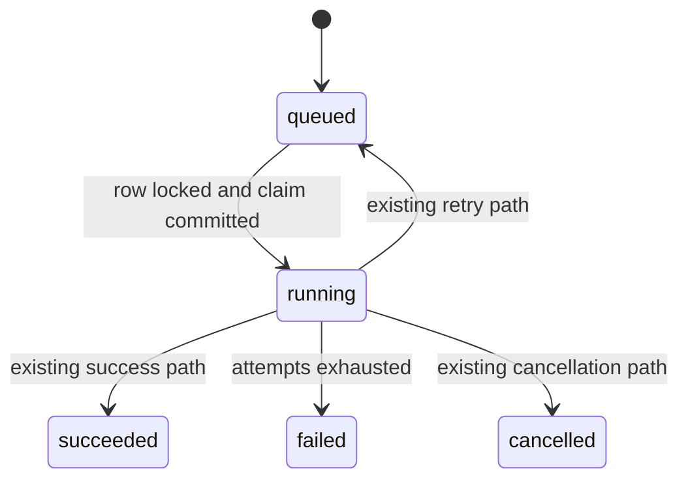
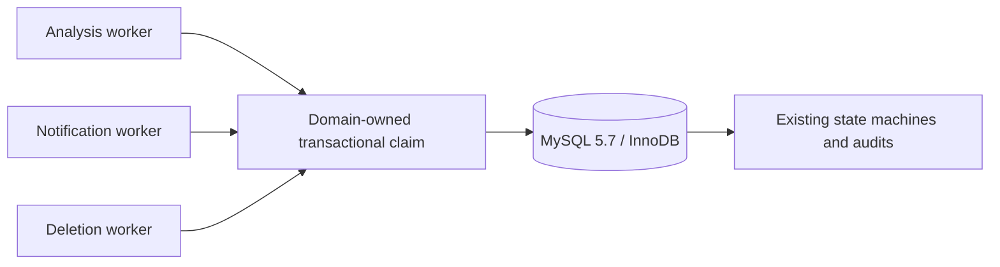

# BUG-024 — MySQL 5.7 worker claim compatibility blocks release

- Status: `DONE`
- Severity: `critical — cloud background workers cannot claim work on the supported database floor`
- Risk: `R3 — durable job state, notification delivery and deletion execution`
- Owner: `产品/架构负责人（用户）`
- Implementer: `Codex`
- Reviewer/Verifier: `pending`
- First observed: `2026-09-19 / isolated MySQL 5.7.44 release gate`
- Related release attempt: `docs/deploy/releases/20260919-021.md`
- Spec revision: `BUG-SPEC-20260919-MYSQL57-WORKER-01`
- Proposed architecture revision: `ARCH-20260919-MYSQL57-WORKER-01`
- User confirmation: `APPROVED 2026-09-19 — user replied “修复bug” immediately after the sole pending approval request for BUG-SPEC-20260919-MYSQL57-WORKER-01`
- Affected Feature IDs: `FEAT-001, FEAT-003, FEAT-006`
- Feature current-state documents: `docs/domain/features/FEAT-001-push-kids-mvp.md`, `docs/domain/features/FEAT-003-notification-channel.md`, `docs/domain/features/FEAT-006-data-cleanup-and-family-reset.md`
- Feature baseline revisions: `FEAT-STATE-20260919-REVIEW-SOURCE-05-LOCAL`, `FEAT-STATE-20260907-CHANNEL-05-CLOUD`, `FEAT-STATE-20260907-03-CLOUD`
- Feature merge owner: `Codex after verification`

## Frontend Design Impact and Repository-native Approval

- Frontend impact: `no — this restores backend worker execution and does not alter visible UI, copy, navigation or state contracts`
- Frontend engineering impact: `no — no Mini Program source or response schema changes`
- Affected UI IDs: `N/A`
- UI current-state documents: `N/A`
- Frontend baseline revision: `N/A`
- Frontend engineering constraint revision: `N/A`
- Affected frontend quality dimensions: `N/A — backend database compatibility repair only`
- Frontend quality budgets/requirements: `N/A`
- Frontend quality verification plan: `existing frontend regression suite only`
- Approved frontend engineering deviations: `none`
- Current Design Revision(s): `N/A`
- Editable design source path(s): `N/A`
- Design source SHA-256: `N/A`
- Proposed Design Revision: `N/A`
- Required viewport/state exports: `N/A`
- Prototype status: `N/A`
- Approved Task Spec revision: `BUG-SPEC-20260919-MYSQL57-WORKER-01`
- Approved Design Revision: `N/A`
- Design approval evidence: `N/A — no frontend impact`
- Snapshot manifest path: `N/A`
- Permitted implementation deviations: `none`
- UI current-state merge owner: `N/A`
- UI current-state merge evidence: `N/A`
- Frontend visual/a11y/resolution verification: `N/A`
- Frontend engineering verification evidence: `backend-only change; full frontend suite remains a release regression gate`
- External design dependency: `none`

## 1. Symptom and impact

- Who/what is affected: `analysis jobs, notification outbox claims and durable deletion requests on MySQL 5.7`
- Frequency: `deterministic whenever a claim statement containing SKIP LOCKED executes`
- User-visible symptom: `analysis can remain queued; notifications and deletion work can remain unprocessed; a release readiness check cannot become trustworthy`
- Business/data/security impact: `no observed corruption; durable work is not claimed, and deletion delay is privacy-relevant`
- First known good version: `unknown; no isolated MySQL 5.7 worker-suite evidence exists for the current claim implementation`
- First known bad version: `current source at base commit 6812dac`
- Workaround: `do not publish a new backend; keep the previous immutable version while repairing and verifying the claim path`

## 2. Reproduction

### Preconditions

- Environment/version: `official MySQL 5.7.44 linux/amd64 container`
- Actor/permissions/tenant: `isolated root-owned test database only; no production access`
- Data/fixture: `fresh Alembic upgrade through 20260913_0014`
- Feature flags/config: `cloud-mode integration test settings`
- External dependencies: `none beyond the isolated database`

### Steps

1. Upgrade an empty MySQL 5.7 database to the unique Alembic head.
2. Execute the full `tests/integration/test_mysql_runtime.py` release gate.
3. Execute `SELECT ... FOR UPDATE SKIP LOCKED` directly on `agent_jobs`.

### Actual result

- Alembic upgrade/current/check succeeds at `20260913_0014`.
- The worker tests log `ProgrammingError`, leave submissions queued and fail.
- MySQL returns `ERROR 1064 (42000)` at `SKIP LOCKED`.
- The query-plan test additionally expects the obsolete index name
  `ix_review_items_family_child_active_due_id`; the migrated schema correctly contains
  `ix_review_items_family_child_active_due_last_id`.

### Expected result

All three durable worker types claim at most one eligible row transactionally on MySQL 5.7, preserve their existing
state machines and family boundaries, and the complete isolated MySQL suite passes against the migrated schema.

### Reproduction evidence

- Test/script: `PUSH_KIDS_TEST_MYSQL_URL=<isolated-url> uv run pytest tests/integration/test_mysql_runtime.py -q`
- Result: `3 failed, 1 passed`
- Direct SQL: `FOR UPDATE SKIP LOCKED` fails; the same statement with plain `FOR UPDATE` succeeds.
- Reproduction rate: `deterministic`

## 3. Triage

### Confirmed facts

| Fact | Evidence |
|---|---|
| Supported production capability floor is MySQL 5.7.18 | `ARCHITECTURE.md`, `TEST-STRATEGY.md` |
| MySQL 5.7 rejects `SKIP LOCKED` | isolated 5.7.44 SQL 1064 reproduction |
| Four source sites emit this option | two analysis-worker claims, one notification claim and one deletion claim |
| Current cloud service is configured as one instance | `deploy/cloudbase/service-settings.json`, release handbook |
| No schema change is needed | plain `FOR UPDATE` works against head `20260913_0014` |
| The new BUG-023 Today/Todo read completed on MySQL 5.7 before the stale index-name assertion | query-plan test reached its final index-name check |

### Blast radius

- Entry points: `AnalysisWorker.process_one`, terminal analysis recovery, notification dispatch, deletion worker.
- Callers/consumers: `learning submission processing`, `reminder delivery`, `child/family deletion`.
- Data already affected: `unknown; no production log or queue-age audit was performed in this release attempt`.
- Security/tenant boundary: `queries remain server-side and tenant-scoped after claim; no scope broadening is proposed`.
- Related behaviors: `readiness, retry/lease recovery, idempotent deletion and notification dedupe`.
- Other code with the same pattern: `the four sites found by repository-wide search are in scope`.

### Link/call graph

```text
cloud worker loop
  -> select one durable row
     -> SQLAlchemy with_for_update(skip_locked=True)
        -> MySQL 5.7 parser -> SQL 1064 -> no claim/state transition

release gate
  -> bounded read EXPLAIN
     -> valid renamed index -> stale assertion name -> false-negative test failure
```

## 4. Root cause

### Fault mechanism

The worker concurrency design assumed the MySQL 8 `SKIP LOCKED` capability while the enforced runtime floor is
MySQL 5.7. SQLAlchemy compiles the requested clause, MySQL 5.7 rejects the statement before row locking, and the
worker's privacy-safe log records only the exception type. The integration suite existed but was previously skipped
without an isolated 5.7 URL, so the incompatibility survived local SQLite checks and cloud version creation.

### Why existing controls missed it

- Missing/incorrect test: `the real-5.7 suite was NOT_RUN in earlier releases; one plan assertion also retained an old index name`.
- Review/spec gap: `FEAT-003 described SKIP LOCKED without reconciling it with ARC-015's MySQL 5.7 floor`.
- Monitoring gap: `worker logs redact SQL detail correctly, but no production queue-age evidence was captured here`.
- Architecture/process contributor: `database capability was inferred from ORM support rather than verified on the minimum engine`.

## 5. Fix contract

### Required behavior

- Claim one eligible row with transactional locking using SQL accepted by MySQL 5.7.
- Preserve existing job/deletion/notification state transitions, retry limits, leases, idempotency and terminal states.
- Preserve current single-instance correctness; concurrent callers may serialize rather than double-claim.
- Keep readiness false on genuine database failures.
- Update the query-plan assertion to the schema's authoritative current index name.

### Must not change

- No API or Mini Program contract changes.
- No migration, table/index mutation or production data rewrite.
- No loss of family scoping, notification dedupe, deletion audit or analysis lease checks.
- No claim based on an unlocked read followed by a separate write.

### Feature current-state impact

- Current Feature sections affected: `analysis worker runtime`, `notification delivery`, `durable deletion`.
- Incorrect/obsolete statement to correct: `MySQL claim uses SKIP LOCKED on the 5.7 production floor`.
- Final facts to merge after verification: `plain transactional row locking is the supported single-instance claim policy; multi-instance non-blocking claims remain deferred`.
- Change Reference to add: `BUG-SPEC-20260919-MYSQL57-WORKER-01 / ARCH-20260919-MYSQL57-WORKER-01`.

### Non-goals

- Multi-instance throughput optimization or a new distributed queue.
- Production queue repair without a separate read-only audit and explicit data-repair authorization.
- Database engine upgrade.

### State/data repair

- The code fix prevents new claim failures only.
- Existing queued rows should recover through the current lease/retry state machines after deployment.
- No direct data repair is authorized or expected; any terminal/expired backlog needs a separate audited decision.

## 6. Fix design

### Selected change

- Replace the four `with_for_update(skip_locked=True)` calls with plain `with_for_update()` in their owning domains.
- Keep selection, ordering, limit, transaction boundary and post-lock state checks unchanged.
- Update the MySQL query-plan fixture to expect `ix_review_items_family_child_active_due_last_id`.
- Rationale: the production service is intentionally capped at one instance; a blocking row lock preserves correctness
  with the smallest compatible change and no new abstraction or schema.

### Trade-offs and alternatives rejected

| Alternative | Why rejected |
|---|---|
| Upgrade production to MySQL 8 | materially larger platform/data migration, outside this release |
| Atomic UPDATE/claim-token protocol | adds schema/protocol complexity not justified for the current single instance |
| Runtime database-version branching | retains two concurrency contracts and extra test burden without a current MySQL 8 target |
| Ignore unrelated worker failures and release only the changed read | violates the repository's full MySQL release gate and could publish an unhealthy worker runtime |

### Sequence diagram

```mermaid
sequenceDiagram
  participant W as Worker
  participant DB as MySQL 5.7
  W->>DB: BEGIN; SELECT eligible LIMIT 1 FOR UPDATE
  DB-->>W: locked row or empty
  alt row returned
    W->>DB: update lease/state; COMMIT
    W->>W: execute existing provider/delivery/deletion path
  else empty
    W->>DB: ROLLBACK/close
  end
```

### State machine



### Architecture diagram



### Expected file changes

| File/path | Action | Expected change | Why required |
|---|---|---|---|
| `apps/api/src/push_kids/agent_processing/worker.py` | modify | remove unsupported skip-locked option at two claims | restore analysis worker |
| `apps/api/src/push_kids/notifications/service.py` | modify | use compatible locked claim | restore notification worker |
| `apps/api/src/push_kids/data_management/worker.py` | modify | use compatible locked claim | restore deletion worker |
| `tests/integration/test_mysql_runtime.py` | modify | current index name and claim coverage | make real-5.7 gate authoritative |
| affected Feature/architecture docs | modify | record supported claim policy | keep current-state truth aligned |

## 7. Verification and release plan

| Test point | Evidence required | Gate |
|---|---|---|
| TP-001 | fresh MySQL 5.7 migration/current/check | block backend release |
| TP-002 | complete `test_mysql_runtime.py` passes with no SQL 1064 | block backend release |
| TP-003 | analysis reaches pending confirmation and preserves retries/lease recovery | block backend release |
| TP-004 | notification/deletion claims preserve dedupe/idempotency/terminal states | block backend release |
| TP-005 | captured worker SQL contains no `SKIP LOCKED`, window function or CTE | block backend release |
| TP-006 | full unit/integration/contract, lint, type, architecture and frontend regressions pass | block release |
| TP-007 | frozen container runs non-root, live/ready 200 and SIGTERM clean | block backend release |

Release order after approval and verification:

1. Freeze and commit the approved BUG-023 plus BUG-024 repair.
2. Build the minimal backend release directory and create a gray immutable cloud version.
3. Verify version/service normal, MINIAPP only, and real AppID live/ready/business smoke.
4. Stop before the manual full-traffic gate.
5. Upload the next Mini Program development version only after the backend gray version is stable.
6. Stop before the experience/review/production manual gates.

Rollback target: backend `flask-ik19-022`; frontend `0.1.10`; Schema remains `20260913_0014`.

## 8. Approval request

Approve exact revision `BUG-SPEC-20260919-MYSQL57-WORKER-01` to authorize the selected compatible-lock repair and
release resumption. Approval does not authorize production data repair, full traffic switching, WeChat review or
formal production publication; those remain their documented manual gates.

## 9. Verification evidence

| Test point | Result | Evidence |
|---|---|---|
| TP-001 | PASS | isolated MySQL 5.7.44 fresh upgrade/current/check at `20260913_0014` |
| TP-002 | PASS | `tests/integration/test_mysql_runtime.py`: 4 passed; pre-fix evidence was 3 failed/1 passed |
| TP-003 | PASS | MySQL analysis fixture reached pending confirmation and confirmation completed |
| TP-004 | PASS | MySQL app background loops issued compatible analysis/notification/deletion claim queries; full notification/deletion regressions included in 362-pass suite |
| TP-005 | PASS | repository production source contains no `skip_locked`; MySQL 5.7 suite executed the worker loops without SQL 1064 |
| TP-006 | PASS after one format retry | backend 362 passed/4 skipped; frontend 170 passed; Ruff/format/Mypy/ESLint/architecture/design/validator/audit/performance PASS; first format check found and then corrected one indentation issue |
| TP-007 | PASS after correcting local fixture config | manifest 90 files/1066837 bytes; image `sha256:4d2d19c6d3b47991d44e52ce41e8c8eee47b5a8701acc5179bf1b98f5371ab79`; CRUD-only DDL denied; UID 10001; live/ready 200; SIGTERM exit 0. First start failed because the local synthetic fixture omitted the required `MYSQL_PASSWORD`; no production config was involved. |

Independent review initially returned `BLOCK` only because FEAT-003 still described `SKIP LOCKED`; code, tests,
transaction boundaries and placement had no P0–P3 findings. `CR-001` was resolved by updating FEAT-001, FEAT-003,
FEAT-006 and the architecture database matrix before the final review. Final independent review: `PASS`, with no
P0–P3 findings, no questionable/unnecessary files and no misplaced or redundant implementation.
