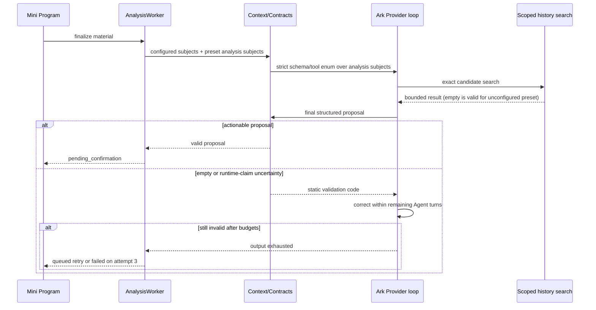
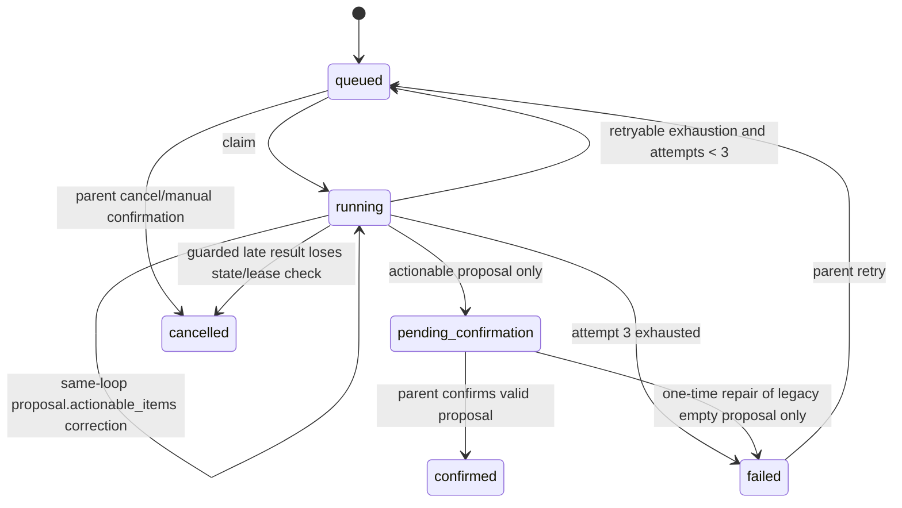
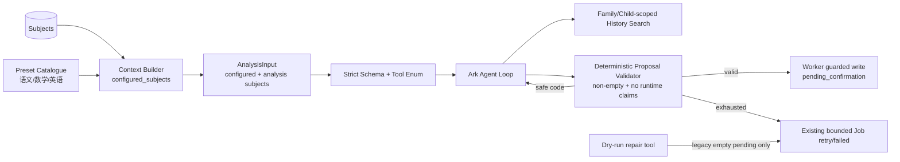

# BUG-027 — 空分析提案伪成功与基础科目识别缺口

- Status: `DONE`
- Severity: `P1 — 有明确学习内容的材料被保存为空待确认草稿，并在界面伪装成错误科目知识点`
- Risk: `R2 — 修改模型输入科目合同、Agent 输出有效性、既有异常草稿修复与质量评测；不改正式确认事务`
- Owner: `产品负责人（用户）`
- Implementer: `Codex`
- Reviewer/Verifier: `独立只读 Reviewer + 产品负责人受控验收`
- First observed: `2026-09-23 / 生产 flask-ik19-024`
- Related incident/ticket: `2026-09-23 用户检查当前待确认记录时发现英语材料显示为数学空白项，并出现“因历史知识检索调用失败”`
- Spec revision: `BUG-SPEC-20260926-EMPTY-PROPOSAL-QUALITY-02`
- User confirmation: `APPROVED — 产品负责人（用户），2026-09-26；在收到 revision 02 的运行时证据、端到端/单科双门禁、固定跨科目轮转、替代方案与“不修改生产 Provider/lease/retry”的说明后明确回复“批准”。该回复在当前会话中只对应 BUG-SPEC-20260926-EMPTY-PROPOSAL-QUALITY-02。`
- Affected Feature IDs: `FEAT-001`
- Feature current-state documents: `docs/domain/features/FEAT-001-push-kids-mvp.md`、`docs/domain/BEHAVIOR-CATALOG.md`
- Feature baseline revision: `FEAT-STATE-20260919-REVIEW-ONLY-CONFIRM-02-UPLOADED`（正文已合并 BUG-026 最终事实，但文档头 revision 尚未前移）
- Feature merge owner: `Codex；仅在实现、测试和 Review 完成后合并最终事实`

## Revision 02 — 发布门禁归因与顺序偏差修复

### New runtime evidence

- 2026-09-25 固定 40-case 完整运行：端到端成功 `38/40 = 95%`；数学、英语 100%，语文
  `86.67%`；`zh-09`、`zh-10` 均为 3 次 Ark 调用超时后的 `analysis_failed`，不是科目、证据、
  空提案或结构化输出错误。
- 同一 `zh-09` 合成图片的受控单组 A/B：stateless `125300ms / 2 turns`，session
  `108414ms / 2 turns`，两种模式均成功；不能把本次长尾归因于 `previous_response_id` 会话续接。
- 失败尝试有时卡在 turn 1、有时卡在 turn 2；其后同一批次连续 30 条完成，符合外部依赖瞬时长尾，
  不符合稳定、可由材料或学科复现的语义缺陷。
- 当前 fixture 按 12 语文、12 数学、12 英语、4 多科目连续执行，使一个短暂依赖故障窗口与语文
  分组强相关。总体端到端门禁正确计入了依赖失败，但单科语义门禁也把依赖不可用当成语文错误，
  指标归因失真。

### Revision 02 decision

1. 保留端到端成功率 `>=95%`：所有失败（包括 Ark/工具/传输失败）继续进入 40 条总分母，故依赖稳定性
   不会被隐藏；超过 2 条任何类型失败仍阻止发布。
2. 单科 `>=90%` 衡量内容质量：明确的基础设施终态 `analysis_failed` 不进入单科语义分母；
   `analysis_output_invalid`、科目不符、证据缺失、空提案等模型/合同失败仍进入对应单科分母并计失败。
3. 40 条集合不变，执行顺序改为固定、可复现的语文/数学/英语 round-robin，并把多科目样本稳定穿插，
   避免时间窗口与某一学科分组相关；不随机洗牌，不允许选择有利顺序。
4. 报告同时输出端到端比率、operational failure count/codes、单科语义分子/分母/比率、空 pending、
   remaining pending 和 formal writes。仍只含 case ID、静态码、attempt 与聚合，不含材料或模型内容。
5. revision 01 的失败报告不能追认为 PASS；revision 02 实现后必须重新完整运行固定 40-case，不能只重跑
   `zh-09`/`zh-10`。

### Alternatives and trade-offs

| Alternative | Decision | Reason |
|---|---|---|
| 不改门禁，等待后反复整批运行直到通过 | rejected | 没有修正科目连续顺序偏差，容易演变为选择性“刷绿” |
| 只重跑两个超时样本 | rejected | 改变固定分母，无法形成一次完整、可审计发布证据 |
| 所有 Provider 失败都从总体分母移除 | rejected | 会隐藏真实端到端可用性，违背发布门禁目的 |
| 增大 5 分钟 lease 或增加第 4 次 Job retry | rejected | A/B 在现有预算内成功；扩大生产恢复窗口但没有证据能修复瞬时厂商长尾 |
| 关闭 session reuse | rejected as BUG-027 fix | 同图 stateless/session 均成功且 session 更快；会话能力仍由其独立 Spec 和开关管理 |

Revision 02 不改变生产调用链、状态机或架构图；仅改变评测工具的固定用例调度和指标聚合。原有
Link/call graph、Agent sequence、Job state machine 和生产架构继续有效。

## Frontend Design Impact and Repository-native Approval

- Frontend impact: `no — 复用既有“失败 → 重试/人工记录”状态和文案，不新增页面、操作、布局或状态名称`
- Frontend impact reason: `修复目标是阻止不可确认的空提案进入既有待确认界面；异常结果回到已经批准的失败态，不新增“待确认中重新分析”分支`
- Frontend engineering impact: `no — 预计不修改小程序代码；运行现有前端回归证明失败/重试路径兼容`
- Frontend engineering impact reason: `既有 UI 已支持 failed、retry 和 manual entry；数据修复把异常 pending_confirmation 纠正为该现有状态`
- Affected UI IDs: `UI-001（兼容回归，不修改当前可见合同）`
- UI current-state documents: `docs/design/frontend/ui/UI-001-parent-miniapp.md`
- Frontend baseline revision: `FDB-20260913-04`
- Frontend engineering constraint revision: `FEC-20260913-LOCAL-DESIGN-EVIDENCE-01`
- Affected frontend quality dimensions: `AI state compatibility、error recovery、privacy（回归验证）`
- Frontend quality budgets/requirements: `既有 failed/retry/manual 状态；AI 草稿必须可编辑且只有家长确认才入档；不得在客户端日志/Storage 保存原始模型内容`
- Frontend quality verification plan: `npm test；npm run lint:miniapp；validate_miniprogram.py；不新增视觉差异，因此不生成新 viewport export`
- Approved frontend engineering deviations: `none`
- Current Design Revision(s): `复用已批准 UI-001 失败/重试状态；无新 DREV`
- Editable design source path(s): `N/A — 无可见变化`
- Design source SHA-256: `N/A — 无可见变化`
- Proposed Design Revision: `N/A — 无可见变化`
- Required viewport/state exports: `N/A — 不改变已有状态的布局或交互`
- Prototype status: `N/A`
- Approved Task Spec revision: `BUG-SPEC-20260926-EMPTY-PROPOSAL-QUALITY-02`
- Approved Design Revision: `N/A`
- Design approval evidence: `N/A — 无新设计`
- Snapshot manifest path: `N/A — 无新设计`
- Permitted implementation deviations: `none`
- UI current-state merge owner: `Codex；仅当兼容事实变化时追加 Change Reference`
- UI current-state merge evidence: `N/A — no visible UI contract changed`
- Frontend visual/a11y/resolution verification: `N/A — 无可见实现变化；若实现中发现必须改 UI，停止并创建 DREV 后重新批准`
- Frontend engineering verification evidence: `npm test: 170 passed；npm run lint:miniapp PASS；validate_miniprogram: 15 pages / 667593 bytes`
- External design dependency: `none`

## 1. Symptom and impact

- Who/what is affected: 孩子的材料科目不在当前 active subject 集合中，或模型在检索/分类后没有形成可确认条目时。
- Frequency: 生产检查到 3 条待确认中有 2 条英语材料形成空提案并被显示成数学；9 月 23 日样本发生在 024 全量后。
- User-visible symptom: 摘要正确识别英语主题，但科目区显示“数学 1 个知识点”，知识点为空且无直接证据；其中一条 uncertainty 声称“因历史知识检索调用失败”。
- Business/data/security impact: 家长不能确认有效内容，且会把前端占位项误认为模型生成结果；未确认草稿未写正式学习/Review，未发现跨家庭或正式数据污染。
- First known good version: `NEEDS_VERIFICATION；严格 configured-subject Schema 之前的 BUG-013 路径允许未配置科目经家长同意新增，但不能据此声称模型质量达标。`
- First known bad version: `flask-ik19-023` 的 9 月 22 日样本；`flask-ik19-024` 的 9 月 23 日样本证明 BUG-026 未覆盖该路径。
- Workaround: 家长不要确认异常空草稿；可手工录入。当前 retry 仅接受 failed，pending_confirmation 不能直接重试。

## 2. Reproduction

### Preconditions

- Environment/version: `prod-d2g14rwoycac6b45d / flask-ik19-024 / MySQL 5.7 / schema 20260913_0014`。
- Actor/permissions/tenant: 已绑定家庭的可写成员；检查对象为“旺仔”的待确认记录。
- Data/fixture: 英语 “My friends” 词汇/句型/律动材料；另一个英语“中国发明”材料。
- Feature flags/config: Ark Provider；严格 subject-grouped JSON Schema；当前 child 的 active subjects 未直接从数据库导出，运行现象与代码共同表明英语未进入该 attempt 的合法科目路径或未被模型形成合法条目。
- External dependencies: 微信私有对象存储、Ark Responses API、MySQL。

### Steps

1. 为只配置部分学习科目的孩子提交一份属于系统基础科目但未处于 active subject 集合的材料，例如英语。
2. Worker 用 `build_analysis_input()` 只读取 active learning subjects。
3. Provider 的最终 JSON Schema 与 history tool enum 只允许这些 subject names。
4. 模型输出事实摘要，但省略无法合法归类/检索的知识点，并把原因写进 uncertainties。
5. 服务端接受 `knowledge_points=[]`、`todo_matches=[]` 的提案并保存为 pending_confirmation。
6. 小程序准备草稿时用 `emptyPoint()` 补一项，并继承后端回退的第一个科目。

### Actual result

- 任务状态为 `pending_confirmation`，不是 `failed`。
- 后端空提案的 `subject_name` 回退到 `existing_subjects[0]`；生产样本中为数学。
- 前端把空列表补成一个空白知识点，显示为“数学 1 个知识点”。
- retry API 因状态不是 failed 返回 `409 只有失败的分析可以重试`。
- “因历史知识检索调用失败”是模型生成的 uncertainty，不是可信的 Job/Tool 诊断。

### Expected result

- 系统预设基础科目 `语文/数学/英语` 即使尚未配置，也必须可以作为“待家长同意新增”的识别科目进入提案；模型不能被协议迫使丢弃清晰的英语材料。
- 没有任何知识点或复习匹配的提案不是可确认成功，必须在同一 Agent loop 内纠正；仍为空时按现有有界 Job retry 进入 failed，而不是 pending_confirmation。
- 模型不得在 uncertainty 中冒充系统运行诊断；真实 tool/validation 原因只使用服务端静态代码。
- failed 继续使用现有重试/人工录入路径；家长确认前零正式写入。

### Reproduction evidence

- Test/script: 待新增 `proposal.actionable_items`、预设科目扩展与异常草稿修复回归。
- Request/trace/log ID: 生产完整资源 ID 不写入 Spec；只记录日期、状态和版本。
- Screenshot/data query: 2026-09-23 通过真实小程序私有链路逐条打开三笔待确认记录；两笔英语为空/数学回退，一笔语文 3 条证据正常。
- Reproduction rate: 观察到的两笔英语材料为 `2/2`；代码级空提案路径为确定性 `100%`。

## 3. Triage

### Confirmed facts

| Fact | Evidence |
|---|---|
| `build_analysis_input()` 只传 active learning subjects | `agent_processing/context.py` 查询 `Subject.active is true` |
| strict JSON Schema 要求 subjects 恰好等于 `existing_subjects` 且禁止额外键 | `contracts.py::structured_output_schema/validate_model_result` |
| history tool 的 subject enum 同样只允许 `existing_subjects` | `providers.py` tool schema 与 `_parse_history_tool_calls` |
| 空 knowledge/todo 在 `AnalysisProposal` 合法 | `knowledge_points`/`todo_matches` 使用空列表 default |
| final history ledger 只检查已输出 knowledge points | `runner.py::validate_final`；空列表没有 missing |
| 空提案的主科目回退为首个 existing subject | `contracts.py::validate_model_result` |
| 小程序对空 knowledge list 注入 `emptyPoint()` | `pages/submission/draft.js::prepareDraft` |
| retry 只接受 failed | `LearningService.retry()` |
| 9 月 23 日异常样本由 024 产生 | 真实小程序检查 + 当前 024 全量状态 |

### Hypotheses

| Hypothesis | Supports | Contradicts | Experiment | Result |
|---|---|---|---|---|
| BUG-026 同-loop ledger 修复失效 | 有“历史检索失败”文字 | 最终没有 new point，因此 ledger 没有 missing 可校验 | 检查 proposal/state 与 validator | rejected as primary cause |
| Ark/数据库整体不可用 | uncertainty 声称检索失败 | 同批语文提案成功；真实依赖异常不会保存 pending_confirmation | 检查状态机与 worker error path | rejected |
| strict active-subject 协议使未配置英语无法合法输出 | 两笔英语均成为空提案；Schema/tool 均限制科目 | 未直接导出该 child 的 subject DB 行 | 增加系统预设分析目录回归，并在受控数据集验证 | confirmed code defect; production trigger highly consistent |
| 前端真的收到模型生成的数学知识点 | UI 显示数学 1 条 | 该条无名称/证据，代码会为空列表注入占位项 | 检查 `prepareDraft()` | rejected |

### Blast radius

- Entry points: 图片分析 finalize、文字触发 Agent 的路径、失败 retry 后的再分析。
- Callers/consumers: `AnalysisWorker → build_analysis_input → AnalysisAgentRunner → ArkAnalysisProvider → LearningSubmission proposal → Mini Program draft`。
- Data already affected: 未确认、不可确认的空 proposal；正式学习数据无证据受影响。
- Security/tenant boundary: 不变；subject/history 查询仍由服务端固定 family/child。
- Related behaviors: `BHV-003`、`BHV-005`、`BHV-014`、`ARC-005`、`ARC-009`。
- Other code with the same pattern: 所有使用 `existing_subjects[0]` 作为空结果回退的路径；所有把模型 uncertainty 当系统事实展示的路径。

### Link/call graph

```text
Mini Program finalize/retry
  → LearningService queues AgentJob
  → AnalysisWorker materializes media and builds AnalysisInput
  → context.py selects only active subjects
  → contracts.py/providers.py close output + tool schema to those subjects
  → model returns summary + empty subject arrays + uncertainty
  → validate_model_result accepts zero actionable items
  → Worker writes pending_confirmation
  → draft.js injects emptyPoint and inherits first-subject fallback
```

## 4. Root cause

### Fault mechanism

两个独立但相互放大的错误共同造成伪成功：

1. “孩子当前配置的科目”和“模型允许识别、但需要家长同意后新增的科目”被错误合并为同一个
   `existing_subjects` 集合。严格 Schema 与 tool enum 因而关闭了原有的未配置预设科目确认路径。
2. 系统只校验 JSON/引用/历史 ledger，没有校验提案是否至少包含一个可确认动作。空提案因此被判定为成功，
   后端首科目回退和前端编辑占位逻辑又把它伪装成真实数学知识点。

模型生成的“历史知识检索调用失败”不是根因证据；根因是服务端允许模型自由描述系统故障，同时没有用
确定性 validation code 阻止不可确认结果进入成功态。

### Why existing controls missed it

- Missing/incorrect test: 没有“未配置系统预设科目仍可识别并要求 consent”的测试；没有“零 actionable items 不得 pending_confirmation”的测试；前端测试只覆盖人工空表单与正常提案。
- Review/spec gap: BUG-026 只修复“已经输出 new point 但 final ledger 缺检索”的路径，没有覆盖“模型完全省略 point”路径。
- Monitoring gap: 当前成功率按 Job succeeded/pending_confirmation 计算会把空提案算成功；没有 actionable proposal 质量门禁。
- Architecture/process contributor: `existing_subjects` 同时承担用户配置事实、Schema 允许集和 history tool 允许集，三个语义没有显式分离。

### Root-cause evidence

- Code location: `agent_processing/context.py`、`contracts.py`、`providers.py`、`runner.py`、`pages/submission/draft.js`、`learning/service.py`。
- Failing test: 待新增 pre-fix regression；当前生产数据已证明外部症状。
- Runtime evidence: 024 下两笔英语材料为空提案/数学回退，同一孩子语文材料正常。

## 5. Fix contract

### Required behavior

- `configured_subjects` 只表示数据库中 active learning subjects。
- `analysis_subjects` 表示本次允许识别的科目：全部 configured subjects，加上缺失的系统预设
  `语文/数学/英语`；顺序稳定、去重、最多 33 项。strict JSON Schema 与 tool enum 使用
  `analysis_subjects`，Prompt 明确区分“已配置”和“可识别但需家长同意新增”。
- 未配置的预设科目可产生普通 proposal point；确认仍使用现有 `consent_required`，只有家长同意才创建 Subject。
- `AnalysisProposal` 在完成服务端投影后必须至少有一个 `knowledge_point` 或 `todo_match`。否则抛出
  `proposal.actionable_items`，由 Provider 在同一 Agent loop 返回静态纠错；轮次/attempt 耗尽后进入既有
  `analysis_output_invalid` failed，不得写 pending_confirmation。
- uncertainty 只能描述材料歧义、证据不足或需要家长核对的内容；声称“接口/系统/数据库/工具调用失败”的文本
  以静态 `uncertainty.runtime_claim` 拒绝并同-loop 纠正。真实依赖错误继续由异常和 Job diagnostic 表达。
- 不再使用首科目为“零动作提案”制造业务科目。合法 proposal 的 primary subject 必须来自第一个 point 或 match。
- 提供默认 dry-run 的幂等修复工具，只识别 `pending_confirmation` 且 proposal 中
  `knowledge_points=[] AND todo_matches=[]` 的记录；apply 后保留 proposal/media，改为 failed，设置现有公共错误码，
  使现有 retry 可用。不得自动重试、确认或删除记录。
- 质量门禁：在固定的 40 条去标识评测集上，端到端有效生成成功率必须 `>=95%`（至少 38/40），且空提案伪成功为 0。

### 95% metric definition

revision 02 把端到端可用性与单科内容质量分开计量，但两者仍在同一次固定 40-case 运行中产生，且任一
门禁失败都阻止发布。

一次评测 case 同时满足以下条件才计 end-to-end success：

1. 在最多 3 个既有 durable Job attempts 内进入 `pending_confirmation`；
2. `knowledge_points + todo_matches >= 1`；
3. 所有 new point 有直接证据，且 subject 属于该 case 的 golden subject set；
4. 不出现空白占位知识点、首科目回退或模型自述运行时故障；
5. 未创建正式 LearningRecord/Knowledge/Review（评测只到提案，随后取消清理）。

评测集固定为 40 条：语文 12、数学 12、英语 12、多科目 4；至少 30 条为合成、去标识图片，剩余可为文字。
执行顺序按固定 round-robin 跨科目轮转，多科目样本稳定穿插，不能随机或按运行结果重排。端到端总体至少
38/40，所有失败类型都进入该分母。

单科内容质量的分母包含该科目的所有 case，但仅排除终态为 `analysis_failed` 的明确基础设施不可用 case；
`analysis_output_invalid`、`proposal.actionable_items`、`subject.mismatch`、`evidence.missing`、存储提案非法和
其他非基础设施失败仍留在对应单科分母并计失败。每个单科语义分母必须大于 0，且通过率至少 90%。脚本同时
输出端到端分子/分母、operational failure count/codes、单科语义分子/分母/比率和安全状态计数，只允许
case ID、静态失败码、轮次/attempt 与聚合；不输出 prompt、图片、模型原文、关键词或 credentials。

该指标是一次受控样本的观察结果，不是对未来随机模型输出的数学保证。发布后还要观察最近 100 个合格生产
任务的“非空 proposal 成功率”；低于 95% 停止扩大流量并回滚。用户取消、确定性输入配置错误不进入评测
集合；Provider/工具/输出失败始终进入端到端分母。只有明确的 `analysis_failed` 基础设施终态从单科语义
分母排除，且仍会降低端到端率。

### Must not change

- 模型不评分、不判断掌握、不预测下一课；Review 日期继续只由 planning policy 生成。
- 家长确认前零正式学习/知识/Review 写入。
- family/child scope、20 logical queries、100 unique results、8 turns、20 proposal items、3 durable attempts 与租约不变。
- 未配置科目仍必须家长显式同意后才能新增；模型不能自动建 Subject。
- raw prompt/output、关键词、科目内容、图片和孩子信息不得进入普通日志、评测报告或修复工具输出。
- API 路径、数据库 Schema、小程序布局与现有 retry/manual entry 交互不变。

### Feature current-state impact

- Current Feature sections affected: AI subject catalogue、strict output contract、failure disposition、pending/failed state、quality gates。
- Incorrect/obsolete statement to correct: “strict schema 只允许 active subjects”不能覆盖未配置系统预设科目；“成功 proposal”当前没有可确认条目不变量。
- Final facts to merge after verification: configured/analysis subject split、non-empty actionable invariant、runtime-claim rejection、repair tool、95% end-to-end gate、subject-semantic attribution、fixed interleaved schedule and live evidence。
- Change Reference to add: `BUG-SPEC-20260923-EMPTY-PROPOSAL-QUALITY-01`。

### Non-goals

- 不允许任意无限制科目名进入模型 Schema；本次只补系统预设科目，家长自建科目仍先配置再进入分析目录。
- 不更换模型、不增加 Worker 并发、不提高重试次数、不修改历史检索算法。
- 不自动确认、删除或自动重跑任何生产记录。
- 不把模型语义正确率包装成 100%；未通过 live 40-case gate 时不得宣称达到 95%。
- 不新增待确认态的“重新分析”API/UI；异常提案回到现有 failed 状态。

### State/data repair

- Does the fix prevent new corruption only? `代码修复防止新增；另提供显式、幂等的既有异常草稿修复工具。`
- Is existing data repair required? `是，但只针对不可确认的空 pending_confirmation；实际生产 apply 属于单独人工核对动作。`
- How is affected data identified? `state=pending_confirmation 且服务端解析后的 proposal 同时没有 knowledge_points/todo_matches；工具默认只报告计数并可要求显式 submission IDs。`
- Is repair idempotent/reversible/audited? `是；重复 apply 不再命中。proposal/media 保留，可按记录 ID 恢复 pending；apply 记录安全计数/ID 摘要，不记录内容。`

## 6. Fix design

### Selected change

- Existing path to modify: `context.py` 组装两个科目集合；`contracts.py` 生成 strict Schema 并拒绝零动作/运行时声明；`providers.py/prompt.py` 使用 analysis subjects 和静态纠错；现有 Worker disposition 接管最终重试。
- Logic to delete/replace: 删除零动作 proposal 的首科目业务回退；不新增第二套 Provider、重试器或 UI 状态机。
- Why no parallel path is needed: 仍使用同一个 AnalysisInput、Agent loop、Worker Job state machine 和确认 consent 合同。
- Error/transaction/concurrency implications: 所有新校验发生在 proposal 持久化前；失败沿现有 bounded retry；修复工具在单事务中锁定目标 Submission/Job 并验证当前状态，避免覆盖并发确认/取消。

### Trade-offs and alternatives rejected

| Alternative | Why rejected |
|---|---|
| 只加强 Prompt | 模型仍可输出结构合法但不可确认的空结果，无法形成确定性安全门禁 |
| 允许 JSON object 任意 additionalProperties 科目 | 会重新开放模型随意创造科目名，扩大 hallucination 与检索边界 |
| 任何空提案直接 pending，交给家长编辑 | 当前正是该伪成功；状态和成功率会继续失真 |
| 新增 pending_confirmation → queued 的通用重分析 API/UI | 扩大状态机和用户可见合同；现有 failed/retry 已能表达该结果 |
| 仅把前端 `emptyPoint()` 隐藏 | 后端仍错误记成功，监控/重试/其他客户端仍错误 |
| 增加 durable retry 次数 | 不修协议和有效性，增加成本与队列延迟 |
| 本次允许任意自定义未配置科目 | 需要新的受控词表/subject candidate 合同；先关闭为后续独立评审项 |

### Sequence diagram



### State machine



Illegal after this revision: `running → pending_confirmation` when both point/match lists are empty;
`pending_confirmation → queued` direct retry remains unsupported.

### Architecture diagram



No module boundary or dependency direction changes: children continues to own the preset catalogue; agent_processing
consumes that public constant; learning continues to own Submission state and confirmation; tools only orchestrate the
owning service/contract and do not write tables directly.

### Expected file changes

| File/path | Action | Expected change | Why required |
|---|---|---|---|
| `apps/api/src/push_kids/agent_processing/context.py` | modify | build configured vs analysis subject collections using the children-owned preset catalogue | restore unconfigured preset recognition without opening arbitrary subjects |
| `apps/api/src/push_kids/agent_processing/contracts.py` | modify | explicit subject contracts; reject zero actionable proposal and runtime-failure claims; remove empty first-subject fallback | authoritative deterministic validation |
| `apps/api/src/push_kids/agent_processing/providers.py` | modify | strict schema/tool enum and correction use analysis subjects | keep provider protocol aligned |
| `apps/api/src/push_kids/agent_processing/prompt.py` | modify | explain configured vs consent-required preset subjects; forbid runtime diagnostic prose; bump prompt revision | model guidance matches server contract |
| `apps/api/src/push_kids/learning/service.py` | modify only if needed | expose an owning, locked legacy-empty transition used by repair tool | preserve state ownership; no direct table writes from tools |
| `tools/repair_empty_analysis_proposals.py` | add | default dry-run, explicit apply, idempotent pending→failed repair with safe output | make current records retryable without auto-running them |
| `tools/evaluate_analysis_quality.py` | modify | fixed interleaved case schedule；separate end-to-end and subject-semantic aggregation while retaining operational failures in the overall denominator | remove temporal subject bias without hiding provider availability |
| `tests/fixtures/analysis_quality/` | add | 40 synthetic/deidentified cases; at least 30 image cases, no child data | stable cross-subject quality denominator |
| `tests/unit/test_analysis_quality_evaluator.py` | add | prove deterministic interleaving, failure classification, denominators, thresholds and aggregate-only report shape | prevent metric changes from silently weakening the gate |
| `tests/unit/test_subject_grouped_analysis.py` | modify | preset-subject and empty/runtime-claim same-loop regressions | provider/contract proof |
| `tests/integration/test_job_lifecycle.py` | modify | configured/analysis subject context and empty proposal durable retries | end-to-end state proof |
| `tests/integration/test_ai_analysis_reliability.py` | modify | legacy empty repair dry-run/apply/idempotency/concurrency/tenant cases | safe data repair proof |
| `tests/frontend/draft-subjects.test.js` | modify only if needed | prove existing failed/retry path remains compatible and no generated empty proposal reaches draft fixture | client regression only |
| `tests/integration/test_mysql_runtime.py` | modify | exercise repair dry-run/apply/idempotency/tenant isolation and retry on the supported MySQL 5.7 floor | prove the locked mutation is not only SQLite-compatible |
| `docs/domain/features/FEAT-001-push-kids-mvp.md` | modify after verification | merge final subject/output/quality facts and current revision | feature source of truth |
| `docs/domain/BEHAVIOR-CATALOG.md` | modify after verification | update BHV-003/BHV-014 | behavior source of truth |
| `docs/architecture/ARCHITECTURE.md` | modify after verification | record split subject semantics and proposal validity owner | architecture source of truth |
| `docs/quality/TEST-STRATEGY.md` | modify after verification | add 40-case live quality gate and aggregate-only evidence rules | prevent “tests passed” from masquerading as model success |

If implementation proves a listed optional file unnecessary, omit it and record that result; adding any unlisted production
boundary, API, Schema migration or visible UI file requires a new Spec revision and reapproval.

### Compatibility and rollout

- Deployment order: backend-only immutable version → deterministic full gates → live 40-case Ark eval → controlled gray → dry-run legacy repair → explicit targeted apply → production image smoke → rolling 100 eligible-job observation → manual full traffic gate。
- Feature flag: 不新增；本修复是 output validity invariant。若 live gate 不达标，不发布而不是用 flag 隐藏。
- Migration/backfill: 无数据库 migration；现有空 pending 通过显式 repair tool 处理。
- Rollback/restore: 切回 `flask-ik19-024`；Schema 不回滚；repair 保留 proposal，可按记录 ID 恢复 pending，但回滚后不得确认空 proposal。
- Success metrics: deterministic relevant tests 100%；live end-to-end ≥38/40（所有失败计入）；排除明确 `analysis_failed` 后各单科语义率 ≥90%；空/遗留 pending 与 formal writes 均为 0；最近 100 个 eligible production jobs 非空 proposal 成功率 ≥95%。
- Abort metrics: 任一跨家庭、自动新增科目、确认前正式写入、原始内容泄露、空 proposal pending、live end-to-end <95%、单科语义率 <90% 或零语义分母均停止发布/放量。

## 7. Regression verification

### Required regression tests

#### TP-001 — 未配置英语仍可生成 consent-required proposal

- Acceptance/expected behavior: configured subjects 为数学/语文时，analysis subjects 还包含英语；英语材料可输出英语 point，history tool 可按英语执行安全空查询；proposal 非空，确认仍需家长 consent。
- Test level: unit + integration。
- Pre-fix failure evidence: Schema/tool 只允许数学/语文，英语无法形成合法 point。
- Post-fix success evidence: `AnalysisInput.analysis_subjects` schema/provider regressions PASS；context integration proves configured English + missing presets remain separated；existing confirmation consent regressions PASS。
- Why this test proves the bug: 直接覆盖两笔生产英语空提案的协议约束。

#### TP-002 — 空 proposal 不得进入 pending_confirmation

- Acceptance/expected behavior: Provider 首次输出所有 subject arrays 为空时收到 `proposal.actionable_items` 静态纠错；纠正后可同 attempt 成功；持续为空则最多 3 durable attempts 后 failed。
- Test level: provider unit + worker integration。
- Pre-fix failure evidence: 当前 `AnalysisProposal` 接受空数组并写 pending_confirmation。
- Post-fix success evidence: one-shot provider corrects `proposal.actionable_items` in the next generation；Worker scripted empty provider reaches failed only after three durable attempts and never enters pending；same-day all-omitted integration now asserts failed。
- Why this test proves the bug: 阻断伪成功的权威路径。

#### TP-003 — 模型不得冒充运行时诊断

- Acceptance/expected behavior: uncertainty 声称 history/tool/API/database 调用失败时以静态 code 拒绝；真实 tool exception 仍走现有 dependency retry，公共文案不泄露细节。
- Test level: unit + integration log/privacy capture。
- Pre-fix failure evidence: 生产提案直接展示模型生成的“因历史知识检索调用失败”。
- Post-fix success evidence: runtime-claim unit regression PASS；existing provider/tool exception privacy and durable retry suites PASS。
- Why this test proves the bug: 分离模型内容与可信系统诊断。

#### TP-004 — 既有空 pending 修复安全

- Acceptance/expected behavior: dry-run 零写；apply 只转换明确空 proposal；重复 apply 零写；非空、其他家庭、已确认、并发已改变状态均不写；proposal/media 保留；转换后现有 retry 可排队。
- Test level: service/tool integration。
- Pre-fix failure evidence: retry 对 pending 返回 409。
- Post-fix success evidence: dry-run/apply/idempotency/family boundary/non-empty preservation/proposal retention/retry integration PASS；production apply NOT_RUN by scope。
- Why this test proves the bug: 使当前受影响记录可恢复而不扩大数据范围。

#### TP-005 — 40-case live quality gate

- Acceptance/expected behavior: 固定跨科目轮转顺序；end-to-end ≥38/40 且所有失败进入该分母；排除明确 `analysis_failed` 后的每单科语义率 ≥90%，而 output/schema/subject/evidence/empty 等失败继续计入单科分母；0 empty pending、0 remaining pending、0 formal writes；报告不含内容/密钥/动态 subject/keyword。
- Test level: controlled live Ark evaluation。
- Pre-fix failure evidence: 生产观察两笔英语为 0/2；不足以量化整体基线，记为当前缺失门禁而非统计结论。
- Post-fix success evidence: revision 01 evaluator run FAIL evidence retained；2026-09-26 revision 02 fresh full rerun PASS：40/40、端到端 100%，语文/数学/英语各 15/15，operational terminal failure、empty/remaining pending、formal writes 和 failure rows 均为 0。完整重跑全部 40 条，没有用旧报告追认或只重跑失败样本。
- Why this test proves the bug: 同时测量协议可执行性、科目正确性和真正可确认结果，而不是仅测 HTTP/Job 成功。

#### TP-006 — 评测顺序和指标归因不可弱化

- Acceptance/expected behavior: 输入 fixture 即使按科目分组，执行计划也必须产生稳定跨科目 round-robin；两个连续 `analysis_failed` 仍使端到端分子减少 2，但不降低对应单科语义率；`analysis_output_invalid`、`subject.mismatch`、`evidence.missing` 和空提案必须同时降低端到端及对应单科语义率；零语义分母拒绝通过；报告只含允许字段。
- Test level: unit（纯调度/聚合，不调用 Ark）。
- Pre-fix failure evidence: revision 01 直接按 JSON 顺序运行，且所有 failure 都进入单科分母；2026-09-25 的连续 Ark 超时只发生在语文分组并把语文率降至 86.67%。
- Post-fix success evidence: `tests/unit/test_analysis_quality_evaluator.py` 9 passed；固定 40-case 轮转、双分母、精确 `analysis_failed` 排除、语义错误归因、零分母拒绝和报告白名单均已覆盖。
- Why this test proves the bug: 直接覆盖时间窗口与学科分组的相关性，以及“保留可用性失败但不伪造成学科语义失败”的双门禁合同。

### Adjacent cases

| Case | Expected |
|---|---|
| configured 数学/语文正常材料 | 行为不变，仍输出对应非空 proposal |
| unconfigured 英语 | 输出英语 proposal；确认前要求 consent |
| configured custom 科目 | 仍在 analysis subjects 中且可检索 |
| arbitrary 未配置 custom 科目 | 不自动新增；最终为空则纠正/failed，家长可配置或手工记录 |
| 全部为 today/history review | `todo_matches>=1`，合法 pending |
| 同日重复导致全部被省略 | 不可确认，进入纠正/failed；不得空 pending |
| 真正空白/非学习图片 | 有界纠正后 failed，保留原材料和人工路径 |
| invalid/unauthorized history | 零越权结果；不泄露存在性 |
| dependency failure | 现有 bounded retry/failed，公共安全文案 |
| manual entry | 不受 Agent proposal invariant 影响 |
| repaired legacy empty pending | failed 后可显式 retry；不得自动执行 |

### Verification commands

| Test point | Command/case | Environment | Result | Evidence |
|---|---|---|---|---|
| TP-001..004 focused | `uv run pytest tests/unit/test_subject_grouped_analysis.py tests/unit/test_provider_evidence.py tests/integration/test_job_lifecycle.py tests/integration/test_ai_analysis_reliability.py tests/integration/test_learning_flow.py -q` | local SQLite/scripted provider | PASS | 98 passed；includes preset-subject, same-loop correction, durable empty retry, writeback fallback and repair state recheck |
| backend full | `uv run pytest tests/unit tests/integration tests/contract -q` | local SQLite | PASS | revision 02 final 389 passed, 5 optional-environment tests skipped |
| quality/static | `uv run ruff check . && uv run ruff format --check . && uv run mypy apps/api/src` | local | PASS | Ruff check PASS；350 files formatted；Mypy 86 files PASS |
| frontend compatibility | `npm test && npm run lint:miniapp` | local | PASS | 170 passed；ESLint PASS |
| architecture/design/miniprogram | architecture + design policy + miniprogram validators | local | PASS | checked=3；DESIGN_EVIDENCE_VALID；15 pages/667593 bytes |
| database audit/perf | empty audit + `uv run pytest tests/performance tests/e2e -q` | local | PASS | all audited business tables 0；3 passed |
| TP-005 live eval | `PYTHONPATH=apps/api/src uv run python tools/evaluate_analysis_quality.py --cases tests/fixtures/analysis_quality/cases.json --report <temp-path>` | controlled environment with runtime Ark secret | PASS | 2026-09-26 revision 02 fresh full run：40/40、end-to-end 100%；语文/数学/英语各 15/15 = 100%；operational terminal failure 0；empty pending 0、remaining pending 0、formal writes 0、failure rows 0。运行中 Provider 调用失败由既有 durable retry 恢复，另有 best-effort session cleanup 告警；均未形成终态失败。报告只含允许聚合字段 |
| TP-006 evaluator policy | `uv run pytest tests/unit/test_analysis_quality_evaluator.py -q` | local, no Ark | PASS | 9 passed；covers exact 40-case interleave, all-case end-to-end denominator, exact `analysis_failed` exclusion, semantic failure attribution, zero denominator rejection and report allowlist |
| MySQL 5.7 | fresh `mysql:5.7.44` + Alembic upgrade/current/check + `PUSH_KIDS_TEST_MYSQL_URL=... uv run pytest tests/integration/test_mysql_runtime.py -q` | isolated MySQL 5.7, InnoDB, `utf8mb4_unicode_ci` | PASS | revision 02 fresh rerun reached `20260913_0014` head；`alembic check` found no pending operation；5 passed including repair dry-run/apply/idempotency/cross-family isolation and retry；ephemeral container removed |
| production repair | repair tool dry-run then explicit IDs/apply | production private runtime | NOT_RUN | separate operator-reviewed action; not authorized by this Spec approval |

All required test points must run after implementation. A deterministic suite can prove protocol/state invariants but cannot
substitute for TP-005; without TP-005 PASS the requested “95%以上” remains unverified and release must stop before full traffic.

## 8. Review checklist

- [x] Observable symptom and expected contract are clear.
- [x] Root cause is evidence-backed, not only plausible.
- [x] Configured vs analysis subject semantics are separate and bounded.
- [x] Empty proposal cannot reach pending_confirmation through any Provider implementation.
- [x] Model-authored uncertainties cannot impersonate runtime diagnostics.
- [x] Existing consent, tenant and confirmation invariants remain authoritative.
- [x] Repair defaults to dry-run and cannot modify non-empty/terminal/cross-tenant records.
- [x] Regression tests fail pre-fix where feasible.
- [x] 40-case live gate reports ≥95% without content leakage.
- [x] Revision 02 keeps every failure in the end-to-end denominator and excludes only explicit `analysis_failed` from subject-semantic denominators.
- [x] Evaluation order is deterministic, cross-subject interleaved and covered by unit tests.
- [x] Every required test point ran or has an explicit blocking NOT_RUN.
- [x] Modified files are necessary, correctly placed and free of parallel paths/dead code.
- [x] Feature/Behavior/Architecture/Test Strategy are semantically merged after verification.
- [x] Revision 02 Independent Review has no BLOCKER/MAJOR（2026-09-26 terminal read-only review：`PASS WITH NON-BLOCKS`；唯一 P2 为本 Spec 三处过期证据，已在归档前同步，不涉及代码变更）。

## 9. Closure and prevention

- Changed behavior: `implemented locally — configured/analysis subjects split; empty/runtime-claim output corrected in-loop then durably retried; non-empty writeback invariant`
- Deleted workaround/logic: `empty first-subject fallback for successful AI proposals removed`
- Data repaired: `none — production apply is neither authorized nor run; dry-run/targeted repair capability is ready`
- Monitoring added: `fixed aggregate-only 40-case evaluator added; revision 02 deterministically interleaves subjects and separates end-to-end from subject-semantic denominators; 2026-09-26 fresh full run passed 40/40; rolling production observation has not started`
- Behavior catalog update: `BHV-003/BHV-014 merged locally`
- Feature current-state document update and Change Reference: `FEAT-001 local revision merged`
- Architecture/test/process change preventing recurrence: `explicit subject semantics + non-empty invariant + runtime-claim trust boundary + blocking live quality gate`
- Independent Review: `revision 01 PASS；revision 02 terminal read-only review PASS WITH NON-BLOCKS — no code/release blocker；唯一 P2 stale Spec evidence 已在归档前同步`
- Residual risk: `模型质量随模型版本和材料分布变化；Ark 长尾仍会降低端到端率。revision 02 只修复学科归因和时间顺序偏差，不掩盖依赖失败，也不承诺消除厂商长尾。`
- Follow-up owner/date: `产品负责人 + Codex / 发布前继续执行受控灰度、生产 dry-run 和 rolling 100 observation；持续观察 Provider 长尾与 best-effort session cleanup 告警`

## 10. Revision history

| Date | Revision | Change | Approval |
|---|---|---|---|
| 2026-09-23 | `BUG-SPEC-20260923-EMPTY-PROPOSAL-QUALITY-01` | configured/analysis subject split、non-empty proposal invariant、runtime-claim rejection、legacy repair and initial 40-case gate | approved by user |
| 2026-09-26 | `BUG-SPEC-20260926-EMPTY-PROPOSAL-QUALITY-02` | retain 95% end-to-end availability gate；separate subject-semantic attribution；deterministic cross-subject schedule；add evaluator contract tests | approved by user |
