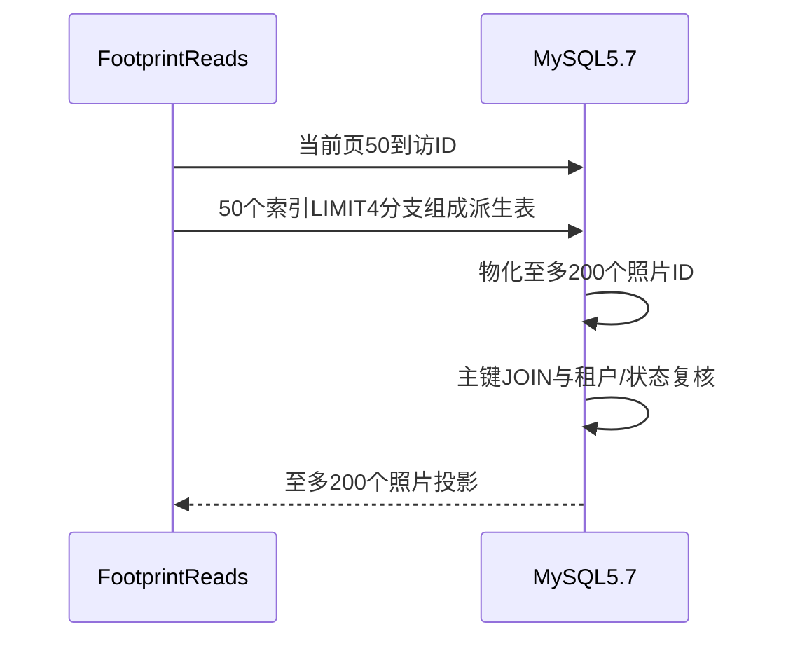
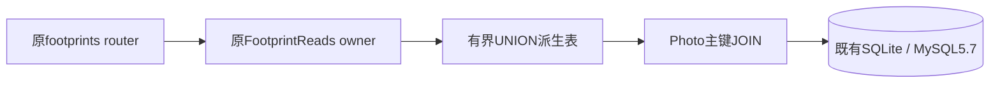

# BUG-031 — MySQL5.7足迹缩略图查询反复执行UNION

- Template: `specs/_templates/BUGFIX-SPEC.md`
- Status: DONE
- Severity / Risk: 发布前读取预算失败 / R2
- Owner / Reviewer: 产品负责人（用户）；独立代码复核沿用只读review流程
- Implementer: Codex
- First observed: 2026-10-23，完整服务端部署门禁，生产未发布
- Spec revision: BUG-SPEC-20261023-FOOTPRINT-PREVIEW-MYSQL57-01
- User confirmation: 用户2026-10-23明确回复“批准 Spec01，修复并继续部署准备（推荐）”（`call_a25398bc2711499eb6e75456d52a8a58`），批准本revision的派生表JOIN修复与回归范围。此前只做隔离进程实验，批准后开始生产修改。
- Feature: [FEAT-012](../../docs/domain/features/FEAT-012-child-photo-footprints.md)，baseline `FEAT-STATE-20261023-PHOTO-FOOTPRINTS-10`；merge owner Codex。
- Related: [部署Spec02](../active/OPS-20261023-FULLSTACK-TEST-DEPLOYMENT.md)、[主Spec04](../active/FEAT-012-CHILD-PHOTO-FOOTPRINTS.md)。本修复满足既有查询数、内存及500ms预算，不改变产品合同。

## Frontend Design Impact and Repository-native Approval

- Frontend impact: no；响应内容、排序、游标、每到访最多四张缩略图、各视图均保持原合同。
- Frontend engineering impact: no；不修改客户端、构建或前端约束。
- UI / FDB / FEC / Design Revision / exports: N/A，无视觉或交互变化；原已批准设计和原生证据不受本修复冒充验收。

## 1. Symptom / reproduction

当前生产候选在真实本地MySQL5.7.44、5万已确认照片分布于1000个到访日、读取50到访日时耗时2.255秒（另次profile约2.23秒），超过已有500ms预算。5万张集中单次到访时通过。生产仍0019/031，未受本轮测试写入影响。

原测试`tests/performance/test_footprints_reads.py`默认fixture只有SQLite，未覆盖MySQL优化器。隔离MySQL复用原断言，仅将EXPLAIN方言和Decimal编码按实际API适配后发现该失败。不能把SQLite通过或新方案的内存实验当当前发布包通过。

### Link/call graph / confirmed root cause

```text
GET /footprints/visits -> FootprintReads.visits
 -> Photo.id IN (50个LIMIT4分支组成的UNION)
 -> MySQL5.7 DEPENDENT SUBQUERY / DEPENDENT UNION
 -> 外层按child_id读取约25000估算行并反复求子查询 -> 约2.1秒SQL
```

实际profile：五次查询约0.001/0.001/0.006/0.034/2.106秒；慢查询EXPLAIN外层key=child_id、type=ref，101行计划含DEPENDENT SUBQUERY、DEPENDENT UNION。不能只因possible_keys中出现目标索引便称计划通过。

## 2. Fix contract / selected design

只将每到访`ORDER BY ordinal,id LIMIT 4`组成的UNION物化为派生表，然后按Photo主键JOIN取展示投影。每个照片只属于一个到访，输入到访ID不重复，故UNION ALL不会重复同一照片。外层保留family/child/state边界、排序与最多4×页面到访数结果；查询总数和游标语义不变。

| 方案 | 权衡 | 选择 |
|---|---|---|
| JOIN有界UNION派生表 | 避免MySQL逐外层行重算；兼容SQLite/MySQL5.7，无新增索引或schema | 推荐 |
| 每到访单独查询 | 容易使用索引，但形成N+1查询，违反既有合同 | 拒绝 |
| 窗口函数/CTE | MySQL5.7不支持 | 拒绝 |
| 放宽预算或移除测试 | 掩盖生产兼容性问题 | 拒绝 |

隔离内存实验已完成，两种5万照片分布都通过原预算断言；1000到访场景缩略图SQL约0.050秒，单次到访场景约0.004秒。实验不修改仓库文件、生产数据库或冻结包，不是正式修复证据。

## 3. Required design views

### Sequence diagram



### State machine

N/A：只读SQL计划修复，不改草稿、确认、Job、清理或分页revision状态机。

### Architecture diagram



无模块、依赖方向、共享抽象或扩展点变更；不另建读服务或数据库表。

## 4. Expected file changes

| 路径 | 动作/必要性 |
|---|---|
| apps/api/src/push_kids/footprints/reads.py | 修改派生表JOIN权威路径，移除慢IN形式 |
| tests/performance/test_footprints_reads.py及受控MySQL测试支持 | 将两种分布显式纳入真实MySQL门禁，验证实际key/type和无dependent union；按真实API编码测响应预算 |
| 本Spec、FEAT-012、Architecture/Behavior核对、测试/发布记录与索引 | 合并验证事实；不把新代码沿用旧SHA/模型/容器证据 |
| dist/新冻结候选 | 修复批准且验证后创建新的manifest；保留旧失败候选供追溯，不覆盖其SHA |

## 5. Regression verification

| ID | 必需结果 |
|---|---|
| P01 | 当前MySQL1000到访场景2.255秒FAIL证据保留；修复后两种5万分布均<500ms、内存<16MiB、原响应/查询数/分页预算通过 |
| P02 | MySQL实际EXPLAIN key/type使用限定索引/主键，缩略图计划无DEPENDENT SUBQUERY/UNION；不以possible_keys字符串代验 |
| P03 | SQLite同两分布及足迹全部integration/contract通过，顺序/每到访四张/不同家庭/已删除照片不进入结果 |
| P04 | Ruff/format/mypy、架构检查通过；独立只读review合同等价、位置与必要性 |
| P05 | 修复后重冻包、哈希/秘密扫描、容器门禁与发布回归；代码变化后明确重验范围，不能重用旧冻结包结论 |

测试不会连接生产；MySQL必须是显式配置的可丢弃本地测试库。未配环境skip不得写成MySQL通过。

## 6. Rollout / closure

批准后才修改生产源码。无schema/API变化，无数据修复或回填；数据库迁移/备份与流量门禁继续由部署Spec跟踪。此修复若失败则停止新服务端发布，旧生产保持不变。

FEAT-012正文、BHV-040、Architecture、UI-018、主Spec及索引已按当前真实MySQL事实同步；详见[本轮证据](../../docs/quality/evidence/FOOTPRINT-PREVIEW-MYSQL57-20261023.md)。P01–P03通过：最终冻结包31项通过，MySQL两分布0.3935/0.1724秒、峰值<6MiB；实际key/type与无DEPENDENT通过，SQLite/顺序/隔离/删除/分页预算通过。P04静态/DAG和独立代码review PASS（Reviewer独立18集成及静态、31项结果/291项SHA复核，最终10份文档107个本地链接与当前事实核对通过）。

P05于2026-10-24闭合：原冻结包SHA未变，291项文件/源匹配与已有秘密值扫描再次PASS；最终Docker重建成功（依赖层缓存，生产Dockerfile/lock未改），镜像`sha256:ec384a3c9c4699aa1cba3b0398498ae6bee7cba82ccb5863bcce91f62b181045`的130份Python源码逐项匹配运行包。隔离网络、只读文件系统与合成SQLite下UID10001、live/ready均200，SIGTERM 0.414秒退出0/OOM=false，构建代理未留在镜像环境，见[持久化容器证据](../../docs/quality/evidence/fullstack-release-20261024/container.json)。已有完整后端671项和新包dry-run证据保留原执行日期；本次不冒称重跑。

P01–P05全部完成，2026-10-24设DONE并迁入completed。本修复完成不表示主足迹全球地图、私有对象、真机或新服务端发布已经验收；生产迁移、配置与人工窗口仍由OPS Spec02跟踪。
